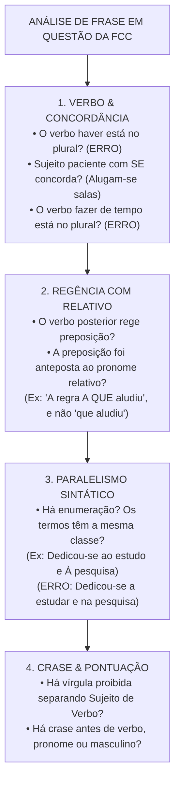
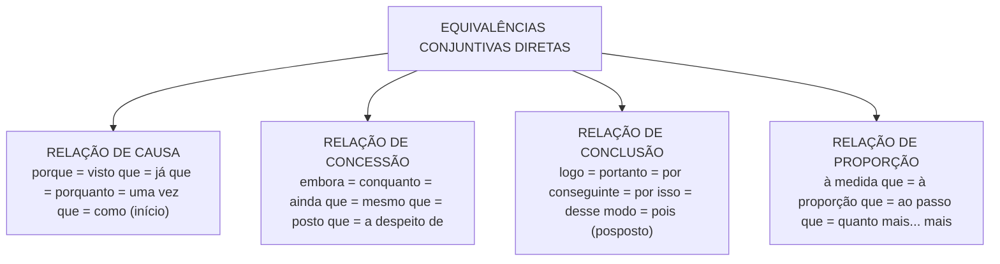

# 06 - Redação: Reescrita, Correção Gramatical e Equivalência de Estruturas

> **Matéria:** Língua Portuguesa  
> **Cargos:** A01 – Técnico de Controle Externo (Adm) / B02 – Técnico de Controle Externo (TI)  
> **Arquivo:** `06_redacao_reescrita_e_equivalencia_de_estruturas.md`  
> **Referência Temática:** Confronto de Frases, Paralelismo Sintático, Paráfrase e Reorganização Textual na FCC

---

## 📌 Ementa / Itens do Edital
- Redação: confronto e reconhecimento de frases corretas e incorretas segundo a norma culta;
- Organização e reorganização de orações e períodos: ordem direta vs. inversões estilísticas e impacto na clareza;
- Equivalência e transformação de estruturas: paráfrase sintática com preservação rigorosa do sentido original;
- Paralelismo sintático e semântico em enumerações e estruturas correlatas (*não só... mas também*, *tanto... quanto*);
- Ambiguidade estrutural e lexical: causas e métodos de saneamento sintático;
- Transposição entre orações desenvolvidas e orações reduzidas (infinitivo, gerúndio e particípio);
- Mecanismos de nominalização e concisão textual;
- Emprego correto das quatro formas dos porquês (*por que*, *por quê*, *porque* e *porquê*).

---

## 🧭 Sumário
- [1. Confronto e Julgamento de Frases: O Checklist Caça-Erros da FCC](#1-confronto-e-julgamento-de-frases-o-checklist-caça-erros-da-fcc)
  - [1.1 Estratégia de Varredura e Identificação de Vícios Gramaticais](#11-estratégia-de-varredura-e-identificação-de-vícios-gramaticais)
  - [1.2 Vícios Recorrentes em Provas de Tribunais](#12-vícios-recorrentes-em-provas-de-tribunais)
  - [1.3 Pronomes Retos Usados Indevidamente como Objetos](#13-pronomes-retos-usados-indevidamente-como-objetos)
- [2. Paralelismo Sintático e Semântico](#2-paralelismo-sintático-e-semântico)
  - [2.1 Princípio da Simetria Estrutural em Termos Coordenados](#21-princípio-da-simetria-estrutural-em-termos-coordenados)
  - [2.2 Paralelismo em Estruturas Correlativas](#22-paralelismo-em-estruturas-correlativas)
  - [2.3 Casos Típicos de Quebra de Paralelismo e Métodos de Correção](#23-casos-típicos-de-quebra-de-paralelismo-e-métodos-de-correção)
- [3. Ambiguidade e Vícios de Construção Frasal](#3-ambiguidade-e-vícios-de-construção-frasal)
  - [3.1 Ambiguidade Estrutural vs. Ambiguidade Lexical](#31-ambiguidade-estrutural-vs-ambiguidade-lexical)
  - [3.2 Ambiguidade pelo Mau Emprego de Pronomes Possessivos (Seu/Sua)](#32-ambiguidade-pelo-mau-emprego-de-pronomes-possessivos-seusua)
  - [3.3 O Mau Posicionamento de Adjuntos Adverbiais e Orações Reduzidas](#33-o-mau-posicionamento-de-adjuntos-adverbiais-e-orações-reduzidas)
  - [3.4 O Emprego Vicioso do Vocábulo O Mesmo](#34-o-emprego-vicioso-do-vocábulo-o-mesmo)
- [4. Organização e Reorganização de Orações e Períodos](#4-organização-e-reorganização-de-orações-e-períodos)
  - [4.1 Ordem Direta e os Efeitos Comunicativos das Inversões](#41-ordem-direta-e-os-efeitos-comunicativos-das-inversões)
  - [4.2 Posicionamento Estratégico de Termos Intercalados e Pontuação](#42-posicionamento-estratégico-de-termos-intercalados-e-pontuação)
  - [4.3 Coesão Sequencial e Encadeamento Lógico de Argumentos](#43-coesão-sequencial-e-encadeamento-lógico-de-argumentos)
- [5. Equivalência, Transformação de Estruturas e Paráfrase](#5-equivalência-transformação-de-estruturas-e-paráfrase)
  - [5.1 Critérios Cumulativos da Paráfrase Legítima](#51-critérios-cumulativos-da-paráfrase-legítima)
  - [5.2 Transposição entre Orações Desenvolvidas e Reduzidas](#52-transposição-entre-orações-desenvolvidas-e-reduzidas)
  - [5.3 Matriz de Substituição e Equivalência de Conectivos](#53-matriz-de-substituição-e-equivalência-de-conectivos)
  - [5.4 Mecanismos de Nominalização e Concisão Textual](#54-mecanismos-de-nominalização-e-concisão-textual)
  - [5.5 Transposição de Vozes Verbais na Reescrita](#55-transposição-de-vozes-verbais-na-reescrita)
- [6. O Emprego Correto das Quatro Formas dos Porquês](#6-o-emprego-correto-das-quatro-formas-dos-porquês)
  - [6.1 Por que: Interrogativo e Relativo](#61-por-que-interrogativo-e-relativo)
  - [6.2 Por quê: Isolado ou Imediatamente Antes de Pontuação](#62-por-quê-isolado-ou-imediatamente-antes-de-pontuação)
  - [6.3 Porque: Conjunção Causal ou Explicativa](#63-porque-conjunção-causal-ou-explicativa)
  - [6.4 Porquê: Substantivo com Artigo ou Determinante](#64-porquê-substantivo-com-artigo-ou-determinante)
  - [6.5 Distinções Léxicas Adicionais: A Fim De vs. Afim e Ao Encontro De vs. De Encontro A](#65-distinções-léxicas-adicionais-a-fim-de-vs-afim-e-ao-encontro-de-vs-de-encontro-a)
- [Fontes Oficiais e Referências Bibliográficas](#fontes-oficiais-e-referências-bibliográficas)
- [Questões de Concurso FCC Comentadas](#questões-de-concurso-fcc-comentadas)
  - [Questão 01](#questão-01)
  - [Questão 02](#questão-02)
  - [Questão 03](#questão-03)
  - [Questão 04](#questão-04)
  - [Questão 05](#questão-05)

---

## 1. Confronto e Julgamento de Frases: O Checklist Caça-Erros da FCC

As questões de confronto e reconhecimento de frases corretas e incorretas constituem uma das marcas mais temidas e refinadas das provas elaboradas pela Fundação Carlos Chagas. Nelas, o enunciado costuma indagar: *"A frase redigida de modo inteiramente claro, correto e condizente com a norma-padrão é:"* ou *"O período que expressa com correção e concisão as ideias do texto é:"*.

Resolver esse modelo de questão exige do candidato abandonar a leitura intuitiva e aplicar uma **metodologia de varredura sintática por camadas**, inspecionando cada alternativa em busca dos vícios gramaticais recorrentes.

### 1.1 Estratégia de Varredura e Identificação de Vícios Gramaticais

Ao inspecionar uma alternativa de reescrita, examine os quatro pontos cardeais da sintaxe da frase:
1. **Concordância Verbal e Nominal:** Localize os núcleos dos sujeitos e confronte-os com as formas verbais correspondentes, sobretudo diante de inversões sintáticas ou de sujeitos oracionais; examine se verbos impessoais como *haver* e *fazer* foram pluralizados indevidamente.
2. **Regência Verbal associada a Pronomes Relativos:** Verifique se o verbo da oração subordinada adjetiva exige preposição e se essa preposição foi corretamente anteposta ao pronome relativo *que, quem, cujo* ou *o qual*.
3. **Emprego do Sinal Indicativo de Crase:** Cheque se a fusão decorre de preposição exigida e se não há crase antes de palavra masculina, verbo, pronome indefinido ou em expressões simétricas.
4. **Sintaxe de Pontuação e Ordem SVC:** Verifique se não houve a colocação de uma vírgula simples entre o sujeito e o predicado, ou entre o verbo e seus complementos diretos/indiretos.

### 1.2 Vícios Recorrentes em Provas de Tribunais

A FCC utiliza distratores padronizados para construir alternativas incorretas:
* Inserção de preposição indevida após o verbo *implicar* (*"implicará em nulidade"* $\rightarrow$ errado);
* Emprego de locuções comparativas proibidas com o verbo *preferir* (*"prefere trabalhar do que descansar"* $\rightarrow$ errado);
* Confusão entre formas parônimas como *a fim de* (finalidade) e *afim* (parentesco/afinidade), ou *ao encontro de* (concordância) e *de encontro a* (choque/colisão);
* Pluralização viciosa do verbo em construções com partícula indeterminadora do sujeito (*"Tratam-se de processos graves"* $\rightarrow$ errado; deve ser *Trata-se de*).

### 1.3 Pronomes Retos Usados Indevidamente como Objetos

A língua culta formal não admite o uso de pronomes pessoais do caso reto (*ele, ela, eles, elas*) na posição de complemento verbal direto. O pronome reto possui vocação exclusivamente subjetiva (função de sujeito da oração).

> 🚨 **ALERTA DE PROVA / PEGADINHA FCC:** Ao ler uma alternativa da FCC, desconfie sumariamente de sentenças que terminam com construções do tipo: *"A nova lei orçamentária trouxe regras rígidas e o gestor deve cumprir elas"*. Essa frase está eivada de erro gramatical inadmissível na norma culta! A forma exigida é com pronome oblíquo enclítico ajustado à terminação consonantal: *"deve cumpri-las"*.

---

## 2. Paralelismo Sintático e Semântico

O paralelismo (ou simetria de construção) é o princípio gramatical e estilístico que determina que elementos coordenados entre si, desempenhando a mesma função sintática no período, devem apresentar **estruturas morfológicas e gramaticais idênticas ou equivalentes**.

### 2.1 Princípio da Simetria Estrutural em Termos Coordenados

Quando se coordenam termos em enumeração (ligados por vírgula ou pela conjunção *e*), todos devem pertencer à mesma classe gramatical ou seguir o mesmo padrão frasal:
* Se o primeiro termo for um substantivo, os seguintes devem ser substantivos (*"Exige-se probidade, competência e lealdade"*);
* Se o primeiro for um verbo no infinitivo, os seguintes devem ser verbos no infinitivo (*"O dever de fiscalizar, orientar e julgar"*);
* Se o primeiro for uma oração desenvolvida introduzida por *que*, os seguintes devem manter a mesma estrutura subordinada (*"Determinou que se revisassem os cálculos e que se notificasse o responsável"*).

### 2.2 Paralelismo em Estruturas Correlativas

Nas estruturas formadas por pares de conectivos correlativos (*não só... mas também*, *não apenas... como também*, *tanto... quanto*, *seja... seja*, *quer... quer*, *ora... ora*), a exigência de simetria é rigorosa: o que vier imediatamente após o primeiro termo correlativo deve ter a mesma natureza sintática do que vier após o segundo polo:
* **Construção Perfeita:** *"O tribunal busca aprimorar os mecanismos de fiscalização **não só para conferir transparência**, **mas também para garantir a legalidade**."* (ambos estruturados por oração subordinada final reduzida de infinitivo: *para conferir* $\leftrightarrow$ *para garantir*).
* **Construção Defeituosa (Quebra de Paralelismo):** *"O tribunal busca aprimorar os mecanismos **não só para conferir transparência**, **mas garantindo a legalidade**."* (misturou oração com preposição + infinitivo com oração reduzida no gerúndio).

### 2.3 Casos Típicos de Quebra de Paralelismo e Métodos de Correção

| Frase com Quebra de Paralelismo (Incorreta) | Causa do Desvio | Frase com Paralelismo Perfeito (Correta) |
| :--- | :--- | :--- |
| *"A equipe dedicou-se **a examinar** os contratos e **na verificação** das certidões."* | Misturou verbo no infinitivo regido por *a* com substantivo preposicionado em *em*. | *"A equipe dedicou-se **a examinar** os contratos e **a verificar** as certidões."* |
| *"A auditoria constatou **o desvio** de verbas e **que faltavam** documentos."* | Coordenou um substantivo simples (*o desvio*) com uma oração desenvolvida (*que faltavam*). | *"A auditoria constatou **o desvio** de verbas e **a falta** de documentos."* |
| *"O tribunal tem como atribuição **fiscalizar** as contas e **a emissão** de pareceres."* | Coordenou forma verbal no infinitivo (*fiscalizar*) com substantivo abstrato (*a emissão*). | *"O tribunal tem como atribuição **fiscalizar** as contas e **emitir** pareceres."* |
| *"A comissão propôs **a revisão** das medições e **que se fizesse** nova perícia."* | Coordenou frase nominal com oração subordinada substantiva. | *"A comissão propôs **a revisão** das medições e **a realização** de nova perícia."* |

---

## 3. Ambiguidade e Vícios de Construção Frasal

A ambiguidade (ou anfibologia) ocorre quando uma frase admite duas ou mais interpretações lógicas distintas em decorrência da má ordenação de suas palavras ou do uso impreciso de termos relacionais.

### 3.1 Ambiguidade Estrutural vs. Ambiguidade Lexical

* **Ambiguidade Lexical:** Decorre do emprego de palavra polissêmica ou homônima em contexto que não esclarece qual de seus sentidos está operando (*"O servidor falou do banco no plenário"* $\rightarrow$ banco financeiro ou assento de sentar?).
* **Ambiguidade Estrutural:** Resulta do mau posicionamento sintático de adjuntos, orações ou pronomes no interior do período, gerando dúvida sobre qual elemento está sendo modificado.

### 3.2 Ambiguidade pelo Mau Emprego de Pronomes Possessivos (Seu/Sua)

No português moderno, os pronomes possessivos de terceira pessoa (*seu, sua, seus, suas*) podem referir-se tanto à pessoa de quem se fala (ele/ela) quanto à pessoa com quem se fala (você / o interlocutor), ou gerar dúvida entre dois sujeitos de terceira pessoa já mencionados:
* *"O presidente comunicou ao conselheiro que sua assessoria seria transferida."*
  * Ambiguidade: a assessoria a ser transferida pertencia ao Presidente ou ao Conselheiro?
* **Método de Saneamento Técnico:** Substitui-se o pronome ambíguo pelas locuções possessivas inequívocas **dele / dela / de você / de Vossa Excelência**:
  * *"O presidente comunicou ao conselheiro a transferência da assessoria **dele** [do conselheiro] para o novo gabinete."*
  * *"O presidente comunicou ao conselheiro que a assessoria **deste** seria transferida."*

### 3.3 O Mau Posicionamento de Adjuntos Adverbiais e Orações Reduzidas

O deslocamento impróprio de adjuntos circunstanciais pode fazê-los incidir sobre orações que não lhes correspondem:
* *"O auditor disse que realizaria a vistoria calmamente."* (O auditor falou com calma ou a vistoria é que seria executada com calma?).
* Saneamento: antecipar o advérbio para junto do verbo que se deseja qualificar: *"O auditor disse calmamente que realizaria a vistoria"* OU *"O auditor disse que, calmamente, realizaria a vistoria"*.

### 3.4 O Emprego Vicioso do Vocábulo O Mesmo

O Manual de Redação da Presidência da República e a boa gramática normativa condenam expressamente o uso das formas *o mesmo, a mesma, os mesmos, as mesmas* como pronomes anafóricos para substituir pessoas ou coisas:
* *"O presidente assinou o parecer e encaminhou o mesmo ao plenário"* $\rightarrow$ **Vício de linguagem**.
* **Forma escorreita:** Deve-se substituir por pronome oblíquo (*"encaminhou-o ao plenário"*), por pronome demonstrativo (*"encaminhou este ao plenário"*) ou por elipse pura (*"assinou o parecer e encaminhou ao plenário"*).

---

## 4. Organização e Reorganização de Orações e Períodos

A estruturação eficiente de um texto formal exige domínio sobre a arquitetura da frase, equilibrando clareza semântica, expressividade e conformidade às regras de pontuação.

### 4.1 Ordem Direta e os Efeitos Comunicativos das Inversões

A ordem direta canônica da oração na língua portuguesa é constituída por:
$$\mathbf{Sujeito} \longrightarrow \mathbf{Verbo} \longrightarrow \mathbf{Complementos \ (OD/OI)} \longrightarrow \mathbf{Adjuntos \ Adverbiais}$$

Embora a ordem direta seja a mais límpida e recomendada para redações oficiais e relatórios de auditoria, a língua admite inversões estilísticas ou enfáticas (ordem inversa):
* Ordem Direta: *"A equipe técnica de fiscalização constatou irregularidades graves nas contas da prefeitura durante a inspeção matutina."*
* Ordem Inversa com Adjunto Deslocado: *"Durante a inspeção matutina, nas contas da prefeitura, a equipe técnica de fiscalização constatou irregularidades graves."*

O perigo da inversão consiste na possibilidade de truncar o raciocínio ou gerar quebra indevida de termos essenciais com vírgulas solitárias.

### 4.2 Posicionamento Estratégico de Termos Intercalados e Pontuação

Termos intercalados (apóstrofos explicativos, orações adjetivas explicativas, conjunções conclusivas deslocadas e adjuntos adverbiais) devem vir sempre isolados por pontuação simétrica (**duas vírgulas, dois travessões ou parênteses**), garantindo que a linha sintática principal do período não seja rompida.

### 4.3 Coesão Sequencial e Encadeamento Lógico de Argumentos

A reorganização de um período não pode corromper a progressão tópica. Os conectivos oracionais e pronomes de retomada devem orientar o leitor ao longo da cadeia de causas e consequências:
* Preservar os operadores argumentativos que introduzem argumentos mais fortes (*mas, inclusive, até mesmo*);
* Evitar parágrafos construídos por acúmulo excessivo de orações adjetivas encaixadas em cadeia (*que... que... que...* — vício do "queísmo"), saneando-as por meio de nominalizações ou transformações em orações reduzidas.

---

## 5. Equivalência, Transformação de Estruturas e Paráfrase

A paráfrase é a reescrita de um texto ou segmento mantendo com fidelidade absoluta o sentido e as relações lógicas da mensagem original, expressando-a por meio de novos recursos vocabulares e sintáticos.

### 5.1 Critérios Cumulativos da Paráfrase Legítima

Para ser declarada correta nas provas da FCC, a reescrita proposta deve atender a dois requisitos inegociáveis:
1. **Fidelidade Semântica e Intencional:** Não pode introduzir juízos inexistentes (extrapolação), nem suprimir circunstâncias essenciais (redução), nem inverter vínculos de causa e efeito (contradição);
2. **Correção Gramatical Absoluta:** Deve respeitar integralmente todas as normas de concordância, regência, crase, colocação e pontuação.

### 5.2 Transposição entre Orações Desenvolvidas e Reduzidas

Uma das técnicas prediletas de transformação de períodos na banca FCC é a conversão entre orações desenvolvidas (que possuem conjunção subordinativa e verbo em modo finito) e orações reduzidas (desprovidas de conjunção e estruturadas com verbo no infinitivo, gerúndio ou particípio):

1. **De Oração Desenvolvida para Reduzida:**
   * Desenvolvida Concessiva: *"Embora o conselheiro conhecesse os riscos da decisão, manteve seu voto."*
   * Reduzida de Infinitivo: *"**Apesar de conhecer** os riscos da decisão, o conselheiro manteve seu voto."*
2. **De Oração Reduzida para Desenvolvida:**
   * Reduzida Temporal: *"**Ao constatar** a fraude, o auditor lavrou o auto de infração."*
   * Desenvolvida Temporal: *"**Quando constatou** a fraude, o auditor lavrou o auto de infração."*
3. **De Oração Nominal para Oração Subordinada:**
   * *"**A despeito das advertências** emitidas pelo órgão, mantiveram as práticas."*
   * $\rightarrow$ *"**Embora o órgão tenha emitido** advertências, mantiveram as práticas."*

### 5.3 Matriz de Substituição e Equivalência de Conectivos

A substituição de conectivos somente é legítima se pertencerem à mesma família semântica:
* **Causais equivalentes:** *porque, visto que, já que, uma vez que, porquanto, como* (anteposto);
* **Concessivos equivalentes:** *embora, conquanto, ainda que, mesmo que, a despeito de, posto que, se bem que*;
* **Conclusivos equivalentes:** *logo, portanto, por conseguinte, por isso, de modo que, pois* (posposto ao verbo e entre vírgulas);
* **Proporcionais equivalentes:** *à medida que, à proporção que, ao passo que*. Cuidado: a expressão *"à medida em que"* é considerada híbrida e incorreta pela norma padrão; a forma aceita é *à medida que*.

### 5.4 Mecanismos de Nominalização e Concisão Textual

A nominalização consiste em converter uma oração verbal em um sintagma nominal construído em torno de um substantivo abstrato cognato:
* Oração Verbal: *"Quando os diretores **compareceram** ao tribunal e **apresentaram** a defesa..."*
* Sintagma Nominalizado: *"Com o **comparecimento** dos diretores ao tribunal e a **apresentação** da defesa..."*
* Efeito: ganha-se concisão, densidade conceitual e formalidade, características valorizadas pela FCC em relatórios técnicos.

### 5.5 Transposição de Vozes Verbais na Reescrita

A equivalência sintática frequentemente explora a alternância entre voz ativa e passiva analítica ou sintética:
* Ativa: *"Os auditores de controle externo apuraram todas as inconsistências no cronograma."*
* Passiva Analítica: *"Todas as inconsistências no cronograma foram apuradas pelos auditores de controle externo."*
* Passiva Sintética: *"Apuraram-se todas as inconsistências no cronograma."*
* Todas as três formulações são semanticamente equivalentes e mantêm rigorosa correção.

---

## 6. O Emprego Correto das Quatro Formas dos Porquês

A distinção ortográfica e sintática entre as quatro formas da grafia dos porquês decorre do papel morfológico exercido pela palavra na frase.

### 6.1 Por que: Interrogativo e Relativo

A grafia **separada e sem acento** ocorre em três contextos bem delimitados:
1. **Em frases interrogativas diretas ou indiretas:** atua como locução prepositiva interrogativa (= *por qual razão*, *por qual motivo*):
   * *"**Por que** o cronograma físico-financeiro sofreu sucessivas prorrogações?"* (pergunta direta).
   * *"Gostaria de compreender **por que** o cronograma sofreu atrasos."* (pergunta indireta).
2. **Equivalendo ao pronome relativo "pelo qual / pela qual / pelos quais / pelas quais":** liga duas orações associando a preposição *por* ao pronome relativo *que*:
   * *"Os motivos **por que** [pelos quais] o contrato foi rescindido são graves."*
   * *"As causas **por que** lutamos são nobres."*
3. **Equivalendo a "por qual razão" diante de substantivos elípticos:**
   * *"Não compreendo **por que** tanta relutância."* (= por qual razão).

### 6.2 Por quê: Isolado ou Imediatamente Antes de Pontuação

A grafia **separada e com acento circunflexo** é utilizada sempre que a palavra se posicionar **imediatamente antes de um sinal de pontuação** (ponto final, ponto de interrogação, ponto de exclamação ou reticências) ou surgir de forma isolada na oração. Nessa posição de final de frase, o monossílabo *que* sofre tonicidade fonética e atrai o acento gráfico:
* *"O ordenador de despesas não apresentou recurso no prazo regulamentar, e ninguém sabe **por quê**."*
* *"Eles rejeitaram a proposta sem explicar **por quê**?"*
* *"Você não compareceu à convocação do plenário. **Por quê**?"*

### 6.3 Porque: Conjunção Causal ou Explicativa

A grafia **junta e sem acento** corresponde a uma **conjunção subordinativa causal** ou **conjunção coordenativa explicativa**, equivalendo a *pois, já que, visto que, porquanto, dado que*:
* *"A prestação de contas foi reprovada **porque** [pois / visto que] os gastos não foram devidamente comprovados."*
* *"Não atrase a entrega dos relatórios, **porque** [pois] a pauta do plenário já está fechada."*

### 6.4 Porquê: Substantivo com Artigo ou Determinante

A grafia **junta e com acento circunflexo** consubstancia um **substantivo masculino**, sinônimo exato de *"o motivo", "a razão", "o fundamento"*. Apresenta-se compulsoriamente antecedido por um artigo definido (*o porquê*), pronome demonstrativo (*este porquê*), pronome possessivo (*seu porquê*) ou numeral (*dois porquês*), admitindo inclusive flexão de plural (*os porquês*):
* *"O conselheiro relator desvendou **o porquê** de tantas notas fiscais emitidas sem atesto de entrega."*
* *"Gostaria de saber **um porquê** plausível para tamanha discrepância orçamentária."*

### 6.5 Distinções Léxicas Adicionais: A Fim De vs. Afim e Ao Encontro De vs. De Encontro A

Para garantir a perfeição no confronto de frases da FCC:
1. **A Fim De vs. Afim:**
   * **A fim de (separado):** locução prepositiva de finalidade (= com o objetivo de, com o propósito de): *"Reuniram-se **a fim de** deliberar sobre as diretrizes"*.
   * **Afim (junto):** adjetivo que expressa parentesco, semelhança ou afinidade de interesses: *"Possuíam ideias **afins** sobre auditoria"*; *"Parentes **afins**"*.
2. **Ao Encontro De vs. De Encontro A:**
   * **Ao encontro de:** indica concordância, harmonia, aproximação favorável: *"A decisão do pleno foi **ao encontro dos** anseios da sociedade"*.
   * **De encontro a:** indica colisão, choque, oposição, contrariedade: *"O reajuste salarial sem previsão orçamentária vai **de encontro às** determinações da LRF"*.

---

## 🌐 Fontes Oficiais e Referências Bibliográficas

* [Manual de Redação da Presidência da República (3ª Edição Revista e Atualizada)](http://www.planalto.gov.br/ccivil_03/manual/manual.htm) - Princípios oficiais de clareza, concisão, precisão e eliminação de ambiguidades.
* [Guia Gramatical do Senado Federal - Construção Frasal e Paralelismo](https://www12.senado.leg.br/manualdecomunicacao/redacao-e-estilo/guia-gramatical) - Modelos práticos de paralelismo sintático e correção de frases complexas.
* [Só Português - Coesão, Coerência e Vícios de Linguagem](https://www.soportugues.com.br/) - Catálogo de ambiguidades, quebra de paralelismo e normas de reescrita.
* GARCIA, Othon M. *Comunicação em Prosa Moderna*. Rio de Janeiro: Editora FGV. (Referência definitiva sobre paralelismo de ideias, simetria sintática e ordenação de orações).
* PLATÃO & FIORIN. *Lições de Texto: Leitura e Redação*. São Paulo: Ática.

---

## 📝 Questões de Concurso FCC Comentadas

### Questão 01
**(FCC – TCE-GO – Analista de Controle Externo)**  
A frase cuja redação prima pela clareza, pela concisão e pela **estrita correção gramatical**, sem qualquer vício de paralelismo sintático ou de regência, é:

* **A)** *"A equipe de fiscalização dedicou-se a examinar os contratos de tecnologia e na verificação das certidões fiscais das licitantes."*
* **B)** *"O relatório a que o conselheiro relator fez menção detalha as razões por que foram desaprovadas as contas da autarquia."*
* **C)** *"O secretário alertou os diretores de que haveriam reuniões extraordinárias afim de deliberar sobre o plano estratégico."*
* **D)** *"Não se deve desobedecer as normas regimentais, sob pena de incorrer em penalidades que todos querem evitar elas."*
* **E)** *"O tribunal busca aprimorar os mecanismos de auditoria não só para conferir transparência aos atos mas garantindo a legalidade."*

> **Comentário Detalhado:**
> - **A)** Incorreta. Apresenta quebra frontal de paralelismo sintático: o verbo *dedicar-se* regeu a preposição *a* no primeiro termo coordenado (*a examinar*) e a preposição *em* no segundo termo coordenado (*na verificação*). A construção harmônica exigiria: *dedicou-se a examinar os contratos e a verificar as certidões* (ou *ao exame dos contratos e à verificação das certidões*).
> - **B)** Correta. A oração reúne três acertos sintáticos exemplares: 1) A expressão *fazer menção* rege a preposição *a* (*quem faz menção, faz menção a algo*), a qual foi adequadamente anteposta ao pronome relativo (*a que o conselheiro fez menção*); 2) O vocábulo *por que* foi grafado separadamente e sem acento de forma perfeita, equivalendo a "pelas quais razões"; 3) A concordância verbal da voz passiva sintética está irrepreensível, com o verbo no plural concordando com o sujeito paciente plural (*foram desaprovadas as contas da autarquia*).
> - **C)** Incorreta. Apresenta dois erros graves: o verbo impessoal *haver* no sentido de existir foi indevidamente pluralizado (*haveriam reuniões* em vez do correto *haveria reuniões*); e a locução de finalidade foi grafada junta de modo vicioso (*afim de* em vez de *a fim de*).
> - **D)** Incorreta. O verbo *desobedecer* é Transitivo Indireto e rege a preposição *a* (*desobedecer às normas*); além disso, o emprego do pronome pessoal do caso reto como objeto direto verbal (*evitar elas*) viola a norma-padrão, que exige a forma oblíqua enclítica (*evitá-las*).
> - **E)** Incorreta. Rompe o paralelismo sintático na estrutura correlativa *não só... mas*: coordenou uma oração preposicionada de infinitivo com valor final (*não só para conferir transparência*) com uma oração reduzida no gerúndio (*mas garantindo*). O correto seria: *não só para conferir transparência, mas também para garantir a legalidade*.
> 
> **Gabarito: B**

---

### Questão 02
**(FCC – TRT – Técnico Judiciário)**  
Considere o período:  
*"\<ins\>A despeito das inúmeras advertências emitidas pelo órgão fiscalizador\</ins\>, os gestores mantiveram as práticas ilegítimas, o que ensejou a aplicação de severas multas."*  
Uma reescrita que preserva a correção gramatical e as **mesmas relações lógicas de sentido** do período original é:

* **A)** *"Visto que o órgão fiscalizador emitiu advertências, os gestores mantiveram as práticas ilegítimas, porquanto aplicaram-se multas severas."*
* **B)** *"Embora o órgão fiscalizador tenha emitido inúmeras advertências, os gestores mantiveram as práticas ilegítimas, motivo pelo qual severas multas foram aplicadas."*
* **C)** *"À medida que o órgão fiscalizador advertia os gestores, estes mantinham as práticas ilegítimas, à proporção que foram multados com rigor."*
* **D)** *"Caso o órgão fiscalizador emitisse advertências, os gestores manteriam as práticas ilegítimas e poderiam aplicar multas."*
* **E)** *"Conforme o órgão fiscalizador advertiu, os gestores mantiveram as práticas ilegítimas de modo que multaram-se os ordenadores."*

> **Comentário Detalhado:**
> - **A)** Incorreta. Desvirtua a relação semântica fundamental do período: substituiu o valor concessivo original (*A despeito de*) por um valor causal (*Visto que*), e transformou a consequência final em causa explicativa com *porquanto*.
> - **B)** Correta. Transforma impecavelmente a locução prepositiva nominal concessiva (*A despeito de...*) em uma oração subordinada adverbial concessiva desenvolvida introduzida pelo conectivo canônico **"Embora"**, flexionando o verbo de modo harmônico no pretérito perfeito do subjuntivo (**"Embora (...) tenha emitido"**). Ademais, preserva a oração principal intacta e verte o segmento consecutivo final em oração coordenada conclusiva de límpida concisão e correção gramatical (**"motivo pelo qual severas multas foram aplicadas"**).
> - **C)** Incorreta. Converteu a relação de concessão em uma relação de simultaneidade progressiva proporcional por meio do uso das locuções proporcionais *À medida que* e *à proporção que*.
> - **D)** Incorreta. Converteu uma asserção factual e pretérita em uma oração hipotético-condicional irrealizada (*Caso o órgão emitisse advertências*).
> - **E)** Incorreta. Deturpou o sentido para conformidade (*Conforme*), além de empregar uma construção defeituosa no segmento final (*multaram-se os ordenadores* em vez de foram multados).
> 
> **Gabarito: B**

---

### Questão 03
**(FCC – TCE-PI – Auditor de Controle Externo)**  
A frase que apresenta **quebra de paralelismo sintático** é:

* **A)** *"O tribunal exige dos candidatos idoneidade moral, notório conhecimento e capacidade de liderança."*
* **B)** *"O parecer recomendava a suspensão cautelar do certame e a anulação de todos os atos subsequentes."*
* **C)** *"A comissão de auditoria propôs a revisão das medições de asfalto e que se fizesse uma nova perícia técnica."*
* **D)** *"O servidor público deve agir com probidade, transparência e presteza."*
* **E)** *"O auditor atuou não apenas no levantamento documental, mas também na instrução probatória dos autos."*

> **Comentário Detalhado:**
> - **A)** Incorreta. Apresenta paralelismo sintático perfeito: todos os três complementos coordenados do verbo *exigir* são sintagmas nominais homogêneos (*idoneidade moral*, *notório conhecimento*, *capacidade de liderança*).
> - **B)** Incorreta. Paralelismo sintático preservado: os dois complementos verbais são estruturados por sintagmas nominais com substantivos abstratos derivados de ação (*a suspensão cautelar* e *a anulação de todos os atos*).
> - **C)** Correta (apresenta erro de paralelismo). O verbo *propôs* teve seus complementos coordenados estruturados de forma assimétrica e heterogênea: o primeiro elemento coordenado é um **sintagma nominal** (*a revisão das medições de asfalto*), ao passo que o segundo elemento coordenado é uma **oração subordinada substantiva desenvolvida** (*e que se fizesse uma nova perícia técnica*). A harmonia sintática culta exigiria unificar as estruturas: ou dois sintagmas nominais (*propôs a revisão das medições e a realização de nova perícia*) ou duas orações desenvolvidas (*propôs que se revisassem as medições e que se fizesse nova perícia*).
> - **D)** Incorreta. Paralelismo mantido com perfeição: enumeração homogênea de substantivos abstratos preposicionados de mesma função (*com probidade, transparência e presteza*).
> - **E)** Incorreta. Paralelismo mantido com exatidão: a estrutura correlativa *não apenas... mas também* liga dois termos preposicionados equivalentes (*no levantamento documental* $\leftrightarrow$ *na instrução probatória*).
> 
> **Gabarito: C**

---

### Questão 04
**(FCC – DPE-RS – Analista Jurídico)**  
Considere as frases e o emprego das quatro formas dos **porquês**:  
I. *"Gostaria de compreender \<ins\>por que\</ins\> o cronograma físico-financeiro sofreu sucessivas prorrogações."*  
II. *"A prestação de contas foi reprovada \<ins\>porque\</ins\> os gastos não foram devidamente comprovados."*  
III. *"O ordenador de despesas não apresentou recurso no prazo regulamentar, e ninguém sabe \<ins\>por quê\</ins\>."*  
IV. *"O conselheiro relator desvendou o \<ins\>porquê\</ins\> de tantas notas fiscais emitidas sem atesto de entrega."*

O emprego das palavras sublinhadas está plenamente correto em:

* **A)** I, II, III e IV.
* **B)** I e II, apenas.
* **C)** II e IV, apenas.
* **D)** I, III e IV, apenas.
* **E)** II, III e IV, apenas.

> **Comentário Detalhado:**
> - **Item I: Correto.** Trata-se de uma oração interrogativa indireta na qual o vocábulo equivale a "por qual razão / por qual motivo", devendo ser grafado **separadamente e sem acento circunflexo** (*por que*).
> - **Item II: Correto.** Atua como conjunção subordinativa causal que explicita a causa da reprovação das contas (= *pois, já que, visto que*), exigindo a grafia **junta e sem acento circunflexo** (*porque*).
> - **Item III: Correto.** O termo encontra-se posicionado imediatamente antes de um sinal de pontuação (ponto final) no término da oração, assumindo tonicidade fonética e exigindo a grafia **separada e com acento circunflexo** (*por quê*).
> - **Item IV: Correto.** Funciona morfologicamente como um substantivo masculino, antecedido pelo artigo definido *o* e significando "a razão" ou "o motivo", impondo a grafia **junta e com acento circunflexo** (*o porquê*).
> - **A)** Correta. Todas as quatro proposições empregam com perfeição absoluta as regras do idioma.
> - **B), C), D) e E)** Incorretas por omitirem assertivas comprovadamente corretas.
> 
> **Gabarito: A**

---

### Questão 05
**(FCC – AL-SP – Técnico Legislativo)**  
Assinale a alternativa em que a reescrita da frase entre parênteses elimina a ambiguidade mantendo a clareza e a correção gramatical:  
*(O presidente comunicou ao conselheiro que sua assessoria seria transferida para o novo gabinete.)*

* **A)** *"O presidente comunicou ao conselheiro a transferência da assessoria dele para o novo gabinete."*
* **B)** *"O presidente comunicou ao conselheiro que a assessoria de sua pessoa seria transferida para o novo gabinete."*
* **C)** *"O presidente comunicou que a assessoria sua seria transferida para o conselheiro no novo gabinete."*
* **D)** *"O presidente comunicou ao conselheiro de que sua própria assessoria transferir-se-ia para o novo gabinete."*
* **E)** *"O presidente comunicou ao conselheiro que a assessoria do mesmo seria transferida para o novo gabinete."*

> **Comentário Detalhado:**
> - **Problema da frase original:** O emprego do pronome possessivo de terceira pessoa *sua* gera ambiguidade estrutural manifesta, impedindo o leitor de definir com segurança se a assessoria a ser transferida pertencia ao Presidente (sujeito) ou ao Conselheiro (objeto indireto).
> - **A)** Correta. Ao substituir o pronome possessivo polissêmico pela locução pós-nominal **"dele"** (*a assessoria dele*), a frase dissipa qualquer dúvida interpretativa, demonstrando cristalinamente que a assessoria subordinava-se ao conselheiro. Ademais, promove uma elegante nominalização (*a transferência da assessoria*), garantindo concisão e estrita observância à norma culta.
> - **B)** Incorreta. A locução artificial *"assessoria de sua pessoa"* é prolixa, canhestra e rejeitada pela estilística oficial.
> - **C)** Incorreta. A reorganização dos termos manteve a redação confusa e deselegante.
> - **D)** Incorreta. O verbo *comunicar* é Transitivo Direto e Indireto (*comunicar algo a alguém*); o acréscimo da preposição *de* (*"comunicou ao conselheiro de que..."*) constitui vício de regência, ao atribuir dois complementos indiretos preposicionados ao mesmo verbo.
> - **E)** Incorreta. O emprego da expressão *"do mesmo"* como pronome anafórico pessoal para substituir indivíduos constitui vício de linguagem formalmente condenado pelo Manual de Redação da Presidência da República e pela gramática culta.
> 
> **Gabarito: A**
