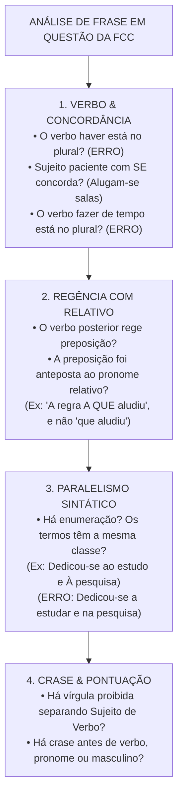
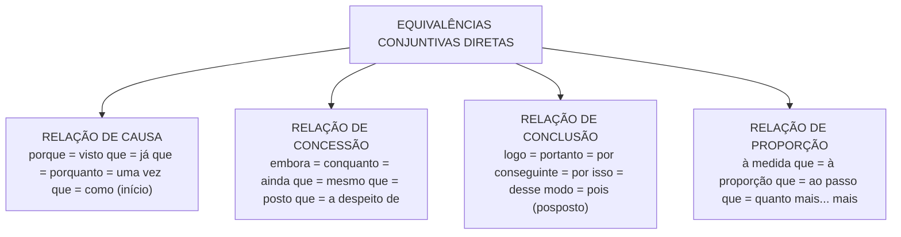

# 06 - Redação: Reescrita, Correção Gramatical e Equivalência de Estruturas

> **Matéria:** Língua Portuguesa  
> **Cargos:** A01 – Técnico de Controle Externo (Adm) / B02 – Técnico de Controle Externo (TI)  
> **Arquivo:** `06_redacao_reescrita_e_equivalencia_de_estruturas.md`  
> **Referência Temática:** Confronto de Frases, Paralelismo Sintático, Paráfrase e Reorganização Textual na FCC

---

## 📌 Ementa / Itens do Edital
- Redação: confronto e reconhecimento de frases corretas e incorretas segundo a norma culta;
- Organização e reorganização de orações e períodos: ordem direta vs. inversões estilísticas e impacto na clareza;
- Equivalência e transformação de estruturas: paráfrase sintática com preservação rigorosa do sentido original;
- Paralelismo sintático e semântico em enumerações e estruturas correlatas (*não só... mas também*, *tanto... quanto*);
- Ambiguidade estrutural e lexical: causas e métodos de saneamento sintático;
- Transposição entre orações desenvolvidas e orações reduzidas (infinitivo, gerúndio e particípio);
- Mecanismos de nominalização e concisão textual;
- Emprego correto das quatro formas dos porquês (*por que*, *por quê*, *porque* e *porquê*).

---

## 🌳 Classificação Hierárquica

```text
6. Construção Textual, Reescrita e Julgamento de Frases
├── 6.1 Confronto e Reconhecimento de Frases Corretas e Incorretas (Padrão FCC)
│   ├── 6.1.1 Checklist de Caça-Erros da FCC:
│   │   ├── Concordância Verbal (sujeitos distantes, verbos haver e fazer impessoais, partícula SE)
│   │   ├── Regência Verbal com Pronome Relativo (preposição obrigatória antes de 'que' e 'cujo')
│   │   ├── Emprego da Crase (proibições diante de masculino, verbos, pronomes indefinidos)
│   │   ├── Colocação Pronominal (atração obrigatória por negativas, conjunções e relativos)
│   │   └── Pontuação Proibida (vírgula isolada quebrando a estrutura Sujeito - Verbo - Complemento)
│   ├── 6.1.2 Paralelismo Sintático:
│   │   ├── Harmonia morfossintática em termos coordenados (manter mesmas classes gramaticais)
│   │   ├── Estruturas Correlatas: não só... mas também; tanto... quanto; seja... seja; quer... quer
│   │   └── Quebra de paralelismo como erro típico nas alternativas distratoras da FCC
│   └── 6.1.3 Ambiguidade e Vícios de Construção:
│       ├── Duplo sentido provocado pelo mau posicionamento de pronomes possessivos (seu/sua)
│       └── Deslocamento inadequado de adjuntos adverbiais que modificam orações indevidas
├── 6.2 Organização e Reorganização de Orações e Períodos
│   ├── 6.2.1 Ordem Direta (Sujeito + Verbo + Complementos + Adjuntos) vs. Ordem Inversa
│   ├── 6.2.2 Deslocamento de Adjuntos e Orações Circunstanciais com pontuação adequada
│   └── 6.2.3 Coesão Referencial e Sequencial: Manutenção do encadeamento lógico de argumentos
├── 6.3 Equivalência e Transformação de Estruturas (Paráfrase Sintática)
│   ├── 6.3.1 Transposição de Oração Desenvolvida para Oração Reduzida (e vice-versa):
│   │   ├── "Embora conhecesse o erro" -> "Apesar de conhecer o erro" (concessiva reduzida)
│   │   └── "Ao analisar as contas" -> "Quando analisou as contas" (temporal desenvolvida)
│   ├── 6.3.2 Substituição de Conectivos com Preservação Estrita do Sentido Original:
│   │   ├── Causa: visto que, já que, porque, porquanto, uma vez que
│   │   ├── Concessão: embora, conquanto, ainda que, a despeito de, não obstante
│   │   └── Conclusão: logo, portanto, por conseguinte, assim, desse modo
│   ├── 6.3.3 Nominalização: Conversão de orações predicativas em substantivos abstratos
│   └── 6.3.4 Transposição de Vozes Verbais (Ativa vs. Passiva Analítica e Sintética)
└── 6.4 Emprego das Quatro Formas dos Porquês
    ├── 6.4.1 Por que: Início de perguntas diretas/indiretas OU relativo (= pelo qual, pela qual razão)
    ├── 6.4.2 Por quê: Fim de frase, imediatamente antes de ponto final, de interrogação ou exclamação
    ├── 6.4.3 Porque: Conjunção subordinativa causal ou coordenativa explicativa (= pois, já que)
    └── 6.4.4 Porquê: Substantivo masculino antecedido de artigo/determinante (= o motivo, a razão)
```

---

## 📖 Resumo Teórico & Pontos-Chave

### 1. O Checklist de Caça-Erros da FCC

Nas questões em que a FCC solicita identificar a frase *"redigida de modo inteiramente claro e correto"*, o candidato deve aplicar um rastreamento metódico:



---

### 2. Paralelismo Sintático: Como Funciona na Prática

O paralelismo é a regra de simetria de construção: elementos coordenados entre si que desempenham a mesma função sintática devem apresentar a **mesma estrutura gramatical**.

#### Exemplos de Quebra e Correção de Paralelismo:

| Frase com Quebra de Paralelismo (Incorreta) | Problema Detectado | Frase com Paralelismo Perfeito (Correta) |
| :--- | :--- | :--- |
| *"A auditoria constatou **o desvio** de verbas e **que faltavam** documentos."* | Coordenou um substantivo (*o desvio*) com uma oração (*que faltavam*). | *"A auditoria constatou **o desvio** de verbas e **a falta** de documentos."* |
| *"O tribunal tem como missão **fiscalizar** as contas e **a emissão** de pareceres."* | Coordenou uma forma verbal no infinitivo (*fiscalizar*) com um substantivo (*a emissão*). | *"O tribunal tem como missão **fiscalizar** as contas e **emitir** pareceres."* |
| *"O diretor dedicou-se **a analisar** os processos e **na redação** dos votos."* | Quebrou a regência da preposição: misturou preposição *a* com preposição *em*. | *"O diretor dedicou-se **a analisar** os processos e **a redigir** os votos."* |
| *"O plano contempla **não só** a modernização dos sistemas, **mas garantindo** a eficácia."* | Misturou substantivo com gerúndio após estrutura correlativa *não só... mas*. | *"O plano contempla **não só** a modernização dos sistemas, **mas também** a garantia da eficácia."* |

---

### 3. Equivalência e Paráfrase: As Duas Condições Cumulativas

Para que uma alternativa de reescrita seja a correta em provas da FCC, ela deve cumprir **duas condições simultâneas**:
1. **Condição Gramatical:** O novo período deve estar 100% livre de erros de concordância, regência, pontuação, crase e flexão verbal;
2. **Condição Semântica:** O novo período deve preservar a **mesma relação lógica e intencional do texto original** (sem alterar causa para consequência, sem transformar concessão em certeza e sem restringir ou extrapolar termos).

#### Matriz de Equivalência dos Conectivos:



---

### 4. O Emprego Correto dos Quatro Porquês

* **Por que (separado e sem acento):**
  1. *Perguntas diretas ou indiretas:* *"**Por que** o gestor não apresentou a prestação de contas?"*; *"Quero saber **por que** você se atrasou"*;
  2. *Equivalente a "pelo qual / pela qual / pelos quais / pelas quais":* *"Os motivos **por que** o contrato foi rescindido são graves"*;
  3. *Equivalente a "por qual razão / por qual motivo":* *"Não compreendo **por que** tanta relutância"*.
* **Por quê (separado e com acento circunflexo):**
  * Empregado **imediatamente antes de sinal de pontuação** (fim de frase ou isolado): *"O prazo precluiu e você sabe **por quê**."*; *"Eles discordaram, mas ninguém explicou **por quê**."*.
* **Porque (junto e sem acento):**
  * Conjunção causal ou explicativa (= *pois*, *já que*, *visto que*): *"O relatório foi rejeitado **porque** continha vícios insanáveis."*.
* **Porquê (junto e com acento circunflexo):**
  * Substantivo masculino com sentido de "o motivo", "a razão", sempre antecedido de artigo, pronome ou numeral: *"Não entendi **o porquê** de tanta demora na deliberação."*.

---

## ⚠️ Alertas de Prova & Pegadinhas da FCC

> 🚨 **ALERTA DE PROVA / PEGADINHA FCC:** Ao analisar questões de frases corretas, desconfie imediatamente de sentenças que utilizem pronomes retos (*ele*, *ela*, *eles*) como objetos diretos verbais (*"A nova lei trouxe regras claras e o tribunal deve seguir elas"*). A norma culta exige pronome oblíquo (*"deve segui-las"*). Essa é uma das alternativas falsas mais frequentes da FCC!

> ⭐ **IMPORTANTE / PARALELISMO SINTÁTICO COM CORRELATOS:**
> Quando a oração usar expressões correlativas como *não só... mas também*, *tanto... quanto*, *seja... seja*, o elemento introduzido após o primeiro conectivo deve ter a mesma classe e estrutura do elemento introduzido após o segundo:
> * *"Ele elogiou não só **a postura do relator**, mas também **o voto do revisor**."* (Perfeito: substantivo + adjuntos nos dois polos).
> * *"Ele elogiou não só **a postura do relator**, mas também **votando com o revisor**."* (ERRADO: misturou substantivo com gerúndio).

> 📌 **NOTA EXPLICATIVA / CHECKLIST DE ERROS SUTIS:**
> Fique atento a pequenos deslizes ortográficos que anulam a alternativa inteira:
> * *A fim de* (locução de finalidade, grafada separadamente) $\neq$ *Afim* (adjetivo que indica parentesco/afinidade: *interesses afins*);
> * *Ao encontro de* (concordância/harmonia: *sua proposta vai ao encontro da lei*) $\neq$ *De encontro a* (choque/oposição: *sua proposta vai de encontro à lei*).

> 💡 **DICA DE REESCRITA / NOMINALIZAÇÃO:** A nominalização (trocar verbo por substantivo abstrato) é a técnica favorita da FCC para reescrever orações com elegância:
> * *"Quando os auditores compareceram à obra..."* $\rightarrow$ *"Com o comparecimento dos auditores à obra..."*. Observe que o sentido é rigorosamente mantido e o texto ganha densidade e concisão.

---

## 🌐 Fontes Oficiais e Referências Bibliográficas

* [Manual de Redação da Presidência da República (3ª Edição Revista e Atualizada)](http://www.planalto.gov.br/ccivil_03/manual/manual.htm) - Princípios oficiais de clareza, concisão, precisão e eliminação de ambiguidades.
* [Guia Gramatical do Senado Federal - Construção Frasal e Paralelismo](https://www12.senado.leg.br/manualdecomunicacao/redacao-e-estilo/guia-gramatical) - Modelos práticos de paralelismo sintático e correção de frases complexas.
* [Só Português - Coesão, Coerência e Vícios de Linguagem](https://www.soportugues.com.br/) - Catálogo de ambiguidades, quebra de paralelismo e normas de reescrita.
* GARCIA, Othon M. *Comunicação em Prosa Moderna*. Rio de Janeiro: Editora FGV. (Referência definitiva sobre paralelismo de ideias, simetria sintática e ordenação de orações).
* PLATÃO & FIORIN. *Lições de Texto: Leitura e Redação*. São Paulo: Ática.

---

## 📝 Questões de Concurso FCC Comentadas

### Questão 01
**(FCC – TCE-GO – Analista de Controle Externo)**  
A frase cuja redação prima pela clareza, pela concisão e pela **estrita correção gramatical**, sem qualquer vício de paralelismo sintático ou de regência, é:

* **A)** *"A equipe de fiscalização dedicou-se a examinar os contratos de tecnologia e na verificação das certidões fiscais das licitantes."*
* **B)** *"O relatório a que o conselheiro relator fez menção detalha as razões por que foram desaprovadas as contas da autarquia."*
* **C)** *"O secretário alertou os diretores de que haveriam reuniões extraordinárias afim de deliberar sobre o plano estratégico."*
* **D)** *"Não se deve desobedecer as normas regimentais, sob pena de incorrer em penalidades que todos querem evitar elas."*
* **E)** *"O tribunal busca aprimorar os mecanismos de auditoria não só para conferir transparência aos atos mas garantindo a legalidade."*

> **Gabarito: B**  
> **Comentário Detalhado:**  
> - **A) Incorreta.** Quebra evidente de **paralelismo sintático**: o verbo *dedicar-se* regeu a preposição *a* no primeiro termo (*a examinar*) e a preposição *em* no segundo termo (*na verificação*). A forma correta seria: *dedicou-se a examinar os contratos e a verificar as certidões* (ou *ao exame dos contratos e à verificação das certidões*).  
> - **B) CORRETA.** Impecável em todos os aspectos: 1) O verbo *fazer menção* rege a preposição *a*, corretamente anteposta ao pronome relativo (*a que o conselheiro fez menção*); 2) O termo *por que* (separado e sem acento) equivale com exatidão a "pelas quais razões"; 3) A concordância verbal está perfeita na passiva sintética (*foram desaprovadas as contas*).  
> - **C) Incorreta.** Múltiplos erros: o verbo *haver* no sentido de existir é impessoal e não aceita plural (*haveriam* é erro crasso); a locução de finalidade deve ser grafada separadamente (*a fim de*, e não *afim de*).  
> - **D) Incorreta.** O verbo *desobedecer* é VTI e exige preposição *a* (*desobedecer às normas*); o emprego de pronome reto como complemento (*evitar elas*) viola a norma-padrão (o correto seria *evitá-las*).  
> - **E) Incorreta.** Quebra de paralelismo na estrutura correlativa *não só... mas*: coordenou oração com infinitivo (*para conferir*) com oração reduzida de gerúndio (*mas garantindo*). Deveria ser: *não só para conferir transparência, mas também para garantir a legalidade*.

---

### Questão 02
**(FCC – TRT – Técnico Judiciário)**  
Considere o período:  
*"<ins>A despeito das inúmeras advertências emitidas pelo órgão fiscalizador</ins>, os gestores mantiveram as práticas ilegítimas, o que ensejou a aplicação de severas multas."*  
Uma reescrita que preserva a correção gramatical e as **mesmas relações lógicas de sentido** do período original é:

* **A)** *"Visto que o órgão fiscalizador emitiu advertências, os gestores mantiveram as práticas ilegítimas, porquanto aplicaram-se multas severas."*
* **B)** *"Embora o órgão fiscalizador tenha emitido inúmeras advertências, os gestores mantiveram as práticas ilegítimas, motivo pelo qual severas multas foram aplicadas."*
* **C)** *"À medida que o órgão fiscalizador advertia os gestores, estes mantinham as práticas ilegítimas, à proporção que foram multados com rigor."*
* **D)** *"Caso o órgão fiscalizador emitisse advertências, os gestores manteriam as práticas ilegítimas e poderiam aplicar multas."*
* **E)** *"Conforme o órgão fiscalizador advertiu, os gestores mantiveram as práticas ilegítimas de modo que multaram-se os ordenadores."*

> **Gabarito: B**  
> **Comentário Detalhado:**  
> - **Análise do original:** A locução prepositiva inicial *"A despeito de"* expressa inequivocamente valor semântico de **concessão** (= apesar de, embora, conquanto). O segmento final (*"o que ensejou..."*) expressa relação de **consequência/conclusão**.  
> - **A) Incorreta.** Substituiu concessão por causa (*Visto que* e *porquanto*).  
> - **B) CORRETA.** Transforma com perfeição a estrutura nominal concessiva em oração subordinada adverbial concessiva desenvolvida (**"Embora (...) tenha emitido"**), mantém a oração principal idêntica e expressa a consequência final com perfeita clareza e correção (**"motivo pelo qual severas multas foram aplicadas"**). Preservação semântica e sintática 100% integral!  
> - **C) Incorreta.** Trocou a concessão por relação de proporcionalidade (*À medida que*).  
> - **D) Incorreta.** Converteu a declaração factual em hipótese/condição (*Caso... emitisse*).  
> - **E) Incorreta.** Alterou o valor semântico para conformidade (*Conforme*).

---

### Questão 03
**(FCC – TCE-PI – Auditor de Controle Externo)**  
A frase que apresenta **quebra de paralelismo sintático** é:

* **A)** *"O tribunal exige dos candidatos idoneidade moral, notório conhecimento e capacidade de liderança."*
* **B)** *"O parecer recomendava a suspensão cautelar do certame e a anulação de todos os atos subsequentes."*
* **C)** *"A comissão de auditoria propôs a revisão das medições de asfalto e que se fizesse uma nova perícia técnica."*
* **D)** *"O servidor público deve agir com probidade, transparência e presteza."*
* **E)** *"O auditor atuou não apenas no levantamento documental, mas também na instrução probatória dos autos."*

> **Gabarito: C**  
> **Comentário Detalhado:**  
> - **A), B), D) e E) Incorretas.** Todas essas alternativas mantêm rigoroso paralelismo sintático: coordenam termos com as mesmas classes gramaticais e estruturas simétricas.  
> - **C) CORRETA (apresenta erro de paralelismo):** O verbo *propôs* teve seus complementos coordenados estruturados de formas assimétricas e heterogêneas: o primeiro complemento é uma **frase nominal** (*a revisão das medições*), ao passo que o segundo é uma **oração subordinada substantiva** (*e que se fizesse uma nova perícia*). Para manter a harmonia exigida pela norma culta, a frase deveria ser redigida como: *propôs a revisão das medições e a realização de nova perícia* (duas estruturas nominais) OU *propôs que se revisassem as medições e que se fizesse nova perícia* (duas orações desenvolvidas simétricas).

---

### Questão 04
**(FCC – DPE-RS – Analista Jurídico)**  
Considere as frases e o emprego das quatro formas dos **porquês**:  
I. *"Gostaria de compreender <ins>por que</ins> o cronograma físico-financeiro sofreu sucessivas prorrogações."*  
II. *"A prestação de contas foi reprovada <ins>porque</ins> os gastos não foram devidamente comprovados."*  
III. *"O ordenador de despesas não apresentou recurso no prazo regulamentar, e ninguém sabe <ins>por quê</ins>."*  
IV. *"O conselheiro relator desvendou o <ins>porquê</ins> de tantas notas fiscais emitidas sem atesto de entrega."*

O emprego das palavras sublinhadas está plenamente correto em:

* **A)** I, II, III e IV.
* **B)** I e II, apenas.
* **C)** II e IV, apenas.
* **D)** I, III e IV, apenas.
* **E)** II, III e IV, apenas.

> **Gabarito: A**  
> **Comentário Detalhado:**  
> - **Item I: Correto.** Trata-se de pergunta indireta equivalente a "por qual razão / por qual motivo", devendo ser grafado separado e sem acento (*por que*).  
> - **Item II: Correto.** Trata-se de conjunção causal que justifica a reprovação (= *pois*, *já que*), devendo ser grafado junto e sem acento (*porque*).  
> - **Item III: Correto.** Está localizado imediatamente antes de um sinal de pontuação (ponto final) no término de uma oração, devendo ser grafado separado e com acento circunflexo (*por quê*).  
> - **Item IV: Correto.** Trata-se de substantivo masculino precedido pelo artigo definido *o* (= a razão, o motivo), devendo ser grafado junto e com acento circunflexo (*o porquê*).  
> - Todos os quatro itens atendem rigorosamente à norma-padrão. Gabarito: A.

---

### Questão 05
**(FCC – AL-SP – Técnico Legislativo)**  
Assinale a alternativa em que a reescrita da frase entre parênteses elimina a ambiguidade mantendo a clareza e a correção gramatical:  
*(O presidente comunicou ao conselheiro que sua assessoria seria transferida para o novo gabinete.)*

* **A)** *"O presidente comunicou ao conselheiro a transferência da assessoria dele para o novo gabinete."*
* **B)** *"O presidente comunicou ao conselheiro que a assessoria de sua pessoa seria transferida para o novo gabinete."*
* **C)** *"O presidente comunicou que a assessoria sua seria transferida para o conselheiro no novo gabinete."*
* **D)** *"O presidente comunicou ao conselheiro de que sua própria assessoria transferir-se-ia para o novo gabinete."*
* **E)** *"O presidente comunicou ao conselheiro que a assessoria do mesmo seria transferida para o novo gabinete."*

> **Gabarito: A**  
> **Comentário Detalhado:**  
> - **Problema da frase original:** O pronome possessivo *sua* gera duplo sentido (ambiguidade): não se sabe com certeza se a assessoria a ser transferida pertencia ao Presidente ou ao Conselheiro.  
> - **A) CORRETA.** Ao substituir o pronome ambíguo *sua* pela locução pós-nominal **"dele"** (*a assessoria dele*), a frase elimina qualquer dúvida, esclarecendo com precisão cirúrgica que a assessoria pertencia ao conselheiro, preservando a correção e a concisão por meio da nominalização (*a transferência da assessoria*).  
> - **B) Incorreta.** A expressão *"assessoria de sua pessoa"* é prolixa e artificial.  
> - **C) Incorreta.** Permanece confusa e ininteligível.  
> - **D) Incorreta.** O verbo *comunicar* é VTDI (*comunicar algo a alguém*); colocar *de que* cria erro de regência com dois complementos preposicionados.  
> - **E) Incorreta.** O emprego de *"do mesmo"* para substituir pessoas é condenado pela norma culta como vício de linguagem.
