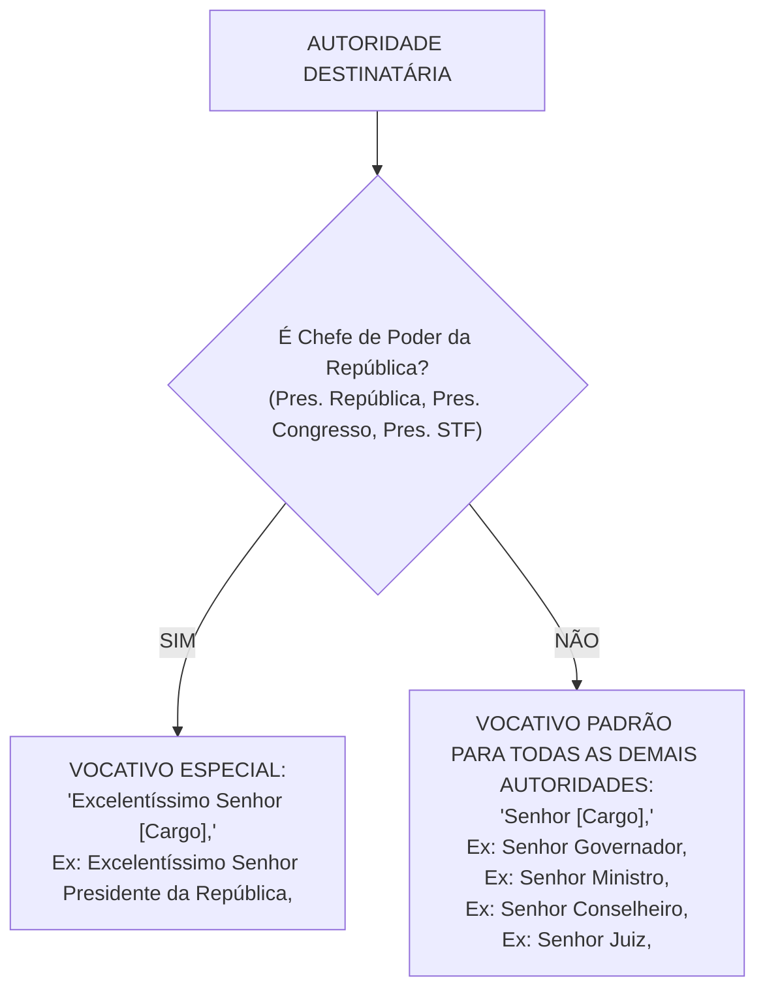
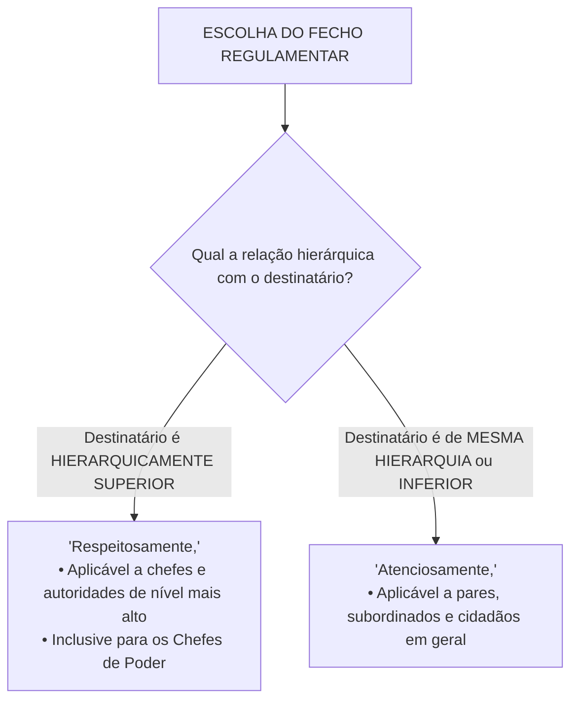

# 07 - Redação Oficial

> **Matéria:** Língua Portuguesa  
> **Cargos:** A01 – Técnico de Controle Externo (Adm) / B02 – Técnico de Controle Externo (TI)  
> **Arquivo:** `07_redacao_oficial.md`  
> **Documento Base:** Manual de Redação da Presidência da República (MRPR - 3ª Edição, revista e atualizada) e Decreto Federal nº 9.758/2019

---

## 📌 Ementa / Itens do Edital
- Redação Oficial: definição, finalidade e fundamentos constitucionais (Art. 37 da CF/88);
- Atributos essenciais da correspondência pública: clareza, precisão, concisão, impessoalidade, formalidade, padronização e uso do padrão culto;
- Pronomes de tratamento: emprego de *Vossa Excelência* vs. *Vossa Senhoria*, regras de concordância verbal, pronominal e de gênero;
- Vocativos regulamentares: distinção entre *"Excelentíssimo Senhor [Cargo],"* (exclusivo para Chefes de Poder) e *"Senhor [Cargo],"* (demais autoridades);
- Abolição de fórmulas laudatórias e arcaísmos (*Digníssimo*, *Ilustríssimo*, etc.);
- O Padrão Ofício unificado na 3ª edição do MRPR (absorção e extinção do Aviso e do Memorando);
- Partes componentes do expediente oficial: cabeçalho, numeração, local e data, endereçamento, assunto, vocativo, texto, fecho e assinatura;
- Fechos regulamentares obrigatórios: *"Respeitosamente,"* (para autoridades superiores) vs. *"Atenciosamente,"* (para mesma hierarquia ou inferior e particulares);
- Correio eletrônico (e-mail institucional) no serviço público e outros atos administrativos (Exposição de Motivos, Mensagem, Parecer e Relatório Técnico).

---

## 🌳 Classificação Hierárquica

```text
7. Teoria e Prática da Redação Oficial no Setor Público
├── 7.1 Fundamentos, Princípios e Atributos da Redação Oficial
│   ├── 7.1.1 Princípios Constitucionais: Legalidade, Impessoalidade, Moralidade, Publicidade e Eficiência (LIMPE)
│   ├── 7.1.2 Impessoalidade:
│   │   ├── Do Emissor: Fala a instituição estatal, e não o servidor como indivíduo
│   │   ├── Do Destinatário: O público ou autoridade é tratado como cidadão/órgão, vedado favorecimento
│   │   └── Do Assunto: Matéria estritamente de interesse público
│   ├── 7.1.3 Clareza e Precisão: Inteligibilidade imediata e repúdio a jargões desnecessários
│   ├── 7.1.4 Concisão: Economia verbal sem prejuízo da clareza informativa
│   ├── 7.1.5 Formalidade e Padronização: Tipografia (Calibri/Carlito 12), diagramação e uniformidade visual
│   └── 7.1.6 Padrão Culto da Língua: Correção gramatical inegociável
├── 7.2 Pronomes de Tratamento e Regras de Endereçamento
│   ├── 7.2.1 Vossa Excelência (V. Ex.ª): Chefes de Poder, Ministros, Governadores, Magistrados, Conselheiros de TCs, MP
│   ├── 7.2.2 Vossa Senhoria (V. S.ª): Demais autoridades públicas e particulares
│   ├── 7.2.3 Regras de Concordância Gramatical com Pronomes de Tratamento:
│   │   ├── Verbos: Sempre na 3ª pessoa do singular (concordância gramatical obrigatória)
│   │   ├── Pronomes: Sempre de 3ª pessoa (seu, sua, seus, suas) -> NUNCA 'vosso/vossa'
│   │   └── Adjetivos/Predicativos: Concordam com o sexo real do destinatário (homem: atento; mulher: atenta)
│   ├── 7.2.4 Vocativos Regulamentares:
│   │   ├── "Excelentíssimo Senhor [Cargo]," -> EXCLUSIVO para Chefes dos 3 Poderes da República (PR, CN, STF)
│   │   └── "Senhor [Cargo]," -> Para TODAS as demais autoridades (Governadores, Ministros, Juízes, Conselheiros)
│   └── 7.2.5 Eliminação de Tratamentos Laudatórios: Extinção de 'Digníssimo (DD.)' e 'Ilustríssimo (Ilmo.)'
├── 7.3 O Padrão Ofício Unificado (3ª Edição do MRPR)
│   ├── 7.3.1 Unificação Formal: Extinção do Aviso e do Memorando (incorporados pelo Ofício)
│   ├── 7.3.2 Estrutura e Diagramação do Ofício:
│   │   ├── Cabeçalho oficial no topo da primeira página
│   │   ├── Identificação do expediente: Tipo, número, ano e sigla do órgão
│   │   ├── Local e Data alinhados à direita (Goiânia, 15 de março de 2026.)
│   │   ├── Endereçamento à esquerda com vocativo de tratamento e cargo
│   │   ├── Assunto: Frase curta em negrito sintetizando o teor
│   │   ├── Vocativo seguido de vírgula
│   │   ├── Corpo do Texto: Introdução (motivo), Desenvolvimento (detalhes) e Conclusão (solicitação)
│   │   ├── Numeração dos parágrafos a partir do 2º parágrafo
│   │   └── Assinatura: Nome completo e Cargo da autoridade emissora (sem traço para assinatura)
│   └── 7.3.3 O Sistema Binário de Fechos:
│       ├── "Respeitosamente," -> Para autoridade hierarquicamente SUPERIOR
│       └── "Atenciosamente," -> Para autoridade de MESMA HIERARQUIA ou INFERIOR, e para cidadãos
└── 7.4 Espécies Documentais e Comunicação Digital
    ├── 7.4.1 Correio Eletrônico (E-mail): Validade documental, formalidade mínima e segurança da informação
    ├── 7.4.2 Mensagem: Comunicação oficial direta entre Chefes de Poder
    ├── 7.4.3 Exposição de Motivos (EM): Submetida por Ministro/titular ao Presidente da República
    └── 7.4.4 Documentos de Controle Externo: Relatório de Auditoria, Instrução Técnica, Parecer do MPC e Acórdão
```

---

## 📖 Resumo Teórico & Pontos-Chave

### 1. Pronomes de Tratamento e o Sistema de Vocativos



#### Quadro de Aplicação de Pronomes de Tratamento:

| Autoridade / Cargo | Pronome de Tratamento | Vocativo Regulamentar | Endereçamento no Envelope |
| :--- | :--- | :--- | :--- |
| **Presidente da República** | Vossa Excelência | *Excelentíssimo Senhor Presidente da República,* | A Sua Excelência o Senhor |
| **Presidente do Congresso Nacional** | Vossa Excelência | *Excelentíssimo Senhor Presidente do Congresso Nacional,* | A Sua Excelência o Senhor |
| **Presidente do STF** | Vossa Excelência | *Excelentíssimo Senhor Presidente do Supremo Tribunal Federal,* | A Sua Excelência o Senhor |
| **Governador de Estado (Goiás)** | Vossa Excelência | *Senhor Governador,* | A Sua Excelência o Senhor |
| **Conselheiro do TCE-GO** | Vossa Excelência | *Senhor Conselheiro,* | A Sua Excelência o Senhor |
| **Ministro de Estado** | Vossa Excelência | *Senhor Ministro,* | A Sua Excelência o Senhor |
| **Prefeito Municipal** | Vossa Excelência | *Senhor Prefeito,* | A Sua Excelência o Senhor |
| **Diretor-Geral / Gerente** | Vossa Senhoria | *Senhor Diretor,* | Ao Senhor |

---

### 2. O Sistema Binário de Fechos Oficiais

A 3ª edição do MRPR simplificou radicalmente os fechos das comunicações oficiais para **apenas duas fórmulas taxativas**, abolindo todas as saudações poéticas, afetivas ou laudatórias (*"Com protestos de estima"*, *"Cordialmente"*, *"Saudações fraternas"*):



---

### 3. Anatomia do Padrão Ofício na 3ª Edição do MRPR

Com a **extinção do Memorando e do Aviso**, o Ofício passou a ser o modelo único de comunicação escrita oficial:

1. **Cabeçalho:** No alto da página, com Brasão de Armas da República e identificação do órgão (apenas na primeira página);
2. **Identificação do Expediente:** Alinhado à esquerda (*Ofício 45/2026/GAB-PRES/TCE-GO*);
3. **Local e Data por Extenso:** Alinhados à margem direita (*Goiânia, 20 de abril de 2026.*);
4. **Endereçamento:** Abaixo da data, à margem esquerda, com o pronome no endereçamento (*A Sua Excelência o Senhor...*);
5. **Assunto:** Síntese em negrito (*Assunto: Solicitação de cessão temporária de servidores técnicos.*);
6. **Vocativo:** Com alinhamento à margem esquerda (*Senhor Secretário,*);
7. **Texto:**
   * *Introdução:* Apresenta o objetivo da comunicação e o histórico resumido;
   * *Desenvolvimento:* Expõe os fundamentos jurídicos, dados e justificativas;
   * *Conclusão:* Apresenta a providência solicitada ou o fechamento do ato;
   * *Numeração de Parágrafos:* Se o texto contiver mais de um parágrafo, **numeram-se todos a partir do segundo** (o primeiro parágrafo nunca recebe numeração arábica);
8. **Fecho:** Alinhado à esquerda (*Respeitosamente,* ou *Atenciosamente,*);
9. **Assinatura:** Nome da autoridade em negrito e o cargo logo abaixo (centralizado na página, **sem linha sobreposta** para assinar).

---

## ⚠️ Alertas de Prova & Pegadinhas da FCC

> 🚨 **ALERTA DE PROVA / PEGADINHA FCC:** A banca FCC frequentemente tenta induzir o candidato ao erro afirmando que o vocativo *"Excelentíssimo Senhor..."* deve ser utilizado para Governadores de Estado, Ministros de Estado ou Desembargadores de Tribunais de Justiça. **ERRADO!** Pela 3ª edição do MRPR, o vocativo *"Excelentíssimo Senhor [Cargo],"* é reservado **exclusivamente aos Chefes dos Três Poderes da República** (Presidente da República, Presidente do Congresso Nacional e Presidente do STF). Para todas as outras autoridades, utiliza-se *"Senhor [Cargo],"*.

> ⭐ **IMPORTANTE / EXTINÇÃO DO MEMORANDO:** Se a questão afirmar que "as comunicações internas entre setores do mesmo órgão público devem ser realizadas mediante *Memorando*", marque como **ERRADA**! O Memorando e o Aviso foram formalmente extintos, passando a tramitar sob a designação única de **OFÍCIO**.

> 📌 **NOTA EXPLICATIVA / CONCORDÂNCIA COM PRONOMES DE TRATAMENTO:**
> Os pronomes de tratamento (*Vossa Excelência*, *Vossa Senhoria*) dirigem-se à 2ª pessoa gramatical (a pessoa com quem se fala), mas exigem **concordância gramatical estrita em 3ª pessoa**:
> * *"Vossa Excelência **aprovou** o relatório em **seu** gabinete"* $\rightarrow$ **CORRETO!**
> * *"Vossa Excelência **aprovastes** o relatório em **vosso** gabinete"* $\rightarrow$ **ERRO GRAVE!**

> 💡 **DICA DE ENDEREÇAMENTO (VOSSA VS. SUA):**
> * Usa-se **Vossa** Excelência / **Vossa** Senhoria quando nos dirigimos **diretamente à pessoa** (no corpo do texto ou no vocativo: *"Informo a Vossa Excelência..."*);
> * Usa-se **Sua** Excelência / **Sua** Senhoria quando **falamos sobre a pessoa a terceiros** ou no sobrescrito do envelope/endereçamento (*"A Sua Excelência o Senhor Governador..."*).

---

## 🌐 Fontes Oficiais e Referências Bibliográficas

* [Manual de Redação da Presidência da República - 3ª Edição Revista e Atualizada (Portal do Planalto)](http://www.planalto.gov.br/ccivil_03/manual/manual.htm) - Texto oficial que disciplina a comunicação pública na administração brasileira.
* [Manual de Redação da Presidência da República em PDF Integral](http://www.planalto.gov.br/ccivil_03/manual/Manual_Redacao_3a_Edicao.pdf) - Diagramação oficial, modelos de ofício e fechos regulamentares.
* [Decreto Federal nº 9.758/2019 (Planalto)](http://www.planalto.gov.br/ccivil_03/_ato2019-2022/2019/decreto/d9758.htm) - Dispõe sobre o tratamento simples e adequado aos agentes públicos.
* [Manual de Comunicação do Senado Federal](https://www12.senado.leg.br/manualdecomunicacao/redacao-e-estilo) - Guia de redação oficial e atos parlamentares.

---

## 📝 Questões de Concurso FCC Comentadas

### Questão 01
**(FCC – TCE-GO – Analista de Controle Externo)**  
O Presidente do Tribunal de Contas do Estado de Goiás necessita encaminhar expediente oficial ao Governador do Estado e, simultaneamente, outro expediente ao Diretor de Escola Pública Estadual. De acordo com a 3ª edição do Manual de Redação da Presidência da República (MRPR), os vocativos e fechos adequados para cada uma dessas comunicações são, respectivamente:

* **A)** Para o Governador: *"Excelentíssimo Senhor Governador,"* / *"Respeitosamente,"*; Para o Diretor: *"Ilustríssimo Senhor Diretor,"* / *"Cordialmente,"*.
* **B)** Para o Governador: *"Senhor Governador,"* / *"Atenciosamente,"*; Para o Diretor: *"Senhor Diretor,"* / *"Atenciosamente,"*.
* **C)** Para o Governador: *"Excelentíssimo Senhor Governador,"* / *"Atenciosamente,"*; Para o Diretor: *"Senhor Diretor,"* / *"Respeitosamente,"*.
* **D)** Para o Governador: *"Senhor Governador,"* / *"Cordialmente,"*; Para o Diretor: *"Digníssimo Diretor,"* / *"Sem mais para o momento,"*.
* **E)** Para o Governador: *"Ilustríssimo Senhor Governador,"* / *"Respeitosamente,"*; Para o Diretor: *"Prezado Senhor Diretor,"* / *"Atenciosamente,"*.

> **Gabarito: B**  
> **Comentário Detalhado:**  
> - **1. Vocativo para Governador:** Pelo MRPR (3ª edição), a expressão *"Excelentíssimo Senhor..."* é restrita aos Chefes de Poder da República. Para governadores de estado, o vocativo correto é **"Senhor Governador,"**.  
> - **2. Fecho para Governador:** Entre Chefes de órgãos autônomos e poderes de mesma dignidade institucional, aplica-se o fecho para autoridades de mesma hierarquia: **"Atenciosamente,"**.  
> - **3. Vocativo e Fecho para Diretor:** O vocativo é **"Senhor Diretor,"** e o fecho para autoridades de hierarquia subordinada é **"Atenciosamente,"**.  
> - **4. Eliminação de distratores:** Os termos *Digníssimo*, *Ilustríssimo*, *Cordialmente* e *Sem mais para o momento* foram formalmente banidos do manual. Portanto, correta a alternativa B.

---

### Questão 02
**(FCC – TRT – Técnico Judiciário)**  
No que concerne ao emprego de pronomes de tratamento e à concordância gramatical em documentos oficiais, assinale a opção que atende integralmente às normas do MRPR:

* **A)** *"Informamos a Vossa Excelência que vossos pedidos foram acolhidos e solicitamos que compareçais à cerimônia de posse."*
* **B)** *"Vossa Senhoria deveis encaminhar o demonstrativo contábil para que possamos analisar vosso relatório tempestivamente."*
* **C)** *"Comunico a Vossa Excelência que sua solicitação foi deferida pelo plenário, estando o processo à sua disposição."*
* **D)** *"Vossa Excelência será recebida pelo Presidente da República, o qual manifestou desejo de conhecer vossos projetos."*
* **E)** *"Solicitamos a Vossa Excelência que vos digneis autorizar o empenho das despesas em vosso orçamento."*

> **Gabarito: C**  
> **Comentário Detalhado:**  
> - Os pronomes de tratamento referem-se à 2ª pessoa do discurso (com quem se fala), mas exigem que a **concordância gramatical seja efetuada compulsoriamente em 3ª pessoa** (verbos em 3ª pessoa e pronomes possessivos de 3ª pessoa: *sua*, *seu*, *seus*, *suas*).  
> - **A), B), D) e E) Incorretas:** Cometeram o erro de usar formas verbais e pronomes em 2ª pessoa do plural (*vossos*, *compareçais*, *deveis*, *vos digneis*).  
> - **C) CORRETA:** Emprega o verbo e os pronomes possessivos perfeitamente em 3ª pessoa (*sua solicitação*, *foi deferida*, *à sua disposição*). Impecável!

---

### Questão 03
**(FCC – TCE-PI – Auditor de Controle Externo)**  
A respeito da padronização de expedientes oficiais segundo a 3ª edição do Manual de Redação da Presidência da República, considere as afirmações:  
I. As comunicações oficiais internas entre diretorias e gerências de um mesmo órgão público devem ser redigidas sob a denominação de *Memorando*.  
II. O *Aviso* é espécie documental privativa utilizada para envio de correspondências por Ministros de Estado a particulares.  
III. Os antigos expedientes denominados *Aviso* e *Memorando* deixaram de existir como tipos autônomos, tendo sido absorvidos pelo *Padrão Ofício*.  
IV. O fecho *"Respeitosamente,"* deve ser empregado em comunicações endereçadas a autoridades de hierarquia superior à do emissor.

Está correto o que se afirma em:

* **A)** I e II, apenas.
* **B)** III e IV, apenas.
* **C)** I, III e IV, apenas.
* **D)** II e III, apenas.
* **E)** I, II, III e IV.

> **Gabarito: B**  
> **Comentário Detalhado:**  
> - **Item I: Incorreto.** O expediente *Memorando* foi extinto pelo MRPR (3ª edição). A comunicação interna passou a ser formalizada como Ofício.  
> - **Item II: Incorreto.** O *Aviso* também foi formalmente extinto na 3ª edição.  
> - **Item III: Correto.** O MRPR unificou o Aviso, o Memorando e o Ofício tradicional sob um gênero documental único: o **Ofício**.  
> - **Item IV: Correto.** O fecho **"Respeitosamente,"** é privativo para autoridades hierarquicamente superiores à do emitente da correspondência.  
> - Portanto, estão corretos apenas os itens III e IV. Gabarito: B.

---

### Questão 04
**(FCC – DPE-RS – Analista de Comunicação)**  
Assinale a alternativa que apresenta um trecho de correspondência oficial eivado de **vício de impessoalidade e prolixidade**, em desacordo com as diretrizes do Manual de Redação Oficial:

* **A)** *"Comunico que a fiscalização das obras da rodovia estadual terá início na próxima segunda-feira, às nove horas."*
* **B)** *"Tenho a imensa honra e o singular privilégio de levar ao vosso excelso conhecimento que meu humilde gabinete concluiu o trabalho."*
* **C)** *"Encaminho, para ciência e deliberação, o relatório consolidado de auditoria financeira do exercício de 2025."*
* **D)** *"Solicito a designação de dois servidores técnicos para compor a comissão de recebimento de materiais de tecnologia."*
* **E)** *"Em cumprimento ao despacho da presidência, restituo os autos para adoção das providências cabíveis."*

> **Gabarito: B**  
> **Comentário Detalhado:**  
> - O Manual de Redação da Presidência da República estabelece que a redação oficial deve primar pela **impessoalidade**, pela **concisão** e pela **sobriedade**. São expressamente banidas as manifestações de exaltação pessoal, adulações, salamaleques e tratamentos bajuladores (*"imensa honra"*, *"singular privilégio"*, *"vosso excelso conhecimento"*, *"meu humilde gabinete"*).  
> - As alternativas A, C, D e E utilizam redação técnica, objetiva, impessoal e concisa, perfeitamente alinhada aos padrões do MRPR. A alternativa B é a única que transgride tais preceitos.

---

### Questão 05
**(FCC – METRÔ-SP – Analista de Administração)**  
Quanto à estrutura física e à diagramação padrão do **Ofício** prescritas na 3ª edição do MRPR:

* **A)** A fonte tipográfica padrão recomendada para o texto é Comic Sans ou Arial Black, tamanho 14.
* **B)** O cabeçalho contendo o Brasão de Armas da República deve ser impresso em todas as páginas do documento, inclusive nas folhas de continuação.
* **C)** A identificação do signatário deve conter seu nome em negrito e o cargo logo abaixo, sem linha sobreposta para assinatura.
* **D)** Todos os parágrafos do texto devem ser numerados em algarismos romanos, a começar pelo primeiro.
* **E)** O local e a data devem ser alinhados à margem esquerda, com o mês grafado de forma numérica abreviada.

> **Gabarito: C**  
> **Comentário Detalhado:**  
> - **A) Incorreta.** O MRPR padroniza o uso das fontes **Calibri** ou **Carlito**, corpo 12 para o texto corrido.  
> - **B) Incorreta.** O cabeçalho com o Brasão das Armas é impresso **apenas na primeira página** do documento; as páginas seguintes recebem apenas o número de página no cabeçalho secundário.  
> - **C) CORRETA.** Na identificação do signatário, escreve-se o **nome da autoridade** (em letras maiúsculas/negrito) e o **cargo** logo abaixo. É formalmente **dispensada e vedada a linha tracejada sobreposta** para assinatura, devendo o espaço ser assinado diretamente sobre o nome.  
> - **D) Incorreta.** A numeração dos parágrafos é em **algarismos arábicos** e aplica-se **apenas a partir do segundo parágrafo** (o primeiro parágrafo nunca recebe número).  
> - **E) Incorreta.** O local e a data devem ser alinhados à **margem direita**, com o mês escrito por extenso (*Goiânia, 10 de maio de 2026.*).
