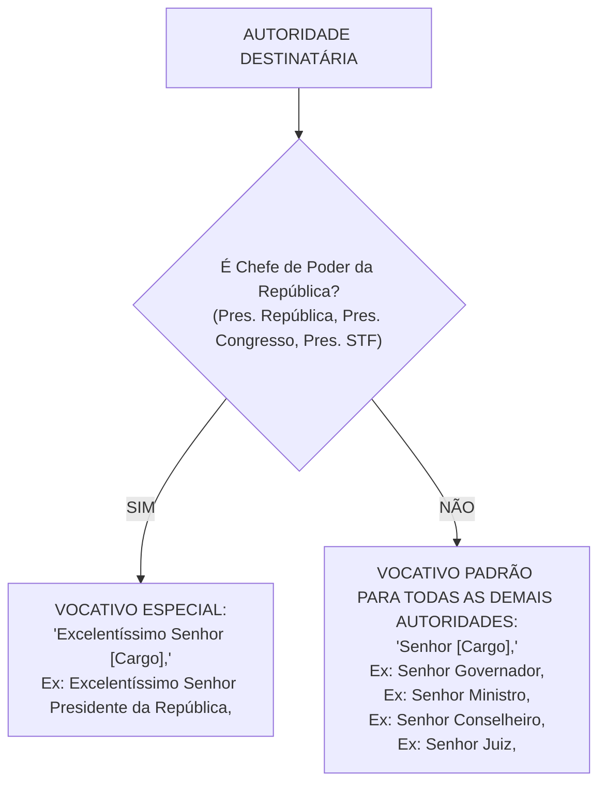
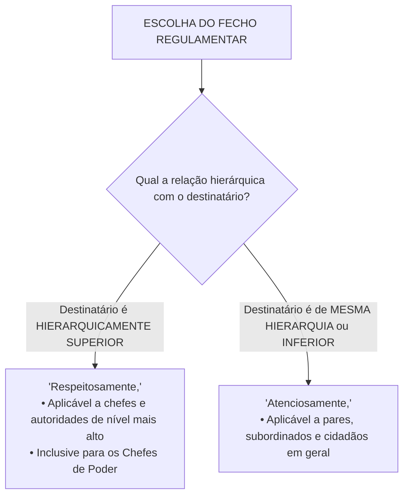

# 07 - Redação Oficial

> **Matéria:** Língua Portuguesa  
> **Cargos:** A01 – Técnico de Controle Externo (Adm) / B02 – Técnico de Controle Externo (TI)  
> **Arquivo:** `07_redacao_oficial.md`  
> **Documento Base:** Manual de Redação da Presidência da República (MRPR - 3ª Edição, revista e atualizada) e Decreto Federal nº 9.758/2019

---

## 📌 Ementa / Itens do Edital
- Redação Oficial: definição, finalidade e fundamentos constitucionais (Art. 37 da CF/88);
- Atributos essenciais da correspondência pública: clareza, precisão, concisão, impessoalidade, formalidade, padronização e uso do padrão culto;
- Pronomes de tratamento: emprego de *Vossa Excelência* vs. *Vossa Senhoria*, regras de concordância verbal, pronominal e de gênero;
- Vocativos regulamentares: distinção entre *"Excelentíssimo Senhor [Cargo],"* (exclusivo para Chefes de Poder) e *"Senhor [Cargo],"* (demais autoridades);
- Abolição de fórmulas laudatórias e arcaísmos (*Digníssimo*, *Ilustríssimo*, etc.);
- O Padrão Ofício unificado na 3ª edição do MRPR (absorção e extinção do Aviso e do Memorando);
- Partes componentes do expediente oficial: cabeçalho, numeração, local e data, endereçamento, assunto, vocativo, texto, fecho e assinatura;
- Fechos regulamentares obrigatórios: *"Respeitosamente,"* (para autoridades superiores) vs. *"Atenciosamente,"* (para mesma hierarquia ou inferior e particulares);
- Correio eletrônico (e-mail institucional) no serviço público e outros atos administrativos (Exposição de Motivos, Mensagem, Parecer e Relatório Técnico).

---

## 🧭 Sumário

1. [Fundamentos Constitucionais e Conceito de Redação Oficial](#1-fundamentos-constitucionais-e-conceito-de-redacao-oficial)
    1. [Definição e Finalidade da Comunicação Pública](#11-definicao-e-finalidade-da-comunicacao-publica)
    2. [Fundamentos Constitucionais: O Artigo 37 da CF/88 e os Princípios da Administração](#12-fundamentos-constitucionais-o-artigo-37-da-cf88-e-os-principios-da-administracao)
    3. [Evolução Normativa: O MRPR 3ª Edição e o Decreto Federal nº 9.758/2019](#13-evolucao-normativa-o-mrpr-3a-edicao-e-o-decreto-federal-no-97582019)
    4. [Teste 062](#Teste-062)
2. [Atributos Fundamentais da Redação Oficial](#2-atributos-fundamentais-da-redacao-oficial)
    1. [Princípio da Impessoalidade e Seus Três Desdobramentos](#21-principio-da-impessoalidade-e-seus-tres-desdobramentos)
    2. [Clareza e Precisão Linguística](#22-clareza-e-precisao-linguistica)
    3. [Concisão Textual e Eliminação da Prolixidade](#23-concisao-textual-e-eliminacao-da-prolixidade)
    4. [Formalidade, Padronização e Tipografia](#24-formalidade-padronizacao-e-tipografia)
    5. [O Uso do Padrão Culto da Língua](#25-o-uso-do-padrao-culto-da-lingua)
    6. [Teste 063](#Teste-063)
    7. [Teste 064](#Teste-064)
3. [Pronomes de Tratamento, Vocativos e Endereçamento](#3-pronomes-de-tratamento-vocativos-e-enderecamento)
    1. [Vossa Excelência vs. Vossa Senhoria: Tabela Completa de Aplicação](#31-vossa-excelencia-vs-vossa-senhoria-tabela-completa-de-aplicacao)
    2. [Regras Rígidas de Concordância Gramatical com Pronomes de Tratamento](#32-regras-rigidas-de-concordancia-gramatical-com-pronomes-de-tratamento)
    3. [Sistema de Vocativos: A Distinção entre Chefes de Poder e Demais Autoridades](#33-sistema-de-vocativos-a-distincao-entre-chefes-de-poder-e-demais-autoridades)
    4. [Endereçamento no Envelope e Regras Dêiticas: Vossa vs. Sua](#34-enderecamento-no-envelope-e-regras-deiticas-vossa-vs-sua)
    5. [Abolição de Fórmulas Laudatórias, Adulações e Arcaísmos](#35-abolicao-de-formulas-laudatorias-adulacoes-e-arcaismos)
    6. [Teste 065](#Teste-065)
    7. [Teste 066](#Teste-066)
4. [O Padrão Ofício Unificado na 3ª Edição do MRPR](#4-o-padrao-oficio-unificado-na-3a-edicao-do-mrpr)
    1. [Unificação Formal: Extinção do Aviso e do Memorando](#41-unificacao-formal-extincao-do-aviso-e-do-memorando)
    2. [Partes Componentes e Diagramação Oficial do Ofício](#42-partes-componentes-e-diagramacao-oficial-do-oficio)
    3. [Estrutura do Texto: Introdução, Desenvolvimento e Conclusão](#43-estrutura-do-texto-introducao-desenvolvimento-e-conclusao)
    4. [Regras de Numeração de Parágrafos](#44-regras-de-numeracao-de-paragrafos)
    5. [Identificação do Signatário e Vedação à Linha de Assinatura](#45-identificacao-do-signatario-e-vedacao-a-linha-de-assinatura)
    6. [O Sistema Binário de Fechos Regulamentares](#46-o-sistema-binario-de-fechos-regulamentares)
    7. [Teste 067](#Teste-067)
    8. [Teste 068](#Teste-068)
    9. [Teste 069](#Teste-069)
5. [Espécies Documentais e Comunicação Digital](#5-especies-documentais-e-comunicacao-digital)
    1. [O Correio Eletrônico Institucional (E-mail Público)](#51-o-correio-eletronico-institucional-e-mail-publico)
    2. [A Mensagem entre Chefes de Poder](#52-a-mensagem-entre-chefes-de-poder)
    3. [A Exposição de Motivos (EM)](#53-a-exposicao-de-motivos-em)
    4. [Atos Típicos dos Tribunais de Contas: Relatório Técnico, Parecer e Acórdão](#54-atos-tipicos-dos-tribunais-de-contas-relatorio-tecnico-parecer-e-acordao)
    5. [Teste 070](#Teste-070)
    6. [Teste 071](#Teste-071)
6. [🌐 Fontes Oficiais e Referências Bibliográficas](#fontes-oficiais-e-referencias-bibliograficas)

---

## 1. Fundamentos Constitucionais e Conceito de Redação Oficial

A Redação Oficial é a maneira formal e padronizada pela qual o Poder Público redige seus atos administrativos, normativos e comunicações epistolares. Longe de constituir um gênero literário estético ou uma expressão de subjetividade do redator, a correspondência pública é a voz impessoal do próprio Estado manifestando-se perante os cidadãos, os demais entes federativos e os órgãos de controle.

### 1.1 Definição e Finalidade da Comunicação Pública

A redação oficial destina-se a viabilizar a comunicação clara, transparente e juridicamente vinculante entre os órgãos da administração pública direta e indireta dos Poderes Executivo, Legislativo e Judiciário, bem como entre estes e os administrados em geral. Sua finalidade última é assegurar que a manifestação da vontade estatal seja plenamente compreensível a qualquer cidadão, afastando ambiguidades que possam comprometer a fruição de direitos ou a imposição de deveres.

### 1.2 Fundamentos Constitucionais: O Artigo 37 da CF/88 e os Princípios da Administração

A redação de expedientes oficiais decorre imediatamente dos princípios basilares esculpidos no *caput* do artigo 37 da Constituição Federal de 1988:

* **Legalidade:** A expedição de atos e comunicações só é válida quando amparada em lei ou competência regulamentar explícita.
* **Impessoalidade:** O documento não representa a vontade pessoal do servidor ou agente público emitente, mas a manifestação institucional impessoal do órgão ou entidade.
* **Moralidade:** Veda o emprego de comunicações oficiais para finalidades espúrias, autopromoção ou perseguição de administrados.
* **Publicidade:** Os atos oficiais devem ser amplamente acessíveis e inteligíveis a todos os destinatários da norma pública.
* **Eficiência:** Impõe o dever de concisão, clareza e celeridade na tramitação e no entendimento das ordens e solicitações administrativas.

### 1.3 Evolução Normativa: O MRPR 3ª Edição e o Decreto Federal nº 9.758/2019

O documento de referência primária no Brasil é o **Manual de Redação da Presidência da República (MRPR)**, cuja 3ª edição (revista e atualizada em 2018) unificou expedientes históricos e aboliu formalismos estéreis. Complementarmente, o **Decreto Federal nº 9.758/2019** consolidou o princípio da simplicidade e da moderação no tratamento dispensado aos agentes públicos, vedando o uso de pronomes honoríficos desproporcionais e simplificando o diálogo entre o Estado e a sociedade.

---

### Teste 062
**(Questão Inédita / Simulada Estilo FCC – Nível: Controle Externo / TI)**  
Segundo as diretrizes consagradas pelo Manual de Redação da Presidência da República (3ª edição) e pelo ordenamento constitucional vigente (art. 37 da CF/88):

* **A)** A redação oficial admite a inserção de impressões pessoais e juízos subjetivos do redator, desde que justificados pelo interesse público primário.
* **B)** A impessoalidade da redação oficial desdobra-se em tríplice dimensão: impessoalidade do emissor (é o serviço público quem se manifesta, e não o servidor individualmente), impessoalidade do destinatário (o texto destina-se ao cidadão ou a outro órgão com tratamento uniforme e isonômico) e impessoalidade do assunto (trata-se estritamente do interesse público, sem paixões político-partidárias).
* **C)** O Decreto Federal nº 9.758/2019 instituiu o uso obrigatório dos pronomes *Vossa Excelência* e *Ilustríssimo* em toda e qualquer comunicação direta com os cidadãos comuns.
* **D)** A publicidade dos atos administrativos autoriza a utilização de gírias e jargões regionais nos expedientes oficiais visando aproximar o Estado das massas populares.
* **E)** O princípio da eficiência desobriga os órgãos de controle externo de observar o padrão culto da língua portuguesa na elaboração de seus relatórios.

---

> **Comentário Detalhado:**
>
> - **A)** Incorreta. A redação oficial é rigorosamente impessoal e técnica; impressões ou opiniões subjetivas de foro íntimo do servidor são terminantemente vedadas pelo MRPR.
> - **B)** Correta. O MRPR (3ª Ed., Cap. 1) explicita com precisão lapidar a tríplice acepção do princípio da impessoalidade na comunicação oficial: 1) Da posição de quem emite a comunicação (o Estado/Administração); 2) Do destinatário que a recebe (isonomia e uniformidade republicana); 3) Do assunto tratado (estrito interesse público, exposto de modo objetivo e isento).
> - **C)** Incorreta. O Decreto nº 9.758/2019 extinguiu expressamente o uso de fórmulas laudatórias (*Digníssimo*, *Ilustríssimo*) e padronizou o tratamento geral no âmbito federal como *senhor* ou *senhora*.
> - **D) e E)** Incorretas. O padrão culto da língua e a formalidade são atributos inegociáveis impostos pela Constituição e pelo MRPR para garantir a inteligibilidade e solenidade dos atos estatais.
>
> **Gabarito: B**

---

## 2. Atributos Fundamentais da Redação Oficial

Para que uma correspondência ou ato público cumpra sua missão constitucional, deve observar cumulativamente seis atributos indeclináveis.

### 2.1 Princípio da Impessoalidade e Seus Três Desdobramentos

A impessoalidade é a viga mestra da redação pública, decompondo-se em três planos complementares:

1. **Impessoalidade do Emissor:** Quem emite a comunicação não é o cidadão privado que ocupa temporariamente o cargo, mas o serviço público institucionalizado. Não cabem impressões individuais, desabafos, opiniões particulares ou estilo literário floreado.
2. **Impessoalidade do Destinatário:** O público-alvo ou o cidadão é considerado genericamente como membro da coletividade, vedando-se qualquer distinção fundada em simpatias, antipatias ou privilégios de casta.
3. **Impessoalidade do Assunto:** A matéria tratada deve circunscrever-se rigorosamente ao interesse público e à finalidade legal do ato.

### 2.2 Clareza e Precisão Linguística

* **Clareza:** O texto deve ser compreendido de forma imediata e inequívoca desde a primeira leitura. Rejeitam-se frases labirínticas, períodos excessivamente longos, inversões sintáticas rebuscadas e termos ambíguos.
* **Precisão:** Consiste no emprego da palavra exata para designar o conceito jurídico, contábil ou técnico correspondente, evitando generalizações vagas ou eufemismos evasivos. Evita-se o jargão corporativo hermético quando o destinatário for o cidadão comum.

### 2.3 Concisão Textual e Eliminação da Prolixidade

A concisão consiste em transmitir o máximo de conteúdo informativo útil com o menor número possível de palavras, sem jamais sacrificar a clareza. São regras práticas para atingir a concisão:

* Cortar adjetivações vazias, advérbios redundantes e superlativos artificiais;
* Eliminar rodeios oratórios e circunlóquios burocráticos (*"Vimos pela presente trazer ao vosso conhecimento o fato de que.."* $\rightarrow$ substitua simplesmente por: *"Comunico que.."*);
* Suprimir períodos de introdução cerimoniosa que nada acrescentam à matéria de fato.

### 2.4 Formalidade, Padronização e Tipografia

* **Formalidade e Polidez:** O texto público orienta-se pela sobriedade, civilidade e polidez republicana, evitando intimidades, gírias e agressividades verbais.
* **Padronização Visual:** A identidade institucional dos expedientes oficiais exige parâmetros rígidos de diagramação:
    * Fonte tipográfica padrão: **Calibri** ou **Carlito**, corpo 12 para o corpo do texto e corpo 9 para notas de rodapé e citações longas;
    * Espaçamento entrelinhas simples (1,0) ou de 1,15, com recuo de parágrafo padronizado (2,5 cm da margem esquerda);
    * Margem esquerda e superior de 3,0 cm; margem direita e inferior de 2,0 cm.

### 2.5 O Uso do Padrão Culto da Língua

O emprego da norma-padrão da língua portuguesa decorre do fato de que a língua culta é a única variante linguística que desfruta de uniformidade nacional codificada pelas gramáticas e dicionários, estando imune às flutuações passageiras de gírias e regionalismos orais.

---

### Teste 063
**(Questão Inédita / Simulada Estilo FCC – Nível: Controle Externo / TI)**  
Assinale a alternativa que apresenta um trecho de correspondência oficial eivado de **vício de impessoalidade e prolixidade**, em desacordo com as diretrizes do Manual de Redação Oficial:

* **A)** *"Comunico que a fiscalização das obras da rodovia estadual terá início na próxima segunda-feira, às nove horas."*
* **B)** *"Tenho a imensa honra e o singular privilégio de levar ao vosso excelso conhecimento que meu humilde gabinete concluiu o trabalho."*
* **C)** *"Encaminho, para ciência e deliberação, o relatório consolidado de auditoria financeira do exercício de 2025."*
* **D)** *"Solicito a designação de dois servidores técnicos para compor a comissão de recebimento de materiais de tecnologia."* em conformidade com as diretrizes e padrões de arquitetura corporativa.
* **E)** *"Em cumprimento ao despacho da presidência, restituo os autos para adoção das providências cabíveis."*

---

> **Comentário Detalhado:**
>
> - **A)** Incorreta. O trecho utiliza linguagem límpida, impessoal, técnica e concisa, perfeitamente adequada ao padrão oficial.
> - **B)** Correta (apresenta vício grave). O fragmento transgride frontalmente os atributos da impessoalidade, sobriedade e concisão, recorrendo a rapapés bajuladores e expressões de subserviência (*"imensa honra"*, *"singular privilégio"*, *"vosso excelso conhecimento"*, *"meu humilde gabinete"*), formalmente banidas do serviço público republicano.
> - **C)** Incorreta. Estrutura padrão límpida de encaminhamento oficial, sem qualquer vício de prolixidade.
> - **D)** Incorreta. Redação direta e objetiva de solicitação administrativa.
> - **E)** Incorreta. Frase escorreita e sóbria de movimentação processual.
> 
> **Gabarito: B**

---

### Teste 064
**(Questão Inédita / Simulada Estilo FCC – Nível: Controle Externo / TI)**  
Quanto à diagramação, tipografia e padrão gráfico dos expedientes oficiais prescritos na 3ª edição do Manual de Redação da Presidência da República:

* **A)** É livre o emprego de qualquer fonte tipográfica decorativa no corpo do ofício, a critério discricionário do redator do documento.
* **B)** O MRPR padronizou o uso obrigatório das fontes tipográficas *Calibri* ou *Carlito*, corpo 12 pontos no texto principal, com espaçamento simples entre linhas e parágrafos numerados sequencialmente a partir do segundo parágrafo.
* **C)** O recuo de parágrafo deve ser de 5 centímetros a partir da margem esquerda da página.
* **D)** A datação do expediente deve constar de forma centralizada e sem a indicação do local de emissão.
* **E)** As margens do documento oficial são livres, permitindo-se a impressão rente às bordas da folha de papel.

---

> **Comentário Detalhado:**
>
> - **A)** Incorreta. O MRPR veda fontes decorativas ou estilizadas para preservar a padronização e a sobriedade dos atos públicos.
> - **B)** Correta. A 3ª Edição do MRPR (Item 2.2) padronizou expressamente as famílias tipográficas *Calibri* ou *Carlito* (software livre equivalente): corpo 12 pt no texto em geral, 10 pt em citações longas e notas de rodapé, espaçamento entrelinhas simples e parágrafos numerados em algarismos arábicos a partir do segundo parágrafo (o 1º e o fecho não se numeram).
> - **C)** Incorreta. O recuo padrão de início de parágrafo na margem esquerda é de **2,5 cm** (e não 5 cm).
> - **D)** Incorreta. A datação é alinhada à direita e inicia-se obrigatoriamente pelo local de expedição seguido de vírgula (*Goiânia, 15 de março de 2026*).
> - **E)** Incorreta. As margens são estritamente padronizadas: esquerda e superior de 3 cm; direita e inferior de 1,5 cm.
>
> **Gabarito: B**

---

## 3. Pronomes de Tratamento, Vocativos e Endereçamento

Os pronomes de tratamento constituem formas cerimoniais consagradas pela tradição e pelo direito administrativo para expressar deferência às autoridades investidas em cargos de soberania ou gestão estatal.

### 3.1 Vossa Excelência vs. Vossa Senhoria: Tabela Completa de Aplicação

A 3ª edição do MRPR uniformizou o rol de autoridades contempladas com cada fórmula de tratamento:

| Pronome de Tratamento | Abrev. Singular | Abrev. Plural | Autoridades Abrangidas |
| :--- | :---: | :---: | :--- |
| **Vossa Excelência** | *V. Ex.ª* | *V. Ex.ªs* | **Poder Executivo:** Presidente e Vice-Presidente da República; Ministros de Estado; Governadores e Vice-Governadores; Secretários de Estado; Prefeitos Municipais. **Poder Legislativo:** Senadores da República; Deputados Federais; Deputados Estaduais; Vereadores. **Poder Judiciário:** Ministros de Tribunais Superiores (STF, STJ, TST, TSE, STM); Desembargadores de TJs e TRFs; Juízes de Direito e Juízes Federais. **Órgãos Autônomos:** Conselheiros dos Tribunais de Contas (TCU, TCEs e TCMs); Membros do Ministério Público (PGR, Procuradores e Promotores de Justiça); Defensores Públicos-Gerais. **Forças Armadas:** Oficiais-Generais. |
| **Vossa Senhoria** | *V. S.ª* | *V. S.ªs* | Todas as demais autoridades públicas não contempladas com *Vossa Excelência* (Diretores de autarquias e escolas, Coordenadores, Gerentes, Chefes de Seção, Auditores e Servidores em geral) e particulares. |

### 3.2 Regras Rígidas de Concordância Gramatical com Pronomes de Tratamento

O emprego dos pronomes de tratamento exige o cumprimento rigoroso de três regras morfossintáticas:

1. **Concordância Verbal Compulsoriamente em 3ª Pessoa:** Embora o pronome de tratamento se refira à pessoa com quem se fala (2ª pessoa do discurso), a forma verbal associada deve ser flexionada **obrigatoriamente na 3ª pessoa do singular (ou do plural)**:
    * *"Vossa Excelência **aprovou** a prestação de contas"* (e nunca *"aprovastes"*).
    * *"Vossa Senhoria **deve** apresentar os laudos"* (e nunca *"deveis"*).

2. **Concordância Pronominal em 3ª Pessoa:** Os pronomes possessivos ou oblíquos associados devem ser estritamente de terceira pessoa (**seu, sua, seus, suas, o, a, lhe**). É erro gravíssimo usar formas de 2ª pessoa do plural (*vosso, vossa, vos*):
    * *"Comunico a Vossa Excelência que **sua** assessoria já concluiu o relatório"* (e nunca *"vossa assessoria"*).
    * *"Solicito a Vossa Senhoria que apresente **seus** esclarecimentos"* (e nunca *"vossos esclarecimentos"*).

3. **Concordância de Gênero com o Sexo Real do Interlocutor:** Adjetivos e particípios predicativos concordam em gênero gramatical com o sexo real e biológico da pessoa física a quem o pronome se dirige (concordância por silepse de gênero consagrada):
    * Se o Conselheiro for homem: *"Vossa Excelência está **atento** às recomendações."*
    * Se a Conselheira for mulher: *"Vossa Excelência está **atenta** às recomendações."*

### 3.3 Sistema de Vocativos: A Distinção entre Chefes de Poder e Demais Autoridades

A 3ª edição do MRPR simplificou radicalmente os vocativos, reservando a locução *"Excelentíssimo Senhor.."* **exclusivamente aos Chefes dos Três Poderes da República**:

1. **Vocativo "Excelentíssimo Senhor [Cargo],":**
    * *Excelentíssimo Senhor Presidente da República,*
    * *Excelentíssimo Senhor Presidente do Congresso Nacional,*
    * *Excelentíssimo Senhor Presidente do Supremo Tribunal Federal,*

2. **Vocativo "Senhor [Cargo]," (Para TODAS as demais autoridades):**
    * Aplica-se a governadores de estado, ministros de estado, senadores, deputados federais e estaduais, prefeitos, juízes, desembargadores e **Conselheiros de Tribunais de Contas**:
    * *Senhor Governador,*
    * *Senhor Ministro,*
    * *Senhor Conselheiro,*
    * *Senhor Juiz de Direito,*
    * *Senhor Diretor-Geral,*

> 🚨 **ALERTA DE PROVA / PEGADINHA FCC:** A Fundação Carlos Chagas reiteradamente tenta induzir o candidato ao erro inserindo o vocativo *"Excelentíssimo Senhor Governador,"* ou *"Excelentíssimo Senhor Ministro de Estado,"*. Trata-se de erro frontal contra a 3ª edição do MRPR. O vocativo cerimonial *Excelentíssimo* é privativo dos **três Chefes de Poder da União** (PR, CN e STF). Para governadores, conselheiros e ministros, usa-se compulsoriamente: *"Senhor Governador,"*, *"Senhor Conselheiro,"*, *"Senhor Ministro,"*.

### 3.4 Endereçamento no Envelope e Regras Dêiticas: Vossa vs. Sua

* **Vossa Excelência / Vossa Senhoria:** Utiliza-se a forma **Vossa** quando o enunciador está em comunicação direta face a face com o interlocutor (no corpo do texto ou no diálogo oral): *"Informo a Vossa Excelência que os autos foram instruídos"*.
* **Sua Excelência / Sua Senhoria:** Emprega-se a forma **Sua** quando o enunciador refere-se a uma terceira autoridade sobre quem se está falando ou no sobrescrito do envelope/endereçamento do documento:
    * No endereçamento do ofício: *"A Sua Excelência o Senhor Conselheiro Presidente do TCE-GO"*.
    * Ao referir-se à autoridade ausente: *"Sua Excelência o Governador determinou a imediata apuração dos fatos"*.

### 3.5 Abolição de Fórmulas Laudatórias, Adulações e Arcaísmos

O Manual de Redação da Presidência da República e o Decreto nº 9.758/2019 baniram expressamente o uso de qualificativos bajuladores e expressões arcaicas na administração pública:

* Foram expressamente extintos os tratamentos: **Digníssimo (DD.)**, **Ilustríssimo (Ilmo.)**, **Preclaro**, **Insígne** e **Mui Digno**;
* A dignidade e a honradez são predicados inerentes ao próprio cargo público, sendo redundante e despropositado explicitá-las em correspondências oficiais;
* É vedado o uso de fórmulas de encerramento vazias ou servientes (*"Com votos de elevado apreço e distinta consideração"*, *"Aproveito o ensejo para renovar protestos de estima"* ou *"Sem mais para o momento"*).

---

### Teste 065
**(Questão Inédita / Simulada Estilo FCC – Nível: Controle Externo / TI)**  
No que concerne ao emprego de pronomes de tratamento e à concordância gramatical em documentos oficiais, assinale a opção que atende integralmente às normas do MRPR:

* **A)** *"Informamos a Vossa Excelência que vossos pedidos foram acolhidos e solicitamos que compareçais à cerimônia de posse."*
* **B)** *"Vossa Senhoria deveis encaminhar o demonstrativo contábil para que possamos analisar vosso relatório tempestivamente."*
* **C)** *"Comunico a Vossa Excelência que sua solicitação foi deferida pelo plenário, estando o processo à sua disposição."*
* **D)** *"Vossa Excelência será recebida pelo Presidente da República, o qual manifestou desejo de conhecer vossos projetos."*
* **E)** *"Solicitamos a Vossa Excelência que vos digneis autorizar o empenho das despesas em vosso orçamento."*

---

> **Comentário Detalhado:**
>
> - **Regra Geral:** Os pronomes de tratamento referem-se à 2ª pessoa gramatical (com quem se fala), porém exigem que **toda a concordância gramatical de verbos e pronomes seja efetuada compulsoriamente em 3ª pessoa** (*ele/ela, seu, sua, seus, suas*). O uso de verbos ou pronomes em 2ª pessoa do plural (*vós, vosso, compareçais*) é erro gramatical manifesto.
> - **A)** Incorreta. Incorreu em erro ao empregar o pronome possessivo *vossos* e a forma verbal *compareçais* em 2ª pessoa do plural.
> - **B)** Incorreta. Cometeu o vício de empregar a forma verbal *deveis* e o possessivo *vosso*.
> - **C)** Correta. A oração flexiona os verbos (*foi deferida*) e os pronomes possessivos (*sua solicitação*, *à sua disposição*) perfeitamente em 3ª pessoa do singular, em estrita harmonia com o pronome de tratamento *Vossa Excelência*.
> - **D)** Incorreta. Erra ao empregar o pronome possessivo de 2ª pessoa do plural *vossos projetos*.
> - **E)** Incorreta. Emprega a flexão arcaica em 2ª pessoa *vos digneis* e *vosso orçamento*.
> 
> **Gabarito: C**

---

### Teste 066
**(Questão Inédita / Simulada Estilo FCC – Nível: Controle Externo / TI)**  
O Presidente do Tribunal de Contas do Estado de Goiás necessita encaminhar expediente oficial ao Governador do Estado e, simultaneamente, outro expediente ao Diretor de Escola Pública Estadual. De acordo com a 3ª edição do Manual de Redação da Presidência da República (MRPR), os vocativos e fechos adequados para cada uma dessas comunicações são, respectivamente:

* **A)** Para o Governador: *"Excelentíssimo Senhor Governador,"* / *"Respeitosamente,"*; Para o Diretor: *"Ilustríssimo Senhor Diretor,"* / *"Cordialmente,"*.
* **B)** Para o Governador: *"Senhor Governador,"* / *"Atenciosamente,"*; Para o Diretor: *"Senhor Diretor,"* / *"Atenciosamente,"*.
* **C)** Para o Governador: *"Excelentíssimo Senhor Governador,"* / *"Atenciosamente,"*; Para o Diretor: *"Senhor Diretor,"* / *"Respeitosamente,"*.
* **D)** Para o Governador: *"Senhor Governador,"* / *"Cordialmente,"*; Para o Diretor: *"Digníssimo Diretor,"* / *"Sem mais para o momento,"*.
* **E)** Para o Governador: *"Ilustríssimo Senhor Governador,"* / *"Respeitosamente,"*; Para o Diretor: *"Prezado Senhor Diretor,"* / *"Atenciosamente,"*.

---

> **Comentário Detalhado:**
>
> - **A)** Incorreta. Erra ao empregar o vocativo cerimonial *Excelentíssimo Senhor* para Governador de Estado (exclusivo para Chefes dos Poderes da União: PR, CN e STF); além disso, traz termos abolidos no expediente do Diretor (*Ilustríssimo* e *Cordialmente*).
> - **B)** Correta. De acordo com a 3ª edição do MRPR: 1) O vocativo para Governadores de Estado é **"Senhor Governador,"**; 2) Na relação institucional entre o Presidente de uma Corte de Contas autônoma e o Chefe do Poder Executivo estadual, aplica-se o fecho para autoridades de mesma dignidade institucional/hierarquia: **"Atenciosamente,"**; 3) O vocativo para Diretor é **"Senhor Diretor,"** e o fecho para autoridade hierarquicamente subordinada/inferior é compulsoriamente **"Atenciosamente,"**. A assertiva B é a única plenamente conforme ao manual.
> - **C)** Incorreta. Erra no vocativo do Governador (*Excelentíssimo*) e inverte os fechos ao utilizar *Respeitosamente* para o Diretor.
> - **D)** Incorreta. Utiliza fórmulas repudiadas pelo padrão oficial (*Cordialmente* e a expressão arcaica *Sem mais para o momento*).
> - **E)** Incorreta. Emprega os termos vedados *Ilustríssimo* e *Prezado*.
> 
> **Gabarito: B**

---

## 4. O Padrão Ofício Unificado na 3ª Edição do MRPR

### 4.1 Unificação Formal: Extinção do Aviso e do Memorando

Historicamente, a administração federal brasileira dividia suas correspondências formais entre três modalidades: o *Ofício* (comunicação externa com outros órgãos ou particulares), o *Aviso* (comunicação exclusiva expedida por Ministros de Estado para autoridades de idêntica hierarquia) e o *Memorando* (comunicação interna de caráter eminentemente intersetorial).

A 3ª edição do MRPR promoveu uma revolução de simplificação: **aboliu formalmente o Aviso e o Memorando**, unificando todas as correspondências oficiais sob a designação única e abrangente de **OFÍCIO**. O ofício passou a ser o instrumento geral de comunicação tanto externa quanto interna.

> ⭐ **IMPORTANTE / EXTINÇÃO DO MEMORANDO EM PROVA:** Questões que afirmem que a comunicação interna entre diretorias ou secretarias de um mesmo tribunal de contas deve ser expedida sob a forma de *Memorando* estão **desatualizadas e incorretas** perante o MRPR vigente. Essa comunicação formaliza-se hoje mediante **Ofício**.

### 4.2 Partes Componentes e Diagramação Oficial do Ofício

O expediente regido pelo Padrão Ofício estrutura-se nos seguintes blocos obrigatórios:

1. **Cabeçalho Oficial:** Centralizado no topo da primeira página, contendo o Brasão de Armas da República e o nome do órgão (nunca impresso nas páginas de continuação);
2. **Identificação do Expediente:** Alinhado à margem esquerda, composto por tipo do documento, número, ano e sigla do órgão emissor (*Ofício 123/2026/GAB-PRES/TCE-GO*);
3. **Local e Data:** Alinhados à **margem direita**, com a cidade por extenso e o mês em minúsculas (*Goiânia, 15 de abril de 2026.*);
4. **Endereçamento:** Alinhado à margem esquerda, indicando o destinatário por meio de *A Sua Excelência o Senhor [Cargo e Endereço]*;
5. **Assunto:** Frase curta, destacada em negrito, sintetizando o objeto da correspondência (*Assunto: Encaminhamento do relatório de auditoria governamental.*);
6. **Vocativo:** Alinhado à margem esquerda, com o cargo da autoridade seguido de vírgula (*Senhor Secretário,*);
7. **Corpo do Texto:** Dividido em introdução, desenvolvimento e conclusão;
8. **Fecho Regulamentar:** Alinhado à margem esquerda;
9. **Assinatura e Cargo:** Centralizados na página.

### 4.3 Estrutura do Texto: Introdução, Desenvolvimento e Conclusão

* **Introdução:** Apresenta claramente o objetivo do documento, identificando o ato normativo ou o documento anterior que motivou a manifestação.
* **Desenvolvimento:** Expõe os fundamentos fáticos, jurídicos, técnicos e contábeis que embasam a solicitação ou a ordem administrativa.
* **Conclusão:** Arremata a comunicação, especificando a medida administrativa solicitada, o prazo concedido para cumprimento ou a providência final adotada.

### 4.4 Regras de Numeração de Parágrafos

Nos expedientes estruturados no padrão ofício:

* Se o texto contiver **apenas um único parágrafo**, este **não recebe numeração** arábica;
* Se o texto contiver dois ou mais parágrafos, **todos os parágrafos são numerados a partir do segundo** (o primeiro parágrafo, correspondente à introdução, nunca é numerado):
    * Primeiro parágrafo: não numerado (introdução);
    * Segundo parágrafo em diante: numerados com algarismos arábicos (2., 3., 4..).

### 4.5 Identificação do Signatário e Vedação à Linha de Assinatura

No encerramento do documento:

* Escreve-se o **nome da autoridade signatária** em letras maiúsculas e negrito;
* Imediatamente abaixo, sem negrito, inscreve-se a designação de seu **cargo público**;
* **É formalmente vedada a colocação de linha tracejada ou traço sobreposto** para apor a assinatura. A assinatura física ou digital deve recair diretamente sobre o nome digitado.

### 4.6 O Sistema Binário de Fechos Regulamentares

O MRPR instituiu um sistema binário de fechos que eliminou a antiga pluralidade de fórmulas de encerramento:

* **Respeitosamente,** $\rightarrow$ Utilizado compulsoriamente quando a comunicação for dirigida a autoridade hierarquicamente **superior** àquela que emite o expediente (inclusive aos Chefes de Poder).
* **Atenciosamente,** $\rightarrow$ Utilizado para autoridades de **mesma hierarquia**, de hierarquia **subordinada/inferior** e para particulares em geral.

---

### Teste 067
**(Questão Inédita / Simulada Estilo FCC – Nível: Controle Externo / TI)**  
A respeito da padronização de expedientes oficiais segundo a 3ª edição do Manual de Redação da Presidência da República, considere as afirmações:  

I. As comunicações oficiais internas entre diretorias e gerências de um mesmo órgão público devem ser redigidas sob a denominação de *Memorando*.  

II. O *Aviso* é espécie documental privativa utilizada para envio de correspondências por Ministros de Estado a particulares.  

III. Os antigos expedientes denominados *Aviso* e *Memorando* deixaram de existir como tipos autônomos, tendo sido absorvidos pelo *Padrão Ofício*.  

IV. O fecho *"Respeitosamente,"* deve ser empregado em comunicações endereçadas a autoridades de hierarquia superior à do emissor.  

Está correto o que se afirma em:

* **A)** I e II, apenas.
* **B)** III e IV, apenas.
* **C)** I, III e IV, apenas.
* **D)** II e III, apenas.
* **E)** I, II, III e IV.

---

> **Comentário Detalhado:**
>
> - **A) Incorreta.** Os itens I e II são falsos, pois *Aviso* e *Memorando* deixaram de existir como espécies documentais autônomas no MRPR (3ª edição).
> - **B) CORRETA.** Estão corretos os itens III (o *Padrão Ofício* unificou aviso, ofício e memorando) e IV (o fecho *Respeitosamente* destina-se a autoridades de hierarquia superior).
> - **C) Incorreta.** Inclui o item I, que contraria a unificação documental do Manual de Redação.
> - **D) Incorreta.** Inclui o item II, que prescreve padrão extinto de comunicação ministerial.
> - **E) Incorreta.** Julga verdadeiros os itens I e II, expressamente revogados.
> 
> **Gabarito: B**

---

### Teste 068
**(Questão Inédita / Simulada Estilo FCC – Nível: Controle Externo / TI)**  
Quanto à estrutura física e à diagramação padrão do **Ofício** prescritas na 3ª edição do MRPR:

* **A)** A fonte tipográfica padrão recomendada para o texto é Comic Sans ou Arial Black, tamanho 14.
* **B)** O cabeçalho contendo o Brasão de Armas da República deve ser impresso em todas as páginas do documento, inclusive nas folhas de continuação.
* **C)** A identificação do signatário deve conter seu nome em negrito e o cargo logo abaixo, sem linha sobreposta para assinatura.
* **D)** Todos os parágrafos do texto devem ser numerados em algarismos romanos, a começar pelo primeiro.
* **E)** O local e a data devem ser alinhados à margem esquerda, com o mês grafado de forma numérica abreviada.

---

> **Comentário Detalhado:**
>
> - **A)** Incorreta. As fontes tipográficas oficiais padronizadas pelo MRPR são **Calibri** ou **Carlito**, corpo 12 para o corpo do texto e corpo 9 para citações destacadas e notas de rodapé.
> - **B)** Incorreta. O cabeçalho com o Brasão das Armas é impresso **exclusivamente na primeira página** do expediente; as páginas seguintes contêm apenas o número de página no cabeçalho secundário.
> - **C)** Correta. De acordo com o MRPR (3ª edição), a identificação do signatário compõe-se do **nome da autoridade** (em letras maiúsculas e negrito) e da **designação de seu cargo** logo abaixo. É formalmente **dispensada e proibida a inserção de linha tracejada sobreposta** para aposição da assinatura, assinando-se diretamente sobre o nome digitado.
> - **D)** Incorreta. A numeração de parágrafos é em **algarismos arábicos** e aplica-se **apenas a partir do segundo parágrafo** (o primeiro parágrafo nunca recebe número).
> - **E)** Incorreta. O local e a data são alinhados à **margem direita** da página, com o mês obrigatoriamente escrito por extenso e em letras minúsculas (*Goiânia, 10 de maio de 2026.*).
> 
> **Gabarito: C**

---

### Teste 069
**(Questão Inédita / Simulada Estilo FCC – Nível: Controle Externo / TI)**  
Considere as seguintes afirmações sobre a assinatura e os fechos nos expedientes oficiais segundo o Manual de Redação da Presidência da República:  

I. *O MRPR estabelece um sistema binário de fechos: "Respeitosamente", para autoridades de hierarquia superior à do signatário (inclusive o Presidente da República); e "Atenciosamente", para autoridades de mesma hierarquia, de hierarquia inferior ou para particulares.*  
II. *A identificação do signatário deve ser precedida de um traço ou linha horizontal de assinatura de 5 centímetros para orientar a firma.*  
III. *Na identificação do signatário, constam centralizados o nome do signatário em letras maiúsculas e, na linha imediatamente inferior, o cargo que ocupa, sem linha de assinatura.*  

Está correto o que se afirma em:

* **A)** I, apenas.
* **B)** I e III, apenas.
* **C)** II, apenas.
* **D)** II e III, apenas.
* **E)** I, II e III.

---

> **Comentário Detalhado:**
>
> - **Item I:** Correto. A 3ª Edição do MRPR consagrou expressamente a simplificação binária dos fechos regulamentares: apenas dois fechos são admitidos em toda a correspondência oficial da administração pública:  
>   - **Respeitosamente:** para autoridades superiores à do remetente (inclusive chefes de Poder);  
>   - **Atenciosamente:** para autoridades de mesma hierarquia, hierarquia inferior ou para o público em geral.
> - **Item II:** Incorreto. O MRPR veda expressamente o antigo uso de traço ou linha sublinhada sobre o qual se assinava (*"não deve haver linha de assinatura"*).
> - **Item III:** Correto. Abaixo do fecho, reserva-se espaço para a assinatura (manual ou digital certificada) e, logo abaixo, sem qualquer traço, constam o nome da autoridade signatária (em maiúsculas) e o cargo em caixa-baixa.
> - **Conclusão:** Estão corretos os itens I e III.
>
> **Gabarito: B**

---

## 5. Espécies Documentais e Comunicação Digital

### 5.1 O Correio Eletrônico Institucional (E-mail Público)

O correio eletrônico consolidou-se como meio legítimo e preferencial de comunicação administrativa ágil no setor público, devendo observar parâmetros estritos de validade jurídica:

* O endereço eletrônico deve ser invariavelmente institucional (*@tce.go.gov.br*), repudiando-se o uso de e-mails pessoais para a prática de atos funcionais;
* Deve conter campo de assunto conciso e informativo;
* O texto deve primar pela sobriedade e impessoalidade, mantendo os mesmos fechos regulamentares (*Respeitosamente* ou *Atenciosamente*);
* Possui eficácia documental plena quando associado a mecanismos de certificação digital no padrão ICP-Brasil.

### 5.2 A Mensagem entre Chefes de Poder

A Mensagem é o instrumento formal e privativo utilizado pelo Chefe do Poder Executivo para se comunicar diretamente com os Chefes dos demais Poderes da República:

* Encaminhamento de projetos de lei ordinária, complementar ou propostas de emenda constitucional ao Poder Legislativo;
* Apresentação da prestação de contas anual do Governador ao Tribunal de Contas do Estado e à Assembleia Legislativa;
* Comunicação de razões de veto a projetos de lei.

### 5.3 A Exposição de Motivos (EM)

A Exposição de Motivos é o expediente submetido privativamente por um Ministro de Estado ou titular de órgão ao Presidente da República (ou por Secretário de Estado ao Governador) com a finalidade de:

* Propor a edição de ato normativo (projeto de lei, medida provisória ou decreto);
* Submeter matéria de alta relevância governamental à decisão superior do Chefe do Executivo.

### 5.4 Atos Típicos dos Tribunais de Contas: Relatório Técnico, Parecer e Acórdão

No âmbito do controle externo, a produção textual desdobra-se em espécies especializadas:

* **Relatório de Auditoria:** Documento descritivo e analítico elaborado pelos auditores de controle externo, contendo os achados de auditoria, critérios de auditoria, matriz de responsabilização e propostas de encaminhamento;
* **Instrução Técnica:** Peça processual intermediária que examina as defesas apresentadas pelos jurisdicionados;
* **Parecer do Ministério Público de Contas:** Manifestação jurídica conclusiva do Procurador de Contas opinando pela regularidade, regularidade com ressalva ou irregularidade das contas;
* **Acórdão:** Decisão colegiada formal deliberada pelo Tribunal Pleno ou pelas Câmaras julgadoras do Tribunal de Contas, dotada de força vinculante e eficácia de título executivo extrajudicial para cobrança de débitos e multas.

---

### Teste 070
**(Questão Inédita / Simulada Estilo FCC – Nível: Controle Externo / TI)**  
Acerca do correio eletrônico institucional (*e-mail*) no âmbito da administração pública, de acordo com o Manual de Redação da Presidência da República:

* **A)** Por constituir comunicação informal e dinâmica, dispensa o cumprimento do padrão culto da língua e dos parâmetros de clareza e impessoalidade.
* **B)** O campo "Assunto" deve ser preenchido de modo pontual e claro, permitindo ao destinatário identificar de imediato o tema e o teor da comunicação sem necessidade de abrir a mensagem.
* **C)** O envio de mensagens eletrônicas institucionais com cópia oculta (Cco) para superiores hierárquicos é prática recomendada pelo MRPR para fiscalização sigilosa.
* **D)** O e-mail público não possui validade legal ou administrativa para fins de instrução processual ou transmissão de documentos públicos.
* **E)** Recomenda-se a inserção de imagens emotivas, frases religiosas ou pensamentos filosóficos pessoais na assinatura institucional automática de e-mail do servidor em conformidade com as diretrizes e padrões de arquitetura corporativa.

---

> **Comentário Detalhado:**
>
> - **A)** Incorreta. O e-mail institucional é um documento oficial público e deve observar rigorosamente a norma culta, a impessoalidade e a formalidade.
> - **B)** Correta. O MRPR (Item 3.2) instrui que o campo "Assunto" (*Subject*) deve ser redigido com clareza e precisão para orientar o destinatário sobre o exato conteúdo da demanda antes mesmo da abertura do corpo do texto.
> - **C)** Incorreta. O uso de cópia oculta (*blind carbon copy*) em comunicações oficiais rotineiras é desestimulado por atentar contra o princípio da transparência e da lealdade administrativa.
> - **D)** Incorreta. O correio eletrônico institucional tem pleno valor documental e probatório, inclusive respaldado pelas normas de processo eletrônico.
> - **E)** Incorreta. Mensagens religiosas, frases de efeito e imagens particulares violam o princípio da laicidade, da sobriedade e da impessoalidade da comunicação pública.
>
> **Gabarito: B**

---

### Teste 071
**(Questão Inédita / Simulada Estilo FCC – Nível: Controle Externo / TI)**  
Considere as seguintes definições sobre espécies documentais da administração pública:  

1. *Documento formal emitido pelos Tribunais de Contas com caráter terminativo ou resolutivo, consubstanciando a decisão colegiada definitiva sobre a regularidade ou irregularidade das contas de um gestor.*  
2. *Documento expedido por ministros de Estado ou secretários com o objetivo de submeter ao chefe do Poder Executivo a proposta de um ato normativo ou projeto de lei.*  
3. *Instrumento de comunicação formal utilizado entre os chefes dos Poderes da República, como no envio de mensagens de prestação de contas governamentais ao Poder Legislativo.*  

As espécies documentais descritas em 1, 2 e 3 correspondem, respectivamente, a:

* **A)** Parecer Técnico – Ofício Circular – Despacho Governamental
* **B)** Acórdão – Exposição de Motivos – Mensagem
* **C)** Resolução – Relatório de Auditoria – Edital
* **D)** Acórdão – Parecer Jurídico – Memorando
* **E)** Nota Técnica – Exposição de Motivos – Decreto

---

> **Comentário Detalhado:**
>
> - **Item 1:** A decisão colegiada deliberativa de um Tribunal de Contas reunido em Plenário ou em Câmara que julga em definitivo processos de controle externo e prestação de contas denomina-se **Acórdão** (art. 71 da CF/88 e leis orgânicas dos TCs).
> - **Item 2:** O expediente privativo de autoridades de alto escalão (ministros ou secretários) dirigido ao chefe do Poder Executivo propondo edição de normas, projetos ou decretos é a **Exposição de Motivos (EM)**.
> - **Item 3:** O instrumento de comunicação oficial exclusivo entre os chefes de Poder (Presidente/Governador para Congresso/Assembleia) denomina-se **Mensagem**.
> - **Conclusão:** A sequência exata é *Acórdão – Exposição de Motivos – Mensagem* (Alternativa B).
>
> **Gabarito: B**

---

## 🌐 Fontes Oficiais e Referências Bibliográficas

* [Manual de Redação da Presidência da República — 3ª Edição Revista e Atualizada (PDF Oficial Planalto)](https://www4.planalto.gov.br/centrais-de-conteudos/publicacoes/manual-de-redacao-da-presidencia-da-republica-1.pdf) - Texto normativo integral que disciplina os atributos da redação oficial, pronomes de tratamento, vocativos, fechos e o Padrão Ofício unificado.
* [Decreto Federal nº 9.758/2019 — Formas de Tratamento na Administração Pública (Planalto)](https://www.planalto.gov.br/ccivil_03/_ato2019-2022/2019/decreto/d9758.htm) - Dispõe sobre a forma de tratamento *Senhor* e veda o emprego de títulos honoríficos e fórmulas laudatórias no serviço público federal.
* [Lei Complementar Federal nº 95/1998 — Elaboração, Redação e Consolidação das Leis (Planalto)](https://www.planalto.gov.br/ccivil_03/leis/lcp/lcp95.htm) - Diretrizes sobre estruturação de atos normativos, articulação de artigos, clareza e precisão legislativa.
* [Manual de Comunicação do Senado Federal — Fundamentos e Diretrizes da Comunicação Pública](https://www12.senado.leg.br/manualdecomunicacao/fundamentos-e-diretrizes) - Princípios de impessoalidade, concisão, formalidade e transparência institucional.
* [Manual de Comunicação do Senado Federal — Emprego de Pronomes de Tratamento e Concordância](https://www.planalto.gov.br/ccivil_03/_ato2019-2022/2019/decreto/d9758.htm) - Regras de concordância em 3ª pessoa com *Vossa Excelência* e *Vossa Senhoria* e distinção dêitica (*Vossa* vs. *Sua*).
* BRASIL. Presidência da República. Casa Civil. **Manual de Redação da Presidência da República**. 3. ed. rev., atual. e ampl. Brasília: Presidência da República, 2018. (Cap. I a III - As Comunicações Oficiais, Pronomes de Tratamento e O Padrão Ofício).
* CUNHA, Celso; CINTRA, Lindley. **Nova Gramática do Português Contemporâneo**. 7. ed. Rio de Janeiro: Lexikon, 2017. (Cap. 11 - Pronomes de Tratamento e Silepse de Gênero).
* GARCIA, Othon M. **Comunicação em Prosa Moderna**. 27. ed. Rio de Janeiro: Editora FGV, 2010. (Terceira Parte - Clareza, Concisão e Correção na Prosa Administrativa).
