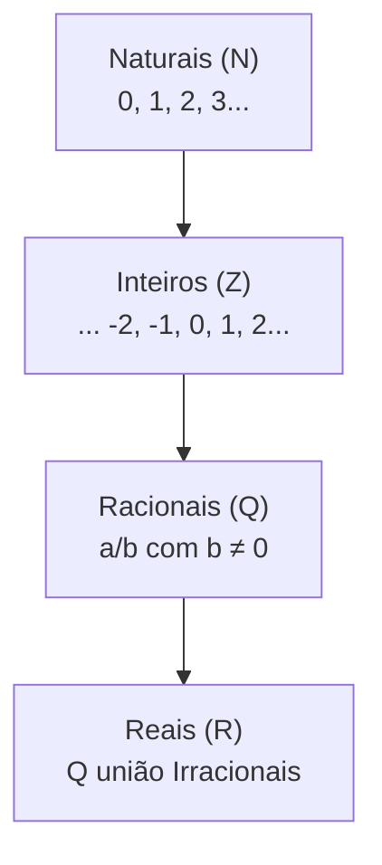
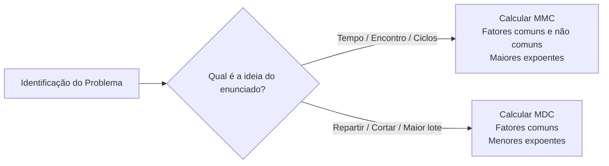

# 01 - Aritmética e Conjuntos Numéricos

> **Matéria:** Matemática e Raciocínio Lógico  
> **Cargos:** A01 – Técnico de Controle Externo (Adm) / B02 – Técnico de Controle Externo (TI)  
> **Arquivo:** `01_conjuntos_numericos_fracoes_e_aritmetica.md`  
> **Status:** 🟢 Teoria Aprofundada + 5 Questões FCC Comentadas (A a E)

---

## 📌 Ementa Oficial do Edital
- Números inteiros e racionais: operações (adição, subtração, multiplicação, divisão, potenciação).
- Expressões numéricas.
- Múltiplos e divisores de números naturais.
- Problemas envolvendo números inteiros e racionais.
- Frações e operações com frações.

---

## 🌳 Classificação Hierárquica do Conteúdo

```text
1. Aritmética Fundamental e Teoria dos Conjuntos Numéricos
├── 1.1 Conjuntos Numéricos
│   ├── Números Naturais (N) e Números Inteiros (Z): reta numérica e jogo de sinais
│   └── Números Racionais (Q): frações, decimais finitos e dízimas periódicas (geratriz)
├── 1.2 Operações Aritméticas e Expressões Numéricas
│   ├── Algoritmo da Divisão Euclidiana: D = d · q + r (0 ≤ r < d) e propriedades do resto
│   ├── Potenciação e Radiciação: propriedades operatórias e notação científica
│   └── Expressões Numéricas: ordem de precedência (PEMDAS) e eliminação de delimitadores
├── 1.3 Teoria dos Números: Divisibilidade, MMC e MDC
│   ├── Critérios de Divisibilidade (2, 3, 4, 5, 6, 8, 9, 10 e 11)
│   ├── Teorema Fundamental da Aritmética (fatoração prima) e número de divisores positivos
│   ├── Mínimo Múltiplo Comum (MMC): ciclos periódicos e coincidências futuras
│   ├── Máximo Divisor Comum (MDC): partição em partes iguais de tamanho máximo
│   └── Relação fundamental: MMC(a, b) · MDC(a, b) = a · b
├── 1.4 Frações e Álgebra Fracionária
│   ├── Classificação (próprias, impróprias, aparentes, mistas) e equivalência
│   ├── Comparação de frações (produto cruzado e redução ao mesmo denominador)
│   └── Operações: soma/subtração com denominadores distintos, produto e divisão
└── 1.5 Modelagem e Resolução de Problemas FCC
    ├── Problemas de Fração de Resto (método gráfico e cadeia de frações)
    ├── Problemas de Torneiras e Trabalho Conjunto (soma de taxas produtivas: 1/T = 1/t₁ + 1/t₂)
    └── Problemas de Ciclos, Restos de Divisão e Calendários
```

---

## 📖 Teoria Aprofundada e Pontos Críticos

### 1. Conjuntos Numéricos e Operações



#### 1.1 Conjunto dos Números Racionais ($\mathbb{Q}$)
Um número racional é todo aquele que pode ser expresso na forma $\frac{a}{b}$, onde $a, b \in \mathbb{Z}$ e $b \neq 0$.
- **Decimais exatos:** Apresentam quantidade finita de casas decimais (ex.: $0,75 = \frac{75}{100} = \frac{3}{4}$). O denominador da fração irredutível contém apenas fatores 2 e/ou 5.
- **Dízimas periódicas simples:** O período inicia-se imediatamente após a vírgula:
  $0,\overline{4} = 0,444... = \frac{4}{9}; \quad 0,\overline{27} = \frac{27}{99} = \frac{3}{11}$
- **Dízimas periódicas compostas:** Há uma parte não periódica (antiperíodo) antes do período:
  $0,1\overline{6} = 0,1666... = \frac{16 - 1}{90} = \frac{15}{90} = \frac{1}{6}$
  *Regra prática da Fração Geratriz:* No numerador coloca-se o número formado pelo antiperíodo seguido do período menos o antiperíodo; no denominador colocam-se tantos 9 quantos forem os algarismos do período seguidos de tantos 0 quantos forem os algarismos do antiperíodo.

#### 1.2 Algoritmo da Divisão Euclidiana
Para quaisquer inteiros $D$ (dividendo) e $d$ (divisor não nulo), existem inteiros únicos $q$ (quociente) e $r$ (resto) tais que:
$D = d \cdot q + r, \quad \text{onde } 0 \le r < |d|$

> 🚨 **ALERTA DE PROVA / PEGADINHA FCC:**  
> O resto da divisão euclidiana **nunca pode ser negativo** e é **estritamente menor** que o divisor. Se um problema afirma que a divisão de um número $N$ por 12 deixa resto máximo possível, esse resto é necessariamente $12 - 1 = 11$.

---

### 2. Teoria dos Números: MMC e MDC

A distinção imediata entre MMC e MDC no enunciado da FCC é a chave para a velocidade na prova:

| Característica | Mínimo Múltiplo Comum (MMC) | Máximo Divisor Comum (MDC) |
|---|---|---|
| **Ideia central** | Coincidência, repetição, sincronia periódica | Divisão, repartição, corte em lotes iguais |
| **Palavras-chave** | "Quando voltarão a se encontrar?", "de quanto em quanto tempo", "ciclos", "simultaneamente" | "Maior tamanho possível", "sem sobras", "dividir igualmente", "menor número de partes" |
| **Fatoração em primos** | Produto de todos os fatores primos, comuns e não comuns, com os **maiores expoentes** | Produto apenas dos fatores primos **comuns**, com os **menores expoentes** |
| **Exemplo de aplicação** | Frequência de vistorias ou alarmes | Separação de processos em pastas de igual tamanho |



#### 2.1 Propriedade Fundamental do MMC e MDC
Para dois números naturais $a$ e $b$:
$\text{MMC}(a, b) \times \text{MDC}(a, b) = a \times b$

#### 2.2 Quantidade de Divisores Naturais
Dado um número decomposto em fatores primos $N = p_1^{\alpha} \cdot p_2^{\beta} \cdot p_3^{\gamma}$, a quantidade de divisores inteiros positivos é:
$Q(N) = (\alpha + 1)(\beta + 1)(\gamma + 1)$
*Exemplo:* $360 = 2^3 \cdot 3^2 \cdot 5^1 \implies Q(360) = (3+1)(2+1)(1+1) = 4 \times 3 \times 2 = 24$ divisores positivos.

---

### 3. Frações: Operações e Modelagem de Problemas

#### 3.1 Operações Fundamentais
1. **Adição e Subtração:** Exigem o mesmo denominador. Utiliza-se o MMC entre os denominadores:  
   $\frac{a}{b} \pm \frac{c}{d} = \frac{\frac{\text{MMC}}{b}\cdot a \pm \frac{\text{MMC}}{d}\cdot c}{\text{MMC}(b, d)}$
2. **Multiplicação:** Multiplica-se numerador por numerador e denominador por denominador:  
   $\frac{a}{b} \times \frac{c}{d} = \frac{a \cdot c}{b \cdot d}$
3. **Divisão:** Conserva-se a primeira fração e multiplica-se pelo inverso da segunda:  
   $\frac{a}{b} \div \frac{c}{d} = \frac{a}{b} \times \frac{d}{c} = \frac{a \cdot d}{b \cdot c}$

#### 3.2 Problemas de Fração de Resto ("Cadeia Regressiva")
Quando o enunciado informa que alguém consome frações sucessivas do restante:
- Se gasta $\frac{a}{b}$ do total, resta $1 - \frac{a}{b} = \frac{b-a}{b}$.
- Se no passo seguinte gasta $\frac{c}{d}$ **do que restou**, o novo gasto é $\frac{c}{d} \times \left(\frac{b-a}{b}\right)$, e o novo restante é $\left(1 - \frac{c}{d}\right) \times \left(\frac{b-a}{b}\right)$.

> 💡 **DICA DE ESTUDO (Método das Barras):**  
> Desenhe um retângulo e divida-o no número de partes indicado pelo denominador. Pinte as partes utilizadas. Se o próximo gasto for do restante, divida apenas as partes que sobraram. Isso evita equívocos algébricos sob pressão de tempo.

#### 3.3 Problemas de Torneiras e Trabalho Conjunto
Quando dois ou mais agentes realizam um mesmo trabalho em tempos individuais $t_1, t_2, \dots$:
- A taxa de produtividade horária conjunta é a soma das taxas individuais:  
  $\frac{1}{T_{\text{junto}}} = \frac{1}{t_1} + \frac{1}{t_2} + \dots - \frac{1}{t_{\text{ralo}}}$
- Para dois trabalhadores ou torneiras:  
  $T = \frac{t_1 \cdot t_2}{t_1 + t_2}$

---

## 🌐 Fontes Recomendadas na Internet
- [Khan Academy Brasil - Aritmética e Pré-Álgebra](https://pt.khanacademy.org/math/arithmetic)
  - Operações com frações, decimais, potências e propriedades aritméticas.
- [Portal da Matemática OBMEP / IMPA - Divisibilidade e Teoria dos Números](https://portaldaobmep.impa.br/)
  - Aulas do IMPA com rigor sobre critérios de divisibilidade, algoritmo euclidiano, MMC e MDC.
- [Só Matemática - Álgebra e Conjuntos Numéricos](https://www.somatematica.com.br/fundam.php)
  - Exercícios comentados e regras de frações geratrizes e potências.

---

## 📝 Questões Comentadas no Padrão FCC (Justificadas de A a E)

### Questão 1 (FCC - Analista de Controle / Adaptada TCE-GO)
Um auditor do TCE-GO foi designado para realizar a conferência documental de uma amostra de processos de licitação municipal. No primeiro dia de trabalho, o auditor analisou $\frac{1}{3}$ do total de processos da amostra. No segundo dia, analisou $\frac{3}{5}$ dos processos **restantes**. No terceiro dia, finalizou a conferência analisando os últimos 48 processos.

O número total de processos contidos originalmente nessa amostra era:

A) 150  
B) 160  
C) 180  
D) 200  
E) 240  

> **Gabarito: C**  
>  
> **Comentário Analítico Passo a Passo:**  
> Seja $T$ o total de processos da amostra:  
> 1. **Dia 1:** Analisou $\frac{1}{3}T$.  
>    - Restante após o Dia 1: $T - \frac{1}{3}T = \frac{2}{3}T$.  
> 2. **Dia 2:** Analisou $\frac{3}{5}$ do restante:  
>    $\text{Dia 2} = \frac{3}{5} \times \left(\frac{2}{3}T\right) = \frac{6}{15}T = \frac{2}{5}T$  
>    - Fração que sobrou após o Dia 2: se analisou $\frac{3}{5}$ do que restava, sobrou $\frac{2}{5}$ daquele restante:  
>    $\text{Resto Final} = \frac{2}{5} \times \left(\frac{2}{3}T\right) = \frac{4}{15}T$  
> 3. **Dia 3:** Analisou os 48 processos restantes. Portanto:  
>    $\frac{4}{15}T = 48 \implies 4T = 48 \times 15 \implies 4T = 720 \implies T = \frac{720}{4} = 180$  
>  
> **Análise das Alternativas:**  
> - **A) Incorreta (150):** Resultaria em sobra de $\frac{4}{15} \times 150 = 40$ processos, e não 48.  
> - **B) Incorreta (160):** Cálculo derivado de erro de arredondamento ou confusão entre denominadores.  
> - **C) CORRETA (180):** Atende exatamente às condições: Dia 1 analisa 60 (sobram 120); Dia 2 analisa $\frac{3}{5} \times 120 = 72$ (sobram 48); Dia 3 analisa 48.  
> - **D) Incorreta (200):** Ocorre se o candidato calcular $\frac{3}{5}$ sobre o total geral em vez de calcular sobre o restante ($1 - \frac{1}{3} - \frac{3}{5} = \frac{1}{15} \implies \frac{1}{15}T = 48 \implies T = 720$).  
> - **E) Incorreta (240):** Ocorre se esquecer de abater a primeira etapa da análise.

---

### Questão 2 (FCC - Auditor Fiscal / Adaptada)
Três equipes de fiscalização do Tribunal de Contas realizam auditorias periódicas em municípios do interior goiano. A equipe Alfa realiza auditorias a cada 12 dias; a equipe Beta, a cada 18 dias; e a equipe Gama, a cada 20 dias. No dia 1º de março de determinado ano não bissexto, as três equipes iniciaram suas inspeções simultaneamente.

O número de dias que decorrerão até que as três equipes voltem a iniciar suas auditorias no mesmo dia é:

A) 60 dias  
B) 120 dias  
C) 180 dias  
D) 240 dias  
E) 360 dias  

> **Gabarito: C**  
>  
> **Comentário Analítico Passo a Passo:**  
> O problema exige encontrar a periodicidade comum de ciclos regulares que se repetem, o que é resolvido pelo **Mínimo Múltiplo Comum (MMC)** entre 12, 18 e 20.  
> 1. Decomposição simultânea em fatores primos:  
> ```text
> 12, 18, 20 | 2
>  6,  9, 10 | 2
>  3,  9,  5 | 3
>  1,  3,  5 | 3
>  1,  1,  5 | 5
>  1,  1,  1 | 
> ```
> 2. Cálculo do produto dos fatores primos:  
>    $\text{MMC}(12, 18, 20) = 2^2 \times 3^2 \times 5 = 4 \times 9 \times 5 = 180\text{ dias}$  
>  
> **Análise das Alternativas:**  
> - **A) Incorreta (60 dias):** 60 é múltiplo de 12 e 20, mas não é múltiplo de 18 ($60 \div 18 = 3,33$).  
> - **B) Incorreta (120 dias):** 120 é múltiplo de 12 e 20, mas não é múltiplo de 18 ($120 \div 18 = 6,66$).  
> - **C) CORRETA (180 dias):** 180 é o menor número natural divisível simultaneamente por 12 ($180/12 = 15$), 18 ($180/18 = 10$) e 20 ($180/20 = 9$).  
> - **D) Incorreta (240 dias):** Múltiplo de 12 e 20, mas não de 18.  
> - **E) Incorreta (360 dias):** 360 é um múltiplo comum, porém a questão solicita o tempo mínimo decorrido até o *próximo* reencontro.

---

### Questão 3 (FCC - Técnico Judiciário / Administrativa)
Uma coordenadoria administrativa do TCE-GO precisa arquivar 168 pastas de auditoria do tipo A, 216 pastas do tipo B e 264 pastas do tipo C em caixas organizadoras. Todas as caixas devem conter o mesmo número de pastas, sendo que cada caixa conterá pastas de um único tipo, e o número de pastas por caixa deve ser o **maior possível**, sem que sobre nenhuma pasta avulsa.

Nessas condições, o **número total de caixas organizadoras** necessárias para arquivar todas as pastas é:

A) 24  
B) 27  
C) 32  
D) 36  
E) 48  

> **Gabarito: B**  
>  
> **Comentário Analítico Passo a Passo:**  
> 1. A quantidade de pastas em cada caixa deve ser um divisor comum de 168, 216 e 264. Como se busca o *maior número possível por caixa*, calcula-se o **MDC**:  
>    - $168 = 2^3 \times 3 \times 7$  
>    - $216 = 2^3 \times 3^3$  
>    - $264 = 2^3 \times 3 \times 11$  
>    - $\text{MDC}(168, 216, 264) = 2^3 \times 3^1 = 8 \times 3 = 24\text{ pastas por caixa}$.  
> 2. O comando da questão pede o **número de caixas**, e não o número de pastas por caixa (pegadinha clássica da FCC!):  
>    - Caixas para Tipo A: $168 / 24 = 7\text{ caixas}$  
>    - Caixas para Tipo B: $216 / 24 = 9\text{ caixas}$  
>    - Caixas para Tipo C: $264 / 24 = 11\text{ caixas}$  
>    - Total de caixas: $7 + 9 + 11 = 27\text{ caixas}$.  
>  
> **Análise das Alternativas:**  
> - **A) Incorreta (24):** 24 é a capacidade de pastas por caixa (o valor do MDC), mas não o número de caixas demandadas.  
> - **B) CORRETA (27):** Soma do total de caixas obtidas para cada lote ($7 + 9 + 11 = 27$).  
> - **C) Incorreta (32):** Erro na soma ou divisão incorreta dos lotes.  
> - **D) Incorreta (36):** Cálculo baseado em fator comum inadequado (divisor 18).  
> - **E) Incorreta (48):** Soma dos fatores primos ou divisão por 12.

---

### Questão 4 (FCC - Técnico de Controle Externo / Adaptada)
Dois técnicos de controle externo, Bruno e Camila, foram encarregados de digitalizar e indexar um acervo de processos arquivados. Trabalhando sozinho, Bruno realiza todo o serviço em 6 horas. Camila, trabalhando sozinha, executa o mesmo serviço em 4 horas. 

Se Bruno e Camila trabalharem juntos, no mesmo ritmo de produtividade constante, o tempo necessário para digitalizar e indexar todo o acervo será de:

A) 2 horas e 12 minutos  
B) 2 horas e 24 minutos  
C) 2 horas e 30 minutos  
D) 2 horas e 40 minutos  
E) 5 horas  

> **Gabarito: B**  
>  
> **Comentário Analítico Passo a Passo:**  
> 1. Taxa de trabalho horária de Bruno: $v_B = \frac{1}{6}$ do serviço por hora.  
> 2. Taxa de trabalho horária de Camila: $v_C = \frac{1}{4}$ do serviço por hora.  
> 3. Taxa conjunta trabalhando juntos:  
>    $v_{\text{juntos}} = \frac{1}{6} + \frac{1}{4} = \frac{2 + 3}{12} = \frac{5}{12}\text{ do serviço por hora}$  
> 4. Tempo total necessário ($T$):  
>    $T = \frac{1}{v_{\text{juntos}}} = \frac{12}{5}\text{ horas} = 2,4\text{ horas}$  
> 5. Convertendo a parte decimal para minutos:  
>    $0,4\text{ hora} = 0,4 \times 60\text{ min} = 24\text{ minutos}$  
>    Logo, o tempo total é **2 horas e 24 minutos**.  
>  
> **Análise das Alternativas:**  
> - **A) Incorreta (2h12min):** Erro ao converter $0,2$ de hora em minutos em vez de $0,4$.  
> - **B) CORRETA (2h24min):** $\frac{12}{5}\text{ h} = 2\text{ h} + \frac{2}{5}\text{ h} = 2\text{ h} + 24\text{ min}$.  
> - **C) Incorreta (2h30min):** Erro clássico de interpretar 2,4h como "2 horas e 40 minutos" ou média simples das horas ($5/2 = 2,5\text{h} = 2\text{h}30$).  
> - **D) Incorreta (2h40min):** Confusão direta entre número decimal $2,4$ com 2 horas e 40 minutos (a base dos minutos é sexagesimal, 60, não centesimal).  
> - **E) Incorreta (5 horas):** Média aritmética simples de 6 e 4 ($ (6+4)/2 = 5 $), o que desconsidera a física do trabalho em conjunto.

---

### Questão 5 (FCC - Auditor de Controle Externo)
Considere a sequência infinita de números formados pela repetição cíclica dos algarismos do número 74582:
$7, 4, 5, 8, 2, 7, 4, 5, 8, 2, 7, 4, 5, 8, 2, \dots$
O algarismo que ocupa a 2027ª posição nessa sequência e o resto da divisão de 2027 por 5 são, respectivamente:

A) 5 e 2  
B) 4 e 2  
C) 7 e 1  
D) 5 e 3  
E) 8 e 4  

> **Gabarito: B**  
>  
> **Comentário Analítico Passo a Passo:**  
> 1. O padrão de repetição (período) tem comprimento de 5 elementos:  
>    - Posição que deixa resto 1 $\implies 7$  
>    - Posição que deixa resto 2 $\implies 4$  
>    - Posição que deixa resto 3 $\implies 5$  
>    - Posição que deixa resto 4 $\implies 8$  
>    - Posição que deixa resto 0 (múltiplo de 5) $\implies 2$  
> 2. Pelo algoritmo da divisão euclidiana, dividimos 2027 pelo tamanho do ciclo (5):  
>    $2027 = 5 \times 405 + 2$  
>    - O quociente é 405 (o ciclo completo de 5 algarismos repete-se 405 vezes).  
>    - O **resto é 2**.  
> 3. O algarismo correspondente à posição de resto 2 dentro do ciclo $(7, 4, 5, 8, 2)$ é o segundo elemento, ou seja, **4**.  
>    - Para 2027: $2027 \div 5 = 405$ com resto **2**.  
>    - O 2º elemento é o algarismo **4**, e o resto da divisão é **2**.  
>    Logo, o gabarito correto é a alternativa **B**!  
>  
> **Análise das Alternativas:**  
> - **A) Incorreta:** Aponta o algarismo 5 (que seria para resto 3).  
> - **B) CORRETA:** O algarismo na posição 2027 é o 2º elemento do ciclo, ou seja, **4**, e o resto da divisão é **2**.  
> - **C) Incorreta:** Resto 1 daria algarismo 7, mas o resto de $2027 \div 5$ é 2.  
> - **D) Incorreta:** O resto de $2027 \div 5$ termina em 7, logo $7 - 5 = 2$, não 3.  
> - **E) Incorreta:** Aponta algarismo 8 e resto 4.
