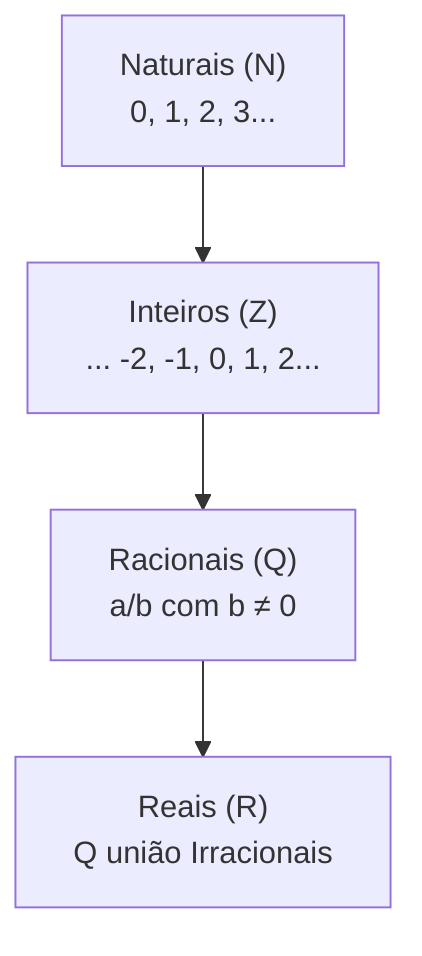
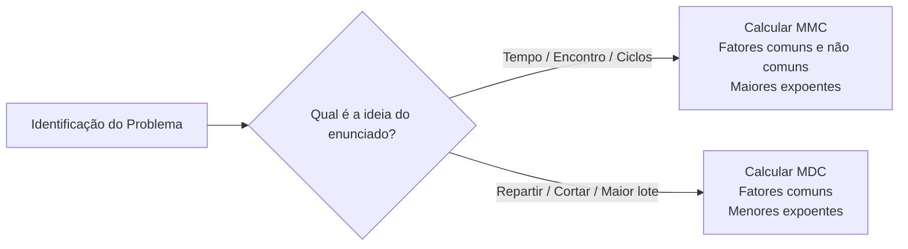

# 01 - Aritmética e Conjuntos Numéricos

> **Matéria:** Matemática e Raciocínio Lógico  
> **Cargos:** A01 – Técnico de Controle Externo (Adm) / B02 – Técnico de Controle Externo (TI)  
> **Arquivo:** `01_conjuntos_numericos_fracoes_e_aritmetica.md`  
> **Status:** 🟢 Teoria Aprofundada + 5 Questões FCC Comentadas (A a E)

---

## 📌 Ementa / Itens do Edital
- Números inteiros e racionais: operações (adição, subtração, multiplicação, divisão, potenciação).
- Expressões numéricas.
- Múltiplos e divisores de números naturais.
- Problemas envolvendo números inteiros e racionais.
- Frações e operações com frações.

---

## 🧭 Sumário
- [1. Conjuntos Numéricos Fundamentais e Propriedades Estruturais](#1-conjuntos-numéricos-fundamentais-e-propriedades-estruturais)
    - [1.1 Conjunto dos Números Naturais e Inteiros](#11-conjunto-dos-números-naturais-e-inteiros)
    - [1.2 Conjunto dos Números Racionais: Decimais Finitos e Dízimas Periódicas](#12-conjunto-dos-números-racionais-decimais-finitos-e-dízimas-periódicas)
    - [1.3 Algoritmo da Divisão Euclidiana e Aritmética dos Restos](#13-algoritmo-da-divisão-euclidiana-e-aritmética-dos-restos)
- [2. Operações Aritméticas e Expressões Numéricas](#2-operações-aritméticas-e-expressões-numéricas)
    - [2.1 Ordem de Precedência das Operações e Delimitadores](#21-ordem-de-precedência-das-operações-e-delimitadores)
    - [2.2 Potenciação: Propriedades Operatórias e Notação Científica](#22-potenciação-propriedades-operatórias-e-notação-científica)
- [3. Teoria dos Números: Divisibilidade, Primos, MMC e MDC](#3-teoria-dos-números-divisibilidade-primos-mmc-e-mdc)
    - [3.1 Critérios de Divisibilidade Aplicados](#31-critérios-de-divisibilidade-aplicados)
    - [3.2 Decomposição em Fatores Primos e Contagem de Divisores Positivos](#32-decomposição-em-fatores-primos-e-contagem-de-divisores-positivos)
    - [3.3 Mínimo Múltiplo Comum: Ciclos, Coincidências e Periodicidade](#33-mínimo-múltiplo-comum-ciclos-coincidências-e-periodicidade)
    - [3.4 Máximo Divisor Comum: Partições Equitativas e Lotes Máximos](#34-máximo-divisor-comum-partições-equitativas-e-lotes-máximos)
    - [3.5 Relação Fundamental entre MMC e MDC](#35-relação-fundamental-entre-mmc-e-mdc)
- [4. Álgebra Fracionária e Operações com Frações](#4-álgebra-fracionária-e-operações-com-frações)
    - [4.1 Conceito, Tipologias e Equivalência de Frações](#41-conceito-tipologias-e-equivalência-de-frações)
    - [4.2 Operações Aritméticas com Frações](#42-operações-aritméticas-com-frações)
- [5. Modelagem e Resolução de Problemas no Padrão FCC](#5-modelagem-e-resolução-de-problemas-no-padrão-fcc)
    - [5.1 Problemas de Fração de Resto ou Cadeia Regressiva](#51-problemas-de-fração-de-resto-ou-cadeia-regressiva)
    - [5.2 Problemas de Trabalho Conjunto e Torneiras](#52-problemas-de-trabalho-conjunto-e-torneiras)
    - [5.3 Problemas de Ciclos Periódicos e Padrões Sequenciais](#53-problemas-de-ciclos-periódicos-e-padrões-sequenciais)
- [Fontes Oficiais e Referências Bibliográficas](#fontes-oficiais-e-referências-bibliográficas)
- [Questões de Concurso FCC Comentadas](#questões-de-concurso-fcc-comentadas)
    - [Questão 01](#questão-01)
    - [Questão 02](#questão-02)
    - [Questão 03](#questão-03)
    - [Questão 04](#questão-04)
    - [Questão 05](#questão-05)

---

## 1. Conjuntos Numéricos Fundamentais e Propriedades Estruturais

O estudo dos conjuntos numéricos estabelece as bases conceituais sobre as quais repousa toda a aritmética e o raciocínio quantitativo exigido nos concursos da área fiscal e de controle. A estruturação desses conjuntos desenvolveu-se historicamente para sanar impossibilidades operatórias verificadas em conjuntos mais restritos.

### 1.1 Conjunto dos Números Naturais e Inteiros

* **Conjunto dos Números Naturais ($\mathbb{N}$):**
  $$\mathbb{N} = \{0, 1, 2, 3, 4, 5, \dots\}$$
  Representa o conjunto de contagem primitiva e ordenação de elementos discretos. É fechado sob as operações de adição e multiplicação (a soma ou produto de dois naturais é sempre um natural), mas falha no fechamento da subtração quando o minuendo é menor que o subtraendo ($3 - 8 \notin \mathbb{N}$).
* **Conjunto dos Números Inteiros ($\mathbb{Z}$):**
  $$\mathbb{Z} = \{\dots, -3, -2, -1, 0, 1, 2, 3, \dots\}$$
  Incorpora os opostos simétricos (negativos) aos números naturais, viabilizando o fechamento irrestrito da subtração. Na reta numérica, os inteiros organizam-se ordenadamente em torno da origem zero.
    * *Regra de Sinais na Multiplicação e Divisão:* Sinais iguais geram resultado positivo ($+ \cdot + = +$; $- \cdot - = +$); sinais contrários geram resultado negativo ($+ \cdot - = -$; $- \cdot + = -$).
    * *Adição de Inteiros com Sinais Opostos:* Conserva-se o sinal do termo de maior valor absoluto (módulo) e subtraem-se os valores: $(-15) + (+9) = -(15 - 9) = -6$.

### 1.2 Conjunto dos Números Racionais: Decimais Finitos e Dízimas Periódicas

O **Conjunto dos Números Racionais ($\mathbb{Q}$)** reúne todos os números suscetíveis de representação sob a forma de uma razão ou fração de dois números inteiros com denominador não nulo:
$$\mathbb{Q} = \left\{ x = \frac{a}{b} \ \middle| \ a \in \mathbb{Z}, \ b \in \mathbb{Z}, \ b \neq 0 \right\}$$

Todo número racional pode ser transcrito sob representação decimal, dividindo-se o numerador pelo denominador, resultando em apenas duas possibilidades formais:

1. **Decimais Exatos (ou Finitos):** Apresentam um número finito de casas decimais após a vírgula. Isso ocorre quando a fração irredutível $\frac{a}{b}$ possui um denominador $b$ decomposto exclusivamente em fatores primos iguais a $2$ e/ou $5$:
   $$0,75 = \frac{75}{100} = \frac{3}{4} \quad (4 = 2^2); \qquad 0,35 = \frac{35}{100} = \frac{7}{20} \quad (20 = 2^2 \times 5)$$
2. **Dízimas Periódicas:** Apresentam infinitas casas decimais que se repetem de maneira cíclica a partir de um bloco repetitivo denominado **período**:
    * **Dízima Periódica Simples:** O período principia imediatamente após a vírgula:
     $$0,\overline{4} = 0,444\dots = \frac{4}{9}; \qquad 0,\overline{27} = 0,2727\dots = \frac{27}{99} = \frac{3}{11}$$
    * **Dízima Periódica Composta:** Existe um segmento decimal que não se repete (o antiperíodo) posicionado entre a vírgula e o início do período:
     $$0,1\overline{6} = 0,1666\dots$$
    * **Regra Prática da Fração Geratriz para Dízimas Compostas:**
     $$\text{Fração Geratriz} = \frac{(\text{Antiperíodo seguido do Período}) - (\text{Antiperíodo})}{(\text{tantos 9 quantos forem os dígitos do período}) \times 10^{(\text{dígitos do antiperíodo})}}$$
     Exemplo para $0,1\overline{6}$:
     $$0,1\overline{6} = \frac{16 - 1}{90} = \frac{15}{90} = \frac{1}{6}$$

### 1.3 Algoritmo da Divisão Euclidiana e Aritmética dos Restos

Para quaisquer dois números inteiros $D$ (dividendo) e $d$ (divisor não nulo), existem inteiros únicos $q$ (quociente) e $r$ (resto) tais que:
$$D = d \cdot q + r, \quad \text{onde } 0 \le r < |d|$$

Propriedades críticas da divisão inteira:

* O resto $r$ é **estritamente não negativo** e **menor que o divisor** ($0 \le r \le d - 1$).
* O **resto máximo possível** na divisão por um divisor $d$ é sempre igual a $d - 1$. Se um problema indagar o resto máximo obtido na divisão por $15$, esse valor é inequivocamente $15 - 1 = 14$.

> 🚨 **ALERTA DE PROVA / PEGADINHA FCC:** Em problemas que envolvem ciclos e restos de divisão (dias da semana, rodízio de equipes, posições de algarismos), o divisor corresponde ao tamanho do ciclo. Se o resto for zero, significa que a divisão foi exata e que a posição procurada corresponde rigorosamente ao **último elemento** do ciclo periódico, e não ao primeiro!

---

## 2. Operações Aritméticas e Expressões Numéricas

### 2.1 Ordem de Precedência das Operações e Delimitadores

A avaliação de expressões aritméticas complexas exige obediência à ordem universal de precedência matemática (mnemônico PEMDAS / PDMAS):

1. **Ordem dos Delimitadores de Escopo (de dentro para fora):**
   1º) Parênteses $( \ )$;
   2º) Colchetes $[ \ ]$;
   3º) Chaves $\{ \ \}$.
2. **Ordem Hierárquica das Operações:**
   1º) **Potenciações e Radiciações** (na ordem em que aparecem da esquerda para a direita);
   2º) **Multiplicações e Divisões** (com estrita igualdade de precedência, calculando-se o que vier primeiro da esquerda para a direita);
   3º) **Adições e Subtrações** (igualmente da esquerda para a direita).

> 📌 **NOTA EXPLICATIVA / ERRO COMUM DE DIVISÃO E MULTIPLICAÇÃO:** Na expressão $12 \div 3 \times 2$, a multiplicação **não** tem prioridade sobre a divisão! Ambas possuem a mesma hierarquia; resolve-se da esquerda para a direita: $12 \div 3 = 4$, e $4 \times 2 = 8$ (o cálculo incorreto $12 \div 6 = 2$ é uma armadilha frequente).

### 2.2 Potenciação: Propriedades Operatórias e Notação Científica

A potenciação traduz o produto de fatores idênticos repetidos ($a^n = \underbrace{a \cdot a \cdots a}_{n \text{ vezes}}$). Suas propriedades fundamentais incluem:

* Produto de potências de mesma base: $a^m \cdot a^n = a^{m+n}$
* Divisão de potências de mesma base: $\frac{a^m}{a^n} = a^{m-n} \quad (a \neq 0)$
* Potência de potência: $(a^m)^n = a^{m \cdot n}$
* Potência de produto: $(a \cdot b)^n = a^n \cdot b^n$
* Expoente nulo: $a^0 = 1 \quad (a \neq 0)$
* Expoente negativo: $a^{-n} = \frac{1}{a^n} = \left(\frac{1}{a}\right)^n \quad (a \neq 0)$
* Expoente fracionário (Radiciação): $a^{\frac{m}{n}} = \sqrt[n]{a^m}$

---

## 3. Teoria dos Números: Divisibilidade, Primos, MMC e MDC

A teoria dos números fornece o ferramental algébrico para lidar com divisões inteiras, periodicidade de escalas e otimização de lotes em logística e auditoria.

### 3.1 Critérios de Divisibilidade Aplicados

Permitem verificar se um número inteiro $N$ é divisível por outro sem executar a divisão longa:

* **Por 2:** O último algarismo da direita é par ($0, 2, 4, 6, 8$).
* **Por 3:** A soma dos valores absolutos dos seus algarismos é um múltiplo de 3 (ex.: $7.458 \rightarrow 7 + 4 + 5 + 8 = 24$, que é divisível por 3).
* **Por 4:** O número formado pelos dois últimos algarismos é divisível por 4 ou termina em $00$.
* **Por 5:** O último algarismo é $0$ ou $5$.
* **Por 6:** É simultaneamente divisível por 2 (par) e por 3 (soma dos algarismos múltipla de 3).
* **Por 8:** O número formado pelos três últimos algarismos é divisível por 8 ou termina em $000$.
* **Por 9:** A soma dos seus algarismos resulta em um múltiplo de 9.
* **Por 10:** O último algarismo é obrigatoriamente $0$.
* **Por 11:** A diferença entre a soma dos algarismos de ordem ímpar e a soma dos algarismos de ordem par é múltipla de 11 (incluindo o zero).

### 3.2 Decomposição em Fatores Primos e Contagem de Divisores Positivos

Pelo Teorema Fundamental da Aritmética, qualquer número natural maior que 1 pode ser decomposto de forma única (a menos da ordem dos fatores) em um produto de potências de números primos:
$$N = p_1^{\alpha} \cdot p_2^{\beta} \cdot p_3^{\gamma} \cdots p_k^{\omega}$$

#### Quantidade Total de Divisores Positivos:
O número total de divisores inteiros positivos de $N$ é obtido somando-se uma unidade a cada expoente da fatoração canônica e multiplicando-se os resultados:
$$Q(N) = (\alpha + 1)(\beta + 1)(\gamma + 1)\cdots(\omega + 1)$$
*Exemplo:* Para encontrar quantos divisores possui o número 360:
$$360 = 2^3 \cdot 3^2 \cdot 5^1 \implies Q(360) = (3 + 1)(2 + 1)(1 + 1) = 4 \times 3 \times 2 = 24 \text{ divisores}$$

### 3.3 Mínimo Múltiplo Comum: Ciclos, Coincidências e Periodicidade

O **Mínimo Múltiplo Comum (MMC)** entre dois ou mais inteiros é o menor número natural não nulo que é divisível simultaneamente por todos eles.
* **Cálculo Prático:** Decompõem-se os números em fatores primos; o MMC é o produto de **todos os fatores primos comuns e não comuns, elevados aos seus maiores expoentes**.

> 💡 **DICA DE IDENTIFICAÇÃO (MMC NA FCC):** O problema exige MMC sempre que veicular ideias de **coincidência temporal futura**, **reencontro de eventos periódicos**, **ciclos de rondas/inspeções** ou questões que indaguem: *"quando voltarão a se encontrar simultaneamente?"*.

### 3.4 Máximo Divisor Comum: Partições Equitativas e Lotes Máximos

O **Máximo Divisor Comum (MDC)** é o maior número inteiro capaz de dividir exatamente todos os números dados, sem deixar resto.
* **Cálculo Prático:** É o produto **apenas dos fatores primos comuns a todos os números, elevados aos seus menores expoentes**.

| Característica | Mínimo Múltiplo Comum (MMC) | Máximo Divisor Comum (MDC) |
|---|---|---|
| **Ideia central** | Coincidência, repetição, sincronia periódica | Divisão, partição equitativa, corte em partes iguais |
| **Palavras-chave** | "Quando voltarão a se encontrar?", "periodicidade", "ciclos", "simultaneamente" | "Maior tamanho possível", "sem sobras", "dividir igualmente", "menor número de caixas" |
| **Fatoração em primos** | Fatores comuns e não comuns com os **maiores expoentes** | Apenas fatores **comuns** com os **menores expoentes** |

> 🚨 **ALERTA DE PROVA / PEGADINHA CLÁSSICA DO MDC:** Em problemas de particionamento (como arquivar pastas em caixas de maior tamanho possível), o cálculo do MDC fornece a **capacidade de cada caixa**, e **não a quantidade total de caixas**! Para achar a quantidade de caixas, deve-se somar a divisão de cada lote pelo valor do MDC encontrado.

### 3.5 Relação Fundamental entre MMC e MDC

Para quaisquer dois números inteiros positivos $a$ e $b$, o produto entre o seu MMC e o seu MDC é rigorosamente igual ao produto entre os próprios números:
$$\text{MMC}(a, b) \times \text{MDC}(a, b) = a \times b$$

---

## 4. Álgebra Fracionária e Operações com Frações

Uma fração $\frac{a}{b}$ representa uma divisão indicada onde o denominador $b$ assinala em quantas partes iguais a unidade inteira foi particionada, e o numerador $a$ indica quantas dessas partes foram tomadas.

### 4.1 Conceito, Tipologias e Equivalência de Frações

* **Fração Própria:** O numerador é menor que o denominador ($a < b$). Representa um valor estritamente menor que a unidade inteira ($\frac{2}{5}, \frac{7}{9}$).
* **Fração Imprópria:** O numerador é maior ou igual ao denominador ($a \ge b$). Representa um valor maior ou igual à unidade inteira ($\frac{7}{4}, \frac{11}{3}$). Podem ser convertidas em **números mistos**: $\frac{7}{4} = 1 \frac{3}{4}$.
* **Fração Aparente:** O numerador é múltiplo exato do denominador, consubstanciando um número inteiro disfarçado ($\frac{12}{3} = 4, \frac{35}{7} = 5$).
* **Frações Equivalentes e Irredutibilidade:** Duas frações são equivalentes quando representam a mesma grandeza fracionária ($\frac{2}{3} = \frac{4}{6} = \frac{10}{15}$). Obtém-se a fração irredutível simplificando numerador e denominador pelo seu MDC.

### 4.2 Operações Aritméticas com Frações

1. **Adição e Subtração:**
    * Com denominadores iguais: conserva-se o denominador comum e operam-se os numeradores: $\frac{a}{c} \pm \frac{b}{c} = \frac{a \pm b}{c}$.
    * Com denominadores distintos: reduz-se ao mesmo denominador mediante o cálculo do MMC dos denominadores:
     $$\frac{a}{b} \pm \frac{c}{d} = \frac{\left(\frac{\text{MMC}}{b} \cdot a\right) \pm \left(\frac{\text{MMC}}{d} \cdot c\right)}{\text{MMC}(b, d)}$$
2. **Multiplicação:** Multiplicam-se os numeradores entre si e os denominadores entre si:
   $$\frac{a}{b} \times \frac{c}{d} = \frac{a \cdot c}{b \cdot d}$$
   A preposição "de" na matemática denota multiplicação: $\frac{2}{3}$ *de* $\frac{4}{5} = \frac{2}{3} \times \frac{4}{5} = \frac{8}{15}$.
3. **Divisão:** Conserva-se a primeira fração e multiplica-se pela fração inversa da segunda:
   $$\frac{a}{b} \div \frac{c}{d} = \frac{a}{b} \times \frac{d}{c} = \frac{a \cdot d}{b \cdot c} \quad (c, d \neq 0)$$

---

## 5. Modelagem e Resolução de Problemas no Padrão FCC

### 5.1 Problemas de Fração de Resto ou Cadeia Regressiva

Problemas clássicos da FCC narram um agente que consome uma fração de um montante total no primeiro dia, gasta uma fração **do restante** no segundo dia e encerra com uma quantia fixa final:

* Se no passo 1 gasta-se $\frac{1}{3}$ do total $T$, sobra:
  $$\text{Resto}_1 = 1 - \frac{1}{3} = \frac{2}{3}T$$
* Se no passo 2 gasta-se $\frac{3}{5}$ **do que sobrou**, o gasto é $\frac{3}{5} \times \frac{2}{3}T = \frac{6}{15}T = \frac{2}{5}T$.
* A parcela que resta ao final é o complementar de $\frac{3}{5}$ sobre o restante prévio:
  $$\text{Resto Final} = \left(1 - \frac{3}{5}\right) \times \frac{2}{3}T = \frac{2}{5} \times \frac{2}{3}T = \frac{4}{15}T$$
* Igualando essa fração ao valor numérico remanescente dado no enunciado, descobre-se o total $T$ por equação direta.

### 5.2 Problemas de Trabalho Conjunto e Torneiras

Quando dois agentes executam uma mesma tarefa de forma cooperativa em ritmos constantes, somam-se as suas taxas unitárias horárias de produtividade:
$$\text{Taxa Conjunta} = \frac{1}{T_{\text{junto}}} = \frac{1}{t_1} + \frac{1}{t_2} + \dots - \frac{1}{t_{\text{ralo}}}$$
Para o caso específico de dois agentes que levam tempos individuais $t_1$ e $t_2$:
$$T = \frac{t_1 \cdot t_2}{t_1 + t_2}$$

*Atenção à Conversão de Tempo:* Se o resultado da divisão em horas for decimal, como $2,4\text{ horas}$, a parte inteira corresponde a $2\text{ horas}$ e a parte decimal $0,4$ deve ser multiplicada por $60\text{ minutos}$ ($0,4 \times 60 = 24\text{ minutos}$). Logo, $2,4\text{ h} = 2\text{ horas e } 24\text{ minutos}$ (e nunca 2h40min!).

### 5.3 Problemas de Ciclos Periódicos e Padrões Sequenciais

Em problemas que constroem sequências infinitas repetindo ciclicamente um conjunto finito de $k$ elementos ($x_1, x_2, \dots, x_k$):

1. Toma-se o número da posição requerida $P$;
2. Divide-se $P$ pelo tamanho do ciclo $k$, obtendo o quociente $q$ e o resto $r$ ($P = k \cdot q + r$);
3. **Se o resto $r > 0$:** O termo procurado é exatamente o $r$-ésimo elemento do ciclo padrão;
4. **Se o resto $r = 0$:** O termo procurado é o último elemento do ciclo (o $k$-ésimo elemento).

---

## 🌐 Fontes Oficiais e Referências Bibliográficas

* [Khan Academy Brasil - Aritmética e Pré-Álgebra](https://pt.khanacademy.org/math/arithmetic) - Operações com frações, decimais, potências e propriedades aritméticas.
* [Portal da Matemática OBMEP / IMPA - Divisibilidade e Teoria dos Números](https://portaldaobmep.impa.br/) - Aulas do IMPA com rigor sobre critérios de divisibilidade, algoritmo euclidiano, MMC e MDC.
* [Só Matemática - Álgebra e Conjuntos Numéricos](https://www.somatematica.com.br/fundam.php) - Exercícios comentados e regras de frações geratrizes e potências.

---

## 📝 Questões de Concurso FCC Comentadas

### Questão 01
**(FCC – TCE-GO – Analista de Controle Externo)**  
Um auditor do TCE-GO foi designado para realizar a conferência documental de uma amostra de processos de licitação municipal. No primeiro dia de trabalho, o auditor analisou $\frac{1}{3}$ do total de processos da amostra. No segundo dia, analisou $\frac{3}{5}$ dos processos **restantes**. No terceiro dia, finalizou a conferência analisando os últimos 48 processos.

O número total de processos contidos originalmente nessa amostra era:

* **A)** 150
* **B)** 160
* **C)** 180
* **D)** 200
* **E)** 240

> **Comentário Detalhado:**
> Modelando o problema algebricamente:
>
> - Seja $T$ a quantidade total de processos da amostra.
> - **No Dia 1:** O auditor executou $\frac{1}{3}T$. A quantidade remanescente após o primeiro dia é:
>   $$\text{Resto}_1 = T - \frac{1}{3}T = \frac{2}{3}T$$
> - **No Dia 2:** O auditor analisou $\frac{3}{5}$ do que restava. Logo, sobrou $\frac{2}{5}$ daquele montante restante:
>   $$\text{Resto Final} = \left(1 - \frac{3}{5}\right) \times \text{Resto}_1 = \frac{2}{5} \times \left(\frac{2}{3}T\right) = \frac{4}{15}T$$
> - **No Dia 3:** O enunciado informa que o resto final totalizou 48 processos. Igualando os valores:
>   $$\frac{4}{15}T = 48 \implies 4T = 48 \times 15 \implies 4T = 720 \implies T = \frac{720}{4} = 180$$
>
> Análise individual das alternativas:
>
> - **A)** Incorreta. Se o total fosse 150, o resto final seria $\frac{4}{15} \times 150 = 40$ processos, divergindo dos 48 informados.
> - **B)** Incorreta. Decorre de equívoco no cálculo das frações parciais.
> - **C)** Correta. Com $T = 180$: no dia 1 são analisados 60 processos (restando 120); no dia 2 são analisados $\frac{3}{5} \times 120 = 72$ processos (restando $120 - 72 = 48$); no dia 3 são analisados exatamente os 48 processos finais.
> - **D)** Incorreta. Ocorre se o candidato calcular $\frac{3}{5}$ sobre o total geral em vez de incidir sobre o restante ($1 - \frac{1}{3} - \frac{3}{5} = \frac{1}{15} \implies \frac{1}{15}T = 48 \implies T = 720$).
> - **E)** Incorreta. Decorre de erro na simplificação de $\frac{720}{4}$ ou na dedução inicial.
> 
> **Gabarito: C**

---

### Questão 02
**(FCC – Auditor Fiscal da Receita – Adaptada)**  
Três equipes de fiscalização do Tribunal de Contas realizam auditorias periódicas em municípios do interior goiano. A equipe Alfa realiza auditorias a cada 12 dias; a equipe Beta, a cada 18 dias; e a equipe Gama, a cada 20 dias. No dia 1º de março de determinado ano não bissexto, as três equipes iniciaram suas inspeções simultaneamente.

O número de dias que decorrerão até que as três equipes voltem a iniciar suas auditorias no mesmo dia é:

* **A)** 60 dias
* **B)** 120 dias
* **C)** 180 dias
* **D)** 240 dias
* **E)** 360 dias

> **Comentário Detalhado:**
> O problema demanda o cálculo do menor intervalo de tempo em que eventos com frequências periódicas distintas coincidem simultaneamente no futuro, o que se resolve determinando o **Mínimo Múltiplo Comum (MMC)** entre 12, 18 e 20.
> Decompondo os números em fatores primos simultâneos:
>
> - $12 = 2^2 \times 3$
> - $18 = 2 \times 3^2$
> - $20 = 2^2 \times 5$
> 
> O MMC reúne todos os fatores primos presentes (2, 3 e 5), elevados aos seus maiores expoentes:
> $$\text{MMC}(12, 18, 20) = 2^2 \times 3^2 \times 5 = 4 \times 9 \times 5 = 180 \text{ dias}$$
> 
> Análise individual das alternativas:
>
> - **A)** Incorreta. 60 é múltiplo comum de 12 e 20, mas não é divisível por 18 ($60 \div 18 \approx 3,33$).
> - **B)** Incorreta. 120 é divisível por 12 e por 20, mas não divide exatamente por 18 ($120 \div 18 \approx 6,66$).
> - **C)** Correta. 180 é o menor número natural simultaneamente divisível por 12 ($180/12 = 15$), 18 ($180/18 = 10$) e 20 ($180/20 = 9$).
> - **D)** Incorreta. 240 não é divisível por 18 ($240 \div 18 \approx 13,33$).
> - **E)** Incorreta. 360 é um múltiplo comum posterior, mas a questão indaga expressamente quando voltarão a coincidir (primeiro reencontro após 1º de março).
> 
> **Gabarito: C**

---

### Questão 03
**(FCC – TCE-PI – Técnico de Controle Externo)**  
Uma coordenadoria administrativa do TCE-GO precisa arquivar 168 pastas de auditoria do tipo A, 216 pastas do tipo B e 264 pastas do tipo C em caixas organizadoras. Todas as caixas devem conter o mesmo número de pastas, sendo que cada caixa conterá pastas de um único tipo, e o número de pastas por caixa deve ser o **maior possível**, sem que sobre nenhuma pasta avulsa.

Nessas condições, o **número total de caixas organizadoras** necessárias para arquivar todas as pastas é:

* **A)** 24
* **B)** 27
* **C)** 32
* **D)** 36
* **E)** 48

> **Comentário Detalhado:**
> A resolução compõe-se de duas etapas lógicas:
>
> 1. Para que as caixas tenham capacidade idêntica, comportem apenas pastas do mesmo tipo e o número de pastas em cada caixa seja o **maior possível**, a capacidade de cada caixa deve corresponder ao **Máximo Divisor Comum (MDC)** entre 168, 216 e 264:
>    - $168 = 2^3 \times 3 \times 7$
>    - $216 = 2^3 \times 3^3$
>    - $264 = 2^3 \times 3 \times 11$
>    - $\text{MDC}(168, 216, 264) = 2^3 \times 3^1 = 8 \times 3 = 24 \text{ pastas por caixa}$.
> 2. O enunciado indaga expressamente o **número de caixas** demandado (e não a quantidade de pastas por caixa):
>    - Caixas para o lote A: $168 \div 24 = 7 \text{ caixas}$
>    - Caixas para o lote B: $216 \div 24 = 9 \text{ caixas}$
>    - Caixas para o lote C: $264 \div 24 = 11 \text{ caixas}$
>    - Total de caixas: $7 + 9 + 11 = 27 \text{ caixas}$.
>
> Análise das alternativas:
>
> - **A)** Incorreta. 24 é a capacidade unitária de pastas em cada caixa (o valor do MDC), armadilha clássica da FCC para o candidato desatento ao comando da questão.
> - **B)** Correta. 27 caixas no total ($7 + 9 + 11$).
> - **C)** Incorreta. Decorre de soma equivocada dos quocientes de divisão.
> - **D)** Incorreta. Considerou indevidamente um divisor não ótimo.
> - **E)** Incorreta. Decorre de erro na soma dos fatores primos ou de divisão simples por 12.
> 
> **Gabarito: B**

---

### Questão 04
**(FCC – TRT – Técnico Judiciário)**  
Dois técnicos de controle externo, Bruno e Camila, foram encarregados de digitalizar e indexar um acervo de processos arquivados. Trabalhando sozinho, Bruno realiza todo o serviço em 6 horas. Camila, trabalhando sozinha, executa o mesmo serviço em 4 horas. 

Se Bruno e Camila trabalharem juntos, no mesmo ritmo de produtividade constante, o tempo necessário para digitalizar e indexar todo o acervo será de:

* **A)** 2 horas e 12 minutos
* **B)** 2 horas e 24 minutos
* **C)** 2 horas e 30 minutos
* **D)** 2 horas e 40 minutos
* **E)** 5 horas

> **Comentário Detalhado:**
> Problema clássico de trabalho cooperativo e soma de taxas operatórias:
>
> 1. Taxa horária de Bruno: $v_B = \frac{1}{6}$ do serviço por hora.
> 2. Taxa horária de Camila: $v_C = \frac{1}{4}$ do serviço por hora.
> 3. Taxa conjunta trabalhando juntos:
>    $$v_{\text{juntos}} = \frac{1}{6} + \frac{1}{4} = \frac{2 + 3}{12} = \frac{5}{12} \text{ do serviço por hora}$$
> 4. Tempo total necessário ($T$):
>    $$T = \frac{1}{v_{\text{juntos}}} = \frac{12}{5} \text{ horas} = 2,4 \text{ horas}$$
> 5. Conversão da fração horária decimal:
>    A parte inteira é de 2 horas. A parte decimal corresponde a:
>    $$0,4 \text{ hora} = 0,4 \times 60 \text{ minutos} = 24 \text{ minutos}$$
>    Portanto, o tempo total é de **2 horas e 24 minutos**.
>
> Análise das alternativas:
>
> - **A)** Incorreta. Erra ao converter a parte decimal tomando $0,2$ em vez de $0,4$.
> - **B)** Correta. $2,4 \text{ horas} = 2 \text{ horas e } 24 \text{ minutos}$.
> - **C)** Incorreta. Resulta da confusão de achar que 2,4h equivale à média de tempo ou 2h30min.
> - **D)** Incorreta. Erro crasso de interpretar o dígito 4 do número decimal 2,4 como 40 minutos (a contagem do tempo é sexagesimal, base 60, e não decimal).
> - **E)** Incorreta. Média aritmética ingênua dos tempos individuais ($\frac{6 + 4}{2} = 5 \text{ horas}$), o que contraria o fato óbvio de que duas pessoas trabalhando juntas terminam a tarefa em tempo menor que o trabalhador mais rápido isoladamente.
> 
> **Gabarito: B**

---

### Questão 05
**(FCC – TCE-GO – Auditor de Controle Externo)**  
Considere a sequência infinita de números formados pela repetição cíclica dos algarismos do número 74582:
$$7, 4, 5, 8, 2, 7, 4, 5, 8, 2, 7, 4, 5, 8, 2, \dots$$
O algarismo que ocupa a 2027ª posição nessa sequência e o resto da divisão de 2027 por 5 são, respectivamente:

* **A)** 5 e 2
* **B)** 4 e 2
* **C)** 7 e 1
* **D)** 5 e 3
* **E)** 8 e 4

> **Comentário Detalhado:**
> Análise do padrão de periodicidade cíclica:
>
> 1. O ciclo básico é composto por 5 algarismos ordenados:
>    - 1º elemento: 7 (posições que deixam resto 1 na divisão por 5)
>    - 2º elemento: 4 (posições que deixam resto 2 na divisão por 5)
>    - 3º elemento: 5 (posições que deixam resto 3 na divisão por 5)
>    - 4º elemento: 8 (posições que deixam resto 4 na divisão por 5)
>    - 5º elemento: 2 (posições que deixam resto 0 na divisão por 5, múltiplos exatos de 5)
> 2. Pelo algoritmo da divisão euclidiana, dividimos a posição 2027 pelo comprimento do período (5):
>    $$2027 = 5 \times 405 + 2$$
>    - O quociente 405 indica que o ciclo completo de 5 algarismos é repetido integralmente 405 vezes.
>    - O **resto é 2**.
> 3. Como o resto da divisão é 2, o algarismo que ocupa a 2027ª posição corresponde ao segundo elemento do bloco cíclico padrão $(7, \mathbf{4}, 5, 8, 2)$, que é o algarismo **4**.
> 4. Logo, o algarismo é **4** e o resto é **2**.
>
> Análise das alternativas:
>
> - **A)** Incorreta. Indica o algarismo 5, que corresponderia a resto 3.
> - **B)** Correta. O algarismo na posição 2027 é o 2º elemento do ciclo (**4**) e o resto da divisão euclidiana de 2027 por 5 é **2**.
> - **C)** Incorreta. Aponta resto 1 e algarismo 7.
> - **D)** Incorreta. Afirma erroneamente que o resto de 2027 por 5 é 3.
> - **E)** Incorreta. Aponta o algarismo 8 e resto 4.
> 
> **Gabarito: B**
