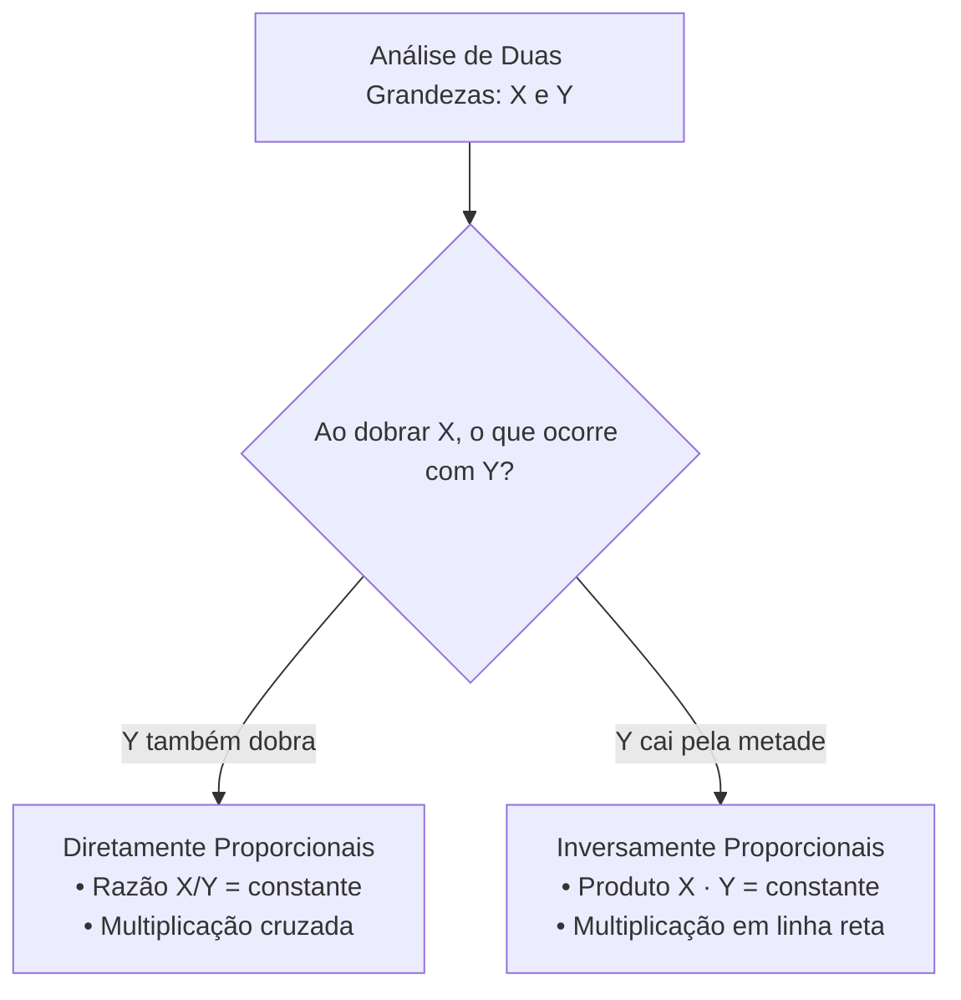

# 02 - Grandezas Proporcionais, Regra de Três e Porcentagem

> **Matéria:** Matemática e Raciocínio Lógico  
> **Cargos:** A01 – Técnico de Controle Externo (Adm) / B02 – Técnico de Controle Externo (TI)  
> **Arquivo:** `02_proporcoes_regra_de_tres_e_porcentagem.md`  
> **Status:** 🟢 Teoria Aprofundada + 5 Questões FCC Comentadas (A a E)

---

## 📌 Ementa / Itens do Edital
- Números e grandezas proporcionais: razões e proporções.
- Divisão em partes proporcionais (direta e inversa).
- Regra de três simples (direta e inversa).
- Porcentagem e problemas envolvendo regra de três simples, cálculos de porcentagem, acréscimos e descontos.

---

## 🧭 Sumário
- [1. Razões, Proporções e Propriedades Fundamentais](#1-razoes-proporcoes-e-propriedades-fundamentais)
    - [1.1 Conceito de Razão e Grandezas Comensuráveis](#11-conceito-de-razao-e-grandezas-comensuraveis)
    - [1.2 Proporções e a Propriedade Fundamental](#12-proporcoes-e-a-propriedade-fundamental)
    - [1.3 Propriedade da Soma dos Termos e Constante de Proporcionalidade](#13-propriedade-da-soma-dos-termos-e-constante-de-proporcionalidade)
- [2. Divisão em Partes Proporcionais](#2-divisao-em-partes-proporcionais)
    - [2.1 Divisão Diretamente Proporcional com a Constante k](#21-divisao-diretamente-proporcional-com-a-constante-k)
    - [2.2 Divisão Inversamente Proporcional e o Método do MMC](#22-divisao-inversamente-proporcional-e-o-metodo-do-mmc)
    - [2.3 Divisão Proporcional Composta ou Mista](#23-divisao-proporcional-composta-ou-mista)
- [3. Classificação de Grandezas e Regra de Três Simples](#3-classificacao-de-grandezas-e-regra-de-tres-simples)
    - [3.1 Grandezas Diretamente Proporcionais e Multiplicação Cruzada](#31-grandezas-diretamente-proporcionais-e-multiplicacao-cruzada)
    - [3.2 Grandezas Inversamente Proporcionais e Multiplicação em Linha Reta](#32-grandezas-inversamente-proporcionais-e-multiplicacao-em-linha-reta)
    - [3.3 Método Prático das Setas e Identificação de Armadilhas](#33-metodo-pratico-das-setas-e-identificacao-de-armadilhas)
- [4. Porcentagem, Fatores Multiplicadores e Variações](#4-porcentagem-fatores-multiplicadores-e-variacoes)
    - [4.1 Conceito e Fatores de Aumento e Desconto](#41-conceito-e-fatores-de-aumento-e-desconto)
    - [4.2 Aumentos e Descontos Sucessivos Cumulativos](#42-aumentos-e-descontos-sucessivos-cumulativos)
    - [4.3 Inversão da Base de Referência Percentual](#43-inversao-da-base-de-referencia-percentual)
    - [4.4 Diferença entre Pontos Percentuais e Variação Percentual](#44-diferenca-entre-pontos-percentuais-e-variacao-percentual)
- [Fontes Oficiais e Referências Bibliográficas](#fontes-oficiais-e-referencias-bibliograficas)
- [Questões de Concurso FCC Comentadas](#questoes-de-concurso-fcc-comentadas)
    - [Questão 01](#questao-01)
    - [Questão 02](#questao-02)
    - [Questão 03](#questao-03)
    - [Questão 04](#questao-04)
    - [Questão 05](#questao-05)

---

## 1. Razões, Proporções e Propriedades Fundamentais

O estudo das grandezas proporcionais é um dos temas de maior peso quantitativo nas provas da Fundação Carlos Chagas. Seu domínio instrumentaliza a análise de contratos públicos, distribuição orçamentária, cálculo de auditorias e reajustes econômico-financeiros.

### 1.1 Conceito de Razão e Grandezas Comensuráveis

* **Razão:** Dados dois números reais $a$ e $b$ (com $b \neq 0$), a razão entre $a$ e $b$ (nesta ordem) é o quociente indicado pela divisão:
  $$\text{Razão} = \frac{a}{b} \quad \text{ou} \quad a : b$$
  O primeiro termo $a$ denomina-se **antecedente** e o segundo termo $b$ é o **consequente**.
* Quando as grandezas possuem a mesma unidade de medida (ex.: metros por metros, reais por reais), a razão é uma grandeza **adimensional pura**. Quando comparam grandezas de naturezas físicas distintas, expressam taxas ou grandezas derivadas (ex.: velocidade média em $\text{km/h}$, densidade demográfica em $\text{hab/km}^2$).

### 1.2 Proporções e a Propriedade Fundamental

Uma proporção é formalmente definida como a **igualdade matemática entre duas ou mais razões equivalentes**:
$$\frac{a}{b} = \frac{c}{d} \quad \text{lê-se: 'a está para b assim como c está para d'}$$
Os termos $a$ e $d$ denominam-se **extremos**, enquanto $b$ e $c$ são os **meios**.

#### A Propriedade Fundamental das Proporções:
Em qualquer proporção válida, o produto dos extremos é rigorosamente igual ao produto dos meios:
$$\frac{a}{b} = \frac{c}{d} \iff a \cdot d = b \cdot c \quad (b, d \neq 0)$$

### 1.3 Propriedade da Soma dos Termos e Constante de Proporcionalidade

Em uma série de razões iguais, a soma dos antecedentes dividida pela soma dos consequentes é igual a qualquer uma das razões primitivas, correspondendo à constante de proporcionalidade $k$:
$$\frac{a}{b} = \frac{c}{d} = \frac{e}{f} = k \implies \frac{a + c + e}{b + d + f} = k$$
Essa propriedade é a base algébrica definitiva para solucionar repartições orçamentárias e partilhas de bens em auditoria sem necessidade de recorrer a sistemas lineares extensos.

---

## 2. Divisão em Partes Proporcionais

A partilha proporcional consiste em distribuir uma quantia total $V$ entre vários beneficiários ou centros de custo em conformidade com critérios predeterminados de mérito, produtividade ou penalidade.

### 2.1 Divisão Diretamente Proporcional com a Constante k

Repartir um total $V$ em partes $x, y, z$ diretamente proporcionais aos pesos $a, b, c$:

1. Define-se cada cota multiplicando o peso respectivo pela constante $k$:
   $$x = a \cdot k, \quad y = b \cdot k, \quad z = c \cdot k$$
2. Como a soma das partes totaliza o montante global $V$:
   $$a \cdot k + b \cdot k + c \cdot k = V \implies k \cdot (a + b + c) = V \implies k = \frac{V}{a + b + c}$$
3. Cada parte individual é calculada multiplicando $k$ pelo peso do beneficiário.

### 2.2 Divisão Inversamente Proporcional e o Método do MMC

Repartir um montante $V$ em partes $x, y, z$ inversamente proporcionais aos coeficientes $a, b, c$ significa repartir **diretamente aos seus inversos** $\frac{1}{a}, \frac{1}{b}, \frac{1}{c}$.

#### O Método Rápido do MMC:
1. Escrevem-se as frações inversas dos pesos: $\frac{1}{a}, \frac{1}{b}, \frac{1}{c}$;
2. Calcula-se o MMC entre os denominadores $a, b, c$ e reduzem-se todas as frações ao mesmo denominador comum;
3. **Despreza-se o denominador comum** e utilizam-se os novos numeradores inteiros como os pesos diretos para a constante $k$.

*Exemplo com 2, 3 e 4:*

* Inversos: $\frac{1}{2}, \frac{1}{3}, \frac{1}{4}$. O $\text{MMC}(2, 3, 4) = 12$.
* Redução: $\frac{6}{12}, \frac{4}{12}, \frac{3}{12}$.
* Pesos diretos operatórios: $6, 4$ e $3$. A soma das cotas é $6k + 4k + 3k = 13k$.

> 💡 **DICA DE RESOLUÇÃO (Inversamente Proporcional a Dois Valores):** Se a partilha for inversamente proporcional a apenas dois números $a$ e $b$, basta inverter diretamente as posições dos pesos: $x = b \cdot k$ e $y = a \cdot k$. Dividir inversamente a 2 e 3 equivale a dividir diretamente a 3 e 2.

### 2.3 Divisão Proporcional Composta ou Mista

Ocorre quando a partilha obedece simultaneamente a critérios diretos (como tempo de casa, horas trabalhadas) e inversos (como número de faltas, processos pendentes, dias de atraso):
$$\text{Peso Composto Final}_i = \text{Peso Direto}_i \times \frac{1}{\text{Peso Inverso}_i} = \frac{\text{Peso Direto}_i}{\text{Peso Inverso}_i}$$
Reduzem-se as frações resultantes a termos inteiros via MMC e aplica-se o método da constante $k$.

---

## 3. Classificação de Grandezas e Regra de Três Simples

A regra de três simples é o método algébrico que permite descobrir um quarto valor desconhecido a partir de três valores conhecidos de duas grandezas proporcionais.

### 3.1 Grandezas Diretamente Proporcionais e Multiplicação Cruzada

Duas grandezas são **Diretamente Proporcionais (DP)** quando a variação de uma acarreta a variação da outra na mesma razão e sentido: duplicando-se uma, a outra dobra; reduzindo-se à metade, a outra também se reduz à metade.

* Exemplos: Número de auditores e quantidade de processos analisados (mesmo tempo); horas trabalhadas e páginas digitalizadas; consumo de combustível e distância percorrida.
* **Mecânica Operatória:** A razão entre elas é constante ($\frac{A_1}{A_2} = \frac{B_1}{B_2}$); multiplica-se em cruz:
  $$A_1 \cdot B_2 = A_2 \cdot B_1$$

### 3.2 Grandezas Inversamente Proporcionais e Multiplicação em Linha Reta

Duas grandezas são **Inversamente Proporcionais (IP)** quando a variação de uma provoca a variação da outra em sentido inverso e na mesma proporção: duplicando-se uma grandeza, a outra cai pela metade; triplicando-se uma, a outra reduz-se a um terço.

* Exemplos: Quantidade de auditores e número de dias para auditar um acervo fixo de relatórios; velocidade de conexão de rede e tempo de download de um arquivo; torneiras abertas e tempo para encher um reservatório fixo.
* **Mecânica Operatória:** O produto entre elas é constante ($A_1 \cdot B_1 = A_2 \cdot B_2$); **multiplica-se em linha reta**:
  $$A_1 \cdot B_1 = A_2 \cdot B_2$$

> 🚨 **ALERTA DE PROVA / PEGADINHA FCC:** O erro mais comum do candidato afobado em regra de três simples é multiplicar todas as matrizes em cruz de forma mecânica! Antes de efetuar qualquer conta, teste mentalmente: *"Se eu aumentar o número de técnicos, vou precisar de mais ou de menos dias para fazer o mesmo trabalho?"*. Como serão necessários menos dias, a relação é inversamente proporcional e a multiplicação deve ser feita obrigatoriamente **em linha reta** ($6 \times 8 = 8 \times D \implies D = 6$).

### 3.3 Método Prático das Setas e Identificação de Armadilhas

Para não errar na prova:

1. Posicione a primeira seta para cima na coluna que contém a incógnita $X$;
2. Pergunte à outra grandeza: *"Se ela aumentar, a grandeza da incógnita precisa aumentar ou diminuir?"*;
3. Se aumentar, coloque a seta no mesmo sentido (para cima $\rightarrow$ DP); se diminuir, coloque a seta em sentido contrário (para baixo $\rightarrow$ IP);
4. Se a seta for no mesmo sentido, multiplique em cruz; se for em sentido inverso, multiplique em linha.

---

## 4. Porcentagem, Fatores Multiplicadores e Variações

A porcentagem (ou percentagem) é uma razão cujo consequente (denominador) é igual a 100:
$$p\% = \frac{p}{100} = i \quad (\text{taxa unitária ou decimal})$$

### 4.1 Conceito e Fatores de Aumento e Desconto

Qualquer acréscimo ou dedução percentual pode ser calculado de modo instantâneo multiplicando o valor primitivo ($V_0$) pelo seu respectivo **Fator Multiplicador ($F$)**:

* **Fator de Acréscimo (Aumento de $i$):**
  $$F = 1 + i \qquad \text{Exemplo: aumento de } 15\% \implies F = 1 + 0{,}15 = 1{,}15$$
  $$V_{\text{final}} = V_0 \times 1{,}15$$
* **Fator de Redução (Desconto de $i$):**
  $$F = 1 - i \qquad \text{Exemplo: desconto de } 10\% \implies F = 1 - 0{,}10 = 0{,}90$$
  $$V_{\text{final}} = V_0 \times 0{,}90$$

### 4.2 Aumentos e Descontos Sucessivos Cumulativos

Aumentos e descontos sucessivos incidem sempre em cascata sobre o valor recém-atualizado, e **nunca sobre o valor original primitivo**. Por esse motivo, taxas percentuais sucessivas **jamais podem ser somadas ou subtraídas aritmeticamente**:
$$F_{\text{acumulado}} = F_1 \times F_2 \times F_3 \times \dots \times F_n$$

| Sucessão de Eventos | Erro Grosseiro (Soma) | Cálculo Correto com Fatores | Efeito Real Acumulado |
| :--- | :---: | :--- | :---: |
| Aumento de 15% seguido de Desconto de 10% | $+5\%$ | $1{,}15 \times 0{,}90 = 1{,}035$ | **Aumento real de 3,5%** |
| Aumento de 20% seguido de Desconto de 20% | $0\%$ | $1{,}20 \times 0{,}80 = 0{,}96$ | **Prejuízo/Desconto de 4%** |
| Aumento de 10% seguido de Aumento de 20% | $+30\%$ | $1{,}10 \times 1{,}20 = 1{,}32$ | **Aumento real de 32%** |
| Desconto de 10% seguido de Desconto de 10% | $-20\%$ | $0{,}90 \times 0{,}90 = 0{,}81$ | **Desconto real de 19%** |

> ⭐ **IMPORTANTE / AUMENTO E DESCONTO DA MESMA TAXA NUNCA SE ANULAM:** Se um produto sofre aumento de $20\%$ e em seguida desconto de $20\%$, ele **não** volta ao preço original! Ele passa a custar $1{,}20 \times 0{,}80 = 0{,}96$ do preço original, ou seja, sofre uma perda líquida de $4\%$. Em geral, um aumento de $i$ seguido de desconto de $i$ gera sempre uma perda real acumulada de $i^2$ (pois $(1+i)(1-i) = 1 - i^2$).

### 4.3 Inversão da Base de Referência Percentual

A base de referência percentual corresponde ao valor que ocupa o denominador da razão comparativa ($\text{Base} = 100\%$). Ao inverter o ponto de vista da comparação, a base numérica altera-se, mudando compulsoriamente a taxa percentual:

* Se a grandeza $E$ é **$25\%$ maior** que a grandeza $P$:
    * Adota-se $P = 100 \implies E = 125$.
    * Para saber quanto $P$ é menor que $E$, o referencial agora é $E$ ($125$):
    $$\text{Taxa de Redução} = \frac{\text{Diferença}}{\text{Nova Base}} = \frac{125 - 100}{125} = \frac{25}{125} = \frac{1}{5} = 0{,}20 = \mathbf{20\%}$$
    * Conclusão: Se $E$ é $25\%$ maior que $P$, então $P$ é **$20\%$ menor** que $E$ (e nunca 25%!).

### 4.4 Diferença entre Pontos Percentuais e Variação Percentual

* **Pontos Percentuais (p.p.):** É a diferença aritmética simples entre duas taxas percentuais (ex.: uma taxa que sobe de $10\%$ para $12\%$ aumentou $2$ pontos percentuais).
* **Variação Percentual Relativa ($\Delta\%$):** É a magnitude do crescimento em relação à taxa original de partida:
  $$\Delta\% = \frac{12 - 10}{10} = \frac{2}{10} = 20\%$$
  A taxa aumentou 2 pontos percentuais, mas sofreu uma elevação relativa real de $20\%$.

---

## 🌐 Fontes Oficiais e Referências Bibliográficas

* [Khan Academy Brasil - Pré-Álgebra: Razões, Proporções e Porcentagens](https://pt.khanacademy.org/math/pre-algebra) - Conceito formal de razões, proporções, grandezas direta e inversamente proporcionais e taxas percentuais.
* [Khan Academy Brasil - Aritmética: Problemas com Proporções e Porcentagem](https://pt.khanacademy.org/math/arithmetic) - Cálculo prático de porcentagens, acréscimos, descontos sucessivos e regra de três simples.
* [OBMEP / IMPA - Apostila 2 do PIC: Métodos de Contagem e Razões](https://www.obmep.org.br/docs/apostila2.pdf) - Raciocínio proporcional aplicado a problemas combinatórios e variações relativas (Prof. Paulo Cezar Pinto Carvalho).
* [Portal da Matemática OBMEP / IMPA - Módulo de Proporcionalidade e Porcentagem](https://portaldaobmep.impa.br/index.php/modulo/ver?modulo=77) - Videoaulas e material teórico oficial sobre grandezas proporcionais e regra de três composta.
* MORGADO, Augusto César; WAGNER, Eduardo; CARVALHO, Paulo Cezar Pinto. **Matemática do Ensino Médio, Volume 1**. 11. ed. Rio de Janeiro: SBM, 2012. (Cap. 4 - Proporcionalidade e Funções Lineares).
* IEZZI, Gelson; HAZZAN, Samuel; DEGENSZAJN, David. **Fundamentos de Matemática Elementar, Volume 11: Matemática Comercial e Financeira**. 2. ed. São Paulo: Atual, 2013. (Cap. 1 a 3 - Razões, Proporções e Porcentagens).
* D'AMBRÓSIO, Ubiratan. **Etnomatemática: Elo entre as Tradições e a Modernidade**. Belo Horizonte: Autêntica, 2001. (Cap. 2 - Aritmética Prática e Proporções).

---

## 📝 Questões de Concurso FCC Comentadas

### Questão 01
**(FCC – Auditor Fiscal da Receita – Adaptada TCE-GO)**  
A Diretoria de Fiscalização de um Tribunal de Contas distribuiu um bônus de incentivo de R$ 45.000,00 entre três equipes técnicas de auditoria ($A$, $B$ e $C$) em partes **inversamente proporcionais** ao número de dias de atraso na entrega dos seus respectivos relatórios finais. A equipe $A$ atrasou 2 dias; a equipe $B$ atrasou 3 dias; e a equipe $C$ atrasou 4 dias.

Nessas condições, o valor recebido pela equipe $A$ superou o valor recebido pela equipe $C$ em:

* **A)** R$ 10.000,00
* **B)** R$ 10.384,60
* **C)** R$ 12.000,00
* **D)** R$ 13.500,00
* **E)** R$ 15.000,00

> **Comentário Detalhado:**
> Resolução sistemática da partilha inversamente proporcional:
>
> 1. Como a divisão é inversamente proporcional a 2, 3 e 4, as frações de ponderação são os seus inversos:
>    $$\text{Pesos:} \quad \frac{1}{2}, \quad \frac{1}{3}, \quad \frac{1}{4}$$
> 2. Reduzem-se todas as frações ao mesmo denominador comum via $\text{MMC}(2, 3, 4) = 12$:
>    $$\frac{1}{2} = \frac{6}{12}; \qquad \frac{1}{3} = \frac{4}{12}; \qquad \frac{1}{4} = \frac{3}{12}$$
> 3. Eliminando o denominador comum 12, as cotas correspondentes são diretamente proporcionais a 6, 4 e 3:
>    $$\text{Equipe } A = 6k; \quad \text{Equipe } B = 4k; \quad \text{Equipe } C = 3k$$
> 4. Somando as cotas de bonificação para atingir o montante de R$ 45.000,00:
>    $$6k + 4k + 3k = 45.000 \implies 13k = 45.000 \implies k = \frac{45.000}{13} \approx 3.461,538$$
> 5. A questão solicita a diferença entre os valores recebidos pela equipe $A$ e pela equipe $C$:
>    $$\text{Diferença} = A - C = 6k - 3k = 3k$$
>    $$\text{Diferença} = 3 \times \left(\frac{45.000}{13}\right) = \frac{135.000}{13} \approx \text{R\$ }\mathbf{\ 10.384,62}$$
>
> Análise individual das alternativas:
>
> - **A)** Incorreta. Estimativa empírica imprecisa que desconsidera o divisor 13 resultante da soma dos numeradores do MMC.
> - **B)** Correta. O cálculo exato de $3k = \frac{135.000}{13}$ resulta em aproximadamente R$ 10.384,615 (arredondado para R$ 10.384,60 nas opções da banca).
> - **C)** Incorreta. Valor que surgiria caso a partilha tivesse sido realizada de forma diretamente proporcional aos números 2, 3 e 4.
> - **D)** Incorreta. Corresponderia a 3 cotas se o denominador da soma fosse 10 em vez de 13.
> - **E)** Incorreta. Corresponde à divisão igualitária de um terço do total sem aplicar a proporcionalidade inversa.
> 
> **Gabarito: B**

---

### Questão 02
**(FCC – TCE-GO – Técnico de Controle Externo)**  
Um contrato de prestação de serviços de segurança da informação celebrado pelo Tribunal de Contas previa pagamento mensal de determinado valor $X$. No segundo ano de vigência, o contrato sofreu um **reajuste com acréscimo de 15%**. No terceiro ano, após revisão contratual, foi concedido um **desconto de 10%** aplicado sobre o valor vigente no segundo ano.

Em relação ao valor original $X$ do contrato no primeiro ano, a aplicação sucessiva dessas duas variações resultou em:

* **A)** um aumento real de 3,5%
* **B)** um aumento real de 5%
* **C)** um desconto real de 3,5%
* **D)** um desconto real de 5%
* **E)** nenhuma variação (0%)

> **Comentário Detalhado:**
> Análise cumulativa por meio de fatores multiplicadores:
>
> 1. Fator multiplicador do primeiro evento (aumento de 15%):
>    $$F_1 = 1 + 0{,}15 = 1{,}15$$
> 2. Fator multiplicador do segundo evento (desconto de 10%):
>    $$F_2 = 1 - 0{,}10 = 0{,}90$$
> 3. O fator acumulado global após as duas variações é o produto dos fatores:
>    $$F_{\text{global}} = F_1 \times F_2 = 1{,}15 \times 0{,}90 = 1{,}035$$
> 4. Conversão do fator final em taxa percentual:
>    $$\Delta\% = (F_{\text{global}} - 1) \times 100\% = (1{,}035 - 1) \times 100\% = +0{,}035 \times 100\% = +\mathbf{3,5\%}$$
>    Como o resultado é positivo, houve um **aumento real de 3,5%** em relação ao valor primitivo do contrato.
>
> Análise das alternativas:
>
> - **A)** Correta. $1{,}15 \times 0{,}90 = 1{,}035 \implies$ aumento real de 3,5%.
> - **B)** Incorreta. Pegadinha clássica da FCC para quem soma/subtrai aritmeticamente as taxas ($+15\% - 10\% = +5\%$), ignorando que o desconto incidiu sobre uma base já majorada.
> - **C)** Incorreta. Erro no sinal da variação; o fator 1,035 é superior a 1, configurando aumento e não desconto.
> - **D)** Incorreta. Subtração invertida das porcentagens.
> - **E)** Incorreta. Ilusão de que taxas nominais próximas se cancelam mutuamente.
> 
> **Gabarito: A**

---

### Questão 03
**(FCC – TRT – Analista Judiciário)**  
Uma equipe de 6 técnicos administrativos, trabalhando com produtividades idênticas e constantes, consegue auditar e validar 120 relatórios de diárias em 8 dias úteis de trabalho. 

Se o Tribunal de Contas alocar mais 2 técnicos com a mesma produtividade para essa equipe, em quantos dias úteis a nova equipe conseguirá auditar e validar os mesmos 120 relatórios?

* **A)** 4 dias
* **B)** 5 dias
* **C)** 6 dias
* **D)** 7 dias
* **E)** 10 dias

> **Comentário Detalhado:**
>
> 1. Identificação dos dados e grandezas:
>     - Quantidade inicial de técnicos: 6
>     - Nova quantidade de técnicos: $6 + 2 = 8$ técnicos
>     - Quantidade de trabalho: constante em ambos os cenários (120 relatórios)
>     - Dias de trabalho: passa de 8 dias para $D$ dias úteis
>
> 2. Análise da relação de proporcionalidade:
>     - Mantendo-se inalterada a quantidade de relatórios (120), se aumentamos o número de trabalhadores na equipe, a tarefa será concluída em um **número menor de dias**.
>     - As grandezas "Técnicos" e "Dias" são **Inversamente Proporcionais (IP)**.
>
> 3. Resolução estruturada (multiplicação em linha reta, pois o produto de operários por tempo é constante):
>    $$6 \times 8 = 8 \times D \implies 48 = 8D \implies D = \frac{48}{8} = \mathbf{6 \text{ dias úteis}}$$
>
> Análise das alternativas:
>
> - **A)** Incorreta. Redução desproporcional; 4 dias demandariam dobrar a equipe para 12 técnicos.
> - **B)** Incorreta. Decorre de cálculo aproximado sem rigor algébrico.
> - **C)** Correta. Produto constante em grandezas inversas: $6 \times 8 = 8 \times D \implies D = 6$.
> - **D)** Incorreta. Suposição linear de que adicionar 2 técnicos reduz o tempo em apenas 1 dia.
> - **E)** Incorreta. Resultado obtido caso o candidato multiplique em cruz por equívoco ($\frac{6}{8} = \frac{8}{D} \implies D = \frac{64}{6} \approx 10,6$ dias), tratando grandezas inversas como se fossem diretas (o que levaria ao absurdo de aumentar o tempo ao contratar mais pessoas).
> 
> **Gabarito: C**

---

### Questão 04
**(FCC – TCE-PI – Técnico Judiciário)**  
Em determinado setor do Tribunal de Contas do Estado de Goiás, o número de processos em meio eletrônico é 25% maior do que o número de processos físicos em papel. 

Em relação ao número de processos eletrônicos, o número de processos em papel é inferior em:

* **A)** 15%
* **B)** 20%
* **C)** 25%
* **D)** 30%
* **E)** 33,3%

> **Comentário Detalhado:**
> Problema que exige a técnica de inversão da base de referência percentual:
>
> 1. Atribuição de uma base de cálculo simples:
>     - Seja $P$ o número de processos em papel: adotemos $P = 100$.
>
> 2. O número de processos eletrônicos ($E$) é 25% maior que $P$:
>    $$E = 100 + 0{,}25 \times 100 = 125$$
> 3. O comando da questão indaga o percentual em que os processos em papel são inferiores **em relação ao total de processos eletrônicos** (o que define que o novo denominador da divisão passa a ser $E = 125$):
>    $$\text{Diferença absoluta} = E - P = 125 - 100 = 25$$
>    $$\text{Percentual relativo} = \frac{\text{Diferença}}{\text{Nova Base } E} = \frac{25}{125} = \frac{1}{5} = 0{,}20 = \mathbf{20\%}$$
>    Portanto, o número de processos físicos em papel é exatamente **20% inferior** ao de processos eletrônicos.
>
> Análise das alternativas:
>
> - **A)** Incorreta. Estimativa arbitrária sem respaldo nos cálculos.
> - **B)** Correta. Razão precisa de $\frac{25}{125} = 0{,}20 = 20\%$.
> - **C)** Incorreta. A pegadinha clássica em que o candidato repete os 25% citados no texto, ignorando que o referencial da comparação foi invertido (de $P$ para $E$).
> - **D)** Incorreta. Valor incorreto.
> - **E)** Incorreta. Confusão com a relação matemática inversa de uma alta de 33,3% (que gera redução simétrica de 25%).
> 
> **Gabarito: B**

---

### Questão 05
**(FCC – TCE-GO – Auditor de Controle Externo)**  
Uma gratificação especial de desempenho no valor de R$ 36.000,00 foi dividida entre dois auditores, Rodrigo e Samuel. O regulamento determinou que a divisão fosse **diretamente proporcional ao tempo de serviço** no Tribunal (Rodrigo tem 6 anos e Samuel tem 4 anos) e, simultaneamente, **inversamente proporcional ao número de processos pendentes** de julgamento em seus gabinetes (Rodrigo tem 3 processos pendentes e Samuel tem 1 processo pendente).

Com base nessas regras, a quantia recebida por Samuel foi de:

* **A)** R$ 12.000,00
* **B)** R$ 14.400,00
* **C)** R$ 18.000,00
* **D)** R$ 21.600,00
* **E)** R$ 24.000,00

> **Comentário Detalhado:**
> Resolução de divisão composta (direta e inversa concomitantemente):
>
> 1. Estruturação dos pesos individuais de cada beneficiário:
>     - Para Rodrigo: diretamente proporcional a 6 anos e inversamente a 3 processos pendentes:
>      $$\text{Peso de Rodrigo} = 6 \times \frac{1}{3} = \frac{6}{3} = 2$$
>     - Para Samuel: diretamente proporcional a 4 anos e inversamente a 1 processo pendente:
>      $$\text{Peso de Samuel} = 4 \times \frac{1}{1} = \frac{4}{1} = 4$$
> 2. Aplicação da constante de proporcionalidade $k$:
>    $$\text{Rodrigo} = 2k; \qquad \text{Samuel} = 4k$$
> 3. Montagem da equação orçamentária para a gratificação de R$ 36.000,00:
>    $$2k + 4k = 36.000 \implies 6k = 36.000 \implies k = \frac{36.000}{6} = 6.000$$
> 4. Cálculo da parcela recebida por Samuel:
>    $$\text{Samuel} = 4k = 4 \times 6.000 = \text{R\$ }\mathbf{\ 24.000,00}$$
>    *(A título de conferência, Rodrigo recebeu $2k = 2 \times 6.000 = \text{R\$} 12.000,00$. A soma dos valores totaliza $12.000 + 24.000 = \text{R\$} 36.000,00$)*.
>
> Análise das alternativas:
>
> - **A)** Incorreta. R$ 12.000,00 corresponde à cota recebida por Rodrigo ($2k$).
> - **B)** Incorreta. Valor que Samuel receberia se a partilha considerasse unicamente o tempo de serviço de forma direta ($\frac{4}{10} \times 36.000 = 14.400$).
> - **C)** Incorreta. Divisão meio a meio simples, desconsiderando ambos os critérios do edital.
> - **D)** Incorreta. Corresponderia à parte de Rodrigo se a partilha fosse baseada unicamente no tempo de serviço ($\frac{6}{10} \times 36.000 = 21.600$).
> - **E)** Correta. O peso final de Samuel (4) representa quatro sextos ($\frac{2}{3}$) do montante global de R$ 36.000,00, totalizando R$ 24.000,00.
> 
> **Gabarito: E**
