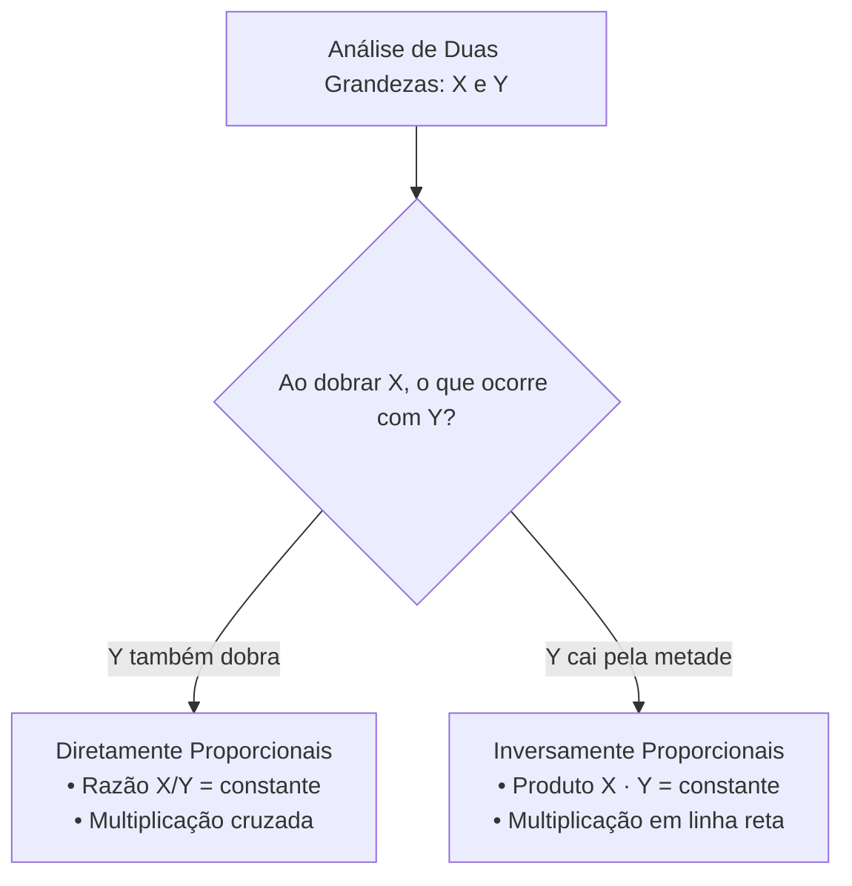

# 02 - Grandezas Proporcionais, Regra de Três e Porcentagem

> **Matéria:** Matemática e Raciocínio Lógico  
> **Cargos:** A01 – Técnico de Controle Externo (Adm) / B02 – Técnico de Controle Externo (TI)  
> **Arquivo:** `02_proporcoes_regra_de_tres_e_porcentagem.md`  
> **Status:** 🟢 Teoria Aprofundada + 5 Questões FCC Comentadas (A a E)

---

## 📌 Ementa Oficial do Edital
- Números e grandezas proporcionais: razões e proporções.
- Divisão em partes proporcionais (direta e inversa).
- Regra de três simples (direta e inversa).
- Porcentagem e problemas envolvendo regra de três simples, cálculos de porcentagem, acréscimos e descontos.

---

## 🌳 Classificação Hierárquica do Conteúdo

```text
2. Proporcionalidade, Regra de Três e Porcentagem
├── 2.1 Razões, Proporções e Propriedades
│   ├── Conceito de razão (antecedente / consequente) e grandezas comensuráveis
│   ├── Proporção: igualdade entre razões (a/b = c/d) e Propriedade Fundamental (a · d = b · c)
│   └── Propriedades operatórias: soma/subtração dos termos e constante de proporcionalidade
├── 2.2 Divisão em Partes Proporcionais
│   ├── Divisão Diretamente Proporcional: uso da constante k (k = Total / Σ pesos)
│   ├── Divisão Inversamente Proporcional: pesos inversos reduzidos ao MMC
│   └── Divisão Composta: direta a um critério e inversa a outro simultaneamente
├── 2.3 Grandezas e Regra de Três Simples
│   ├── Classificação: Grandezas Diretamente Proporcionais (razão constante)
│   ├── Classificação: Grandezas Inversamente Proporcionais (produto constante)
│   └── Resolução estruturada: análise de setas e montagem das equações
└── 2.4 Porcentagem, Acréscimos e Descontos Sucessivos
    ├── Fatores de Multiplicação: aumento (1 + i) e desconto (1 - i)
    ├── Variação Percentual Relativa: Δ% = [(Vf - Vi) / Vi] · 100%
    ├── Aumentos e Descontos Sucessivos: produto cumulativo dos fatores multiplicadores
    └── Inversão da Base de Referência Percentual (A em relação a B vs. B em relação a A)
```

---

## 📖 Teoria Aprofundada e Métodos de Resolução

### 1. Razões e Proporções

Uma proporção é uma igualdade entre duas razões:
$\frac{a}{b} = \frac{c}{d} \iff a \cdot d = b \cdot c \quad (b, d \neq 0)$
- **Propriedade da Soma:** A soma dos antecedentes está para a soma dos consequentes assim como cada antecedente está para o seu consequente:  
  $\frac{a}{b} = \frac{c}{d} = k \implies \frac{a + c}{b + d} = k$



---

### 2. Divisão em Partes Proporcionais

#### 2.1 Divisão Diretamente Proporcional
Para repartir um valor total $V$ em partes $x, y, z$ diretamente proporcionais a $a, b, c$:  
$x = a \cdot k, \quad y = b \cdot k, \quad z = c \cdot k$  
$a \cdot k + b \cdot k + c \cdot k = V \implies k = \frac{V}{a + b + c}$  
Em seguida, multiplica-se $k$ por cada peso individual.

#### 2.2 Divisão Inversamente Proporcional
Repartir $V$ em partes inversamente proporcionais a $a, b, c$ equivale a repartir diretamente aos inversos $\frac{1}{a}, \frac{1}{b}, \frac{1}{c}$.
- **Procedimento Prático Rápido:**
  1. Escreva os inversos: $\frac{1}{a}, \frac{1}{b}, \frac{1}{c}$.
  2. Reduza todos ao mesmo denominador comum via $\text{MMC}(a, b, c)$.
  3. Descarte o denominador comum e utilize os novos numeradores como os pesos diretos para $k$.

> 💡 **DICA DE ESTUDO (Dois Termos Inversos):**  
> Dividir um valor $V$ inversamente a $2$ e $3$ equivale a dividir **diretamente por 3 e 2**! Basta inverter as posições: $x = 3k$ e $y = 2k$.

#### 2.3 Divisão Proporcional Composta
Quando a divisão é diretamente proporcional a $p_1, p_2$ e inversamente proporcional a $q_1, q_2$:  
$\text{Peso Final}_i = p_i \times \frac{1}{q_i} = \frac{p_i}{q_i}$  
Reduzem-se as frações resultantes ao mesmo denominador e aplica-se a constante $k$.

---

### 3. Regra de Três Simples

1. **Diretamente Proporcional (DP):**
   - Mais servidores $\rightarrow$ mais processos analisados.
   - Mais horas trabalhadas $\rightarrow$ mais páginas digitalizadas.
   - *Resolução:* Multiplica-se em cruz: $\frac{A_1}{A_2} = \frac{B_1}{B_2} \implies A_1 \cdot B_2 = A_2 \cdot B_1$.

2. **Inversamente Proporcional (IP):**
   - Mais servidores $\rightarrow$ menos dias para concluir a mesma tarefa.
   - Maior velocidade do link de dados $\rightarrow$ menor tempo para transmitir o arquivo.
   - *Resolução:* Multiplica-se em linha: $A_1 \cdot B_1 = A_2 \cdot B_2$.

> 🚨 **ALERTA DE PROVA / PEGADINHA FCC:**  
> Nunca monte a regra de três no automático multiplicando em cruz antes de testar a relação: *"Se eu dobrar esta grandeza, a outra vai dobrar ou vai cair pela metade?"*. Se cair pela metade, multiplique **em linha reta**!

---

### 4. Porcentagem, Acréscimos e Descontos Sucessivos

#### 4.1 Fatores Multiplicadores
Toda alteração percentual de taxa $i$ ($i = \frac{p}{100}$) pode ser operada multiplicando o valor inicial pelo Fator ($F$):
- **Aumento de $i$:** $F = 1 + i$ (Ex.: aumento de $25\% \implies F = 1 + 0{,}25 = 1{,}25$).
- **Desconto de $i$:** $F = 1 - i$ (Ex.: desconto de $15\% \implies F = 1 - 0{,}15 = 0{,}85$).

#### 4.2 Variações Sucessivas
Aumentos e descontos sucessivos multiplicam-se entre si; **nunca se somam**:  
$F_{\text{global}} = F_1 \times F_2 \times F_3 \times \dots \times F_n$

| Operação Sucessiva | Erro Comum (Soma Simples) | Cálculo Correto (Fatores) | Resultado Efetivo |
|---|---|---|---|
| Aumento de 10% + Aumento de 20% | $+30\%$ | $1{,}10 \times 1{,}20 = 1{,}32$ | $+32\%$ de aumento |
| Aumento de 20% + Desconto de 20% | $0\%$ (inalterado) | $1{,}20 \times 0{,}80 = 0{,}96$ | $-4\%$ de redução |
| Desconto de 10% + Desconto de 10% | $-20\%$ | $0{,}90 \times 0{,}90 = 0{,}81$ | $-19\%$ de redução |

#### 4.3 Inversão do Referencial Percentual
Se o salário de $A$ é $25\%$ maior que o salário de $B$, quanto o salário de $B$ é menor que o de $A$?
- Suponha $B = 100 \implies A = 125$.
- A diferença absoluta é 25.
- O referencial agora é $A$ ($125$):  
  $\text{Redução \%} = \frac{125 - 100}{125} = \frac{25}{125} = \frac{1}{5} = 20\%$
- *Conclusão:* Se $A$ é $25\%$ maior que $B$, $B$ é **$20\%$ menor** que $A$ (e não $25\%$).

---

## 🌐 Fontes Recomendadas na Internet
- [Khan Academy Brasil - Razões, Proporções e Porcentagem](https://pt.khanacademy.org/math/pre-algebra/pre-algebra-ratios-rates)
  - Vídeos e listas práticas sobre grandezas proporcionais e cálculo de porcentagens.
- [Portal da Matemática OBMEP / IMPA - Proporcionalidade e Regra de Três](https://portaldaobmep.impa.br/)
  - Módulos avançados do IMPA sobre divisão proporcional e propriedades das razões.
- [Banco Central do Brasil - Cidadania Financeira](https://www.bcb.gov.br/cidadaniafinanceira)
  - Cálculos de reajustes contratuais, variações percentuais acumuladas e fatores de atualização.

---

## 📝 Questões Comentadas no Padrão FCC (Justificadas de A a E)

### Questão 1 (FCC - Auditor Fiscal / Adaptada TCE-GO)
A Diretoria de Fiscalização de um Tribunal de Contas distribuiu um bônus de incentivo de R$ 45.000,00 entre três equipes técnicas de auditoria ($A$, $B$ e $C$) em partes **inversamente proporcionais** ao número de dias de atraso na entrega dos seus respectivos relatórios finais. A equipe $A$ atrasou 2 dias; a equipe $B$ atrasou 3 dias; e a equipe $C$ atrasou 4 dias.

Nessas condições, o valor recebido pela equipe $A$ superou o valor recebido pela equipe $C$ em:

A) R$ 10.000,00  
B) R$ 10.384,60  
C) R$ 12.000,00  
D) R$ 13.500,00  
E) R$ 15.000,00  

> **Gabarito: B**  
>  
> **Comentário Analítico Passo a Passo:**  
> 1. Divisão inversamente proporcional aos atrasos de 2, 3 e 4 dias:  
>    - Pesos inversos: $\frac{1}{2}$, $\frac{1}{3}$, $\frac{1}{4}$.  
> 2. Redução ao mesmo denominador ($\text{MMC}(2, 3, 4) = 12$):  
>    $\frac{1}{2} = \frac{6}{12}; \quad \frac{1}{3} = \frac{4}{12}; \quad \frac{1}{4} = \frac{3}{12}$  
> 3. Descartando o denominador, as cotas são proporcionais a $6, 4, 3$:  
>    $A = 6k, \quad B = 4k, \quad C = 3k$  
>    $\text{Soma: } 6k + 4k + 3k = 13k$  
> 4. Montante total: R$ 45.000,00  
>    $13k = 45.000 \implies k = \frac{45.000}{13} \approx 3.461,538$  
> 5. A questão solicita quanto a equipe $A$ superou a equipe $C$:  
>    $A - C = 6k - 3k = 3k$  
>    $3k = 3 \times \left(\frac{45.000}{13}\right) = \frac{135.000}{13} \approx \text{R\$} 10.384,62$  
>  
> **Análise das Alternativas:**  
> - **A) Incorreta (R$ 10.000,00):** Suposição simplificada desconsiderando o denominador 13 da soma dos inversos.  
> - **B) CORRETA (R$ 10.384,60):** Cálculo exato da diferença de 3 cotas de constante $k$ ($\frac{135.000}{13} \approx 10.384,61$).  
> - **C) Incorreta (R$ 12.000,00):** Ocorre se fosse dividida diretamente pelos pesos 2, 3 e 4.  
> - **D) Incorreta (R$ 13.500,00):** Valor referente a 3 cotas se a soma total fosse 10.  
> - **E) Incorreta (R$ 15.000,00):** Um terço do valor total sem ponderação.

---

### Questão 2 (FCC - Técnico de Controle Externo / Adaptada)
Um contrato de prestação de serviços de segurança da informação celebrado pelo Tribunal de Contas previa pagamento mensal de determinado valor $X$. No segundo ano de vigência, o contrato sofreu um **reajuste com acréscimo de 15%**. No terceiro ano, após revisão contratual, foi concedido um **desconto de 10%** aplicado sobre o valor vigente no segundo ano.

Em relação ao valor original $X$ do contrato no primeiro ano, a aplicação sucessiva dessas duas variações resultou em:

A) um aumento real de 3,5%  
B) um aumento real de 5%  
C) um desconto real de 3,5%  
D) um desconto real de 5%  
E) nenhuma variação (0%)  

> **Gabarito: A**  
>  
> **Comentário Analítico Passo a Passo:**  
> 1. Fator do primeiro evento (acréscimo de 15%):  
>    $F_1 = 1 + 0{,}15 = 1{,}15$  
> 2. Fator do segundo evento (desconto de 10%):  
>    $F_2 = 1 - 0{,}10 = 0{,}90$  
> 3. Fator acumulado composto:  
>    $F_{\text{total}} = F_1 \times F_2 = 1{,}15 \times 0{,}90 = 1{,}035$  
> 4. Conversão para percentual de variação:  
>    $\Delta\% = (1{,}035 - 1) \times 100\% = +0{,}035 \times 100\% = +3{,}5\%$  
>    Representa um **aumento real acumulado de 3,5%**.  
>  
> **Análise das Alternativas:**  
> - **A) CORRETA (Aumento real de 3,5%):** Aplicação estrita do produto de fatores multiplicadores $1{,}15 \times 0{,}90 = 1{,}035$.  
> - **B) Incorreta (Aumento real de 5%):** Pegadinha clássica da FCC para quem comete o erro grave de subtrair aritmeticamente as taxas ($15\% - 10\% = 5\%$).  
> - **C) Incorreta (Desconto real de 3,5%):** Erro de sinal; o fator 1,035 é maior que 1, caracterizando aumento, não desconto.  
> - **D) Incorreta (Desconto real de 5%):** Subtração invertida das taxas nominais.  
> - **E) Incorreta (0%):** Suposição infundada de neutralização entre percentuais diferentes.

---

### Questão 3 (FCC - Analista Judiciário / Administrativa)
Uma equipe de 6 técnicos administrativos, trabalhando com produtividades idênticas e constantes, consegue auditar e validar 120 relatórios de diárias em 8 dias úteis de trabalho. 

Se o Tribunal de Contas alocar mais 2 técnicos com a mesma produtividade para essa equipe, em quantos dias úteis a nova equipe conseguirá auditar e validar os mesmos 120 relatórios?

A) 4 dias  
B) 5 dias  
C) 6 dias  
D) 7 dias  
E) 10 dias  

> **Gabarito: C**  
>  
> **Comentário Analítico Passo a Passo:**  
> 1. Identificação das grandezas e quantidades:  
>    - Grandeza "Técnicos": de 6 passou para $6 + 2 = 8$ técnicos.  
>    - Grandeza "Relatórios": constante (120 relatórios em ambos os casos).  
>    - Grandeza "Dias úteis": de 8 dias passará para $D$ dias.  
> 2. Análise da relação de proporcionalidade entre "Técnicos" e "Dias":  
>    - Mantendo constante a quantidade de trabalho (120 relatórios), se aumentamos o número de técnicos trabalhando, serão necessários **menos dias** para concluir a tarefa.  
>    - As grandezas são **Inversamente Proporcionais (IP)**!  
> 3. Cálculo multiplicando em linha reta:  
>    $6 \times 8 = 8 \times D \implies 48 = 8D \implies D = \frac{48}{8} = 6\text{ dias úteis}$  
>  
> **Análise das Alternativas:**  
> - **A) Incorreta (4 dias):** Redução excessiva, corresponderia a dobrar a equipe para 12 técnicos.  
> - **B) Incorreta (5 dias):** Erro de aproximação.  
> - **C) CORRETA (6 dias):** Multiplicação direta em linha por se tratar de grandezas inversamente proporcionais ($6 \times 8 = 8 \times D \implies D = 6$).  
> - **D) Incorreta (7 dias):** Erro ao subtrair apenas 1 dia arbitrariamente.  
> - **E) Incorreta (10 dias):** Resultado obtido se o candidato multiplicar em cruz por engano ($\frac{6}{8} = \frac{8}{D} \implies D = \frac{64}{6} \approx 10{,}6$ dias), tratando grandezas inversas como se fossem diretas.

---

### Questão 4 (FCC - Técnico Judiciário)
Em determinado setor do Tribunal de Contas do Estado de Goiás, o número de processos em meio eletrônico é 25% maior do que o número de processos físicos em papel. 

Em relação ao número de processos eletrônicos, o número de processos em papel é inferior em:

A) 15%  
B) 20%  
C) 25%  
D) 30%  
E) 33,3%  

> **Gabarito: B**  
>  
> **Comentário Analítico Passo a Passo:**  
> 1. Definição de uma base de cálculo conveniente:  
>    - Seja $P$ o número de processos em papel: vamos atribuir $P = 100$.  
> 2. O número de processos eletrônicos ($E$) é 25% maior:  
>    $E = 100 + 25\% \times 100 = 125$  
> 3. O enunciado pergunta quanto $P$ é inferior em relação a $E$ (a nova base de referência é $E = 125$):  
>    $\text{Diferença absoluta} = E - P = 125 - 100 = 25$  
>    $\text{Percentual relativo} = \frac{\text{Diferença}}{\text{Base } E} = \frac{25}{125} = \frac{1}{5} = 0{,}20 = 20\%$  
> 4. Logo, os processos em papel são **20% inferiores** aos processos eletrônicos.  
>  
> **Análise das Alternativas:**  
> - **A) Incorreta (15%):** Cálculo sem base lógica.  
> - **B) CORRETA (20%):** A razão $\frac{25}{125} = \frac{1}{5} = 20\%$.  
> - **C) Incorreta (25%):** Pegadinha clássica em que o candidato replica os 25% do enunciado, ignorando a mudança da base de referência do denominador.  
> - **D) Incorreta (30%):** Valor arbitrário.  
> - **E) Incorreta (33,3%):** Confusão com a relação inversa de acréscimo de 33,3% (que gera redução de 25%).

---

### Questão 5 (FCC - Auditor de Controle Externo / Adaptada)
Uma gratificação especial de desempenho no valor de R$ 36.000,00 foi dividida entre dois auditores, Rodrigo e Samuel. O regulamento determinou que a divisão fosse **diretamente proporcional ao tempo de serviço** no Tribunal (Rodrigo tem 6 anos e Samuel tem 4 anos) e, simultaneamente, **inversamente proporcional ao número de processos pendentes** de julgamento em seus gabinetes (Rodrigo tem 3 processos pendentes e Samuel tem 1 processo pendente).

Com base nessas regras, a quantia recebida por Samuel foi de:

A) R$ 12.000,00  
B) R$ 14.400,00  
C) R$ 18.000,00  
D) R$ 21.600,00  
E) R$ 24.000,00  

> **Gabarito: E**  
>  
> **Comentário Analítico Passo a Passo:**  
> 1. Divisão composta:  
>    - Para Rodrigo: diretamente proporcional a 6 e inversamente a 3:  
>      $\text{Peso de Rodrigo} = 6 \times \frac{1}{3} = \frac{6}{3} = 2$  
>    - Para Samuel: diretamente proporcional a 4 e inversamente a 1:  
>      $\text{Peso de Samuel} = 4 \times \frac{1}{1} = \frac{4}{1} = 4$  
> 2. Aplicação da constante de proporcionalidade $k$:  
>    $\text{Rodrigo} = 2k; \quad \text{Samuel} = 4k$  
>    $\text{Soma total: } 2k + 4k = 6k = 36.000 \implies k = \frac{36.000}{6} = 6.000$  
> 3. Cálculo da parcela de Samuel:  
>    $\text{Samuel} = 4k = 4 \times 6.000 =$ R$ $24.000,00$  
>    *(Para Rodrigo restam $2 \times 6.000 =$ R$ $12.000,00$. Soma: $12.000 + 24.000 = 36.000$)*.  
>  
> **Análise das Alternativas:**  
> - **A) Incorreta (R$ 12.000,00):** Corresponde à parte recebida por Rodrigo ($2k$).  
> - **B) Incorreta (R$ 14.400,00):** Resultado obtido caso a divisão fosse feita apenas diretamente pelo tempo de serviço ($4/10 \times 36.000$).  
> - **C) Incorreta (R$ 18.000,00):** Divisão meio a meio, desconsiderando os critérios de produtividade.  
> - **D) Incorreta (R$ 21.600,00):** Corresponderia à parte de Rodrigo se a divisão considerasse apenas o tempo de serviço ($6/10 \times 36.000$).  
> - **E) CORRETA (R$ 24.000,00):** Samuel tem peso composto final 4 contra peso 2 de Rodrigo, recebendo dois terços do total: $\frac{4}{6} \times 36.000 = 24.000$.
