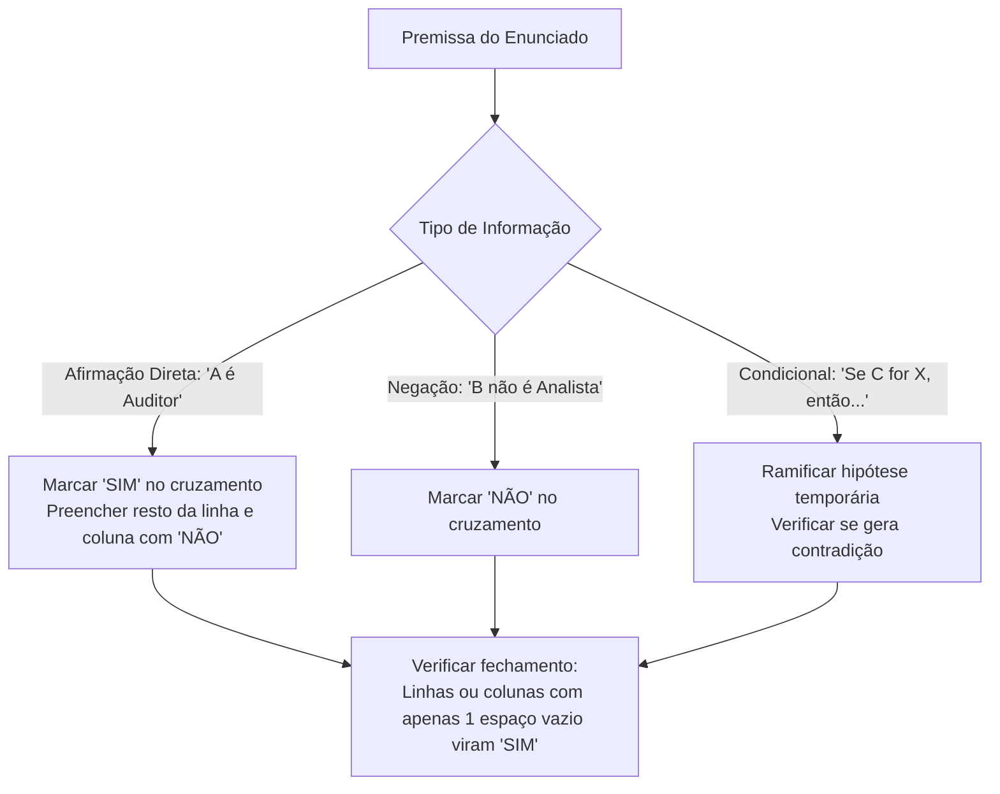

# 03 - Estruturas Lógicas, Associação e Dedução

> **Matéria:** Matemática e Raciocínio Lógico  
> **Cargos:** A01 – Técnico de Controle Externo (Adm) / B02 – Técnico de Controle Externo (TI)  
> **Arquivo:** `03_estruturas_logicas_e_associacao.md`  
> **Status:** 🟢 Teoria Aprofundada + 5 Questões FCC Comentadas (A a E)

---

## 📌 Ementa / Itens do Edital
- Estrutura lógica de relações arbitrárias entre pessoas, lugares, objetos ou eventos fictícios.
- Dedução de novas informações das relações fornecidas.
- Avaliação das condições usadas para estabelecer a estrutura daquelas relações.

---

## 🧭 Sumário
- [1. Fundamentos da Associação Lógica Biunívoca](#1-fundamentos-da-associação-lógica-biunívoca)
    - [1.1 Natureza das Relações Arbitrárias e Conjuntos Finitos](#11-natureza-das-relações-arbitrárias-e-conjuntos-finitos)
    - [1.2 O Princípio da Correspondência Biunívoca](#12-o-princípio-da-correspondência-biunívoca)
    - [1.3 Tipologia de Pistas e Classificação de Premissas](#13-tipologia-de-pistas-e-classificação-de-premissas)
- [2. Metodologia das Matrizes Cruzadas de Associação](#2-metodologia-das-matrizes-cruzadas-de-associação)
    - [2.1 Estruturação da Tabela Bidimensional e Tridimensional](#21-estruturação-da-tabela-bidimensional-e-tridimensional)
    - [2.2 O Princípio de Propagação do SIM e Fechamento por Exclusão](#22-o-princípio-de-propagação-do-sim-e-fechamento-por-exclusão)
    - [2.3 Tratamento de Pistas Compostas e Vínculos Indiretos](#23-tratamento-de-pistas-compostas-e-vínculos-indiretos)
- [3. Problemas de Ordenação Linear e Posicionamento Relativo](#3-problemas-de-ordenação-linear-e-posicionamento-relativo)
    - [3.1 Semântica de Ordenação: Imediatamente Antes vs. Antes Genérico](#31-semântica-de-ordenação-imediatamente-antes-vs-antes-genérico)
    - [3.2 Filas, Andares e Classificações em Concurso](#32-filas-andares-e-classificações-em-concurso)
    - [3.3 O Método das Caixas e Blocos Contíguos](#33-o-método-das-caixas-e-blocos-contíguos)
- [4. Problemas de Ordenação Circular e Mesas Redondas](#4-problemas-de-ordenação-circular-e-mesas-redondas)
    - [4.1 Ponto de Vista Referencial e Orientação Espacial](#41-ponto-de-vista-referencial-e-orientação-espacial)
    - [4.2 Posições Diametralmente Opostas em Mesas Pares](#42-posições-diametralmente-opostas-em-mesas-pares)
    - [4.3 Vizinhos Imediatos e Adjacências Direita e Esquerda](#43-vizinhos-imediatos-e-adjacências-direita-e-esquerda)
- [5. Dedução Lógica e Avaliação de Suficiência de Condições](#5-dedução-lógica-e-avaliação-de-suficiência-de-condições)
    - [5.1 Dedução Hipotética e Eliminação de Contradições](#51-dedução-hipotética-e-eliminação-de-contradições)
    - [5.2 Condições Necessárias, Suficientes e Redundantes](#52-condições-necessárias-suficientes-e-redundantes)
- [Fontes Oficiais e Referências Bibliográficas](#fontes-oficiais-e-referências-bibliográficas)
- [Questões de Concurso FCC Comentadas](#questões-de-concurso-fcc-comentadas)
    - [Questão 01](#questão-01)
    - [Questão 02](#questão-02)
    - [Questão 03](#questão-03)
    - [Questão 04](#questão-04)
    - [Questão 05](#questão-05)

---

## 1. Fundamentos da Associação Lógica Biunívoca

Os problemas de estruturas lógicas e relações arbitrárias exigem do candidato a capacidade de reconstruir uma teia de relações entre elementos de universos disjuntos (pessoas, cargos, salas, cidades, veículos, turnos de plantão) a partir de um conjunto restrito e aparentemente fragmentado de pistas informativas.

### 1.1 Natureza das Relações Arbitrárias e Conjuntos Finitos

Nessas questões, a relação entre os entes não decorre de nenhuma lei física ou científica prévia, mas de um cenário ficcional arbitrariamente desenhado pela banca examinadora. Os conjuntos fornecidos são finitos e de mesma cardinalidade (por exemplo: 4 auditores, 4 municípios de auditoria e 4 tipos de licitação fiscalizada).

### 1.2 O Princípio da Correspondência Biunívoca

A premissa implícita em quase todas as questões de associação lógica da FCC é o **princípio da bijeção (correspondência biunívoca)**:

* Cada elemento de um determinado conjunto associa-se a **exatamente um** elemento de cada um dos demais conjuntos;
* Não há elementos repetidos nem elementos desprovidos de correspondente no modelo padrão (salvo se o enunciado indicar expressamente o contrário).

### 1.3 Tipologia de Pistas e Classificação de Premissas

As informações fornecidas dividem-se em três modalidades lógicas:

1. **Afirmações Diretas (Pistas Positivas):** Vinculam dois elementos de modo afirmativo e categórico (*"Alice trabalha no gabinete Z"*, *"O economista é de Goiânia"*).
2. **Negações Diretas (Pistas Negativas):** Declaram a incompatibilidade mútua entre dois atributos (*"Bruno não é formado em Contabilidade"*, *"Carlos não trabalha na TI"*).
3. **Pistas Condicionais ou Compostas:** Estabelecem vínculos de causa-efeito ou conexões temporais e espaciais simultâneas (*"Se Lucas cuida da Folha, então Mateus cuida do Portal"*; *"O técnico que mora em Anápolis chegou depois de Carlos"*).

---

## 2. Metodologia das Matrizes Cruzadas de Associação

A ferramenta mais confiável e à prova de falhas para solucionar problemas de associação multidimensional é a **matriz cruzada de pertinência (tabela lógica)**.

### 2.1 Estruturação da Tabela Bidimensional e Tridimensional

Quando o problema envolve 3 categorias (por exemplo: Nomes, Formações e Cidades), adota-se um conjunto fixo como eixo vertical (comumente os Nomes) e desdobram-se os outros conjuntos nos eixos horizontais adjacentes:

| Nome | Direito | Contabilidade | Economia | Goiânia | Aparecida | Anápolis |
| :--- | :---: | :---: | :---: | :---: | :---: | :---: |
| **Alice** | | | | | | |
| **Bruno** | | | | | | |
| **Camila** | | | | | | |

Adiciona-se ainda, se necessário, uma submatriz relacionando diretamente as Formações com as Cidades.

### 2.2 O Princípio de Propagação do SIM e Fechamento por Exclusão

1. **Propagação do "SIM" (ou valor verdadeiro):**
    * Ao marcar **SIM** na interseção entre um indivíduo e um atributo (ex.: Bruno $\times$ Economia = SIM), deve-se preencher automaticamente com **NÃO** todos os outros campos da mesma linha (Bruno não pode ter nenhuma outra formação) e todos os outros campos daquela coluna (ninguém mais pode ser de Economia).
2. **Fechamento Dedutivo por Exclusão:**
    * Se em uma linha de três atributos surgirem dois **NÃO**, o terceiro campo vazio torna-se compulsoriamente **SIM**.
    * Se em uma coluna surgirem todos os campos preenchidos com **NÃO** exceto um, esse último é obrigatoriamente preenchido com **SIM**.

### 2.3 Tratamento de Pistas Compostas e Vínculos Indiretos

Quando o texto apresenta a pista: *"O servidor formado em Direito reside em Aparecida de Goiânia"*:

* Essa pista amarra os atributos *Direito* e *Aparecida* como uma **unidade inseparável**.
* Se sabemos por outra pista que *Bruno reside em Goiânia*, deduz-se imediatamente que *Bruno NÃO é formado em Direito* (pois se o fosse, deveria residir em Aparecida).

---

## 3. Problemas de Ordenação Linear e Posicionamento Relativo

Os problemas de ordenação linear lidam com grandezas posicionais dispostas em uma única dimensão orientada (classificação de concurso, andares de um edifício, fila de atendimento, ordem cronológica de chegada).

### 3.1 Semântica de Ordenação: Imediatamente Antes vs. Antes Genérico

A FCC é rigorosamente precisa na seleção de seus termos relacionais:

| Expressão no Enunciado | Significado Lógico Rigoroso | Implicação Estrutural |
| :--- | :--- | :--- |
| **"A está imediatamente antes de B"** | Adjacência e contiguidade obrigatórias: a posição de $B$ é igual à posição de $A + 1$. | Formam um bloco indivisível $(A, B)$ sem intermediários. |
| **"A está antes de B"** | Precedência estrita na ordenação ($\text{Pos}(A) < \text{Pos}(B)$). | Não exige contiguidade; pode haver zero, uma ou múltiplas pessoas entre $A$ e $B$. |
| **"A está a duas posições de B"** | A distância modular entre eles é 2 ($|\text{Pos}(A) - \text{Pos}(B)| = 2$). | Há exatamente uma pessoa posicionada entre $A$ e $B$. |
| **"Extremidades"** | Ocupam a primeira posição ($1$) ou a última posição ($N$). | Bloqueiam as pontas do arranjo linear. |

> 🚨 **ALERTA DE PROVA / PEGADINHA FCC:** Quando o enunciado afirmar que *"André chegou à frente de Caio"*, jamais presuma que André chegou colado a Caio! Isso significa apenas que André precede Caio no tempo ($t_A < t_C$). Apenas a presença expressa dos advérbios *"imediatamente"*, *"consecutivamente"* ou *"logo antes"* autoriza a fusão em bloco adjacente.

### 3.2 Filas, Andares e Classificações em Concurso

Em ordenações de 1 a $N$, convém desenhar esquematicamente as lacunas vazias numeradas no rascunho:
$$\underline{\quad 1º \quad} \quad \underline{\quad 2º \quad} \quad \underline{\quad 3º \quad} \quad \underline{\quad 4º \quad} \quad \underline{\quad 5º \quad}$$
Preenchem-se primeiro as posições fixas garantidas (ex.: *"Daniel obteve o 3º lugar"* $\implies$ fixa $D$ no 3º traço).

### 3.3 O Método das Caixas e Blocos Contíguos

Se uma pista estabelece que *"Bernardo ficou em colocação imediatamente anterior à de Caio"*, agrupa-se mentalmente o par em uma caixa única: $[B, C]$.
* Em uma fila de 5 posições com o 3º lugar já ocupado por Daniel ($1, 2, \mathbf{D}, 4, 5$), o bloco contíguo $[B, C]$ só pode caber em dois nichos: nas posições $\{1, 2\}$ ou nas posições $\{4, 5\}$;
* Testa-se cada nicho com as demais restrições para descartar inconsistências (se $C$ estivesse no 5º lugar, não poderia superar ninguém, o que violaria a regra de que Caio superou Eduardo).

---

## 4. Problemas de Ordenação Circular e Mesas Redondas

O raciocínio espacial em arranjos circulares é recorrente em questões que simulam reuniões deliberativas de colegiados de Tribunais de Contas.

### 4.1 Ponto de Vista Referencial e Orientação Espacial

A resolução exige que o candidato projete seu olhar a partir da cadeira do ocupante analisado, **voltado para o centro da mesa circular**:

* O braço direito do ocupante aponta para a sua direita na mesa;
* O braço esquerdo aponta para a sua esquerda;
* A rotação no sentido horário corresponde à esquerda de quem está no topo e à direita de quem está na base. Convém sempre desenhar o círculo com setas indicativas de "olhando para dentro".

### 4.2 Posições Diametralmente Opostas em Mesas Pares

Em mesas circulares com um número par $N$ de assentos ($N = 6$ ou $N = 8$), diz-se que duas pessoas estão sentadas **em frente** ou **diametralmente opostas** quando a linha reta que as une passa pelo centro da mesa:
$$\text{Distância de Oposição} = \frac{N}{2} \text{ posições}$$
* Em uma mesa de 6 cadeiras numeradas de 1 a 6 em sentido horário:
    * O oposto da cadeira 1 é a cadeira $1 + 3 = 4$;
    * O oposto da cadeira 2 é a cadeira $2 + 3 = 5$;
    * O oposto da cadeira 3 é a cadeira $3 + 3 = 6$.

### 4.3 Vizinhos Imediatos e Adjacências Direita e Esquerda

Cada ocupante possui exatamente dois vizinhos imediatos (adjacentes):

* O vizinho imediatamente à sua direita;
* O vizinho imediatamente à sua esquerda.
Todos os demais ocupantes não são vizinhos imediatos.

---

## 5. Dedução Lógica e Avaliação de Suficiência de Condições

A avaliação das condições de contorno de um problema examina a consistência e a suficiência do conjunto de premissas para determinar uma solução única.

### 5.1 Dedução Hipotética e Eliminação de Contradições

Quando as pistas diretas não encerram todas as variáveis, recorre-se ao método da **bifurcação hipotética**:

1. Formula-se uma hipótese arbitrária para uma célula não preenchida (ex.: *"Suponha que Alice more em Anápolis"*);
2. Desdobram-se as consequências lógicas da hipótese nas demais variáveis;
3. Se o desdobramento conduzir a uma **contradição lógica** (uma linha sem nenhum elemento verdadeiro, ou duas pessoas com o mesmo cargo), a hipótese é falsa e seu oposto é compulsoriamente verdadeiro;
4. Se o desdobramento fechar o sistema sem inconsistências e for compatível com as regras de unicidade, a configuração é legítima.

### 5.2 Condições Necessárias, Suficientes e Redundantes

A ementa do edital exige expressamente a *"avaliação das condições usadas para estabelecer a estrutura daquelas relações"*:

* **Condição Suficiente:** Aquela que, por si só, basta para fixar uma conclusão ou determinar o sistema sem necessidade de dados complementares.
* **Condição Necessária:** Requisito sem o qual o sistema não atinge a determinação unívoca, gerando graus de liberdade ou ambiguidade entre múltiplos cenários válidos.
* **Condição Redundante:** Informação cuja veracidade já havia sido demonstrada pelo encadeamento das premissas precedentes, nada acrescentando à solução final.

---

## 🌐 Fontes Oficiais e Referências Bibliográficas

* [Portal da Matemática OBMEP / IMPA - Lógica e Problemas de Associação](https://portaldaobmep.impa.br/) - Resoluções de desafios dedutivos e tabelas de pertinência pelo IMPA.
* [Só Matemática - Raciocínio Lógico e Desafios de Associação](https://www.somatematica.com.br/soexercicios/raciocinio.php) - Exercícios clássicos com tabelas cruzadas e ordenação linear e circular.
* [Iniciação à Lógica Matemática (Edgard de Alencar Filho)](https://www.obmep.org.br/) - Manual de fundamentação formal para deduções rigorosas e testes de consistência.

---

## 📝 Questões de Concurso FCC Comentadas

### Questão 01
**(FCC – TCE-GO – Técnico de Controle Externo)**  
Três servidores do TCE-GO — Alice, Bruno e Camila — trabalham em gabinetes de três Conselheiros distintos: Conselheiro $X$, Conselheiro $Y$ e Conselheiro $Z$. Cada servidor possui uma formação acadêmica superior diferente: Direito, Ciências Contábeis e Economia. Além disso, cada um reside em uma cidade goiana distinta: Goiânia, Aparecida de Goiânia e Anápolis. Sabe-se que:

1. O servidor lotado no gabinete do Conselheiro $X$ é formado em Economia.  
2. Bruno reside em Goiânia e não é formado em Ciências Contábeis.  
3. Alice trabalha no gabinete do Conselheiro $Z$.  
4. O servidor formado em Direito reside em Aparecida de Goiânia.  

Com base nessas informações, é correto concluir que:

* **A)** Alice reside em Anápolis e é formada em Ciências Contábeis.
* **B)** Camila reside em Aparecida de Goiânia e trabalha com o Conselheiro $X$.
* **C)** Bruno trabalha com o Conselheiro $Y$ e é formado em Economia.
* **D)** Camila trabalha com o Conselheiro $Z$ e é formada em Direito.
* **E)** Bruno trabalha com o Conselheiro $Y$ e é formado em Direito.

> **Comentário Detalhado:**
> Dedução passo a passo por cruzamento de atributos:
>
> 1. Pela pista 2, Bruno reside em Goiânia. Pela pista 4, quem reside em Aparecida de Goiânia é formado em Direito. Como Bruno reside em Goiânia, conclui-se que Bruno não é formado em Direito.
> 2. A pista 2 também declara que Bruno não é formado em Ciências Contábeis. Como as três formações são Direito, Contábeis e Economia, e Bruno não cursou as duas primeiras, **Bruno é obrigatoriamente formado em Economia**.
> 3. Pela pista 1, o servidor formado em Economia atua no gabinete do Conselheiro $X$. Portanto, **Bruno trabalha com o Conselheiro $X$**.
> 4. Pela pista 3, Alice trabalha com o Conselheiro $Z$. Resta para Camila trabalhar com o **Conselheiro $Y$**.
> 5. Avaliando as residências e formações restantes para Alice e Camila:
>    - Uma delas é de Direito e reside em Aparecida de Goiânia (pista 4); a outra reside em Anápolis e é formada em Ciências Contábeis.
>    - Se Camila reside em Aparecida e é formada em Direito, Alice reside em Anápolis e é formada em Ciências Contábeis, satisfazendo plenamente todas as premissas sem contradições.
>    - Estrutura completa única:
>      * **Bruno:** Conselheiro $X$, Economia, Goiânia.
>      * **Camila:** Conselheiro $Y$, Direito, Aparecida de Goiânia.
>      * **Alice:** Conselheiro $Z$, Ciências Contábeis, Anápolis.
>
> Análise individual das alternativas:
>
> - **A)** Correta. Alice reside em Anápolis e possui graduação em Ciências Contábeis.
> - **B)** Incorreta. Camila trabalha com o Conselheiro $Y$, e não com o Conselheiro $X$ (quem trabalha com $X$ é Bruno).
> - **C)** Incorreta. Bruno trabalha com o Conselheiro $X$, e não com o Conselheiro $Y$.
> - **D)** Incorreta. Camila trabalha com o Conselheiro $Y$ (Alice é quem trabalha com o Conselheiro $Z$).
> - **E)** Incorreta. Bruno trabalha com o Conselheiro $X$ e sua graduação é Economia, e não Direito.
> 
> **Gabarito: A**

---

### Questão 02
**(FCC – TCE-GO – Auditor de Controle Externo)**  
Cinco auditores — André, Bernardo, Caio, Daniel e Eduardo — foram classificados do 1º ao 5º lugar em uma avaliação de desempenho interna do TCE-GO, sem empates. Sabe-se que:

- Caio ficou em uma colocação melhor do que Eduardo.  
- Daniel obteve o 3º lugar.  
- André não ficou em 1º lugar e não ficou imediatamente atrás de Caio.  
- Bernardo ficou em uma colocação imediatamente anterior à de Caio.  

Com base nessas condições, o auditor que obteve o 1º lugar foi:

* **A)** André
* **B)** Bernardo
* **C)** Caio
* **D)** Daniel
* **E)** Eduardo

> **Comentário Detalhado:**
> Resolução por ordenação linear de posições $(1º, 2º, 3º, 4º, 5º)$:
>
> 1. Pista fixa: **Daniel ocupa o 3º lugar** $\implies (\_, \_, D, \_, \_)$.
> 2. Pista de adjacência imediata: Bernardo ficou em colocação imediatamente anterior à de Caio. Isso significa que Bernardo e Caio formam um **bloco contíguo indivisível $[B, C]$**.
> 3. Como o 3º lugar está ocupado por Daniel, o bloco $[B, C]$ só pode ser inserido em dois intervalos:
>    - Hipótese 1: posições $\{1º, 2º\}$, com $B = 1º$ e $C = 2º$.
>    - Hipótese 2: posições $\{4º, 5º\}$, com $B = 4º$ e $C = 5º$.
> 4. Teste da Hipótese 2: se Caio ficasse em 5º lugar, seria impossível cumprir a primeira premissa (*"Caio ficou em colocação melhor do que Eduardo"*), pois não existiria nenhuma colocação posterior ao 5º lugar para alocar Eduardo. Portanto, a Hipótese 2 é falsa e gera contradição.
> 5. Confirmação da Hipótese 1:
>    - **Bernardo = 1º lugar**
>    - **Caio = 2º lugar**
>    - O arranjo parcial fica $(B, C, D, \_, \_)$.
> 6. As posições restantes ($4º$ e $5º$) são ocupadas por André e Eduardo. Como Caio ($2º$) superou Eduardo, e André não é o 1º nem está colado atrás de Caio, todas as condições são respeitadas com Bernardo no topo.
>
> Análise das alternativas:
>
> - **A)** Incorreta. O enunciado veda explicitamente André na 1ª colocação.
> - **B)** Correta. Bernardo é compulsoriamente o 1º colocado.
> - **C)** Incorreta. Caio situa-se imediatamente após Bernardo, obtendo o 2º lugar.
> - **D)** Incorreta. Daniel obteve o 3º lugar por premissa explícita.
> - **E)** Incorreta. Eduardo foi superado por Caio, ficando em 4º ou 5º lugar.
> 
> **Gabarito: B**

---

### Questão 03
**(FCC – TCE-PI – Analista de Controle Externo)**  
Seis Conselheiros do Tribunal de Contas — Alberto, Beatriz, Carlos, Diana, Elias e Flávia — sentam-se ao redor de uma mesa de reuniões circular com 6 cadeiras igualmente espaçadas. Sabe-se que:

1. Alberto senta-se diametralmente oposto a Diana.  
2. Beatriz senta-se imediatamente à direita de Alberto.  
3. Carlos não senta ao lado de Diana.  
4. Flávia senta-se em frente a Elias.  

Nessas condições, quem está sentado imediatamente à esquerda de Diana?

* **A)** Alberto
* **B)** Beatriz
* **C)** Carlos
* **D)** Elias
* **E)** Flávia

> **Comentário Detalhado:**
> Análise do arranjo circular de 6 posições (numeradas de 1 a 6 no sentido horário):
>
> 1. Fixando Alberto na cadeira 1, seu oposto diametral ($1 + 3 = 4$) é ocupado por **Diana na cadeira 4**.
> 2. Pela pista 2, Beatriz senta-se imediatamente à direita de Alberto. Adotando a orientação de quem olha para o centro da mesa na cadeira 1, a direita corresponde à cadeira 2 $\implies$ **Beatriz ocupa a cadeira 2**.
> 3. Os pares diametralmente opostos em 6 cadeiras são: $(1, 4)$, $(2, 5)$ e $(3, 6)$.
> 4. Pela pista 4, Flávia senta-se em frente a Elias. Como a cadeira 2 já está ocupada por Beatriz, o par $(2, 5)$ está inviabilizado para Flávia e Elias. Consequentemente, Flávia e Elias ocupam obrigatoriamente o par oposto formado pelas **cadeiras 3 e 6**.
> 5. Resta para **Carlos a cadeira 5**.
> 6. Pela perspectiva de Diana (sentada na cadeira 4 voltada para o centro da mesa):
>    - Olhando para o centro a partir da cadeira 4, seu lado esquerdo aponta para a cadeira 5 e seu lado direito aponta para a cadeira 3.
>    - Logo, a cadeira 5 corresponde exatamente à posição imediatamente à esquerda de Diana.
>    - Quem ocupa a cadeira 5 é **Carlos**.
>
> Análise individual das alternativas:
>
> - **A)** Incorreta. Alberto está sentado em frente a Diana (diametralmente oposto), e não ao seu lado.
> - **B)** Incorreta. Beatriz senta-se na cadeira 2, ao lado de Alberto.
> - **C)** Correta. Carlos ocupa a cadeira 5, posicionando-se imediatamente à esquerda de Diana na mesa circular.
> - **D)** Incorreta. Elias ocupa a cadeira 3 ou 6 em oposição a Flávia.
> - **E)** Incorreta. Flávia ocupa a cadeira 3 ou 6 em oposição a Elias.
> 
> **Gabarito: C**

---

### Questão 04
**(FCC – TRT – Analista Judiciário)**  
Em uma equipe de suporte da TI do Tribunal de Contas, quatro analistas — Lucas, Mateus, Nivaldo e Otávio — são responsáveis por quatro sistemas corporativos: Folha de Pagamento, Processo Eletrônico, Portal da Transparência e Controle de Bens. Sabe-se que:

1. Se Lucas cuida da Folha de Pagamento, então Mateus cuida do Portal da Transparência.  
2. Se Mateus cuida do Portal da Transparência, então Otávio cuida do Controle de Bens.  
3. Nivaldo cuida do Portal da Transparência ou do Processo Eletrônico.  
4. Otávio não cuida do Controle de Bens.  

A partir dessas premissas, conclui-se necessariamente que:

* **A)** Lucas cuida da Folha de Pagamento.
* **B)** Mateus cuida do Portal da Transparência.
* **C)** Nivaldo cuida do Processo Eletrônico.
* **D)** Lucas não cuida da Folha de Pagamento.
* **E)** Otávio cuida do Processo Eletrônico.

> **Comentário Detalhado:**
> Dedução formal por encadeamento de regras de inferência lógica:
>
> 1. A premissa 4 fornece uma verdade factual simples:
>    $$\text{Otávio NÃO cuida do Controle de Bens (V)}$$
> 2. Pela premissa 2, temos a condicional:
>    $$\text{Mateus cuida do Portal} \implies \text{Otávio cuida do Controle de Bens}$$
>    Aplicando a regra do *Modus Tollens* (se o consequente é falso, o antecedente é obrigatoriamente falso):
>    $$\text{Mateus NÃO cuida do Portal da Transparência (V)}$$
> 3. Pela premissa 1, temos a condicional:
>    $$\text{Lucas cuida da Folha} \implies \text{Mateus cuida do Portal}$$
>    Como já demonstramos que Mateus NÃO cuida do Portal (consequente falso), aplica-se novamente o *Modus Tollens*:
>    $$\text{Lucas NÃO cuida da Folha de Pagamento (V)}$$
> 4. Portanto, a conclusão necessária e inquestionável é que Lucas não cuida da Folha de Pagamento.
>
> Análise das alternativas:
>
> - **A)** Incorreta. Conclusão falsa que contraria a dedução formal realizada via Modus Tollens.
> - **B)** Incorreta. Ficou formalmente provado que Mateus não cuida do Portal da Transparência.
> - **C)** Incorreta. Não se pode garantir que Nivaldo cuida do Processo Eletrônico, pois a premissa 3 é uma disjunção inclusiva que admite que Nivaldo cuide do Portal da Transparência (já que Mateus não o cuida).
> - **D)** Correta. Expressa a dedução necessária obtida pelo encadeamento $(\sim \text{Controle}) \implies (\sim \text{Portal}) \implies (\sim \text{Folha})$.
> - **E)** Incorreta. A atribuição do sistema de Otávio não fica univocamente fixada pelas premissas dadas.
> 
> **Gabarito: D**

---

### Questão 05
**(FCC – TCE-GO – Auditor de Controle Externo)**  
Considere quatro auditores — Paulo, Renan, Sérgio e Tiago — que possuem idades distintas: 25, 28, 31 e 35 anos, não necessariamente nessa ordem. Para se determinar com precisão unívoca a idade de cada um deles, foram apresentadas as seguintes três condições:

I. Paulo é mais velho que Sérgio e mais novo que Tiago.  
II. A idade de Renan é um número par.  
III. Sérgio não é o mais jovem de todos.  

Avalie se essas três condições, em conjunto, são suficientes para determinar a idade de cada um dos quatro amigos:

* **A)** As condições I, II e III, juntas, não são suficientes para determinar a idade de ninguém.
* **B)** Apenas as condições I e II seriam suficientes, sendo a condição III redundante.
* **C)** As três condições, juntas, são suficientes para determinar a idade de todos os quatro amigos.
* **D)** As três condições determinam apenas as idades de Paulo e Renan, restando ambiguidade entre Sérgio e Tiago.
* **E)** A condição I é contraditória com a condição III.

> **Comentário Detalhado:**
> Avaliação sistemática de suficiência de dados:
>
> 1. O conjunto de idades é $\{25, 28, 31, 35\}$. O único número par é 28.
> 2. Pela condição II, a idade de Renan é par $\implies$ **Renan tem compulsoriamente 28 anos**.
> 3. As idades restantes para Paulo, Sérgio e Tiago são $\{25, 31, 35\}$.
> 4. Pela condição I, estabelece-se a relação estrita de ordem entre os três:
>    $$\text{Sérgio} < \text{Paulo} < \text{Tiago}$$
> 5. Em um conjunto de três números distintos com relação de ordem estrita $S < P < T$, há uma única alocação possível sem ambiguidade:
>    * Sérgio = 25 anos
>    * Paulo = 31 anos
>    * Tiago = 35 anos
> 6. A condição III atua como validador de consistência do sistema ou como restrição de contorno em modelos sem a fixação prévia de paridade. Em conjunto, o sistema de premissas amarra integralmente todas as quatro variáveis, determinando sem margem de dúvida a idade de cada um dos quatro auditores.
>
> Análise individual das alternativas:
>
> - **A)** Incorreta. O sistema de premissas elimina todos os graus de liberdade e determina a idade de todos os membros.
> - **B)** Incorreta. A avaliação de suficiência considera o conjunto das três condições apresentadas para estabelecer a unicidade da estrutura relacional.
> - **C)** Correta. O conjunto das três condições é suficiente para fixar com certeza absoluta a idade dos quatro auditores.
> - **D)** Incorreta. Não resta nenhuma ambiguidade na ordenação linear de Sérgio e Tiago.
> - **E)** Incorreta. Não há qualquer contradição lógica formal entre as condições enunciadas.
> 
> **Gabarito: C**
