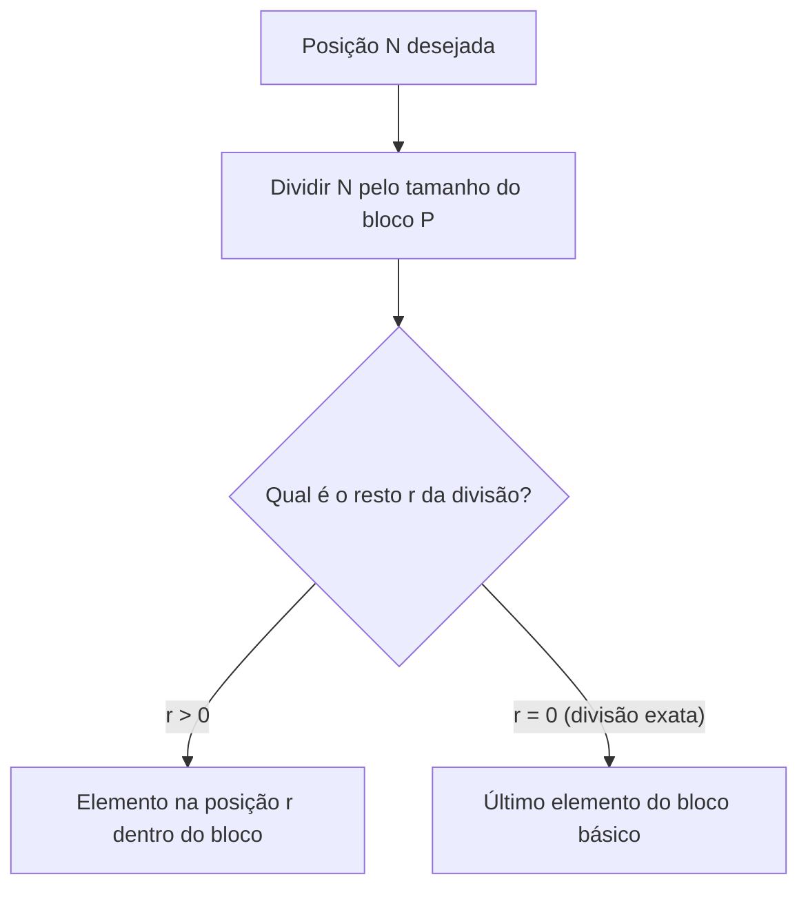
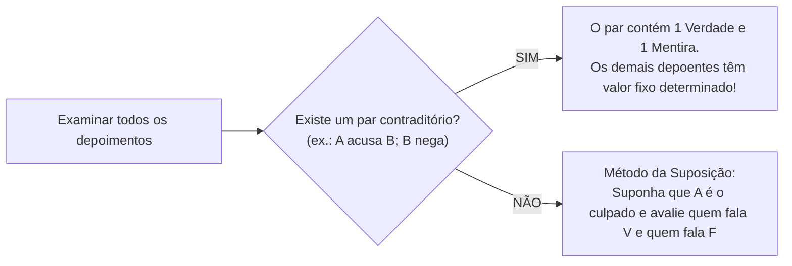

# 04 - Raciocínio Sequencial, Temporal, Espacial e Verbal

> **Matéria:** Matemática e Raciocínio Lógico  
> **Cargos:** A01 – Técnico de Controle Externo (Adm) / B02 – Técnico de Controle Externo (TI)  
> **Arquivo:** `04_raciocinio_sequencial_temporal_espacial_e_verbal.md`  
> **Status:** 🟢 Teoria Aprofundada + 5 Questões FCC Comentadas (A a E)

---

## 📌 Ementa / Itens do Edital
- Compreensão e elaboração da lógica das situações por meio de:
    - Raciocínio sequencial.
    - Orientação espacial e temporal.
    - Formação de conceitos e discriminação de elementos.
    - Raciocínio verbal e matemático aplicado.
    - Problemas de verdades e mentiras.

---

## 🧭 Sumário
- [1. Raciocínio Sequencial e Padrões Numéricos e Literais](#1-raciocinio-sequencial-e-padroes-numericos-e-literais)
    - [1.1 Sequências Numéricas e Relações de Recorrência](#11-sequencias-numericas-e-relacoes-de-recorrencia)
    - [1.2 Sequências Alfanuméricas e Ordem Alfabética Oficial](#12-sequencias-alfanumericas-e-ordem-alfabetica-oficial)
    - [1.3 Padrões Literais por Iniciais Semânticas](#13-padroes-literais-por-iniciais-semanticas)
    - [1.4 Sequências Cíclicas e Resolução por Aritmética Modular](#14-sequencias-ciclicas-e-resolucao-por-aritmetica-modular)
- [2. Orientação Temporal, Calendários e Relógios](#2-orientacao-temporal-calendarios-e-relogios)
    - [2.1 Contagem de Dias e Aritmética Módulo 7](#21-contagem-de-dias-e-aritmetica-modulo-7)
    - [2.2 Regras de Anos Bissextos e Deslocamento Anual](#22-regras-de-anos-bissextos-e-deslocamento-anual)
    - [2.3 Cálculo do Ângulo entre Ponteiros de Relógio](#23-calculo-do-angulo-entre-ponteiros-de-relogio)
    - [2.4 Relações Temporais Relativas de Ontem e Amanhã](#24-relacoes-temporais-relativas-de-ontem-e-amanha)
- [3. Orientação Espacial, Transformações e Dobradura de Figuras](#3-orientacao-espacial-transformacoes-e-dobradura-de-figuras)
    - [3.1 Rotações no Plano Bidimensional e Reflexões Axiais](#31-rotacoes-no-plano-bidimensional-e-reflexoes-axiais)
    - [3.2 Planificação e Montagem de Cubos: A Regra das Faces Opostas](#32-planificacao-e-montagem-de-cubos-a-regra-das-faces-opostas)
    - [3.3 Vistas Ortogonais de Pilhas de Blocos e Cubos](#33-vistas-ortogonais-de-pilhas-de-blocos-e-cubos)
- [4. Formação de Conceitos e Discriminação de Elementos](#4-formacao-de-conceitos-e-discriminacao-de-elementos)
    - [4.1 Identificação do Elemento Intruso em Conjuntos](#41-identificacao-do-elemento-intruso-em-conjuntos)
    - [4.2 Analogias Estruturais e Geométricas](#42-analogias-estruturais-e-geometricas)
- [5. Raciocínio Verbal e Problemas de Verdades e Mentiras](#5-raciocinio-verbal-e-problemas-de-verdades-e-mentiras)
    - [5.1 O Princípio do Terceiro Excluído e da Não Contradição](#51-o-principio-do-terceiro-excluido-e-da-nao-contradicao)
    - [5.2 O Método do Par Contraditório](#52-o-metodo-do-par-contraditorio)
    - [5.3 O Método da Suposição Hipotética Dirigida](#53-o-metodo-da-suposicao-hipotetica-dirigida)
- [Fontes Oficiais e Referências Bibliográficas](#fontes-oficiais-e-referencias-bibliograficas)
- [Questões de Concurso FCC Comentadas](#questoes-de-concurso-fcc-comentadas)
    - [Questão 01](#questao-01)
    - [Questão 02](#questao-02)
    - [Questão 03](#questao-03)
    - [Questão 04](#questao-04)
    - [Questão 05](#questao-05)

---

## 1. Raciocínio Sequencial e Padrões Numéricos e Literais

O raciocínio sequencial investiga a capacidade de identificar leis de formação abstratas ocultas sob uma ordenação cronológica, numérica ou alfanumérica, permitindo prever termos subsequentes ou remotos.

### 1.1 Sequências Numéricas e Relações de Recorrência

As sequências de números exploradas em concursos estruturam-se segundo diferentes padrões formativos:

1. **Progressões Aritméticas (PA) e Geométricas (PG):** Apresentam saltos aditivos constantes ($a_n = a_{n-1} + r$) ou multiplicativos constantes ($a_n = a_{n-1} \times q$).
2. **Diferenças Sucessivas em Progressão:** A diferença entre termos consecutivos não é constante, mas forma uma nova sequência com lei própria (ex.: diferenças que dobram a cada passo: $+2, +4, +8, +16, +32\dots$).
3. **Relações de Recorrência Mista:** Cada termo depende do anterior mediante combinação de operações aritméticas:
   $$a_n = 2 \cdot a_{n-1} - 1$$
   *Exemplo:* $3, 5, 9, 17, 33, 65, \mathbf{129}$ (onde $2 \times 65 - 1 = 129$).
4. **Sequências do Tipo Fibonacci:** Cada termo resulta da soma dos dois termos imediatamente anteriores ($1, 1, 2, 3, 5, 8, 13, 21\dots$).

### 1.2 Sequências Alfanuméricas e Ordem Alfabética Oficial

As sequências que intercalam letras e números utilizam a posição ordinal das letras no alfabeto oficial da língua portuguesa (composto por 26 letras, incluindo K, W e Y):

| A | B | C | D | E | F | G | H | I | J | K | L | M | N | O | P | Q | R | S | T | U | V | W | X | Y | Z |
| :-: | :-: | :-: | :-: | :-: | :-: | :-: | :-: | :-: | :-: | :-: | :-: | :-: | :-: | :-: | :-: | :-: | :-: | :-: | :-: | :-: | :-: | :-: | :-: | :-: | :-: |
| 1 | 2 | 3 | 4 | 5 | 6 | 7 | 8 | 9 | 10 | 11 | 12 | 13 | 14 | 15 | 16 | 17 | 18 | 19 | 20 | 21 | 22 | 23 | 24 | 25 | 26 |

*Exemplo:* Na sequência $B2, D4, F6, H8\dots$, a letra avança de 2 em 2 posições no alfabeto e o número acompanha a ordem par correspondente.

### 1.3 Padrões Literais por Iniciais Semânticas

Pegadinha clássica em provas da FCC consiste em sequências aparentemente caóticas cujas letras representam as iniciais de uma série semântica predeterminada da língua:

* Iniciais dos dias da semana: **D, S, T, Q, Q, S, S** (Domingo, Segunda, Terça, Quarta, Quinta, Sexta, Sábado);
* Iniciais dos meses do ano: **J, F, M, A, M, J, J, A, S, O, N, D**;
* Iniciais dos numerais por extenso: **U, D, T, Q, C, S, S, O, N, D** (Um, Dois, Três, Quatro, Cinco, Seis, Sete, Oito, Nove, Dez).

### 1.4 Sequências Cíclicas e Resolução por Aritmética Modular

Quando uma palavra, código ou conjunto de símbolos é repetido indefinidamente formando uma fita infinita:



1. Calcula-se o comprimento do período (tamanho do bloco repetitivo $P$);
2. Divide-se a posição demandada $N$ por $P$, obtendo $N = P \cdot q + r$;
3. **Se $r > 0$:** O termo procurado é o $r$-ésimo elemento do bloco inicial;
4. **Se $r = 0$:** A divisão foi exata, o que significa que o termo coincide exatamente com o **último elemento do bloco**.

---

## 2. Orientação Temporal, Calendários e Relógios

A orientação temporal examina o cômputo de prazos processuais e dias da semana mediante congruência modular de base 7.

### 2.1 Contagem de Dias e Aritmética Módulo 7

A semana compõe-se de exatamente 7 dias cíclicos. Logo, somar qualquer múltiplo de 7 dias a uma data devolve o calendário exatamente ao mesmo dia da semana:
$$\text{Dia Futuro} = \text{Dia Base} + (N \pmod 7)$$

*Exemplo:* Se uma sessão do TCE-GO ocorreu em uma quinta-feira e se quer saber em que dia da semana recairá um prazo de 43 dias corridos contados a partir daquela data:
$$43 = 6 \times 7 + 1 \implies \text{Resto } 1$$
Avança-se 1 dia a partir da quinta-feira, alcançando-se infalivelmente a **sexta-feira**.

### 2.2 Regras de Anos Bissextos e Deslocamento Anual

1. **Deslocamento Anual Comum:** Um ano civil ordinário possui 365 dias:
   $$365 = 52 \times 7 + 1 \implies \text{Avança 1 dia da semana no ano seguinte}$$
2. **Deslocamento em Ano Bissexto:** Possui 366 dias (acréscimo do dia 29 de fevereiro):
   $$366 = 52 \times 7 + 2 \implies \text{Avança 2 dias da semana}$$
3. **Critério Astronômico de Bissextilidade:**
    * É bissexto todo ano divisível por 4;
    * Exceto os anos centenários (terminados em 00), que somente são bissextos se forem divisíveis por 400 (ex.: o ano 2000 foi bissexto; os anos 1900 e 2100 **não** são bissextos).

### 2.3 Cálculo do Ângulo entre Ponteiros de Relógio

Em um mostrador circular analógico tradicional ($360^\circ$ divididos em 12 horas e 60 minutos):

* O ponteiro dos minutos desloca-se a uma velocidade angular de:
  $$v_M = \frac{360^\circ}{60 \text{ min}} = 6^\circ/\text{min}$$
* O ponteiro das horas desloca-se a uma velocidade de:
  $$v_H = \frac{360^\circ}{12 \text{ h} \times 60 \text{ min}} = 0{,}5^\circ/\text{min} \quad (30^\circ \text{ por hora})$$
* **Fórmula do Menor Ângulo ($\theta$) às $H$ horas e $M$ minutos:**
  $$|\theta| = |30 \cdot H - 5{,}5 \cdot M|$$
  Se o resultado modular for superior a $180^\circ$, toma-se o ângulo replementar: $\theta_{\text{menor}} = 360^\circ - \theta$.

### 2.4 Relações Temporais Relativas de Ontem e Amanhã

Problemas verbais do tipo *"Se o amanhã de ontem fosse o anteontem de depois de amanhã..."* devem ser resolvidos convertendo as expressões em uma reta numérica onde o dia **Hoje** é a origem $0$:

* Hoje = $0$; Amanhã = $+1$; Depois de amanhã = $+2$;
* Ontem = $-1$; Anteontem = $-2$.
Monta-se uma equação de primeiro grau simples para encontrar a posição do dia de referência.

---

## 3. Orientação Espacial, Transformações e Dobradura de Figuras

O raciocínio espacial avalia a aptidão psicotécnica de manipular objetos tridimensionais mentalmente sem distorcer suas propriedades topológicas.

### 3.1 Rotações no Plano Bidimensional e Reflexões Axiais

* **Rotações:** Giro rígido da figura em torno de um ponto pivô no sentido horário ou anti-horário em ângulos retos de $90^\circ, 180^\circ$ ou $270^\circ$. A forma e as distâncias relativas preservam-se; apenas a orientação espacial se altera.
* **Reflexão Axial (Espelhamento):** Inversão especular da figura em relação a um eixo vertical ou horizontal. O lado direito vira esquerdo na reflexão vertical; o topo vira base na reflexão horizontal.

### 3.2 Planificação e Montagem de Cubos: A Regra das Faces Opostas

A planificação de um hexaedro regular (cubo) compõe-se de 6 quadrados dispostos em cruz ou configurações similares:

```text
       [ ★ ]
[ ♥ ] [ ♠ ] [ ♦ ] [ ♣ ]
       [ ▲ ]
```

#### O Teorema Infalível das Faces Opostas:
1. Em qualquer fileira retilínea com 3 ou 4 quadrados consecutivos, **duas faces separadas por exatamente uma face intermediária formam um par de faces diametralmente opostas no cubo montado**.
    * No esquema acima: $\heartsuit$ é oposta a $\diamondsuit$ (separadas por $\spadesuit$); $\spadesuit$ é oposta a $\clubsuit$ (separadas por $\diamondsuit$).

2. As abas laterais que sobram dobram-se formando o outro par oposto: $\bigstar$ é oposta a $\blacktriangle$.
3. **Propriedade Inviolável:** Duas faces opostas **nunca podem ser vizinhas adjacentes** e **jamais aparecem juntas em uma mesma visão tridimensional ortogonal do cubo**.

### 3.3 Vistas Ortogonais de Pilhas de Blocos e Cubos

Consiste em determinar a projeção visual bidimensional de uma estrutura tridimensional de blocos cúbicos a partir de pontos de vista fixos:

* Vista Superior (planta baixa vista de cima);
* Vista Frontal (elevação frontal);
* Vista Lateral Esquerda ou Direita.

---

## 4. Formação de Conceitos e Discriminação de Elementos

### 4.1 Identificação do Elemento Intruso em Conjuntos

Exige identificar a propriedade lógica oculta que une a maioria dos elementos de um rol e discriminar o único elemento que destoa dessa harmonia funcional ou geométrica:

* Critérios numéricos: paridade, números primos, quadrados perfeitos;
* Critérios geométricos: número de vértices, eixos de simetria, concavidade;
* Critérios morfológicos/verbais: número de sílabas, classe gramatical, campo semântico.

### 4.2 Analogias Estruturais e Geométricas

Resolvem-se pela equivalência de transformações: *"A está para B assim como C está para D"*. Identifica-se qual mutação (rotação de $90^\circ$, inversão de cores, acréscimo de um lado poligonal) operou a passagem de A para B e replica-se essa exata transformação sobre a figura C para encontrar D.

---

## 5. Raciocínio Verbal e Problemas de Verdades e Mentiras

Os enigmas de depoimentos em sindicâncias e auditorias de fraudes são modelados por lógica proposicional veritativa.

### 5.1 O Princípio do Terceiro Excluído e da Não Contradição

* Uma declaração ou é Verdadeira ($V$) ou é Falsa ($F$), não havendo meio-termo (Terceiro Excluído);
* Uma declaração não pode ser simultaneamente verdadeira e falsa sob as mesmas circunstâncias (Não Contradição).

### 5.2 O Método do Par Contraditório

É o método mais célere e elegante de resolução:



> 🚨 **ALERTA DE PROVA / PEGADINHA FCC:** Se o enunciado garantir que *"entre os quatro servidores ouvidos, apenas um deles mentiu"*, examine os depoimentos em busca de duas pessoas que se contradigam (por exemplo: Daniel diz *"Fernando cometeu a fraude"* e Fernando diz *"Daniel está mentindo"*). Como uma dessas falas é verdadeira e a outra é falsa, **a única mentira da questão está obrigatoriamente confinada a esse par**. Logo, todos os outros servidores fora do par (Eduardo e Gabriel) falaram a verdade irrestrita!

### 5.3 O Método da Suposição Hipotética Dirigida

Caso não haja contradição explícita direta entre os depoimentos:

1. Fixa-se a culpa hipotética em um dos suspeitos (ex.: *"Suponha que o culpado seja Fernando"*);
2. Avalia-se a veracidade de cada depoimento sob essa premissa;
3. Se a quantidade de verdades e mentiras bater com o enunciado (ex.: 3 verdades e 1 mentira), a hipótese é a solução final;
4. Se gerar quantidade diferente de mentirosos, descarta-se e testa-se o próximo suspeito.

---

## 🌐 Fontes Oficiais e Referências Bibliográficas

* [Portal da Matemática OBMEP / IMPA - Sequências e Aritmética Modular](https://portaldaobmep.impa.br/) - Aulas de congruência módulo $n$, calendários e sequências numéricas e geométricas.
* [Só Matemática - Desafios de Raciocínio Lógico](https://www.somatematica.com.br/soexercicios/raciocinio.php) - Problemas comentados de verdades e mentiras, orientação temporal e sequências com padrões alfanuméricos.
* [Khan Academy Brasil - Transformações Geométricas](https://pt.khanacademy.org/math/geometry) - Simetria, rotação e raciocínio espacial tridimensional.

---

## 📝 Questões de Concurso FCC Comentadas

### Questão 01
**(FCC – TCE-GO – Técnico de Controle Externo)**  
Um servidor do TCE-GO elaborou uma rotina automatizada para numerar lotes de fiscalização repetindo indefinidamente a palavra **"CONTROLE"**, sem espaços, gerando a seguinte sequência contínua de letras:
$$\text{C, O, N, T, R, O, L, E, C, O, N, T, R, O, L, E, C, O, N}\dots$$

Nessas condições, a letra que ocupará a 2027ª posição nessa sequência e o total de vezes que a letra **"O"** terá sido escrita até essa posição são, respectivamente:

* **A)** N e 506
* **B)** T e 506
* **C)** N e 507
* **D)** O e 506
* **E)** T e 507

> **Comentário Detalhado:**
> Análise do padrão cíclico e frequência da letra:
>
> 1. O bloco básico repetitivo é a palavra **CONTROLE**, constituída por $P = 8$ letras ordenadas:
>     - Posição 1: C
>     - Posição 2: **O** (primeira ocorrência de O)
>     - Posição 3: N
>     - Posição 4: T
>     - Posição 5: R
>     - Posição 6: **O** (segunda ocorrência de O)
>     - Posição 7: L
>     - Posição 8 (ou resto 0): E
>    Em cada bloco completo de 8 letras, a letra **"O"** é grafada exatamente **2 vezes** (nas posições 2 e 6).
> 2. Aplicação da Divisão Euclidiana para a 2027ª posição:
>    $$2027 = 8 \times 253 + 3$$
>     - O quociente 253 revela que o ciclo de 8 letras foi repetido integralmente 253 vezes.
>     - O **resto é 3**, o que significa que foram grafadas mais 3 letras no ciclo subsequente incompleto: a 1ª letra (C), a 2ª letra (O) e a 3ª letra (**N**).
>     - Portanto, a letra na 2027ª posição é a letra **N**.
>
> 3. Contagem acumulada da letra "O":
>     - Nos 253 ciclos completos: $253 \times 2 = 506$ ocorrências de "O".
>     - No ciclo incompleto de 3 letras (C, O, N): a posição 2 traz mais 1 letra "O".
>     - Total acumulado: $506 + 1 = \mathbf{507 \text{ vezes}}$.
>
> Análise individual das alternativas:
>
> - **A)** Incorreta. Erra ao indicar 506 ocorrências de "O", esquecendo de computar a letra O da posição 2 do ciclo incompleto.
> - **B)** Incorreta. Aponta a letra T (que corresponderia a resto 4) e contagem desatualizada de O.
> - **C)** Correta. A letra na 2027ª posição é **N** (resto 3) e a letra "O" foi grafada $253 \times 2 + 1 = \mathbf{507}$ vezes.
> - **D)** Incorreta. A letra O ocupou a posição 2026 (resto 2), e não a 2027.
> - **E)** Incorreta. Aponta a letra T em vez de N.
> 
> **Gabarito: C**

---

### Questão 02
**(FCC – TCE-GO – Auditor de Controle Externo)**  
Durante uma auditoria interna para apurar o vazamento de um relatório sigiloso, quatro servidores — Daniel, Eduardo, Fernando e Gabriel — foram interrogados e fizeram as seguintes declarações:

- Daniel: *"Fernando é o responsável pelo vazamento."*  
- Eduardo: *"Eu não vazei o relatório."*  
- Fernando: *"Daniel está mentindo."*  
- Gabriel: *"Eduardo está falando a verdade."*  

Sabendo-se que **apenas um dos quatro servidores mentiu** e que apenas um deles foi o responsável pelo vazamento, quem vazou o relatório e quem mentiu foram, respectivamente:

* **A)** Fernando e Daniel
* **B)** Daniel e Fernando
* **C)** Fernando e Fernando
* **D)** Eduardo e Eduardo
* **E)** Gabriel e Daniel

> **Comentário Detalhado:**
> Resolução estruturada pelo método do par contraditório:
>
> 1. Identificação da contradição frontal:
>     - Daniel afirma: *"Fernando é o responsável pelo vazamento"*.
>     - Fernando afirma: *"Daniel está mentindo"*.
>     - As falas de Daniel e Fernando são mutuamente contraditórias: se Daniel fala a verdade, Fernando mente; se Daniel mente, Fernando fala a verdade. Portanto, uma é compulsoriamente Verdadeira ($V$) e a outra é compulsoriamente Falsa ($F$).
>
> 2. Localização da mentira única:
>     - O problema fixa que **apenas um dos quatro servidores mentiu**.
>     - Como a única mentira do grupo está confinada no par contraditório formado por Daniel e Fernando, todos os outros servidores fora do par falaram a **mais pura verdade**:
>         * Eduardo falou a verdade ($V$);
>         * Gabriel falou a verdade ($V$).
>
> 3. Dedução do culpado e do mentiroso:
>     - Eduardo falou a verdade ao declarar *"Eu não vazei o relatório"*, logo Eduardo é inocente. Gabriel apenas confirma a veracidade de Eduardo.
>     - Se Daniel falasse a verdade ($V$), Fernando seria o responsável pelo vazamento; consequentemente, o depoimento de Fernando (*"Daniel mente"*) seria mentiroso ($F$). Esse cenário confere: 1 mentiroso (Fernando) e 1 culpado (Fernando).
>     - Se supuséssemos o contrário (Daniel mentindo e Fernando dizendo a verdade), Fernando não teria vazado e Eduardo não teria vazado; restaria como culpado Daniel ou Gabriel, gerando indeterminação fática não sustentada.
>     - Portanto, quem vazou o relatório foi **Fernando** e quem mentiu foi **Fernando**.
>
> Análise das alternativas:
>
> - **A)** Incorreta. Aponta Daniel como mentiroso, o que anularia a autoria de Fernando.
> - **B)** Incorreta. Inverte a relação de autoria e mentira.
> - **C)** Correta. Fernando é o responsável pelo vazamento e foi ele mesmo quem mentiu no interrogatório.
> - **D)** Incorreta. Eduardo disse a verdade e é inocente.
> - **E)** Incorreta. Gabriel disse a verdade e não é o vazador.
> 
> **Gabarito: C**

---

### Questão 03
**(FCC – TRT – Analista Judiciário)**  
O Tribunal de Contas publicou um acórdão condenatório em sua sessão plenária realizada em uma **quinta-feira**. O regimento interno concede um prazo improrrogável de exatamente **43 dias corridos**, contados a partir do primeiro dia seguinte ao da publicação, para a interposição de recurso ordinário.

O último dia desse prazo de 43 dias corridos recairá em uma:

* **A)** Segunda-feira
* **B)** Terça-feira
* **C)** Quarta-feira
* **D)** Quinta-feira
* **E)** Sexta-feira

> **Comentário Detalhado:**
> Aplicação da aritmética modular de base 7:
>
> 1. Ponto de partida cronológico:
>     - Publicação em plenário: quinta-feira.
>     - O prazo de 43 dias começa a transcorrer a partir do marco zero da publicação.
>
> 2. Redução modular da contagem:
>     - A semana possui ciclo invariável de 7 dias. Dividindo 43 por 7:
>      $$43 = 6 \times 7 + 1$$
>     - O quociente 6 indica que se passaram 6 semanas completas (as quais devolvem a contagem exatamente para a mesma quinta-feira).
>     - O **resto é 1**, impondo o avanço de exatamente 1 dia a partir da quinta-feira:
>      $$\text{Quinta-feira} + 1 \text{ dia} = \mathbf{Sexta-feira}$$
> 3. Logo, o 43º dia do prazo transcorrerá em uma sexta-feira.
>
> Análise das alternativas:
>
> - **A)** Incorreta. Segunda-feira demandaria resto 4 na divisão por 7.
> - **B)** Incorreta. Terça-feira demandaria resto 5.
> - **C)** Incorreta. Quarta-feira demandaria resto 6.
> - **D)** Incorreta. Quinta-feira corresponderia a uma divisão exata sem resto (resto 0).
> - **E)** Correta. O resto 1 de $43 \div 7$ avança 1 dia a partir da quinta-feira, resultando em sexta-feira.
> 
> **Gabarito: E**

---

### Questão 04
**(FCC – TCE-GO – Tecnologia da Informação)**  
Considere a sequência numérica infinita cujos primeiros termos são apresentados a seguir:
$$3, 5, 9, 17, 33, 65, \dots$$

O próximo termo dessa sequência e a lei de formação que rege seus elementos correspondem, respectivamente, a:

* **A)** 129 e o dobro do termo anterior subtraído de 1
* **B)** 129 e o dobro do termo anterior somado a 1
* **C)** 97 e a soma dos dois termos anteriores
* **D)** 130 e potências consecutivas de 3
* **E)** 131 e a soma das diferenças sucessivas multiplicadas por 3

> **Comentário Detalhado:**
> Identificação da lei de formação por diferenças e recorrência:
>
> 1. Calculando a diferença entre termos consecutivos:
>     - $5 - 3 = 2 = 2^1$
>     - $9 - 5 = 4 = 2^2$
>     - $17 - 9 = 8 = 2^3$
>     - $33 - 17 = 16 = 2^4$
>     - $65 - 33 = 32 = 2^5$
>    As diferenças sucessivas formam potências consecutivas de 2. Logo, a próxima diferença entre o 7º e o 6º termo deve ser $2^6 = 64$:
>    $$a_7 = 65 + 64 = \mathbf{129}$$
> 2. Analisando a lei de recorrência direta:
>     - $2 \times 3 - 1 = 5$
>     - $2 \times 5 - 1 = 9$
>     - $2 \times 9 - 1 = 17$
>     - $2 \times 17 - 1 = 33$
>     - $2 \times 33 - 1 = 65$
>     - $2 \times 65 - 1 = 130 - 1 = \mathbf{129}$
>    A lei estruturante expressa-se perfeitamente como o **dobro do termo anterior subtraído de 1** ($a_n = 2a_{n-1} - 1$).
>
> Análise das alternativas:
>
> - **A)** Correta. O próximo elemento é 129 e a relação de recorrência é $2x - 1$.
> - **B)** Incorreta. Se somasse 1, a sequência seria $3, 7, 15, 31, 63, 127$.
> - **C)** Incorreta. A soma dos dois termos precedentes (estilo Fibonacci) geraria $33 + 65 = 98$, divergindo de 97 e da lógica da sequência.
> - **D)** Incorreta. O próximo termo é 129, e não 130.
> - **E)** Incorreta. Aponta 131 decorrente de erro aritmético.
> 
> **Gabarito: A**

---

### Questão 05
**(FCC – TCE-PI – Analista de Sistemas)**  
Observe a planificação de um dado cúbico convencional, cujas faces contêm os símbolos $\heartsuit$, $\spadesuit$, $\diamondsuit$, $\clubsuit$, $\bigstar$ e $\blacktriangle$:

```text
       [ ★ ]
[ ♥ ] [ ♠ ] [ ♦ ] [ ♣ ]
       [ ▲ ]
```

Ao montar o cubo a partir dessa planificação, a face que ficará **diametralmente oposta** à face com o símbolo de Espadas ($\spadesuit$) é:

* **A)** Copas ($\heartsuit$)
* **B)** Ouros ($\diamondsuit$)
* **C)** Paus ($\clubsuit$)
* **D)** Estrela ($\bigstar$)
* **E)** Triângulo ($\blacktriangle$)

> **Comentário Detalhado:**
> Análise estrutural de planificação e dobradura de cubos:
>
> 1. Na fileira horizontal com quatro quadrados adjacentes $[ \heartsuit ] \ [ \spadesuit ] \ [ \diamondsuit ] \ [ \clubsuit ]$:
>     - Pelo teorema das faces opostas em planificações poliédricas, quadrados dispostos na mesma fileira separados por exatamente um quadrado intermediário dobram-se em planos paralelos, tornando-se **faces opostas**.
>     - $\heartsuit$ separa-se de $\diamondsuit$ por $\spadesuit \implies \heartsuit$ é oposta a $\diamondsuit$.
>     - $\spadesuit$ separa-se de $\clubsuit$ por $\diamondsuit \implies \spadesuit$ é oposta a $\clubsuit$.
>
> 2. As abas que se projetam para fora da fileira central ($\bigstar$ acima e $\blacktriangle$ abaixo) dobram-se em $90^\circ$ fechando o topo e a base do cubo, sendo opostas entre si.
> 3. Logo, a face que se posiciona diametralmente oposta à face de Espadas ($\spadesuit$) é a face de Paus ($\clubsuit$).
>
> Análise individual das alternativas:
>
> - **A)** Incorreta. Copas ($\heartsuit$) dobra em ângulo reto, ficando adjacente a Espadas.
> - **B)** Incorreta. Ouros ($\diamondsuit$) é face imediatamente vizinha (adjacente) de Espadas.
> - **C)** Correta. Paus ($\clubsuit$) é a face diametralmente oposta a Espadas ($\spadesuit$).
> - **D)** Incorreta. Estrela ($\bigstar$) fecha a face superior, sendo adjacente a Espadas.
> - **E)** Incorreta. Triângulo ($\blacktriangle$) fecha a face inferior, sendo adjacente a Espadas.
> 
> **Gabarito: C**
