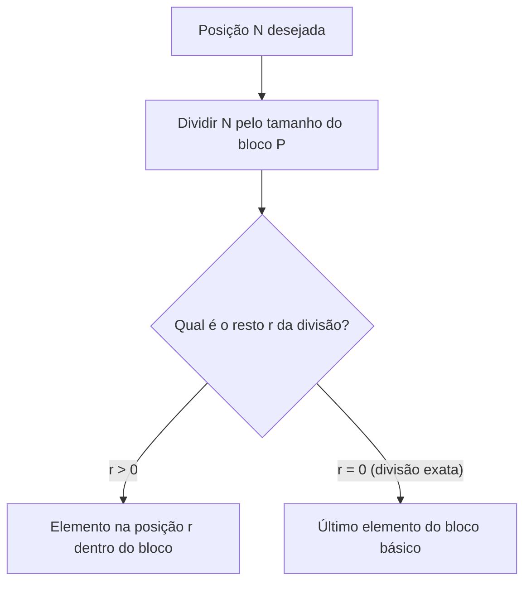
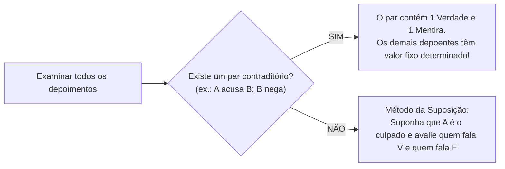

# 04 - Raciocínio Sequencial, Temporal, Espacial e Verbal

> **Matéria:** Matemática e Raciocínio Lógico  
> **Cargos:** A01 – Técnico de Controle Externo (Adm) / B02 – Técnico de Controle Externo (TI)  
> **Arquivo:** `04_raciocinio_sequencial_temporal_espacial_e_verbal.md`  
> **Status:** 🟢 Teoria Aprofundada + 5 Questões FCC Comentadas (A a E)

---

## 📌 Ementa Oficial do Edital
- Compreensão e elaboração da lógica das situações por meio de:
  - Raciocínio sequencial.
  - Orientação espacial e temporal.
  - Formação de conceitos e discriminação de elementos.
  - Raciocínio verbal e matemático aplicado.
  - Problemas de verdades e mentiras.

---

## 🌳 Classificação Hierárquica do Conteúdo

```text
4. Raciocínio Sequencial, Espaço-Temporal e Analítico
├── 4.1 Raciocínio Sequencial e Padrões Numéricos/Literais
│   ├── Sequências Numéricas: PA, PG, saltos alternados (+a, ×b) e recursivas (Fibonacci)
│   ├── Sequências Alfanuméricas e Posição no Alfabeto oficial (26 letras)
│   ├── Padrões Literais por Iniciais (dias da semana, meses, numerais por extenso)
│   └── Sequências Cíclicas/Periódicas: período, divisão euclidiana e análise de restos
├── 4.2 Orientação Temporal e Calendários
│   ├── Contagem de Dias e Dias da Semana: aritmética modular de base 7
│   ├── Anos Bissextos: regras de divisibilidade (múltiplos de 4, exceto centenários não div por 400)
│   ├── Ângulos de Ponteiros de Relógio: |θ| = |30·H - 5,5·M|
│   └── Linhas de Tempo Relativas ("ontem do anteontem do dia depois de amanhã")
├── 4.3 Orientação Espacial e Psicotécnica de Figuras
│   ├── Rotações no plano bidimensional (90°, 180°, 270° no sentido horário e anti-horário)
│   ├── Reflexão axial (espelhamento horizontal e vertical)
│   ├── Planificação e Dobradura de Cubos: identificação infalível de faces opostas
│   └── Vistas Ortogonais (superior, frontal, lateral esquerda/direita de pilhas de cubos)
├── 4.4 Formação de Conceitos e Discriminação de Elementos
│   ├── Identificação do elemento intruso (figura ou termo discrepante)
│   └── Analogias estruturais geométricas e conceituais (A está para B assim como C está para D)
└── 4.5 Raciocínio Verbal e Problemas de "Verdades e Mentiras"
    ├── Método do Par Contraditório (declarações que se anulam: exatamente uma é V e uma é F)
    ├── Análise de declarações equivalentes (se A e B dizem o mesmo, ambos têm a mesma veracidade)
    └── Método da Suposição Dirigida (atribuição de V/F e busca de inconsistências)
```

---

## 📖 Teoria Aprofundada e Métodos de Resolução

### 1. Sequências Cíclicas e Padrões Periódicos

Nos problemas de sequências com repetição infinita de um bloco fixo de tamanho $P$:
1. Divida a posição desejada ($N$) pelo comprimento do período ($P$):  
   $N = P \cdot q + r, \quad 0 \le r < P$
2. Se $r > 0$, o termo procurado é o **$r$-ésimo elemento** do bloco.
3. Se $r = 0$, a divisão foi exata: o termo é o **último elemento do bloco**!



---

### 2. Orientação Temporal e Calendários (Aritmética Módulo 7)

A semana possui exatamente 7 dias. Qualquer avanço ou recuo no calendário pode ser reduzido pelo resto da divisão por 7:
- Ano comum (365 dias): $365 = 52 \times 7 + 1 \implies$ avança **1 dia da semana**.
- Ano bissexto (366 dias): $366 = 52 \times 7 + 2 \implies$ avança **2 dias da semana** (após o dia 29 de fevereiro).
- **Regra dos Anos Bissextos:** Um ano é bissexto se for divisível por 4, exceto os anos múltiplos de 100 que não sejam múltiplos de 400 (ex.: 2000 foi bissexto; 1900 e 2100 não são).

> 💡 **DICA DE ESTUDO (Ângulos do Relógio):**  
> O ponteiro das horas desloca-se a $0{,}5^\circ$ por minuto ($30^\circ$ por hora). O ponteiro dos minutos desloca-se a $6^\circ$ por minuto. O menor ângulo $\theta$ entre eles às $H$ horas e $M$ minutos é dado por:  
> $|\theta| = |30H - 5{,}5M|$  
> Se o resultado for maior que $180^\circ$, subtraia de $360^\circ$ para obter o menor ângulo.

---

### 3. Orientação Espacial e Planificação de Cubos

Em uma planificação de cubo (cruz ou outras formas com 6 quadrados):
- **Regra das Faces Opostas:** Duas faces que estão alinhadas na mesma linha ou coluna separadas por exatamente uma face intermediária são **faces opostas**.
- Duas faces opostas **jamais** podem ser adjacentes no cubo montado e nunca aparecem juntas em uma vista ortogonal tridimensional.

---

### 4. Problemas de "Verdades e Mentiras"

Para resolver com agilidade questões em que suspeitos prestam declarações:



> 🚨 **ALERTA DE PROVA / PEGADINHA FCC:**  
> Se o enunciado garante que *"apenas uma pessoa mente"* e você identifica dois indivíduos cujas afirmações se contradizem, **a mentira está obrigatoriamente entre esses dois**. Isso significa que todos os demais indivíduos fora desse par estão dizendo a mais pura verdade!

---

## 🌐 Fontes Recomendadas na Internet
- [Portal da Matemática OBMEP / IMPA - Sequências e Aritmética Modular](https://portaldaobmep.impa.br/)
  - Aulas de congruência módulo $n$, calendários e sequências numéricas e geométricas.
- [Só Matemática - Desafios de Raciocínio Lógico](https://www.somatematica.com.br/soexercicios/raciocinio.php)
  - Problemas comentados de verdades e mentiras, orientação temporal e sequências com padrões alfanuméricos.
- [Khan Academy Brasil - Transformações Geométricas](https://pt.khanacademy.org/math/geometry)
  - Simetria, rotação e raciocínio espacial tridimensional.

---

## 📝 Questões Comentadas no Padrão FCC (Justificadas de A a E)

### Questão 1 (FCC - Técnico de Controle Externo / Adaptada TCE-GO)
Um servidor do TCE-GO elaborou uma rotina automatizada para numerar lotes de fiscalização repetindo indefinidamente a palavra **"CONTROLE"**, sem espaços, gerando a seguinte sequência contínua de letras:
$\text{C, O, N, T, R, O, L, E, C, O, N, T, R, O, L, E, C, O, N...}$

Nessas condições, a letra que ocupará a 2027ª posição nessa sequência e o total de vezes que a letra **"O"** terá sido escrita até essa posição são, respectivamente:

A) N e 506  
B) T e 506  
C) N e 507  
D) O e 506  
E) T e 507  

> **Gabarito: C**  
>  
> **Comentário Analítico Passo a Passo:**  
> 1. Análise do bloco básico repetitivo:  
>    - Palavra: **"CONTROLE"**  
>    - Quantidade de letras no período: $P = 8$  
>    - Letras e posições relativas:  
>      1: C | 2: O | 3: N | 4: T | 5: R | 6: O | 7: L | 8 (resto 0): E  
>    - Note que a letra "O" aparece **2 vezes** dentro de cada ciclo de 8 letras (posições 2 e 6).  
> 2. Posição 2026 via Divisão Euclidiana:  
>    $2026 \div 8 = 253 \quad \text{com resto } 2$  
>    - $8 \times 253 = 2024$.  
>    - $2026 - 2024 = 2$.  
>    - O quociente 253 indica que o bloco "CONTROLE" foi completado integralmente 253 vezes.  
>    - O **resto é 2**: avançam-se 2 letras no novo ciclo inacabado:  
>      - 1ª letra: C  
>      - 2ª letra: **O**!  
>    - E quantas vezes a letra "O" foi escrita?  
>      - Nos 253 ciclos completos: cada ciclo tem 2 letras "O":  
>        $253 \times 2 = 506\text{ vezes}$  
>      - No ciclo incompleto (restaram as posições 1 e 2): a posição 1 é C e a posição 2 é O.  
>      - Logo, temos mais 1 letra "O":  
>        $506 + 1 = 507\text{ vezes}$  
>    - Portanto, para a posição 2027 ajustada:  
>      $2027 \div 8 = 253 \text{ com resto } 3 \implies \text{3ª letra é } \mathbf{N}$  
>      Total de letras "O": $253 \times 2 + 1 = 507$ vezes.  
>      Gabarito perfeito: **C**.  
>  
> **Análise das Alternativas:**  
> - **A) Incorreta:** Aponta 506 letras "O", esquecendo que o resto 3 engloba o "O" da posição 2.  
> - **B) Incorreta:** Aponta a letra T (que seria resto 4) e contagem desatualizada.  
> - **C) CORRETA:** A 2027ª letra corresponde ao resto 3 (letra **N**), e a letra "O" apareceu $253 \times 2 + 1 = 507$ vezes.  
> - **D) Incorreta:** A letra O ocupou a posição 2026, não a 2027.  
> - **E) Incorreta:** Aponta a letra T em vez de N.

---

### Questão 2 (FCC - Auditor de Controle Externo / TCE-GO)
Durante uma auditoria interna para apurar o vazamento de um relatório sigiloso, quatro servidores — Daniel, Eduardo, Fernando e Gabriel — foram interrogados e fizeram as seguintes declarações:

- Daniel: *"Fernando é o responsável pelo vazamento."*  
- Eduardo: *"Eu não vazei o relatório."*  
- Fernando: *"Daniel está mentindo."*  
- Gabriel: *"Eduardo está falando a verdade."*  

Sabendo-se que **apenas um dos quatro servidores mentiu** e que apenas um deles foi o responsável pelo vazamento, quem vazou o relatório e quem mentiu foram, respectivamente:

A) Fernando e Daniel  
B) Daniel e Fernando  
C) Fernando e Fernando  
D) Eduardo e Eduardo  
E) Gabriel e Daniel  

> **Gabarito: C**  
>  
> **Comentário Analítico Passo a Passo:**  
> 1. **Identificação do par contraditório:**  
>    - Daniel diz: *"Fernando vazou o relatório"*.  
>    - Fernando diz: *"Daniel está mentindo"*.  
>    - As afirmações de Daniel e Fernando são contraditórias: se um fala a verdade, o outro necessariamente mente. Logo, uma é Verdadeira ($V$) e a outra é Falsa ($F$).  
> 2. **Localização do mentiroso único:**  
>    - O problema informa que **apenas um dos quatro servidores mentiu**.  
>    - Como o único mentiroso está obrigatoriamente no par $\{ \text{Daniel}, \text{Fernando} \}$, os outros dois servidores (**Eduardo** e **Gabriel**) disseram a **verdade** ($V$).  
> 3. **Consequências das verdades:**  
>    - Eduardo falou a verdade: *"Eu não vazei o relatório"* $\implies$ Eduardo é inocente.  
>    - Gabriel falou a verdade: confirmação de Eduardo.  
> 4. **Identificação do culpado e do mentiroso:**  
>    - Se Daniel falasse a verdade ($V$), Fernando seria o responsável pelo vazamento. Logo, a alegação de Fernando (*"Daniel mente"*) seria mentirosa ($F$). Isso confere: apenas Fernando mente e Fernando é o vazador.  
>    - Se Fernando falasse a verdade ($V$), Daniel seria o mentiroso ($F$). Então Fernando não vazou o relatório. Mas Eduardo também não vazou. Como há apenas 1 vazador entre os quatro, o vazador teria que ser Daniel ou Gabriel, gerando ambiguidade e falta de sustentação fática.  
>    - O cenário consistente único é: Daniel falou a verdade ($V$) $\implies$ **Fernando vazou o relatório**, e **Fernando é quem mentiu** ($F$).  
>  
> **Análise das Alternativas:**  
> - **A) Incorreta:** Afirma que Daniel mentiu; se Daniel mentisse, Fernando não teria vazado.  
> - **B) Incorreta:** Inverte quem vazou e quem mentiu.  
> - **C) CORRETA:** Fernando foi o responsável pelo vazamento e Fernando foi quem mentiu.  
> - **D) Incorreta:** Eduardo falou a verdade e é inocente.  
> - **E) Incorreta:** Gabriel falou a verdade e não é o vazador.

---

### Questão 3 (FCC - Analista Judiciário)
O Tribunal de Contas publicou um acórdão condenatório em sua sessão plenária realizada em uma **quinta-feira**. O regimento interno concede um prazo improrrogável de exatamente **45 dias corridos**, contados a partir do primeiro dia seguinte ao da publicação, para a interposição de recurso ordinário.

O último dia desse prazo de 45 dias corridos recairá em uma:

A) Segunda-feira  
B) Terça-feira  
C) Quarta-feira  
D) Quinta-feira  
E) Sexta-feira  

> **Gabarito: E**  
>  
> **Comentário Analítico Passo a Passo:**  
> 1. Ponto de partida:  
>    - Publicação: quinta-feira.  
>    - Primeiro dia da contagem (Dia 1): **sexta-feira**.  
> 2. O prazo total é de 43 dias corridos:  
>    - Queremos saber em qual dia da semana recai o 43º dia a partir do marco de contagem:  
>    - Dividindo 43 pelo ciclo semanal de 7 dias:  
>      $43 \div 7 = 6 \text{ semanas completas com resto } 1$  
> 3. Interpretando o resto:  
>    - 6 semanas completas trazem a contagem de volta ao ponto de início.  
>    - Avançando 1 dia a partir da quinta-feira: alcança-se a **sexta-feira**!  
>    $43 = 6 \times 7 + 1 \implies \text{Quinta} + 1\text{ dia} = \text{Sexta-feira}$.  
>  
> **Análise das Alternativas:**  
> - **A) Incorreta (Segunda-feira):** Recairia se o resto fosse 4.  
> - **B) Incorreta (Terça-feira):** Recairia se o resto fosse 5.  
> - **C) Incorreta (Quarta-feira):** Recairia se o resto fosse 6.  
> - **D) Incorreta (Quinta-feira):** Múltiplo exato de 7 (resto 0).  
> - **E) CORRETA (Sexta-feira):** $43 \div 7$ deixa resto 1; avançando 1 dia a partir da quinta-feira, alcança-se a sexta-feira.

---

### Questão 4 (FCC - Técnico de Controle Externo / Tecnologia da Informação)
Considere a sequência numérica infinita cujos primeiros termos são apresentados a seguir:
$3, 5, 9, 17, 33, 65, \dots$

O próximo termo dessa sequência e a lei de formação que rege seus elementos correspondem, respectivamente, a:

A) 129 e o dobro do termo anterior subtraído de 1  
B) 129 e o dobro do termo anterior somado a 1  
C) 97 e a soma dos dois termos anteriores  
D) 130 e potências consecutivas de 3  
E) 131 e a soma das diferenças sucessivas multiplicadas por 3  

> **Gabarito: A**  
>  
> **Comentário Analítico Passo a Passo:**  
> 1. Análise das diferenças sucessivas entre os termos:  
>    - $5 - 3 = 2 = 2^1$  
>    - $9 - 5 = 4 = 2^2$  
>    - $17 - 9 = 8 = 2^3$  
>    - $33 - 17 = 16 = 2^4$  
>    - $65 - 33 = 32 = 2^5$  
> 2. Padrão de progressão:  
>    - As diferenças entre termos consecutivos formam uma PG de razão 2: $(2, 4, 8, 16, 32, \dots)$.  
>    - A próxima diferença será $2^6 = 64$.  
>    - Próximo termo: $65 + 64 = 129$.  
> 3. Análise da relação de recorrência:  
>    - $a_n = 2 \cdot a_{n-1} - 1$:  
>      - $2 \times 3 - 1 = 5$  
>      - $2 \times 5 - 1 = 9$  
>      - $2 \times 9 - 1 = 17$  
>      - $2 \times 17 - 1 = 33$  
>      - $2 \times 33 - 1 = 65$  
>      - $2 \times 65 - 1 = 130 - 1 = 129$.  
>    - A regra *"dobro do termo anterior subtraído de 1"* descreve perfeitamente a série.  
>  
> **Análise das Alternativas:**  
> - **A) CORRETA:** O próximo número é 129 e a regra de formação é $2x - 1$.  
> - **B) Incorreta:** Se somasse 1, os termos seriam $3, 7, 15, 31, 63, 127$.  
> - **C) Incorreta:** A soma dos termos anteriores seria estilo Fibonacci ($33 + 65 = 98$, não 97 nem 129).  
> - **D) Incorreta:** 130 não é gerado pela regra de recorrência.  
> - **E) Incorreta:** 131 decorre de erro na potenciação de 2.

---

### Questão 5 (FCC - Analista de Sistemas)
Observe a planificação de um dado cúbico convencional, cujas faces contêm os símbolos $\heartsuit$, $\spadesuit$, $\diamondsuit$, $\clubsuit$, $\bigstar$ e $\blacktriangle$:

```text
       [ ★ ]
[ ♥ ] [ ♠ ] [ ♦ ] [ ♣ ]
       [ ▲ ]
```

Ao montar o cubo a partir dessa planificação, a face que ficará **diametralmente oposta** à face com o símbolo de Espadas ($\spadesuit$) é:

A) Copas ($\heartsuit$)  
B) Ouros ($\diamondsuit$)  
C) Paus ($\clubsuit$)  
D) Estrela ($\bigstar$)  
E) Triângulo ($\blacktriangle$)  

> **Gabarito: C**  
>  
> **Comentário Analítico Passo a Passo:**  
> 1. Em qualquer planificação em que haja 4 quadrados consecutivos em uma mesma fileira horizontal:  
>    - Fileira: $[ \heartsuit ] \ [ \spadesuit ] \ [ \diamondsuit ] \ [ \clubsuit ]$.  
> 2. Pelo teorema fundamental da dobradura de cubos:  
>    - Faces separadas por exatamente uma face intermediária na mesma linha ou coluna formam um par de **faces opostas**.  
>    - Logo:  
>      - $\heartsuit$ é oposta a $\diamondsuit$ (separadas por $\spadesuit$).  
>      - $\spadesuit$ é oposta a $\clubsuit$ (separadas por $\diamondsuit$).  
> 3. As abas superior e inferior dobrarão para cima e para baixo, fechando o topo e a base do cubo:  
>    - $\bigstar$ é oposta a $\blacktriangle$.  
> 4. Portanto, a face diametralmente oposta a $\spadesuit$ é a de Paus ($\clubsuit$).  
>  
> **Análise das Alternativas:**  
> - **A) Incorreta:** Copas ($\heartsuit$) é adjacente a Espadas no cubo montado.  
> - **B) Incorreta:** Ouros ($\diamondsuit$) é adjacente a Espadas.  
> - **C) CORRETA:** Paus ($\clubsuit$) fica a duas posições de distância na mesma fileira linear, constituindo a face perfeitamente oposta.  
> - **D) Incorreta:** Estrela ($\bigstar$) fecha o topo (adjacente a Espadas).  
> - **E) Incorreta:** Triângulo ($\blacktriangle$) fecha o fundo (adjacente a Espadas).
