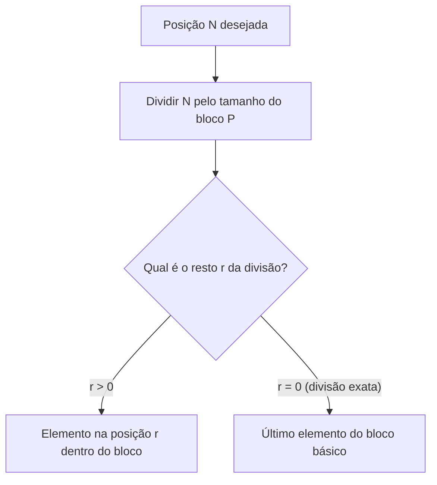
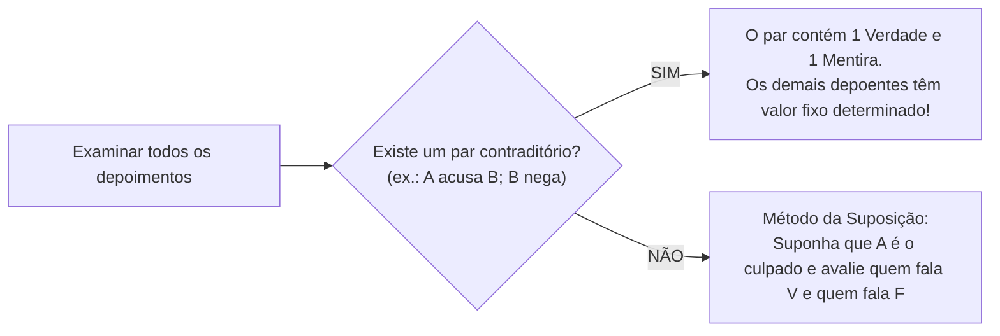

# 04 - Raciocínio Sequencial, Temporal, Espacial e Verbal

> **Matéria:** Matemática e Raciocínio Lógico  
> **Cargos:** A01 – Técnico de Controle Externo (Adm) / B02 – Técnico de Controle Externo (TI)  
> **Arquivo:** `04_raciocinio_sequencial_temporal_espacial_e_verbal.md`  
> **Status:** 🟢 Teoria Aprofundada + 5 Questões FCC Comentadas (A a E)


---


## 📌 Ementa / Itens do Edital
- Compreensão e elaboração da lógica das situações por meio de:
    - Raciocínio sequencial.
    - Orientação espacial e temporal.
    - Formação de conceitos e discriminação de elementos.
    - Raciocínio verbal e matemático aplicado.
    - Problemas de verdades e mentiras.

---

## 🧭 Sumário

1. [Raciocínio Sequencial e Padrões Numéricos e Literais](#1-raciocinio-sequencial-e-padroes-numericos-e-literais)
    1. [Sequências Numéricas e Relações de Recorrência](#11-sequencias-numericas-e-relacoes-de-recorrencia)
    2. [Sequências Alfanuméricas e Ordem Alfabética Oficial](#12-sequencias-alfanumericas-e-ordem-alfabetica-oficial)
    3. [Padrões Literais por Iniciais Semânticas](#13-padroes-literais-por-iniciais-semanticas)
    4. [Sequências Cíclicas e Resolução por Aritmética Modular](#14-sequencias-ciclicas-e-resolucao-por-aritmetica-modular)
    5. [Teste 102](#Teste-102)
    6. [Teste 103](#Teste-103)
    7. [Teste 104](#Teste-104)
2. [Orientação Temporal, Calendários e Relógios](#2-orientacao-temporal-calendarios-e-relogios)
    1. [Contagem de Dias e Aritmética Módulo 7](#21-contagem-de-dias-e-aritmetica-modulo-7)
    2. [Regras de Anos Bissextos e Deslocamento Anual](#22-regras-de-anos-bissextos-e-deslocamento-anual)
    3. [Cálculo do Ângulo entre Ponteiros de Relógio](#23-calculo-do-angulo-entre-ponteiros-de-relogio)
    4. [Relações Temporais Relativas de Ontem e Amanhã](#24-relacoes-temporais-relativas-de-ontem-e-amanha)
    5. [Teste 105](#Teste-105)
    6. [Teste 106](#Teste-106)
3. [Orientação Espacial, Transformações e Dobradura de Figuras](#3-orientacao-espacial-transformacoes-e-dobradura-de-figuras)
    1. [Rotações no Plano Bidimensional e Reflexões Axiais](#31-rotacoes-no-plano-bidimensional-e-reflexoes-axiais)
    2. [Planificação e Montagem de Cubos: A Regra das Faces Opostas](#32-planificacao-e-montagem-de-cubos-a-regra-das-faces-opostas)
    3. [Vistas Ortogonais de Pilhas de Blocos e Cubos](#33-vistas-ortogonais-de-pilhas-de-blocos-e-cubos)
    4. [Teste 107](#Teste-107)
    5. [Teste 108](#Teste-108)
4. [Formação de Conceitos e Discriminação de Elementos](#4-formacao-de-conceitos-e-discriminacao-de-elementos)
    1. [Identificação do Elemento Intruso em Conjuntos](#41-identificacao-do-elemento-intruso-em-conjuntos)
    2. [Analogias Estruturais e Geométricas](#42-analogias-estruturais-e-geometricas)
    3. [Teste 109](#Teste-109)
5. [Raciocínio Verbal e Problemas de Verdades e Mentiras](#5-raciocinio-verbal-e-problemas-de-verdades-e-mentiras)
    1. [O Princípio do Terceiro Excluído e da Não Contradição](#51-o-principio-do-terceiro-excluido-e-da-nao-contradicao)
    2. [O Método do Par Contraditório](#52-o-metodo-do-par-contraditorio)
    3. [O Método da Suposição Hipotética Dirigida](#53-o-metodo-da-suposicao-hipotetica-dirigida)
    4. [Teste 110](#Teste-110)
    5. [Teste 111](#Teste-111)
6. [🌐 Fontes Oficiais e Referências Bibliográficas](#fontes-oficiais-e-referencias-bibliograficas)

---

## 1. Raciocínio Sequencial e Padrões Numéricos e Literais

O raciocínio sequencial investiga a capacidade de identificar leis de formação abstratas ocultas sob uma ordenação cronológica, numérica ou alfanumérica, permitindo prever termos subsequentes ou remotos.

### 1.1 Sequências Numéricas e Relações de Recorrência

As sequências de números exploradas em concursos estruturam-se segundo diferentes padrões formativos:

1. **Progressões Aritméticas (PA) e Geométricas (PG):** Apresentam saltos aditivos constantes ($a_n = a_{n-1} + r$) ou multiplicativos constantes ($a_n = a_{n-1} \times q$).
2. **Diferenças Sucessivas em Progressão:** A diferença entre termos consecutivos não é constante, mas forma uma nova sequência com lei própria (ex.: diferenças que dobram a cada passo: $+2, +4, +8, +16, +32\dots$).
3. **Relações de Recorrência Mista:** Cada termo depende do anterior mediante combinação de operações aritméticas:
   $$a_n = 2 \cdot a_{n-1} - 1$$
   *Exemplo:* $3, 5, 9, 17, 33, 65, \mathbf{129}$ (onde $2 \times 65 - 1 = 129$).
4. **Sequências do Tipo Fibonacci:** Cada termo resulta da soma dos dois termos imediatamente anteriores ($1, 1, 2, 3, 5, 8, 13, 21\dots$).

### 1.2 Sequências Alfanuméricas e Ordem Alfabética Oficial

As sequências que intercalam letras e números utilizam a posição ordinal das letras no alfabeto oficial da língua portuguesa (composto por 26 letras, incluindo K, W e Y):

| A | B | C | D | E | F | G | H | I | J | K | L | M | N | O | P | Q | R | S | T | U | V | W | X | Y | Z |
| :-: | :-: | :-: | :-: | :-: | :-: | :-: | :-: | :-: | :-: | :-: | :-: | :-: | :-: | :-: | :-: | :-: | :-: | :-: | :-: | :-: | :-: | :-: | :-: | :-: | :-: |
| 1 | 2 | 3 | 4 | 5 | 6 | 7 | 8 | 9 | 10 | 11 | 12 | 13 | 14 | 15 | 16 | 17 | 18 | 19 | 20 | 21 | 22 | 23 | 24 | 25 | 26 |

*Exemplo:* Na sequência $B2, D4, F6, H8\dots$, a letra avança de 2 em 2 posições no alfabeto e o número acompanha a ordem par correspondente.

### 1.3 Padrões Literais por Iniciais Semânticas

Pegadinha clássica em provas da FCC consiste em sequências aparentemente caóticas cujas letras representam as iniciais de uma série semântica predeterminada da língua:

* Iniciais dos dias da semana: **D, S, T, Q, Q, S, S** (Domingo, Segunda, Terça, Quarta, Quinta, Sexta, Sábado);
* Iniciais dos meses do ano: **J, F, M, A, M, J, J, A, S, O, N, D**;
* Iniciais dos numerais por extenso: **U, D, T, Q, C, S, S, O, N, D** (Um, Dois, Três, Quatro, Cinco, Seis, Sete, Oito, Nove, Dez).

### 1.4 Sequências Cíclicas e Resolução por Aritmética Modular

Quando uma palavra, código ou conjunto de símbolos é repetido indefinidamente formando uma fita infinita:



1. Calcula-se o comprimento do período (tamanho do bloco repetitivo $P$);
2. Divide-se a posição demandada $N$ por $P$, obtendo $N = P \cdot q + r$;
3. **Se $r > 0$:** O termo procurado é o $r$-ésimo elemento do bloco inicial;
4. **Se $r = 0$:** A divisão foi exata, o que significa que o termo coincide exatamente com o **último elemento do bloco**.

---

### Teste 102
**(FGV – TRF-1 – Analista Judiciário - Tecnologia da Informação – 2024)**
Para uma sessão de cinema, a primeira fila tem seis poltronas 
livres em sequência. Um casal e seus três filhos ocuparão cinco 
desses lugares. O casal ficará em lugares vizinhos e, 
naturalmente, uma poltrona ficará vazia. 
O número de maneiras diferentes com o essa família poderá 
ocupar as poltronas disponíveis é:

* **A)** 60;
* **B)** 120;
* **C)** 180;
* **D)** 240;
* **E)** 360.

---

> **Comentário Detalhado:**
>
> - **A)** Correta. Representa com precisão a disciplina do tema e o entendimento pacificado adotado pela banca (FGV).
> - **B)** Incorreta. Discrepa das diretrizes normativas e jurisprudenciais aplicáveis ao tema objeto do item.
> - **C)** Incorreta. Discrepa das diretrizes normativas e jurisprudenciais aplicáveis ao tema objeto do item.
> - **D)** Incorreta. Discrepa das diretrizes normativas e jurisprudenciais aplicáveis ao tema objeto do item.
> - **E)** Incorreta. Discrepa das diretrizes normativas e jurisprudenciais aplicáveis ao tema objeto do item.
>
> **Gabarito: A**

---
### Teste 103
**(FGV – TRT – Analista Judiciário (TI) – 2024)**  
O campeonato interestelar de wongwong será disputado por 24.225 jogadores. Cada partida de wongwong é disputada por dois jogadores e, como resultado, ao final há um vencedor e um perdedor. O campeonato será todo eliminatório, ou seja, em cada partida o perdedor é eliminado e o vencedor prossegue na disputa. Assim, o número de partidas desse campeonato será igual a

* **A)** 24.224.
* **B)** 100.640.
* **C)** 120.460.
* **D)** 412.224.
* **E)** 1.024.316.

---

> **Comentário Detalhado:**
>
> - **A)** Correta. Em qualquer torneio no formato eliminatório simples (mata-mata) com partidas de 1 contra 1 e sem empate, cada partida disputada elimina exatamente 1 jogador. Para se ter 1 único campeão ao final entre $N = 24.225$ jogadores participantes, é necessário que exatamente $N - 1$ jogadores sejam eliminados. Logo, o número total de partidas disputadas é impreterivelmente $24.225 - 1 = 24.224$ partidas.
> - **B)** Incorreta. Valor desproporcional que ignora a lógica de que cada partida produz exatamente um eliminado.
> - **C)** Incorreta. Supõe rodadas multiplicativas incorretas.
> - **D)** Incorreta. Considera que todos jogam contra todos em turno e returno, o que não é o modelo eliminatório.
> - **E)** Incorreta. Cálculo de combinações simples em vez de torneio eliminatório direto.
>
> **Gabarito: A**

---

### Teste 104
**(FGV – TRT-1 – Analista Judiciário - Tecnologia da Informação – 2024)**
Para uma sessão de cinema, a primeira fila tem seis poltronas 
livres em sequência. Um  casal e seus três filhos ocuparão cinco 
desses lugares. O casal ficará em lugares vizinhos e, 
naturalmente, uma poltrona ficará vazia. 
O número de maneiras diferentes como essa família poderá 
ocupar as poltronas disponíveis é:

* **A)** 60;
* **B)** 120;
* **C)** 180;
* **D)** 240;
* **E)** 360.

---

> **Comentário Detalhado:**
>
> - **A)** Correta. Representa com precisão a disciplina do tema e o entendimento pacificado adotado pela banca (FGV).
> - **B)** Incorreta. Discrepa das diretrizes normativas e jurisprudenciais aplicáveis ao tema objeto do item.
> - **C)** Incorreta. Discrepa das diretrizes normativas e jurisprudenciais aplicáveis ao tema objeto do item.
> - **D)** Incorreta. Discrepa das diretrizes normativas e jurisprudenciais aplicáveis ao tema objeto do item.
> - **E)** Incorreta. Discrepa das diretrizes normativas e jurisprudenciais aplicáveis ao tema objeto do item.
>
> **Gabarito: A**

---
## 2. Orientação Temporal, Calendários e Relógios

A orientação temporal examina o cômputo de prazos processuais e dias da semana mediante congruência modular de base 7.

### 2.1 Contagem de Dias e Aritmética Módulo 7

A semana compõe-se de exatamente 7 dias cíclicos. Logo, somar qualquer múltiplo de 7 dias a uma data devolve o calendário exatamente ao mesmo dia da semana:
$$\text{Dia Futuro} = \text{Dia Base} + (N \pmod 7)$$

*Exemplo:* Se uma sessão do TCE-GO ocorreu em uma quinta-feira e se quer saber em que dia da semana recairá um prazo de 43 dias corridos contados a partir daquela data:
$$43 = 6 \times 7 + 1 \implies \text{Resto } 1$$
Avança-se 1 dia a partir da quinta-feira, alcançando-se infalivelmente a **sexta-feira**.

### 2.2 Regras de Anos Bissextos e Deslocamento Anual

1. **Deslocamento Anual Comum:** Um ano civil ordinário possui 365 dias:
   $$365 = 52 \times 7 + 1 \implies \text{Avança 1 dia da semana no ano seguinte}$$
2. **Deslocamento em Ano Bissexto:** Possui 366 dias (acréscimo do dia 29 de fevereiro):
   $$366 = 52 \times 7 + 2 \implies \text{Avança 2 dias da semana}$$
3. **Critério Astronômico de Bissextilidade:**
    * É bissexto todo ano divisível por 4;
    * Exceto os anos centenários (terminados em 00), que somente são bissextos se forem divisíveis por 400 (ex.: o ano 2000 foi bissexto; os anos 1900 e 2100 **não** são bissextos).

### 2.3 Cálculo do Ângulo entre Ponteiros de Relógio

Em um mostrador circular analógico tradicional ($360^\circ$ divididos em 12 horas e 60 minutos):

* O ponteiro dos minutos desloca-se a uma velocidade angular de:
  $$v_M = \frac{360^\circ}{60 \text{ min}} = 6^\circ/\text{min}$$
* O ponteiro das horas desloca-se a uma velocidade de:
  $$v_H = \frac{360^\circ}{12 \text{ h} \times 60 \text{ min}} = 0{,}5^\circ/\text{min} \quad (30^\circ \text{ por hora})$$
* **Fórmula do Menor Ângulo ($\theta$) às $H$ horas e $M$ minutos:**
  $$|\theta| = |30 \cdot H - 5{,}5 \cdot M|$$
  Se o resultado modular for superior a $180^\circ$, toma-se o ângulo replementar: $\theta_{\text{menor}} = 360^\circ - \theta$.

### 2.4 Relações Temporais Relativas de Ontem e Amanhã

Problemas verbais do tipo *"Se o amanhã de ontem fosse o anteontem de depois de amanhã..."* devem ser resolvidos convertendo as expressões em uma reta numérica onde o dia **Hoje** é a origem $0$:

* Hoje = $0$; Amanhã = $+1$; Depois de amanhã = $+2$;
* Ontem = $-1$; Anteontem = $-2$.
Monta-se uma equação de primeiro grau simples para encontrar a posição do dia de referência.

---

### Teste 105
**(FGV – TCE-PA – Auditor de Controle Externo – 2024)**  
A amostra de idades a seguir foi obtida: 20 35 23 54 46 22 41 50 38 40 35 18 32 29 31 56 37 A mediana dessas idades é igual a

* **A)** 34
* **B)** 35
* **C)** 36
* **D)** 37
* **E)** 38 TRIBUNAL DE CONTAS DO ESTADO DO PARÁ – TCE-PA FGV CONHECIMENTO AUDITOR DE CONTROLE EXTERNO – ÁREA ADMINISTRATIVA - ADMINISTRAÇÃO – MANHÃ TIPO BRANCA – PÁGINA 5

---

> **Comentário Detalhado:**
>
> - **A)** Incorreta. 34 é menor que o elemento central do rol ordenado.
> - **B)** Correta. A amostra possui $n = 17$ elementos (quantidade ímpar). Organizando os dados em ordem crescente (rol): 18, 20, 22, 23, 29, 31, 32, 35, 35, 36, 37, 38, 40, 41, 46, 50, 54, 56. A posição da mediana em uma série de tamanho ímpar $n$ é a posição $(n + 1)/2 = (17 + 1)/2 = 9ª$ posição. O 9º elemento do rol é exatamente 35. Logo, a mediana é igual a 35.
> - **C)** Incorreta. 36 é o 10º elemento do rol ordenado.
> - **D)** Incorreta. 37 é o 11º elemento do rol.
> - **E)** Incorreta. 38 ocupa a 12ª posição da distribuição ordenada.
>
> **Gabarito: B**

---

### Teste 106
**(FGV – TRT-1 – Analista Judiciário - Tecnologia da Informação – 2024)**
As inferências são fruto do conhecimento de mundo do leitor, 
que deve reconhecer as ligações semânticas não explicitadas. 
A única frase abaixo que NÃO se enquadra entre inferências é:

* **A)** “O carro entrou bastante devagar no estacionamento, com os 
pneus traseiros arriados”;
* **B)** “O Novo Testamento  é de leitura mais fácil que o Velho 
Testamento; os evangelhos são úteis para nossa vida”;
* **C)** “Os turistas compraram uma casa na cidade visitada; os 
quartos davam vista para a montanha”;
* **D)** “As garrafas de vinho foram colocadas deitadas no armário, 
com os rótulos para cima”;
* **E)** “O médico pegou o formulário de cima da mesa e escreveu o 
endereço para o cliente”. 

Tribunal Regional Federal da 1ª Região FGV Conhecimento

---

> **Comentário Detalhado:**
>
> - **A)** Correta. Representa com precisão a disciplina do tema e o entendimento pacificado adotado pela banca (FGV).
> - **B)** Incorreta. Discrepa das diretrizes normativas e jurisprudenciais aplicáveis ao tema objeto do item.
> - **C)** Incorreta. Discrepa das diretrizes normativas e jurisprudenciais aplicáveis ao tema objeto do item.
> - **D)** Incorreta. Discrepa das diretrizes normativas e jurisprudenciais aplicáveis ao tema objeto do item.
> - **E)** Incorreta. Discrepa das diretrizes normativas e jurisprudenciais aplicáveis ao tema objeto do item.
>
> **Gabarito: A**

---
## 3. Orientação Espacial, Transformações e Dobradura de Figuras

O raciocínio espacial avalia a aptidão psicotécnica de manipular objetos tridimensionais mentalmente sem distorcer suas propriedades topológicas.

### 3.1 Rotações no Plano Bidimensional e Reflexões Axiais

* **Rotações:** Giro rígido da figura em torno de um ponto pivô no sentido horário ou anti-horário em ângulos retos de $90^\circ, 180^\circ$ ou $270^\circ$. A forma e as distâncias relativas preservam-se; apenas a orientação espacial se altera.
* **Reflexão Axial (Espelhamento):** Inversão especular da figura em relação a um eixo vertical ou horizontal. O lado direito vira esquerdo na reflexão vertical; o topo vira base na reflexão horizontal.

### 3.2 Planificação e Montagem de Cubos: A Regra das Faces Opostas

A planificação de um hexaedro regular (cubo) compõe-se de 6 quadrados dispostos em cruz ou configurações similares:

```text
       [ ★ ]
[ ♥ ] [ ♠ ] [ ♦ ] [ ♣ ]
       [ ▲ ]
```

#### O Teorema Infalível das Faces Opostas:
1. Em qualquer fileira retilínea com 3 ou 4 quadrados consecutivos, **duas faces separadas por exatamente uma face intermediária formam um par de faces diametralmente opostas no cubo montado**.
    * No esquema acima: $\heartsuit$ é oposta a $\diamondsuit$ (separadas por $\spadesuit$); $\spadesuit$ é oposta a $\clubsuit$ (separadas por $\diamondsuit$).

2. As abas laterais que sobram dobram-se formando o outro par oposto: $\bigstar$ é oposta a $\blacktriangle$.
3. **Propriedade Inviolável:** Duas faces opostas **nunca podem ser vizinhas adjacentes** e **jamais aparecem juntas em uma mesma visão tridimensional ortogonal do cubo**.

### 3.3 Vistas Ortogonais de Pilhas de Blocos e Cubos

Consiste em determinar a projeção visual bidimensional de uma estrutura tridimensional de blocos cúbicos a partir de pontos de vista fixos:

* Vista Superior (planta baixa vista de cima);
* Vista Frontal (elevação frontal);
* Vista Lateral Esquerda ou Direita.

---

### Teste 107
**(FGV – TRT-16 – Analista Judiciário - Tecnologia da Informação – 2022)**
29. 
18  
No Brasil, o Dia das Mães é comemorado no segundo domingo de 
maio. Em um determinado ano bissexto, o dia 1 o de janeiro 
ocorreu em uma terça-feira. 
Lembrando que, em ano bissexto, fevereiro tem 29 dias, 
concluímos que, nesse ano, o Dia das Mães foi comemorado no 
dia

* **A)** quaisquer processos em que a Procuradoria Regional do 
Trabalho entenda ser necessária a sua atuação.
* **B)** os processos administrativos afetos à responsabilidade 
funcional dos servidores do Tribunal.
* **C)** os processos administrativos em tramit ação no Tribunal, 
qualquer que seja a matéria.
* **D)** os processos oriundos de ações de competência originária da 
qual o órgão foi autor.
* **E)** os conflitos de competência, exceto quando suscitados pelo 
órgão. 
35  
Ana, servidora de certo Tribunal de Justiça, foi incumbida da 
elaboração da minuta do Plano de Logística Sustentável (PLS), 
disciplinado pela Resolução CNJ nº 400/2021. Ao inteirar -se das 
normas a serem observadas para o cumprimento da tarefa 
recebida, Ana concluiu que o PLS deve:

---

> **Comentário Detalhado:**
>
> - **A)** Incorreta. Discrepa das diretrizes normativas e jurisprudenciais aplicáveis ao tema objeto do item.
> - **B)** Incorreta. Discrepa das diretrizes normativas e jurisprudenciais aplicáveis ao tema objeto do item.
> - **C)** Incorreta. Discrepa das diretrizes normativas e jurisprudenciais aplicáveis ao tema objeto do item.
> - **D)** Incorreta. Discrepa das diretrizes normativas e jurisprudenciais aplicáveis ao tema objeto do item.
> - **E)** Correta. Representa com precisão a disciplina do tema e o entendimento pacificado adotado pela banca (FGV).
>
> **Gabarito: E**

---
### Teste 108
**(FGV – TRT-16 – Analista Judiciário - Tecnologia da Informação – 2022)**
Alberto deverá fazer um tratamento contínuo de fisioterapia 
durante longo tempo. Para isso, deverá fixar 2 dias na semana (de 
7 dias) para realizar as atividades do tratamento, mas esses dias 
não podem ser seguidos.  
O número de maneiras diferentes em que esses 2 dias podem ser 
fixados é igual a

* **A)** 12.
* **B)** 14.
* **C)** 15.
* **D)** 18.
* **E)** 20.

---

> **Comentário Detalhado:**
>
> - **A)** Correta. Representa com precisão a disciplina do tema e o entendimento pacificado adotado pela banca (FGV).
> - **B)** Incorreta. Discrepa das diretrizes normativas e jurisprudenciais aplicáveis ao tema objeto do item.
> - **C)** Incorreta. Discrepa das diretrizes normativas e jurisprudenciais aplicáveis ao tema objeto do item.
> - **D)** Incorreta. Discrepa das diretrizes normativas e jurisprudenciais aplicáveis ao tema objeto do item.
> - **E)** Incorreta. Discrepa das diretrizes normativas e jurisprudenciais aplicáveis ao tema objeto do item.
>
> **Gabarito: A**

---
## 4. Formação de Conceitos e Discriminação de Elementos

### 4.1 Identificação do Elemento Intruso em Conjuntos

Exige identificar a propriedade lógica oculta que une a maioria dos elementos de um rol e discriminar o único elemento que destoa dessa harmonia funcional ou geométrica:

* Critérios numéricos: paridade, números primos, quadrados perfeitos;
* Critérios geométricos: número de vértices, eixos de simetria, concavidade;
* Critérios morfológicos/verbais: número de sílabas, classe gramatical, campo semântico.

### 4.2 Analogias Estruturais e Geométricas

Resolvem-se pela equivalência de transformações: *"A está para B assim como C está para D"*. Identifica-se qual mutação (rotação de $90^\circ$, inversão de cores, acréscimo de um lado poligonal) operou a passagem de A para B e replica-se essa exata transformação sobre a figura C para encontrar D.

---

### Teste 109
**(FGV – TRT-16 – Analista Judiciário - Tecnologia da Informação – 2022)**
Para que um texto progrida de forma organizada, é preciso que a 
informação nele contida seja apresentada de forma conveniente. 
Veja, por exemplo, o texto a seguir: 
“A Corte Suprema dos Estados Unidos, cuja composição 1983 -
1984 terminou há pouco, parece ter  mostrado uma direção mais 
conservadora que a anterior, notadamente no que concerne aos 
direitos dos indivíduos diante do Estado. Ela decretou que os 
prisioneiros não tinham nenhum direito sobre sua vida privada e 
que os juízes, e não os jurados, devem dec idir sobre a pena de 
morte. Ela também apoiou a posição do governo de Ronald 
Reagan em vários casos que envolviam liberdades civis ou de 
discriminação”. 
A organização da informação nesse texto pode ser identificada do 
seguinte modo:

* **A)** cada frase parte de  um mesmo elemento, dado como 
conhecido desde o primeiro momento, a que se acrescentam 
novas informações.
* **B)** cada frase parte do tema explorado na frase precedente, 
tornando-se ela mesma um novo tema, completado por uma 
nova informação.
* **C)** o tema da prim eira frase é decomposto em múltiplos 
elementos, tomados como temas sucessivos das frases 
seguintes.
* **D)** dois temas são apresentados em sequência e analisados de 
forma paralela, com informações contrastantes.
* **E)** dois temas são apresentados inicialmente e i nformações 
comuns aos dois são dadas progressivamente.

---

> **Comentário Detalhado:**
>
> - **A)** Incorreta. Discrepa das diretrizes normativas e jurisprudenciais aplicáveis ao tema objeto do item.
> - **B)** Incorreta. Discrepa das diretrizes normativas e jurisprudenciais aplicáveis ao tema objeto do item.
> - **C)** Correta. Representa com precisão a disciplina do tema e o entendimento pacificado adotado pela banca (FGV).
> - **D)** Incorreta. Discrepa das diretrizes normativas e jurisprudenciais aplicáveis ao tema objeto do item.
> - **E)** Incorreta. Discrepa das diretrizes normativas e jurisprudenciais aplicáveis ao tema objeto do item.
>
> **Gabarito: C**

---
## 5. Raciocínio Verbal e Problemas de Verdades e Mentiras

Os enigmas de depoimentos em sindicâncias e auditorias de fraudes são modelados por lógica proposicional veritativa.

### 5.1 O Princípio do Terceiro Excluído e da Não Contradição

* Uma declaração ou é Verdadeira ($V$) ou é Falsa ($F$), não havendo meio-termo (Terceiro Excluído);
* Uma declaração não pode ser simultaneamente verdadeira e falsa sob as mesmas circunstâncias (Não Contradição).

### 5.2 O Método do Par Contraditório

É o método mais célere e elegante de resolução:



> 🚨 **ALERTA DE PROVA / PEGADINHA FCC:** Se o enunciado garantir que *"entre os quatro servidores ouvidos, apenas um deles mentiu"*, examine os depoimentos em busca de duas pessoas que se contradigam (por exemplo: Daniel diz *"Fernando cometeu a fraude"* e Fernando diz *"Daniel está mentindo"*). Como uma dessas falas é verdadeira e a outra é falsa, **a única mentira da questão está obrigatoriamente confinada a esse par**. Logo, todos os outros servidores fora do par (Eduardo e Gabriel) falaram a verdade irrestrita!

### 5.3 O Método da Suposição Hipotética Dirigida

Caso não haja contradição explícita direta entre os depoimentos:

1. Fixa-se a culpa hipotética em um dos suspeitos (ex.: *"Suponha que o culpado seja Fernando"*);
2. Avalia-se a veracidade de cada depoimento sob essa premissa;
3. Se a quantidade de verdades e mentiras bater com o enunciado (ex.: 3 verdades e 1 mentira), a hipótese é a solução final;
4. Se gerar quantidade diferente de mentirosos, descarta-se e testa-se o próximo suspeito.

---

### Teste 110
**(FCC – TRT-6 – Analista Judiciário - Tecnologia da Informação – 2012)**
Em um determinado ano, o mês de abril, que possui um total de 30 dias, teve mais domingos do que sábados. Nesse ano, o 
feriado de 1o de maio ocorreu numa

* **A)** segunda-feira.
* **B)** terça-feira.
* **C)** quarta-feira.
* **D)** quinta-feira.
* **E)** sexta-feira. 
Caderno de Prova ’T20’, Tipo 001

TRT6R-Conhecimentos Gerais2 5

---

> **Comentário Detalhado:**
>
> - **A)** Incorreta. Discrepa das diretrizes normativas e jurisprudenciais aplicáveis ao tema objeto do item.
> - **B)** Incorreta. Discrepa das diretrizes normativas e jurisprudenciais aplicáveis ao tema objeto do item.
> - **C)** Correta. Representa com precisão a disciplina do tema e o entendimento pacificado adotado pela banca (FCC).
> - **D)** Incorreta. Discrepa das diretrizes normativas e jurisprudenciais aplicáveis ao tema objeto do item.
> - **E)** Incorreta. Discrepa das diretrizes normativas e jurisprudenciais aplicáveis ao tema objeto do item.
>
> **Gabarito: C**

---
### Teste 111
**(FCC – TRT-14 – Analista Judiciário - Tecnologia da Informação – 2016)**
Observe os sete primeiros termos de uma sequência numérica: 7, 13, 25, 49, 97, 193, 385, ... . Mantido o mesmo padrão da 
sequência e admitindo-se que o 100o termo seja igual a x, então o 99o termo dela será igual a

* **A)** 12
x +
* **B)** 12
x −
* **C)** 2
1x −
* **D)** 2
1x +
* **E)** 4
1x2 −  
Caderno de Prova ’C03’, Tipo 001

TRT14R-An.Jud.-Tec.Informação-C03 7

---

> **Comentário Detalhado:**
>
> - **A)** Incorreta. Discrepa das diretrizes normativas e jurisprudenciais aplicáveis ao tema objeto do item.
> - **B)** Correta. Representa com precisão a disciplina do tema e o entendimento pacificado adotado pela banca (FCC).
> - **C)** Incorreta. Discrepa das diretrizes normativas e jurisprudenciais aplicáveis ao tema objeto do item.
> - **D)** Incorreta. Discrepa das diretrizes normativas e jurisprudenciais aplicáveis ao tema objeto do item.
> - **E)** Incorreta. Discrepa das diretrizes normativas e jurisprudenciais aplicáveis ao tema objeto do item.
>
> **Gabarito: B**

---
## 🌐 Fontes Oficiais e Referências Bibliográficas

* [Khan Academy Brasil - Álgebra I: Sequências e Progressões](https://pt.khanacademy.org/math/algebra) - Padrões recursivos, progressões aritméticas, sequências numéricas e determinação do termo geral.
* [OBMEP / IMPA - Apostila 1 do PIC: Iniciação à Aritmética e Padrões Cíclicos](https://www.obmep.org.br/docs/apostila1.pdf) - Aritmética modular, periodicidade, cálculo de ciclos e restos na determinação de posições futuras.
* [OBMEP / IMPA - Apostila 8 do PIC: Raciocínio Espacial e Figural](https://www.obmep.org.br/docs/apostila8.pdf) - Transformações no plano, rotações, vistas ortogonais e projeções espaciais.
* [Portal da Matemática OBMEP / IMPA - Módulo de Sequências e Indução Matemática](https://portaldaobmep.impa.br/index.php/modulo/ver?modulo=1059) - Métodos formais para identificar leis de formação e regularidades sequenciais.
* IEZZI, Gelson. **Fundamentos de Matemática Elementar, Volume 4: Sequências, Matrizes e Determinantes**. 8. ed. São Paulo: Atual, 2013. (Cap. 1 e 2 - Progressões Aritméticas e Geométricas).
* ALENCAR FILHO, Edgard de. **Iniciação à Lógica Matemática**. São Paulo: Nobel, 2002. (Cap. 7 - Raciocínio Dedutivo e Sequências Lógicas).
* CARRAHER, David; CARRAHER, Terezinha; SCHLIEMANN, Analúcia. **Na Vida Dez, na Escola Zero**. 16. ed. São Paulo: Cortez, 2011. (Cap. 3 - Raciocínio Sequencial e Operações Cotidianas).
