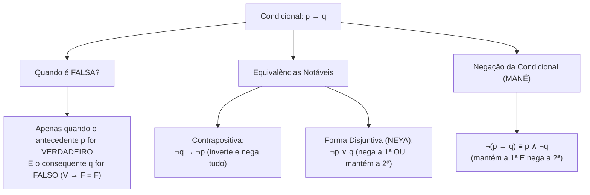
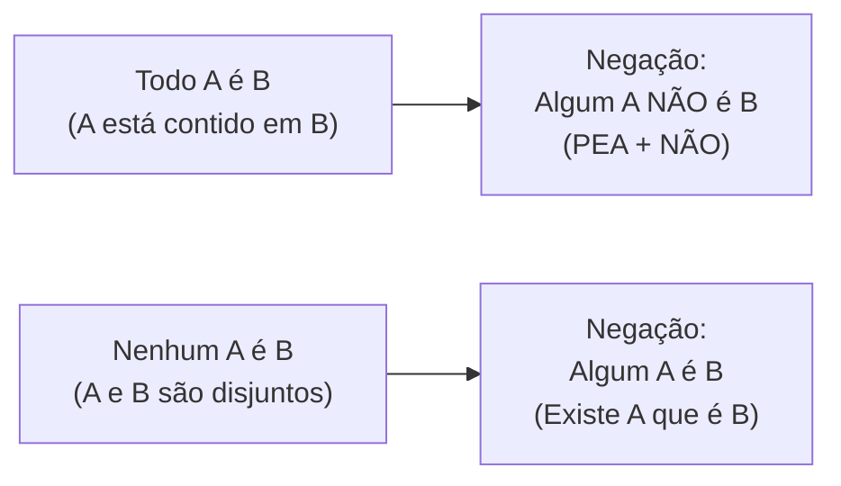

# 05 - Lógica de Argumentação e Conclusões Válidas

> **Matéria:** Matemática e Raciocínio Lógico  
> **Cargos:** A01 – Técnico de Controle Externo (Adm) / B02 – Técnico de Controle Externo (TI)  
> **Arquivo:** `05_logica_de_argumentacao_e_conclusoes_validas.md`  
> **Status:** 🟢 Teoria Aprofundada + 5 Questões FCC Comentadas (A a E)

---

## 📌 Ementa / Itens do Edital
- Compreensão do processo lógico que, a partir de um conjunto de hipóteses, conduz, de forma válida, a conclusões determinadas.
- Proposições lógicas, conectivos e tabelas-verdade.
- Equivalências e negações lógicas.
- Argumentos dedutivos, premissas, conclusão e validade.
- Silogismos categóricos e diagramas lógicos (Todo, Algum, Nenhum).

---

## 🧭 Sumário
- [1. Proposições Lógicas, Princípios e Conectivos Fundamentais](#1-proposicoes-logicas-principios-e-conectivos-fundamentais)
    - [1.1 Definição de Proposição e Sentenças Não Proposicionais](#11-definicao-de-proposicao-e-sentencas-nao-proposicionais)
    - [1.2 Os Três Princípios Fundamentais da Lógica Clássica](#12-os-tres-principios-fundamentais-da-logica-classica)
    - [1.3 Conectivos Lógicos e Regras da Tabela-Verdade](#13-conectivos-logicos-e-regras-da-tabela-verdade)
    - [1.4 A Condicional: Peculiaridades e o Caso Falso Único](#14-a-condicional-peculiaridades-e-o-caso-falso-unico)
- [2. Álgebra Proposicional: Negações e Equivalências Clássicas](#2-algebra-proposicional-negacoes-e-equivalencias-classicas)
    - [2.1 Leis de De Morgan para Conjunção e Disjunção](#21-leis-de-de-morgan-para-conjuncao-e-disjuncao)
    - [2.2 Negação da Condicional e a Regra do MANÉ](#22-negacao-da-condicional-e-a-regra-do-mane)
    - [2.3 Equivalências Notáveis da Condicional: Contrapositiva e Disjuntiva (NEYA)](#23-equivalencias-notaveis-da-condicional-contrapositiva-e-disjuntiva-neya)
    - [2.4 Tautologias, Contradições e Contingências](#24-tautologias-contradicoes-e-contingencias)
- [3. Validade de Argumentos Dedutivos e Regras de Inferência](#3-validade-de-argumentos-dedutivos-e-regras-de-inferencia)
    - [3.1 Estrutura do Argumento: Premissas e Conclusão](#31-estrutura-do-argumento-premissas-e-conclusao)
    - [3.2 Conceito Formal de Validade vs. Verdade Empírica](#32-conceito-formal-de-validade-vs-verdade-empirica)
    - [3.3 Principais Regras de Inferência Válidas](#33-principais-regras-de-inferencia-validas)
    - [3.4 O Método do Encadeamento de Premissas Verdadeiras](#34-o-metodo-do-encadeamento-de-premissas-verdadeiras)
- [4. Lógica de Primeira Ordem: Quantificadores e Silogismos Categóricos](#4-logica-de-primeira-ordem-quantificadores-e-silogismos-categoricos)
    - [4.1 Quantificadores Universais e Existenciais: Todo, Nenhum e Algum](#41-quantificadores-universais-e-existenciais-todo-nenhum-e-algum)
    - [4.2 Negação de Proposições Categóricas e a Mnemônica PEA + NÃO](#42-negacao-de-proposicoes-categoricas-e-a-mnemonica-pea-nao)
    - [4.3 Análise de Silogismos via Diagramas de Euler-Venn](#43-analise-de-silogismos-via-diagramas-de-euler-venn)
- [Fontes Oficiais e Referências Bibliográficas](#fontes-oficiais-e-referencias-bibliograficas)

---

## 1. Proposições Lógicas, Princípios e Conectivos Fundamentais

A lógica proposicional (ou lógica sentencial) é o ramo da lógica matemática dedicado ao estudo das proposições e dos modos pelos quais estas se combinam para constituir raciocínios dedutivos válidos.

### 1.1 Definição de Proposição e Sentenças Não Proposicionais

* **Proposição Lógica:** Toda oração declarativa com sujeito e predicado expressos que veicula um pensamento completo e à qual se pode atribuir, de forma unívoca, um único valor lógico: **Verdadeiro ($V$)** ou **Falso ($F$)**.
    * Exemplos: *"O TCE-GO fiscaliza as contas municipais"*; *"Goiânia é a capital do Estado de Goiás"*.
* **Sentenças Não Proposicionais (que NÃO são proposições lógicas perante concursos):**
    * Sentenças interrogativas: *"Quem relatou o processo?"*;
    * Sentenças exclamativas: *"Excelente trabalho de auditoria!"*;
    * Sentenças imperativas: *"Instrua os autos imediatamente"*;
    * Sentenças optativas (exprimem desejo): *"Deus o abençoe"*;
    * Sentenças abertas (paradoxo ou incógnita indefinida): *"Ele é auditor fiscal"* (falta definir quem é "ele"); *"$x + 5 = 12$"* (sem o valor de $x$, não é V nem F).

### 1.2 Os Três Princípios Fundamentais da Lógica Clássica

A lógica bivalente aristotélica assenta-se sobre três postulados absolutos:

1. **Princípio da Identidade:** Uma proposição é idêntica a si mesma: se ela é verdadeira, é sempre verdadeira; se é falsa, é sempre falsa ($p \implies p$).
2. **Princípio da Não Contradição:** Uma proposição não pode ser simultaneamente verdadeira e falsa sob as mesmas circunstâncias e no mesmo tempo: $\neg(p \land \neg p)$.
3. **Princípio do Terceiro Excluído:** Uma proposição só pode assumir dois valores lógicos ($V$ ou $F$), excluindo-se qualquer terceiro valor ou estado intermediário.

### 1.3 Conectivos Lógicos e Regras da Tabela-Verdade

As proposições simples combinam-se mediante operadores lógicos (conectivos) para formar proposições compostas. O número de linhas da tabela-verdade de uma proposição composta contendo $n$ proposições simples distintas é sempre dado por:
$$\text{Número de Linhas} = 2^n$$

| Conectivo | Notação Simbólica | Leitura | Condição de Verdade na Tabela-Verdade |
| :--- | :---: | :--- | :--- |
| **Negação** | $\neg p$ ou $\sim p$ | "não p" | Inverte o valor lógico original ($V \rightarrow F$; $F \rightarrow V$). |
| **Conjunção** | $p \land q$ | "p e q" | Só é **VERDADEIRA** se ambas as proposições forem verdadeiras ($V \land V = V$). |
| **Disjunção Inclusiva** | $p \lor q$ | "p ou q" | Só é **FALSA** se ambas as proposições forem falsas ($F \lor F = F$). |
| **Disjunção Exclusiva** | $p \underline{\lor} q$ | "ou p ou q" | É **VERDADEIRA** se os valores lógicos forem opostos/distintos ($V \ \underline{\lor} \ F = V$). |
| **Condicional** | $p \rightarrow q$ | "se p, então q" | Só é **FALSA** se o antecedente for $V$ e o consequente for $F$ ($V \rightarrow F = F$). |
| **Bicondicional** | $p \leftrightarrow q$ | "p se e somente se q" | É **VERDADEIRA** se ambas tiverem o mesmo valor lógico ($V \leftrightarrow V = V$; $F \leftrightarrow F = V$). |

### 1.4 A Condicional: Peculiaridades e o Caso Falso Único

A condicional $p \rightarrow q$ é a estrutura que mais induz candidatos a erro. Na condicional:

* O termo $p$ é o **antecedente** (ou condição suficiente);
* O termo $q$ é o **consequente** (ou condição necessária).
* **A Regra do Falso Único:** A condicional só é avaliada como Falsa se ocorrer a combinação $V \rightarrow F$ (o famoso mnemônico *Vera Fischer é Falsa*).
* Em qualquer outro caso ($V \rightarrow V$, $F \rightarrow V$, $F \rightarrow F$), **a condicional é necessariamente VERDADEIRA**. Note que, se a primeira parte for falsa, a condicional já é automaticamente verdadeira, independentemente do que venha depois.

---

## 2. Álgebra Proposicional: Negações e Equivalências Clássicas

Duas proposições compostas são **logicamente equivalentes** ($P \equiv Q$) quando possuem rigorosamente a mesma tabela-verdade para todas as combinações de valorações de suas componentes.

### 2.1 Leis de De Morgan para Conjunção e Disjunção

As Leis de Augustus De Morgan ditam a negação das estruturas conjuntivas e disjuntivas:

1. **Negação da Conjunção ("E"):** Nega-se a primeira, nega-se a segunda e troca-se o conectivo por "OU":
   $$\neg(p \land q) \equiv \neg p \lor \neg q$$
   *Exemplo:* A negação de *"O relatório foi concluído e o prazo foi cumprido"* é *"O relatório **não** foi concluído **OU** o prazo **não** foi cumprido"*.
2. **Negação da Disjunção Inclusiva ("OU"):** Nega-se a primeira, nega-se a segunda e troca-se o conectivo por "E":
   $$\neg(p \lor q) \equiv \neg p \land \neg q$$
   *Exemplo:* A negação de *"Houve sobrepreço ou houve desídia"* é *"**Não** houve sobrepreço **E** **não** houve desídia"*.

### 2.2 Negação da Condicional e a Regra do MANÉ

A negação de uma proposição condicional $p \rightarrow q$ é obtida pelo célebre mnemônico **MANÉ** (**MA**ntém a primeira e **NE**ga a segunda):
$$\neg(p \rightarrow q) \equiv p \land \neg q$$

> 🚨 **ALERTA DE PROVA / PEGADINHA FCC:** A negação de uma proposição do tipo *"Se p, então q"* **JAMAIS começa com a palavra 'Se'**! Se a questão solicitar a negação de uma condicional e alguma alternativa vier iniciada por *"Se..."*, elimine-a imediatamente. A negação lógica da condicional é sempre uma conjunção com o conectivo **"E"**!
>
> * Proposição: *"Se o auditor fiscaliza, a irregularidade diminui."*
> * Negação estrita: *"O auditor fiscaliza **E** a irregularidade **não** diminui."*

### 2.3 Equivalências Notáveis da Condicional: Contrapositiva e Disjuntiva (NEYA)

A FCC explora intensamente duas formas canônicas de reescrever a condicional $p \rightarrow q$:

1. **Equivalência Contrapositiva (Inverte e Nega Tudo):**
   $$p \rightarrow q \equiv \neg q \rightarrow \neg p$$
   *Exemplo:* *"Se a prestação de contas foi apresentada tempestivamente, então a certidão foi emitida"* $\equiv$ *"Se a certidão **não** foi emitida, então a prestação de contas **não** foi apresentada tempestivamente"*.
2. **Equivalência Disjuntiva (Regra do NEYA - NEga a primeira OU mantêm a segunda):**
   $$p \rightarrow q \equiv \neg p \lor q$$
   *Exemplo:* *"Se o servidor observa a moralidade, sua conduta é inatacável"* $\equiv$ *"O servidor **não** observa a moralidade **OU** sua conduta é inatacável"*.

---

### Questão 01
**(FCC – Auditor Fiscal da Receita – Adaptada TCE-GO)**  
Considere a seguinte afirmação feita por um auditor durante a sessão do Tribunal de Contas:

*"Se a prestação de contas foi apresentada tempestivamente, então a documentação comprobatória é idônea e o parecer técnico é favorável."*

A negação lógica dessa afirmação é expressa por:

* **A)** Se a prestação de contas não foi apresentada tempestivamente, então a documentação não é idônea ou o parecer técnico não é favorável.
* **B)** A prestação de contas foi apresentada tempestivamente, e a documentação comprobatória não é idônea ou o parecer técnico não é favorável.
* **C)** A prestação de contas não foi apresentada tempestivamente, ou a documentação comprobatória é idônea e o parecer técnico é favorável.
* **D)** Se a documentação comprobatória não é idônea ou o parecer técnico não é favorável, então a prestação de contas não foi apresentada tempestivamente.
* **E)** A prestação de contas foi apresentada tempestivamente, e a documentação comprobatória não é idônea e o parecer técnico não é favorável.

> **Comentário Detalhado:**
> Formalização simbólica e aplicação das leis lógicas:
>
> 1. Estrutura proposicional:
>     - Seja $p$: *"A prestação de contas foi apresentada tempestivamente"*.
>     - Seja $q$: *"A documentação comprobatória é idônea"*.
>     - Seja $r$: *"O parecer técnico é favorável"*.
>     - Forma simbólica original: $p \rightarrow (q \land r)$.
>
> 2. Regra de negação da condicional (Regra do MANÉ):
>    $$\neg [p \rightarrow (q \land r)] \equiv p \land \neg(q \land r)$$
> 3. Negação da conjunção interna via Primeira Lei de De Morgan:
>    $$\neg(q \land r) \equiv \neg q \lor \neg r$$
> 4. Forma canônica final da negação:
>    $$p \land (\neg q \lor \neg r)$$
>    Traduzindo para a linguagem corrente: *"A prestação de contas foi apresentada tempestivamente"* ($p$) **E** ($\land$) *"[a documentação comprobatória não é idônea"* ($\neg q$) **OU** ($\lor$) *"o parecer técnico não é favorável]"* ($\neg r$).
>
> Análise individual das alternativas:
>
> - **A)** Incorreta. Estrutura a negação como uma nova condicional (a negação estrita da condicional nunca é condicional).
> - **B)** Correta. Aplica perfeitamente a regra do MANÉ associada à Lei de De Morgan: mantém a primeira proposição com "e" e nega o consequente composto trocando o conectivo interno de "e" para "ou".
> - **C)** Incorreta. Expressa a equivalência disjuntiva da condicional ($\neg p \lor (q \land r)$), e não a sua negação.
> - **D)** Incorreta. Expressa a contrapositiva da condicional original, consubstanciando equivalência lógica e não negação.
> - **E)** Incorreta. Erra ao manter o conectivo "e" na segunda parte, descumprindo a Lei de De Morgan.
> 
> **Gabarito: B**

---

### Questão 02
**(FCC – TCE-GO – Técnico de Controle Externo)**  
Do ponto de vista da lógica formal, a proposição:  
*"Se o servidor público observa o princípio da moralidade, então sua conduta administrativa é inatacável"*  
é logicamente equivalente a:

* **A)** Se a conduta administrativa do servidor público é inatacável, então ele observa o princípio da moralidade.
* **B)** Se o servidor público não observa o princípio da moralidade, então sua conduta administrativa não é inatacável.
* **C)** O servidor público não observa o princípio da moralidade ou sua conduta administrativa é inatacável.
* **D)** O servidor público observa o princípio da moralidade e sua conduta administrativa não é inatacável.
* **E)** Se a conduta administrativa do servidor não for inatacável, então ele observa o princípio da moralidade.

> **Comentário Detalhado:**
> Análise das leis de equivalência da condicional $p \rightarrow q$:
>
> 1. Identificação das proposições:
>     - $p$: *"O servidor público observa o princípio da moralidade"*
>     - $q$: *"Sua conduta administrativa é inatacável"*
>
> 2. As duas equivalências lógicas canônicas de $p \rightarrow q$ são:
>     - Equivalência Contrapositiva: $\neg q \rightarrow \neg p$ (*"Se a conduta não é inatacável, então o servidor não observa a moralidade"*).
>     - Equivalência Disjuntiva (Regra do NEYA): $\neg p \lor q$ (*"O servidor NÃO observa a moralidade OU sua conduta é inatacável"*).
>
> 3. Como a contrapositiva não figura entre as opções, busca-se a forma disjuntiva $\neg p \lor q$, presente de modo límpido na alternativa C.
>
> Análise das alternativas:
>
> - **A)** Incorreta. Consiste na recíproca simples ($q \rightarrow p$), o que constitui a falácia da afirmação do consequente.
> - **B)** Incorreta. É a inversa simples ($\neg p \rightarrow \neg q$), falácia da negação do antecedente.
> - **C)** Correta. Aplicação perfeita da equivalência disjuntiva NEYA: $\neg p \lor q$.
> - **D)** Incorreta. Esta é a negação da condicional ($p \land \neg q$), e não sua equivalência.
> - **E)** Incorreta. Nega o consequente sem negar o antecedente na condicional invertida ($\neg q \rightarrow p$).
> 
> **Gabarito: C**

---

### 2.4 Tautologias, Contradições e Contingências

* **Tautologia:** Proposição composta que é invariavelmente verdadeira em todas as linhas da sua tabela-verdade, independentemente dos valores lógicos das proposições simples (ex.: $p \lor \neg p$, princípio do terceiro excluído).
* **Contradição:** Proposição composta que é invariavelmente falsa em todas as linhas da sua tabela-verdade (ex.: $p \land \neg p$).
* **Contingência:** Proposição composta cuja tabela-verdade apresenta pelo menos um valor verdadeiro e pelo menos um valor falso.

---

## 3. Validade de Argumentos Dedutivos e Regras de Inferência

A argumentação lógica investiga se uma determinada conclusão decorre com necessidade matemática absoluta a partir de um conjunto de premissas assumidas como verdadeiras.

### 3.1 Estrutura do Argumento: Premissas e Conclusão

Um argumento dedutivo é um conjunto ordenado de proposições estruturado em:

* **Premissas ($P_1, P_2, \dots, P_n$):** Proposições que servem de ponto de partida, evidência ou suporte fático.
* **Conclusão ($C$):** Proposição final deduzida que decorre das premissas.
Representa-se simbolicamente por: $P_1, P_2, \dots, P_n \vdash C$.

### 3.2 Conceito Formal de Validade vs. Verdade Empírica

* A **validade** é uma propriedade formal e estrutural do argumento; não se confunde com a verdade material dos fatos no mundo físico.
* Um argumento dedutivo é declarado **VÁLIDO** quando é logicamente impossível que todas as suas premissas sejam simultaneamente verdadeiras e a sua conclusão seja falsa.
* Se for possível construir um cenário consistente em que todas as premissas sejam verdadeiras e a conclusão seja falsa, o argumento é categorizado como **INVÁLIDO (Falácia ou Sofisma)**.

### 3.3 Principais Regras de Inferência Válidas

1. **Modus Ponens (Afirmação do Antecedente):**
   $$\frac{p \rightarrow q, \quad p}{\therefore q}$$
2. **Modus Tollens (Negação do Consequente):**
   $$\frac{p \rightarrow q, \quad \neg q}{\therefore \neg p}$$
3. **Silogismo Disjuntivo:**
   $$\frac{p \lor q, \quad \neg p}{\therefore q}$$
4. **Silogismo Hipotético (Transitividade da Condicional):**
   $$\frac{p \rightarrow q, \quad q \rightarrow r}{\therefore p \rightarrow r}$$

---

### Questão 03
**(FCC – TCE-GO – Analista de Controle Externo)**  
Considere verdadeiras as seguintes quatro premissas a respeito das rotinas de controle do Tribunal:

I. Se o contrato administrativo possui cláusula de reajuste abusiva, então a auditoria emite notificação prévia.  

II. Se a auditoria emite notificação prévia, então o ordenador de despesas suspende o pagamento.  

III. Se o ordenador de despesas suspende o pagamento, então a empresa contratada apresenta defesa prévia.  

IV. A empresa contratada não apresentou defesa prévia.  

A partir dessas premissas, é correto concluir de forma necessariamente válida que:

* **A)** A auditoria emitiu notificação prévia e o contrato possui cláusula abusiva.
* **B)** O ordenador de despesas suspendeu o pagamento, mas o contrato não possui cláusula abusiva.
* **C)** O contrato administrativo não possui cláusula de reajuste abusiva e a auditoria não emitiu notificação prévia.
* **D)** A empresa contratada apresentou recurso extemporâneo ao plenário.
* **E)** Se o contrato não possui cláusula abusiva, então o ordenador suspendeu o pagamento.

> **Comentário Detalhado:**
> Dedução formal por encadeamento retroativo (*Modus Tollens*):
>
> 1. Todas as premissas devem ser assumidas como Verdadeiras ($V$):
>     - Pela Premissa IV (fato simples garantido): *"A empresa não apresentou defesa"* $= V$. Logo, a proposição *"A empresa apresenta defesa"* é **Falsa ($F$)**.
>
> 2. Pela Premissa III:
>    $$\text{Ordenador suspende o pagamento} \rightarrow \text{Empresa apresenta defesa} \quad (= V)$$
>    Como o consequente é $F$, pelo *Modus Tollens*, o antecedente é obrigatoriamente **Falso ($F$)**:
>    $$\text{O ordenador de despesas NÃO suspendeu o pagamento} \quad (= V)$$
> 3. Pela Premissa II:
>    $$\text{Auditoria emite notificação} \rightarrow \text{Ordenador suspende o pagamento} \quad (= V)$$
>    Como o consequente é $F$, pelo *Modus Tollens*, o antecedente é obrigatoriamente **Falso ($F$)**:
>    $$\text{A auditoria NÃO emitiu notificação prévia} \quad (= V)$$
> 4. Pela Premissa I:
>    $$\text{Contrato possui cláusula abusiva} \rightarrow \text{Auditoria emite notificação} \quad (= V)$$
>    Como o consequente é $F$, pelo *Modus Tollens*, o antecedente é obrigatoriamente **Falso ($F$)**:
>    $$\text{O contrato NÃO possui cláusula de reajuste abusiva} \quad (= V)$$
> 5. Conclusão sintetizada: O contrato não possui cláusula abusiva ($V$) **E** a auditoria não emitiu notificação ($V$).
>
> Análise das alternativas:
>
> - **A)** Incorreta. Ambas as proposições foram demonstradas como falsas.
> - **B)** Incorreta. O ordenador não suspendeu o pagamento.
> - **C)** Correta. Enuncia exatamente as deduções irrefutáveis obtidas pelo encadeamento dedutivo das premissas.
> - **D)** Incorreta. Informação estranha sem amparo no universo das premissas.
> - **E)** Incorreta. Contradiz o fato provado de que o ordenador não suspendeu o pagamento.
> 
> **Gabarito: C**

---

### 3.4 O Método do Encadeamento de Premissas Verdadeiras

O método prático para resolver questões com múltiplas premissas condicionais na FCC consiste em:

1. Atribuir o valor lógico **VERDADEIRO ($V$)** a todas as premissas do enunciado;
2. Localizar o ponto de partida mais restrito: quase sempre uma **proposição simples isolada** ou uma **conjunção ("E")**;
3. Propagar esse valor veritativo pelas condicionais utilizando *Modus Ponens* ou *Modus Tollens*;
4. As conclusões verdadeiras necessárias deduzidas correspondem à alternativa correta.

---

## 4. Lógica de Primeira Ordem: Quantificadores e Silogismos Categóricos

A lógica categórica estuda proposições que expressam relações de inclusão total, inclusão parcial ou exclusão total entre classes e conjuntos.

### 4.1 Quantificadores Universais e Existenciais: Todo, Nenhum e Algum

* **Universal Afirmativo ("TODO A é B"):** Todo elemento de A pertence a B ($A \subset B$). O conjunto A está totalmente contido no conjunto B.
* **Universal Negativo ("NENHUM A é B"):** Nenhum elemento de A pertence a B ($A \cap B = \emptyset$). Os conjuntos A e B são mutuamente disjuntos.
* **Particular / Existencial Afirmativo ("ALGUM A é B"):** Existe pelo menos um elemento pertencente a A que também pertence a B ($A \cap B \neq \emptyset$).
* **Particular Negativo ("ALGUM A NÃO é B"):** Existe pelo menos um elemento de A que não pertence ao conjunto B.

### 4.2 Negação de Proposições Categóricas e a Mnemônica PEA + NÃO

Para negar uma proposição quantificada, deve-se alternar o tipo de quantificador (universal vira existencial, e existencial vira universal):

1. **Negação de "TODO A é B":**
    * Não é "Nenhum A é B"! Para quebrar uma afirmação universal afirmativa, basta encontrar **ao menos um contraexemplo**.
    * Aplica-se a regra mnemônica **PEA + NÃO**:
    * **P**elo menos um A não é B;
    * **E**xiste A que não é B;
    * **A**lgum A não é B.

2. **Negação de "NENHUM A é B":**
    * Basta provar que existe pelo menos um elemento na interseção: *"Algum A é B"* (ou *"Pelo menos um A é B"*).

3. **Negação de "ALGUM A é B":**
    * Nega-se pelo quantificador universal negativo: *"Nenhum A é B"*.

> 🚨 **ALERTA DE PROVA / PEGADINHA DO "TODO" VS. "NENHUM":** A alternativa mais tentadora e incorreta em provas da FCC para negar *"Todos os servidores são concursados"* é *"Nenhum servidor é concursado"*. Lembre-se: "Todo" e "Nenhum" são proposições contrárias (podem ser ambas falsas ao mesmo tempo se houver 99 concursados e 1 comissionado), mas **não são contraditórias**. A negação legítima é: *"Pelo menos um servidor não é concursado"*.

---

### Questão 04
**(FCC – TCE-PI – Auditor de Controle Externo)**  
A afirmação *"Todos os relatórios elaborados pela comissão técnica continham recomendações aos municípios"* tem como **negação lógica** a proposição:

* **A)** Nenhum relatório elaborado pela comissão técnica continha recomendações aos municípios.
* **B)** Todos os relatórios elaborados pela comissão técnica não continham recomendações aos municípios.
* **C)** Pelo menos um relatório elaborado pela comissão técnica não continha recomendações aos municípios.
* **D)** Alguns relatórios elaborados pela comissão técnica continham recomendações aos municípios.
* **E)** A maioria dos relatórios continha recomendações aos municípios.

> **Comentário Detalhado:**
> Análise da negação de proposições universais afirmativas:
>
> 1. A proposição dada é categórica universal afirmativa: *"Todo A é B"*, onde $A$ representa o conjunto de relatórios da comissão técnica e $B$ a propriedade de conter recomendações.
> 2. Para negar uma afirmação universal afirmativa, basta exibir a existência de **ao menos uma exceção**:
>    $$\neg (\forall x, A(x) \rightarrow B(x)) \equiv \exists x, A(x) \land \neg B(x)$$
> 3. Aplica-se a regra do **PEA + NÃO**:
>     - **P**elo menos um A não é B;
>     - **E**xiste A que não é B;
>     - **A**lgum A não é B.
>
> 4. Tradução exata: *"Pelo menos um relatório elaborado pela comissão técnica NÃO continha recomendações aos municípios"*.
>
> Análise individual das alternativas:
>
> - **A)** Incorreta. *"Nenhum A é B"* é a proposição contrária universal, e não a negação contraditória. Se houver 99 relatórios com recomendações e apenas 1 sem recomendações, tanto a proposição original quanto a alternativa A serão simultaneamente falsas.
> - **B)** Incorreta. Equivalente a "Nenhum", cometendo o mesmo equívoco de A.
> - **C)** Correta. Traduz com perfeição lógica formal a negação existencial do quantificador universal afirmativo.
> - **D)** Incorreta. Trata-se de proposição subalterna que seria verdadeira junto com o "Todo".
> - **E)** Incorreta. Imprecisão quantitativa sem valor de negação lógica.
> 
> **Gabarito: C**

---

### 4.3 Análise de Silogismos via Diagramas de Euler-Venn

Para avaliar a validade de silogismos com premissas como *"Todo A é E"* e *"Algum E é P"*:

* Desenhe os círculos de conjuntos de Euler-Venn;
* O círculo $A$ está totalmente dentro de $E$;
* O círculo $P$ cruza com $E$, mas **não se pode garantir que encoste em $A$**. Ele pode estar numa região de $E$ totalmente afastada de $A$;
* Portanto, deduzir que *"Algum A é P"* ou *"Nenhum A é P"* constitui falácia de conclusão contingente. O que é logicamente correto afirmar é que a interseção pode ocorrer, mas **não é uma conclusão necessária**.

---

### Questão 05
**(FCC – TRT – Analista Judiciário)**  
Considere como verdadeiras as seguintes duas premissas a respeito dos membros de um tribunal:

Premissa 1: *"Todos os auditores de controle externo são especialistas em finanças públicas."*  
Premissa 2: *"Alguns especialistas em finanças públicas são professores universitários."*  

A partir dessas premissas, é **necessariamente** correto concluir que:

* **A)** Todos os professores universitários são auditores de controle externo.
* **B)** Alguns auditores de controle externo são professores universitários.
* **C)** Nenhum auditor de controle externo é professor universitário.
* **D)** Pelo menos um auditor de controle externo não é especialista em finanças públicas.
* **E)** Pode haver auditor de controle externo que seja professor universitário, mas não é uma conclusão necessária.

> **Comentário Detalhado:**
> Modelagem geométrica por Diagramas de Euler-Venn:
>
> 1. Premissa 1 (*"Todo Auditor é Especialista"*): o conjunto dos Auditores ($A$) está totalmente contido no conjunto dos Especialistas em Finanças ($E$), ou seja, $A \subset E$.
> 2. Premissa 2 (*"Algum Especialista é Professor"*): o conjunto dos Professores ($P$) possui interseção não vazia com o conjunto dos Especialistas ($E$), isto é, $E \cap P \neq \emptyset$.
> 3. Relação espacial entre $A$ e $P$:
>     - A região de interseção entre $E$ e $P$ pode estar situada inteiramente na parte de $E$ que é externa a $A$ (neste caso, nenhum auditor seria professor).
>     - Ou essa interseção pode cruzar parcialmente com o conjunto $A$ (neste caso, alguns auditores seriam professores).
>     - Como não há restrição impositiva, ambas as hipóteses são perfeitamente possíveis. Portanto, não se pode deduzir com necessidade lógica que *"Algum auditor é professor"*, nem que *"Nenhum auditor é professor"*. A afirmação é contingente e não necessária.
>
> Análise das alternativas:
>
> - **A)** Incorreta. Generalização abusiva desprovida de nexo dedutivo.
> - **B)** Incorreta. Erro clássico da falácia de quatro termos; a interseção de $E$ com $P$ não tem garantia de alcançar o subconjunto $A$.
> - **C)** Incorreta. Não se pode garantir que não haja interseção.
> - **D)** Incorreta. Contradiz diretamente a Premissa 1.
> - **E)** Correta. Demonstra o rigor da lógica aristotélica formal: a relação é factível, mas não se impõe como conclusão necessária.
> 
> **Gabarito: E**

---

## 🌐 Fontes Oficiais e Referências Bibliográficas

* [Portal da Matemática OBMEP / IMPA - Módulo de Noções de Lógica e Argumentação](https://portaldaobmep.impa.br/index.php/modulo/ver?modulo=1059) - Validade de argumentos, silogismos, quantificadores (todo, algum, nenhum) e diagramas lógicos.
* [OBMEP / IMPA - Apostila 2 do PIC: Métodos de Contagem e Lógica Formal](https://www.obmep.org.br/docs/apostila2.pdf) - Diagramas de Euler-Venn, diagramação de conjuntos e análise dedutiva formal.
* [Khan Academy Brasil - Álgebra: Raciocínio Lógico e Argumentação Dedutiva](https://pt.khanacademy.org/math/algebra) - Construção de demonstrações, equivalências lógicas fundamentais e leis de De Morgan.
* [Khan Academy Brasil - Pré-Álgebra: Conjuntos e Diagramas de Venn](https://pt.khanacademy.org/math/pre-algebra) - Operações de união, interseção e inclusão aplicadas a silogismos categóricos.
* ALENCAR FILHO, Edgard de. **Iniciação à Lógica Matemática**. São Paulo: Nobel, 2002. (Cap. 8 e 9 - Argumentação Lógica, Regras de Inferência e Silogismos).
* COPI, Irving M. **Introdução à Lógica**. 2. ed. São Paulo: Mestre Jou, 1978. (Cap. 6 e 7 - Silogismos Categóricos e Diagramas de Venn).
* MORTARI, Cezar A. **Introdução à Lógica**. 2. ed. São Paulo: Editora Unesp, 2016. (Cap. 9 - Teoria da Argumentação e Validade Dedutiva).
