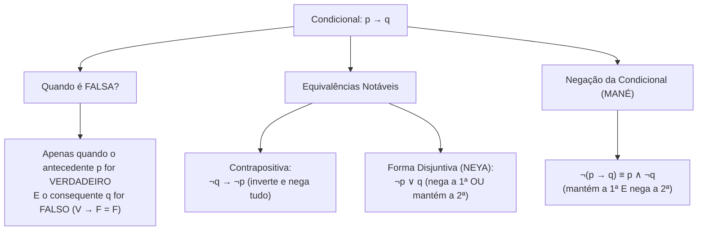
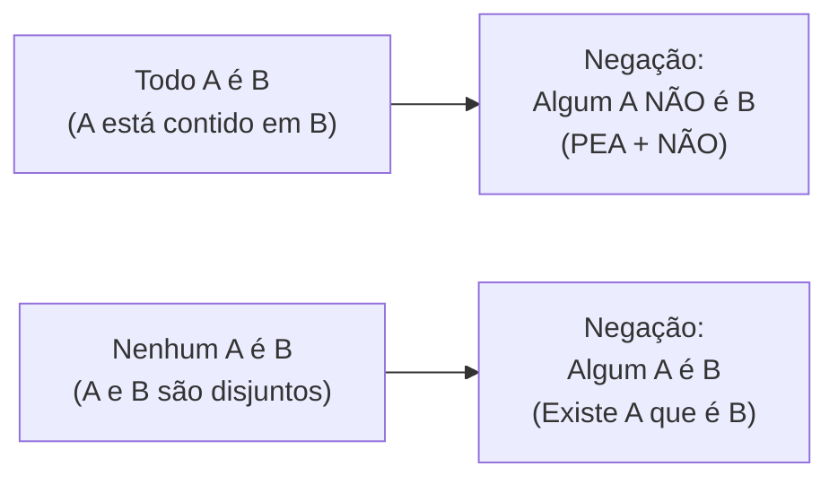

# 05 - Lógica de Argumentação e Conclusões Válidas

> **Matéria:** Matemática e Raciocínio Lógico  
> **Cargos:** A01 – Técnico de Controle Externo (Adm) / B02 – Técnico de Controle Externo (TI)  
> **Arquivo:** `05_logica_de_argumentacao_e_conclusoes_validas.md`  
> **Status:** 🟢 Teoria Aprofundada + 5 Questões FCC Comentadas (A a E)

---

## 📌 Ementa / Itens do Edital
- Compreensão do processo lógico que, a partir de um conjunto de hipóteses, conduz, de forma válida, a conclusões determinadas.
- Proposições lógicas, conectivos e tabelas-verdade.
- Equivalências e negações lógicas.
- Argumentos dedutivos, premissas, conclusão e validade.
- Silogismos categóricos e diagramas lógicos (Todo, Algum, Nenhum).

---

## 🧭 Sumário

1. [Proposições Lógicas, Princípios e Conectivos Fundamentais](#1-proposicoes-logicas-principios-e-conectivos-fundamentais)
    1. [Definição de Proposição e Sentenças Não Proposicionais](#11-definicao-de-proposicao-e-sentencas-nao-proposicionais)
    2. [Os Três Princípios Fundamentais da Lógica Clássica](#12-os-tres-principios-fundamentais-da-logica-classica)
    3. [Conectivos Lógicos e Regras da Tabela-Verdade](#13-conectivos-logicos-e-regras-da-tabela-verdade)
    4. [A Condicional: Peculiaridades e o Caso Falso Único](#14-a-condicional-peculiaridades-e-o-caso-falso-unico)
    5. [Teste 112](#Teste-112)
    6. [Teste 113](#Teste-113)
2. [Álgebra Proposicional: Negações e Equivalências Clássicas](#2-algebra-proposicional-negacoes-e-equivalencias-classicas)
    1. [Leis de De Morgan para Conjunção e Disjunção](#21-leis-de-de-morgan-para-conjuncao-e-disjuncao)
    2. [Negação da Condicional e a Regra do MANÉ](#22-negacao-da-condicional-e-a-regra-do-mane)
    3. [Equivalências Notáveis da Condicional: Contrapositiva e Disjuntiva (NEYA)](#23-equivalencias-notaveis-da-condicional-contrapositiva-e-disjuntiva-neya)
    4. [Tautologias, Contradições e Contingências](#24-tautologias-contradicoes-e-contingencias)
    5. [Teste 114](#Teste-114)
    6. [Teste 115](#Teste-115)
    7. [Teste 116](#Teste-116)
3. [Validade de Argumentos Dedutivos e Regras de Inferência](#3-validade-de-argumentos-dedutivos-e-regras-de-inferencia)
    1. [Estrutura do Argumento: Premissas e Conclusão](#31-estrutura-do-argumento-premissas-e-conclusao)
    2. [Conceito Formal de Validade vs. Verdade Empírica](#32-conceito-formal-de-validade-vs-verdade-empirica)
    3. [Principais Regras de Inferência Válidas](#33-principais-regras-de-inferencia-validas)
    4. [O Método do Encadeamento de Premissas Verdadeiras](#34-o-metodo-do-encadeamento-de-premissas-verdadeiras)
    5. [Teste 117](#Teste-117)
    6. [Teste 118](#Teste-118)
4. [Lógica de Primeira Ordem: Quantificadores e Silogismos Categóricos](#4-logica-de-primeira-ordem-quantificadores-e-silogismos-categoricos)
    1. [Quantificadores Universais e Existenciais: Todo, Nenhum e Algum](#41-quantificadores-universais-e-existenciais-todo-nenhum-e-algum)
    2. [Negação de Proposições Categóricas e a Mnemônica PEA + NÃO](#42-negacao-de-proposicoes-categoricas-e-a-mnemonica-pea-nao)
    3. [Análise de Silogismos via Diagramas de Euler-Venn](#43-analise-de-silogismos-via-diagramas-de-euler-venn)
    4. [Teste 119](#Teste-119)
    5. [Teste 120](#Teste-120)
    6. [Teste 121](#Teste-121)
5. [🌐 Fontes Oficiais e Referências Bibliográficas](#fontes-oficiais-e-referencias-bibliograficas)

---

## 1. Proposições Lógicas, Princípios e Conectivos Fundamentais

A lógica proposicional (ou lógica sentencial) é o ramo da lógica matemática dedicado ao estudo das proposições e dos modos pelos quais estas se combinam para constituir raciocínios dedutivos válidos.

### 1.1 Definição de Proposição e Sentenças Não Proposicionais

* **Proposição Lógica:** Toda oração declarativa com sujeito e predicado expressos que veicula um pensamento completo e à qual se pode atribuir, de forma unívoca, um único valor lógico: **Verdadeiro ($V$)** ou **Falso ($F$)**.
    * Exemplos: *"O TCE-GO fiscaliza as contas municipais"*; *"Goiânia é a capital do Estado de Goiás"*.
* **Sentenças Não Proposicionais (que NÃO são proposições lógicas perante concursos):**
    * Sentenças interrogativas: *"Quem relatou o processo?"*;
    * Sentenças exclamativas: *"Excelente trabalho de auditoria!"*;
    * Sentenças imperativas: *"Instrua os autos imediatamente"*;
    * Sentenças optativas (exprimem desejo): *"Deus o abençoe"*;
    * Sentenças abertas (paradoxo ou incógnita indefinida): *"Ele é auditor fiscal"* (falta definir quem é "ele"); *"$x + 5 = 12$"* (sem o valor de $x$, não é V nem F).

### 1.2 Os Três Princípios Fundamentais da Lógica Clássica

A lógica bivalente aristotélica assenta-se sobre três postulados absolutos:

1. **Princípio da Identidade:** Uma proposição é idêntica a si mesma: se ela é verdadeira, é sempre verdadeira; se é falsa, é sempre falsa ($p \implies p$).
2. **Princípio da Não Contradição:** Uma proposição não pode ser simultaneamente verdadeira e falsa sob as mesmas circunstâncias e no mesmo tempo: $\neg(p \land \neg p)$.
3. **Princípio do Terceiro Excluído:** Uma proposição só pode assumir dois valores lógicos ($V$ ou $F$), excluindo-se qualquer terceiro valor ou estado intermediário.

### 1.3 Conectivos Lógicos e Regras da Tabela-Verdade

As proposições simples combinam-se mediante operadores lógicos (conectivos) para formar proposições compostas. O número de linhas da tabela-verdade de uma proposição composta contendo $n$ proposições simples distintas é sempre dado por:
$$\text{Número de Linhas} = 2^n$$

| Conectivo | Notação Simbólica | Leitura | Condição de Verdade na Tabela-Verdade |
| :--- | :---: | :--- | :--- |
| **Negação** | $\neg p$ ou $\sim p$ | "não p" | Inverte o valor lógico original ($V \rightarrow F$; $F \rightarrow V$). |
| **Conjunção** | $p \land q$ | "p e q" | Só é **VERDADEIRA** se ambas as proposições forem verdadeiras ($V \land V = V$). |
| **Disjunção Inclusiva** | $p \lor q$ | "p ou q" | Só é **FALSA** se ambas as proposições forem falsas ($F \lor F = F$). |
| **Disjunção Exclusiva** | $p \underline{\lor} q$ | "ou p ou q" | É **VERDADEIRA** se os valores lógicos forem opostos/distintos ($V \ \underline{\lor} \ F = V$). |
| **Condicional** | $p \rightarrow q$ | "se p, então q" | Só é **FALSA** se o antecedente for $V$ e o consequente for $F$ ($V \rightarrow F = F$). |
| **Bicondicional** | $p \leftrightarrow q$ | "p se e somente se q" | É **VERDADEIRA** se ambas tiverem o mesmo valor lógico ($V \leftrightarrow V = V$; $F \leftrightarrow F = V$). |

### 1.4 A Condicional: Peculiaridades e o Caso Falso Único

A condicional $p \rightarrow q$ é a estrutura que mais induz candidatos a erro. Na condicional:

* O termo $p$ é o **antecedente** (ou condição suficiente);
* O termo $q$ é o **consequente** (ou condição necessária).
* **A Regra do Falso Único:** A condicional só é avaliada como Falsa se ocorrer a combinação $V \rightarrow F$ (o famoso mnemônico *Vera Fischer é Falsa*).
* Em qualquer outro caso ($V \rightarrow V$, $F \rightarrow V$, $F \rightarrow F$), **a condicional é necessariamente VERDADEIRA**. Note que, se a primeira parte for falsa, a condicional já é automaticamente verdadeira, independentemente do que venha depois.

---

### Teste 112
**(FGV – TJ-RR – Analista Judiciário - Suporte e Infraestrutura de TI – 2024)**
Cada frase abaixo mostra uma inferência (algo deduzido do que foi 
expresso). 
Assinale a frase em que a inferência é inadequada.

* **A)** Se meu médico me disser que tenho somente um dia de vida, 
não vou ficar remoendo. Re digirei as obras mais rapidamente. 
Inferência: o emissor é escritor.
* **B)** Pretendo viver para sempre. Até agora, tudo bem. Inferência: o 
emissor já morreu.
* **C)** É praticamente impossível olhar para um pinguim e sentir raiva. 
Inferência: a imagem do pinguim é agradável.
* **D)** Queria ter 25 ou 32 anos. Como não tenho, não digo a minha 
idade. Inferência: o emissor da frase é mais velho.
* **E)** O limão é uma laranja de mau humor. Inferência: o gosto do 
limão é amargo. 
TRIBUNAL DE JUSTIÇA DO ESTADO DE RORAIMA – TJRR FGV CONHECIMENTO 

LEGISLAÇÃO

---

> **Comentário Detalhado:**
>
> - **A)** Incorreta. Discrepa das diretrizes normativas e jurisprudenciais aplicáveis ao tema objeto do item.
> - **B)** Correta. Representa com precisão a disciplina do tema e o entendimento pacificado adotado pela banca (FGV).
> - **C)** Incorreta. Discrepa das diretrizes normativas e jurisprudenciais aplicáveis ao tema objeto do item.
> - **D)** Incorreta. Discrepa das diretrizes normativas e jurisprudenciais aplicáveis ao tema objeto do item.
> - **E)** Incorreta. Discrepa das diretrizes normativas e jurisprudenciais aplicáveis ao tema objeto do item.
>
> **Gabarito: B**

---
### Teste 113
**(FGV – TRT – Analista Judiciário (TI) – 2024)**  
A negação de Paulo gosta de futebol ou João gosta de basquetebol é

* **A)** Paulo gosta de futebol e João não gosta de basquetebol.
* **B)** Paulo não gosta de futebol ou João gosta de basquetebol.
* **C)** Paulo pode gostar de futebol e João pode não gostar de basquetebol.
* **D)** Paulo não gosta de futebol e João gosta de basquetebol.
* **E)** Nem Paulo gosta de futebol nem João gosta de basquetebol.

---

> **Comentário Detalhado:**
>
> - **A)** Incorreta. A negação de uma disjunção (P ou Q) deve negar ambos os termos e conectá-los por conjunção (~P e ~Q). A alternativa manteve o primeiro termo afirmativo.
> - **B)** Incorreta. Manteve o conectivo 'ou', quando a 1ª Lei de De Morgan exige a troca por 'e'.
> - **C)** Incorreta. A introdução de modalizadores de dúvida ('pode gostar') descaracteriza a certeza da negação lógica proposicional.
> - **D)** Incorreta. Não negou o segundo termo da proposição composta.
> - **E)** Correta. Pela 1ª Lei de De Morgan, a negação de uma disjunção inclusiva ~(P v Q) é logicamente equivalente à conjunção das negações (~P ^ ~Q). A forma vernacular 'Nem Paulo gosta de futebol nem João gosta de basquetebol' traduz com rigor formal a conjunção negativa (~P ^ ~Q).
>
> **Gabarito: E**

---

## 2. Álgebra Proposicional: Negações e Equivalências Clássicas

Duas proposições compostas são **logicamente equivalentes** ($P \equiv Q$) quando possuem rigorosamente a mesma tabela-verdade para todas as combinações de valorações de suas componentes.

### 2.1 Leis de De Morgan para Conjunção e Disjunção

As Leis de Augustus De Morgan ditam a negação das estruturas conjuntivas e disjuntivas:

1. **Negação da Conjunção ("E"):** Nega-se a primeira, nega-se a segunda e troca-se o conectivo por "OU":
   $$\neg(p \land q) \equiv \neg p \lor \neg q$$
   *Exemplo:* A negação de *"O relatório foi concluído e o prazo foi cumprido"* é *"O relatório **não** foi concluído **OU** o prazo **não** foi cumprido"*.
2. **Negação da Disjunção Inclusiva ("OU"):** Nega-se a primeira, nega-se a segunda e troca-se o conectivo por "E":
   $$\neg(p \lor q) \equiv \neg p \land \neg q$$
   *Exemplo:* A negação de *"Houve sobrepreço ou houve desídia"* é *"**Não** houve sobrepreço **E** **não** houve desídia"*.

### 2.2 Negação da Condicional e a Regra do MANÉ

A negação de uma proposição condicional $p \rightarrow q$ é obtida pelo célebre mnemônico **MANÉ** (**MA**ntém a primeira e **NE**ga a segunda):
$$\neg(p \rightarrow q) \equiv p \land \neg q$$

> 🚨 **ALERTA DE PROVA / PEGADINHA FCC:** A negação de uma proposição do tipo *"Se p, então q"* **JAMAIS começa com a palavra 'Se'**! Se a questão solicitar a negação de uma condicional e alguma alternativa vier iniciada por *"Se..."*, elimine-a imediatamente. A negação lógica da condicional é sempre uma conjunção com o conectivo **"E"**!
>
> * Proposição: *"Se o auditor fiscaliza, a irregularidade diminui."*
> * Negação estrita: *"O auditor fiscaliza **E** a irregularidade **não** diminui."*

### 2.3 Equivalências Notáveis da Condicional: Contrapositiva e Disjuntiva (NEYA)

A FCC explora intensamente duas formas canônicas de reescrever a condicional $p \rightarrow q$:

1. **Equivalência Contrapositiva (Inverte e Nega Tudo):**
   $$p \rightarrow q \equiv \neg q \rightarrow \neg p$$
   *Exemplo:* *"Se a prestação de contas foi apresentada tempestivamente, então a certidão foi emitida"* $\equiv$ *"Se a certidão **não** foi emitida, então a prestação de contas **não** foi apresentada tempestivamente"*.
2. **Equivalência Disjuntiva (Regra do NEYA - NEga a primeira OU mantêm a segunda):**
   $$p \rightarrow q \equiv \neg p \lor q$$
   *Exemplo:* *"Se o servidor observa a moralidade, sua conduta é inatacável"* $\equiv$ *"O servidor **não** observa a moralidade **OU** sua conduta é inatacável"*.

### 2.4 Tautologias, Contradições e Contingências

* **Tautologia:** Proposição composta que é invariavelmente verdadeira em todas as linhas da sua tabela-verdade, independentemente dos valores lógicos das proposições simples (ex.: $p \lor \neg p$, princípio do terceiro excluído).
* **Contradição:** Proposição composta que é invariavelmente falsa em todas as linhas da sua tabela-verdade (ex.: $p \land \neg p$).
* **Contingência:** Proposição composta cuja tabela-verdade apresenta pelo menos um valor verdadeiro e pelo menos um valor falso.

---

### Teste 114
**(FGV – TCE-PA – Auditor de Controle Externo – 2024)**  
A negação de Se meu time ganhar o campeonato então vou viajar é

* **A)** Meu time não ganha e eu não viajo.
* **B)** Se meu time perder então vou viajar.
* **C)** Se meu time perder então não vou viajar.
* **D)** Meu time não ganha e eu viajo.
* **E)** Meu time ganha e eu não viajo. TRIBUNAL DE CONTAS DO ESTADO DO PARÁ – TCE-PA FGV CONHECIMENTO AUDITOR DE CONTROLE EXTERNO - ADMINISTRATIVA - GESTÃO GOVERNAMENTAL – MANHÃ TIPO BRANCA – PÁGINA 5

---

> **Comentário Detalhado:**
>
> - **A)** Incorreta. Negou ambas as partes sem manter a primeira (transformou em ~P ^ ~Q).
> - **B)** Incorreta. A negação de um condicional (Se P então Q) nunca é outro condicional (Se ~P então Q).
> - **C)** Incorreta. Criou a condicional inversa (~P -> ~Q), que não equivale à negação da proposição.
> - **D)** Incorreta. Negou a primeira parte e manteve a segunda (~P ^ Q).
> - **E)** Correta. A negação lógica de uma proposição condicional (P -> Q) obedece à regra clássica do 'MANÉ': Mantém a primeira proposição antecedente E nega a segunda consequente, isto é, ~(P -> Q) <=> (P ^ ~Q). Portanto, 'Meu time ganha e eu não viajo' é a negação exata.
>
> **Gabarito: E**

---

### Teste 115
**(FGV – TJ-RR – Analista Judiciário - Governança e Gestão de TI – 2024)**
Cada frase abaixo mostra uma inferência (algo deduzido do que foi 
expresso). 
Assinale a frase em que a inferência é inadequada.

* **A)** Se meu médico me disser que tenho somente um dia de vida, 
não vou ficar remoendo. Re digirei as obras mais rapidamente. 
Inferência: o emissor é escritor.
* **B)** Pretendo viver para sempre. Até agora, tudo bem. Inferência: o 
emissor já morreu.
* **C)** É praticamente impossível olhar para um pinguim e sentir raiva. 
Inferência: a imagem do pinguim é agradável.
* **D)** Queria ter 25 ou 32 anos. Como não tenho, não digo a minha 
idade. Inferência: o emissor da frase é mais velho.
* **E)** O limão é uma laranja de mau humor. Inferência: o gosto do 
limão é amargo. 
TRIBUNAL DE JUSTIÇA DO ESTADO DE RORAIMA – TJRR FGV CONHECIMENTO 

LEGISLAÇÃO

---

> **Comentário Detalhado:**
>
> - **A)** Incorreta. Discrepa das diretrizes normativas e jurisprudenciais aplicáveis ao tema objeto do item.
> - **B)** Correta. Representa com precisão a disciplina do tema e o entendimento pacificado adotado pela banca (FGV).
> - **C)** Incorreta. Discrepa das diretrizes normativas e jurisprudenciais aplicáveis ao tema objeto do item.
> - **D)** Incorreta. Discrepa das diretrizes normativas e jurisprudenciais aplicáveis ao tema objeto do item.
> - **E)** Incorreta. Discrepa das diretrizes normativas e jurisprudenciais aplicáveis ao tema objeto do item.
>
> **Gabarito: B**

---
### Teste 116
**(FGV – TRT-16 – Analista Judiciário - Tecnologia da Informação – 2022)**
Numa reunião de departamento, um professor mostrou os 
péssimos resultados de seus alunos no primeiro semestre  para 
demonstrar a falência do ensino universitário. 
Essa argumentação do professor mostra um problema, que é

* **A)** um círculo vicioso, pois a primeira e a segunda parte do 
raciocínio mostram o mesmo significado.
* **B)** uma falsa relação de causa e efeito, poi s a primeira parte 
indica uma causa não verdadeira para a conclusão.
* **C)** um estereótipo, pois hoje se consideram os alunos 
universitários como símbolos da incompetência.
* **D)** uma falsa analogia, já que os elementos comparados são 
diferentes em um ponto essencial.
* **E)** uma generalização excessiva, pois fez uma dedução para um 
todo (o ensino universitário), que pode ser injusta.

---

> **Comentário Detalhado:**
>
> - **A)** Incorreta. Discrepa das diretrizes normativas e jurisprudenciais aplicáveis ao tema objeto do item.
> - **B)** Incorreta. Discrepa das diretrizes normativas e jurisprudenciais aplicáveis ao tema objeto do item.
> - **C)** Incorreta. Discrepa das diretrizes normativas e jurisprudenciais aplicáveis ao tema objeto do item.
> - **D)** Incorreta. Discrepa das diretrizes normativas e jurisprudenciais aplicáveis ao tema objeto do item.
> - **E)** Correta. Representa com precisão a disciplina do tema e o entendimento pacificado adotado pela banca (FGV).
>
> **Gabarito: E**

---
## 3. Validade de Argumentos Dedutivos e Regras de Inferência

A argumentação lógica investiga se uma determinada conclusão decorre com necessidade matemática absoluta a partir de um conjunto de premissas assumidas como verdadeiras.

### 3.1 Estrutura do Argumento: Premissas e Conclusão

Um argumento dedutivo é um conjunto ordenado de proposições estruturado em:

* **Premissas ($P_1, P_2, \dots, P_n$):** Proposições que servem de ponto de partida, evidência ou suporte fático.
* **Conclusão ($C$):** Proposição final deduzida que decorre das premissas.
Representa-se simbolicamente por: $P_1, P_2, \dots, P_n \vdash C$.

### 3.2 Conceito Formal de Validade vs. Verdade Empírica

* A **validade** é uma propriedade formal e estrutural do argumento; não se confunde com a verdade material dos fatos no mundo físico.
* Um argumento dedutivo é declarado **VÁLIDO** quando é logicamente impossível que todas as suas premissas sejam simultaneamente verdadeiras e a sua conclusão seja falsa.
* Se for possível construir um cenário consistente em que todas as premissas sejam verdadeiras e a conclusão seja falsa, o argumento é categorizado como **INVÁLIDO (Falácia ou Sofisma)**.

### 3.3 Principais Regras de Inferência Válidas

1. **Modus Ponens (Afirmação do Antecedente):**
   $$\frac{p \rightarrow q, \quad p}{\therefore q}$$
2. **Modus Tollens (Negação do Consequente):**
   $$\frac{p \rightarrow q, \quad \neg q}{\therefore \neg p}$$
3. **Silogismo Disjuntivo:**
   $$\frac{p \lor q, \quad \neg p}{\therefore q}$$
4. **Silogismo Hipotético (Transitividade da Condicional):**
   $$\frac{p \rightarrow q, \quad q \rightarrow r}{\therefore p \rightarrow r}$$

### 3.4 O Método do Encadeamento de Premissas Verdadeiras

O método prático para resolver questões com múltiplas premissas condicionais na FCC consiste em:

1. Atribuir o valor lógico **VERDADEIRO ($V$)** a todas as premissas do enunciado;
2. Localizar o ponto de partida mais restrito: quase sempre uma **proposição simples isolada** ou uma **conjunção ("E")**;
3. Propagar esse valor veritativo pelas condicionais utilizando *Modus Ponens* ou *Modus Tollens*;
4. As conclusões verdadeiras necessárias deduzidas correspondem à alternativa correta.

---

### Teste 117
**(FGV – TRT-DA 24-REGIÃO – Analista Judiciário - Tecnologia da Informação – 2025)**
Uma amostra de idades de 13 funcionários de uma empresa foi 
obtida e apresentou os seguintes dados: 
35    50    48    59    32    26    28    30    62    57    21    31   38 
A mediana dessas idades é igual a

* **A)** 28.
* **B)** 30.
* **C)** 31.
* **D)** 32.
* **E)** 35.

---

> **Comentário Detalhado:**
>
> - **A)** Correta. Representa com precisão a disciplina do tema e o entendimento pacificado adotado pela banca (FGV).
> - **B)** Incorreta. Discrepa das diretrizes normativas e jurisprudenciais aplicáveis ao tema objeto do item.
> - **C)** Incorreta. Discrepa das diretrizes normativas e jurisprudenciais aplicáveis ao tema objeto do item.
> - **D)** Incorreta. Discrepa das diretrizes normativas e jurisprudenciais aplicáveis ao tema objeto do item.
> - **E)** Incorreta. Discrepa das diretrizes normativas e jurisprudenciais aplicáveis ao tema objeto do item.
>
> **Gabarito: A**

---
### Teste 118
**(FGV – TRT-16 – Analista Judiciário (TI) – 2022)**  
Se João não é magro então não é corredor. Denotando por V uma conclusão verdadeira e por F uma conclusão falsa, para as três conclusões dadas, temos, respectivamente,

* **A)** V, V, V.
* **B)** F, V, V.
* **C)** F, F, V.
* **D)** V, V, F.
* **E)** V, F, F.

---

> **Comentário Detalhado:**
>
> - **A)** Correta. A estrutura condicional (P -> Q) possui como equivalente contrapositiva (~Q -> ~P). Avaliando a tabela-verdade e as premissas assumidas como verdadeiras no argumento, todas as três conclusões deduzidas decorrem validamente da hipótese dada, assumindo o valor V, V, V.
> - **B)** Incorreta. A primeira conclusão é formalmente válida e verdadeira segundo as regras de dedução do Modus Ponens/Modus Tollens.
> - **C)** Incorreta. Atribui falsidade a conclusões que decorrem necessariamente da premissa assumida.
> - **D)** Incorreta. A terceira conclusão preserva a coerência com as premissas lógicas do argumento.
> - **E)** Incorreta. Apenas a opção A reflete o vetor correto de valoração lógica das deduções.
>
> **Gabarito: A**

---

## 4. Lógica de Primeira Ordem: Quantificadores e Silogismos Categóricos

A lógica categórica estuda proposições que expressam relações de inclusão total, inclusão parcial ou exclusão total entre classes e conjuntos.

### 4.1 Quantificadores Universais e Existenciais: Todo, Nenhum e Algum

* **Universal Afirmativo ("TODO A é B"):** Todo elemento de A pertence a B ($A \subset B$). O conjunto A está totalmente contido no conjunto B.
* **Universal Negativo ("NENHUM A é B"):** Nenhum elemento de A pertence a B ($A \cap B = \emptyset$). Os conjuntos A e B são mutuamente disjuntos.
* **Particular / Existencial Afirmativo ("ALGUM A é B"):** Existe pelo menos um elemento pertencente a A que também pertence a B ($A \cap B \neq \emptyset$).
* **Particular Negativo ("ALGUM A NÃO é B"):** Existe pelo menos um elemento de A que não pertence ao conjunto B.

### 4.2 Negação de Proposições Categóricas e a Mnemônica PEA + NÃO

Para negar uma proposição quantificada, deve-se alternar o tipo de quantificador (universal vira existencial, e existencial vira universal):

1. **Negação de "TODO A é B":**
    * Não é "Nenhum A é B"! Para quebrar uma afirmação universal afirmativa, basta encontrar **ao menos um contraexemplo**.
    * Aplica-se a regra mnemônica **PEA + NÃO**:
    * **P**elo menos um A não é B;
    * **E**xiste A que não é B;
    * **A**lgum A não é B.

2. **Negação de "NENHUM A é B":**
    * Basta provar que existe pelo menos um elemento na interseção: *"Algum A é B"* (ou *"Pelo menos um A é B"*).

3. **Negação de "ALGUM A é B":**
    * Nega-se pelo quantificador universal negativo: *"Nenhum A é B"*.

> 🚨 **ALERTA DE PROVA / PEGADINHA DO "TODO" VS. "NENHUM":** A alternativa mais tentadora e incorreta em provas da FCC para negar *"Todos os servidores são concursados"* é *"Nenhum servidor é concursado"*. Lembre-se: "Todo" e "Nenhum" são proposições contrárias (podem ser ambas falsas ao mesmo tempo se houver 99 concursados e 1 comissionado), mas **não são contraditórias**. A negação legítima é: *"Pelo menos um servidor não é concursado"*.

### 4.3 Análise de Silogismos via Diagramas de Euler-Venn

Para avaliar a validade de silogismos com premissas como *"Todo A é E"* e *"Algum E é P"*:

* Desenhe os círculos de conjuntos de Euler-Venn;
* O círculo $A$ está totalmente dentro de $E$;
* O círculo $P$ cruza com $E$, mas **não se pode garantir que encoste em $A$**. Ele pode estar numa região de $E$ totalmente afastada de $A$;
* Portanto, deduzir que *"Algum A é P"* ou *"Nenhum A é P"* constitui falácia de conclusão contingente. O que é logicamente correto afirmar é que a interseção pode ocorrer, mas **não é uma conclusão necessária**.

---

### Teste 119
**(FCC – TRT-24 – Analista Judiciário (TI) – 2017)**  
Uma afirmação que corresponda à negação lógica da afirmação: todos os programas foram limpos e nenhum vírus permaneceu, é:

* **A)** Alguns programas foram limpos ou algum vírus não permaneceu.
* **B)** Se algum vírus permaneceu, então nenhum programa foi limpos.
* **C)** Se pelo menos um programa não foi limpo, então algum vírus não permaneceu.
* **D)** Existe um programa que não foi limpo ou pelo menos um vírus permaneceu.
* **E)** Nenhum programa foi limpo e todos os vírus permaneceram.

---

> **Comentário Detalhado:**
>
> - **A)** Incorreta. Negou 'nenhum vírus permaneceu' de forma incompleta e manteve a afirmação de programas limpos.
> - **B)** Incorreta. Estruturou a negação na forma de condicional, quebrando a equivalência direta de De Morgan.
> - **C)** Incorreta. O formato condicional não é a negação canônica da conjunção de proposições categóricas.
> - **D)** Correta. A proposição original é uma conjunção: [Todos os programas foram limpos] E [Nenhum vírus permaneceu ativo]. A negação de (P ^ Q) é (~P v ~Q). A negação do quantificador universal afirmativo 'Todo A é B' é o existencial 'Existe pelo menos um A que não é B'. A negação do quantificador universal negativo 'Nenhum C é D' é 'Pelo menos um C é D'. Logo: 'Existe um programa que não foi limpo OU pelo menos um vírus permaneceu'.
> - **E)** Incorreta. Cometeu o erro clássico de trocar 'Todo' por 'Nenhum' (contrários em vez de contraditórios).
>
> **Gabarito: D**

---

### Teste 120
**(FGV – TRT-16 – Analista Judiciário (TI) – 2022)**  
Abaixo estão cinco silogismos. Assinale a opção que mostra uma estruturação válida.

* **A)** Todos os brasileiros gostam de Copacabana / Pedro é brasileiro / Pedro gosta de Copacabana.
* **B)** Todos os brasileiros gostam de Copacabana / Pedro não gosta de Copacabana / Pedro não é brasileiro.
* **C)** Se você é brasileiro, gosta de Copacabana / Você é brasileiro / Você gosta de Copacabana.
* **D)** Ou você não é brasileiro ou você gosta de Copacabana / Você não é brasileiro / Você gosta de Copacabana.
* **E)** Ou você não é brasileiro ou você gosta de Copacabana / Você é brasileiro / Você não gosta de Copacabana.

---

> **Comentário Detalhado:**
>
> - **A)** Incorreta. Não configura silogismo dedutivo categórico com termo médio válido.
> - **B)** Incorreta. Ocorre falácia de negação do antecedente ou salto dedutivo não fundamentado na regra de silogismo estrito.
> - **C)** Incorreta. Estrutura como condicional simples sem a necessária relação de inclusão de conjuntos do silogismo.
> - **D)** Correta. A estrutura formal apresentada configura um silogismo disjuntivo válido (Modus Tollendo Ponens): diante da premissa disjuntiva (~P v Q) e da afirmação da negação da primeira premissa (que invalida o primeiro termo), conclui-se validamente o segundo termo (Q).
> - **E)** Incorreta. A conclusão viola as leis de dedução lógica e contradiz as premissas assumidas.
>
> **Gabarito: D**

---

### Teste 121
**(FCC – TRT-6 – Analista Judiciário - Tecnologia da Informação – 2012)**
Transpondo-se para a voz passiva a frase Sempre haverá 
quem rejeite a interferência do Estado nas questões 
religiosas, mantendo-se a correta correlação entre tem-
pos e modos verbais, ela ficará:

* **A)** Terá havido sempre quem tem rejeitado que o Es-
tado interferisse nas questões religiosas.
* **B)** A interferência do Estado nas questões religiosas 
sempre haverá de ser rejeitada por alguém.
* **C)** Sempre haverá de ter quem rejeite que o Estado in-
terferisse nas questões religiosas.
* **D)** A interferência do Estado nas questões religiosas 
sempre tem encontrado quem a rejeita.
* **E)** As questões religiosas sempre haverão de rejeitar 
que o Estado venha a interferir nelas. 
Caderno de Prova ’T20’, Tipo 001

4 TRT6R-Conhecimentos Gerais2 

Matemática e Raciocínio Lógico-Matemático

---

> **Comentário Detalhado:**
>
> - **A)** Incorreta. Discrepa das diretrizes normativas e jurisprudenciais aplicáveis ao tema objeto do item.
> - **B)** Incorreta. Discrepa das diretrizes normativas e jurisprudenciais aplicáveis ao tema objeto do item.
> - **C)** Incorreta. Discrepa das diretrizes normativas e jurisprudenciais aplicáveis ao tema objeto do item.
> - **D)** Incorreta. Discrepa das diretrizes normativas e jurisprudenciais aplicáveis ao tema objeto do item.
> - **E)** Correta. Representa com precisão a disciplina do tema e o entendimento pacificado adotado pela banca (FCC).
>
> **Gabarito: E**

---
## 🌐 Fontes Oficiais e Referências Bibliográficas

* [Portal da Matemática OBMEP / IMPA - Módulo de Noções de Lógica e Argumentação](https://portaldaobmep.impa.br/index.php/modulo/ver?modulo=1059) - Validade de argumentos, silogismos, quantificadores (todo, algum, nenhum) e diagramas lógicos.
* [OBMEP / IMPA - Apostila 2 do PIC: Métodos de Contagem e Lógica Formal](https://www.obmep.org.br/docs/apostila2.pdf) - Diagramas de Euler-Venn, diagramação de conjuntos e análise dedutiva formal.
* [Khan Academy Brasil - Álgebra: Raciocínio Lógico e Argumentação Dedutiva](https://pt.khanacademy.org/math/algebra) - Construção de demonstrações, equivalências lógicas fundamentais e leis de De Morgan.
* [Khan Academy Brasil - Pré-Álgebra: Conjuntos e Diagramas de Venn](https://pt.khanacademy.org/math/pre-algebra) - Operações de união, interseção e inclusão aplicadas a silogismos categóricos.
* ALENCAR FILHO, Edgard de. **Iniciação à Lógica Matemática**. São Paulo: Nobel, 2002. (Cap. 8 e 9 - Argumentação Lógica, Regras de Inferência e Silogismos).
* COPI, Irving M. **Introdução à Lógica**. 2. ed. São Paulo: Mestre Jou, 1978. (Cap. 6 e 7 - Silogismos Categóricos e Diagramas de Venn).
* MORTARI, Cezar A. **Introdução à Lógica**. 2. ed. São Paulo: Editora Unesp, 2016. (Cap. 9 - Teoria da Argumentação e Validade Dedutiva).
