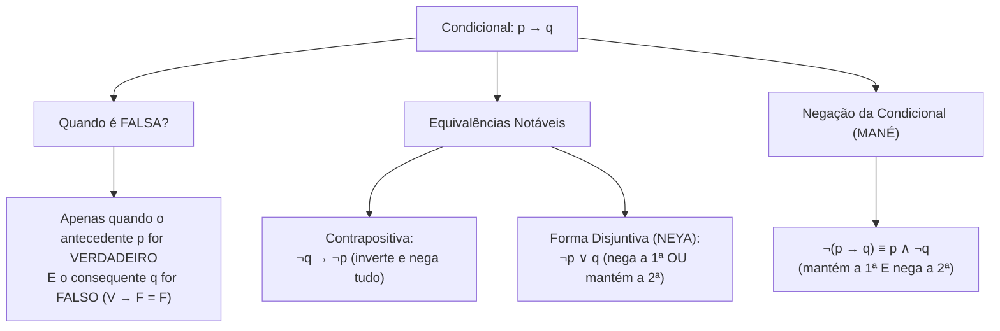
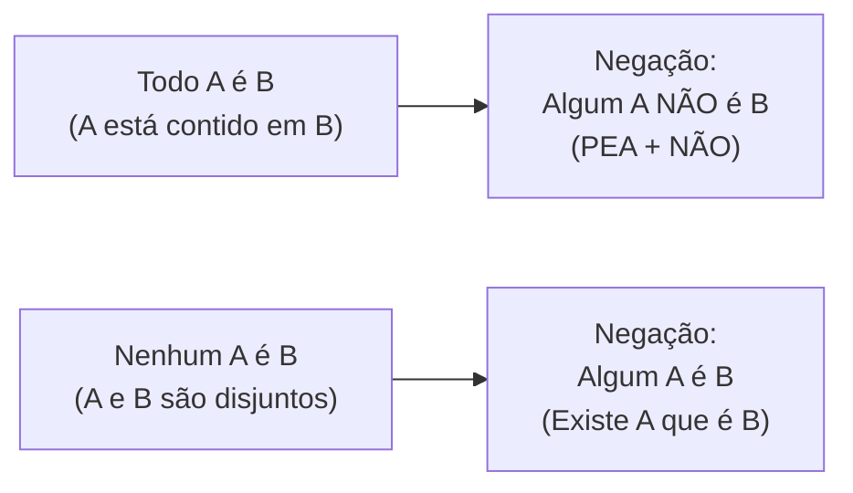

# 05 - Lógica de Argumentação e Conclusões Válidas

> **Matéria:** Matemática e Raciocínio Lógico  
> **Cargos:** A01 – Técnico de Controle Externo (Adm) / B02 – Técnico de Controle Externo (TI)  
> **Arquivo:** `05_logica_de_argumentacao_e_conclusoes_validas.md`  
> **Status:** 🟢 Teoria Aprofundada + 5 Questões FCC Comentadas (A a E)

---

## 📌 Ementa Oficial do Edital
- Compreensão do processo lógico que, a partir de um conjunto de hipóteses, conduz, de forma válida, a conclusões determinadas.
- Proposições lógicas, conectivos e tabelas-verdade.
- Equivalências e negações lógicas.
- Argumentos dedutivos, premissas, conclusão e validade.
- Silogismos categóricos e diagramas lógicos (Todo, Algum, Nenhum).

---

## 🌳 Classificação Hierárquica do Conteúdo

```text
5. Lógica Proposicional, Argumentação e Conclusões Válidas
├── 5.1 Proposições, Conectivos e Tabelas-Verdade
│   ├── Definição de Proposição e Princípios (Identidade, Não Contradição, Terceiro Excluído)
│   ├── Sentenças não proposicionais (interrogativas, exclamativas, imperativas e abertas)
│   └── Conectivos: Conjunção (∧), Disjunção (∨), Disjunção Exclusiva (⊻), Condicional (→), Bicondicional (↔)
├── 5.2 Álgebra Proposicional: Negações e Equivalências Clássicas
│   ├── Leis de De Morgan: ¬(p ∧ q) ≡ ¬p ∨ ¬q e ¬(p ∨ q) ≡ ¬p ∧ ¬q
│   ├── Negação da Condicional (Regra do "MANÉ"): ¬(p → q) ≡ p ∧ ¬q
│   ├── Equivalências da Condicional: Contrapositiva (¬q → ¬p) e Disjuntiva / NEYA (¬p ∨ q)
│   └── Tautologias, Contradições e Contingências
├── 5.3 Validade de Argumentos e Regras de Inferência
│   ├── Estrutura do argumento dedutivo: Premissas (P₁, P₂, ...) e Conclusão (C)
│   ├── Validade formal (argumento válido vs. falácia / sofisma)
│   ├── Regras de inferência: Modus Ponens, Modus Tollens, Silogismo Disjuntivo e Silogismo Hipotético
│   └── Métodos práticos de prova: Método das Premissas Verdadeiras e Método da Conclusão Falsa
└── 5.4 Lógica de Primeira Ordem e Silogismos Categóricos
    ├── Quantificadores: Universal Afirmativo (Todo), Universal Negativo (Nenhum) e Particular (Algum)
    ├── Negação de Quantificadores (Regra do "PEA + NÃO": Pelo menos um, Existe, Algum)
    └── Análise de Silogismos via Diagramas de Euler-Venn
```

---

## 📖 Teoria Aprofundada e Métodos de Resolução

### 1. Conectivos Lógicos e Regras de Verdade

| Conectivo | Símbolo | Leitura | Regra de Ouro da Tabela-Verdade |
|---|:---:|---|---|
| **Conjunção** | $p \land q$ | "p e q" | Só é **VERDADEIRA** se ambas forem verdadeiras ($V \land V = V$). |
| **Disjunção Inclusiva** | $p \lor q$ | "p ou q" | Só é **FALSA** se ambas forem falsas ($F \lor F = F$). |
| **Disjunção Exclusiva** | $p \underline{\lor} q$ | "ou p ou q" | É **VERDADEIRA** se os valores lógicos forem diferentes. |
| **Condicional** | $p \rightarrow q$ | "se p, então q" | Só é **FALSA** no caso Vera Fischer ($V \rightarrow F = F$). |
| **Bicondicional** | $p \leftrightarrow q$ | "p se e somente se q" | É **VERDADEIRA** se os valores lógicos forem iguais ($V \leftrightarrow V = V$, $F \leftrightarrow F = V$). |



---

### 2. Negações e Equivalências Obrigatórias da FCC

#### 2.1 As Negações Mais Cobradas
1. **Negação do "E" (De Morgan):** $\neg(p \land q) \equiv \neg p \lor \neg q$  
   *"Estudo e passo"* $\rightarrow$ Negação: *"Não estudo OU não passo"*.
2. **Negação do "OU" (De Morgan):** $\neg(p \lor q) \equiv \neg p \land \neg q$  
   *"Viajo ou trabalho"* $\rightarrow$ Negação: *"Não viajo E não trabalho"*.
3. **Negação do "SE... ENTÃO" (MANÉ):** $\neg(p \rightarrow q) \equiv p \land \neg q$  
   *"Se for nomeado, comprarei um carro"* $\rightarrow$ Negação: *"Fui nomeado E não comprei um carro"*.

#### 2.2 As Equivalências da Condicional
A FCC testa repetidamente as duas formas equivalentes de reescrever uma condicional $p \rightarrow q$:
1. **Contrapositiva:** Inverte a ordem das proposições e nega ambas:
   $p \rightarrow q \iff \neg q \rightarrow \neg p$
   *"Se o relatório for aprovado, o processo será arquivado"* $\equiv$ *"Se o processo não for arquivado, então o relatório não foi aprovado"*.
2. **Equivalência Disjuntiva (Regra do NEYA):** Nega a primeira, troca o conectivo por "OU" e mantém a segunda:
   $p \rightarrow q \iff \neg p \lor q$

> 🚨 **ALERTA DE PROVA / PEGADINHA FCC:**  
> A negação de uma condicional $p \rightarrow q$ **NUNCA** começa com "Se"! Se uma alternativa de negação trouxer a palavra "Se", elimine-a de imediato. A negação da condicional é sempre uma **conjunção ("E")**.

---

### 3. Validade de Argumentos Dedutivos

Um argumento com premissas $P_1, P_2, \dots, P_n$ e conclusão $C$ é **VÁLIDO** se e somente se for logicamente impossível que todas as premissas sejam verdadeiras e a conclusão seja falsa ao mesmo tempo.

#### Método do Encadeamento de Premissas Verdadeiras
1. Atribua valor lógico **VERDADEIRO ($V$)** a todas as premissas fornecidas.
2. Identifique o ponto de partida mais restritivo:
   - Uma **proposição simples** isolada ($p = V$).
   - Uma **conjunção** ($p \land q = V \implies p = V \text{ e } q = V$).
3. Propague o valor determinado para as condicionais e disjunções utilizando as regras:
   - Em $p \rightarrow q = V$: se $p = V$, obrigatoriamente $q = V$ (*Modus Ponens*).
   - Em $p \rightarrow q = V$: se $q = F$, obrigatoriamente $p = F$ (*Modus Tollens*).
   - Em $p \lor q = V$: se $p = F$, obrigatoriamente $q = V$ (*Silogismo Disjuntivo*).
4. As conclusões verdadeiras necessárias correspondem à alternativa correta.

---

### 4. Silogismos Categóricos e Quantificadores



> 🛑 **ATENÇÃO:**  
> A negação de *"Todo servidor do TCE é dedicado"* **NÃO É** *"Nenhum servidor é dedicado"*.  
> A negação do quantificador universal afirmativo exige apenas furar a regra com **pelo menos uma exceção**: *"Pelo menos um servidor do TCE não é dedicado"*.

---

## 🌐 Fontes Recomendadas na Internet
- [Portal da Matemática OBMEP / IMPA - Lógica Matemática e Demonstrações](https://portaldaobmep.impa.br/)
  - Aulas de lógica formal, tabelas-verdade, argumentos válidos e diagramas de conjuntos.
- [Só Matemática - Lógica Proposicional e Equivalências](https://www.somatematica.com.br/superior/logica/)
  - Resumos das Leis de De Morgan, contrapositiva e regras de inferência dedutiva.
- [Stanford Encyclopedia of Philosophy - Classical Logic](https://plato.stanford.edu/entries/logic-classical/)
  - Enciclopédia de filosofia e lógica clássica internacional com deduções formais e semântica.
- [Iniciação à Lógica Matemática (Edgard de Alencar Filho)](https://www.obmep.org.br/)
  - Referência absoluta adotada pela FCC em concursos de tribunais.

---

## 📝 Questões Comentadas no Padrão FCC (Justificadas de A a E)

### Questão 1 (FCC - Auditor Fiscal / Adaptada TCE-GO)
Considere a seguinte afirmação feita por um auditor durante a sessão do Tribunal de Contas:

*"Se a prestação de contas foi apresentada tempestivamente, então a documentação comprobatória é idônea e o parecer técnico é favorável."*

A negação lógica dessa afirmação é expressa por:

A) Se a prestação de contas não foi apresentada tempestivamente, então a documentação não é idônea ou o parecer técnico não é favorável.  
B) A prestação de contas foi apresentada tempestivamente, e a documentação comprobatória não é idônea ou o parecer técnico não é favorável.  
C) A prestação de contas não foi apresentada tempestivamente, ou a documentação comprobatória é idônea e o parecer técnico é favorável.  
D) Se a documentação comprobatória não é idônea ou o parecer técnico não é favorável, então a prestação de contas não foi apresentada tempestivamente.  
E) A prestação de contas foi apresentada tempestivamente, e a documentação comprobatória não é idônea e o parecer técnico não é favorável.  

> **Gabarito: B**  
>  
> **Comentário Analítico Passo a Passo:**  
> 1. Formalização simbólica da proposição original:  
>    - Seja $p$: *"A prestação de contas foi apresentada tempestivamente"*.  
>    - Seja $q$: *"A documentação comprobatória é idônea"*.  
>    - Seja $r$: *"O parecer técnico é favorável"*.  
>    - Estrutura: $p \rightarrow (q \land r)$.  
> 2. Regra de negação da condicional (Regra do "MANÉ"):  
>    $\neg [p \rightarrow (q \land r)] \equiv p \land \neg(q \land r)$  
> 3. Aplicação da Lei de De Morgan para negar a conjunção interna:  
>    $\neg(q \land r) \equiv \neg q \lor \neg r$  
> 4. Expressão final da negação:  
>    $p \land (\neg q \lor \neg r)$  
>    - Tradução em linguagem natural: *"A prestação de contas foi apresentada tempestivamente"* ($p$) **E** ($\land$) *"[a documentação comprobatória não é idônea"* ($\neg q$) **OU** ($\lor$) *"o parecer técnico não é favorável]"* ($\neg r$).  
>  
> **Análise das Alternativas:**  
> - **A) Incorreta:** Tenta negar a condicional transformando-a em outra condicional (a negação de uma condicional nunca é outra condicional).  
> - **B) CORRETA:** Aplicação perfeita do MANÉ com a Lei de De Morgan: mantém a primeira ($p$), troca a condicional por "e" ($\land$) e nega a conjunção interna trocando o conectivo por "ou" ($\neg q \lor \neg r$).  
> - **C) Incorreta:** Essa estrutura corresponde à equivalência lógica disjuntiva ($\neg p \lor (q \land r)$), e não à sua negação.  
> - **D) Incorreta:** Essa é a contrapositiva da proposição (uma equivalência lógica), e não a negação solicitada.  
> - **E) Incorreta:** Cometeu o erro comum de esquecer de inverter o conectivo interno de "e" para "ou" pela Lei de De Morgan.

---

### Questão 2 (FCC - Analista de Controle Externo / TCE-GO)
Considere verdadeiras as seguintes quatro premissas a respeito das rotinas de controle do Tribunal:

I. Se o contrato administrativo possui cláusula de reajuste abusiva, então a auditoria emite notificação prévia.  
II. Se a auditoria emite notificação prévia, então o ordenador de despesas suspende o pagamento.  
III. Se o ordenador de despesas suspende o pagamento, então a empresa contratada apresenta defesa prévia.  
IV. A empresa contratada não apresentou defesa prévia.  

A partir dessas premissas, é correto concluir de forma necessariamente válida que:

A) A auditoria emitiu notificação prévia e o contrato possui cláusula abusiva.  
B) O ordenador de despesas suspendeu o pagamento, mas o contrato não possui cláusula abusiva.  
C) O contrato administrativo não possui cláusula de reajuste abusiva e a auditoria não emitiu notificação prévia.  
D) A empresa contratada apresentou recurso extemporâneo ao plenário.  
E) Se o contrato não possui cláusula abusiva, então o ordenador suspendeu o pagamento.  

> **Gabarito: C**  
>  
> **Comentário Analítico Passo a Passo:**  
> 1. Todas as premissas são assumidas como **Verdadeiras ($V$)**:  
>    - Pela Premissa IV: *"A empresa não apresentou defesa prévia"* $= V$.  
>      - Portanto, *"A empresa contratada apresenta defesa"* é **Falsa ($F$)**.  
> 2. Pela Premissa III:  
>    - *"Se o ordenador suspende o pagamento $\rightarrow$ empresa apresenta defesa"* $= V$.  
>    - Consequente é $F \implies$ Antecedente tem que ser **Falso ($F$)** (*Modus Tollens*).  
>    - Conclusão: **O ordenador de despesas NÃO suspendeu o pagamento** ($V$).  
> 3. Pela Premissa II:  
>    - *"Se a auditoria emite notificação $\rightarrow$ ordenador suspende o pagamento"* $= V$.  
>    - Consequente é $F \implies$ Antecedente tem que ser **Falso ($F$)** (*Modus Tollens*).  
>    - Conclusão: **A auditoria NÃO emitiu notificação prévia** ($V$).  
> 4. Pela Premissa I:  
>    - *"Se contrato possui cláusula abusiva $\rightarrow$ auditoria emite notificação"* $= V$.  
>    - Consequente é $F \implies$ Antecedente tem que ser **Falso ($F$)** (*Modus Tollens*).  
>    - Conclusão: **O contrato NÃO possui cláusula de reajuste abusiva** ($V$).  
> 5. Síntese:  
>    - O contrato não possui cláusula abusiva ($V$) **E** a auditoria não emitiu notificação ($V$).  
>  
> **Análise das Alternativas:**  
> - **A) Incorreta:** Afirma que a auditoria emitiu notificação e que o contrato é abusivo, contrariando as conclusões deduzidas.  
> - **B) Incorreta:** O ordenador de despesas não suspendeu o pagamento.  
> - **C) CORRETA:** Ambas as afirmações são logicamente deduzidas como verdadeiras por encadeamento de *Modus Tollens*.  
> - **D) Incorreta:** Informação estranha às premissas fornecidas.  
> - **E) Incorreta:** Inconsistente com o fato provado de que o ordenador não suspendeu o pagamento.

---

### Questão 3 (FCC - Técnico de Controle Externo)
Do ponto de vista da lógica formal, a proposição:
*"Se o servidor público observa o princípio da moralidade, então sua conduta administrativa é inatacável"*
é logicamente equivalente a:

A) Se a conduta administrativa do servidor público é inatacável, então ele observa o princípio da moralidade.  
B) Se o servidor público não observa o princípio da moralidade, então sua conduta administrativa não é inatacável.  
C) O servidor público não observa o princípio da moralidade ou sua conduta administrativa é inatacável.  
D) O servidor público observa o princípio da moralidade e sua conduta administrativa não é inatacável.  
E) Se a conduta administrativa do servidor não for inatacável, então ele observa o princípio da moralidade.  

> **Gabarito: C**  
>  
> **Comentário Analítico Passo a Passo:**  
> 1. Estrutura da proposição: $p \rightarrow q$, onde:  
>    - $p$: *"O servidor observa a moralidade"*  
>    - $q$: *"Sua conduta é inatacável"*  
> 2. Existem duas equivalências clássicas para a condicional $p \rightarrow q$:  
>    - **Equivalência Contrapositiva:** $\neg q \rightarrow \neg p$ (*"Se a conduta não é inatacável, então o servidor não observa a moralidade"*).  
>    - **Equivalência Disjuntiva (Regra do NEYA):** $\neg p \lor q$ (*"O servidor NÃO observa a moralidade OU sua conduta é inatacável"*).  
> 3. Examinando as alternativas, a forma contrapositiva não consta nas opções, mas a forma disjuntiva $\neg p \lor q$ consta exatamente na **Alternativa C**!  
>  
> **Análise das Alternativas:**  
> - **A) Incorreta:** É a recíproca simples ($q \rightarrow p$), o que constitui a falácia da afirmação do consequente.  
> - **B) Incorreta:** É a inversa simples ($\neg p \rightarrow \neg q$), falácia da negação do antecedente.  
> - **C) CORRETA:** Aplicação perfeita da equivalência disjuntiva (NEYA): $\neg p \lor q$.  
> - **D) Incorreta:** Esta é a negação da condicional ($p \land \neg q$), e não uma proposição logicamente equivalente.  
> - **E) Incorreta:** Nega apenas o consequente sem negar o antecedente na condicional invertida.

---

### Questão 4 (FCC - Analista Judiciário)
Considere como verdadeiras as seguintes duas premissas a respeito dos membros de um tribunal:

Premissa 1: *"Todos os auditores de controle externo são especialistas em finanças públicas."*  
Premissa 2: *"Alguns especialistas em finanças públicas são professores universitários."*  

A partir dessas premissas, é **necessariamente** correto concluir que:

A) Todos os professores universitários são auditores de controle externo.  
B) Alguns auditores de controle externo são professores universitários.  
C) Nenhum auditor de controle externo é professor universitário.  
D) Pelo menos um auditor de controle externo não é especialista em finanças públicas.  
E) Pode haver auditor de controle externo que seja professor universitário, mas não é uma conclusão necessária.  

> **Gabarito: E**  
>  
> **Comentário Analítico Passo a Passo:**  
> 1. Representação por Diagramas de Euler-Venn:  
>    - Seja $A$ o conjunto dos auditores.  
>    - Seja $E$ o conjunto dos especialistas em finanças públicas.  
>    - Seja $P$ o conjunto dos professores universitários.  
> 2. Análise da Premissa 1 (*"Todo A é E"*):  
>    - O conjunto $A$ está totalmente contido no conjunto $E$ ($A \subset E$).  
> 3. Análise da Premissa 2 (*"Algum E é P"*):  
>    - A interseção entre $E$ e $P$ é não vazia ($E \cap P \neq \emptyset$).  
> 4. Relação entre $A$ e $P$:  
>    - Os elementos da interseção $E \cap P$ podem estar totalmente fora do conjunto $A$, ou podem coincidir parcialmente com $A$, ou até mesmo conter todo $A$.  
>    - Não há garantia lógica de que $A \cap P \neq \emptyset$. Pode ser que nenhum auditor seja professor ($A \cap P = \emptyset$).  
>    - Portanto, não se pode afirmar com certeza que *"Algum auditor é professor"*, nem que *"Nenhum auditor é professor"*. A intersecção é contingente/possível, mas **não necessária**.  
>  
> **Análise das Alternativas:**  
> - **A) Incorreta:** Falácia de generalização indevida.  
> - **B) Incorreta:** Erro clássico em provas da FCC; a interseção de $E$ com $P$ pode ocorrer na região de $E$ externa a $A$.  
> - **C) Incorreta:** Também não se pode garantir a exclusão total.  
> - **D) Incorreta:** Viola diretamente a premissa 1 ("Todo A é E").  
> - **E) CORRETA:** Demonstra o rigor dedutivo: a pertinência é possível, porém não decorre necessariamente das premissas.

---

### Questão 5 (FCC - Auditor de Controle Externo / Adaptada)
A afirmação *"Todos os relatórios elaborados pela comissão técnica continham recomendações aos municípios"* tem como **negação lógica** a proposição:

A) Nenhum relatório elaborado pela comissão técnica continha recomendações aos municípios.  
B) Todos os relatórios elaborados pela comissão técnica não continham recomendações aos municípios.  
C) Pelo menos um relatório elaborado pela comissão técnica não continha recomendações aos municípios.  
D) Alguns relatórios elaborados pela comissão técnica continham recomendações aos municípios.  
E) A maioria dos relatórios continha recomendações aos municípios.  

> **Gabarito: C**  
>  
> **Comentário Analítico Passo a Passo:**  
> 1. Análise da proposição original:  
>    - Trata-se de uma proposição categórica universal afirmativa: *"Todo A é B"*, onde $A$ é o conjunto dos relatórios da comissão técnica e $B$ é a propriedade de conter recomendações.  
> 2. Regra de negação do quantificador universal ("Todo"):  
>    - A negação de *"Todo A é B"* é obtida demonstrando a existência de ao menos um contraexemplo:  
>    $\neg (\forall x, A(x) \rightarrow B(x)) \equiv \exists x, A(x) \land \neg B(x)$  
>    - Utiliza-se a mnemônica **PEA + NÃO**:  
>      - **P**elo menos um A não é B;  
>      - **E**xiste A que não é B;  
>      - **A**lgum A não é B.  
> 3. Tradução: *"Pelo menos um relatório elaborado pela comissão técnica NÃO continha recomendações aos municípios"*.  
>  
> **Análise das Alternativas:**  
> - **A) Incorreta:** "Nenhum A é B" é uma contrária extrema, não a negação contraditória. Se de 100 relatórios, 99 continham recomendações e 1 não continha, a proposição original é falsa e a alternativa A também é falsa.  
> - **B) Incorreta:** Equivalente a dizer "nenhum", cometendo o mesmo erro de A.  
> - **C) CORRETA:** Expressa com precisão matemática o quantificador existencial com negação do predicado (PEA + NÃO).  
> - **D) Incorreta:** É uma subalterna, verdadeira sempre que o "Todo" for verdadeiro.  
> - **E) Incorreta:** Não atende à negação lógica formal.
