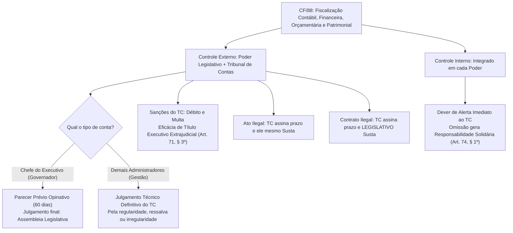
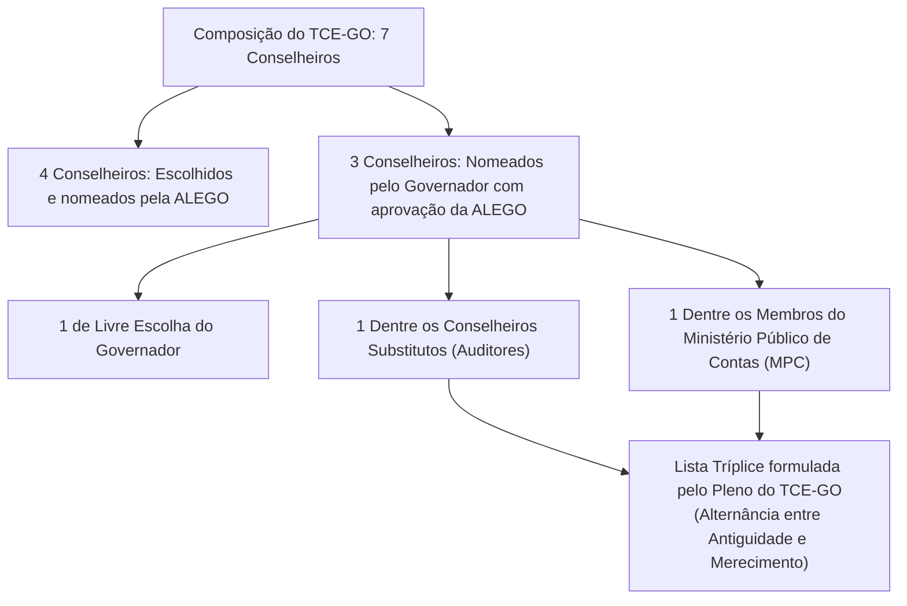

# 01 - Bases Constitucionais do Controle Externo (CF/88 e CE/GO)

> **Matéria:** Legislação Institucional  
> **Cargos:** A01 – Técnico de Controle Externo (Adm) / B02 – Técnico de Controle Externo (TI)  
> **Arquivo:** `01_bases_constitucionais_cf88_e_ce_go.md`  
> **Atos Normativos:** CF/88 (Arts. 37 a 41 e 70 a 75) e Constituição do Estado de Goiás (Arts. 26 a 33)

---

## 📌 Ementa / Itens do Edital
- Constituição da República Federativa do Brasil de 1988:
  - Administração Pública: disposições gerais (Art. 37); princípios expressos e implícitos; investidura em cargo ou emprego público (concurso público, prazos e direitos do aprovado); regime de subsídios, remuneração e teto constitucional (subtetos estaduais); acumulação remunerada de cargos públicos; direito de greve e livre associação sindical;
  - Servidores Públicos civis (Arts. 38 a 41): direitos funcionais, exercício de mandato eletivo, estabilidade após três anos de efetivo exercício, avaliação especial de desempenho e hipóteses taxativas de perda do cargo do servidor estável;
  - Responsabilidade civil do Estado (Art. 37, § 6º): Teoria do Risco Administrativo, responsabilidade objetiva da Administração e das concessionárias, excludentes e atenuantes de responsabilidade, e ação regressiva subjetiva contra o agente público causador do dano;
  - Fiscalização contábil, financeira, orçamentária, operacional e patrimonial (Arts. 70 e 71): controle externo e controle interno; sujeição subjetiva ao dever de prestar contas;
  - Competências constitucionais dos Tribunais de Contas: apreciação de contas do Chefe do Poder Executivo vs. julgamento técnico de contas dos ordenadores de despesas; exame de atos de admissão de pessoal e concessão inicial de aposentadorias/pensões (ato complexo); medidas saneadoras e sustação de atos administrativos; rito constitucional para sustação de contratos administrativos e intervenção subsidiária; eficácia executiva das decisões condenatórias (título executivo extrajudicial - Art. 71, § 3º);
  - Sistema de Controle Interno de cada Poder (Art. 74): finalidades, apoio ao controle externo e dever de comunicação sob pena de responsabilidade solidária;
  - Princípio da Simetria Constitucional (Art. 75): aplicação obrigatória do modelo federal de fiscalização e composição aos Tribunais de Contas dos Estados, DF e Municípios;
- Constituição do Estado de Goiás (Arts. 26 a 33):
  - Disposições relativas ao Tribunal de Contas do Estado de Goiás (TCE-GO): natureza jurídica, sede, jurisdição, autonomia institucional, funcional, administrativa e orçamentária;
  - Composição do TCE-GO: os 7 Conselheiros e as regras rígidas de indicação e nomeação (4 pela Assembleia Legislativa de Goiás - ALEGO e 3 pelo Governador do Estado com aprovação legislativa);
  - Vagas técnicas privativas do Governador: rodízio entre Conselheiros Substitutos (Auditores) e Membros do Ministério Público de Contas (MPC-GO);
  - Requisitos constitucionais para nomeação de Conselheiro: idade (entre 35 e 70 anos), idoneidade moral, reputação ilibada, notório saber e mais de 10 anos de exercício de função;
  - Garantias, prerrogativas, vencimentos e vedações dos Conselheiros (equiparadas às dos Desembargadores do Tribunal de Justiça do Estado de Goiás - TJ-GO);
  - Competências específicas na Carta Estadual e prazos de apreciação de contas do Governador (60 dias contados do recebimento).

---

## 🌳 Classificação Hierárquica

```text
1. Fundamentos Constitucionais da Administração Pública e do Controle Externo
├── 1.1 Regime Constitucional da Administração Pública (CF/88, Arts. 37 a 41)
│   ├── 1.1.1 Princípios Constitucionais:
│   │   ├── Princípios Expressos (Art. 37, caput): Legalidade, Impessoalidade, Moralidade, Publicidade e Eficiência (LIMPE)
│   │   └── Princípios Implícitos: Razoabilidade, Proporcionalidade, Autotutela (Súmulas 346 e 473 do STF), Motivação e Supremacia do Interesse Público
│   ├── 1.1.2 Provimento de Cargos e Concurso Público (Art. 37, I a IV):
│   │   ├── Concurso de provas ou provas e títulos; prazo de validade de até 2 anos, prorrogável uma vez por igual período
│   │   └── Cargos em comissão (livre nomeação e exoneração, para direção, chefia e assessoramento) e funções de confiança (privativas de concursados)
│   ├── 1.1.3 Remuneração, Subsídios e Tetos Constitucionais (Art. 37, XI e § 12):
│   │   ├── Teto Geral Federal: Subsídio mensal dos Ministros do STF
│   │   └── Subtetos no Estado de Goiás: Executivo (subsídio do Governador), Legislativo (deputados estaduais) e Judiciário (desembargadores do TJ-GO)
│   ├── 1.1.4 Acumulação Remunerada de Cargos Públicos (Art. 37, XVI e XVII):
│   │   ├── Regra Geral: VEDAÇÃO ABSOLUTA de acumulação remunerada
│   │   └── Exceções Expressas (desde que haja compatibilidade de horários):
│   │       ├── a) Dois cargos de professor;
│   │       ├── b) Um cargo de professor com outro técnico ou científico;
│   │       └── c) Dois cargos ou empregos privativos de profissionais de saúde, com profissões regulamentadas
│   ├── 1.1.5 Exercício de Mandato Eletivo pelo Servidor Público (Art. 38):
│   │   ├── Mandato federal, estadual ou distrital: Afastamento obrigatório do cargo
│   │   ├── Mandato de Prefeito: Afastamento obrigatório, sendo facultado optar pela remuneração do cargo efetivo
│   │   └── Mandato de Vereador: Havendo compatibilidade de horários, percebe as vantagens de ambos os cargos; sem compatibilidade, afasta-se e opta
│   ├── 1.1.6 Estabilidade Constitucional e Perda do Cargo (Art. 41):
│   │   ├── Estabilidade após 3 anos de efetivo exercício + aprovação em Avaliação Especial de Desempenho
│   │   └── Hipóteses Taxativas de Perda do Cargo do Servidor Estável:
│   │       ├── 1. Sentença judicial transitada em julgado;
│   │       ├── 2. Processo administrativo disciplinar (PAD) com ampla defesa;
│   │       ├── 3. Procedimento de avaliação periódica de desempenho (na forma de lei complementar); e
│   │       └── 4. Excesso de despesa com pessoal após esgotamento das medidas prévias (Art. 169, § 4º da CF/88)
│   └── 1.1.7 Responsabilidade Civil Objetiva do Estado (Art. 37, § 6º):
│       ├── Pessoas jurídicas de direito público e as de direito privado prestadoras de serviços públicos
│       ├── Responsabilidade objetiva (independe de dolo ou culpa do agente; Teoria do Risco Administrativo)
│       └── Ação Regressiva do Estado contra o agente público: Exige dolo ou culpa (responsabilidade subjetiva)
├── 1.2 Sistema Constitucional de Controle Externo e Interno (CF/88, Arts. 70 a 75)
│   ├── 1.2.1 Abrangência Material do Controle: Fiscalização contábil, financeira, orçamentária, operacional e patrimonial
│   ├── 1.2.2 Princípios de Fiscalização: Legalidade, legitimidade, economicidade, aplicação das subvenções e renúncia de receitas
│   ├── 1.2.3 Sujeito Passivo Obrigatório da Prestação de Contas (Art. 70, parágrafo único):
│   │   └── Qualquer pessoa física ou jurídica, pública ou privada, que utilize, arrecade, guarde, gerencie ou administre dinheiros, bens e valores públicos
│   ├── 1.2.4 Competências Constitucionais dos Tribunais de Contas (Art. 71):
│   │   ├── Contas de Governo: Emissão de Parecer Prévio opinativo em 60 dias (julgamento exclusivo pelo Legislativo)
│   │   ├── Contas de Gestão: Julgamento técnico definitivo pelo Tribunal de Contas (com quitação ou condenação)
│   │   ├── Atos de Pessoal: Registro de admissões de pessoal e concessão inicial de aposentadorias/pensões (ato complexo)
│   │   ├── Inspeções e Auditorias: De ofício ou por solicitação do Legislativo
│   │   ├── Aplicação de Sanções e Multas: Decisão condenatória tem eficácia de Título Executivo Extrajudicial (Art. 71, § 3º)
│   │   ├── Sustação de Atos: Assina prazo de 30 dias; não cumprido, o próprio TC susta a execução do ato
│   │   └── Sustação de Contratos: Assina prazo; não cumprido, solicita a sustação ao Legislativo; se omisso por 90 dias, o TC decide
│   ├── 1.2.5 Sistema de Controle Interno Integrado (Art. 74):
│   │   ├── Apoio ao controle externo na missão fiscalizatória
│   │   └── Dever de Alerta: Obrigatoriedade de comunicar qualquer ilegalidade sob pena de responsabilidade solidária (Art. 74, § 1º)
│   └── 1.2.6 Princípio da Simetria Constitucional Obrigatória (Art. 75):
│       └── As normas do TCU (arts. 70 a 74) aplicam-se compulsoriamente aos Tribunais de Contas Estaduais e Municipais
└── 1.3 O TCE-GO na Constituição do Estado de Goiás (Arts. 26 a 33 da CE/GO)
    ├── 1.3.1 Posição Institucional e Autonomia:
    │   ├── Órgão constitucional autônomo, dotado de autogoverno, quadro próprio de pessoal e autonomia orçamentária
    │   └── Jurisdição própria e privativa em todo o território estadual de Goiás
    ├── 1.3.2 Composição e Nomeação dos 7 Conselheiros (Art. 27 da CE/GO):
    │   ├── 4 Conselheiros: Escolhidos e nomeados pela Assembleia Legislativa de Goiás (ALEGO)
    │   └── 3 Conselheiros: Nomeados pelo Governador do Estado com aprovação prévia da ALEGO, sendo:
    │       ├── 1 de livre escolha do Governador;
    │       ├── 1 escolhido dentre os Conselheiros Substitutos (Auditores), em lista tríplice por merecimento e antiguidade; e
    │       └── 1 escolhido dentre os membros do Ministério Público de Contas (MPC), em lista tríplice por merecimento e antiguidade
    ├── 1.3.3 Requisitos Constitucionais para Nomeação de Conselheiro:
    │   ├── Cidadão brasileiro; idade entre 35 e 70 anos incompletos;
    │   ├── Idoneidade moral e reputação ilibada;
    │   └── Notórios conhecimentos jurídicos, contábeis, econômicos, financeiros ou de administração pública + mais de 10 anos de exercício funcional
    ├── 1.3.4 Estatuto dos Conselheiros (Art. 28 da CE/GO):
    │   └── Mesmas garantias (vitaliciedade, inamovibilidade e irredutibilidade), prerrogativas e impedimentos dos Desembargadores do TJ-GO
    ├── 1.3.5 O Ministério Público de Contas de Goiás (Art. 30 da CE/GO):
    │   └── Instituição permanente junto ao TCE-GO; ingresso por concurso público; mesmas garantias e vedações dos membros do MPE
    └── 1.3.6 Prazos Específicos:
        └── Envio e emissão de parecer prévio das contas anuais do Governador: 60 dias a contar do seu recebimento oficial
```

---

## 📖 Resumo Teórico Aprofundado & Esquematizado

### 1. Administração Pública na CF/88: Pontos Críticos para a FCC

#### 1.1 Princípios Constitucionais Expressos e Implícitos (Art. 37, caput)
* **Legalidade:** Enquanto o particular pode fazer tudo o que a lei não proíbe (princípio da autonomia da vontade - Art. 5º, II da CF), o administrador público **só pode agir nos estritos termos e limites autorizados pela lei** (*princípio da subordinação à lei*).
* **Impessoalidade:** Veda o favorecimento ou perseguição pessoal de indivíduos (finalidade pública inafastável). Desdobramento central no Art. 37, § 1º: **vedação à promoção pessoal** de autoridades ou servidores em publicidade de atos, programas, obras ou serviços públicos (proibição de nomes, símbolos ou imagens que caracterizem promoção pessoal).
* **Moralidade:** Exige probidade, boa-fé e lealdade institucional. A imoralidade administrativa é causa autônoma de invalidação do ato pelo Judiciário e viabiliza a propositura de **Ação Popular** (Art. 5º, LXXIII) e ação de improbidade administrativa.
* **Publicidade:** Os atos públicos devem ser transparentes para produzir efeitos jurídicos e viabilizar o controle social, ressalvadas hipóteses de segurança do Estado ou intimidade/vida privada.
* **Eficiência:** Inserido pela Emenda Constitucional nº 19/1998 (Reforma Administrativa). Exige produtividade, otimização de recursos, combate ao desperdício e celeridade nos serviços estatais.
* **Princípio da Autotutela (Súmulas 346 e 473 do STF):** A Administração Pública pode **anular** seus próprios atos quando eivados de ilegalidade (porque deles não se originam direitos), e pode **revogar** seus atos legais por motivo de conveniência e oportunidade, respeitados os direitos adquiridos.

#### 1.2 Regras de Cargos, Empregos e Concursos Públicos
* **Regra Geral:** A investidura em cargo ou emprego público depende de aprovação prévia em **concurso público de provas ou de provas e títulos**, de acordo com a natureza e a complexidade do cargo.
* **Validade do Concurso (Art. 37, III):** Prazo de validade de **até dois anos**, prorrogável uma vez, por igual período. O candidato aprovado dentro do número de vagas previsto no edital tem **direito subjetivo à nomeação** durante o prazo de vigência (STF - Tema 161).
* **Cargos em Comissão vs. Funções de Confiança (Art. 37, V):**
  * *Funções de Confiança:* Exercidas **exclusivamente por servidores ocupantes de cargo efetivo**;
  * *Cargos em Comissão:* Preenchidos por servidores de carreira nos casos, condições e percentuais mínimos previstos em lei, e por pessoas sem vínculo efetivo;
  * Ambos destinam-se **apenas às atribuições de direção, chefia e assessoramento** (é inconstitucional a criação de cargo em comissão para atribuições meramente técnicas ou operacionais!).

#### 1.3 Acumulação de Cargos e Mandato Eletivo
* **Vedações e Exceções de Acumulação Remunerada (Art. 37, XVI):**
  * A regra geral é a proibição de acumulação de cargos públicos, abrangendo autarquias, fundações, empresas públicas e sociedades de economia mista.
  * **Exceções cumulativas com compatibilidade de horários:**
    1. Dois cargos de **professor**;
    2. Um cargo de **professor** com outro **técnico ou científico**;
    3. Dois cargos ou empregos privativos de **profissionais de saúde**, com profissões regulamentadas.
  * O teto remuneratório constitucional aplica-se a **cada vínculo isoladamente**, e não à soma das remunerações acumuladas (*STF - Temas 377 e 384*).
* **Servidor em Mandato Eletivo (Art. 38 da CF/88):**
  * *Mandato Federal, Estadual ou Distrital (Deputado, Senador):* Afastamento compulsório do cargo público;
  * *Mandato de Prefeito:* Afasta-se do cargo público, sendo-lhe **facultado optar pela sua remuneração**;
  * *Mandato de Vereador:* Havendo compatibilidade de horários, **percebe as vantagens do seu cargo e o subsídio do mandato**; sem compatibilidade, afasta-se e opta pela remuneração.

#### 1.4 Estabilidade e Hipóteses de Perda do Cargo (Art. 41)
* São estáveis após **três anos de efetivo exercício** os servidores nomeados para cargo de provimento efetivo em virtude de concurso público.
* Requisito obrigatório para a aquisição da estabilidade: **aprovação prévia em avaliação especial de desempenho** por comissão instituída para essa finalidade.
* **As 4 hipóteses taxativas de perda do cargo do servidor público estável:**
  1. Sentença judicial transitada em julgado;
  2. Processo administrativo disciplinar (PAD) no qual lhe seja assegurada ampla defesa;
  3. Procedimento de avaliação periódica de desempenho, na forma de **lei complementar**, assegurada ampla defesa;
  4. Excesso de despesa com pessoal (Art. 169, § 4º da CF/88): após redução de 20% das despesas com cargos em comissão e exoneração dos servidores não estáveis, se o excesso persistir, o servidor estável poderá perder o cargo mediante ato motivado e indenização compensatória de 1 mês por ano de serviço.

#### 1.5 Responsabilidade Civil do Estado (Art. 37, § 6º)
* **Regra Geral:** Responsabilidade civil **objetiva** das pessoas jurídicas de direito público e das pessoas jurídicas de direito privado prestadoras de serviços públicos pelos danos que seus agentes causarem a terceiros.
* Adota a **Teoria do Risco Administrativo** (o particular lesado precisa provar apenas o ato estatal, o dano e o nexo de causalidade, dispensando prova de dolo ou culpa da Administração).
* **Excludentes de Responsabilidade:** Caso fortuito, força maior e culpa exclusiva da vítima (rompem o nexo causal). A culpa concorrente atenua a indenização.
* **Ação Regressiva:** O Estado responde perante a vítima objetivamente; caso seja condenado, tem o direito de regresso contra o servidor público causador do dano, em cuja ação deverá comprovar cabalmente a ocorrência de **dolo ou culpa (responsabilidade subjetiva)**.
* **Tema 940 do STF (Tese Vinculante):** A vítima do dano deve ajuizar a ação indenizatória **exclusivamente contra o Estado ou pessoa jurídica prestadora**, sendo vedado o ajuizamento da ação diretamente contra o servidor público ou a inclusão deste no polo passivo em litisconsórcio.

---

### 2. Fiscalização e Controle na CF/88 (Arts. 70 a 75)



#### 2.1 Emissão de Parecer Prévio vs. Julgamento de Contas
| Tipo de Conta | Responsável | Atuação do Tribunal de Contas | Quem Julga Definitivamente? |
| :--- | :--- | :--- | :--- |
| **Contas de Governo** | Chefe do Poder Executivo (Governador / Presidente / Prefeito) | Emite **Parecer Prévio** (opinativo e consultivo) no prazo de **60 dias**. | **Poder Legislativo** (Assembleia Legislativa ou Congresso Nacional). |
| **Contas de Gestão** | Ordenadores de despesas, Secretários, Diretores de autarquias e empresas estatais | **Julga em caráter técnico e definitivo** a regularidade ou irregularidade das contas. | **O próprio Tribunal de Contas**. |

> **Jurisprudência Vinculante do STF (Temas 157 e 835):** Para fins de inelegibilidade eleitoral (Lei da Ficha Limpa - LC 64/90), a competência para julgar **todas** as contas prestadas por Prefeito Municipal (sejam contas de governo ou contas de gestão na condição de ordenador de despesas) é **exclusiva da Câmara de Vereadores**, atuando o Tribunal de Contas apenas como órgão auxiliar emissor de parecer prévio opinativo.

#### 2.2 Rito de Sustação: Atos Administrativos vs. Contratos Administrativos
* **Ato Administrativo Ilegal (Art. 71, X):** Verificada a ilegalidade, o Tribunal de Contas assina prazo para que o órgão adote as medidas corretivas. Se não atendido o prazo, **o próprio Tribunal de Contas susta a execução do ato impugnado**, comunicando a decisão ao Poder Legislativo.
* **Contrato Administrativo Ilegal (Art. 71, XI e § 1º):** No caso de contrato, o Tribunal de Contas assina prazo para regularização. Se desatendido, **a competência para sustar o contrato é originária do Poder Legislativo** (Assembleia Legislativa), que solicitará imediatamente ao Executivo as providências.
* **Atuação Subsidiária do Tribunal de Contas (Art. 71, § 2º):** Se o Poder Legislativo ou o Poder Executivo, no prazo de **90 (noventa) dias**, não efetivar as medidas de sustação do contrato, **o próprio Tribunal de Contas decidirá a respeito da sustação**.

#### 2.3 Eficácia das Decisões Condenatórias (Art. 71, § 3º)
* As decisões do Tribunal de Contas de que resulte imputação de **débito** (ressarcimento) ou **multa** têm **eficácia de título executivo extrajudicial**.
* **Cobrança Judicial:** O Tribunal de Contas não tem personalidade jurídica nem procuradoria contenciosa para ingressar com execução fiscal na Justiça. A execução é ajuizada pela **Fazenda Pública titular do crédito** (a Procuradoria-Geral do Estado de Goiás - PGE-GO no caso de recursos estaduais).
* **Tema 899 do STF (Tese Vinculante):** É **prescritível** a pretensão de ressarcimento ao erário fundada em decisão de Tribunal de Contas, aplicando-se o prazo prescricional de **5 (cinco) anos**.

---

### 3. Disposições do TCE-GO na Constituição do Estado de Goiás (Arts. 26 a 33 da CE/GO)

#### 3.1 Composição e Processo de Escolha dos 7 Conselheiros (Art. 27 da CE/GO)



#### 3.2 Requisitos Constitucionais para Nomeação de Conselheiro (Art. 27, § 1º da CE/GO):
1. **Nacionalidade:** Ser brasileiro;
2. **Idade:** Ter mais de **35 (trinta e cinco) anos** e menos de **70 (setenta) anos** de idade;
3. **Reputação:** Idoneidade moral e reputação ilibada;
4. **Qualificação Profissional:** Notórios conhecimentos jurídicos, contábeis, econômicos e financeiros ou de administração pública;
5. **Experiência Profissional:** Contar mais de **10 (dez) anos de exercício de função** ou de efetiva atividade profissional que exija os conhecimentos acima mencionados.

#### 3.3 Garantias, Prerrogativas e Vedações dos Conselheiros (Art. 28 da CE/GO):
* Os Conselheiros do TCE-GO gozam das mesmas garantias, prerrogativas, impedimentos, subsídios e vantagens dos **Desembargadores do Tribunal de Justiça do Estado de Goiás (TJ-GO)**:
  * **Vitaliciedade:** Adquirida na posse (para os indicados políticos) ou após 2 anos de efetivo exercício (para membros de carreira);
  * **Inamovibilidade:** Não podem ser removidos de suas funções compulsoriamente, salvo por motivo de interesse público fundamentado;
  * **Irredutibilidade de Subsídio:** Sujeito aos impostos gerais e ao teto constitucional;
  * **Vedações:** Exercer outro cargo ou função pública (salvo uma de magistério); exercer atividade político-partidária; exercer a advocacia no juízo perante o qual se afastou antes de decorridos 3 anos (*quarentena de saída*).

#### 3.4 Ministério Público de Contas junto ao TCE-GO (Art. 30 da CE/GO):
* Instituição permanente que oficia em todos os processos perante o Tribunal de Contas;
* Composto por Procuradores de Contas, chefiados pelo **Procurador-Geral de Contas**;
* Ingresso obrigatório na carreira mediante **concurso público de provas e títulos**;
* Seus membros gozam das mesmas garantias, prerrogativas, vedações e subsídios aplicáveis aos membros do **Ministério Público Estadual (MPE-GO)**.

---

## ⚠️ Alertas de Prova & Pegadinhas da FCC

> 🚨 **ALERTA DE PROVA / PEGADINHA FCC:** A FCC costuma afirmar que o TCE é composto por 9 Conselheiros (confundindo com os 9 Ministros do TCU). **Atenção:** Pelo Art. 75 da CF/88 e pela Constituição de Goiás, os Tribunais de Contas Estaduais são compostos por exatamente **SETE (7) Conselheiros** (4 indicados pelo Legislativo e 3 pelo Executivo).

> ⭐ **IMPORTANTE / PRAZO REGIMENTAL:** O Tribunal de Contas assina prazo para adoção de providências. Se o órgão nada fizer, quem susta o contrato é o Poder Legislativo. O Tribunal de Contas só sustará diretamente se o Legislativo (ou Executivo) for omisso por **90 (noventa) dias** (Art. 71, § 2º da CF/88). Questões de concurso colocam prazos de 30 ou 60 dias para tentar induzir o candidato ao erro!

> 📌 **NOTA EXPLICATIVA / SÚMULA VINCULANTE Nº 3 E TEMA 445 DO STF:** O registro de aposentadoria é ato complexo e dispensa contraditório no Tribunal de Contas, **desde que o processo seja julgado em até 5 anos** da sua entrada no Tribunal. Se ultrapassar 5 anos sem julgamento, o servidor jubilado passa a ter direito subjetivo ao contraditório e à ampla defesa perante o Tribunal de Contas.

---

## 🌐 Fontes Oficiais e Referências Bibliográficas

* [Constituição da República Federativa do Brasil de 1988 (Planalto)](http://www.planalto.gov.br/ccivil_03/constituicao/constituicao.htm) - Arts. 37 a 41 (Da Administração Pública) e Arts. 70 a 75 (Da Fiscalização Contábil, Financeira e Orçamentária).
* [Constituição do Estado de Goiás de 1989 (Legisla Goiás)](https://legisla.casacivil.go.gov.br/pesquisa_legislacao/83300/constituicao-estadual) - Arts. 26 a 33 (Do Tribunal de Contas do Estado).
* [Supremo Tribunal Federal - Súmula Vinculante nº 3](https://portal.stf.jus.br) - Contraditório e ampla defesa em processos de concessão inicial perante os Tribunais de Contas.
* [Supremo Tribunal Federal - Tema 899 de Repercussão Geral (RE 636.886)](https://portal.stf.jus.br) - Prescritibilidade da pretensão de ressarcimento fundada em decisões de Tribunal de Contas.
* [Supremo Tribunal Federal - Tema 940 de Repercussão Geral (RE 1.027.633)](https://portal.stf.jus.br) - Ação de responsabilidade civil contra o Estado e vedação de ação direta em desfavor do servidor.

---

## 📝 Questões de Concurso FCC Comentadas

### Questão 01
**(FCC – TCE-PI – Auditor de Controle Externo)**  
A respeito das normas constitucionais federais aplicáveis ao sistema de fiscalização contábil, financeira e orçamentária e da jurisprudência consolidada do Supremo Tribunal Federal, assinale a opção correta:

* **A)** A competência para julgar as contas prestadas anualmente pelo Governador de Estado pertence ao respectivo Tribunal de Contas, o qual profere julgamento definitivo imune à revisão judicial de mérito.
* **B)** A decisão do Tribunal de Contas que imputa débito ou comina penalidade de multa a ordenador de despesas ostenta eficácia de título executivo extrajudicial, cabendo à Procuradoria do próprio Tribunal de Contas promover a respectiva execução judicial.
* **C)** No caso de contrato administrativo eivado de ilegalidade insanável, o Tribunal de Contas comunicará o fato ao Poder Legislativo para que este adote o ato de sustação; todavia, caso o Legislativo ou o Executivo não adotem a medida no prazo de 90 dias, o próprio Tribunal de Contas decidirá a respeito da sustação do contrato.
* **D)** O sistema de controle interno de cada Poder tem competência constitucional para emitir o parecer prévio sobre as contas do Chefe do Executivo, cabendo ao Tribunal de Contas apenas a homologação revisional.
* **E)** As decisões dos Tribunais de Contas que resultam em imputação de débito ao agente público para reparação de dano ao erário são impassíveis de prescrição, consoante o princípio da imprescritibilidade geral da dívida ativa pública.

> **Gabarito: C**  
> **Comentário Detalhado:**  
> - **A) Incorreta.** O Tribunal de Contas emite apenas **Parecer Prévio** (opinativo) sobre as contas do Governador (Art. 71, I da CF). Quem julga essas contas é a **Assembleia Legislativa** (Art. 75 c/c Art. 49, IX da CF).  
> - **B) Incorreta.** A decisão possui de fato eficácia de título executivo **extrajudicial** (Art. 71, § 3º), mas quem detém personalidade e legitimidade para ajuizar a execução judicial é a **Fazenda Pública lesada (PGE)**, e não o Tribunal de Contas.  
> - **C) CORRETA.** Trata-se da regra literal do art. 71, § 1º e § 2º da CF/88: no caso de contrato, a sustação compete ao Poder Legislativo; se este ou o Poder Executivo não adotarem as medidas cabíveis no prazo de **90 dias**, o próprio Tribunal de Contas decidirá a respeito da sustação.  
> - **D) Incorreta.** O parecer prévio sobre as contas do Chefe do Executivo é competência privativa do Tribunal de Contas perante o Poder Legislativo. O controle interno apoia o controle externo, mas não elabora o parecer prévio constitucional.  
> - **E) Incorreta.** O STF fixou a tese vinculante no **Tema 899** estabelecendo expressamente que a pretensão de ressarcimento ao erário fundada em decisão de Tribunal de Contas é **prescritível** no prazo quinquenal (5 anos).

---

### Questão 02
**(FCC – TCE-GO – Analista de Controle Externo)**  
Segundo as normas da Constituição do Estado de Goiás que disciplinam a organização e o funcionamento do Tribunal de Contas do Estado de Goiás (TCE-GO), a escolha e a nomeação de seus Conselheiros submetem-se ao seguinte regramento:

* **A)** Cinco Conselheiros são indicados e nomeados pela Assembleia Legislativa e dois pelo Governador do Estado com aprovação prévia do Tribunal de Justiça.
* **B)** Quatro Conselheiros são indicados pela Assembleia Legislativa e três pelo Governador do Estado, com prévia aprovação legislativa, devendo dois destes últimos recair necessariamente sobre membros de carreira técnica (um Conselheiro Substituto e um membro do MPC-GO).
* **C)** Todos os sete Conselheiros são livremente nomeados pelo Governador do Estado, cabendo à Assembleia Legislativa a fixação prévia de lista sêxtupla representativa.
* **D)** O Tribunal é composto por nove Conselheiros vitalícios, exigindo-se idade mínima de trinta anos e formação privativa em Ciências Contábeis ou Econômicas.
* **E)** A vaga destinada aos membros do Ministério Público de Contas prescinde de lista tríplice, sendo o candidato nomeado por antiguidade absoluta apurada na carreira.

> **Gabarito: B**  
> **Comentário Detalhado:**  
> - **A) Incorreta.** São 4 indicados pela ALEGO e 3 pelo Governador, e a sabatina é da ALEGO (não do TJ).  
> - **B) CORRETA.** Nos termos do art. 27 da Constituição do Estado de Goiás (em perfeita simetria com o art. 73, § 2º e art. 75 da CF/88): o TCE-GO compõe-se de **7 Conselheiros**, sendo **quatro indicados pela Assembleia Legislativa** e **três pelo Governador do Estado**, aprovados pela ALEGO, sendo um de sua livre escolha e **dois alternadamente entre Conselheiros Substitutos (Auditores) e membros do Ministério Público de Contas (MPC-GO)**, indicados em lista tríplice pelo Tribunal Pleno segundo os critérios de antiguidade e merecimento.  
> - **C) Incorreta.** A maioria (4 Conselheiros) é indicada pelo Poder Legislativo.  
> - **D) Incorreta.** O TCE-GO possui 7 Conselheiros (e não 9) e a idade mínima exigida é de **35 anos** (e máxima de 70 anos incompletos).  
> - **E) Incorreta.** A indicação dá-se compulsoriamente mediante lista tríplice elaborada pelo Pleno do TCE-GO, alternando-se antiguidade e merecimento.

---

### Questão 03
**(FCC – DPE-RS – Analista Jurídico)**  
A respeito das garantias constitucionais da magistratura atribuídas aos membros dos Tribunais de Contas pela Constituição da República de 1988 e reproduzidas nas Constituições Estaduais, os Conselheiros gozam de:

* **A)** Estabilidade simples após aprovação em estágio probatório de três anos, sendo equiparados aos Procuradores de Estado.
* **B)** Vitaliciedade, inamovibilidade e irredutibilidade de subsídio, tendo os mesmos impedimentos, prerrogativas e vencimentos dos Desembargadores do Tribunal de Justiça.
* **C)** Inamovibilidade relativa, podendo ser livremente exonerados *ad nutum* mediante decreto do Chefe do Poder Executivo em caso de rejeição de contas públicas.
* **D)** Foro por prerrogativa de função perante a Assembleia Legislativa para o julgamento de crimes comuns e de responsabilidade.
* **E)** Mandato com prazo determinado de quatro anos, permitida uma única recondução consecutiva por deliberação do Colégio de Líderes parlamentares.

> **Gabarito: B**  
> **Comentário Detalhado:**  
> - **A) Incorreta.** Conselheiros gozam de vitaliciedade (garantia da magistratura), e não de mera estabilidade estatutária.  
> - **B) CORRETA.** Pelo art. 73, § 3º c/c art. 75 da CF/88 e art. 28 da Constituição do Estado de Goiás, os Conselheiros do Tribunal de Contas do Estado têm as mesmas garantias (**vitaliciedade, inamovibilidade e irredutibilidade de subsídio**), prerrogativas, impedimentos, vencimentos e vantagens dos **Desembargadores do Tribunal de Justiça**.  
> - **C) Incorreta.** É inadmissível exoneração *ad nutum* de membro vitalício; a perda do cargo de Conselheiro só ocorre por sentença judicial transitada em julgado (ou processo de impeachment no Senado/Assembleia por crime de responsabilidade).  
> - **D) Incorreta.** Conselheiros de Tribunais de Contas Estaduais possuem foro por prerrogativa de função perante o **Superior Tribunal de Justiça (STJ)** para crimes comuns e de responsabilidade (Art. 105, I, "a" da CF/88).  
> - **E) Incorreta.** O cargo de Conselheiro é de investidura vitalícia, e não de mandato com prazo fixo.

---

### Questão 04
**(FCC – TRT – Área Judiciária)**  
Acerca do regime constitucional dos servidores públicos civis (artigos 37 a 41 da CF/88) e da responsabilidade civil do Estado, considere as seguintes afirmativas:

I. O servidor público estável somente perderá o cargo em virtude de sentença judicial transitada em julgado ou mediante processo administrativo disciplinar no qual lhe seja assegurada ampla defesa, inexistindo qualquer outra hipótese constitucional de perda de cargo.  
II. O direito de regresso da Administração Pública contra o servidor público causador de dano a terceiro exige a comprovação de que o agente agiu com dolo ou culpa.  
III. O teto remuneratório constitucional aplica-se ao somatório das remunerações nas hipóteses de acumulação lícita de cargos públicos, devendo o excedente ser retido pelo ente pagador.  

Está correto o que se afirma APENAS em:
* **A)** I.
* **B)** II.
* **C)** III.
* **D)** I e II.
* **E)** II e III.

> **Gabarito: B**  
> **Comentário Detalhado:**  
> - **Item I Incorreto:** A Constituição prevê **quatro hipóteses** de perda do cargo pelo estável (Art. 41, § 1º e Art. 169, § 4º): 1) sentença judicial transitada em julgado; 2) PAD com ampla defesa; 3) procedimento de avaliação periódica de desempenho (lei complementar); e 4) excesso de despesa com pessoal da LRF. A assertiva peca ao dizer que "inexiste qualquer outra hipótese".  
> - **Item II CORRETO.** O Art. 37, § 6º da CF/88 define que o Estado responde objetivamente perante o administrado, mas o direito de regresso contra o responsável subordina-se à demonstração de **dolo ou culpa** (responsabilidade subjetiva).  
> - **Item III Incorreto.** O STF fixou tese em repercussão geral (**Temas 377 e 384**) de que, havendo acumulação legítima de cargos públicos, o teto constitucional incide sobre a remuneração de **cada cargo isoladamente considerado**, e não sobre a soma dos vencimentos.

---

### Questão 05
**(FCC – TCE-AP – Técnico de Controle Externo)**  
Nos termos do artigo 74 da Constituição Federal de 1988, os responsáveis pelo sistema de controle interno integrado dos Poderes Executivo, Legislativo e Judiciário têm a obrigação constitucional de:

* **A)** Homologar judicialmente as decisões condenatórias exaradas pelo Tribunal de Contas no prazo improrrogável de quinze dias.
* **B)** Assinar prazo para anulação de leis estaduais que contrariem as metas fiscais da Lei de Diretrizes Orçamentárias.
* **C)** Dar ciência imediata ao Tribunal de Contas de qualquer irregularidade ou ilegalidade de que tomarem conhecimento na gestão pública, sob pena de responsabilidade solidária.
* **D)** Substituir o Tribunal de Contas no julgamento das contas anuais dos secretários de Estado e dirigentes autárquicos.
* **E)** Exercer privativamente a representação judicial dos Conselheiros do Tribunal de Contas perante os órgãos de cúpula do Poder Judiciário.

> **Gabarito: C**  
> **Comentário Detalhado:**  
> - **A) Incorreta.** Decisões de TC não dependem de homologação de controle interno; são títulos executivos extrajudiciais constitucionais plenos.  
> - **B) Incorreta.** O controle interno não assina prazo para anular leis; controle de constitucionalidade é do Judiciário.  
> - **C) CORRETA.** O art. 74, § 1º da CF/88 estabelece de forma categórica: *"Os responsáveis pelo controle interno, ao tomarem conhecimento de qualquer irregularidade ou ilegalidade, dela darão ciência ao Tribunal de Contas da União, sob pena de responsabilidade solidária"*.  
> - **D) Incorreta.** O julgamento técnico das contas de gestão é competência privativa indelegável do Tribunal de Contas (Art. 71, II da CF).  
> - **E) Incorreta.** O controle interno não exerce representação judicial contenciosa.
