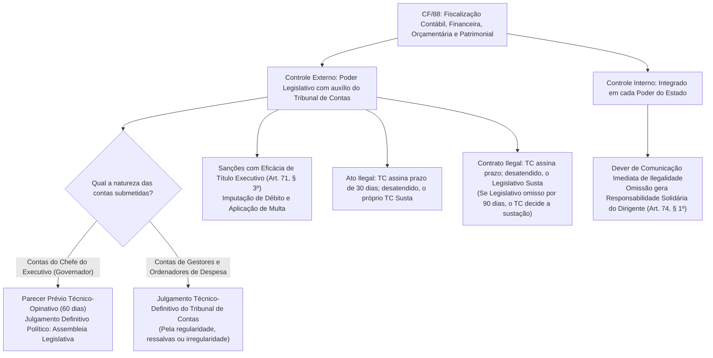
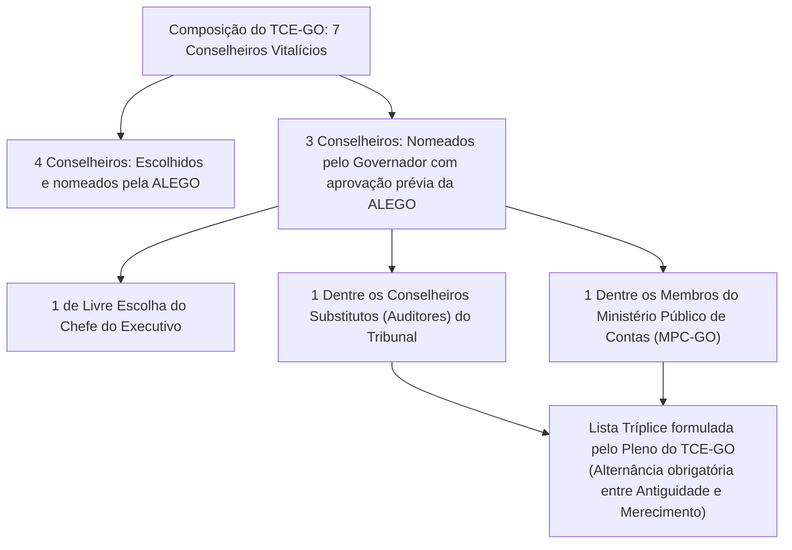

# 01 - Bases Constitucionais do Controle Externo (CF/88 e CE/GO)

> **Matéria:** Legislação Institucional  
> **Cargos:** A01 – Técnico de Controle Externo (Adm) / B02 – Técnico de Controle Externo (TI)  
> **Arquivo:** `01_bases_constitucionais_cf88_e_ce_go.md`  
> **Atos Normativos:** CF/88 (Arts. 37 a 41 e 70 a 75) e Constituição do Estado de Goiás (Arts. 26 a 33)

---

## 📌 Ementa / Itens do Edital
- Constituição da República Federativa do Brasil de 1988:
    - Administração Pública: disposições gerais (Art. 37); princípios expressos e implícitos; investidura em cargo ou emprego público (concurso público, prazos e direitos do aprovado); regime de subsídios, remuneração e teto constitucional (subtetos estaduais); acumulação remunerada de cargos públicos; direito de greve e livre associação sindical;
    - Servidores Públicos civis (Arts. 38 a 41): direitos funcionais, exercício de mandato eletivo, estabilidade após três anos de efetivo exercício, avaliação especial de desempenho e hipóteses taxativas de perda do cargo do servidor estável;
    - Responsabilidade civil do Estado (Art. 37, § 6º): Teoria do Risco Administrativo, responsabilidade objetiva da Administração e das concessionárias, excludentes e atenuantes de responsabilidade, e ação regressiva subjetiva contra o agente público causador do dano;
    - Fiscalização contábil, financeira, orçamentária, operacional e patrimonial (Arts. 70 e 71): controle externo e controle interno; sujeição subjetiva ao dever de prestar contas;
    - Competências constitucionais dos Tribunais de Contas: apreciação de contas do Chefe do Poder Executivo vs. julgamento técnico de contas dos ordenadores de despesas; exame de atos de admissão de pessoal e concessão inicial de aposentadorias/pensões (ato complexo); medidas saneadoras e sustação de atos administrativos; rito constitucional para sustação de contratos administrativos e intervenção subsidiária; eficácia executiva das decisões condenatórias (título executivo extrajudicial - Art. 71, § 3º);
    - Sistema de Controle Interno de cada Poder (Art. 74): finalidades, apoio ao controle externo e dever de comunicação sob pena de responsabilidade solidária;
    - Princípio da Simetria Constitucional (Art. 75): aplicação obrigatória do modelo federal de fiscalização e composição aos Tribunais de Contas dos Estados, DF e Municípios;
- Constituição do Estado de Goiás (Arts. 26 a 33):
    - Disposições relativas ao Tribunal de Contas do Estado de Goiás (TCE-GO): natureza jurídica, sede, jurisdição, autonomia institucional, funcional, administrativa e orçamentária;
    - Composição do TCE-GO: os 7 Conselheiros e as regras rígidas de indicação e nomeação (4 pela Assembleia Legislativa de Goiás - ALEGO e 3 pelo Governador do Estado com aprovação legislativa);
    - Vagas técnicas privativas do Governador: rodízio entre Conselheiros Substitutos (Auditores) e Membros do Ministério Público de Contas (MPC-GO);
    - Requisitos constitucionais para nomeação de Conselheiro: idade (entre 35 e 70 anos), idoneidade moral, reputação ilibada, notório saber e mais de 10 anos de exercício de função;
    - Garantias, prerrogativas, vencimentos e vedações dos Conselheiros (equiparadas às dos Desembargadores do Tribunal de Justiça do Estado de Goiás - TJ-GO);
    - Competências específicas na Carta Estadual e prazos de apreciação de contas do Governador (60 dias contados do recebimento).

---

## 🧭 Sumário

1. [Regime Constitucional da Administração Pública (CF/88, Arts. 37 a 41)](#1-regime-constitucional-da-administracao-publica-cf88-arts-37-a-41)
    1. [Princípios Constitucionais Expressos e Implícitos](#11-principios-constitucionais-expressos-e-implicitos)
    2. [Provimento de Cargos, Concurso Público e Prazos](#12-provimento-de-cargos-concurso-publico-e-prazos)
    3. [Regime Remuneratório, Subsídios e Tetos Constitucionais](#13-regime-remuneratorio-subsidios-e-tetos-constitucionais)
    4. [Acumulação Remunerada de Cargos Públicos](#14-acumulacao-remunerada-de-cargos-publicos)
    5. [Exercício de Mandato Eletivo pelo Servidor Público (Art. 38)](#15-exercicio-de-mandato-eletivo-pelo-servidor-publico-art-38)
    6. [Estabilidade Constitucional e Hipóteses Taxativas de Perda do Cargo](#16-estabilidade-constitucional-e-hipoteses-taxativas-de-perda-do-cargo)
    7. [Responsabilidade Civil Objetiva do Estado e Ação Regressiva](#17-responsabilidade-civil-objetiva-do-estado-e-acao-regressiva)
    8. [Teste 122](#Teste-122)
    9. [Teste 123](#Teste-123)
    10. [Teste 124](#Teste-124)
2. [Fiscalização e Controle na CF/88 (Arts. 70 a 75)](#2-fiscalizacao-e-controle-na-cf88-arts-70-a-75)
    1. [Abrangência Material e Sujeição Subjetiva ao Dever de Prestar Contas](#21-abrangencia-material-e-sujeicao-subjetiva-ao-dever-de-prestar-contas)
    2. [Competências dos Tribunais de Contas: Contas de Governo vs. Contas de Gestão](#22-competencias-dos-tribunais-de-contas-contas-de-governo-vs-contas-de-gestao)
    3. [Fiscalização de Atos de Pessoal e Registro de Aposentadorias e Pensões](#23-fiscalizacao-de-atos-de-pessoal-e-registro-de-aposentadorias-e-pensoes)
    4. [Rito Constitucional de Sustação de Atos e Contratos Administrativos](#24-rito-constitucional-de-sustacao-de-atos-e-contratos-administrativos)
    5. [Eficácia Executiva das Decisões Condenatórias e Prescrição](#25-eficacia-executiva-das-decisoes-condenatorias-e-prescricao)
    6. [Sistema Integrado de Controle Interno e Responsabilidade Solidária (Art. 74)](#26-sistema-integrado-de-controle-interno-e-responsabilidade-solidaria-art-74)
    7. [Princípio da Simetria Constitucional Obrigatória (Art. 75)](#27-principio-da-simetria-constitucional-obrigatoria-art-75)
    8. [Teste 125](#Teste-125)
    9. [Teste 126](#Teste-126)
    10. [Teste 127](#Teste-127)
    11. [Teste 128](#Teste-128)
3. [O Tribunal de Contas do Estado de Goiás na CE/GO (Arts. 26 a 33)](#3-o-tribunal-de-contas-do-estado-de-goias-na-cego-arts-26-a-33)
    1. [Natureza Jurídica, Jurisdição e Autonomias Constitucionais](#31-natureza-juridica-jurisdicao-e-autonomias-constitucionais)
    2. [Composição e Escolha dos 7 Conselheiros do TCE-GO](#32-composicao-e-escolha-dos-7-conselheiros-do-tce-go)
    3. [Requisitos Constitucionais para a Investidura de Conselheiro](#33-requisitos-constitucionais-para-a-investidura-de-conselheiro)
    4. [Estatuto dos Conselheiros: Garantias, Prerrogativas, Vedações e Foro](#34-estatuto-dos-conselheiros-garantias-prerrogativas-vedacoes-e-foro)
    5. [Ministério Público de Contas de Goiás (Art. 30 da CE/GO)](#35-ministerio-publico-de-contas-de-goias-art-30-da-cego)
    6. [Competências Específicas na Carta Estadual e Prazos Regimentais](#36-competencias-especificas-na-carta-estadual-e-prazos-regimentais)
    7. [Teste 129](#Teste-129)
    8. [Teste 130](#Teste-130)
    9. [Teste 131](#Teste-131)
4. [Fontes Oficiais e Referências Bibliográficas](#4-fontes-oficiais-e-referencias-bibliograficas)

---

## 1. Regime Constitucional da Administração Pública (CF/88, Arts. 37 a 41)

### 1.1 Princípios Constitucionais Expressos e Implícitos
O artigo 37, *caput*, da Constituição da República de 1988 estabelece que a Administração Pública direta e indireta de qualquer dos Poderes da União, dos Estados, do Distrito Federal e dos Municípios obedecerá aos princípios de legalidade, impessoalidade, moralidade, publicidade e eficiência (mnemônico clássico **LIMPE**), além de princípios implícitos densificados pela doutrina e pela jurisprudência dos Tribunais Superiores.

1. **Princípio da Legalidade:** No Direito Administrativo, a legalidade adquire feição estrita (princípio da subordinação à lei). Enquanto o particular no regime privado goza de autonomia da vontade — podendo fazer tudo o que a lei não proíbe (Art. 5º, II da CF) —, o administrador público só tem permissão para praticar atos expressamente autorizados ou determinados em lei. Qualquer atuação estatal fora do balizamento normativo configura abuso de poder e ilegalidade insanável.
2. **Princípio da Impessoalidade:** Exige que a atividade administrativa seja orientada exclusivamente ao interesse público, sendo vedada a perseguição de inimigos ou o privilégio indevido de amigos e aliados políticos. Desdobra-se decisivamente no **Art. 37, § 1º da CF/88**: a publicidade dos atos, programas, obras, serviços e campanhas dos órgãos públicos deve possuir caráter estritamente educativo, informativo ou de orientação social, dela **não podendo constar nomes, símbolos ou imagens que caracterizem promoção pessoal** de autoridades ou servidores públicos.
3. **Princípio da Moralidade:** Exige conduta ética, lealdade institucional, boa-fé e probidade na gestão dos recursos públicos. A ofensa à moralidade prescinde de prova de violação frontal à letra fria da lei; o ato administrativo imoral é nulo e passível de desconstituição pelo Poder Judiciário por meio de **Ação Popular** (Art. 5º, LXXIII da CF) e sancionamento via Ação de Improbidade Administrativa (Lei nº 8.429/1992).
4. **Princípio da Publicidade:** A regra geral republicana é a absoluta transparência dos atos administrativos para assegurar a sua eficácia externa e possibilitar o controle social e institucional. As únicas exceções constitucionalmente toleradas decorrem de imperativos de **segurança da sociedade e do Estado** ou de preservação da **intimidade, honra e vida privada** das pessoas (Art. 5º, X e XXXIII).
5. **Princípio da Eficiência:** Inserido pela Emenda Constitucional nº 19/1998, traduz o modelo de Administração Pública Gerencial. Impõe aos órgãos e agentes a busca contínua por resultados de qualidade, economicidade, rendimento funcional, combate a desperdícios e celeridade nos serviços postos à disposição do cidadão.
6. **Princípios Implícitos Relevantes:**
    - **Autotutela (Súmulas 346 e 473 do STF):** A Administração Pública tem o poder-dever de **anular** seus próprios atos quando eivados de vício de ilegalidade (porque de atos ilegais não se originam direitos), e de **revogá-los** por razões de conveniência e oportunidade, resguardados os direitos adquiridos e assegurada a ampla defesa quando houver reflexo em interesses individuais.
    - **Razoabilidade e Proporcionalidade:** Proíbem a imposição de restrições ou sanções em medida superior à estritamente necessária para o atendimento do interesse público (vedação ao excesso).
    - **Motivação:** Dever funcional de explicitar os fundamentos de fato e de direito que justificaram a prática do ato administrativo.

> 🚨 **ALERTA DE PROVA / PEGADINHA FCC:** A banca FCC frequentemente tenta confundir os desdobramentos de *Impessoalidade* e *Moralidade*. A veiculação de foto, slogan ou nome de prefeito/governador em placas de obras públicas é expressamente uma violação da regra constitucional de **impessoalidade** (Art. 37, § 1º), ainda que também afronte a moralidade. Lembre-se ainda de que o princípio da *Eficiência* não constava no texto original de 1988; foi introduzido formalmente pela EC 19/1998.

### 1.2 Provimento de Cargos, Concurso Público e Prazos
A investidura em cargo ou emprego público depende de aprovação prévia em **concurso público de provas ou de provas e títulos**, consoante a complexidade e a natureza do cargo (Art. 37, II da CF).

- **Prazos de Validade (Art. 37, III):** O prazo de validade do concurso será de **até dois anos**, prorrogável uma única vez, por igual período. A prorrogação constitui ato discricionário da Administração, devendo ocorrer impreterivelmente dentro do prazo de vigência original.
- **Direito Subjetivo à Nomeação:** O STF fixou a tese com repercussão geral (**Tema 161 - RE 598.099**) segundo a qual o candidato aprovado **dentro do número de vagas** expressamente previsto no edital possui direito público subjetivo à nomeação durante o prazo de vigência do certame, salvo situações excepcionalíssimas caracterizadas por superveniência, imprevisibilidade, gravidade e necessidade coletiva inadiável.
- **Cargos em Comissão vs. Funções de Confiança (Art. 37, V):**
    - **Funções de Confiança:** Destinadas exclusivamente a servidores ocupantes de cargo efetivo.
    - **Cargos em Comissão:** De livre nomeação e livre exoneração (*ad nutum*), preenchidos por servidores de carreira nos casos, condições e percentuais mínimos fixados em lei, e por pessoas sem vínculo prévio com a Administração.
    - **Restrição Material Rígida:** Tanto os cargos em comissão quanto as funções de confiança destinam-se **apenas às atribuições de direção, chefia e assessoramento**. A criação por lei de cargos comissionados para atividades rotineiras, burocráticas, meramente técnicas ou operacionais é formalmente **inconstitucional** (Tema 1010 do STF).

### 1.3 Regime Remuneratório, Subsídios e Tetos Constitucionais
A remuneração dos servidores públicos e os subsídios dos agentes políticos submetem-se ao teto remuneratório geral estabelecido no artigo 37, XI, da Carta Magna, cujo limite máximo federal corresponde ao **subsídio mensal dos Ministros do Supremo Tribunal Federal (STF)**.

Nos Estados-membros, adota-se o regime de subtetos por Poder, salvo se houver emenda estadual instituindo subteto único:

- **Poder Executivo:** Subsídio mensal do Governador do Estado.
- **Poder Legislativo:** Subsídio mensal dos Deputados Estaduais.
- **Poder Judiciário, Ministério Público, Defensoria Pública e TRIBUNAIS DE CONTAS:** Subsídio mensal dos Desembargadores do Tribunal de Justiça do Estado (limitado a 90,25% do subsídio dos Ministros do STF).

> 📌 **NOTA EXPLICATIVA / TETO NA ACUMULAÇÃO LÍCITA:** Conforme julgamento dos **Temas 377 e 384 de Repercussão Geral do STF**, nos casos autorizados constitucionalmente de acumulação de cargos, o teto remuneratório incide sobre a **remuneração de cada cargo ou vínculo isoladamente considerado**, e não sobre o somatório dos rendimentos percebidos pelo agente.

### 1.4 Acumulação Remunerada de Cargos Públicos
A regra republicana insculpida no artigo 37, XVI e XVII, da CF/88 é a **vedação absoluta** da acumulação remunerada de cargos, empregos ou funções públicas na Administração direta, autárquica, fundacional, empresas públicas e sociedades de economia mista.

A Constituição autoriza apenas três hipóteses taxativas e excepcionais de acumulação, **desde que haja imperativa compatibilidade de horários**:

1. A de dois cargos de **professor**;
2. A de um cargo de **professor** com outro **técnico ou científico**;
3. A de dois cargos ou empregos privativos de **profissionais de saúde**, com profissões regulamentadas.

> ⭐ **IMPORTANTE / CONCEITO DE CARGO TÉCNICO:** O Superior Tribunal de Justiça (STJ) pacificou que "cargo técnico ou científico" para efeito de acumulação constitucional é aquele para cujo exercício sejam exigidos conhecimentos específicos em nível superior ou formação profissionalizante de ensino médio, não se enquadrando funções meramente administrativas ou de suporte genérico.

### 1.5 Exercício de Mandato Eletivo pelo Servidor Público (Art. 38)
Ao servidor público da administração direta, autárquica e fundacional no exercício de mandato eletivo aplicam-se as disposições expressas do artigo 38 da CF/88:

| Mandato Eletivo Conquistado | Afastamento do Cargo Efetivo | Regra de Remuneração / Opção | Tempo de Serviço e Benefícios |
| :--- | :--- | :--- | :--- |
| **Federal, Estadual ou Distrital** (Deputado, Senador) | **Afastamento obrigatório** do cargo, emprego ou função. | Recebe o subsídio do mandato político (não há faculdade de opção). | Conta para todos os efeitos legais, salvo promoção por merecimento. |
| **Prefeito Municipal** (ou Vice-Prefeito em exercício executivo) | **Afastamento obrigatório** do cargo, emprego ou função. | **Facultado optar** pela remuneração do cargo efetivo ou pelo subsídio de Prefeito. | Conta para todos os efeitos legais, salvo promoção por merecimento. |
| **Vereador Municipal** | - **Havendo compatibilidade:** NÃO se afasta. - **Sem compatibilidade:** Afasta-se do cargo efetivo. | - *Com compatibilidade:* Percebe as vantagens de seu cargo **acumuladas** com o subsídio de vereador. - *Sem compatibilidade:* Aplica-se a regra de Prefeito (afasta-se e opta). | Mantém filiação previdenciária original e cômputo de tempo de serviço. |

---

### 1.6 Estabilidade Constitucional e Hipóteses Taxativas de Perda do Cargo
Nos moldes do artigo 41 da CF/88, adquire estabilidade após **três anos de efetivo exercício** o servidor público nomeado para cargo de provimento efetivo em virtude de aprovação em concurso público. 

É condição obrigatória e indispensável para a consolidação da estabilidade a aprovação prévia em **avaliação especial de desempenho**, realizada por comissão especificamente instituída.

O servidor público estável somente perderá o cargo público nas seguintes **quatro hipóteses taxativas**:

1. **Sentença judicial transitada em julgado** (não cabe perda por decisão de primeira instância pendente de recurso);
2. **Processo administrativo disciplinar (PAD)** no qual lhe seja formalmente assegurada a ampla defesa e o contraditório;
3. **Procedimento de avaliação periódica de desempenho**, na forma de **lei complementar**, assegurada ampla defesa;
4. **Excesso de despesa com pessoal (Art. 169, § 4º da CF/88):** Caso as despesas de pessoal superem os limites da Lei de Responsabilidade Fiscal e as medidas preliminares obrigatórias (redução de pelo menos 20% das despesas com comissionados e exoneração de todos os servidores não estáveis) se revelem insuficientes, o servidor estável poderá ser exonerado, fazendo jus a uma indenização equivalente a 1 (um) mês de remuneração por ano de serviço prestado.

> 🚨 **ALERTA DE PROVA / PEGADINHA FCC:** Questões da FCC frequentemente tentam enganar o candidato afirmando que o servidor estável "somente perde o cargo por sentença transitada em julgado ou PAD". Essa assertiva está **INCORRETA** porque ignora as duas outras vias constitucionais expressas: a avaliação periódica de desempenho e o corte por despesa excessiva do art. 169. Fique atento à presença de termos restritivos como "apenas" e "somente".

### 1.7 Responsabilidade Civil Objetiva do Estado e Ação Regressiva
O artigo 37, § 6º, da CF/88 estabelece a **responsabilidade civil extracontratual do Estado** adotando a **Teoria do Risco Administrativo**:

$$\text{Ato Administrativo (Comissivo)} + \text{Dano Efetivo} + \text{Nexo Causal} \Longrightarrow \text{Dever de Indenizar (Responsabilidade Objetiva)}$$

- **Abrangência Subjetiva:** Submetem-se ao regime da responsabilidade objetiva:
    - As pessoas jurídicas de direito público (União, Estados, DF, Municípios, Autarquias e Fundações Públicas de direito público);
    - As pessoas jurídicas de direito privado **prestadoras de serviços públicos** (empresas públicas, sociedades de economia mista prestadoras, concessionárias e permissionárias de serviço público), relativamente a danos causados a usuários e a não usuários do serviço.
- **Excludentes e Atenuantes do Nexo Causal:** O rompimento do nexo de causalidade afasta a responsabilidade do Estado nas hipóteses de **culpa exclusiva da vítima**, **caso fortuito absoluto** ou **força maior**. Havendo culpa concorrente da vítima, a obrigação de indenizar é mitigada proporcionalmente (atenuante).
- **Ação Regressiva do Estado:** Caso o Estado seja condenado a indenizar a vítima, ele detém o direito/dever de ajuizar **ação de regresso** em desfavor do servidor público causador direto do dano. A responsabilidade do servidor é puramente **subjetiva**, exigindo-se prova irrefutável de que ele agiu com **dolo ou culpa**.
- **Tema 940 do STF (Tese Vinculante - RE 1.027.633):** A ação indenizatória por danos causados por agente público no exercício de suas funções deve ser proposta **exclusivamente em face da pessoa jurídica de direito público ou da concessionária**, sendo inadmissível o ajuizamento da ação diretamente contra o agente público ou a sua inclusão no polo passivo mediante litisconsórcio passivo facultativo.

---

### Teste 122
**(Questão Inédita / Simulada Estilo FCC – Nível: Controle Externo / TI)**  
Nos termos do artigo 37, inciso XVI, e do artigo 38 da Constituição Federal de 1988, a respeito da acumulação remunerada de cargos públicos e do exercício de mandato eletivo por servidor público:

* **A)** É permitida a acumulação remunerada de três cargos de professor, desde que comprovada a compatibilidade de horários.
* **B)** É constitucional a acumulação remunerada de dois cargos privativos de profissionais de saúde, com profissões regulamentadas, havendo compatibilidade de horários, independentemente de teto remuneratório.
* **C)** O servidor público investido no mandato de Prefeito será afastado do cargo efetivo, sendo-lhe facultado optar pela sua remuneração de origem.
* **D)** O servidor público investido no mandato de Vereador deverá ser compulsoriamente afastado de seu cargo efetivo, sem direito a optar pelo subsídio do mandato legislativo.
* **E)** É vedada em qualquer hipótese a acumulação de um cargo de professor com outro técnico ou científico.

---

> **Comentário Detalhado:**
>
> - **A)** Incorreta. A regra do art. 37, XVI, "a", autoriza a acumulação de **dois** cargos de professor (e não três), desde que haja compatibilidade de horários.
> - **B)** Incorreta. Embora seja lícita a acumulação de dois cargos de profissionais de saúde (art. 37, XVI, "c"), a remuneração cumulada submete-se ao teto constitucional (STF, Temas 377 e 384: o teto incide isoladamente sobre cada vínculo, mas não há dispensa de teto).
> - **C)** Correta. De acordo com o art. 38, inciso II, da CF/88: *"investido no mandato de Prefeito, será afastado do cargo, emprego ou função, sendo-lhe facultado optar pela sua remuneração"*. O afastamento funcional é obrigatório, mas a opção remuneratória é prerrogativa expressa do servidor.
> - **D)** Incorreta. Para o mandato de Vereador (art. 38, III), havendo compatibilidade de horários, o servidor perceberá as vantagens de seu cargo cumulativamente com a remuneração do cargo eletivo. Se não houver compatibilidade, aplica-se a regra do prefeito.
> - **E)** Incorreta. A acumulação de um cargo de professor com outro técnico ou científico é expressamente autorizada pela CF/88 (art. 37, XVI, "b").
>
> **Gabarito: C**

---

### Teste 123
**(Questão Inédita / Simulada Estilo FCC – Nível: Controle Externo / TI)**  
Acerca do regime constitucional dos servidores públicos civis (artigos 37 a 41 da CF/88) e da responsabilidade civil do Estado, considere as seguintes afirmativas:

I. O servidor público estável somente perderá o cargo em virtude de sentença judicial transitada em julgado ou mediante processo administrativo disciplinar no qual lhe seja assegurada ampla defesa, inexistindo qualquer outra hipótese constitucional de perda de cargo.  

II. O direito de regresso da Administração Pública contra o servidor público causador de dano a terceiro exige a comprovação de que o agente agiu com dolo ou culpa.  

III. O teto remuneratório constitucional aplica-se ao somatório das remunerações nas hipóteses de acumulação lícita de cargos públicos, devendo o excedente ser retido pelo ente pagador.  

Está correto o que se afirma APENAS em:

* **A)** I.
* **B)** II.
* **C)** III.
* **D)** I e II.
* **E)** II e III.

---

> **Comentário Detalhado:**
>
> - **A) Incorreta.** O item I erra ao asseverar inexistência de outras causas de perda de cargo do servidor estável (existem quatro hipóteses: sentença judicial, PAD, avaliação de desempenho e excesso de despesas de pessoal).
> - **B) CORRETA.** Apenas o item II é verdadeiro, pois a responsabilidade civil do Estado perante terceiros é objetiva, mas a ação regressiva em face do agente público exige comprovação de dolo ou culpa (CF, art. 37, § 6º).
> - **C) Incorreta.** O item III colide com a jurisprudência vinculante do STF (Temas 377 e 384), que impõe a aplicação do teto de forma isolada sobre cada cargo acumulável.
> - **D) Incorreta.** O item I incorre em omissão normativa inconstitucional.
> - **E) Incorreta.** O item III está equivocado ante o entendimento consolidado do STF.
> 
> **Gabarito: B**

---

### Teste 124
**(Questão Inédita / Simulada Estilo FCC – Nível: Controle Externo / TI)**  
Em matéria de responsabilidade civil da Administração Pública (art. 37, § 6º, da CF/88) e atuação de agentes públicos:

* **A)** As pessoas jurídicas de direito público e as de direito privado prestadoras de serviços públicos responderão pelos danos que seus agentes causarem a terceiros com base na teoria da culpa administrativa subjetiva em conformidade com as diretrizes e padrões de arquitetura corporativa.
* **B)** A vítima de um dano causado por viatura oficial em trânsito pode ajuizar ação indenizatória diretamente e com exclusividade em face do servidor causador do acidente.
* **C)** A responsabilidade civil do Estado independe de culpa ou dolo da Administração (responsabilidade objetiva sob a teoria do risco administrativo), assegurado o direito de regresso contra o agente responsável nos casos de dolo ou culpa.
* **D)** O direito de regresso contra o agente público pode ser exercido mesmo que a Administração Pública não comprove dolo ou culpa do servidor.
* **E)** A teoria do risco integral é a regra geral no direito brasileiro, não admitindo excludentes como caso fortuito ou força maior.

---

> **Comentário Detalhado:**
>
> - **A)** Incorreta. A responsabilidade das pessoas de direito público e das prestadoras de serviço público é **objetiva** (teoria do risco administrativo), e não subjetiva.
> - **B)** Incorreta. Conforme jurisprudência vinculante do Supremo Tribunal Federal (Tema 940 de Repercussão Geral - RE 1.027.633): *"A teor do disposto no art. 37, § 6º, da Constituição Federal, a ação por danos causados por agente público deve ser ajuizada contra o Estado ou a pessoa jurídica de direito privado prestadora de serviço público, sendo parte ilegítima para a lide o autor do ato, assegurado o direito de regresso contra o responsável nos casos de dolo ou culpa"*.
> - **C)** Correta. Traduz fielmente a redação do art. 37, § 6º, da CF/88 e a doutrina do Direito Administrativo: a responsabilidade estatal é objetiva (basta conduta estatal, nexo causal e dano), cabendo ação regressiva contra o servidor unicamente se este tiver agido com dolo ou culpa.
> - **D)** Incorreta. Na ação de regresso em face do servidor, a responsabilidade é subjetiva, exigindo a demonstração inequívoca de dolo ou culpa.
> - **E)** Incorreta. A regra adotada é a do **risco administrativo**, que admite atenuantes e excludentes de responsabilidade (culpa exclusiva da vítima, caso fortuito e força maior).
>
> **Gabarito: C**

---

## 2. Fiscalização e Controle na CF/88 (Arts. 70 a 75)

### 2.1 Abrangência Material e Sujeição Subjetiva ao Dever de Prestar Contas
A fiscalização contábil, financeira, orçamentária, operacional e patrimonial dos entes federados quanto à legalidade, legitimidade, economicidade, aplicação de subvenções e renúncia de receitas é exercida pelo Poder Legislativo, mediante controle externo, e pelos sistemas de controle interno integrados de cada Poder (Arts. 70 e 71 da CF).

- **Dever Universal de Prestar Contas (Art. 70, parágrafo único):** Prestará contas qualquer pessoa física ou jurídica, pública ou privada, que utilize, arrecade, guarde, gerencie ou administre dinheiros, bens e valores públicos ou pelos quais o Estado responda, ou que, em nome deste, assuma obrigações de natureza pecuniária.

### 2.2 Competências dos Tribunais de Contas: Contas de Governo vs. Contas de Gestão
A sistemática de julgamento e exame de contas públicas divide-se com rigor constitucional:

1. **Contas de Governo (Chefe do Executivo):** Consistem no balanço geral do Estado e na execução global dos orçamentos (LOA, LDO, PPA). Sobre elas, o Tribunal de Contas **não julga**, mas apenas **aprecia mediante Parecer Prévio opinativo**, emitido no prazo de **60 (sessenta) dias** a contar do seu recebimento. A competência para o julgamento definitivo e político dessas contas é indelegável da **Assembleia Legislativa** (em nível federal, do Congresso Nacional).
2. **Contas de Gestão (Ordenadores de Despesas):** Envolvem os atos concretos de gestão, compras, licitações e liquidação de despesas praticados por secretários de estado, diretores de empresas estatais, presidentes de fundações e quaisquer ordenadores de despesa. O Tribunal de Contas **julga tecnicamente em caráter definitivo**, proferindo decisão que pode declarar a regularidade, regularidade com ressalvas ou irregularidade das contas.

> 📌 **NOTA EXPLICATIVA / SÚMULAS E TEMAS 157 E 835 DO STF:** O Supremo Tribunal Federal pacificou que, para fins de inelegibilidade eleitoral (alínea 'g' do inciso I do art. 1º da LC 64/90), a competência para julgar **todas** as contas prestadas por Prefeito Municipal — tanto as contas de governo quanto as contas de gestão na condição de ordenador — é **exclusiva da Câmara Municipal**, figurando o parecer do Tribunal de Contas como ato opinativo que somente deixará de prevalecer por voto de 2/3 dos vereadores. No entanto, para os **Governadores e Secretários de Estado**, mantém-se a distinção: o TCE emite parecer nas contas anuais do Governador e julga diretamente os Secretários de Estado quando ordenadores.

### 2.3 Fiscalização de Atos de Pessoal e Registro de Aposentadorias e Pensões
Nos termos do artigo 71, III, da CF/88, compete ao Tribunal de Contas apreciar, para fins de registro, a legalidade dos atos de admissão de pessoal (ressalvadas as nomeações para cargo de comissão) e das concessões iniciais de aposentadorias, reformas e pensões.

- **Natureza de Ato Complexo:** O ato de concessão de aposentadoria ou pensão é classificado pelo STF como **ato administrativo complexo**. O ato concessório emitido pelo órgão de origem do servidor é precário e provisório, somente se aperfeiçoando e tornando-se definitivo com o competente exame e registro pelo Tribunal de Contas.
- **Súmula Vinculante nº 3 do STF:** Nos processos perante os Tribunais de Contas que resultem em anulação ou revogação de atos administrativos que beneficiem alguém, são assegurados o contraditório e a ampla defesa, **excetuada a apreciação da legalidade do ato de concessão inicial de aposentadoria, reforma e pensão**.
- **Tema 445 do STF (Marco Temporal de 5 Anos):** Em atenção à segurança jurídica e à confiança legítima, os Tribunais de Contas têm o prazo decadencial de **5 (cinco) anos** para apreciar a legalidade do ato de concessão inicial de aposentadoria ou pensão, contados da data de chegada do processo à Corte de Contas. Passados 5 anos sem homologação, o ato considera-se tacitamente estabilizado para fins de exigência de prévio contraditório perante o servidor jubilado.

---

### 2.4 Rito Constitucional de Sustação de Atos e Contratos Administrativos
A fiscalização corretiva do Tribunal de Contas sobre atos e contratos eivados de ilegalidade segue ritos inteiramente distintos, cobrados com insistência cirúrgica pela banca FCC:

| Categoria Objeto de Ilegalidade | 1º Passo: Fixação de Prazo | Omissão da Administração: Quem Susta Diretamente? | Comunicação / Providência Posterior |
| :--- | :--- | :--- | :--- |
| **Ato Administrativo Ilegal** (Portarias, nomeações, editais de concurso) | O Tribunal de Contas assina prazo de **30 dias** para que o órgão adote as medidas necessárias ao exato cumprimento da lei. | **O próprio TRIBUNAL DE CONTAS susta** diretamente a execução do ato ilegal impugnado. | Comunica a decisão e providência à Assembleia Legislativa. |
| **Contrato Administrativo Ilegal** (Ajuste firmado com terceiro particular) | O Tribunal de Contas assina prazo para a regularização ou anulação do contrato. | A competência originária para sustar a execução do contrato é do **PODER LEGISLATIVO** (Assembleia Legislativa), que solicitará imediatamente ao Executivo as medidas. | Se o Legislativo ou o Executivo **não adotarem as medidas no prazo de 90 dias**, o **próprio TRIBUNAL DE CONTAS decidirá** a respeito da sustação. |

> 🚨 **ALERTA DE PROVA / PEGADINHA FCC:** Grave esta regra com atenção: o Tribunal de Contas **NUNCA susta contratos administrativos de imediato**. A sustação de contrato é primária e privativa do Poder Legislativo. O Tribunal de Contas só ganha competência subsidiária se passarem **90 (noventa) dias** de inércia parlamentar/executiva (Art. 71, § 2º da CF). A FCC costuma tentar induzir o candidato ao erro trocando 90 dias por 30 ou 60 dias!

### 2.5 Eficácia Executiva das Decisões Condenatórias e Prescrição
Conforme prescreve o artigo 71, § 3º, da Carta Federal, as decisões do Tribunal de Contas de que resulte imputação de **débito** (reparação do erário) ou cominação de **multa** têm **eficácia de título executivo extrajudicial**.

- **Legitimidade para Execução:** O Tribunal de Contas não é pessoa jurídica e não possui capacidade processual contenciosa para ajuizar execução de suas decisões em juízo. A legitimação ativa para a execução fiscal pertence à **Fazenda Pública credora** (em Goiás, o Estado de Goiás, representado pela Procuradoria-Geral do Estado - PGE-GO; ou o Município, se a condenação envolver verbas municipais).
- **Destinação das Multas:** Os valores arrecadados a título de multa por condenação proferida pelo TCE revertem aos cofres do ente federativo a que o Tribunal está vinculado (ou a fundos específicos legalmente instituídos para aperfeiçoamento institucional do órgão de controle).
- **Tema 899 do STF (Prescritibilidade da Execução de Decisões de TC):** Ao fixar tese no RE 636.886, o Supremo Tribunal Federal assentou que: *"É prescritível a pretensão de ressarcimento ao erário fundada em decisão de Tribunal de Contas"*, aplicando-se o **prazo prescricional quinquenal (5 anos)** da Lei de Execuções Fiscais e do Decreto nº 20.910/1932.

---

### 2.6 Sistema Integrado de Controle Interno e Responsabilidade Solidária (Art. 74)
Os Poderes Legislativo, Executivo e Judiciário manterão, de forma integrada, sistema de controle interno com as finalidades constitucionais de:

1. Avaliar o cumprimento das metas previstas no plano plurianual e a execução dos programas de governo e dos orçamentos;
2. Comprovar a legalidade e avaliar os resultados, quanto à eficácia e eficiência, da gestão orçamentária, financeira e patrimonial nos órgãos e entidades da administração;
3. Exercer o controle das operações de crédito, avais e garantias, bem como dos direitos e haveres do Estado;
4. Apoiar o controle externo no exercício de sua missão institucional.

> 🚨 **ALERTA DE PROVA / DEVER DE CIÊNCIA E SOLIDARIEDADE:** O artigo 74, § 1º, da CF/88 impõe aos responsáveis pelo controle interno uma obrigação de alerta cogente: ao tomarem conhecimento de qualquer irregularidade ou ilegalidade, **devem dela dar ciência imediata ao Tribunal de Contas**, sob pena de **responsabilidade solidária**. Ou seja, a omissão do chefe de auditoria ou controlador interno atrai a sua responsabilização pessoal pelo dano verificado!

### 2.7 Princípio da Simetria Constitucional Obrigatória (Art. 75)
O artigo 75 da Constituição de 1988 positiva o princípio da simetria federativa: as normas relativas à fiscalização contábil, financeira, orçamentária, operacional e patrimonial estabelecidas para a União (arts. 70 a 74) **aplicam-se obrigatoriamente à organização, composição e fiscalização dos Tribunais de Contas dos Estados e do Distrito Federal, bem como aos Tribunais e Conselhos de Contas dos Municípios**.
Qualquer tentativa das Constituições Estaduais de inovar, restringir competências fiscalizatórias ou alterar a fórmula de composição dos Tribunais de Contas padece de vício de inconstitucionalidade material e formal.

---

### Teste 125
**(Questão Inédita / Simulada Estilo FCC – Nível: Controle Externo / TI)**  
No tocante ao controle externo exercido pelo Tribunal de Contas sobre os atos de pessoal e concessão de benefícios previdenciários (art. 71, III, da CF/88):

* **A)** O registro de aposentadorias, reformas e pensões pelos Tribunais de Contas é ato meramente homologatório, não podendo a Corte de Contas recusar registro fundado em ilegalidade.
* **B)** O procedimento de registro inicial de aposentadoria no Tribunal de Contas prescinde do contraditório e da ampla defesa, desde que a análise seja concluída no prazo de 5 anos a contar da chegada do processo à Corte.
* **C)** A Súmula Vinculante nº 3 do STF estabelece que o contraditório e a ampla defesa são sempre obrigatórios na apreciação da legalidade do ato de concessão inicial de aposentadoria, independentemente do tempo decorrido.
* **D)** A nomeação para cargo em comissão de livre nomeação e exoneração está sujeita a registro prévio e obrigatório pelo Tribunal de Contas perante o qual atua o órgão.
* **E)** Decorrido o prazo de 10 anos sem manifestação do Tribunal de Contas, o ato de aposentadoria é sumariamente anulado por decurso de prazo.

---

> **Comentário Detalhado:**
>
> - **A)** Incorreta. O exame de legalidade para fins de registro é ato complexo e dotado de densidade fiscalizatória plena; se houver ilegalidade, o Tribunal de Contas nega o registro e determina a cessação dos pagamentos indevidos.
> - **B)** Correta. A Súmula Vinculante nº 3 do STF estabelece expressamente: *"Nos processos perante o Tribunal de Contas da União asseguram-se o contraditório e a ampla defesa quando da decisão puder resultar anulação ou revogação de ato administrativo que beneficie o interessado, **excetuada a apreciação da legalidade do ato de concessão inicial de aposentadoria, reforma e pensão**"*. Todavia, segundo tese de Repercussão Geral fixada pelo STF (Tema 445 - RE 636.553), ultrapassado o prazo de 5 anos a contar da chegada do processo ao TC sem decisão, o ato é tacitamente estabilizado, exigindo a partir de então prévio contraditório.
> - **C)** Incorreta. A SV 3 excetua expressamente a apreciação da concessão inicial.
> - **D)** Incorreta. O art. 71, III, da CF/88 ressalva taxativamente as nomeações para cargo de provimento em comissão da obrigatoriedade de registro no Tribunal de Contas.
> - **E)** Incorreta. Não há anulação sumária por decurso de prazo; ultrapassados 5 anos sem julgamento, opera-se o direito ao contraditório antes de eventual revisão.
>
> **Gabarito: B**

---

### Teste 126
**(Questão Inédita / Simulada Estilo FCC – Nível: Controle Externo / TI)**  
Sobre o rito constitucional de fiscalização e sustação de atos e contratos administrativos disciplinado no artigo 71, incisos IX a XI e §§ 1º e 2º, da Constituição Federal:

* **A)** Tanto a sustação de ato administrativo quanto a de contrato administrativo são atos privativos de competência originária e direta do Tribunal de Contas.
* **B)** No caso de contrato administrativo com irregularidade grave, a competência para a sustação é primariamente do Congresso Nacional (ou Assembleia Legislativa), cabendo ao Tribunal de Contas decidir sobre a sustação caso o Poder Legislativo não se manifeste no prazo de 90 dias.
* **C)** O Tribunal de Contas pode sustar imediatamente um contrato administrativo sem necessidade de qualquer prévia comunicação ao Poder Legislativo ou ao Poder Executivo. em conformidade com as diretrizes e padrões de arquitetura corporativa.
* **D)** A sustação de ato administrativo impugnado pelo Tribunal de Contas depende sempre de prévia autorização da Assembleia Legislativa.
* **E)** Se o Poder Legislativo sustar o contrato, o Tribunal de Contas deverá anular a decisão parlamentar no prazo de 30 dias.

---

> **Comentário Detalhado:**
>
> - **A)** Incorreta. O regime constitucional é diferenciado: o Tribunal de Contas susta diretamente os **atos** administrativos (art. 71, X); mas a sustação de **contratos** administrativos é prerrogativa primária do Poder Legislativo (art. 71, § 1º).
> - **B)** Correta. Trata-se da clássica pegadinha do art. 71, §§ 1º e 2º, da CF/88:  
>   - *§ 1º:* No caso de contrato, o ato de sustação será adotado diretamente pelo Congresso Nacional (ou Assembleia Legislativa), que solicitará, de imediato, ao Poder Executivo as medidas cabíveis.  
>   - *§ 2º:* Se o Congresso Nacional (ou o Poder Executivo) não efetivar as medidas no prazo de **90 dias**, o Tribunal de Contas decidirá a respeito da sustação do contrato.
> - **C)** Incorreta. O TC só assume a competência supletiva de sustar o contrato após a inércia parlamentar pelo prazo de 90 dias.
> - **D)** Incorreta. A sustação de ato administrativo é executada diretamente pelo Tribunal de Contas (art. 71, X).
> - **E)** Incorreta. O TC não anula decisões do Poder Legislativo sobre sustação de contratos; quem exerce o controle jurisdicional de constitucionalidade é o Poder Judiciário.
>
> **Gabarito: B**

---

### Teste 127
**(Questão Inédita / Simulada Estilo FCC – Nível: Controle Externo / TI)**  
Nos termos do artigo 74 da Constituição Federal de 1988, os responsáveis pelo sistema de controle interno integrado dos Poderes Executivo, Legislativo e Judiciário têm a obrigação constitucional de:

* **A)** Homologar judicialmente as decisões condenatórias exaradas pelo Tribunal de Contas no prazo improrrogável de quinze dias.
* **B)** Assinar prazo para anulação de leis estaduais que contrariem as metas fiscais da Lei de Diretrizes Orçamentárias.
* **C)** Dar ciência imediata ao Tribunal de Contas de qualquer irregularidade ou ilegalidade de que tomarem conhecimento na gestão pública, sob pena de responsabilidade solidária.
* **D)** Substituir o Tribunal de Contas no julgamento das contas anuais dos secretários de Estado e dirigentes autárquicos.
* **E)** Exercer privativamente a representação judicial dos Conselheiros do Tribunal de Contas perante os órgãos de cúpula do Poder Judiciário em conformidade com as diretrizes e padrões de arquitetura corporativa.

---

> **Comentário Detalhado:**
>
> - **A) Incorreta.** Decisões de Tribunais de Contas que imputam débito ou multa possuem eficácia imediata de título executivo extrajudicial por mandamento constitucional (Art. 71, § 3º), dispensando qualquer homologação de controle interno ou judicial prévia.
> - **B) Incorreta.** O controle de constitucionalidade de leis é atribuição privativa do Poder Judiciário; os órgãos de controle interno não detêm competência para assinar prazos com vistas à anulação de leis.
> - **C) CORRETA.** O artigo 74, § 1º, da CF/88 prescreve categoricamente: *"Os responsáveis pelo controle interno, ao tomarem conhecimento de qualquer irregularidade ou ilegalidade, dela darão ciência ao Tribunal de Contas da União [e do Estado por simetria], sob pena de responsabilidade solidária"*.
> - **D) Incorreta.** O julgamento de contas de gestão de secretários e ordenadores de despesas constitui competência técnica privativa do próprio Tribunal de Contas (Art. 71, II da CF).
> - **E) Incorreta.** O controle interno não exerce representação judicial contenciosa de Conselheiros, atuando estritamente na fiscalização administrativa e operacional.
> 
> **Gabarito: C**

---

### Teste 128
**(FGV – TCE-GO – Analista de Controle Externo – 2024)**  
A Constituição do Estado de Goiás estabelece a atuação político -

administrativa no estado.

Sobre o TCE-GO, analise os itens a seguir:

I. Os cargos de Procurador de Contas integram quadro próprio

do TCE-GO;

II. O TCE -GO, integrado por cinco conselheiros, tem sede na

Capital, quadro próprio de pessoal e jurisdição em todo o

território estadual;

III. Os Conselheiros do TCE -GO têm as mesmas garant ias,

prerrogativas, impedimentos, vencimentos e vantagens dos

Desembargadores do Tribunal de Justiça.

Está correto o que se afirma em

* **A)** I, apenas.
* **B)** I e II, apenas.
* **C)** I e III, apenas.
* **D)** II e III, apenas.
* **E)** I, II e III.

---

> **Comentário Detalhado:**
>
> - **A)** Incorreta. O item III também está correto nos termos do art. 28 da Constituição do Estado de Goiás.
> - **B)** Incorreta. O item II está falso, pois o TCE-GO é composto por sete conselheiros e não cinco.
> - **C)** Correta. Analisando as proposições à luz da Constituição Estadual de Goiás: I está CORRETO (o Ministério Público de Contas atua junto ao TCE-GO e integra seu quadro institucional, art. 31 da CE/GO); II está INCORRETO (o TCE-GO é integrado por 7 Conselheiros, conforme o princípio da simetria com o TCU e art. 27 da CE-GO, e não por cinco); III está CORRETO (os Conselheiros do TCE-GO possuem as mesmas garantias, prerrogativas, impedimentos, vencimentos e vantagens dos Desembargadores do TJ-GO, conforme art. 28 da CE-GO). Logo, apenas I e III são verdadeiros.
> - **D)** Incorreta. O item II é flagrantemente falso quanto ao número de conselheiros.
> - **E)** Incorreta. O item II invalida a alternativa.
>
> **Gabarito: C**

---

## 3. O Tribunal de Contas do Estado de Goiás na CE/GO (Arts. 26 a 33)

### 3.1 Natureza Jurídica, Jurisdição e Autonomias Constitucionais
O Tribunal de Contas do Estado de Goiás (TCE-GO) é órgão público constitucional autônomo, não subordinado nem vinculado hierarquicamente a nenhum dos três Poderes de Estado (Executivo, Legislativo ou Judiciário).

- **Sede e Jurisdição:** Tem sede na capital do Estado (Goiânia) e estende sua jurisdição própria e privativa sobre todas as pessoas, órgãos e entidades sujeitos à fiscalização orçamentária estadual em todo o território goiano (Art. 26 da CE/GO).
- **Autonomias Constitucionais:** O TCE-GO possui autonomia funcional, administrativa, financeira e orçamentária. Dispõe de autogoverno (eleição de seus dirigentes pelo Tribunal Pleno), iniciativa legislativa reservada para propor a criação de seus cargos e fixação de vencimentos do seu quadro próprio de servidores, e competência para elaborar sua proposta orçamentária anual dentro dos limites das diretrizes orçamentárias.

### 3.2 Composição e Escolha dos 7 Conselheiros do TCE-GO
Nos moldes do artigo 27 da Constituição do Estado de Goiás, em estrita simetria com a CF/88, o TCE-GO é composto por **7 (sete) Conselheiros**, cuja escolha observa o seguinte esquema:

- **4 Conselheiros:** De livre escolha, indicação e nomeação da **Assembleia Legislativa do Estado de Goiás (ALEGO)**;
- **3 Conselheiros:** Nomeados pelo **Governador do Estado**, com prévia aprovação da Assembleia Legislativa após arguição pública (sabatina), sendo:
    - **1 (um)** de livre escolha do Governador do Estado;
    - **1 (um)** escolhido alternadamente dentre os **Conselheiros Substitutos (Auditores)** do Tribunal de Contas, indicados em lista tríplice formulada pelo Pleno, segundo critérios alternados de antiguidade e merecimento;
    - **1 (um)** escolhido alternadamente dentre os membros do **Ministério Público de Contas (MPC-GO)**, indicados em lista tríplice formulada pelo Pleno do Tribunal, também pelos critérios alternados de antiguidade e merecimento.

> 🚨 **ALERTA DE PROVA / PEGADINHA FCC:** Lembre-se de dois números fundamentais: o TCE-GO tem **7 Conselheiros** (o TCU tem 9 Ministros). A Assembleia Legislativa escolhe a MAIORIA (**4 Conselheiros**), e o Governador escolhe a minoria (**3 Conselheiros**), sendo que 2 das vagas do Governador são obrigatoriamente vinculadas à lista tríplice de carreiras técnicas (Auditor e Procurador de Contas).

### 3.3 Requisitos Constitucionais para a Investidura de Conselheiro
O artigo 27, § 1º, da Constituição Estadual elenca de forma taxativa as exigências cumulativas para nomeação como Conselheiro do TCE-GO:

1. **Nacionalidade:** Ser brasileiro (nato ou naturalizado);
2. **Idade Mínima e Máxima:** Contar com mais de **35 (trinta e cinco) anos** e menos de **70 (setenta) anos** de idade na data da investidura;
3. **Moralidade:** Possuir idoneidade moral e reputação ilibada;
4. **Qualificação Profissional:** Comprovar notórios conhecimentos jurídicos, contábeis, econômicos e financeiros ou de administração pública;
5. **Experiência Profissional:** Contar com mais de **10 (dez) anos de efetivo exercício de função** ou de atividade profissional que exija os conhecimentos técnicos exigidos.

### 3.4 Estatuto dos Conselheiros: Garantias, Prerrogativas, Vedações e Foro
O artigo 28 da Carta Estadual estabelece que os Conselheiros do TCE-GO gozam das mesmas garantias, prerrogativas, impedimentos, subsídios e vencimentos atribuídos aos **Desembargadores do Tribunal de Justiça do Estado de Goiás (TJ-GO)**:

- **Garantias da Magistratura:**
    - **Vitaliciedade:** Adquirida na posse para os indicados políticos oriundos da ALEGO e do Executivo, ou após dois anos de estágio para os membros de carreira técnica. A perda do cargo de Conselheiro só pode ocorrer por sentença judicial transitada em julgado (ou processo de impeachment por crime de responsabilidade);
    - **Inamovibilidade:** Não podem ser transferidos compulsoriamente de seus cargos, salvo interesse público fundamentado;
    - **Irredutibilidade de Subsídio:** Remuneração na forma de subsídio mensal, sujeita aos impostos gerais e ao subteto estadual do Poder Judiciário.
- **Vedações Expressas:** É vedado ao Conselheiro exercer outro cargo ou função pública (ressalvada uma de magistério), dedicar-se a atividade político-partidária ou exercer a advocacia no Tribunal de que se afastou antes de decorridos 3 anos de seu afastamento (quarentena constitucional).
- **Foro por Prerrogativa de Função:** Nos termos do artigo 105, I, "a", da CF/88, os Conselheiros de Tribunais de Contas Estaduais respondem penalmente, nos crimes comuns e de responsabilidade, originária e diretamente perante o **Superior Tribunal de Justiça (STJ)**.

### 3.5 Ministério Público de Contas de Goiás (Art. 30 da CE/GO)
O Ministério Público de Contas (MPC-GO) atua junto ao TCE-GO como órgão permanente de fiscalização da lei:

- É chefiado pelo **Procurador-Geral de Contas**, nomeado pelo Governador do Estado a partir de lista tríplice eleita pelos integrantes da carreira para mandato com prazo legalmente fixado.
- O ingresso na carreira dá-se obrigatoriamente mediante **concurso público de provas e títulos**.
- Seus membros gozam das mesmas garantias, prerrogativas, vedações e subsídios conferidos aos membros do **Ministério Público Estadual (MPE-GO)**.

### 3.6 Competências Específicas na Carta Estadual e Prazos Regimentais
Além das atribuições comuns simétricas ao art. 71 da CF, destacam-se prazos e funções expressas na CE/GO (Arts. 26 a 33):

- **Parecer Prévio do Governador:** O Tribunal emitirá parecer prévio sobre as contas prestadas anualmente pelo Governador do Estado no prazo de **60 (sessenta) dias** a contar do seu recebimento.
- **Representação e Fiscalização de Ofício:** Realização de auditorias financeiras, orçamentárias e operacionais por iniciativa própria da Corte ou por solicitação expressa da Assembleia Legislativa.
- **Consulta:** O TCE-GO tem competência para responder a consultas formuladas por autoridades competentes sobre matérias de sua alçada, tendo a resposta caráter normativo e constituindo prejulgamento da tese, mas não do fato concreto.

---

### Teste 129
**(FGV – TCE-GO – Analista de Controle Externo – 2024)**  
O artigo 25 da Constituição do Estado de Goiás estabelece que a fiscalização contábil, financeira, orçamentária, operacional e patrimonial do Estado e das entidades da administração direta e indireta, no que se refere à legalidade, legitim idade, economicidade, aplicação das subvenções e renúncia de receitas, será́ exercida pela Assembleia Legislativa mediante controle externo e pelo sistema de controle interno de cada Poder. Assinale a opção que indica uma competência do TCE.

* **A)** apreciar as contas prestadas anualmente pelo Presidente.
* **B)** legislar sobre assuntos de seu interesse.
* **C)** prestar contas da aplicação dos auxílios federais ou estaduais entregues ao Município.
* **D)** julgar as contas dos responsáveis por bens, excluídas as fundações mantidas pelo Estado.
* **E)** aplicar aos responsáveis, em caso de ilegalidade de despesa, multa proporcional ao dano causado ao erário.

---

> **Comentário Detalhado:**
>
> - **A)** Incorreta. A apreciação das contas do Presidente da República cabe ao TCU (CF/88, art. 71, I), e do Governador cabe à Assembleia Legislativa mediante parecer prévio do TCE-GO.
> - **B)** Incorreta. Legislar é competência típica do Poder Legislativo, não do Tribunal de Contas.
> - **C)** Incorreta. A prestação de contas de recursos recebidos é dever do gestor municipal que os recebeu, e não do TCE.
> - **D)** Incorreta. As fundações públicas estaduais estão expressamente sujeitas à jurisdição e julgamento de contas do TCE-GO.
> - **E)** Correta. Nos termos do art. 25, inciso VIII, da Constituição do Estado de Goiás (em perfeita simetria ao art. 71, VIII, da CF/88), compete ao Tribunal de Contas aplicar aos responsáveis, em caso de ilegalidade de despesa ou irregularidade de contas, as sanções previstas em lei, que estabelecerá, entre outras cominações, multa proporcional ao dano causado ao erário.
>
> **Gabarito: E**

---

### Teste 130
**(FGV – TCE-GO – Analista de Controle Externo – 2024)**  
O Sistema de Controle Externo, conforme estabelecido na Constituição do Estado de Goiás, é essencial para garantir a fiscalização efetiva e transparente da aplicação dos recursos públicos. Assinale a opção que indica a instituição que exerce o assessoramento no controle externo do Poder Legislativo.

* **A)** Procuradoria-Geral da Assembleia Legislativa.
* **B)** Prefeitura Municipal.
* **C)** Secretaria Estadual de Planejamento.
* **D)** Câmara Municipal.
* **E)** Controladoria do Estado. TRIBUNAL DE CONTAS DO ESTADO DE GOIÁS FGV CONHECIMENTO ANALISTA DE CONTROLE EXTERNO - CIENCIAS CONTABEIS – MANHÃ TIPO BRANCA – PÁGINA 9

---

> **Comentário Detalhado:**
>
> - **A)** Correta. Na estrutura do Poder Legislativo do Estado de Goiás delineada pela Constituição Estadual, a Procuradoria-Geral da Assembleia Legislativa presta consultoria e assessoramento jurídico aos órgãos parlamentares no exercício das funções legislativas e de controle externo político.
> - **B)** Incorreta. A Prefeitura Municipal é órgão executivo municipal, sem função de assessoramento ao Legislativo estadual.
> - **C)** Incorreta. A Secretaria de Planejamento integra a cúpula do Poder Executivo estadual.
> - **D)** Incorreta. A Câmara Municipal é órgão legislativo do município, não integrando a estrutura do Estado.
> - **E)** Incorreta. A Controladoria-Geral do Estado (CGE) é o órgão central de controle interno do Poder Executivo estadual.
>
> **Gabarito: A**

---

### Teste 131
**(FGV – TCE-GO – Analista de Controle Externo – 2024)**  
O artigo 31 da Constituição Federal do Brasil estabelece que a fiscalização no âmbito municipal será conduzida pelo Poder Legislativo Municipal, por meio de controle externo, e pelos sistemas de controle interno do Poder Executivo Municipal, conforme determinado pela legislação. Assinale a opção que indica o órgão que auxilia o controle externo da Câmara Municipal.

* **A)** Controladoria do Estado.
* **B)** Tribunal de Contas do Estado.
* **C)** Secretaria da Fazenda.
* **D)** Secretaria de Auditoria.
* **E)** Conselho de Controle.

---

> **Comentário Detalhado:**
>
> - **A)** Incorreta. A Controladoria do Estado atua no âmbito do Poder Executivo estadual.
> - **B)** Correta. Nos termos do art. 31, § 1º, da Constituição Federal de 1988, o controle externo da Câmara Municipal será exercido com o auxílio dos Tribunais de Contas dos Estados ou do Município ou dos Conselhos ou Tribunais de Contas dos Municípios onde houver.
> - **C)** Incorreta. A Secretaria da Fazenda é órgão arrecadador e financeiro do Poder Executivo.
> - **D)** Incorreta. Não existe órgão genérico com essa denominação na disciplina constitucional.
> - **E)** Incorreta. Órgão inexistente no modelo constitucional brasileiro.
>
> **Gabarito: B**

---

## 4. Fontes Oficiais e Referências Bibliográficas

* [Constituição Federal de 1988 - Arts. 70 a 75 (Controle Externo)](https://www.planalto.gov.br/ccivil_03/constituicao/constituicao.htm#art70) - Competências de fiscalização contábil, financeira, orçamentária e operacional do Tribunal de Contas.
* [Constituição do Estado de Goiás - Texto Compilado (Casa Civil/GO)](https://legisla.casacivil.go.gov.br/constituicao-estadual) - Organização dos Poderes Estaduais e fiscalização pelo TCE-GO (Arts. 25 a 33).
* [Lei Estadual nº 16.168/2007 - Lei Orgânica do TCE-GO (Casa Civil/GO)](https://legisla.casacivil.go.gov.br/pesquisa_legislacao/86708/lei-16168) - Estrutura básica, jurisdição e competências institucionais do Tribunal.
* [Portal Institucional do TCE-GO - Competências e Jurisdição Constitucional](https://portal.tce.go.gov.br/competencias) - Atribuições fiscalizatórias, consultivas, sancionatórias e corretivas do Tribunal de Contas de Goiás.
* [Portal Institucional do TCE-GO - Regimento Interno (Resolução nº 22/2008 no GNOI)](https://gnoi.tce.go.gov.br/atoNormativo/Publicado?id=9544) - Normas regimentais sobre o Plenário, Câmaras e deliberações.
* CARVALHO FILHO, José dos Santos. **Manual de Direito Administrativo**. 38. ed. Barueri: Atlas, 2024. (Cap. 20 - Controle da Administração Pública).
* DI PIETRO, Maria Sylvia Zanella. **Direito Administrativo**. 37. ed. Rio de Janeiro: Forense, 2024. (Cap. 17 - Controle Administrativo e Controle Legislativo).
* ZYMLER, Benjamin. **Direito Administrativo e Controle**. 3. ed. Belo Horizonte: Fórum, 2018. (Cap. 4 - O Tribunal de Contas no Modelo Constitucional).
