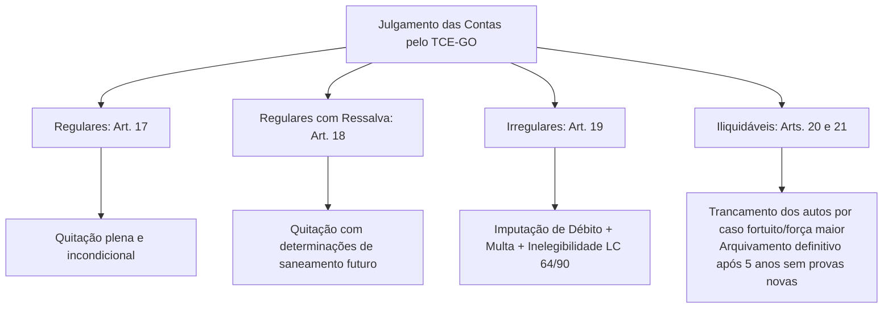
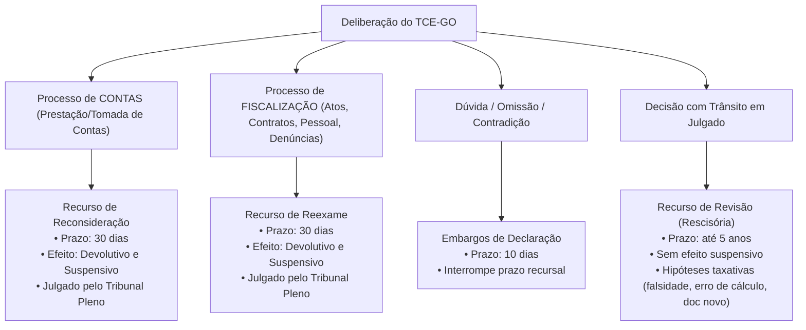

# 02 - Lei Orgânica do TCE-GO (Lei Estadual nº 16.168/2007)

> **Matéria:** Legislação Institucional  
> **Cargos:** A01 – Técnico de Controle Externo (Adm) / B02 – Técnico de Controle Externo (TI)  
> **Arquivo:** `02_lei_organica_tce_go_lei_16168_2007.md`  
> **Ato Normativo:** Lei Estadual nº 16.168, de 11 de dezembro de 2007 (atualizada pelas Leis Estaduais nº 21.050/2021, 23.120/2024 e 23.413/2025)

---

## 📌 Ementa / Itens do Edital
- Lei Orgânica do Tribunal de Contas do Estado de Goiás (Lei Estadual nº 16.168/2007 e alterações):
  - Natureza jurídica, sede, jurisdição, autonomia institucional e competências finalísticas privativas;
  - Jurisdicionados: rol legal dos agentes, gestores, entidades públicas e privadas sujeitas à fiscalização do TCE-GO;
  - Instrumentos de fiscalização externa: auditorias, inspeções, acompanhamentos, monitoramentos e levantamentos;
  - Apreciação e registro de atos sujeitos a controle: admissão de pessoal (concursos) e concessão de aposentadorias, reformas e pensões (ato administrativo complexo);
  - Fiscalização de procedimentos licitatórios, editais, contratos administrativos, convênios, parcerias do terceiro setor (OSs, OSCIPs e MROSC) e instrumentos congêneres;
  - Tomada e Prestação de Contas Ordinárias dos ordenadores de despesas estaduais;
  - Tomada de Contas Especial (TCE): pressupostos materiais cumulativos de instauração, responsabilidade solidária da autoridade administrativa omissa, limite de alçada para dispensa por economia processual e prazo decadencial decenal;
  - Classificação técnica do julgamento de contas:
    - Contas Regulares (quitação plena);
    - Contas Regulares com Ressalva (impropriedades formais sem dano ao erário, determinações saneadoras);
    - Contas Irregulares (dano, desfalque, desvio, grave infração legal ou reincidência; imputação de débito, multa e inelegibilidade da LC 64/90);
    - Contas Iliquidáveis (caso fortuito ou força maior, trancamento das contas e prazo de desarquivamento em até 5 anos);
  - Medidas Cautelares no processo de controle externo: requisitos (*fumus boni iuris* e *periculum in mora*), indisponibilidade de bens, afastamento provisório de responsáveis e suspensão de atos/licitações;
  - Poder Sancionatório do TCE-GO:
    - Imputação de débito (ressarcimento do erário atualizado com juros; título executivo extrajudicial);
    - Multas sancionatórias simples (por infração grave, obstrução, descumprimento de prazos/diligências);
    - Multa proporcional ao dano (até 100% do débito apurado);
    - Inabilitação para o exercício de cargo em comissão ou função de confiança (até 5 anos);
    - Declaração de inidoneidade para licitar e contratar com a Administração Pública Estadual (até 5 anos);
  - Processo e Procedimento no Controle Externo: contraditório, ampla defesa, prazos processuais e comunicações;
  - Sistema Recursal da Lei Orgânica:
    - Recurso de Reconsideração (processos de contas; 30 dias; efeitos devolutivo e suspensivo);
    - Recurso de Reexame (processos de fiscalização de atos/contratos, pessoal, denúncia e representação; 30 dias; efeitos devolutivo e suspensivo);
    - Embargos de Declaração (obscuridade, contradição ou omissão; 10 dias; interrompe prazo dos demais recursos);
    - Recurso de Revisão (natureza rescisória; 5 anos do trânsito em julgado; sem efeito suspensivo; erro de cálculo, falsidade documental ou documento novo superveniente);
  - Regime de Prescrição da pretensão punitiva e de ressarcimento (prazo quinquenal de 5 anos e prescrição intercorrente trienal).

---

## 🌳 Classificação Hierárquica

```text
2. Lei Orgânica do TCE-GO (Lei Estadual nº 16.168/2007)
├── 2.1 Natureza, Jurisdição e Competências Constitucionais e Legais (Arts. 1º a 4º)
│   ├── 2.1.1 Natureza jurídica, autonomia funcional, administrativa e financeira, sede em Goiânia
│   ├── 2.1.2 Abrangência territorial e rol exaustivo dos jurisdicionados (Art. 4º):
│   │   ├── Gestores públicos da administração direta, autárquica e fundacional
│   │   ├── Dirigentes de empresas públicas e sociedades de economia mista estaduais
│   │   ├── Entidades privadas recebedoras de recursos estaduais (subvenções, convênios, OSs, OSCIPs e MROSC)
│   │   ├── Responsáveis por desvio, extravio ou perda de dinheiros, bens ou valores públicos
│   │   └── Sucessores dos administradores até o limite do valor do patrimônio transferido
│   └── 2.1.3 Competências constitucionais e institucionais privativas (Arts. 1º a 3º)
├── 2.2 Fiscalização de Atos, Contratos e Instrumentos de Controle Externo (Arts. 5º a 10)
│   ├── 2.2.1 Instrumentos Operacionais: Auditorias, inspeções, acompanhamentos, monitoramentos e levantamentos
│   ├── 2.2.2 Fiscalização de Atos Sujeitos a Registro (admissão de pessoal e aposentadorias/pensões)
│   └── 2.2.3 Fiscalização de Licitações e Contratos (exame de editais, termos aditivos e suspensão cautelar)
├── 2.3 Julgamento de Contas e Tomada de Contas Especial (Arts. 11 a 28)
│   ├── 2.3.1 Prestação de Contas Ordinária anual dos ordenadores de despesas
│   ├── 2.3.2 Tomada de Contas Especial (TCE) (Arts. 11 a 13):
│   │   ├── Pressupostos obrigatórios de instauração (omissão, não comprovação, desfalque, desvio, dano)
│   │   ├── Esgotamento das medidas administrativas internas pelo órgão de origem
│   │   ├── Dispensa por economia processual (valor de alçada mínimo fixado pelo Tribunal)
│   │   ├── Prazo decadencial de 10 anos sem notificação válida (inviabilização da ampla defesa)
│   │   └── Responsabilidade solidária da autoridade omissa em instaurar a TCE
│   └── 2.3.3 Julgamento e Classificação das Contas pelo Tribunal (Arts. 16 a 21):
│       ├── Contas Regulares (Art. 17): quitação plena e incondicional
│       ├── Contas Regulares com Ressalva (Art. 18): impropriedades formais, quitação com determinações preventivas
│       ├── Contas Irregulares (Art. 19): omissão, dano, desvio, fraude; condenação em débito, multa e inelegibilidade
│       └── Contas Iliquidáveis (Arts. 20 e 21): caso fortuito/força maior, trancamento e desarquivamento em até 5 anos
├── 2.4 Medidas Cautelares, Sanções e Penalidades (Arts. 41 a 47)
│   ├── 2.4.1 Medidas Cautelares: suspensão de atos/licitações, afastamento provisório e indisponibilidade de bens
│   ├── 2.4.2 Imputação de Débito (condenação ressarcitória com eficácia de título executivo extrajudicial)
│   ├── 2.4.3 Multas do TCE-GO:
│   │   ├── Multa proporcional ao dano apurado (até 100% do débito imputado)
│   │   └── Multa sancionatória simples por infração legal/regulamentar ou sonegação de informações
│   ├── 2.4.4 Inabilitação para o exercício de cargo em comissão ou função de confiança (até 5 anos)
│   └── 2.4.5 Declaração de Inidoneidade para licitar ou contratar com a administração estadual (até 5 anos)
└── 2.5 Processo, Prazos e Sistema Recursal (Arts. 50 a 65)
    ├── 2.5.1 Devido processo legal, contraditório, citação e prazo ordinário de defesa (30 dias)
    ├── 2.5.2 Rol Taxativo dos Recursos na Lei Orgânica:
    │   ├── Recurso de Reconsideração (Art. 52): exclusivo de processos de contas; prazo 30 dias; efeito suspensivo
    │   ├── Recurso de Reexame (Art. 53): processos de atos, contratos, admissão, denúncia; prazo 30 dias; efeito suspensivo
    │   ├── Embargos de Declaração (Art. 55): obscuridade, omissão ou contradição; prazo 10 dias; interrompe prazo recursal
    │   └── Recurso de Revisão (Art. 56): natureza rescisória; prazo 5 anos; sem efeito suspensivo; hipóteses taxativas
    └── 2.5.3 Prescrição da pretensão punitiva e ressarcitória (prazo geral de 5 anos; prescrição intercorrente de 3 anos)
```

---

## 📖 Resumo Teórico & Pontos-Chave

### 1. Jurisdição e Jurisdicionados do TCE-GO (Arts. 1º a 4º da Lei Estadual nº 16.168/2007)

O Tribunal de Contas do Estado de Goiás é órgão dotado de **autonomia funcional, administrativa e financeira**, com sede na Capital (Goiânia) e **jurisdição própria e privativa em todo o território goiano**, abrangendo:

* **Administração Direta:** Os Poderes Executivo, Legislativo e Judiciário estaduais, bem como o Ministério Público Estadual e a Defensoria Pública do Estado;
* **Administração Indireta:** Autarquias, fundações públicas, empresas públicas e sociedades de economia mista estaduais;
* **Entidades Privadas e Terceiro Setor:** Qualquer pessoa física ou jurídica que receba recursos públicos estaduais a título de subvenção, auxílio, convênio, contrato de gestão (Organizações Sociais - OSs), termo de parceria (OSCIPs) ou termos de colaboração/fomento (MROSC);
* **Causadores de Dano:** Qualquer pessoa que der causa a perda, extravio, desvio ou outra irregularidade de que resulte dano ao erário estadual;
* **Sucessores:** Os sucessores dos administradores e responsáveis, que respondem pela reparação do dano até o limite do valor do patrimônio que lhes foi transferido pela sucessão hereditária.

---

### 2. Instrumentos de Fiscalização Externa (Arts. 5º a 10)

Para exercer a fiscalização contábil, financeira, orçamentária, operacional e patrimonial, o TCE-GO utiliza os seguintes instrumentos formais:

| Instrumento | Finalidade Específica | Momento / Dinâmica |
| :--- | :--- | :--- |
| **Auditoria** | Exame aprofundado e sistemático de operações contábeis, programas e sistemas governamentais. | Ordinária (prevista no Plano Anual de Fiscalização) ou Extraordinária. |
| **Inspeção** | Verificação *in loco* para suprir omissões, esclarecer dúvidas de auditoria ou apurar denúncias e representações. | Pontual, rápida e direcionada a fatos específicos e urgentes. |
| **Acompanhamento** | Fiscalização concomitante e contínua das atividades dos órgãos jurisdicionados. | Ao longo de todo o exercício financeiro (em tempo real). |
| **Monitoramento** | Verificação do cumprimento das deliberações, acórdãos e recomendações emitidas pelo Tribunal. | Posterior, focado na efetividade das determinações expedidas. |
| **Levantamento** | Mapeamento preliminar de áreas para conhecer a estrutura, sistemas e riscos dos jurisdicionados. | Fase preparatória para definir o plano de auditorias. |

---

### 3. Tomada de Contas Especial (TCE) (Arts. 11 a 13)

A Tomada de Contas Especial é um processo administrativo formal, de caráter excepcional, instaurado pela autoridade competente quando esgotadas as medidas administrativas internas de cobrança ou saneamento.

#### 3.1 Hipóteses Obrigatórias de Instauração:
1. Omissão injustificada no dever de prestar contas;
2. Não comprovação da aplicação dos recursos repassados pelo Estado (inclusive convênios e subvenções);
3. Ocorrência de desfalque, desvio de dinheiro, bens ou valores públicos;
4. Prática de qualquer ato ilegal, ilegítimo ou antieconômico de que resulte comprovado dano ao erário.

#### 3.2 Regras Processuais Fundamentais da TCE:
* **Esgotamento das Vias Administrativas:** A instauração da TCE só é cabível após frustradas as providências administrativas internas do órgão de origem para recompor o dano.
* **Responsabilidade Solidária da Autoridade Omissa (Art. 11, § 1º):** Sob pena de responsabilidade solidária com o causador do dano, a autoridade administrativa competente é obrigada a instaurar a TCE no prazo fixado em ato normativo do TCE-GO.
* **Dispensa de Instauração por Economia Processual:** O Tribunal pode fixar valor de alçada anual abaixo do qual a TCE não deve ser instaurada nem encaminhada, por ser o custo da cobrança superior ao valor do prejuízo (exceto em caso de reincidência cumulativa do mesmo gestor).
* **Decadência Decenal (10 anos):** Salvo determinação em contrário do Tribunal, fica dispensada a instauração da TCE quando houver transcorrido prazo superior a **10 (dez) anos** entre a data provável do fato gerador e a primeira notificação válida do responsável pela autoridade administrativa, devido à inviabilização do pleno exercício da ampla defesa.

---

### 4. Classificação das Contas Julgadas pelo TCE-GO (Arts. 16 a 21)

Ao deliberar sobre processo de tomada ou prestação de contas dos ordenadores de despesas e administradores públicos estaduais, o Tribunal de Contas proferirá decisão definitiva classificando as contas em:



#### Quadro Sinótico de Julgamento de Contas:

| Classificação | Fundamento Legal | Efeitos Jurídicos / Consequências |
| :--- | :--- | :--- |
| **Regulares** | Art. 17 da LOTCE. Exatidão dos demonstrativos, legalidade, legitimidade e economicidade dos atos de gestão. | O Tribunal confere **quitação plena** e irrevogável ao responsável, liberando-o da responsabilidade. |
| **Regulares com Ressalva** | Art. 18 da LOTCE. Impropriedade ou falta de natureza formal de que não resulte dano ao erário nem evidencie má-fé. | O Tribunal dá **quitação**, emitindo determinação com recomendações para que as falhas sejam corrigidas no futuro. |
| **Irregulares** | Art. 19 da LOTCE. Omissão na prestação de contas, desvio de bens, infração grave a norma legal/regulamentar ou dano ao erário. | Condenação em **débito** (reparação do dano); aplicação de **multa**; inabilitação/inidoneidade; envio ao MP Estadual (improbidade) e à Justiça Eleitoral (**inelegibilidade** da LC 64/90 se houver dano doloso). |
| **Iliquidáveis** | Arts. 20 e 21 da LOTCE. Quando caso fortuito ou força maior, alheio à vontade do responsável, tornar materialmente impossível o julgamento do mérito. | O Tribunal ordena o **trancamento das contas** e o arquivamento. Se em até **5 (cinco) anos** surgirem elementos probatórios, o feito é reaberto; após 5 anos, opera-se o arquivamento definitivo. |

---

### 5. Medidas Cautelares e Sanções Administrativas (Arts. 41 a 47)

#### 5.1 Medidas Cautelares (Art. 41)
Em caso de urgência (*periculum in mora*) e havendo plausibilidade do direito (*fumus boni iuris*), o Relator ou o Plenário poderá, de ofício ou a requerimento do Ministério Público de Contas, decretar cautelarmente:
* **Suspensão cautelar de atos administrativos e licitações:** paralisação imediata de certame ou execução contratual viciada;
* **Afastamento provisório de responsáveis:** quando houver fortes indícios de que sua permanência no cargo dificulte a instrução processual ou destrua provas (sem prejuízo de seus vencimentos);
* **Indisponibilidade de bens dos responsáveis:** por prazo determinado, no montante estritamente necessário para garantir o ressarcimento do erário apurado.

#### 5.2 Sanções do TCE-GO
1. **Imputação de Débito:** condenação ressarcitória do valor do dano atualizado monetariamente e acrescido de juros legais. Constitui **título executivo extrajudicial** (Art. 71, § 3º da CF/88);
2. **Multa Proporcional ao Dano:** pode ser aplicada ao responsável em percentual de até **100% (cem por cento)** do valor do dano imputado (aplicada cumulativamente com o débito);
3. **Multa Sancionatória por Infração Grave / Obstrução:** cominada em faixas de valores legais independentemente de dano ao erário (ex.: sonegação de documentos, desobediência a diligências no prazo regulamentar, reincidência);
4. **Inabilitação para Cargo em Comissão ou Função de Confiança:** pelo prazo de até **5 (cinco) anos** para o exercício de cargos de chefia, direção e assessoramento na Administração Pública de Goiás;
5. **Declaração de Inidoneidade para Licitar e Contratar:** pelo prazo de até **5 (cinco) anos** com a Administração Pública Estadual para pessoas físicas ou jurídicas que tenham cometido fraude em licitações ou contratos.

---

### 6. Sistema Recursal da Lei Orgânica do TCE-GO (Arts. 50 a 65)

O sistema recursal da Lei Estadual nº 16.168/2007 é taxativo e possui distinções procedimentais rigorosas:



#### Tabela Comparativa dos Recursos:

| Recurso | Cabimento Específico | Prazo | Efeitos | Competência para Julgar |
| :--- | :--- | :--- | :--- | :--- |
| **Recurso de Reconsideração** (Art. 52) | Deliberações definitivas proferidas em **processos de contas** (prestação de contas, tomada de contas ordinária ou especial). Pode ser interposto apenas uma única vez. | **30 dias** | Devolutivo e **Suspensivo** | **Tribunal Pleno** |
| **Recurso de Reexame** (Art. 53) | Deliberações proferidas em processos de **fiscalização de atos e contratos, atos sujeitos a registro (admissão/aposentadoria), denúncias e representações**. | **30 dias** | Devolutivo e **Suspensivo** | **Tribunal Pleno** |
| **Embargos de Declaração** (Art. 55) | Contra qualquer decisão (monocrática ou colegiada) para sanar **obscuridade, omissão ou contradição**. | **10 dias** | Efeito devolutivo próprio; **interrompe** o prazo para outros recursos. | O mesmo Relator ou Colegiado prolator da decisão. |
| **Recurso de Revisão** (Art. 56) | Contra decisão de mérito transitada em julgado, fundado estritamente em: 1) erro de cálculo; 2) falsidade de documento; 3) documento novo relevante superveniente. | **5 anos** do trânsito em julgado | Devolutivo (**não suspende** a execução da decisão). | **Tribunal Pleno** |

---

## ⚠️ Alertas de Prova & Pegadinhas da FCC

> 🚨 **ALERTA DE PROVA / PEGADINHA FCC:** A FCC frequentemente troca os recursos: diz que cabe *Recurso de Reconsideração* em fiscalização de contrato ou em ato de aposentadoria. **Atenção:** Recurso de **Reconsideração** é exclusivo de processos de **CONTAS**. Para atos, contratos, licitações, denúncias e representações, o recurso cabível é o Recurso de **Reexame**. Ambos têm prazo de **30 dias** e efeito suspensivo.

> ⭐ **IMPORTANTE / DISTINÇÃO CONCEITUAL:** Se o gestor foi negligente ou sumiu com os documentos, as contas são **IRREGULARES** (omissão no dever de prestar contas). As contas somente serão consideradas **ILIQUIDÁVEIS** se a impossibilidade decorrer de **caso fortuito ou força maior** (ex.: enchente ou incêndio acidental comprovado pelo corpo de bombeiros que destruiu os arquivos públicos). O prazo para reabertura de contas iliquidáveis se surgirem provas é de **5 (cinco) anos**.

> 📌 **NOTA EXPLICATIVA / PRAZO PROCESSUAL:** Diferente do Código de Processo Civil (CPC), que fixa o prazo de embargos de declaração em 5 dias, na Lei Orgânica do TCE-GO (e na Lei Orgânica do TCU) o prazo dos Embargos de Declaração é de **10 (dez) dias**! E os embargos **interrompem** a contagem do prazo para a interposição dos demais recursos.

> 🛑 **ATENÇÃO / PRAZO DECADENCIAL DA TCE:** A autoridade administrativa deve instaurar a TCE tempestivamente. Caso transcorram mais de 10 anos entre a ocorrência do fato gerador e a notificação válida sem motivo atribuível ao réu, o Tribunal considera inviabilizada a ampla defesa e determina o arquivamento sem julgamento de mérito por decadência da pretensão de instauração.

---

## 🌐 Fontes Oficiais e Referências Bibliográficas

* [Lei Estadual nº 16.168, de 11/12/2007 (Legisla Goiás)](https://legisla.casacivil.go.gov.br/pesquisa_legislacao/83307/lei-16168) - Lei Orgânica do Tribunal de Contas do Estado de Goiás com atualizações normativas consolidadas.
* [Lei Estadual nº 21.050, de 15/07/2021 (Legisla Goiás)](https://legisla.casacivil.go.gov.br) - Introduziu modificações sobre instrução processual e comunicações eletrônicas no TCE-GO.
* [Portal do Tribunal de Contas do Estado de Goiás](https://portal.tce.go.gov.br) - Seção de Legislação Aplicada e Jurisprudência do Controle Externo.
* [Súmula nº 282 do TCU / Jurisprudência do STF sobre Prescrição no Controle Externo (Tema 899)](https://portal.stf.jus.br) - Aplicação do regime prescricional quinquenal às pretensões de cobrança e sanção.

---

## 📝 Questões de Concurso FCC Comentadas

### Questão 01
**(FCC – TCE-GO – Analista de Controle Externo)**  
Em decorrência de auditoria operacional e contábil realizada no âmbito de determinada Secretaria de Estado, o Tribunal de Contas do Estado de Goiás constatou que o gestor ordenou despesas amparado em documentação formalmente incompleta, mas que as obras foram integralmente executadas, o valor praticado foi condizente com a tabela de referência de preços oficiais e não houve prejuízo financeiro aos cofres públicos. Consoante o regramento expresso da Lei Estadual nº 16.168/2007 (Lei Orgânica do TCE-GO), as contas desse gestor deverão ser julgadas:

* **A)** Irregulares, aplicando-se multa rescisória e declarando-se a inidoneidade para licitar, tendo em vista o princípio da legalidade estrita que rege a despesa pública.
* **B)** Regulares com ressalva, dando-se quitação ao responsável e determinando-se a adoção de medidas necessárias à correção das impropriedades constatadas.
* **C)** Iliquidáveis, determinando-se o trancamento das contas e o arquivamento definitivo do feito sem apreciação de mérito.
* **D)** Regulares com quitação plena e irrestrita, reputando-se inexistentes quaisquer impropriedades de caráter formal.
* **E)** Sobrestadas pelo prazo de cinco anos, aguardando eventual manifestação confirmatória da Controladoria-Geral do Estado.

> **Gabarito: B**  
> **Comentário Detalhado:**  
> - **A) Incorreta.** As contas só são julgadas irregulares quando houver omissão de prestação, grave infração à norma legal ou regulamentar, dano ao erário, desfalque ou desvio de dinheiro público (Art. 19). Mera impropriedade formal sem desfalque ou má-fé não enseja irregularidade nem inidoneidade.  
> - **B) CORRETA.** Nos termos do art. 16, II c/c art. 18 da Lei Estadual nº 16.168/2007: as contas serão julgadas *regulares com ressalva* quando evidenciarem impropriedade ou qualquer outra falta de natureza formal de que não resulte dano ao erário. Nesse caso, o Tribunal dará quitação ao responsável e expedirá determinações corretivas para que as falhas não se repitam nos exercícios seguintes.  
> - **C) Incorreta.** As contas iliquidáveis (Arts. 20 e 21) ocorrem apenas quando caso fortuito ou força maior, alheio à vontade do responsável, torne materialmente inviável o julgamento de mérito (ex.: documentos destruídos em desastre natural devidamente comprovado).  
> - **D) Incorreta.** As contas regulares puras (Art. 17) expressam de forma cabal a exatidão e a legalidade estrita de todos os atos; quando há impropriedade formal, o julgamento é pela regularidade *com ressalva*.  
> - **E) Incorreta.** Não há previsão legal de sobrestamento ordinário por cinco anos para aguardar a Controladoria em caso de contas com documentação formal incompleta já submetidas a julgamento no TCE.

---

### Questão 02
**(FCC – TCE-AP – Auditor de Controle Externo)**  
A respeito da Tomada de Contas Especial (TCE) disciplinada nas leis orgânicas dos Tribunais de Contas e na Lei Orgânica do TCE-GO, assinale a opção correta:

* **A)** A Tomada de Contas Especial pode ser instaurada imediatamente pelo Tribunal de Contas perante qualquer indício de irregularidade, prescindindo da tentativa de adoção de medidas saneadoras internas pelo órgão de origem.
* **B)** A autoridade administrativa que tiver conhecimento de dano ao erário e se omitir em instaurar tempestivamente a Tomada de Contas Especial responderá solidariamente pelo débito com o causador do prejuízo.
* **C)** O Tribunal de Contas não pode estabelecer valor mínimo de prejuízo (valor de alçada) para a dispensa de envio de tomada de contas especial, devendo todo e qualquer dano financeiro, independentemente do montante, ser remetido à Corte de Contas.
* **D)** Transcorrido o prazo de vinte anos entre a ocorrência do fato gerador e a notificação do responsável, o Tribunal de Contas deverá obrigatoriamente julgar as contas pelo mérito e condenar o responsável à revelia.
* **E)** A Tomada de Contas Especial constitui procedimento processual comum e periódico, devendo ser apresentada anualmente por todos os secretários de Estado no encerramento de suas gestões.

> **Gabarito: B**  
> **Comentário Detalhado:**  
> - **A) Incorreta.** A Tomada de Contas Especial tem natureza excepcional e subsidiária. O art. 11 da LOTCE estabelece que ela pressupõe o esgotamento prévio das medidas administrativas internas de cobrança ou recomposição no órgão ou entidade de origem.  
> - **B) CORRETA.** Conforme prevê expressamente o art. 11, § 1º da Lei nº 16.168/2007 (reproduzindo o modelo federal do art. 8º da Lei nº 8.443/92), a autoridade administrativa competente, sob pena de **responsabilidade solidária**, deve adotar imediatas providências para instauração de tomada de contas especial diante de omissão, desfalque, desvio ou dano ao erário.  
> - **C) Incorreta.** O Tribunal de Contas pode sim (e costuma) fixar valor de alçada mínimo para remessa de TCE por razões de economia processual, arquivando internamente as cobranças cujo custo de processamento superaria o valor do próprio ressarcimento.  
> - **D) Incorreta.** Decorrido prazo superior a **10 (dez) anos** do fato gerador sem a notificação válida do responsável, fica inviabilizado o exercício do contraditório e da ampla defesa, ensejando a dispensa de instauração e o arquivamento por decadência do procedimento.  
> - **E) Incorreta.** O procedimento ordinário anual prestado por todos os secretários de Estado é a **Prestação de Contas Ordinária**. A TCE é um processo de exceção instaurado apenas quando há dano, omissão ou extravio de bens públicos.

---

### Questão 03
**(FCC – TCE-RS – Auditor de Controle Externo)**  
Determinado Secretário de Estado de Goiás foi sancionado pelo Tribunal Pleno do TCE-GO em processo de fiscalização de licitação pública com aplicação de penalidade de multa por grave infração a preceito da Lei de Licitações. Querendo recorrer da decisão colegiada, o gestor deverá utilizar a via recursal cabível segundo a Lei Orgânica do TCE-GO (Lei Estadual nº 16.168/2007), que prevê:

* **A)** Recurso de Reconsideração, a ser interposto no prazo preclusivo de quinze dias úteis, dotado de efeito apenas devolutivo.
* **B)** Recurso de Reexame, no prazo de trinta dias, que terá efeito suspensivo e devolutivo, a ser apreciado pelo Tribunal Pleno.
* **C)** Embargos Infringentes, no prazo de cinco dias, desde que a decisão colegiada não tenha sido unânime.
* **D)** Agravo de Instrumento perante o Tribunal de Justiça do Estado de Goiás, uma vez exaurida a jurisdição administrativa do Tribunal de Contas.
* **E)** Recurso de Apelação Administrativa, no prazo de dez dias, encaminhado à Assembleia Legislativa de Goiás para deliberação final.

> **Gabarito: B**  
> **Comentário Detalhado:**  
> - **A) Incorreta.** O Recurso de Reconsideração (Art. 52) é privativo de processos de **contas** (prestação ou tomada de contas). Em processo de fiscalização de licitações, atos e contratos, a espécie cabível é o Recurso de Reexame. Além disso, o prazo é de 30 dias (não 15).  
> - **B) CORRETA.** Conforme o art. 53 da Lei nº 16.168/2007: de decisão definitiva proferida em processo de fiscalização de atos, contratos, admissão, concessão, representação ou denúncia, cabe **Recurso de Reexame**, com efeito suspensivo e devolutivo, no prazo de **trinta (30) dias**, a ser julgado pelo Tribunal Pleno.  
> - **C) Incorreta.** Não existe a figura dos Embargos Infringentes no rol recursal da Lei Orgânica do TCE-GO.  
> - **D) Incorreta.** As decisões de Tribunais de Contas não são recorríveis para o Poder Judiciário via agravo de instrumento; o Judiciário somente analisa a legalidade mediante ação ordinária ou mandado de segurança autônomo, não integrando a hierarquia recursal da Corte de Contas.  
> - **E) Incorreta.** A Assembleia Legislativa não julga recursos contra deliberações sancionatórias do Tribunal de Contas; o TCE goza de autonomia funcional e decisória.

---

### Questão 04
**(FCC – TCE-PR – Auditor de Controle Externo)**  
Sobre o poder sancionatório e a aplicação de medidas punitivas pelo Tribunal de Contas do Estado de Goiás com fundamento na Lei Estadual nº 16.168/2007, assinale a afirmativa correta:

* **A)** A condenação em débito para ressarcimento de dano causado ao erário impede a cominação concomitante de penalidade de multa, sob pena de configurar *bis in idem*.
* **B)** O Tribunal de Contas pode aplicar ao responsável por dano ao erário multa proporcional de até 100% do valor atualizado do dano, cumulada com a condenação em ressarcimento.
* **C)** A declaração de inidoneidade para participar de licitações ou contratar com a Administração Pública Estadual é sanção privativa do Governador do Estado, cabendo ao Tribunal de Contas apenas propor a penalidade.
* **D)** A inabilitação para o exercício de cargo em comissão ou função de confiança pode ser aplicada pelo Tribunal de Contas pelo prazo de até vinte anos ininterruptos.
* **E)** As multas aplicadas pelo Tribunal de Contas possuem eficácia executiva provisória, necessitando de ratificação judicial expressa pela Vara da Fazenda Pública para sua cobrança coercitiva.

> **Gabarito: B**  
> **Comentário Detalhado:**  
> - **A) Incorreta.** O débito visa recompor o patrimônio lesado (natureza indenizatória/reparatória), enquanto a multa visa punir a conduta reprovável (natureza sancionatória). A cumulação de débito com multa é expressamente autorizada pela LOTCE (Art. 42).  
> - **B) CORRETA.** Nos termos do art. 42 da Lei Estadual nº 16.168/2007, quando o responsável for julgado em débito, o Tribunal poderá aplicar-lhe multa de até **100% (cem por cento)** do valor atualizado do dano causado ao erário.  
> - **C) Incorreta.** O Tribunal de Contas possui competência própria para declarar a inidoneidade do licitante fraudador para licitar ou contratar com a Administração Pública do Estado de Goiás pelo prazo de até 5 (cinco) anos (Art. 44).  
> - **D) Incorreta.** O prazo máximo de inabilitação para o exercício de cargo em comissão ou função de confiança na administração pública estadual cominada pelo TCE é de **até 5 (cinco) anos** (Art. 43), e não 20 anos.  
> - **E) Incorreta.** As decisões do Tribunal de Contas que imputam débito ou multa ostentam **eficácia de título executivo extrajudicial** imediata (Art. 71, § 3º da CF/88 c/c art. 47 da LOTCE), prescindindo de homologação ou ratificação prévia do Poder Judiciário.

---

### Questão 05
**(FCC – TCE-CE – Técnico de Controle Externo)**  
Decorridos dois anos da publicação de acórdão definitivo transitado em julgado do TCE-GO que condenou um ex-ordenador de despesas a ressarcir os cofres públicos por suposto desvio de recursos, foram localizadas nos arquivos da Secretaria notas fiscais originais e atestados de recebimento da época que comprovam inequivocamente a efetiva entrega das mercadorias e a regularidade do pagamento. Diante dessa nova situação, o ex-gestor:

* **A)** Não poderá mais recorrer no âmbito administrativo do TCE-GO, haja vista a preclusão absoluta operada pelo decurso do prazo de trinta dias da decisão definitiva.
* **B)** Deverá interpor Recurso de Reconsideração, pois fatos novos reabrem a contagem do prazo recursal originário de trinta dias.
* **C)** Poderá interpor Recurso de Revisão no prazo de até cinco anos contados do trânsito em julgado, com base na superveniência de documentos novos com eficácia sobre a prova produzida.
* **D)** Poderá interpor Embargos de Declaração perante o Tribunal Pleno com efeito suspensivo imediato sobre a dívida ativa.
* **E)** Deverá ajuizar Reclamação Constitucional perante o Supremo Tribunal Federal, sendo vedado novo pronunciamento da Corte de Contas estadual.

> **Gabarito: C**  
> **Comentário Detalhado:**  
> - **A) Incorreta.** A decisão transitada em julgado pode ser revista na via do Recurso de Revisão no prazo legal de até 5 anos.  
> - **B) Incorreta.** O Recurso de Reconsideração tem prazo preclusivo de 30 dias contados da publicação da decisão e não cabe após o trânsito em julgado.  
> - **C) CORRETA.** Nos termos do art. 56 da Lei nº 16.168/2007: cabe **Recurso de Revisão** ao Tribunal Pleno, interposto no prazo de **cinco (5) anos** do trânsito em julgado da deliberação condenatória, fundado em: I - erro de cálculo nas contas; II - falsidade de documento em que se tenha fundamentado o acórdão; ou III - **superveniência de novos documentos com eficácia sobre a prova produzida**.  
> - **D) Incorreta.** O prazo dos Embargos de Declaração é de 10 dias e visa sanar obscuridade, omissão ou contradição no texto da própria decisão, não se prestando para juntada de novas provas após o trânsito em julgado.  
> - **E) Incorreta.** A Reclamação ao STF visa preservar a competência do STF ou garantir a autoridade de suas decisões/súmulas vinculantes, não cabendo para simples juntada de notas fiscais supervenientes em processo de contas.
