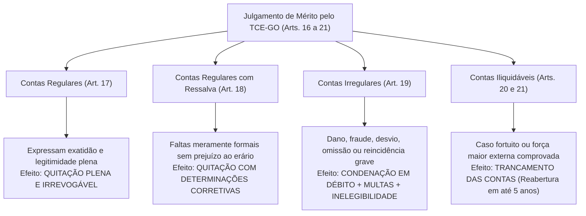
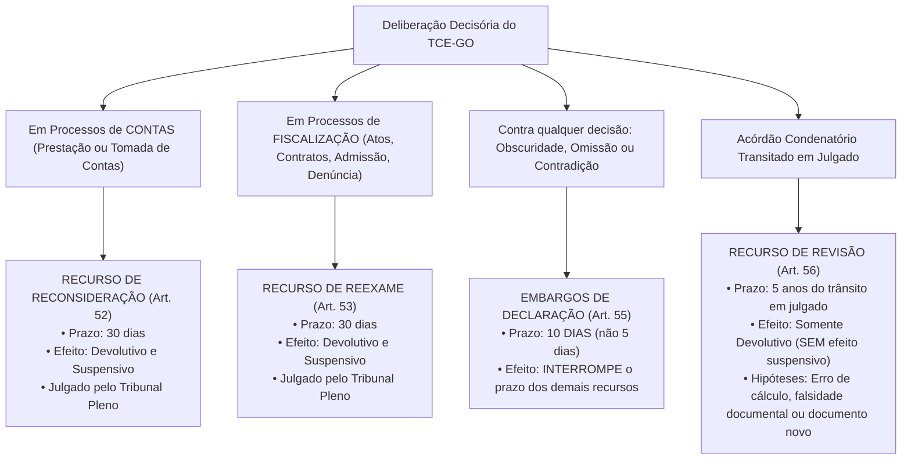

# 02 - Lei Orgânica do TCE-GO (Lei Estadual nº 16.168/2007)

> **Matéria:** Legislação Institucional  
> **Cargos:** A01 – Técnico de Controle Externo (Adm) / B02 – Técnico de Controle Externo (TI)  
> **Arquivo:** `02_lei_organica_tce_go_lei_16168_2007.md`  
> **Ato Normativo:** Lei Estadual nº 16.168, de 11 de dezembro de 2007 (atualizada pelas Leis Estaduais nº 21.050/2021, 23.120/2024 e 23.413/2025)

---

## 📌 Ementa / Itens do Edital
- Lei Orgânica do Tribunal de Contas do Estado de Goiás (Lei Estadual nº 16.168/2007 e alterações):
    - Natureza jurídica, sede, jurisdição, autonomia institucional e competências finalísticas privativas;
    - Jurisdicionados: rol legal dos agentes, gestores, entidades públicas e privadas sujeitas à fiscalização do TCE-GO;
    - Instrumentos de fiscalização externa: auditorias, inspeções, acompanhamentos, monitoramentos e levantamentos;
    - Apreciação e registro de atos sujeitos a controle: admissão de pessoal (concursos) e concessão de aposentadorias, reformas e pensões (ato administrativo complexo);
    - Fiscalização de procedimentos licitatórios, editais, contratos administrativos, convênios, parcerias do terceiro setor (OSs, OSCIPs e MROSC) e instrumentos congêneres;
    - Tomada e Prestação de Contas Ordinárias dos ordenadores de despesas estaduais;
    - Tomada de Contas Especial (TCE): pressupostos materiais cumulativos de instauração, responsabilidade solidária da autoridade administrativa omissa, limite de alçada para dispensa por economia processual e prazo decadencial decenal;
    - Classificação técnica do julgamento de contas:
    - Contas Regulares (quitação plena);
    - Contas Regulares com Ressalva (impropriedades formais sem dano ao erário, determinações saneadoras);
    - Contas Irregulares (dano, desfalque, desvio, grave infração legal ou reincidência; imputação de débito, multa e inelegibilidade da LC 64/90);
    - Contas Iliquidáveis (caso fortuito ou força maior, trancamento das contas e prazo de desarquivamento em até 5 anos);
    - Medidas Cautelares no processo de controle externo: requisitos (*fumus boni iuris* e *periculum in mora*), indisponibilidade de bens, afastamento provisório de responsáveis e suspensão de atos/licitações;
    - Poder Sancionatório do TCE-GO:
    - Imputação de débito (ressarcimento do erário atualizado com juros; título executivo extrajudicial);
    - Multas sancionatórias simples (por infração grave, obstrução, descumprimento de prazos/diligências);
    - Multa proporcional ao dano (até 100% do débito apurado);
    - Inabilitação para o exercício de cargo em comissão ou função de confiança (até 5 anos);
    - Declaração de inidoneidade para licitar e contratar com a Administração Pública Estadual (até 5 anos);
    - Processo e Procedimento no Controle Externo: contraditório, ampla defesa, prazos processuais e comunicações;
    - Sistema Recursal da Lei Orgânica:
    - Recurso de Reconsideração (processos de contas; 30 dias; efeitos devolutivo e suspensivo);
    - Recurso de Reexame (processos de fiscalização de atos/contratos, pessoal, denúncia e representação; 30 dias; efeitos devolutivo e suspensivo);
    - Embargos de Declaração (obscuridade, contradição ou omissão; 10 dias; interrompe prazo dos demais recursos);
    - Recurso de Revisão (natureza rescisória; 5 anos do trânsito em julgado; sem efeito suspensivo; erro de cálculo, falsidade documental ou documento novo superveniente);
    - Regime de Prescrição da pretensão punitiva e de ressarcimento (prazo quinquenal de 5 anos e prescrição intercorrente trienal).

---

## 🧭 Sumário
- [1. Natureza, Jurisdição e Competências Constitucionais e Legais (Arts. 1º a 4º)](#1-natureza-jurisdicao-e-competencias-constitucionais-e-legais-arts-1o-a-4o)
    - [1.1 Natureza Jurídica, Sedes e Autonomias Constitucionais](#11-natureza-juridica-sedes-e-autonomias-constitucionais)
    - [1.2 Rol Legal dos Jurisdicionados e Responsabilidade dos Sucessores](#12-rol-legal-dos-jurisdicionados-e-responsabilidade-dos-sucessores)
    - [1.3 Competências Finalísticas Privativas do TCE-GO](#13-competencias-finalisticas-privativas-do-tce-go)
- [2. Instrumentos de Fiscalização Externa (Arts. 5º a 10)](#2-instrumentos-de-fiscalizacao-externa-arts-5o-a-10)
    - [2.1 Quadro Diferencial dos Instrumentos Operacionais de Controle](#21-quadro-diferencial-dos-instrumentos-operacionais-de-controle)
    - [2.2 Fiscalização de Atos de Admissão, Concessão de Aposentadorias e Pensões](#22-fiscalizacao-de-atos-de-admissao-concessao-de-aposentadorias-e-pensoes)
    - [2.3 Controle de Editais, Licitações, Contratos e Parcerias com o Terceiro Setor](#23-controle-de-editais-licitacoes-contratos-e-parcerias-com-o-terceiro-setor)
- [3. Julgamento de Contas e Tomada de Contas Especial (Arts. 11 a 28)](#3-julgamento-de-contas-e-tomada-de-contas-especial-arts-11-a-28)
    - [3.1 Prestação de Contas Ordinária dos Ordenadores de Despesas](#31-prestacao-de-contas-ordinaria-dos-ordenadores-de-despesas)
    - [3.2 Tomada de Contas Especial: Pressupostos, Solidariedade e Decadência](#32-tomada-de-contas-especial-pressupostos-solidariedade-e-decadencia)
    - [3.3 Classificação Técnica das Decisões de Contas: Regulares, Regulares com Ressalva, Irregulares e Iliquidáveis](#33-classificacao-tecnica-das-decisoes-de-contas-regulares-regulares-com-ressalva-irregulares-e-iliquidaveis)
- [4. Medidas Cautelares e Poder Sancionatório do TCE-GO (Arts. 41 a 47)](#4-medidas-cautelares-e-poder-sancionatorio-do-tce-go-arts-41-a-47)
    - [4.1 Medidas Cautelares: Suspensão, Afastamento e Indisponibilidade de Bens](#41-medidas-cautelares-suspensao-afastamento-e-indisponibilidade-de-bens)
    - [4.2 Imputação de Débito e Eficácia Executiva Extrajudicial](#42-imputacao-de-debito-e-eficacia-executiva-extrajudicial)
    - [4.3 Regime das Multas Sancionatórias e Proporcionais ao Dano](#43-regime-das-multas-sancionatorias-e-proporcionais-ao-dano)
    - [4.4 Inabilitação para Cargo em Comissão e Declaração de Inidoneidade](#44-inabilitacao-para-cargo-em-comissao-e-declaracao-de-inidoneidade)
- [5. Processo, Prazos e Sistema Recursal da Lei Orgânica (Arts. 50 a 65)](#5-processo-prazos-e-sistema-recursal-da-lei-organica-arts-50-a-65)
    - [5.1 Devido Processo Legal, Contraditório e Prazos de Defesa](#51-devido-processo-legal-contraditorio-e-prazos-de-defesa)
    - [5.2 Sistema Recursal Taxativo: Reconsideração, Reexame, Embargos e Revisão](#52-sistema-recursal-taxativo-reconsideracao-reexame-embargos-e-revisao)
    - [5.3 Regime da Prescrição Punitiva e Ressarcitória no TCE-GO](#53-regime-da-prescricao-punitiva-e-ressarcitoria-no-tce-go)
- [6. Fontes Oficiais e Referências Bibliográficas](#6-fontes-oficiais-e-referencias-bibliograficas)
- [7. Questões de Concurso FCC Comentadas](#7-questoes-de-concurso-fcc-comentadas)

---

## 1. Natureza, Jurisdição e Competências Constitucionais e Legais (Arts. 1º a 4º)

### 1.1 Natureza Jurídica, Sedes e Autonomias Constitucionais
O Tribunal de Contas do Estado de Goiás (TCE-GO), criado pela ordem constitucional e disciplinado no plano infraconstitucional pela **Lei Estadual nº 16.168, de 11 de dezembro de 2007** (Lei Orgânica do TCE-GO), é órgão público constitucional autônomo, investido da missão republicana de controle externo contábil, financeiro, orçamentário, operacional e patrimonial do Estado de Goiás.

- **Sede e Jurisdição Territorial:** Tem sede na Capital do Estado (Goiânia) e exerce **jurisdição própria e privativa em todo o território estadual de Goiás**, alcançando todos os responsáveis por dinheiros, bens e valores públicos da administração estadual direta e indireta.
- **Autonomias:** Goza de **autonomia funcional, administrativa e financeira**, com autogoverno (eleição de seu Presidente, Vice-Presidente e Corregedor-Geral pelo Tribunal Pleno), iniciativa privativa de leis para organização de seus serviços e cargos de seu quadro técnico, e competência para executar suas dotações orçamentárias de acordo com a programação financeira.

---

### 1.2 Rol Legal dos Jurisdicionados e Responsabilidade dos Sucessores
Estão expressamente submetidos à jurisdição fiscalizatória do TCE-GO, nos termos do artigo 4º da Lei Estadual nº 16.168/2007:

1. Qualquer pessoa física ou jurídica, pública ou privada, que utilize, arrecade, guarde, gerencie ou administre dinheiros, bens ou valores públicos estaduais ou pelos quais o Estado de Goiás responda;
2. Todos os gestores, ordenadores de despesas e agentes dos Poderes Executivo, Legislativo e Judiciário, do Ministério Público Estadual, da Defensoria Pública do Estado e dos Tribunais e Conselhos vinculados ao Estado;
3. Dirigentes de autarquias, fundações públicas estaduais, empresas públicas e sociedades de economia mista sob controle acionário do Estado de Goiás;
4. Dirigentes de entidades privadas recebedoras de recursos estaduais sob qualquer título: subvenções sociais, auxílios, convênios de cooperação, contratos de gestão (Organizações Sociais - OSs), termos de parceria (OSCIPs) ou termos de colaboração e fomento (Marco Regulatório das Organizações da Sociedade Civil - MROSC / Lei Federal nº 13.019/2014);
5. Qualquer pessoa que der causa a perda, extravio, desfalque ou desvio de bens e valores públicos estaduais;
6. **Responsabilidade dos Sucessores (Art. 4º, parágrafo único):** A obrigação de reparar o dano causado ao erário e as dívidas decorrentes de acórdãos condenatórios do Tribunal estendem-se aos sucessores e herdeiros do administrador ou responsável, **até o limite do valor do patrimônio que lhes tenha sido transferido** pela sucessão causa mortis.

> 🚨 **ALERTA DE PROVA / PEGADINHA FCC:** O TCE-GO possui jurisdição estritamente sobre a esfera **ESTADUAL**. Ele **NÃO fiscaliza recursos municipais próprios** dos 246 municípios goianos — estes são de competência privativa do **TCM-GO** (Tribunal de Contas dos Municípios do Estado de Goiás). Todavia, se o Estado de Goiás repassar recursos voluntários a um Município via convênio, o TCE-GO tem jurisdição sobre o convênio estadual! Quanto aos sucessores, atente-se à pegadinha de afirmar que os herdeiros respondem com seus próprios bens: a responsabilidade é estritamente intra vires hereditatis (limitada ao valor do quinhão hereditário recebido).

---

### 1.3 Competências Finalísticas Privativas do TCE-GO
Nos moldes dos artigos 1º a 3º da Lei nº 16.168/2007, compete privativamente ao TCE-GO:

- Apreciar as contas anuais prestadas pelo Governador do Estado mediante Parecer Prévio em 60 dias;
- Julgar as contas dos administradores e demais responsáveis por recursos estaduais;
- Apreciar, para fins de registro, a legalidade dos atos de admissão de pessoal e das concessões iniciais de aposentadorias, reformas e pensões;
- Realizar, por iniciativa própria ou a pedido da Assembleia Legislativa, auditorias e inspeções;
- Fiscalizar a aplicação de quaisquer recursos repassados pelo Estado a Municípios ou entidades privadas;
- Prestar as informações solicitadas pela Assembleia Legislativa sobre a fiscalização contábil e orçamentária;
- Aplicar sanções e fixar prazos para adoção de medidas corretivas em atos ilegais;
- Emitir pronunciamento em caráter normativo em resposta a **Consultas** formuladas por autoridades legitimadas (sem analisar casos concretos).

---

## 2. Instrumentos de Fiscalização Externa (Arts. 5º a 10)

### 2.1 Quadro Diferencial dos Instrumentos Operacionais de Controle
Para concretizar as diretrizes da fiscalização contábil, orçamentária e operacional, o corpo técnico do TCE-GO atua por meio de cinco instrumentos procedimentais formais:

| Instrumento Formal | Finalidade e Âmbito de Aplicação | Momento Temporal / Característica |
| :--- | :--- | :--- |
| **Auditoria** | Exame aprofundado, abrangente e estruturado da gestão orçamentária, contábil, financeira, patrimonial ou operacional de órgãos e programas. | Prevista no **Plano Anual de Fiscalização (PAF)** (ordinária) ou decorrente de fato grave superveniente (extraordinária). |
| **Inspeção** | Verificação *in loco* pontual destinada a suprir omissões, esclarecer fatos duvidosos levantados em auditorias ou apurar **denúncias e representações urgentes**. | Ação pontual, emergencial e de tiro curto sobre objeto determinado. |
| **Acompanhamento** | Fiscalização concomitante, simultânea e contínua dos atos de gestão pública ao longo do exercício orçamentário. | Realizado **em tempo real** no curso do exercício financeiro. |
| **Monitoramento** | Verificação do efetivo cumprimento e do resultado prático das decisões, acórdãos e recomendações emanadas do Tribunal. | Atuação **posterior** para averiguar a eficácia e obediência às determinações do Pleno. |
| **Levantamento** | Mapeamento prévio de áreas, processos de trabalho, sistemas corporativos e estrutura de controle de jurisdicionados. | Fase preliminar de diagnóstico para identificar riscos e subsidiar a elaboração de futuras auditorias. |

> ⭐ **IMPORTANTE / DISTINÇÃO RECORRENTE DA FCC:** A FCC adora cobrar a distinção conceitual entre *Monitoramento* e *Levantamento*. Memorize a regra mnemônica: **Levantamento** é o diagnóstico prévio (*antes* da auditoria, para mapear riscos); **Monitoramento** é o acompanhamento posterior (*depois* do acórdão, para checar se o gestor cumpriu as determinações expedidas pela Corte de Contas).

---

### 2.2 Fiscalização de Atos de Admissão, Concessão de Aposentadorias e Pensões
O TCE-GO examina a legalidade dos atos de admissão de pessoal na administração pública estadual (efetivos e empregados públicos), ressalvadas expressamente as nomeações para **cargos em comissão de livre nomeação e exoneração**.

- **Registro de Aposentadorias e Pensões:** Caracteriza-se como ato administrativo complexo. O deferimento pelo órgão ou entidade previdenciária de origem constitui apenas etapa inicial, aperfeiçoando-se com o registro definitivo concedido pelo Tribunal de Contas.
- O prazo para o exame do ato concessório é de **cinco anos**, findos os quais, sem decisão do Tribunal, opera-se a estabilização para efeito de garantia do contraditório e ampla defesa (Tema 445 do STF).

---

### 2.3 Controle de Editais, Licitações, Contratos e Parcerias com o Terceiro Setor
O Tribunal fiscaliza procedimentos de licitação, editais, atas de registro de preços, contratos administrativos e instrumentos congêneres de órgãos estaduais.

- O TCE-GO possui atribuição legal para analisar a minuta de editais de concessões, parcerias público-privadas (PPPs) e grandes contratações públicas, determinando ajustes saneadores quando identificadas cláusulas restritivas da competitividade.
- Nas parcerias com o Terceiro Setor (Organizações Sociais de Saúde, Educação, etc.), a fiscalização do TCE-GO debruça-se sobre o atingimento de metas pactuadas nos **Contratos de Gestão**, a regularidade dos processos de contratação de terceiros pelas OSs e o cumprimento dos limites de despesas com pessoal e custeio.

---

## 3. Julgamento de Contas e Tomada de Contas Especial (Arts. 11 a 28)

### 3.1 Prestação de Contas Ordinária dos Ordenadores de Despesas
Anualmente, todos os titulares de órgãos da administração direta, autarquias, fundações e dirigentes de empresas estatais estaduais devem apresentar ao TCE-GO a sua **Prestação de Contas Ordinária**.
As contas são organizadas sob a forma de demonstrativos contábeis, relatórios de execução orçamentária e relatório conclusivo do órgão de controle interno, submetendo-se à instrução das unidades técnicas especializadas da Corte e parecer do Ministério Público de Contas antes do julgamento final pelo Tribunal Pleno ou por uma de suas Câmaras.

---

### 3.2 Tomada de Contas Especial: Pressupostos, Solidariedade e Decadência
A **Tomada de Contas Especial (TCE)** é um processo de controle externo extraordinário e coercitivo instaurado diante da caracterização de dano ao erário estadual.

1. **Pressupostos Materiais Obrigatórios de Instauração (Art. 11):**
    - Omissão culposa ou dolosa no dever de prestar contas;
    - Não comprovação da aplicação dos recursos repassados pelo Estado;
    - Ocorrência de desfalque, desvio, alcance ou extravio de bens ou valores públicos;
    - Prática de qualquer ato ilegal, ilegítimo ou antieconômico do qual resulte comprovado prejuízo financeiro ao erário estadual.

2. **Esgotamento das Providências Internas:** A instauração formal da TCE pressupõe o insucesso das medidas administrativas internas deflagradas no próprio órgão de origem para notificar o devedor e reaver amigavelmente os valores lesados.
3. **Responsabilidade Solidária da Autoridade Omissa (Art. 11, § 1º):** A autoridade administrativa máxima do órgão ou entidade jurisdicionada tem o dever legal inafastável de instaurar a TCE diante da notícia fundamentada de dano ou desvio. Caso se omita culposamente, **responderá solidariamente** pelo valor total do prejuízo apurado perante o Tribunal de Contas!
4. **Dispensa de Encaminhamento por Economia Processual:** O Plenário do TCE-GO edita anualmente instruções normativas fixando **valor de alçada mínimo** (montante mínimo de prejuízo) abaixo do qual a TCE não deve ser remetida à Corte, para evitar que o custo operacional do processamento administrativo supere o próprio montante a ser recuperado (salvo casos de reincidência dolosa do gestor).
5. **Decadência Decenal (10 Anos):** Salvo expressa determinação em contrário do Tribunal, fica **dispensada a instauração da Tomada de Contas Especial** quando houver transcorrido prazo superior a **10 (dez) anos** entre a data presumida do fato lesivo e a primeira notificação formal válida do responsável pelo órgão administrativo, por restar manifestamente inviabilizado o exercício pleno do contraditório e da ampla defesa pelo longo decurso do tempo.

---

### 3.3 Classificação Técnica das Decisões de Contas: Regulares, Regulares com Ressalva, Irregulares e Iliquidáveis
Ao julgar as tomadas ou prestações de contas, o TCE-GO proferirá decisão terminativa ou definitiva, classificando as contas em uma das quatro hipóteses taxativas dos artigos 16 a 21 da LOTCE:

| Classificação das Contas | Hipóteses Materiais Enquadradas | Consequências Jurídicas e Decisórias |
| :--- | :--- | :--- |
| **Regulares** (Art. 17) | Demonstram de forma cristalina a exatidão dos demonstrativos, a legalidade, legitimidade e economicidade dos atos de gestão financeira e orçamentária praticados. | O Tribunal confere **quitação plena e irrestrita** ao gestor, exonerando-o da responsabilidade pelo exercício examinado. |
| **Regulares com Ressalva** (Art. 18) | Evidenciam impropriedades de natureza meramente formal ou falhas burocráticas que **não resultaram em dano ao patrimônio público** nem revelam conduta de má-fé. | O Tribunal confere **quitação**, expedindo determinações e recomendações preventivas para que as falhas sejam expurgadas nos períodos seguintes. |
| **Irregulares** (Art. 19) | a) Omissão injustificada na prestação de contas; b) Prática de ato de gestão ilegal, ilegítimo ou antieconômico, ou infração grave a norma legal; c) Dano ao erário resultante de ato de gestão ilegítimo ou desfalque/desvio; d) Reincidência no descumprimento de determinações anteriores do Tribunal. | - **Condenação em débito** (ressarcimento); - Aplicação de multas simples ou proporcionais; - Inabilitação para cargos comissionados e inidoneidade; - Remessa ao MPE (para ACP por Improbidade); - Envio à Justiça Eleitoral (**inelegibilidade** da LC 64/90, caso a conduta configure ato doloso de improbidade administrativa). |
| **Iliquidáveis** (Arts. 20 e 21) | Ocorrência de **caso fortuito ou força maior**, comprovadamente alheio à vontade do responsável, que torne **materialmente impossível** a apuração do mérito das contas (ex.: desastre natural, enchente súbita ou incêndio que destrua integralmente os arquivos). | O Tribunal ordena o **trancamento das contas** e o arquivamento do feito. Caso surjam novos elementos ou provas no prazo decadencial de **cinco (5) anos**, o processo é desentranhado e julgado pelo mérito; esgotado o quinquênio, o arquivamento torna-se definitivo. |

> 🚨 **ALERTA DE PROVA / PEGADINHA FCC:** Fique atento: o desaparecimento ou extravio de documentos por desídia, culpa ou desleixo do ordenador de despesas **NÃO autoriza a classificação como iliquidável**! Se o gestor não comprova força maior cabal, suas contas são julgadas **IRREGULARES** por omissão e falta de comprovação de gastos. Contas iliquidáveis decorrem estritamente de caso fortuito ou força maior comprovados.

---

## 4. Medidas Cautelares e Poder Sancionatório do TCE-GO (Arts. 41 a 47)

### 4.1 Medidas Cautelares: Suspensão, Afastamento e Indisponibilidade de Bens
No curso de fiscalizações ou processos de contas, havendo receio fundamentado de dano irreparável ao erário (*periculum in mora*) e plausibilidade jurídica da ilicitude (*fumus boni iuris*), o Relator ou o Tribunal Pleno poderá expedir **medidas cautelares preparatórias ou incidentais**:

1. **Suspensão Cautelar de Licitação ou Contrato:** Paralisação imediata de certames ou atos administrativos irregulares até o julgamento definitivo;
2. **Afastamento Provisório de Responsáveis:** Quando comprovado que a permanência do investigado no cargo público poderá embaraçar a colheita de provas ou fraudar a instrução, sem prejuízo de seus vencimentos e subsídios funcionais;
3. **Indisponibilidade Provisória de Bens:** Bloqueio acautelatório de bens do responsável, em valor suficiente para garantir a integral recomposição do prejuízo apurado.

---

### 4.2 Imputação de Débito e Eficácia Executiva Extrajudicial
A imputação de débito constitui provimento de recomposição patrimonial que obriga o agente condenado a recolher aos cofres públicos o montante do prejuízo verificado, monetariamente corrigido e acrescido de juros de mora legais (Art. 41 c/c Art. 47).

- A decisão proferida pelo TCE-GO que imputa débito ou comina penalidade de multa tem **eficácia de título executivo extrajudicial**, apto a amparar a propositura direta de Ação de Execução Fiscal pela Procuradoria-Geral do Estado (PGE-GO).

---

### 4.3 Regime das Multas Sancionatórias e Proporcionais ao Dano
O TCE-GO dispõe de competência legal para impor duas espécies de multas:

- **Multa Proporcional ao Dano (Art. 42):** Nos casos em que o responsável for julgado em débito, o Tribunal poderá aplicar-lhe multa proporcional de até **100% (cem por cento)** do valor atualizado do prejuízo financeiro causado ao erário. Essa sanção é cumulável com a obrigação de restituição do débito, não configurando *bis in idem*.
- **Multa Sancionatória Simples (Art. 43):** Cominada nas situações de desrespeito à autoridade das deliberações da Corte, mesmo sem ocorrência de dano patrimonial direto:
    - Grave infração a preceito constitucional, legal ou regulamentar de natureza financeira, contábil ou patrimonial;
    - Não atendimento, sem justa causa, de diligência, notificação ou prazo assinado pelo Relator;
    - Obstrução ao livre exercício de inspeções e auditorias determinadas pela Corte;
    - Sonegação de livros, contratos, notas fiscais e documentos requisitados em diligência de controle externo;
    - Reincidência no descumprimento de ordens ou recomendações do Tribunal.

---

### 4.4 Inabilitação para Cargo em Comissão e Declaração de Inidoneidade
Em casos revestidos de especial gravidade, o Tribunal Pleno do TCE-GO poderá deliberar pelas seguintes medidas gravosas de idoneidade administrativa:

- **Inabilitação para o Exercício de Cargo em Comissão ou Função de Confiança (Art. 43, parágrafo único):** Pelo prazo de até **cinco (5) anos**, impedindo a nomeação do apenado para funções de chefia, direção e assessoramento em qualquer órgão ou entidade da administração estadual de Goiás;
- **Declaração de Inidoneidade para Licitar e Contratar com a Administração Pública Estadual (Art. 44):** Pelo prazo de até **cinco (5) anos**, imposta a empresas, consórcios e pessoas físicas que tenham perpetrado fraude comprovada em certames licitatórios ou contratos públicos perante órgãos sob controle do TCE-GO.

---

## 5. Processo, Prazos e Sistema Recursal da Lei Orgânica (Arts. 50 a 65)

### 5.1 Devido Processo Legal, Contraditório e Prazos de Defesa
Os processos perante o Tribunal de Contas observam estritamente o devido processo legal constitucional, com publicidade das pautas de julgamento, intimações regulares e garantia de contraditório e ampla defesa.

- **Prazo Geral de Resposta / Defesa:** Citado o responsável ou notificado o interessado para justificar irregularidades ou recolher o débito, o prazo geral assinado para apresentação de defesa formal é de **30 (trinta) dias**.

---

### 5.2 Sistema Recursal Taxativo: Reconsideração, Reexame, Embargos e Revisão
O rol recursal da Lei Orgânica do TCE-GO é estritamente legal e desenhado com competências específicas:

| Espécie Recursal | Matéria / Cabimento Específico | Prazo Legal | Efeitos Processuais | Julgador Competente |
| :--- | :--- | :--- | :--- | :--- |
| **Recurso de Reconsideração** (Art. 52) | Cabe exclusivamente contra deliberação definitiva proferida em **processos de tomada ou prestação de contas**. Interponível apenas uma vez. | **30 dias** | Devolutivo e **Suspensivo** | **Tribunal Pleno** |
| **Recurso de Reexame** (Art. 53) | Cabe contra decisões definitivas proferidas em processos de **fiscalização de atos, editais, licitações, contratos administrativos, atos sujeitos a registro (pessoal e aposentadoria), denúncias e representações**. | **30 dias** | Devolutivo e **Suspensivo** | **Tribunal Pleno** |
| **Embargos de Declaração** (Art. 55) | Oponíveis contra decisões monocráticas ou acórdãos para suprir **omissão**, aclarar **obscuridade** ou eliminar **contradição**. | **10 dias** | Devolutivo próprio; **interrompe** a contagem do prazo para outros recursos. | O mesmo prolator da deliberação recorrida (Relator ou Colegiado). |
| **Recurso de Revisão** (Art. 56) | Ação rescisória autônoma contra decisão de mérito transitada em julgado, com base restrita em: 1) erro de cálculo; 2) falsidade documental comprovada; 3) surgimento de documentos novos e relevantes supervenientes. | **5 anos** (do trânsito em julgado) | **Apenas efeito devolutivo** (não suspende a cobrança executiva da condenação). | **Tribunal Pleno** |

> 🚨 **ALERTA DE PROVA / PEGADINHA FCC:** Memorize as duas diferenças capitais que derrubam candidatos:
>
> 1. Embargos de Declaração na Lei Orgânica têm prazo de **10 DIAS** (o CPC prevê 5 dias; a FCC coloca 5 dias para o candidato errar!). Os embargos **interrompem** (zeram) o prazo dos demais recursos.
> 2. O recurso contra processo de **contas** chama-se *Reconsideração*; o recurso contra processos de **atos, contratos, editais e pessoal** chama-se *Reexame*.

---

### 5.3 Regime da Prescrição Punitiva e Ressarcitória no TCE-GO
Em consonância com as teses vinculantes fixadas pelo Supremo Tribunal Federal (Temas 899 e 1021) e normativos do Tribunal:

- **Prescrição Geral Quinquenal (5 anos):** A pretensão punitiva (aplicação de multas e sanções de inabilitação/inidoneidade) e a pretensão de cobrança de débitos decorrentes de títulos do TCE prescrevem em **cinco (5) anos**, contados da data da ocorrência do fato ou da cessação da conduta irregular.
- **Prescrição Intercorrente Trienal (3 anos):** Incide a prescrição intercorrente caso o processo administrativo de controle externo permaneça paralisado por mais de **três (3) anos** ininterruptos, pendente de despacho ou deliberação da autoridade instrutória.

---

## 6. Fontes Oficiais e Referências Bibliográficas

* [Lei Estadual nº 16.168, de 11/12/2007 (Legisla Goiás)](https://legisla.casacivil.go.gov.br/pesquisa_legislacao/83307/lei-16168) - Lei Orgânica do Tribunal de Contas do Estado de Goiás com atualizações consolidadas.
* [Lei Estadual nº 21.050, de 15/07/2021 (Legisla Goiás)](https://legisla.casacivil.go.gov.br) - Alterações procedimentais nas comunicações eletrônicas e instrução processual do TCE-GO.
* [Lei Federal nº 13.019/2014 (MROSC)](http://www.planalto.gov.br) - Marco Regulatório das Organizações da Sociedade Civil.
* [Portal do Tribunal de Contas do Estado de Goiás](https://portal.tce.go.gov.br) - Legislação, Regimentos e Jurisprudência Aplicada do Controle Externo.
* [Supremo Tribunal Federal - Tema 899 (RE 636.886)](https://portal.stf.jus.br) - Prescritibilidade da pretensão de ressarcimento fundada em decisões de Tribunal de Contas.

---

## 7. Questões de Concurso FCC Comentadas

### Questão 01
**(FCC – TCE-GO – Analista de Controle Externo)**  
Em decorrência de auditoria operacional e contábil realizada no âmbito de determinada Secretaria de Estado, o Tribunal de Contas do Estado de Goiás constatou que o gestor ordenou despesas amparado em documentação formalmente incompleta, mas que as obras foram integralmente executadas, o valor praticado foi condizente com a tabela de referência de preços oficiais e não houve prejuízo financeiro aos cofres públicos. Consoante o regramento expresso da Lei Estadual nº 16.168/2007 (Lei Orgânica do TCE-GO), as contas desse gestor deverão ser julgadas:

* **A)** Irregulares, aplicando-se multa rescisória e declarando-se a inidoneidade para licitar, tendo em vista o princípio da legalidade estrita que rege a despesa pública.
* **B)** Regulares com ressalva, dando-se quitação ao responsável e determinando-se a adoção de medidas necessárias à correção das impropriedades constatadas.
* **C)** Iliquidáveis, determinando-se o trancamento das contas e o arquivamento definitivo do feito sem apreciação de mérito.
* **D)** Regulares com quitação plena e irrestrita, reputando-se inexistentes quaisquer impropriedades de caráter formal.
* **E)** Sobrestadas pelo prazo de cinco anos, aguardando eventual manifestação confirmatória da Controladoria-Geral do Estado.

> **Comentário Detalhado:**
>
> - **A) Incorreta.** As contas somente são julgadas irregulares quando constatada grave infração à norma legal ou regulamentar, omissão injustificada na prestação de contas, prática de ato antieconômico ou ocorrência de dano, desvio ou desfalque de dinheiro público (Art. 19). Faltas de natureza estritamente formal sem dano financeiro não ensejam irregularidade nem inidoneidade.
> - **B) CORRETA.** Nos termos do artigo 16, II c/c art. 18 da Lei Estadual nº 16.168/2007: as contas são julgadas *regulares com ressalva* quando evidenciarem impropriedade ou qualquer outra falta de natureza formal da qual não resulte dano ao erário. Em tal cenário, o Tribunal Pleno profere decisão dando quitação ao responsável e expedindo determinações corretivas para que as falhas sejam sanadas nos exercícios seguintes.
> - **C) Incorreta.** As contas iliquidáveis (Arts. 20 e 21 da LOTCE) ocorrem unicamente quando evento decorrente de caso fortuito ou força maior externa e imprevisível, alheio à vontade do responsável, torne materialmente impossível a análise de mérito (como em desastres naturais com perda irreversível do acervo).
> - **D) Incorreta.** O julgamento pela regularidade plena (Art. 17) expressa de forma cabal a correção formal e material de todos os atos praticados, sem qualquer desvio burocrático; ocorrendo falha procedimental formal sanável, impõe-se a regularidade *com ressalva*.
> - **E) Incorreta.** Inexiste mandamento na LOTCE para sobrestamento ordinário do processo por cinco anos em razão de mera instrução documental formal incompleta em contas já pautadas para deliberação do Pleno.
> 
> **Gabarito: B**

---

### Questão 02
**(FCC – TCE-AP – Auditor de Controle Externo)**  
A respeito da Tomada de Contas Especial (TCE) disciplinada nas leis orgânicas dos Tribunais de Contas e na Lei Orgânica do TCE-GO, assinale a opção correta:

* **A)** A Tomada de Contas Especial pode ser instaurada imediatamente pelo Tribunal de Contas perante qualquer indício de irregularidade, prescindindo da tentativa de adoção de medidas saneadoras internas pelo órgão de origem.
* **B)** A autoridade administrativa que tiver conhecimento de dano ao erário e se omitir em instaurar tempestivamente a Tomada de Contas Especial responderá solidariamente pelo débito com o causador do prejuízo.
* **C)** O Tribunal de Contas não pode estabelecer valor mínimo de prejuízo (valor de alçada) para a dispensa de envio de tomada de contas especial, devendo todo e qualquer dano financeiro, independentemente do montante, ser remetido à Corte de Contas.
* **D)** Transcorrido o prazo de vinte anos entre a ocorrência do fato gerador e a notificação do responsável, o Tribunal de Contas deverá obrigatoriamente julgar as contas pelo mérito e condenar o responsável à revelia.
* **E)** A Tomada de Contas Especial constitui procedimento processual comum e periódico, devendo ser apresentada anualmente por todos os secretários de Estado no encerramento de suas gestões.

> **Comentário Detalhado:**
>
> - **A) Incorreta.** A Tomada de Contas Especial possui caráter excepcional e subsidiário. O art. 11 da LOTCE preconiza que a sua formalização no órgão de origem pressupõe o exaurimento prévio de todas as medidas administrativas internas tendentes à recomposição amigável do prejuízo.
> - **B) CORRETA.** Em observância estrita ao art. 11, § 1º da Lei nº 16.168/2007 (reproduzindo o mandamento federal do art. 8º da Lei nº 8.443/92): a autoridade administrativa competente que se omitir na adoção tempestiva de providências para a instauração da tomada de contas especial responderá **solidariamente** pelo dano financeiro causado ao erário.
> - **C) Incorreta.** O Tribunal de Contas é expressamente autorizado por lei a fixar valor de alçada mínimo, dispensando o processamento de TCEs cujo custo operacional de tramitação seja superior ao montante a ser ressarcido (princípio da economicidade processual).
> - **D) Incorreta.** Decorrido prazo superior a **10 (dez) anos** do fato gerador sem que tenha havido a notificação válida do agente investigado, opera-se a dispensa de instauração por presunção legal de comprometimento insuperável da ampla defesa e contraditório pelo decurso de prazo decenal.
> - **E) Incorreta.** O procedimento periódico regular e obrigatório de todos os secretários de Estado é a **Prestação de Contas Ordinária** anual. A TCE é procedimento especial e restrito às ocorrências de dano, fraude ou extravio.
> 
> **Gabarito: B**

---

### Questão 03
**(FCC – TCE-RS – Auditor de Controle Externo)**  
Determinado Secretário de Estado de Goiás foi sancionado pelo Tribunal Pleno do TCE-GO em processo de fiscalização de licitação pública com aplicação de penalidade de multa por grave infração a preceito da Lei de Licitações. Querendo recorrer da decisão colegiada, o gestor deverá utilizar a via recursal cabível segundo a Lei Orgânica do TCE-GO (Lei Estadual nº 16.168/2007), que prevê:

* **A)** Recurso de Reconsideração, a ser interposto no prazo preclusivo de quinze dias úteis, dotado de efeito apenas devolutivo.
* **B)** Recurso de Reexame, no prazo de trinta dias, que terá efeito suspensivo e devolutivo, a ser apreciado pelo Tribunal Pleno.
* **C)** Embargos Infringentes, no prazo de cinco dias, desde que a decisão colegiada não tenha sido unânime.
* **D)** Agravo de Instrumento perante o Tribunal de Justiça do Estado de Goiás, uma vez exaurida a jurisdição administrativa do Tribunal de Contas.
* **E)** Recurso de Apelação Administrativa, no prazo de dez dias, encaminhado à Assembleia Legislativa de Goiás para deliberação final.

> **Comentário Detalhado:**
>
> - **A) Incorreta.** O Recurso de Reconsideração (Art. 52) é privativo e exclusivo de decisões proferidas em processos de **contas** (prestação de contas ou tomada de contas). Em processo de fiscalização de licitações, atos e contratos, a modalidade adequada é o Recurso de Reexame. Além disso, o prazo legal é de 30 dias contínuos.
> - **B) CORRETA.** O artigo 53 da Lei Estadual nº 16.168/2007 prevê expressamente que cabe **Recurso de Reexame** de decisão definitiva proferida em processo concernente a ato sujeito a registro, fiscalização de atos, contratos, editais, termos aditivos, denúncias e representações, no prazo de **trinta (30) dias**, dotado de efeito devolutivo e **suspensivo**, sendo julgado pelo Tribunal Pleno.
> - **C) Incorreta.** O rol recursal da Lei Orgânica do TCE-GO é exaustivo e não prevê a figura dos Embargos Infringentes.
> - **D) Incorreta.** O Poder Judiciário não atua como instância recursal hierárquica das decisões dos Tribunais de Contas; o controle judicial é estritamente de legalidade e mediante ação própria ordinária, inexistindo agravo de instrumento judicial contra acórdão de TCE.
> - **E) Incorreta.** A Assembleia Legislativa não julga recursos interpostos contra decisões sancionatórias do Tribunal de Contas, órgão dotado de autonomia decisória plena.
> 
> **Gabarito: B**

---

### Questão 04
**(FCC – TCE-PR – Auditor de Controle Externo)**  
Sobre o poder sancionatório e a aplicação de medidas punitivas pelo Tribunal de Contas do Estado de Goiás com fundamento na Lei Estadual nº 16.168/2007, assinale a afirmativa correta:

* **A)** A condenação em débito para ressarcimento de dano causado ao erário impede a cominação concomitante de penalidade de multa, sob pena de configurar *bis in idem*.
* **B)** O Tribunal de Contas pode aplicar ao responsável por dano ao erário multa proporcional de até 100% do valor atualizado do dano, cumulada com a condenação em ressarcimento.
* **C)** A declaração de inidoneidade para participar de licitações ou contratar com a Administração Pública Estadual é sanção privativa do Governador do Estado, cabendo ao Tribunal de Contas apenas propor a penalidade.
* **D)** A inabilitação para o exercício de cargo em comissão ou função de confiança pode ser aplicada pelo Tribunal de Contas pelo prazo de até vinte anos ininterruptos.
* **E)** As multas aplicadas pelo Tribunal de Contas possuem eficácia executiva provisória, necessitando de ratificação judicial expressa pela Vara da Fazenda Pública para sua cobrança coercitiva.

> **Comentário Detalhado:**
>
> - **A) Incorreta.** O débito ostenta natureza puramente recompositiva/indenizatória (retorno do valor subtraído aos cofres), ao passo que a multa possui natureza sancionatória/repressiva. A cumulação de ambas as sanções é expressamente autorizada pela LOTCE e sumulada pela jurisprudência.
> - **B) CORRETA.** Nos termos do artigo 42 da Lei Estadual nº 16.168/2007, havendo julgamento pela ocorrência de débito, o Pleno poderá aplicar ao ordenador responsável multa proporcional de até **100% (cem por cento)** do valor do dano devidamente atualizado.
> - **C) Incorreta.** O TCE-GO possui competência legal autônoma e própria para aplicar a sanção de declaração de inidoneidade para licitar e contratar com os entes públicos do Estado de Goiás pelo prazo de até cinco anos (Art. 44).
> - **D) Incorreta.** A penalidade de inabilitação para o exercício de cargo em comissão ou função de confiança na esfera estadual possui o limite temporal máximo de **até 5 (cinco) anos** (Art. 43, parágrafo único).
> - **E) Incorreta.** Os acórdãos condenatórios proferidos por Tribunais de Contas que imponham débito ou multa ostentam **eficácia imediata de título executivo extrajudicial** (Art. 71, § 3º da CF/88 c/c art. 47 da LOTCE), prescindindo de chancela ou ação homologatória judicial.
> 
> **Gabarito: B**

---

### Questão 05
**(FCC – TCE-CE – Técnico de Controle Externo)**  
Decorridos dois anos da publicação de acórdão definitivo transitado em julgado do TCE-GO que condenou um ex-ordenador de despesas a ressarcir os cofres públicos por suposto desvio de recursos, foram localizadas nos arquivos da Secretaria notas fiscais originais e atestados de recebimento da época que comprovam inequivocamente a efetiva entrega das mercadorias e a regularidade do pagamento. Diante dessa nova situação, o ex-gestor:

* **A)** Não poderá mais recorrer no âmbito administrativo do TCE-GO, haja vista a preclusão absoluta operada pelo decurso do prazo de trinta dias da decisão definitiva.
* **B)** Deverá interpor Recurso de Reconsideração, pois fatos novos reabrem a contagem do prazo recursal originário de trinta dias.
* **C)** Poderá interpor Recurso de Revisão no prazo de até cinco anos contados do trânsito em julgado, com base na superveniência de documentos novos com eficácia sobre a prova produzida.
* **D)** Poderá interpor Embargos de Declaração perante o Tribunal Pleno com efeito suspensivo imediato sobre a dívida ativa.
* **E)** Deverá ajuizar Reclamação Constitucional perante o Supremo Tribunal Federal, sendo vedado novo pronunciamento da Corte de Contas estadual.

> **Comentário Detalhado:**
>
> - **A) Incorreta.** A autoridade da coisa julgada administrativa em processos de controle externo não é absoluta; a decisão transitada em julgado é passível de revisão extraordinária via Recurso de Revisão no prazo quinquenal.
> - **B) Incorreta.** O Recurso de Reconsideração tem prazo preclusivo originário de 30 dias contados da publicação da decisão e somente cabe antes da ocorrência do trânsito em julgado.
> - **C) CORRETA.** Nos exatos termos do artigo 56 da Lei nº 16.168/2007: cabe **Recurso de Revisão** ao Tribunal Pleno, interposto em uma única oportunidade e dentro do prazo decadencial de **cinco (5) anos** contados do trânsito em julgado da deliberação condenatória, fundado em: I - erro de cálculo nas contas; II - falsidade de documento que serviu de sustentáculo à condenação; ou III - **superveniência de novos documentos com eficácia preponderante sobre a prova produzida**.
> - **D) Incorreta.** O prazo legal dos Embargos de Declaração é de 10 dias da publicação do ato e destina-se estritamente à sanação de obscuridades ou omissões do julgado, sendo via imprópria para dilação probatória nova após o trânsito em julgado.
> - **E) Incorreta.** A Reclamação ao STF presta-se exclusivamente à preservação da competência do Supremo ou garantia de eficácia de súmula vinculante, descabendo para juntada probatória de quitação fática perante o Tribunal de Contas.
> 
> **Gabarito: C**
