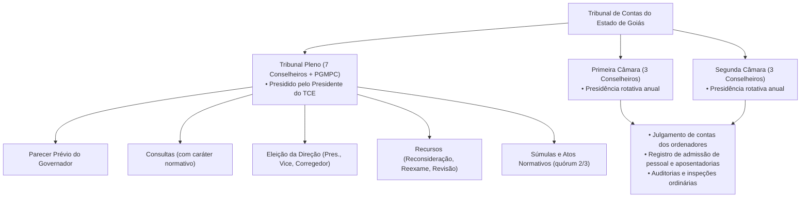
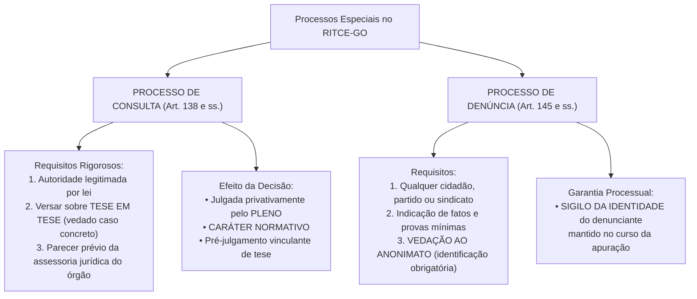

# 03 - Regimento Interno do TCE-GO (Resolução nº 22/2008)

> **Matéria:** Legislação Institucional  
> **Cargos:** A01 – Técnico de Controle Externo (Adm) / B02 – Técnico de Controle Externo (TI)  
> **Arquivo:** `03_regimento_interno_tce_go_resolucao_22_2008.md`  
> **Ato Normativo:** Resolução nº 22, de 04 de setembro de 2008 (atualizada pelas Resoluções Normativas e Administrativas posteriores)

---

## 📌 Ementa / Itens do Edital
- Regimento Interno do Tribunal de Contas do Estado de Goiás (Resolução nº 22/2008 e alterações):
  - Organização institucional do Tribunal: Plenário, Primeira Câmara, Segunda Câmara e seus respectivos órgãos de direção;
  - Tribunal Pleno: composição dos 7 Conselheiros, quórum de instalação (maioria absoluta) e deliberação (maioria simples vs. quórum qualificado de 2/3), competências privativas indelegáveis;
  - Câmaras Deliberativas (1ª e 2ª Câmaras): composição com 3 Conselheiros cada, rodízio de membros e competências originárias;
  - Órgãos de Direção Superior: Presidência, Vice-Presidência e Corregedoria-Geral; mandatos bienais de 2 (dois) anos e regra de vedação de reeleição imediata para o mesmo cargo;
  - Corregedoria-Geral: atribuições correicionais ordinárias e extraordinárias sobre serviços, conduta funcional e cumprimento de prazos processuais;
  - Ouvidoria do TCE-GO: canal de acesso do cidadão, fomento à transparência e controle social;
  - Ministério Público de Contas (MPC-GO) junto ao TCE-GO: intervenção obrigatória em todos os processos submetidos a julgamento e parecer conclusivo;
  - Conselheiros Substitutos (Auditores): substituição de Conselheiros titulares e atuação na judicância concorrente com relatoria de processos;
  - Processo no Regimento Interno: distribuição aleatória e automática, princípio do juiz natural, impedimentos e suspeições;
  - Sessões de Julgamento: ordinárias, extraordinárias, presenciais e virtuais; dinâmica das deliberações, pedido de vista regimental e sustentação oral (prazo improrrogável de 15 minutos);
  - Processos Especiais no RITCE-GO:
    - Processo de Consulta: autoridades legitimadas, requisito indeclinável de caso em tese (vedação de caso concreto), exigência de parecer técnico-jurídico prévio, caráter normativo e efeito vinculante de pré-julgamento de tese;
    - Denúncias e Representações: legitimidade popular, vedação absoluta ao anonimato, sigilo temporário da identidade do denunciante para proteção funcional e requisitos formais de admissibilidade;
    - Registro de Atos de Admissão de Pessoal e Concessão de Aposentadorias, Reformas e Pensões.

---

## 🌳 Classificação Hierárquica

```text
3. Regimento Interno do TCE-GO (Resolução nº 22/2008)
├── 3.1 Organização Institucional e Colegiados Deliberativos (Arts. 1º a 35)
│   ├── 3.1.1 Tribunal Pleno:
│   │   ├── Composição: 7 Conselheiros e presença obrigatória do Procurador-Geral de Contas
│   │   ├── Quóruns Regimentais:
│   │   │   ├── Instalação: Maioria absoluta de seus membros (mínimo de 4 Conselheiros)
│   │   │   ├── Deliberação Comum: Maioria simples dos presentes
│   │   │   └── Quórum Qualificado de 2/3 (mínimo de 5 votos): Emenda regimental, edição/revisão de Súmulas
│   │   └── Competências Privativas Indelegáveis do Pleno:
│   │       ├── Emissão de Parecer Prévio sobre as contas anuais do Governador do Estado
│   │       ├── Eleição dos órgãos diretivos (Presidente, Vice-Presidente e Corregedor-Geral)
│   │       ├── Resposta a Consultas formuladas por autoridades legitimadas
│   │       ├── Julgamento de Recursos de Reconsideração, Reexame e Revisão
│   │       └── Declaração de inidoneidade de licitantes e inabilitação para cargo em comissão
│   ├── 3.1.2 Câmaras Deliberativas (1ª e 2ª Câmaras):
│   │   ├── Composição: 3 Conselheiros em cada Câmara (Presidente do TCE não integra Câmaras ordinárias)
│   │   ├── Presidência da Câmara e rodízio periódico de Conselheiros
│   │   └── Competências Originárias:
│   │       ├── Julgamento de contas dos administradores e ordenadores de despesas (salvo Governador)
│   │       ├── Apreciação da legalidade para registro de atos de admissão e aposentadorias/pensões
│   │       └── Processos ordinários de fiscalização (auditorias, inspeções e monitoramentos)
│   └── 3.1.3 Conselheiros Substitutos (Auditores):
│       ├── Substituição plena de Conselheiros em férias, licenças ou vacâncias
│       └── Atuação concorrente na relatoria e instrução de processos distribuídos
├── 3.2 Órgãos de Direção Superior e Órgãos Vinculados (Arts. 36 a 70)
│   ├── 3.2.1 Eleição e Mandatos dos Dirigentes:
│   │   ├── Eleição bienal na última sessão ordinária do ano de encerramento do biênio
│   │   ├── Mandato de 2 (dois) anos
│   │   └── Vedação peremptória de reeleição imediata para o mesmo cargo
│   ├── 3.2.2 Presidência do TCE-GO: Representação legal, direção administrativa, gestão orçamentária e voto de desempate
│   ├── 3.2.3 Vice-Presidência: Substituição legal do Presidente e atribuições regimentais delegadas
│   ├── 3.2.4 Corregedoria-Geral: Correições ordinárias e extraordinárias, fiscalização de prazos e disciplina
│   ├── 3.2.5 Ouvidoria: Tratamento de manifestações dos cidadãos, fomento à transparência e controle social
│   └── 3.2.6 Ministério Público de Contas (MPC-GO):
│       ├── Atuação fiscalizatória indeclinável da ordem jurídica
│       └── Parecer obrigatório sobre o mérito em todos os processos julgados pelo Tribunal
├── 3.3 Dinâmica Processual, Instrução e Sessões de Julgamento (Arts. 71 a 120)
│   ├── 3.3.1 Distribuição, prevenção e sorteio equitativo entre Conselheiros e Auditores
│   ├── 3.3.2 Impedimentos e Suspeições (aplicação supletiva das normas do Código de Processo Civil)
│   ├── 3.3.3 Instrução Processual Técnica: Unidades Técnicas de Fiscalização -> Parecer do MPC -> Voto do Relator
│   ├── 3.3.4 Sessões Plenárias e de Câmaras: Ordinárias, extraordinárias e plenário virtual
│   ├── 3.3.5 Pedido de Vista Regimental: Prazo regimental e devolução obrigatória dos autos
│   └── 3.3.6 Sustentação Oral:
│       ├── Inscrição prévia dos advogados ou partes perante a Secretaria das Sessões
│       └── Prazo improrrogável de 15 (quinze) minutos por processo
└── 3.4 Processos Especiais Disciplinados no RITCE-GO (Arts. 121 a 180)
    ├── 3.4.1 Processo de Consulta:
    │   ├── Rol taxativo de autoridades legitimadas (Chefes de Poder, Secretários de Estado, PGJ, PGE)
    │   ├── Requisitos cumulativos de admissibilidade:
    │   │   ├── Versar exclusivamente sobre tese abstrata de direito (vedado caso concreto)
    │   │   ├── Pertinência temático-competencial com o controle externo
    │   │   └── Instrução obrigatória com parecer técnico-jurídico do órgão consulente
    │   └── Efeitos da Resposta do Plenário: Caráter normativo e pré-julgamento vinculante de tese
    ├── 3.4.2 Processo de Denúncia:
    │   ├── Legitimidade: Qualquer cidadão, partido político, associação legal ou entidade sindical
    │   ├── Vedação expressa ao anonimato (exigência de identificação do denunciante)
    │   └── Sigilo temporário da identidade do autor para resguardo contra retaliações
    ├── 3.4.3 Processo de Representação: Órgãos públicos, agentes de controle e equipes de fiscalização
    └── 3.4.4 Procedimento de Registro de Atos de Pessoal e Aposentadorias/Pensões
```

---

## 📖 Resumo Teórico & Pontos-Chave

### 1. Composição e Competências do Tribunal Pleno x Câmaras Deliberativas

O Regimento Interno do TCE-GO divide a competência judicante da Corte em dois níveis decisórios:



#### Quadro de Distribuição de Competências Regimentais:

| Matéria | Competência Deliberativa | Quórum Mínimo de Aprovação |
| :--- | :--- | :--- |
| **Parecer Prévio sobre as Contas do Governador** | **Tribunal Pleno** (exclusiva) | Maioria simples (presente a maioria absoluta) |
| **Eleição de Presidente, Vice e Corregedor** | **Tribunal Pleno** (exclusiva) | Maioria absoluta |
| **Aprovação / Reforma do Regimento Interno** | **Tribunal Pleno** (exclusiva) | Quórum qualificado de **2/3 (dois terços)** |
| **Aprovação / Revisão de Súmulas Jurisprudenciais** | **Tribunal Pleno** (exclusiva) | Quórum qualificado de **2/3 (dois terços)** |
| **Apreciação de Consultas** | **Tribunal Pleno** (exclusiva) | Maioria simples (caráter normativo) |
| **Recursos de Reconsideração, Reexame e Revisão** | **Tribunal Pleno** (exclusiva) | Maioria simples |
| **Registro de Admissão, Aposentadorias e Pensões** | **Primeira e Segunda Câmaras** | Maioria simples |
| **Julgamento de Contas dos Secretários e Gestores** | **Primeira e Segunda Câmaras** | Maioria simples |

---

### 2. Órgãos de Direção Superior (Mandatos e Reeleição)

* **Composição:** Presidência, Vice-Presidência e Corregedoria-Geral;
* **Eleição:** Realizada pelo Tribunal Pleno mediante votação secreta na última (ou penúltima) sessão ordinária do ano em que se encerra o mandato;
* **Duração do Mandato:** **2 (dois) anos**, coincidindo com o biênio civil;
* **Regra Proibitiva de Reeleição:** É expressamente **vedada a reeleição** de qualquer dos dirigentes para o **mesmo cargo** no período imediatamente subsequente;
* **Corregedoria-Geral:**
  * Órgão de correição e fiscalização disciplinar permanente interna;
  * Realiza correições ordinárias (anuais) e extraordinárias nos gabinetes, Câmaras e unidades administrativas do TCE-GO;
  * Instaura sindicâncias e processos disciplinares contra servidores do Tribunal.

---

### 3. Ministério Público de Contas (MPC-GO) e Conselheiros Substitutos (Auditores)

#### 3.1 Atuação do Ministério Público de Contas (MPC-GO):
* Órgão de atuação permanente perante a Corte de Contas, integrado por Procuradores de Contas chefiados pelo **Procurador-Geral de Contas**;
* **Intervenção Obrigatória:** Tem vista regimental de **todos os processos** submetidos a julgamento perante o Plenário ou as Câmaras para emitir parecer fundamentado sobre a legalidade e o mérito;
* **Nulidade Processual:** O julgamento de qualquer processo sem prévia manifestação do Ministério Público de Contas gera nulidade absoluta da deliberação colegiada.

#### 3.2 Papel dos Conselheiros Substitutos (Auditores):
* Ingressam na carreira por concurso público de provas e títulos com requisitos idênticos aos de Conselheiro;
* **Substituição de Conselheiro:** Em caso de vacância, ausência, licença ou impedimento de Conselheiro titular, o Auditor é convocado para substituí-lo no Pleno ou na Câmara, exercendo todas as funções judicantes;
* **Atuação Concorrente Ordinária:** Quando não estiverem substituindo Conselheiro titular, atuam como relatores de processos de fiscalização que lhes forem distribuídos originariamente.

---

### 4. Dinâmica das Sessões de Julgamento

1. **Ordem dos Trabalhos em Sessão:**
   - Verificação de quórum (mínimo de 4 Conselheiros no Pleno; mínimo de 2 Conselheiros na Câmara além do Presidente);
   - Leitura, discussão e aprovação da ata da sessão anterior;
   - Comunicações da Presidência e manifestações dos Conselheiros e do MPC;
   - Julgamento dos processos em pauta: relatório sintético -> parecer do MPC -> sustentação oral -> voto do Relator -> votos dos demais membros.
2. **Sustentação Oral (Art. 98 do RITCE-GO):**
   - Permitida ao responsável, interessado ou advogado com procuração nos autos;
   - Exige requerimento/inscrição formal antes da abertura dos trabalhos da sessão;
   - O tempo de sustentação oral é de **15 (quinze) minutos**, improrrogável;
   - Não cabe sustentação oral em matérias de mero expediente, diligências preparatórias ou embargos de declaração.
3. **Pedido de Vista:**
   - Qualquer Conselheiro pode pedir vista dos autos caso discorde do voto do Relator ou queira examinar a matéria detalhadamente;
   - Os autos devem ser restituídos para julgamento no prazo regimental (em regra, até a sessão ordinária subsequente).

---

### 5. Processos Especiais no RITCE-GO: Consulta e Denúncia



#### 5.1 Requisitos Cruciais da Consulta:
* **Legitimados:** Governador, Presidente da ALEGO, Presidente do TJ-GO, Procurador-Geral de Justiça (MPE), Defensor Público-Geral, Secretários de Estado e dirigentes máximos de autarquias/fundações;
* **Proibição de Caso Concreto:** A consulta **jamais** pode versar sobre contrato específico, licitação em curso ou processo em andamento. Deve versar estritamente sobre interpretação abstrata em tese;
* **Exigência de Parecer Jurídico:** A petição de consulta deve ser obrigatoriamente instruída com manifestação formal da assessoria jurídica da autoridade consulente (PGE ou assessoria interna);
* **Efeito Normativo:** Uma vez respondida pelo Pleno, a tese fixada passa a vincular os julgamentos do próprio Tribunal de Contas perante a Administração Pública.

#### 5.2 Denúncias perante o TCE-GO:
* **Legitimidade:** Qualquer cidadão, partido político, associação legalmente constituída ou entidade sindical é parte legítima para denunciar irregularidades ou ilegalidades perante o TCE-GO;
* **Vedação ao Anonimato:** O TCE-GO **não admite denúncia anônima**. A petição deve conter o nome legível, qualificação, CPF e endereço do denunciante;
* **Sigilo da Autoria:** Embora identificado perante o Tribunal, o nome do denunciante será mantido em **estrito sigilo** durante toda a fase de instrução para evitar perseguições e retaliações hierárquicas.

---

## ⚠️ Alertas de Prova & Pegadinhas da FCC

> 🚨 **ALERTA DE PROVA / PEGADINHA FCC:** A FCC adora criar situações em que um Secretário de Estado indaga ao TCE se pode assinar um aditivo específico com determinada empresa X. **Atenção:** Essa consulta será sumariamente **inadmitida e arquivada sem exame de mérito**, pois a consulta não pode versar sobre caso concreto pendente de deliberação.

> ⭐ **IMPORTANTE / QUÓRUM QUALIFICADO:** A aprovação e reforma do Regimento Interno e a aprovação ou alteração de enunciados de **Súmulas de Jurisprudência** exigem o quórum qualificado de **dois terços (2/3) dos membros do Plenário** (isto é, pelo menos 5 Conselheiros). Questões costumam colocar "maioria simples" ou "maioria absoluta" para enganar o concurseiro.

> 📌 **NOTA EXPLICATIVA / PRAZO DA SUSTENTAÇÃO ORAL:** Nos termos regimentais, o tempo para sustentação oral por advogado regularmente habilitado é de **15 (quinze) minutos** por processo. Não são 10 minutos nem 20 minutos!

> 🛑 **ATENÇÃO / VEDAÇÃO AO ANONIMATO:** A Constituição e o RITCE-GO vedam o anonimato na representação e denúncia externa. Contudo, se uma notícia anônima trouxer documentos contundentes de desvio de verbas, a Presidência pode convertê-la em matéria de fiscalização oficiosa ou de inteligência, mas a denúncia propriamente dita é formalmente rejeitada se anônima.

---

## 🌐 Fontes Oficiais e Referências Bibliográficas

* [Resolução nº 22, de 04 de setembro de 2008 - Regimento Interno do TCE-GO Consolidado](https://portal.tce.go.gov.br/regimento-interno) - Texto integral com índices remissivos.
* [Portal Institucional do TCE-GO - Estrutura Organizacional e Sessões Colegiadas](https://portal.tce.go.gov.br) - Pautas de julgamento, atas e composição do Pleno e Câmaras.
* [Código de Processo Civil (Lei nº 13.105/2015)](http://www.planalto.gov.br/ccivil_03/_ato2015-2018/2015/lei/l13105.htm) - Aplicação subsidiária e supletiva nos processos do controle externo.
* [Súmulas e Jurisprudência do TCE-GO (TCE-Juris)](https://www.tce.go.gov.br/jurisprudencia) - Enunciados sumulares aprovados pelo quórum qualificado de 2/3 do Plenário.

---

## 📝 Questões de Concurso FCC Comentadas

### Questão 01
**(FCC – TCE-GO – Analista de Controle Externo)**  
A respeito da distribuição de competências entre os órgãos colegiados deliberativos do Tribunal de Contas do Estado de Goiás, em conformidade com as regras do seu Regimento Interno (Resolução nº 22/2008), compete privativamente ao Tribunal Pleno:

* **A)** O exame e registro da concessão inicial de aposentadorias de magistrados e membros do Ministério Público Estadual.
* **B)** A emissão de parecer prévio sobre as contas anuais prestadas pelo Governador do Estado e a resposta a consultas com efeito normativo formuladas por autoridades competentes.
* **C)** A instrução probatória preliminar de denúncias anônimas apresentadas por servidores públicos estaduais.
* **D)** O julgamento ordinário da tomada de contas dos diretores de hospitais públicos estaduais e fiscais de contrato.
* **E)** A realização de correições ordinárias nas repartições da administração pública estadual para verificar a pontualidade dos servidores.

> **Gabarito: B**  
> **Comentário Detalhado:**  
> - **A) Incorreta.** Os atos de concessão de aposentadorias, reformas e pensões de quaisquer servidores ou membros de poder são de competência ordinária das **Câmaras Deliberativas** (1ª e 2ª Câmaras), e não privativos do Plenário.  
> - **B) CORRETA.** Nos termos expressos do Regimento Interno do TCE-GO, compete privativamente ao **Tribunal Pleno**: apreciar e emitir o Parecer Prévio sobre as contas de governo prestadas anualmente pelo Governador do Estado, bem como responder a consultas formuladas por autoridades legitimadas em tese, cujas decisões detêm caráter normativo e efeito vinculante de pré-julgamento.  
> - **C) Incorreta.** Denúncias anônimas não são admitidas pelo Tribunal de Contas por expressa vedação constitucional e regimental ao anonimato.  
> - **D) Incorreta.** O julgamento de contas dos ordenadores de despesas e gestores da administração direta e indireta compete ordinariamente às **Câmaras Deliberativas** (1ª e 2ª Câmaras).  
> - **E) Incorreta.** Correições internas de servidores do TCE-GO são atribuição da Corregedoria-Geral; correição de pontualidade de servidores do Executivo cabe aos órgãos do próprio Executivo.

---

### Questão 02
**(FCC – TCE-MA – Auditor de Controle Externo)**  
Determinado Presidente de Empresa Pública Estadual de Goiás encaminhou expediente de Consulta ao Tribunal de Contas do Estado de Goiás para saber se, diante das peculiaridades de um contrato em andamento com fornecedor específico de software, poderia efetuar a prorrogação contratual por mais 12 meses. A consulta veio desacompanhada de parecer jurídico interno. De acordo com o Regimento Interno do TCE-GO:

* **A)** A consulta deve ser conhecida e respondida pelo Conselheiro Relator monocraticamente, pois há urgência na continuidade do serviço público.
* **B)** A consulta não deverá ser conhecida, tanto por versar sobre caso concreto e contrato específico, quanto pela ausência de parecer do órgão de assessoria jurídica competente.
* **C)** O Tribunal Pleno deverá converter o pedido em procedimento de fiscalização sigilosa e punir o consulente com multa por litigância de má-fé.
* **D)** A consulta poderá ser admitida desde que ratificada pelo Presidente da Assembleia Legislativa em sessão plenária.
* **E)** O Regimento Interno do TCE-GO não admite a figura do processo de consulta, devendo as dúvidas ser solucionadas exclusivamente pelo Poder Judiciário.

> **Gabarito: B**  
> **Comentário Detalhado:**  
> - **A) Incorreta.** O julgamento de consulta é privativo do Tribunal Pleno (não cabe decisão monocrática de mérito) e a consulta não pode versar sobre caso concreto.  
> - **B) CORRETA.** Conforme o RITCE-GO (Art. 138 e ss.), o processo de consulta submete-se a requisitos rígidos e cumulativos de admissibilidade: 1) Versar exclusivamente sobre **caso em tese** (dúvida abstrata sobre a interpretação da norma), sendo vedado o exame de contratos determinados ou casos concretos; 2) Vir instruída obrigatoriamente com o **parecer técnico do órgão de assistência jurídica** da autoridade consulente. Como o caso versava sobre contrato determinado e não trazia parecer jurídico, a consulta não pode ser conhecida.  
> - **C) Incorreta.** A consequência da falta de requisitos de admissibilidade é o não conhecimento da consulta e o seu arquivamento, e não a imposição sumária de multa por má-fé.  
> - **D) Incorreta.** A ratificação parlamentar não sana a inadequação temática de caso concreto nem a ausência de manifestação jurídica prévia.  
> - **E) Incorreta.** O processo de consulta é expressamente previsto no Regimento Interno do TCE-GO como importante instrumento pedagógico e orientador da administração.

---

### Questão 03
**(FCC – TCE-SE – Analista de Controle Externo)**  
Nos processos submetidos a julgamento perante os órgãos colegiados do TCE-GO, no tocante ao direito de manifestação dos procuradores das partes e à ordem dos trabalhos regimentais:

* **A)** A sustentação oral é permitida aos advogados das partes pelo prazo improrrogável de quinze minutos, mediante prévio requerimento formulado perante a Secretaria das Sessões.
* **B)** A sustentação oral pode ser realizada por qualquer cidadão a qualquer tempo da sessão, pelo prazo de até trinta minutos, independentemente de procuração nos autos.
* **C)** O pedido de vista dos autos formulado por Conselheiro durante a sessão autoriza a retenção do processo pelo prazo indeterminado de até um ano.
* **D)** As sessões de julgamento das Câmaras são secretas e vedadas ao público, divulgando-se apenas a parte dispositiva do acórdão no Diário Oficial.
* **E)** A intervenção do Ministério Público de Contas nas sessões é facultativa, sendo prescindível a elaboração de parecer quando houver sustentação oral da defesa.

> **Gabarito: A**  
> **Comentário Detalhado:**  
> - **A) CORRETA.** Nos termos do art. 98 do RITCE-GO, o advogado legalmente constituído ou a parte interessada pode sustentar oralmente as razões da defesa perante o Tribunal Pleno ou as Câmaras pelo tempo de **15 (quinze) minutos**, mediante inscrição prévia formalizada perante a Secretaria das Sessões antes da abertura dos trabalhos.  
> - **B) Incorreta.** A sustentação oral exige habilitação legal e inscrição prévia, e o prazo legal é de 15 minutos (e não 30 minutos livres).  
> - **C) Incorreta.** O pedido de vista possui prazo regimental certo (em regra, devolução até a sessão ordinária subsequente), não podendo o processo permanecer retido indefinidamente.  
> - **D) Incorreta.** As sessões de julgamento do Tribunal são **públicas**, prestigiando o princípio da publicidade e a transparência (CF, Art. 37, caput e Art. 93, IX).  
> - **E) Incorreta.** A intervenção do Ministério Público de Contas é **obrigatória** em todos os processos submetidos a julgamento, sob pena de nulidade processual absoluta.

---

### Questão 04
**(FCC – TCE-PI – Auditor de Controle Externo)**  
Cidadão que teve conhecimento de irregularidades no pagamento de sobrepreço em obras públicas estaduais decide formalizar denúncia perante o Tribunal de Contas do Estado de Goiás. Segundo as normas regimentais da Corte:

* **A)** A denúncia formulada de forma anônima deve ser imediatamente autuada e encaminhada a julgamento pelo Tribunal Pleno sem necessidade de diligências.
* **B)** A denúncia exige a qualificação e identificação do denunciante, sendo vedado o anonimato, assegurando-se o sigilo quanto à sua identidade durante todo o curso da instrução.
* **C)** Somente partidos políticos com representação na Assembleia Legislativa possuem legitimidade ativa para apresentar denúncia perante o Tribunal.
* **D)** A denúncia de cidadão depende de prévia autorização da Mesa Diretora da Assembleia Legislativa para ser protocolizada no TCE-GO.
* **E)** Recebida a denúncia, a identidade do denunciante deverá ser imediatamente publicada no Diário Oficial Eletrônico para conhecimento do gestor denunciado.

> **Gabarito: B**  
> **Comentário Detalhado:**  
> - **A) Incorreta.** A Constituição e o Regimento Interno do TCE-GO vedam o anonimato na apresentação de denúncias formais de controle social.  
> - **B) CORRETA.** Nos termos regimentais, qualquer cidadão, partido político, associação ou sindicato é legítimo para formular denúncia perante o TCE-GO. O denunciante deve **identificar-se formalmente** (vedado o anonimato), mas o Tribunal **manterá sob sigilo a sua identidade** durante toda a tramitação e instrução dos autos, com o objetivo de preservá-lo de eventuais perseguições funcionais ou retaliações.  
> - **C) Incorreta.** Qualquer cidadão no gozo dos direitos civis e políticos tem legitimidade para formular denúncia.  
> - **D) Incorreta.** O direito de petição e denúncia perante o Tribunal de Contas decorre diretamente da Constituição Federal e da Lei Orgânica, prescindindo de autorização parlamentar.  
> - **E) Incorreta.** A identidade do denunciante é resguardada por sigilo legal e jamais publicada no Diário Oficial.

---

### Questão 05
**(FCC – TCE-GO – Técnico de Controle Externo)**  
No âmbito dos órgãos diretivos do Tribunal de Contas do Estado de Goiás, a eleição do Presidente, Vice-Presidente e Corregedor-Geral é regida pela Resolução nº 22/2008, a qual preconiza que:

* **A)** O mandato dos dirigentes é de quatro anos, sendo admitida uma reeleição consecutiva para o mesmo cargo.
* **B)** O mandato é de dois anos, permitida a reeleição sucessiva e indefinida caso haja aprovação por maioria absoluta do Plenário.
* **C)** O mandato é de dois anos, vedada a reeleição para o mesmo cargo no período imediatamente subsequente.
* **D)** Os dirigentes são indicados pelo Governador do Estado dentre os Conselheiros mais antigos do Tribunal.
* **E)** A Corregedoria-Geral é exercida pelo Procurador-Geral de Contas eleito em lista sêxtupla pelos servidores concursados.

> **Gabarito: C**  
> **Comentário Detalhado:**  
> - **A) Incorreta.** O mandato é de 2 anos (não 4) e é proibida a reeleição consecutiva para o mesmo cargo.  
> - **B) Incorreta.** O Regimento Interno veda taxativamente a reeleição imediata para o mesmo cargo diretivo.  
> - **C) CORRETA.** Nos termos do Regimento Interno do TCE-GO, os Conselheiros elegerão o Presidente, o Vice-Presidente e o Corregedor-Geral para um **mandato de 2 (dois) anos**, sendo expressamente **vedada a reeleição para o mesmo cargo no período imediatamente subsequente**.  
> - **D) Incorreta.** Os dirigentes são eleitos pelos próprios Conselheiros em sessão plenária do Tribunal, e não nomeados pelo Governador do Estado (garantia da autonomia institucional).  
> - **E) Incorreta.** O Corregedor-Geral é um Conselheiro titular eleito pelo Plenário. O Procurador-Geral de Contas chefia o MPC, que é órgão autônomo perante o TCE.
