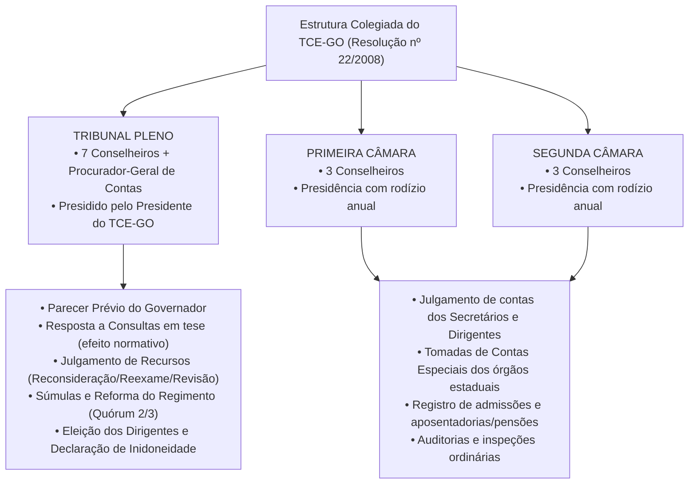
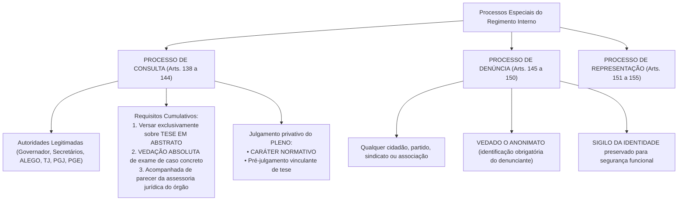

# 03 - Regimento Interno do TCE-GO (Resolução nº 22/2008)

> **Matéria:** Legislação Institucional  
> **Cargos:** A01 – Técnico de Controle Externo (Adm) / B02 – Técnico de Controle Externo (TI)  
> **Arquivo:** `03_regimento_interno_tce_go_resolucao_22_2008.md`  
> **Ato Normativo:** Resolução nº 22, de 04 de setembro de 2008 (atualizada pelas Resoluções Normativas e Administrativas posteriores)

---

## 📌 Ementa / Itens do Edital
- Regimento Interno do Tribunal de Contas do Estado de Goiás (Resolução nº 22/2008 e alterações):
    - Organização institucional do Tribunal: Plenário, Primeira Câmara, Segunda Câmara e seus respectivos órgãos de direção;
    - Tribunal Pleno: composição dos 7 Conselheiros, quórum de instalação (maioria absoluta) e deliberação (maioria simples vs. quórum qualificado de 2/3), competências privativas indelegáveis;
    - Câmaras Deliberativas (1ª e 2ª Câmaras): composição com 3 Conselheiros cada, rodízio de membros e competências originárias;
    - Órgãos de Direção Superior: Presidência, Vice-Presidência e Corregedoria-Geral; mandatos bienais de 2 (dois) anos e regra de vedação de reeleição imediata para o mesmo cargo;
    - Corregedoria-Geral: atribuições correicionais ordinárias e extraordinárias sobre serviços, conduta funcional e cumprimento de prazos processuais;
    - Ouvidoria do TCE-GO: canal de acesso do cidadão, fomento à transparência e controle social;
    - Ministério Público de Contas (MPC-GO) junto ao TCE-GO: intervenção obrigatória em todos os processos submetidos a julgamento e parecer conclusivo;
    - Conselheiros Substitutos (Auditores): substituição de Conselheiros titulares e atuação na judicância concorrente com relatoria de processos;
    - Processo no Regimento Interno: distribuição aleatória e automática, princípio do juiz natural, impedimentos e suspeições;
    - Sessões de Julgamento: ordinárias, extraordinárias, presenciais e virtuais; dinâmica das deliberações, pedido de vista regimental e sustentação oral (prazo improrrogável de 15 minutos);
    - Processos Especiais no RITCE-GO:
    - Processo de Consulta: autoridades legitimadas, requisito indeclinável de caso em tese (vedação de caso concreto), exigência de parecer técnico-jurídico prévio, caráter normativo e efeito vinculante de pré-julgamento de tese;
    - Denúncias e Representações: legitimidade popular, vedação absoluta ao anonimato, sigilo temporário da identidade do denunciante para proteção funcional e requisitos formais de admissibilidade;
    - Registro de Atos de Admissão de Pessoal e Concessão de Aposentadorias, Reformas e Pensões.

---

## 🧭 Sumário
- [1. Organização Institucional e Colegiados Deliberativos (Arts. 1º a 35)](#1-organização-institucional-e-colegiados-deliberativos-arts-1º-a-35)
    - [1.1 Tribunal Pleno: Composição, Quóruns e Competências Privativas](#11-tribunal-pleno-composição-quóruns-e-competências-privativas)
    - [1.2 Câmaras Deliberativas (1ª e 2ª Câmaras): Estrutura e Competências Originárias](#12-câmaras-deliberativas-1ª-e-2ª-câmaras-estrutura-e-competências-originárias)
    - [1.3 Papel dos Conselheiros Substitutos (Auditores)](#13-papel-dos-conselheiros-substitutos-auditores)
- [2. Órgãos de Direção Superior e Órgãos Vinculados (Arts. 36 a 70)](#2-órgãos-de-direção-superior-e-órgãos-vinculados-arts-36-a-70)
    - [2.1 Presidência, Vice-Presidência e Corregedoria-Geral: Eleição, Mandatos e Vedação à Reeleição](#21-presidência-vice-presidência-e-corregedoria-geral-eleição-mandatos-e-vedação-à-reeleição)
    - [2.2 Corregedoria-Geral e Fiscalização Correicional](#22-corregedoria-geral-e-fiscalização-correicional)
    - [2.3 Ouvidoria e Fomento ao Controle Social](#23-ouvidoria-e-fomento-ao-controle-social)
    - [2.4 Ministério Público de Contas (MPC-GO): Intervenção Obrigatória e Nulidade Processual](#24-ministério-público-de-contas-mpc-go-intervenção-obrigatória-e-nulidade-processual)
- [3. Dinâmica Processual, Instrução e Sessões de Julgamento (Arts. 71 a 120)](#3-dinâmica-processual-instrução-e-sessões-de-julgamento-arts-71-a-120)
    - [3.1 Distribuição Eletrônica, Prevenção, Impedimentos e Suspeições](#31-distribuição-eletrônica-prevenção-impedimentos-e-suspeições)
    - [3.2 Sessões Ordinárias, Extraordinárias e Plenário Virtual](#32-sessões-ordinárias-extraordinárias-e-plenário-virtual)
    - [3.3 Ordem das Deliberações, Pedido de Vista e Sustentação Oral (15 Minutos)](#33-ordem-das-deliberações-pedido-de-vista-e-sustentação-oral-15-minutos)
- [4. Processos Especiais Disciplinados no RITCE-GO (Arts. 121 a 180)](#4-processos-especiais-disciplinados-no-ritce-go-arts-121-a-180)
    - [4.1 Processo de Consulta: Legitimidade, Requisitos Rígidos e Efeito Normativo](#41-processo-de-consulta-legitimidade-requisitos-rígidos-e-efeito-normativo)
    - [4.2 Processo de Denúncia: Legitimidade Ampla, Vedação ao Anonimato e Sigilo](#42-processo-de-denúncia-legitimidade-ampla-vedação-ao-anonimato-e-sigilo)
    - [4.3 Processo de Representação Institucional](#43-processo-de-representação-institucional)
    - [4.4 Processo de Registro de Atos de Admissão de Pessoal e Concessões](#44-processo-de-registro-de-atos-de-admissão-de-pessoal-e-concessões)
- [5. Fontes Oficiais e Referências Bibliográficas](#5-fontes-oficiais-e-referências-bibliográficas)
- [6. Questões de Concurso FCC Comentadas](#6-questões-de-concurso-fcc-comentadas)

---

## 1. Organização Institucional e Colegiados Deliberativos (Arts. 1º a 35)

### 1.1 Tribunal Pleno: Composição, Quóruns e Competências Privativas
O Tribunal Pleno é o órgão supremo de deliberação do Tribunal de Contas do Estado de Goiás, integrado pela totalidade dos **sete (7) Conselheiros titulares** (ou Conselheiros Substitutos regularmente convocados), contando sempre com a presença obrigatória do Procurador-Geral de Contas ou de Procurador de Contas designado.
- **Quórum de Instalação e Funcionamento:** O Tribunal Pleno instala-se e delibera validamente com a presença da maioria absoluta de seus membros titulares, exigindo-se a presença de pelo menos **quatro (4) Conselheiros**, além do Presidente da sessão.
- **Quórum Geral de Deliberação:** As decisões do Plenário são adotadas por **maioria simples** dos votos dos membros presentes, cabendo ao Presidente o voto de qualidade (desempate), ressalvados os casos em que a legislação ou o Regimento exigir quórum qualificado.
- **Quórum Qualificado de 2/3 (dois terços):** Exige a manifestação favorável de pelo menos **cinco (5) Conselheiros** para:
    1. Aprovação e alteração do Regimento Interno do TCE-GO;
    2. Aprovação, revisão ou cancelamento de enunciados da **Súmula de Jurisprudência** do Tribunal;
    3. Proposta de criação ou extinção de cargos e funções do quadro do Tribunal, bem como fixação de subsídios.
- **Competências Privativas Indelegáveis do Tribunal Pleno:**
    - Apreciar e emitir o **Parecer Prévio** sobre as contas prestadas anualmente pelo Chefe do Poder Executivo (Governador do Estado);
    - Eleger o Presidente, o Vice-Presidente e o Corregedor-Geral do Tribunal para mandato bienal;
    - Julgar privativamente todos os recursos de **Reconsideração, Reexame e Revisão** interpostos contra decisões da Corte;
    - Responder a **Consultas** formuladas por autoridades legitimadas sobre dúvidas na aplicação de dispositivos legais em tese;
    - Aplicar as sanções de **declaração de inidoneidade para licitar** (Art. 44 da LOTCE) e **inabilitação para cargo em comissão** (Art. 43 da LOTCE).

---

### 1.2 Câmaras Deliberativas (1ª e 2ª Câmaras): Estrutura e Competências Originárias
O Tribunal divide-se operacionalmente em **duas Câmaras Deliberativas** (Primeira e Segunda Câmaras), destinadas a conferir celeridade à judicância do controle externo ordinário.
- **Composição das Câmaras:** Cada Câmara é composta por **três (3) Conselheiros titulares**. O Presidente do Tribunal de Contas **não integra** nenhuma das Câmaras, atuando exclusivamente na direção geral do órgão e na presidência do Plenário.
- **Presidência da Câmara e Rodízio:** A presidência de cada Câmara é exercida por um de seus membros efetivos, em sistema de rodízio anual, vedada a recondução imediata na mesma Câmara se houver outro Conselheiro que ainda não tenha exercido a função. O Regimento prevê a alternância periódica de Conselheiros entre as duas Câmaras.
- **Competências Originárias das Câmaras:**
    - Julgar as tomadas e prestações de contas ordinárias e tomadas de contas especiais de administradores e ordenadores de despesas dos órgãos da administração direta, autarquias, fundações e empresas estatais;
    - Apreciar a legalidade, para fins de registro, dos atos de admissão de pessoal e das concessões iniciais de aposentadorias, reformas e pensões civis e militares;
    - Deliberar sobre processos de auditorias e inspeções ordinárias do Plano Anual de Fiscalização.

---

### 1.3 Papel dos Conselheiros Substitutos (Auditores)
Os Conselheiros Substitutos (Auditores) ingressam na carreira do TCE-GO exclusivamente mediante concurso público de provas e títulos:

- **Substituição Plena de Conselheiro:** Em caso de vacância temporária, férias, licenças regulamentares ou impedimentos formais de Conselheiro titular, o Auditor é convocado pela Presidência para atuar como Conselheiro Substituto com assento no Pleno ou na Câmara respectiva, exercendo a judicância com as mesmas garantias, prerrogativas e deveres inerentes ao cargo titular.
- **Judicância Concorrente:** Fora dos períodos de substituição plena, os Conselheiros Substitutos exercem função ordinária de judicância, instruindo e relatando processos de fiscalização e matérias administrativas que lhes sejam distribuídos por sorteio pelo sistema eletrônico.

---

## 2. Órgãos de Direção Superior e Órgãos Vinculados (Arts. 36 a 70)

### 2.1 Presidência, Vice-Presidência e Corregedoria-Geral: Eleição, Mandatos e Vedação à Reeleição
A direção superior do TCE-GO é composta pelo **Presidente**, pelo **Vice-Presidente** e pelo **Corregedor-Geral**, eleitos pelo Tribunal Pleno mediante votação secreta na última sessão ordinária do mês de dezembro do ano de término do mandato:

- **Duração do Mandato:** Mandato fixo de **dois (2) anos**, iniciando-se a posse formal no primeiro dia útil do mês de janeiro subsequente à eleição.
- **Vedação Peremptória de Reeleição:** É expressamente **proibida a reeleição** de qualquer Conselheiro para o **mesmo cargo diretivo** no período imediatamente subsequente (Art. 38 do RITCE-GO). Essa vedação resguarda o princípio republicano e a salutar alternância na cúpula do controle externo goiano.
- **Presidência do TCE-GO:** É o órgão de representação política, institucional e legal da Corte perante os demais Poderes. Compete-lhe dirigir a administração, superintender os serviços e quadro técnico, praticar atos de gestão orçamentária, presidir o Plenário e proferir voto ordinário em matérias administrativas ou de quórum qualificado, bem como o **voto de desempate (voto de qualidade)** nos julgamentos de processos de controle externo.
- **Vice-Presidência:** Substitui o Presidente em suas ausências, faltas, férias ou impedimentos, auxiliando na supervisão dos serviços e exercendo atribuições delegadas por ato formal da Presidência.

---

### 2.2 Corregedoria-Geral e Fiscalização Correicional
A Corregedoria-Geral é exercida por Conselheiro titular eleito para mandato bienal:

- **Atribuições Correicionais:** Realiza correições ordinárias (anuais obrigatórias) e extraordinárias nos gabinetes de Conselheiros, Auditores, Secretarias de Câmaras e unidades administrativas do Tribunal;
- **Fiscalização de Prazos e Conduta:** Fiscaliza o cumprimento rigoroso dos prazos regimentais de instrução, relatoria e julgamento de processos, além de apurar desvios disciplinares funcionais de servidores da Corte, instaurando sindicâncias e comissões de PAD.

---

### 2.3 Ouvidoria e Fomento ao Controle Social
A Ouvidoria do TCE-GO atua como canal direto de interlocução entre o cidadão e a Corte de Contas, visando:

- Receber sugestões, reclamações, elogios e manifestações sobre os serviços prestados pelo Tribunal;
- Orientar o público externo sobre a forma adequada de acessar informações públicas (Lei de Acesso à Informação - LAI) e formular denúncias sobre má aplicação do dinheiro público goiano.

---

### 2.4 Ministério Público de Contas (MPC-GO): Intervenção Obrigatória e Nulidade Processual
O Ministério Público de Contas atua junto ao TCE-GO como fiscal permanente da ordem jurídica:

- **Obrigatoriedade de Parecer Prévio:** Tem vista e intervenção **obrigatória em todos os processos** de controle externo sujeitos a julgamento pelo Pleno ou pelas Câmaras.
- **Nulidade Absoluta:** O julgamento colegiado realizado sem prévia oportunidade de manifestação formal e parecer do Ministério Público de Contas é portador de vício de nulidade insanável por afronta ao devido processo legal.

---

## 3. Dinâmica Processual, Instrução e Sessões de Julgamento (Arts. 71 a 120)

### 3.1 Distribuição Eletrônica, Prevenção, Impedimentos e Suspeições
- **Distribuição Aleatória:** Os processos são autuados e distribuídos eletronicamente entre Conselheiros e Auditores mediante sistema informatizado, assegurando-se a alternância, o sorteio público e a estrita observância do princípio do **juiz natural**.
- **Prevenção Regimental:** O conhecimento de medida cautelar preparatória, consulta anterior ou recurso conexo previne a competência do Relator originário para os feitos posteriores que versem sobre o mesmo objeto.
- **Impedimentos e Suspeições:** Aplicam-se aos membros do TCE-GO e aos Procuradores do MPC-GO as hipóteses legais de impedimento e suspeição previstas na legislação processual civil (Código de Processo Civil - CPC/2015), tais como parentesco até o terceiro grau com interessados, interesse econômico ou inimizade capital.

---

### 3.2 Sessões Ordinárias, Extraordinárias e Plenário Virtual
As deliberações do Pleno e das Câmaras ocorrem em:

- **Sessões Ordinárias:** Realizadas em dias e horários pré-fixados no calendário regimental divulgado anualmente;
- **Sessões Extraordinárias:** Convocadas pelo Presidente em virtude de relevância, urgência pública ou acúmulo de pauta, com notificação prévia aos Conselheiros;
- **Plenário Virtual:** Julgamento eletrônico assíncrono de processos padronizados ou de menor complexidade jurídica (como registro ordinário de pensões e aposentadorias que contam com parecer convergente da área técnica e do MPC), resguardado às partes o direito de requerer destaque para julgamento em sessão presencial.

---

### 3.3 Ordem das Deliberações, Pedido de Vista e Sustentação Oral (15 Minutos)

1. **Rito de Votação em Sessão:**
    - O Relator profere o relatório circunstanciado e o seu voto fundamentado;
    - As partes ou procuradores inscritos realizam a sustentação oral;
    - Manifesta-se o representante do Ministério Público de Contas;
    - Votam os Conselheiros na ordem regimental de antiguidade;
    - Proclamação do resultado pelo Presidente da sessão.
2. **Pedido de Vista Regimental:** Qualquer Conselheiro ou Auditor votante que tenha dúvida sobre a matéria pode pedir vista dos autos. O processo deve ser devolvido impreterivelmente no prazo assinado pelo Regimento (regra geral, até a sessão ordinária subsequente), vedada a retenção indefinida do processo em gabinete.
3. **Sustentação Oral (Art. 98 do RITCE-GO):**
    - Garantida ao responsável, ao interessado direto ou ao advogado regularmente munido de instrumento de procuração;
    - Exige protocolo ou inscrição formal perante a Secretaria das Sessões **antes do início da sessão de julgamento**;
    - O tempo de manifestação é fixado no prazo **improrrogável de 15 (quinze) minutos** por processo. Não é cabível sustentação oral em matérias de mero expediente, fixação de diligências preliminares ou julgamento de embargos de declaração.

> 🚨 **ALERTA DE PROVA / PEGADINHA FCC:** Questões da FCC frequentemente trazem o prazo de sustentação oral como "10 minutos" ou "20 minutos com prorrogação". O prazo do RITCE-GO é de **15 minutos, improrrogável**. Memorize este número exato!

---

## 4. Processos Especiais Disciplinados no RITCE-GO (Arts. 121 a 180)

### 4.1 Processo de Consulta: Legitimidade, Requisitos Rígidos e Efeito Normativo
A Consulta é o mecanismo pelo qual as autoridades dirigentes do Estado submetem dúvidas jurídicas ao Tribunal de Contas sobre a correta aplicação de normas orçamentárias e financeiras:

- **Rol Taxativo de Autoridades Legitimadas:** Governador do Estado; Presidente da Assembleia Legislativa; Presidente do Tribunal de Justiça; Procurador-Geral de Justiça (MPE); Defensor Público-Geral; Secretários de Estado; e dirigentes superiores de autarquias e fundações.
- **Requisitos de Admissibilidade Indeclináveis (Sob pena de arquivamento sumário):**
    1. Versar estritamente sobre **dúvida na aplicação de lei em tese (abstrata)**;
    2. **Vedação absoluta de caso concreto:** A consulta jamais pode versar sobre situação fática determinada, contrato específico em execução, edital em andamento ou processo administrativo instaurado;
    3. **Instrução obrigatória com parecer jurídico:** A petição deve ser obrigatoriamente instruída com manifestação formal e fundamentada da assessoria jurídica da autoridade consulente (ex.: Procuradoria-Geral do Estado - PGE-GO ou consultoria jurídica da pasta).
- **Efeitos da Resposta do Tribunal Pleno:** O julgamento da consulta é competência privativa do Plenário. A resposta proferida tem **caráter normativo** e constitui **pré-julgamento da tese**, vinculando a Administração e as futuras deliberações do próprio TCE-GO, embora não examine a situação fática específica do consulente.

> 🚨 **ALERTA DE PROVA / PEGADINHA FCC:** Se a questão da FCC narrar que um Secretário de Estado consultou o Tribunal sobre se pode contratar dispensando licitação a empresa "X" para fornecer ambulâncias no contrato nº 123/2026, a resposta correta é: **A consulta NÃO será conhecida**, por versar sobre caso concreto e contrato individualizado.

---

### 4.2 Processo de Denúncia: Legitimidade Ampla, Vedação ao Anonimato e Sigilo
- **Legitimidade Ativa Ampla:** Qualquer cidadão brasileiro no gozo de seus direitos políticos, partido político registrado no TSE, associação legalmente constituída ou sindicato tem legitimidade para representar e denunciar ilegalidades ou irregularidades de gestão perante o TCE-GO.
- **Vedação Peremptória ao Anonimato:** Em homenagem ao princípio republicano e ao texto expresso da CF/88 (Art. 5º, IV), **o TCE-GO não admite denúncias anônimas**. A petição de denúncia deve conter o nome completo legível, comprovação de qualificação civil, número do CPF/CNPJ, domicílio e indicação clara de indícios materiais e provas do fato alegado.
- **Sigilo Protetivo da Identidade do Denunciante:** Recebida e admitida a denúncia formal, a Secretaria do Tribunal autuará o processo atribuindo-lhe caráter de **sigilo temporário quanto à qualificação do denunciante**, resguardando sua integridade funcional e prevenindo perseguições políticas até a decisão definitiva do feito.

---

### 4.3 Processo de Representação Institucional
A representação é o instrumento de notícia de irregularidade promovido por agentes e órgãos públicos no cumprimento de dever funcional de ofício:

- Pode ser formulada por Conselheiros, Auditores, membros do Ministério Público de Contas, órgãos de controle interno, servidores de equipes de auditoria ou autoridades públicas estaduais e municipais;
- Dispensa as formalidades protetivas de sigilo de identidade típicas da denúncia popular, instaurando-se processo autônomo de fiscalização.

---

### 4.4 Processo de Registro de Atos de Admissão de Pessoal e Concessões
Os atos de admissão de concursados e as concessões iniciais de aposentadorias, reformas e pensões são fiscalizados em processo eletrônico próprio remetido ao TCE pelos órgãos de previdência:

- A deliberação compete privativamente às **Câmaras Deliberativas** (1ª e 2ª Câmaras);
- Sendo verificado vício de legalidade insanável, o Tribunal nega o registro do ato e assina prazo de **30 (trinta) dias** para que o órgão de origem cesse o pagamento e recolha aos cofres públicos as quantias indevidamente pagas de má-fé.

---

## 5. Fontes Oficiais e Referências Bibliográficas

* [Resolução nº 22, de 04 de setembro de 2008 (RITCE-GO)](https://portal.tce.go.gov.br/regimento-interno) - Texto consolidado com alterações regimentais.
* [Portal do Tribunal de Contas do Estado de Goiás](https://portal.tce.go.gov.br) - Estrutura institucional, competências de órgãos colegiados e pautas de julgamento.
* [Código de Processo Civil (Lei Federal nº 13.105/2015)](http://www.planalto.gov.br) - Arts. 144 a 148 (Regime de impedimentos e suspeições judiciais).
* [Súmulas e Enunciados de Jurisprudência do TCE-GO](https://www.tce.go.gov.br/jurisprudencia) - Interpretações normativas sumuladas pelo Tribunal Pleno.

---

## 6. Questões de Concurso FCC Comentadas

### Questão 01
**(FCC – TCE-GO – Analista de Controle Externo)**  
A respeito da distribuição de competências entre os órgãos colegiados deliberativos do Tribunal de Contas do Estado de Goiás, em conformidade com as regras do seu Regimento Interno (Resolução nº 22/2008), compete privativamente ao Tribunal Pleno:

* A) O exame e registro da concessão inicial de aposentadorias de magistrados e membros do Ministério Público Estadual.
* B) A emissão de parecer prévio sobre as contas anuais prestadas pelo Governador do Estado e a resposta a consultas com efeito normativo formuladas por autoridades competentes.
* C) A instrução probatória preliminar de denúncias anônimas apresentadas por servidores públicos estaduais.
* D) O julgamento ordinário da tomada de contas dos diretores de hospitais públicos estaduais e fiscais de contrato.
* E) A realização de correições ordinárias nas repartições da administração pública estadual para verificar a pontualidade dos servidores.

> **Comentário Detalhado:**
> - **A) Incorreta.** O exame e registro da legalidade das concessões de aposentadorias e reformas constituem atribuição precípua e ordinária das **Câmaras Deliberativas** (1ª e 2ª Câmaras), e não competência privativa do Plenário.
> - **B) CORRETA.** Nos termos expressos do Regimento Interno do TCE-GO, insere-se no rol de competências privativas do **Tribunal Pleno**: a apreciação para emissão do Parecer Prévio sobre as contas de governo prestadas anualmente pelo Governador do Estado, bem como o conhecimento e resposta a consultas em tese, as quais gozam de caráter normativo vinculante.
> - **C) Incorreta.** Denúncias anônimas não são admitidas pelo Tribunal de Contas em virtude de expressa vedação regimental e constitucional ao anonimato.
> - **D) Incorreta.** O julgamento de contas de gestão e tomadas de contas especiais de diretores, secretários e administradores compete originariamente às **Câmaras Deliberativas**.
> - **E) Incorreta.** As correições ordinárias internas são exercidas pela Corregedoria-Geral do TCE sobre os próprios órgãos da Corte de Contas; o controle da pontualidade de servidores do Poder Executivo é competência interna do próprio Executivo.
> 
> **Gabarito: B**

---

### Questão 02
**(FCC – TCE-MA – Auditor de Controle Externo)**  
Determinado Presidente de Empresa Pública Estadual de Goiás encaminhou expediente de Consulta ao Tribunal de Contas do Estado de Goiás para saber se, diante das peculiaridades de um contrato em andamento com fornecedor específico de software, poderia efetuar a prorrogação contratual por mais 12 meses. A consulta veio desacompanhada de parecer jurídico interno. De acordo com o Regimento Interno do TCE-GO:

* A) A consulta deve ser conhecida e respondida pelo Conselheiro Relator monocraticamente, pois há urgência na continuidade do serviço público.
* B) A consulta não deverá ser conhecida, tanto por versar sobre caso concreto e contrato específico, quanto pela ausência de parecer do órgão de assessoria jurídica competente.
* C) O Tribunal Pleno deverá converter o pedido em procedimento de fiscalização sigilosa e punir o consulente com multa por litigância de má-fé.
* D) A consulta poderá ser admitida desde que ratificada pelo Presidente da Assembleia Legislativa em sessão plenária.
* E) O Regimento Interno do TCE-GO não admite a figura do processo de consulta, devendo as dúvidas ser solucionadas exclusivamente pelo Poder Judiciário.

> **Comentário Detalhado:**
> - **A) Incorreta.** A apreciação de consultas constitui matéria indelegável do Tribunal Pleno, sendo vedada a resolução monocrática do mérito da tese por Conselheiro Relator.
> - **B) CORRETA.** Nos termos dos artigos 138 e seguintes do RITCE-GO, o processo de consulta submete-se cumulativamente a dois requisitos formais intransponíveis: 1) versar obrigatoriamente sobre dúvida de direito em **caso em tese** (sendo expressamente vedada a submissão de caso concreto ou contrato individualizado); 2) vir acompanhada de **parecer da assessoria jurídica do órgão consulente**. O descumprimento de qualquer desses pressupostos impõe o não conhecimento da consulta e o seu consequente arquivamento sumário.
> - **C) Incorreta.** O descumprimento dos requisitos de admissibilidade da consulta acarreta seu mero não conhecimento, não ensejando sanção imediata por má-fé.
> - **D) Incorreta.** A aprovação parlamentar não supre os requisitos regimentais de abstração do tema nem a exigência de parecer técnico da assessoria jurídica do órgão.
> - **E) Incorreta.** O processo de consulta é amplamente previsto no RITCE-GO como instrumento orientador e preventivo de controle externo.
> 
> **Gabarito: B**

---

### Questão 03
**(FCC – TCE-SE – Analista de Controle Externo)**  
Nos processos submetidos a julgamento perante os órgãos colegiados do TCE-GO, no tocante ao direito de manifestação dos procuradores das partes e à ordem dos trabalhos regimentais:

* A) A sustentação oral é permitida aos advogados das partes pelo prazo improrrogável de quinze minutos, mediante prévio requerimento formulado perante a Secretaria das Sessões.
* B) A sustentação oral pode ser realizada por qualquer cidadão a qualquer tempo da sessão, pelo prazo de até trinta minutos, independentemente de procuração nos autos.
* C) O pedido de vista dos autos formulado por Conselheiro durante a sessão autoriza a retenção do processo pelo prazo indeterminado de até um ano.
* D) As sessões de julgamento das Câmaras são secretas e vedadas ao público, divulgando-se apenas a parte dispositiva do acórdão no Diário Oficial.
* E) A intervenção do Ministério Público de Contas nas sessões é facultativa, sendo prescindível a elaboração de parecer quando houver sustentação oral da defesa.

> **Comentário Detalhado:**
> - **A) CORRETA.** Conforme prescreve o artigo 98 do RITCE-GO, o advogado legalmente constituído ou o próprio responsável tem o direito de produzir sustentação oral perante o Plenário ou as Câmaras pelo prazo **improrrogável de 15 (quinze) minutos**, devendo protocolar inscrição perante a Secretaria das Sessões antes do início dos trabalhos da sessão colegiada.
> - **B) Incorreta.** A sustentação oral exige prévia inscrição formal e capacidade postulatória ou interesse direto demonstrado, sendo o prazo estrito de 15 minutos (não 30 minutos).
> - **C) Incorreta.** O pedido de vista dos autos deve observar o prazo regimental de restituição para pauta subsequente, sendo vedada a retenção indefinida.
> - **D) Incorreta.** As sessões colegiadas do TCE-GO regem-se pela regra constitucional da **publicidade estrita**, sendo abertas ao público e transmitidas em canais oficiais.
> - **E) Incorreta.** A atuação do Ministério Público de Contas com intervenção oral ou escrita é **obrigatória** em todos os processos submetidos a julgamento, sob pena de nulidade absoluta do julgado.
> 
> **Gabarito: A**

---

### Questão 04
**(FCC – TCE-PI – Auditor de Controle Externo)**  
Cidadão que teve conhecimento de irregularidades no pagamento de sobrepreço em obras públicas estaduais decide formalizar denúncia perante o Tribunal de Contas do Estado de Goiás. Segundo as normas regimentais da Corte:

* A) A denúncia formulada de forma anônima deve ser imediatamente autuada e encaminhada a julgamento pelo Tribunal Pleno sem necessidade de diligências.
* B) A denúncia exige a qualificação e identificação do denunciante, sendo vedado o anonimato, assegurando-se o sigilo quanto à sua identidade durante todo o curso da instrução.
* C) Somente partidos políticos com representação na Assembleia Legislativa possuem legitimidade ativa para apresentar denúncia perante o Tribunal.
* D) A denúncia de cidadão depende de prévia autorização da Mesa Diretora da Assembleia Legislativa para ser protocolizada no TCE-GO.
* E) Recebida a denúncia, a identidade do denunciante deverá ser imediatamente publicada no Diário Oficial Eletrônico para conhecimento do gestor denunciado.

> **Comentário Detalhado:**
> - **A) Incorreta.** A denúncia anônima é inadmissível por expressa vedação da Constituição da República (Art. 5º, IV) e do Regimento Interno do TCE-GO.
> - **B) CORRETA.** Em conformidade com o regramento dos artigos 145 e seguintes do RITCE-GO, o denunciante tem a obrigação de **qualificar-se formalmente com apresentação de documentos e endereço** (vedado o anonimato). Todavia, para preservar sua incolumidade pessoal e resguardá-lo de perseguições funcionais, a Corte **manterá sob estrito sigilo a identidade do autor** da denúncia durante a tramitação processual.
> - **C) Incorreta.** A legitimidade popular é ampla: qualquer cidadão em pleno gozo de direitos políticos, bem como partidos, associações e sindicatos, pode formalizar denúncia.
> - **D) Incorreta.** O direito de denúncia de controle social é exercido diretamente perante o Tribunal de Contas, dispensando qualquer intermediação ou chancela da Assembleia Legislativa.
> - **E) Incorreta.** Divulgar o nome do denunciante violaria a garantia legal de sigilo protetivo imposta pelo Regimento Interno.
> 
> **Gabarito: B**

---

### Questão 05
**(FCC – TCE-GO – Técnico de Controle Externo)**  
No âmbito dos órgãos diretivos do Tribunal de Contas do Estado de Goiás, a eleição do Presidente, Vice-Presidente e Corregedor-Geral é regida pela Resolução nº 22/2008, a qual preconiza que:

* A) O mandato dos dirigentes é de quatro anos, sendo admitida uma reeleição consecutiva para o mesmo cargo.
* B) O mandato é de dois anos, permitida a reeleição sucessiva e indefinida caso haja aprovação por maioria absoluta do Plenário.
* C) O mandato é de dois anos, vedada a reeleição para o mesmo cargo no período imediatamente subsequente.
* D) Os dirigentes são indicados pelo Governador do Estado dentre os Conselheiros mais antigos do Tribunal.
* E) A Corregedoria-Geral é exercida pelo Procurador-Geral de Contas eleito em lista sêxtupla pelos servidores concursados.

> **Comentário Detalhado:**
> - **A) Incorreta.** O mandato diretivo tem a duração legal de 2 (dois) anos, sendo vedada a recondução imediata para o mesmo cargo.
> - **B) Incorreta.** O Regimento veda expressamente a reeleição consecutiva para a mesma função de direção.
> - **C) CORRETA.** Nos termos do artigo 38 do Regimento Interno do TCE-GO, os Conselheiros titulares elegerão, em escrutínio secreto pelo Pleno, o Presidente, o Vice-Presidente e o Corregedor-Geral para um **mandato bienal de 2 (dois) anos**, sendo expressamente **vedada a reeleição para o mesmo cargo no período imediatamente subsequente**.
> - **D) Incorreta.** O TCE-GO possui autogoverno constitucional; os dirigentes são eleitos internamente pelos membros do Plenário e não indicados pelo Governador do Estado.
> - **E) Incorreta.** O Corregedor-Geral é obrigatoriamente um Conselheiro titular do TCE-GO eleito pelos pares; o MPC é chefiado pelo Procurador-Geral de Contas, órgão com funções ministeriais autônomas perante o Tribunal.
> 
> **Gabarito: C**
