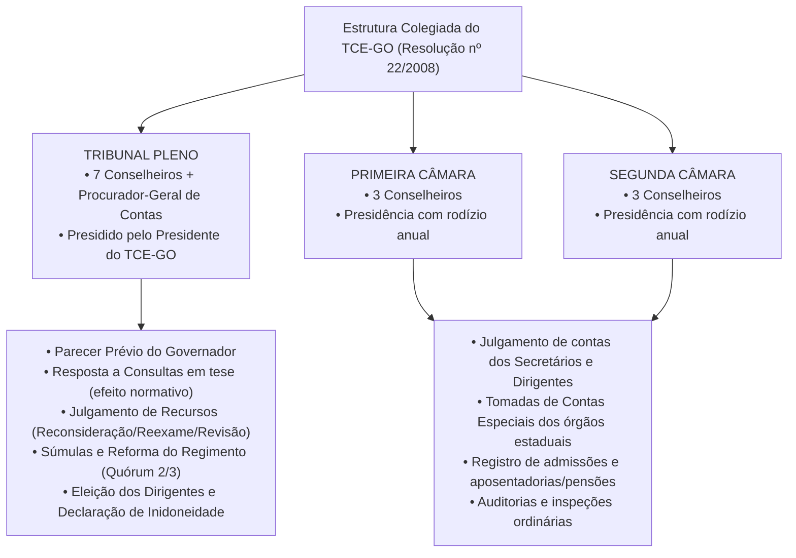
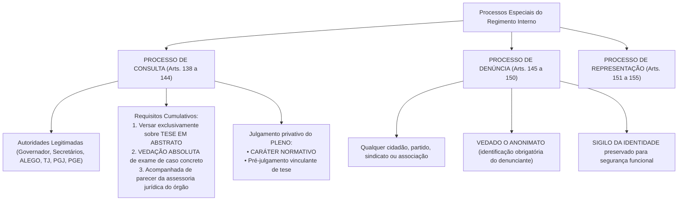

# 03 - Regimento Interno do TCE-GO (Resolução nº 22/2008)

> **Matéria:** Legislação Institucional  
> **Cargos:** A01 – Técnico de Controle Externo (Adm) / B02 – Técnico de Controle Externo (TI)  
> **Arquivo:** `03_regimento_interno_tce_go_resolucao_22_2008.md`  
> **Ato Normativo:** Resolução nº 22, de 04 de setembro de 2008 (atualizada pelas Resoluções Normativas e Administrativas posteriores)

---

## 📌 Ementa / Itens do Edital
- Regimento Interno do Tribunal de Contas do Estado de Goiás (Resolução nº 22/2008 e alterações):
    - Organização institucional do Tribunal: Plenário, Primeira Câmara, Segunda Câmara e seus respectivos órgãos de direção;
    - Tribunal Pleno: composição dos 7 Conselheiros, quórum de instalação (maioria absoluta) e deliberação (maioria simples vs. quórum qualificado de 2/3), competências privativas indelegáveis;
    - Câmaras Deliberativas (1ª e 2ª Câmaras): composição com 3 Conselheiros cada, rodízio de membros e competências originárias;
    - Órgãos de Direção Superior: Presidência, Vice-Presidência e Corregedoria-Geral; mandatos bienais de 2 (dois) anos e regra de vedação de reeleição imediata para o mesmo cargo;
    - Corregedoria-Geral: atribuições correicionais ordinárias e extraordinárias sobre serviços, conduta funcional e cumprimento de prazos processuais;
    - Ouvidoria do TCE-GO: canal de acesso do cidadão, fomento à transparência e controle social;
    - Ministério Público de Contas (MPC-GO) junto ao TCE-GO: intervenção obrigatória em todos os processos submetidos a julgamento e parecer conclusivo;
    - Conselheiros Substitutos (Auditores): substituição de Conselheiros titulares e atuação na judicância concorrente com relatoria de processos;
    - Processo no Regimento Interno: distribuição aleatória e automática, princípio do juiz natural, impedimentos e suspeições;
    - Sessões de Julgamento: ordinárias, extraordinárias, presenciais e virtuais; dinâmica das deliberações, pedido de vista regimental e sustentação oral (prazo improrrogável de 15 minutos);
    - Processos Especiais no RITCE-GO:
    - Processo de Consulta: autoridades legitimadas, requisito indeclinável de caso em tese (vedação de caso concreto), exigência de parecer técnico-jurídico prévio, caráter normativo e efeito vinculante de pré-julgamento de tese;
    - Denúncias e Representações: legitimidade popular, vedação absoluta ao anonimato, sigilo temporário da identidade do denunciante para proteção funcional e requisitos formais de admissibilidade;
    - Registro de Atos de Admissão de Pessoal e Concessão de Aposentadorias, Reformas e Pensões.

---

## 🧭 Sumário

1. [Organização Institucional e Colegiados Deliberativos (Arts. 1º a 35)](#1-organizacao-institucional-e-colegiados-deliberativos-arts-1o-a-35)
    1. [Tribunal Pleno: Composição, Quóruns e Competências Privativas](#11-tribunal-pleno-composicao-quoruns-e-competencias-privativas)
    2. [Câmaras Deliberativas (1ª e 2ª Câmaras): Estrutura e Competências Originárias](#12-camaras-deliberativas-1a-e-2a-camaras-estrutura-e-competencias-originarias)
    3. [Papel dos Conselheiros Substitutos (Auditores)](#13-papel-dos-conselheiros-substitutos-auditores)
    4. [Teste 142](#Teste-142)
    5. [Teste 143](#Teste-143)
2. [Órgãos de Direção Superior e Órgãos Vinculados (Arts. 36 a 70)](#2-orgaos-de-direcao-superior-e-orgaos-vinculados-arts-36-a-70)
    1. [Presidência, Vice-Presidência e Corregedoria-Geral: Eleição, Mandatos e Vedação à Reeleição](#21-presidencia-vice-presidencia-e-corregedoria-geral-eleicao-mandatos-e-vedacao-a-reeleicao)
    2. [Corregedoria-Geral e Fiscalização Correicional](#22-corregedoria-geral-e-fiscalizacao-correicional)
    3. [Ouvidoria e Fomento ao Controle Social](#23-ouvidoria-e-fomento-ao-controle-social)
    4. [Ministério Público de Contas (MPC-GO): Intervenção Obrigatória e Nulidade Processual](#24-ministerio-publico-de-contas-mpc-go-intervencao-obrigatoria-e-nulidade-processual)
    5. [Teste 144](#Teste-144)
    6. [Teste 145](#Teste-145)
3. [Dinâmica Processual, Instrução e Sessões de Julgamento (Arts. 71 a 120)](#3-dinamica-processual-instrucao-e-sessoes-de-julgamento-arts-71-a-120)
    1. [Distribuição Eletrônica, Prevenção, Impedimentos e Suspeições](#31-distribuicao-eletronica-prevencao-impedimentos-e-suspeicoes)
    2. [Sessões Ordinárias, Extraordinárias e Plenário Virtual](#32-sessoes-ordinarias-extraordinarias-e-plenario-virtual)
    3. [Ordem das Deliberações, Pedido de Vista e Sustentação Oral (15 Minutos)](#33-ordem-das-deliberacoes-pedido-de-vista-e-sustentacao-oral-15-minutos)
    4. [Teste 146](#Teste-146)
    5. [Teste 147](#Teste-147)
    6. [Teste 148](#Teste-148)
4. [Processos Especiais Disciplinados no RITCE-GO (Arts. 121 a 180)](#4-processos-especiais-disciplinados-no-ritce-go-arts-121-a-180)
    1. [Processo de Consulta: Legitimidade, Requisitos Rígidos e Efeito Normativo](#41-processo-de-consulta-legitimidade-requisitos-rigidos-e-efeito-normativo)
    2. [Processo de Denúncia: Legitimidade Ampla, Vedação ao Anonimato e Sigilo](#42-processo-de-denuncia-legitimidade-ampla-vedacao-ao-anonimato-e-sigilo)
    3. [Processo de Representação Institucional](#43-processo-de-representacao-institucional)
    4. [Processo de Registro de Atos de Admissão de Pessoal e Concessões](#44-processo-de-registro-de-atos-de-admissao-de-pessoal-e-concessoes)
    5. [Teste 149](#Teste-149)
    6. [Teste 150](#Teste-150)
    7. [Teste 151](#Teste-151)
5. [Fontes Oficiais e Referências Bibliográficas](#5-fontes-oficiais-e-referencias-bibliograficas)

---

## 1. Organização Institucional e Colegiados Deliberativos (Arts. 1º a 35)

### 1.1 Tribunal Pleno: Composição, Quóruns e Competências Privativas
O Tribunal Pleno é o órgão supremo de deliberação do Tribunal de Contas do Estado de Goiás, integrado pela totalidade dos **sete (7) Conselheiros titulares** (ou Conselheiros Substitutos regularmente convocados), contando sempre com a presença obrigatória do Procurador-Geral de Contas ou de Procurador de Contas designado.

- **Quórum de Instalação e Funcionamento:** O Tribunal Pleno instala-se e delibera validamente com a presença da maioria absoluta de seus membros titulares, exigindo-se a presença de pelo menos **quatro (4) Conselheiros**, além do Presidente da sessão.
- **Quórum Geral de Deliberação:** As decisões do Plenário são adotadas por **maioria simples** dos votos dos membros presentes, cabendo ao Presidente o voto de qualidade (desempate), ressalvados os casos em que a legislação ou o Regimento exigir quórum qualificado.
- **Quórum Qualificado de 2/3 (dois terços):** Exige a manifestação favorável de pelo menos **cinco (5) Conselheiros** para:
    1. Aprovação e alteração do Regimento Interno do TCE-GO;
    2. Aprovação, revisão ou cancelamento de enunciados da **Súmula de Jurisprudência** do Tribunal;
    3. Proposta de criação ou extinção de cargos e funções do quadro do Tribunal, bem como fixação de subsídios.

- **Competências Privativas Indelegáveis do Tribunal Pleno:**
    - Apreciar e emitir o **Parecer Prévio** sobre as contas prestadas anualmente pelo Chefe do Poder Executivo (Governador do Estado);
    - Eleger o Presidente, o Vice-Presidente e o Corregedor-Geral do Tribunal para mandato bienal;
    - Julgar privativamente todos os recursos de **Reconsideração, Reexame e Revisão** interpostos contra decisões da Corte;
    - Responder a **Consultas** formuladas por autoridades legitimadas sobre dúvidas na aplicação de dispositivos legais em tese;
    - Aplicar as sanções de **declaração de inidoneidade para licitar** (Art. 44 da LOTCE) e **inabilitação para cargo em comissão** (Art. 43 da LOTCE).

### 1.2 Câmaras Deliberativas (1ª e 2ª Câmaras): Estrutura e Competências Originárias
O Tribunal divide-se operacionalmente em **duas Câmaras Deliberativas** (Primeira e Segunda Câmaras), destinadas a conferir celeridade à judicância do controle externo ordinário.

- **Composição das Câmaras:** Cada Câmara é composta por **três (3) Conselheiros titulares**. O Presidente do Tribunal de Contas **não integra** nenhuma das Câmaras, atuando exclusivamente na direção geral do órgão e na presidência do Plenário.
- **Presidência da Câmara e Rodízio:** A presidência de cada Câmara é exercida por um de seus membros efetivos, em sistema de rodízio anual, vedada a recondução imediata na mesma Câmara se houver outro Conselheiro que ainda não tenha exercido a função. O Regimento prevê a alternância periódica de Conselheiros entre as duas Câmaras.
- **Competências Originárias das Câmaras:**
    - Julgar as tomadas e prestações de contas ordinárias e tomadas de contas especiais de administradores e ordenadores de despesas dos órgãos da administração direta, autarquias, fundações e empresas estatais;
    - Apreciar a legalidade, para fins de registro, dos atos de admissão de pessoal e das concessões iniciais de aposentadorias, reformas e pensões civis e militares;
    - Deliberar sobre processos de auditorias e inspeções ordinárias do Plano Anual de Fiscalização.

### 1.3 Papel dos Conselheiros Substitutos (Auditores)
Os Conselheiros Substitutos (Auditores) ingressam na carreira do TCE-GO exclusivamente mediante concurso público de provas e títulos:

- **Substituição Plena de Conselheiro:** Em caso de vacância temporária, férias, licenças regulamentares ou impedimentos formais de Conselheiro titular, o Auditor é convocado pela Presidência para atuar como Conselheiro Substituto com assento no Pleno ou na Câmara respectiva, exercendo a judicância com as mesmas garantias, prerrogativas e deveres inerentes ao cargo titular.
- **Judicância Concorrente:** Fora dos períodos de substituição plena, os Conselheiros Substitutos exercem função ordinária de judicância, instruindo e relatando processos de fiscalização e matérias administrativas que lhes sejam distribuídos por sorteio pelo sistema eletrônico.

---

### Teste 142
**(FGV – TCE-GO – Analista de Controle Externo – 2024)**  
XX foi empossado como Conselheiro do Tribunal de Contas do Estado de Goiás e foi informado que passaria a integrar a Câmara X desse Tribunal. Por ter dúvidas em relação ao tempo em que permaneceria nessa Câmara e ao processo de escolha do respectivo Presi dente, XX consultou o Regimento Interno, tendo concluído corretamente que

* **A)** em razão da inamovibilidade, ele permanecerá na Câmara até que faça uma permuta para outra Câmara ou ocorra vacância que permita a sua remoção.
* **B)** o Presidente será escolhido en tre os ocupantes do cargo de Vice-Presidente, Corregedor-Geral ou Ouvidor do Tribunal.
* **C)** o Presidente será escolhido livremente, pelo sufrágio dos integrantes da respectiva Câmara.
* **D)** o Presidente será escolhido entre os dois Diretores de área da ESCOEX.
* **E)** integrará a Câmara até que seja realizado o rodizio bienal. Controle Externo

---

> **Comentário Detalhado:**
>
> - **A)** Incorreta. A garantia constitucional da inamovibilidade dos magistrados e conselheiros refere-se ao cargo e ao tribunal, não assegurando permanência fixa em órgão fracionário.
> - **B)** Incorreta. Os cargos de cúpula diretiva (Vice-Presidente, Corregedor) não são exclusivos para a presidência fracionária de Câmara.
> - **C)** Incorreta. A presidência de câmara segue regras específicas de alternância regimentais.
> - **D)** Incorreta. A Escola de Contas (ESCOEX) não se confunde com os critérios regimentais de presidência das Câmaras.
> - **E)** Correta. De acordo com o Regimento Interno do TCE-GO (Resolução nº 22/2008), os Conselheiros distribuem-se entre a Primeira e a Segunda Câmara, integrando o respectivo colegiado fracionário até a realização do rodízio bienal obrigatório previsto regimentalmente, que visa oxigenar a composição das turmas julgadoras.
>
> **Gabarito: E**

---

### Teste 143
**(FGV – TCE-GO – Analista de Controle Externo - Tecnologia da Informação – 2024)**
Pedro, servidor do Tribunal de Contas do Estado de Goiás, foi 
incumbido, por seu superior hierárquico, de encaminhar 
determinado expediente ao agente ou órgão competente para 
aprovar, anualmente, a programação financeira de desembolso do 
Tribunal. 
À luz do Regimento Interno do Tribunal de Contas do Estado de 
Goiás, Pedro concluiu corretamente que o processo deveria ser 
encaminhado

* **A)** ao Plenário.
* **B)** à Comissão de Finanças.
* **C)** ao Presidente do Tribunal.
* **D)** à Auditoria de Controle Interno.
* **E)** ao Vice-Presidente do Tribunal.

---

> **Comentário Detalhado:**
>
> - **A)** Incorreta. Discrepa das diretrizes normativas e jurisprudenciais aplicáveis ao tema objeto do item.
> - **B)** Incorreta. Discrepa das diretrizes normativas e jurisprudenciais aplicáveis ao tema objeto do item.
> - **C)** Correta. Representa com precisão a disciplina do tema e o entendimento pacificado adotado pela banca (FGV).
> - **D)** Incorreta. Discrepa das diretrizes normativas e jurisprudenciais aplicáveis ao tema objeto do item.
> - **E)** Incorreta. Discrepa das diretrizes normativas e jurisprudenciais aplicáveis ao tema objeto do item.
>
> **Gabarito: C**

---
## 2. Órgãos de Direção Superior e Órgãos Vinculados (Arts. 36 a 70)

### 2.1 Presidência, Vice-Presidência e Corregedoria-Geral: Eleição, Mandatos e Vedação à Reeleição
A direção superior do TCE-GO é composta pelo **Presidente**, pelo **Vice-Presidente** e pelo **Corregedor-Geral**, eleitos pelo Tribunal Pleno mediante votação secreta na última sessão ordinária do mês de dezembro do ano de término do mandato:

- **Duração do Mandato:** Mandato fixo de **dois (2) anos**, iniciando-se a posse formal no primeiro dia útil do mês de janeiro subsequente à eleição.
- **Vedação Peremptória de Reeleição:** É expressamente **proibida a reeleição** de qualquer Conselheiro para o **mesmo cargo diretivo** no período imediatamente subsequente (Art. 38 do RITCE-GO). Essa vedação resguarda o princípio republicano e a salutar alternância na cúpula do controle externo goiano.
- **Presidência do TCE-GO:** É o órgão de representação política, institucional e legal da Corte perante os demais Poderes. Compete-lhe dirigir a administração, superintender os serviços e quadro técnico, praticar atos de gestão orçamentária, presidir o Plenário e proferir voto ordinário em matérias administrativas ou de quórum qualificado, bem como o **voto de desempate (voto de qualidade)** nos julgamentos de processos de controle externo.
- **Vice-Presidência:** Substitui o Presidente em suas ausências, faltas, férias ou impedimentos, auxiliando na supervisão dos serviços e exercendo atribuições delegadas por ato formal da Presidência.

### 2.2 Corregedoria-Geral e Fiscalização Correicional
A Corregedoria-Geral é exercida por Conselheiro titular eleito para mandato bienal:

- **Atribuições Correicionais:** Realiza correições ordinárias (anuais obrigatórias) e extraordinárias nos gabinetes de Conselheiros, Auditores, Secretarias de Câmaras e unidades administrativas do Tribunal;
- **Fiscalização de Prazos e Conduta:** Fiscaliza o cumprimento rigoroso dos prazos regimentais de instrução, relatoria e julgamento de processos, além de apurar desvios disciplinares funcionais de servidores da Corte, instaurando sindicâncias e comissões de PAD.

### 2.3 Ouvidoria e Fomento ao Controle Social
A Ouvidoria do TCE-GO atua como canal direto de interlocução entre o cidadão e a Corte de Contas, visando:

- Receber sugestões, reclamações, elogios e manifestações sobre os serviços prestados pelo Tribunal;
- Orientar o público externo sobre a forma adequada de acessar informações públicas (Lei de Acesso à Informação - LAI) e formular denúncias sobre má aplicação do dinheiro público goiano.

### 2.4 Ministério Público de Contas (MPC-GO): Intervenção Obrigatória e Nulidade Processual
O Ministério Público de Contas atua junto ao TCE-GO como fiscal permanente da ordem jurídica:

- **Obrigatoriedade de Parecer Prévio:** Tem vista e intervenção **obrigatória em todos os processos** de controle externo sujeitos a julgamento pelo Pleno ou pelas Câmaras.
- **Nulidade Absoluta:** O julgamento colegiado realizado sem prévia oportunidade de manifestação formal e parecer do Ministério Público de Contas é portador de vício de nulidade insanável por afronta ao devido processo legal.

---

### Teste 144
**(FGV – TRT – Analista Judiciário - Tecnologia da Informação – 2024)**
Joana foi empossada como auditora do Tribunal de Contas do 
Estado de Goiás. Ciente de que, entre as atribuições afetas ao seu 
cargo, estava a de substituir os Conselheiros, consultou a Lei 
Orgânica do Tribunal em relação aos requisitos e às circunstâncias 
afetas a essa substituição, tendo concluído corretamente que

* **A)** a substituição pressu põe que o respectivo Conselheiro a 
requeira.
* **B)** a substituição dos Conselheiros, pelos auditores, observará 
critérios de rodízio.
* **C)** há uma vinculação permanente entre ela, Joana, e 
determinado Conselheiro, para fins de substituição.
* **D)** a sistemática de  substituição é integralmente definida na Lei 
Orgânica do Tribunal de Contas do Estado de Goiás.
* **E)** é de competência exclusiva do Presidente do Tribunal a 
convocação dos auditores para substituir Conselheiros.

---

> **Comentário Detalhado:**
>
> - **A)** Incorreta. Discrepa das diretrizes normativas e jurisprudenciais aplicáveis ao tema objeto do item.
> - **B)** Correta. Representa com precisão a disciplina do tema e o entendimento pacificado adotado pela banca (FGV).
> - **C)** Incorreta. Discrepa das diretrizes normativas e jurisprudenciais aplicáveis ao tema objeto do item.
> - **D)** Incorreta. Discrepa das diretrizes normativas e jurisprudenciais aplicáveis ao tema objeto do item.
> - **E)** Incorreta. Discrepa das diretrizes normativas e jurisprudenciais aplicáveis ao tema objeto do item.
>
> **Gabarito: B**

---
### Teste 145
**(FGV – TRT – Analista Judiciário - Tecnologia da Informação – 2024)**
XX foi empossado como Conselheiro do Tribunal de Contas do 
Estado de Goiás e foi informado que passaria a integrar a Câmara 
X desse Tribunal.  
Por ter dúvidas em relação ao tempo em que permaneceria nessa 
Câmara e ao processo de escolha do respectivo Presi dente, XX 
consultou o Regimento Interno, tendo concluído corretamente 
que

* **A)** em razão da inamovibilidade, ele permanecerá na Câmara até 
que faça uma permuta para outra Câmara ou ocorra vacância 
que permita a sua remoção.
* **B)** o Presidente será escolhido en tre os ocupantes do cargo de 
Vice-Presidente, Corregedor-Geral ou Ouvidor do Tribunal.
* **C)** o Presidente será escolhido livremente, pelo sufrágio dos 
integrantes da respectiva Câmara.
* **D)** o Presidente será escolhido entre os dois Diretores de área da 
ESCOEX.
* **E)** integrará a Câmara até que seja realizado o rodizio bienal. 

Controle Externo

---

> **Comentário Detalhado:**
>
> - **A)** Incorreta. Discrepa das diretrizes normativas e jurisprudenciais aplicáveis ao tema objeto do item.
> - **B)** Incorreta. Discrepa das diretrizes normativas e jurisprudenciais aplicáveis ao tema objeto do item.
> - **C)** Incorreta. Discrepa das diretrizes normativas e jurisprudenciais aplicáveis ao tema objeto do item.
> - **D)** Incorreta. Discrepa das diretrizes normativas e jurisprudenciais aplicáveis ao tema objeto do item.
> - **E)** Correta. Representa com precisão a disciplina do tema e o entendimento pacificado adotado pela banca (FGV).
>
> **Gabarito: E**

---
## 3. Dinâmica Processual, Instrução e Sessões de Julgamento (Arts. 71 a 120)

### 3.1 Distribuição Eletrônica, Prevenção, Impedimentos e Suspeições
- **Distribuição Aleatória:** Os processos são autuados e distribuídos eletronicamente entre Conselheiros e Auditores mediante sistema informatizado, assegurando-se a alternância, o sorteio público e a estrita observância do princípio do **juiz natural**.
- **Prevenção Regimental:** O conhecimento de medida cautelar preparatória, consulta anterior ou recurso conexo previne a competência do Relator originário para os feitos posteriores que versem sobre o mesmo objeto.
- **Impedimentos e Suspeições:** Aplicam-se aos membros do TCE-GO e aos Procuradores do MPC-GO as hipóteses legais de impedimento e suspeição previstas na legislação processual civil (Código de Processo Civil - CPC/2015), tais como parentesco até o terceiro grau com interessados, interesse econômico ou inimizade capital.

### 3.2 Sessões Ordinárias, Extraordinárias e Plenário Virtual
As deliberações do Pleno e das Câmaras ocorrem em:

- **Sessões Ordinárias:** Realizadas em dias e horários pré-fixados no calendário regimental divulgado anualmente;
- **Sessões Extraordinárias:** Convocadas pelo Presidente em virtude de relevância, urgência pública ou acúmulo de pauta, com notificação prévia aos Conselheiros;
- **Plenário Virtual:** Julgamento eletrônico assíncrono de processos padronizados ou de menor complexidade jurídica (como registro ordinário de pensões e aposentadorias que contam com parecer convergente da área técnica e do MPC), resguardado às partes o direito de requerer destaque para julgamento em sessão presencial.

---

### 3.3 Ordem das Deliberações, Pedido de Vista e Sustentação Oral (15 Minutos)

1. **Rito de Votação em Sessão:**
    - O Relator profere o relatório circunstanciado e o seu voto fundamentado;
    - As partes ou procuradores inscritos realizam a sustentação oral;
    - Manifesta-se o representante do Ministério Público de Contas;
    - Votam os Conselheiros na ordem regimental de antiguidade;
    - Proclamação do resultado pelo Presidente da sessão.

2. **Pedido de Vista Regimental:** Qualquer Conselheiro ou Auditor votante que tenha dúvida sobre a matéria pode pedir vista dos autos. O processo deve ser devolvido impreterivelmente no prazo assinado pelo Regimento (regra geral, até a sessão ordinária subsequente), vedada a retenção indefinida do processo em gabinete.
3. **Sustentação Oral (Art. 98 do RITCE-GO):**
    - Garantida ao responsável, ao interessado direto ou ao advogado regularmente munido de instrumento de procuração;
    - Exige protocolo ou inscrição formal perante a Secretaria das Sessões **antes do início da sessão de julgamento**;
    - O tempo de manifestação é fixado no prazo **improrrogável de 15 (quinze) minutos** por processo. Não é cabível sustentação oral em matérias de mero expediente, fixação de diligências preliminares ou julgamento de embargos de declaração.

> 🚨 **ALERTA DE PROVA / PEGADINHA FCC:** Questões da FCC frequentemente trazem o prazo de sustentação oral como "10 minutos" ou "20 minutos com prorrogação". O prazo do RITCE-GO é de **15 minutos, improrrogável**. Memorize este número exato!

---

### Teste 146
**(FGV – TCE-GO – Analista de Controle Externo - Tecnologia da Informação – 2024)**
Pedro, servidor do Tribunal de Contas do Estado de Goiás, foi 
incumbido, por seu superior hierárquico, de encaminhar 
determinado expediente ao agente ou órgão competente para 
aprovar, anualmente, a programação financeira de desembolso do 
Tribunal. 
À luz do Regimento Interno do Tribunal de Contas do Estado de 
Goiás, Pedro concluiu corretamente que o processo deveria ser 
encaminhado

* **A)** ao Plenário.
* **B)** à Comissão de Finanças.
* **C)** ao Presidente do Tribunal.
* **D)** à Auditoria de Controle Interno.
* **E)** ao Vice-Presidente do Tribunal.

---

> **Comentário Detalhado:**
>
> - **A)** Incorreta. Discrepa das diretrizes normativas e jurisprudenciais aplicáveis ao tema objeto do item.
> - **B)** Incorreta. Discrepa das diretrizes normativas e jurisprudenciais aplicáveis ao tema objeto do item.
> - **C)** Correta. Representa com precisão a disciplina do tema e o entendimento pacificado adotado pela banca (FGV).
> - **D)** Incorreta. Discrepa das diretrizes normativas e jurisprudenciais aplicáveis ao tema objeto do item.
> - **E)** Incorreta. Discrepa das diretrizes normativas e jurisprudenciais aplicáveis ao tema objeto do item.
>
> **Gabarito: C**

---
### Teste 147
**(FGV – TRT – Analista Judiciário - Tecnologia da Informação – 2024)**
Joana foi empossada como auditora do Tribunal de Contas do 
Estado de Goiás. Ciente de que, entre as atribuições afetas ao seu 
cargo, estava a de substituir os Conselheiros, consultou a Lei 
Orgânica do Tribunal em relação aos requisitos e às circunstâncias 
afetas a essa substituição, tendo concluído corretamente que

* **A)** a substituição pressu põe que o respectivo Conselheiro a 
requeira.
* **B)** a substituição dos Conselheiros, pelos auditores, observará 
critérios de rodízio.
* **C)** há uma vinculação permanente entre ela, Joana, e 
determinado Conselheiro, para fins de substituição.
* **D)** a sistemática de  substituição é integralmente definida na Lei 
Orgânica do Tribunal de Contas do Estado de Goiás.
* **E)** é de competência exclusiva do Presidente do Tribunal a 
convocação dos auditores para substituir Conselheiros.

---

> **Comentário Detalhado:**
>
> - **A)** Incorreta. Discrepa das diretrizes normativas e jurisprudenciais aplicáveis ao tema objeto do item.
> - **B)** Correta. Representa com precisão a disciplina do tema e o entendimento pacificado adotado pela banca (FGV).
> - **C)** Incorreta. Discrepa das diretrizes normativas e jurisprudenciais aplicáveis ao tema objeto do item.
> - **D)** Incorreta. Discrepa das diretrizes normativas e jurisprudenciais aplicáveis ao tema objeto do item.
> - **E)** Incorreta. Discrepa das diretrizes normativas e jurisprudenciais aplicáveis ao tema objeto do item.
>
> **Gabarito: B**

---
### Teste 148
**(FGV – TRT – Analista Judiciário - Tecnologia da Informação – 2024)**
XX foi empossado como Conselheiro do Tribunal de Contas do 
Estado de Goiás e foi informado que passar ia a integrar a Câmara 
X desse Tribunal.  
Por ter dúvidas em relação ao tempo em que permaneceria nessa 
Câmara e ao processo de escolha do respectivo Presidente, XX 
consultou o Regimento Interno, tendo concluído corretamente 
que

* **A)** em razão da inamovibilidade, ele permanecerá na Câmara até 
que faça uma permuta para outra Câmara ou ocorra vacância 
que permita a sua remoção.
* **B)** o Presidente será escolhido entre os ocupantes do cargo de 
Vice-Presidente, Corregedor-Geral ou Ouvidor do Tribunal.
* **C)** o Presidente será escolhido livremente, pelo sufrágio dos 
integrantes da respectiva Câmara.
* **D)** o Presidente será escolhido entre os dois Diretores de área da 
ESCOEX.
* **E)** integrará a Câmara até que seja realizado o rodizio bienal. 

Controle Externo

---

> **Comentário Detalhado:**
>
> - **A)** Incorreta. Discrepa das diretrizes normativas e jurisprudenciais aplicáveis ao tema objeto do item.
> - **B)** Incorreta. Discrepa das diretrizes normativas e jurisprudenciais aplicáveis ao tema objeto do item.
> - **C)** Incorreta. Discrepa das diretrizes normativas e jurisprudenciais aplicáveis ao tema objeto do item.
> - **D)** Incorreta. Discrepa das diretrizes normativas e jurisprudenciais aplicáveis ao tema objeto do item.
> - **E)** Correta. Representa com precisão a disciplina do tema e o entendimento pacificado adotado pela banca (FGV).
>
> **Gabarito: E**

---
## 4. Processos Especiais Disciplinados no RITCE-GO (Arts. 121 a 180)

### 4.1 Processo de Consulta: Legitimidade, Requisitos Rígidos e Efeito Normativo
A Consulta é o mecanismo pelo qual as autoridades dirigentes do Estado submetem dúvidas jurídicas ao Tribunal de Contas sobre a correta aplicação de normas orçamentárias e financeiras:

- **Rol Taxativo de Autoridades Legitimadas:** Governador do Estado; Presidente da Assembleia Legislativa; Presidente do Tribunal de Justiça; Procurador-Geral de Justiça (MPE); Defensor Público-Geral; Secretários de Estado; e dirigentes superiores de autarquias e fundações.
- **Requisitos de Admissibilidade Indeclináveis (Sob pena de arquivamento sumário):**
    1. Versar estritamente sobre **dúvida na aplicação de lei em tese (abstrata)**;
    2. **Vedação absoluta de caso concreto:** A consulta jamais pode versar sobre situação fática determinada, contrato específico em execução, edital em andamento ou processo administrativo instaurado;
    3. **Instrução obrigatória com parecer jurídico:** A petição deve ser obrigatoriamente instruída com manifestação formal e fundamentada da assessoria jurídica da autoridade consulente (ex.: Procuradoria-Geral do Estado - PGE-GO ou consultoria jurídica da pasta).

- **Efeitos da Resposta do Tribunal Pleno:** O julgamento da consulta é competência privativa do Plenário. A resposta proferida tem **caráter normativo** e constitui **pré-julgamento da tese**, vinculando a Administração e as futuras deliberações do próprio TCE-GO, embora não examine a situação fática específica do consulente.

> 🚨 **ALERTA DE PROVA / PEGADINHA FCC:** Se a questão da FCC narrar que um Secretário de Estado consultou o Tribunal sobre se pode contratar dispensando licitação a empresa "X" para fornecer ambulâncias no contrato nº 123/2026, a resposta correta é: **A consulta NÃO será conhecida**, por versar sobre caso concreto e contrato individualizado.

### 4.2 Processo de Denúncia: Legitimidade Ampla, Vedação ao Anonimato e Sigilo
- **Legitimidade Ativa Ampla:** Qualquer cidadão brasileiro no gozo de seus direitos políticos, partido político registrado no TSE, associação legalmente constituída ou sindicato tem legitimidade para representar e denunciar ilegalidades ou irregularidades de gestão perante o TCE-GO.
- **Vedação Peremptória ao Anonimato:** Em homenagem ao princípio republicano e ao texto expresso da CF/88 (Art. 5º, IV), **o TCE-GO não admite denúncias anônimas**. A petição de denúncia deve conter o nome completo legível, comprovação de qualificação civil, número do CPF/CNPJ, domicílio e indicação clara de indícios materiais e provas do fato alegado.
- **Sigilo Protetivo da Identidade do Denunciante:** Recebida e admitida a denúncia formal, a Secretaria do Tribunal autuará o processo atribuindo-lhe caráter de **sigilo temporário quanto à qualificação do denunciante**, resguardando sua integridade funcional e prevenindo perseguições políticas até a decisão definitiva do feito.

### 4.3 Processo de Representação Institucional
A representação é o instrumento de notícia de irregularidade promovido por agentes e órgãos públicos no cumprimento de dever funcional de ofício:

- Pode ser formulada por Conselheiros, Auditores, membros do Ministério Público de Contas, órgãos de controle interno, servidores de equipes de auditoria ou autoridades públicas estaduais e municipais;
- Dispensa as formalidades protetivas de sigilo de identidade típicas da denúncia popular, instaurando-se processo autônomo de fiscalização.

### 4.4 Processo de Registro de Atos de Admissão de Pessoal e Concessões
Os atos de admissão de concursados e as concessões iniciais de aposentadorias, reformas e pensões são fiscalizados em processo eletrônico próprio remetido ao TCE pelos órgãos de previdência:

- A deliberação compete privativamente às **Câmaras Deliberativas** (1ª e 2ª Câmaras);
- Sendo verificado vício de legalidade insanável, o Tribunal nega o registro do ato e assina prazo de **30 (trinta) dias** para que o órgão de origem cesse o pagamento e recolha aos cofres públicos as quantias indevidamente pagas de má-fé.

---

### Teste 149
**(FGV – TCE-GO – Analista de Controle Externo – 2024)**  
Pedro, servidor do incumbido, por seu superior hierárquico, de encaminhar determinado expediente ao agente ou órgão competente para aprovar, anualmente, a programação financeira de desembolso do Tribunal. À luz do Regimento Interno do Goiás, Pedro concluiu corretamente que o processo deveria ser encaminhado

* **A)** ao Plenário.
* **B)** à Comissão de Finanças.
* **C)** ao Presidente do Tribunal.
* **D)** à Auditoria de Controle Interno.
* **E)** ao Vice-Presidente do Tribunal.

---

> **Comentário Detalhado:**
>
> - **A)** Incorreta. O Tribunal Pleno tem competência jurisdicional e deliberativa superior, não exercendo atos de gestão orçamentária executiva de desembolso.
> - **B)** Incorreta. Não existe 'Comissão de Finanças' com atribuição executiva de autorizar fluxo de caixa do TCE-GO.
> - **C)** Correta. Nos termos do Regimento Interno do TCE-GO, compete privativamente ao Presidente do Tribunal a gestão orçamentária, financeira e administrativa do órgão, cabendo-lhe aprovar anualmente o cronograma de desembolso e a programação financeira das despesas institucionais.
> - **D)** Incorreta. O Controle Interno do TCE atua na fiscalização da conformidade a posteriori e preventiva, sem poder ordenador.
> - **E)** Incorreta. O Vice-Presidente apenas substitui o Presidente em suas ausências, não detendo a titularidade nata de aprovação financeira.
>
> **Gabarito: C**

---

### Teste 150
**(FGV – TCE-GO – Analista de Controle Externo - Tecnologia da Informação – 2024)**
Pedro, servidor do Tribunal de Contas do Estado de Goiás, foi 
incumbido, por seu superior hierárquico, de encaminhar 
determinado expediente ao agente ou órgão competente para 
aprovar, anualmente, a programação financeira de desembolso do 
Tribunal. 
À luz do Regimento Interno do Tribunal de Contas do Estado de 
Goiás, Pedro concluiu corretamente que o processo deveria ser 
encaminhado

* **A)** ao Plenário.
* **B)** à Comissão de Finanças.
* **C)** ao Presidente do Tribunal.
* **D)** à Auditoria de Controle Interno.
* **E)** ao Vice-Presidente do Tribunal.

---

> **Comentário Detalhado:**
>
> - **A)** Incorreta. Discrepa das diretrizes normativas e jurisprudenciais aplicáveis ao tema objeto do item.
> - **B)** Incorreta. Discrepa das diretrizes normativas e jurisprudenciais aplicáveis ao tema objeto do item.
> - **C)** Correta. Representa com precisão a disciplina do tema e o entendimento pacificado adotado pela banca (FGV).
> - **D)** Incorreta. Discrepa das diretrizes normativas e jurisprudenciais aplicáveis ao tema objeto do item.
> - **E)** Incorreta. Discrepa das diretrizes normativas e jurisprudenciais aplicáveis ao tema objeto do item.
>
> **Gabarito: C**

---
### Teste 151
**(FGV – TRT – Analista Judiciário - Tecnologia da Informação – 2024)**
Joana foi empossada como auditora do Tribunal de Contas do 
Estado de Goiás. Ciente de que, entre as atribuições afetas ao seu 
cargo, estava a de substituir os Conselheiros, consultou a Lei 
Orgânica do Tribunal em relação aos requisitos e às circunstâncias 
afetas a essa substituição, tendo concluído corretamente que

* **A)** a substituição pressupõe que o respectivo Conselheiro a 
requeira.
* **B)** a substituição dos Conselheiros, pelos auditores, observará 
critérios de rodízio.
* **C)** há uma vinculação permanente entre ela, Joana, e 
determinado Conselheiro, para fins de substituição.
* **D)** a sistemática de substituição é integralmente definida na Lei 
Orgânica do Tribunal de Contas do Estado de Goiás.
* **E)** é de competência exclusiva do Presidente do Tribunal a 
convocação dos auditores para substituir Conselheiros.

---

> **Comentário Detalhado:**
>
> - **A)** Incorreta. Discrepa das diretrizes normativas e jurisprudenciais aplicáveis ao tema objeto do item.
> - **B)** Correta. Representa com precisão a disciplina do tema e o entendimento pacificado adotado pela banca (FGV).
> - **C)** Incorreta. Discrepa das diretrizes normativas e jurisprudenciais aplicáveis ao tema objeto do item.
> - **D)** Incorreta. Discrepa das diretrizes normativas e jurisprudenciais aplicáveis ao tema objeto do item.
> - **E)** Incorreta. Discrepa das diretrizes normativas e jurisprudenciais aplicáveis ao tema objeto do item.
>
> **Gabarito: B**

---
## 5. Fontes Oficiais e Referências Bibliográficas

* [Resolução nº 22/2008 - Regimento Interno do TCE-GO (Portal GNOI Oficial)](https://gnoi.tce.go.gov.br/atoNormativo/Publicado?id=9544) - Texto integral compilado com organização dos colegiados, sessões e recursos regimentais.
* [Lei Estadual nº 16.168/2007 - Lei Orgânica do TCE-GO (Casa Civil/GO)](https://legisla.casacivil.go.gov.br/pesquisa_legislacao/86708/lei-16168) - Base legal da competência regimental do Tribunal Pleno do TCE-GO.
* [Portal Institucional do TCE-GO - TCE-Juris: Atos Normativos e Resoluções](https://portal.tce.go.gov.br/tce-juris/atos-normativos-do-tce-go) - Repositório oficial de resoluções regulamentares do TCE-GO.
* [Portal Institucional do TCE-GO - Corregedoria Geral e Ética](https://portal.tce.go.gov.br/corregedoria-geral2) - Atribuições da Corregedoria Geral no Regimento Interno.
* [Portal Institucional do TCE-GO - Competências do Plenário e das Câmaras](https://portal.tce.go.gov.br/competencias) - Funcionamento dos órgãos colegiados e distribuição de processos.
* CARVALHO FILHO, José dos Santos. **Manual de Direito Administrativo**. 38. ed. Barueri: Atlas, 2024. (Cap. 20 - Organização dos Órgãos de Controle Externo).
* ZYMLER, Benjamin. **Direito Administrativo e Controle**. 3. ed. Belo Horizonte: Fórum, 2018. (Cap. 5 - O Processo nos Tribunais de Contas).
* SILVA, José Afonso da. **Curso de Direito Constitucional Positivo**. 43. ed. São Paulo: Malheiros, 2020. (Cap. 4 - O Tribunal de Contas e sua Função Institucional).
