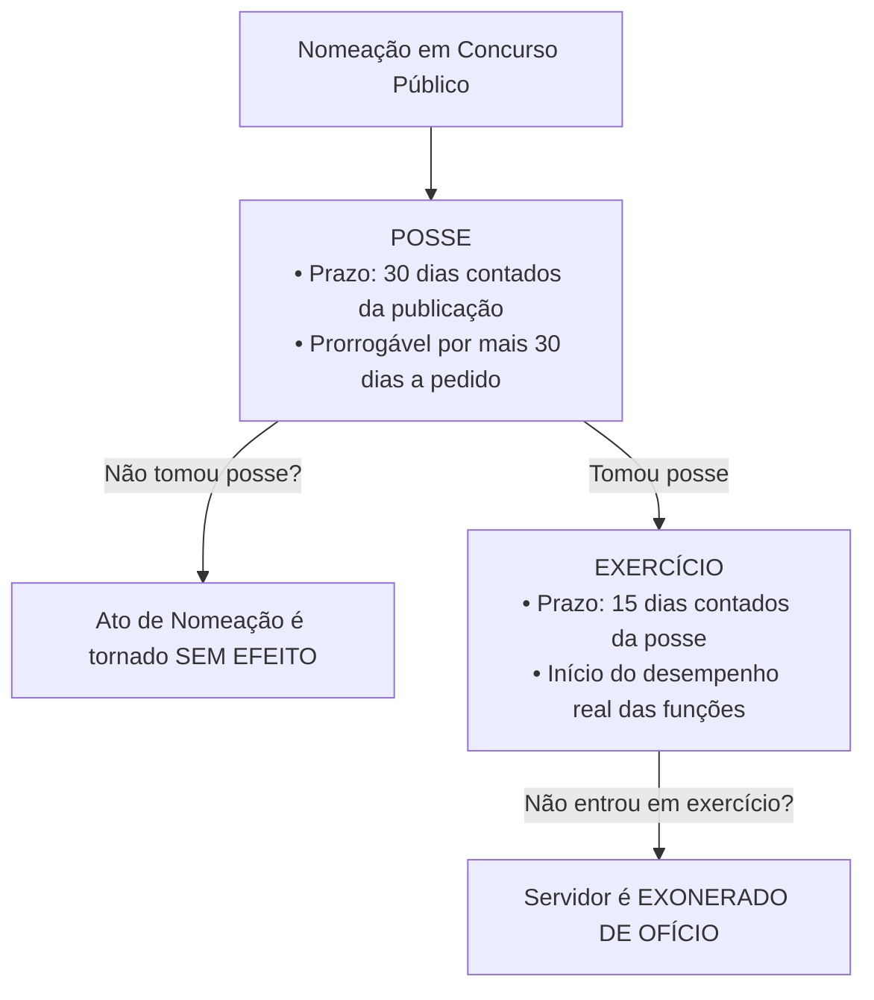
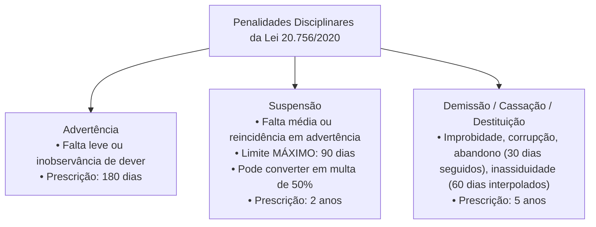

# 04 - Regime Jurídico dos Servidores e PCCR do TCE-GO

> **Matéria:** Legislação Institucional  
> **Cargos:** A01 – Técnico de Controle Externo (Adm) / B02 – Técnico de Controle Externo (TI)  
> **Arquivo:** `04_regime_juridico_servidores_e_pccr_leis_20756_e_15122.md`  
> **Atos Normativos:** Lei Estadual nº 20.756, de 28 de janeiro de 2020 (Estatuto Geral dos Servidores Públicos Civis do Estado de Goiás) e Lei Estadual nº 15.122, de 04 de fevereiro de 2005 (Plano de Cargos, Carreiras e Remuneração do TCE-GO)

---

## 📌 Ementa / Itens do Edital
- Regime Jurídico dos Servidores Públicos Civis do Estado de Goiás (Lei Estadual nº 20.756/2020):
  - Disposições preliminares: conceito de servidor público, cargo público de provimento efetivo e em comissão, classe, padrão e quadro de pessoal;
  - Provimento de cargos públicos: forma originária (nomeação) e formas derivadas (reintegração, recondução, reversão, aproveitamento e readaptação);
  - Concurso público: requisitos, validade, prorrogação e reserva legal de vagas para pessoas com deficiência;
  - Posse e Exercício: requisitos legais, prazos rigorosos (30 dias para posse e 15 dias para exercício) e consequências jurídicas do não comparecimento (ato sem efeito x exoneração de ofício);
  - Estágio Probatório: período de 3 (três) anos (36 meses) de efetivo exercício, comissão de avaliação, critérios taxativos avaliados e consequências da inaptidão (exoneração ou recondução);
  - Estabilidade constitucional e hipóteses de perda do cargo público;
  - Vacância do cargo público: exoneração, demissão, readaptação, aposentadoria, posse em outro cargo inacumulável e falecimento;
  - Direitos e vantagens pecuniárias: vencimento básico, remuneração, indenizações (diárias, ajuda de custo e transporte), gratificações e adicionais;
  - Regime de férias, licenças e afastamentos remunerados e não remunerados;
  - Regime Disciplinar: deveres funcionais, vedações e proibições;
  - Penalidades disciplinares: advertência, suspensão (limite máximo de 90 dias e conversão em multa), demissão, cassação de aposentadoria ou disponibilidade e destituição de cargo em comissão ou função de confiança;
  - Prescrição da pretensão punitiva disciplinar: prazos de 5 anos, 2 anos e 180 dias; termo inicial e causas de interrupção;
  - Processo Administrativo Disciplinar (PAD) e Sindicância: fases procedimentais (instauração, inquérito administrativo com instrução, defesa e relatório, e julgamento);
- Plano de Cargos, Carreiras e Remuneração dos Servidores do TCE-GO (Lei Estadual nº 15.122/2005 e alterações):
  - Estrutura da Carreira de Controle Externo: Analista de Controle Externo e Técnico de Controle Externo (Especialidades Administrativa e TI);
  - Atribuições típicas do cargo de Técnico de Controle Externo;
  - Desenvolvimento funcional: Progressão Funcional (horizontal, entre padrões da mesma classe) e Promoção Funcional (vertical, entre classes da carreira);
  - Requisitos de interstício temporal, avaliação periódica de desempenho e capacitação continuada na Escola Superior de Controle Externo do TCE-GO;
  - Estrutura remuneratória: vencimento base, Gratificação de Controle Externo (GCE) e adicional de qualificação.

---

## 🌳 Classificação Hierárquica

```text
4. Estatuto dos Servidores Públicos Civis de Goiás e PCCR do TCE-GO
├── 4.1 Estatuto dos Servidores Públicos Civis do Estado de Goiás (Lei Estadual nº 20.756/2020)
│   ├── 4.1.1 Disposições Preliminares:
│   │   ├── Conceito de Servidor Público (pessoa legalmente investida em cargo público)
│   │   └── Cargo Público: Efetivo (concurso) vs. Em Comissão (livre nomeação e exoneração)
│   ├── 4.1.2 Investidura, Provimento e Vacância:
│   │   ├── Forma Originária de Provimento: Nomeação
│   │   ├── Formas Derivadas de Provimento:
│   │   │   ├── Reintegração: Servidor demitido ilegalmente retorna com ressarcimento integral
│   │   │   ├── Recondução: Servidor estável inabilitado em estágio probatório ou pelo retorno do titular
│   │   │   ├── Reversão: Retorno do aposentado (de ofício por insubsistência da invalidez ou a pedido)
│   │   │   ├── Readaptação: Investidura em cargo compatível com limitação física ou mental superveniente
│   │   │   └── Aproveitamento: Retorno obrigatório do servidor em disponibilidade a cargo compatível
│   │   ├── Posse: Ato de investidura; prazo de 30 dias (se não tomar posse: ato tornado sem efeito)
│   │   ├── Exercício: Desempenho efetivo; prazo de 15 dias (se não entrar em exercício: exoneração)
│   │   ├── Estágio Probatório: 3 anos (fatores: assiduidade, pontualidade, disciplina, iniciativa, produtividade, responsabilidade)
│   │   └── Vacância: Exoneração, Demissão, Readaptação, Aposentadoria, Posse em cargo inacumulável e Falecimento
│   ├── 4.1.3 Direitos, Vantagens e Licenças:
│   │   ├── Vencimento (parcela básica fixada em lei) vs. Remuneração (vencimento + vantagens permanentes)
│   │   ├── Indenizações (não incorporáveis): Ajuda de custo, diárias e indenização de transporte
│   │   ├── Férias anuais remuneradas (30 dias) e adicional de 1/3 constitucional
│   │   └── Licenças: Saúde, família, maternidade (180 dias), paternidade (20 dias), capacitação e mandato classista
│   ├── 4.1.4 Regime Disciplinar:
│   │   ├── Deveres funcionais e Proibições expressas
│   │   ├── Penalidades Disciplinares:
│   │   │   ├── Advertência: Falta leve ou inobservância de dever funcional
│   │   │   ├── Suspensão: Até 90 dias (reincidência em falta leve ou falta média); conversão em multa (50%)
│   │   │   ├── Demissão: Falta grave, improbidade, corrupção, abandono de cargo (30 dias consecutivos) ou inassiduidade habitual (60 dias interpolados)
│   │   │   ├── Cassação de aposentadoria ou disponibilidade: Falta cometida em atividade punível com demissão
│   │   │   └── Destituição de cargo em comissão ou função de confiança
│   │   └── Prescrição da Ação Disciplinar:
│   │       ├── 5 anos: Infrações puníveis com demissão, cassação e destituição
│   │       ├── 2 anos: Infrações puníveis com suspensão
│   │       ├── 180 dias: Infrações puníveis com advertência
│   │       └── Termo inicial: data do conhecimento pela autoridade competente; interrupção pela abertura de apuração
│   └── 4.1.5 Processo Administrativo Disciplinar (PAD):
│       ├── Sindicância vs. PAD ordinário
│       └── Fases do PAD: Instauração -> Inquérito Administrativo (Instrução, Defesa e Relatório) -> Julgamento
└── 4.2 Plano de Cargos, Carreiras e Remuneração do TCE-GO (Lei Estadual nº 15.122/2005)
    ├── 4.2.1 Estrutura do Quadro Efetivo do TCE-GO:
    │   ├── Analista de Controle Externo (Nível Superior)
    │   └── Técnico de Controle Externo (Nível Intermediário/Técnico Superior):
    │       ├── Especialidade Técnico Administrativo (A01)
    │       └── Especialidade Tecnologia da Informação (B02)
    ├── 4.2.2 Atribuições Legais do Técnico de Controle Externo:
    │   ├── Apoio operacional e técnico-administrativo aos processos de fiscalização
    │   ├── Operacionalização de ferramentas de TI, triagem e análise preliminar de dados
    │   └── Execução de rotinas administrativas, gestão documental e atendimento procedimental
    ├── 4.2.3 Desenvolvimento na Carreira:
    │   ├── Progressão Funcional: Mudança de padrão dentro da mesma classe (interstício + avaliação de desempenho)
    │   └── Promoção Funcional: Mudança de classe (interstício + avaliação satisfatória + cursos na Escola de Contas)
    └── 4.2.4 Estrutura Remuneratória: Vencimento-base, Gratificação de Controle Externo (GCE) e Adicional de Qualificação
```

---

## 📖 Resumo Teórico & Pontos-Chave

### 1. Provimento, Posse, Exercício e Estágio Probatório (Lei Estadual nº 20.756/2020)

A Lei nº 20.756/2020 é o Estatuto dos Servidores Públicos Civis do Estado de Goiás (em vigor desde 28/07/2020, revogando expressamente a anterior Lei nº 10.460/1988).

#### 1.1 Posse e Exercício (Diferenças Críticas para FCC):



#### 1.2 Formas Derivadas de Provimento:

| Forma de Provimento | Conceito e Hipótese de Aplicação | Regra de Retorno / Vantagens |
| :--- | :--- | :--- |
| **Reintegração** | Retorno do servidor estável ao cargo anteriormente ocupado quando sua **demissão for invalidada** por decisão judicial ou administrativa. | Retorno obrigatório com **ressarcimento integral** de todas as remunerações e vantagens retroativas. |
| **Recondução** | Retorno do servidor estável ao cargo de origem anteriormente ocupado em razão de: 1) **Inabilitação em estágio probatório** de outro cargo público; ou 2) Retorno do anterior ocupante reintegrado. | Retorno **sem direito a qualquer indenização** financeira pelo período de afastamento. |
| **Reversão** | Retorno do servidor **aposentado** ao serviço ativo: a) *De ofício:* quando junta médica oficial declara insubsistentes os motivos da aposentadoria por invalidez; b) *A pedido:* voluntária, no interesse do serviço, até os 70 anos de idade e com vaga disponível. | Volta a receber remuneração do cargo efetivo ativo. |
| **Readaptação** | Investidura do servidor em cargo de atribuições e responsabilidades compatíveis com a **limitação que tenha sofrido** em sua capacidade física ou mental, verificada em perícia oficial. | Mantém o nível de vencimento do cargo de origem se o novo cargo possuir vencimento inferior. |
| **Aproveitamento** | Retorno obrigatório à atividade do servidor que se encontrava em **disponibilidade** (por extinção do cargo ou declaração de desnecessidade). | Aproveitado em cargo de atribuições e vencimentos compatíveis com o anteriormente ocupado. |

---

### 2. Estágio Probatório e Estabilidade (Lei Estadual nº 20.756/2020)

* **Duração:** **3 (três) anos** (36 meses) de efetivo exercício;
* **Fatores Avaliados na Avaliação Especial de Desempenho:**
  1. Assiduidade;
  2. Pontualidade;
  3. Disciplina;
  4. Iniciativa;
  5. Produtividade e qualidade no trabalho;
  6. Responsabilidade.
* **Reprovação no Estágio Probatório:**
  * Se o servidor **não era estável** em cargo público estadual anterior: é **exonerado**;
  * Se o servidor **já era estável** em cargo público estadual anterior: é **reconduzido** ao cargo de origem.

---

### 3. Regime Disciplinar e Penalidades (Lei Estadual nº 20.756/2020)



#### Prescrição da Ação Disciplinar:
* **5 (cinco) anos:** para as infrações puníveis com **demissão**, **cassação de aposentadoria ou disponibilidade** e **destituição de cargo em comissão ou função de confiança**;
* **2 (dois) anos:** para as infrações puníveis com **suspensão**;
* **180 (cento e oitenta) dias:** para as infrações puníveis com **advertência**;
* **Termo Inicial:** o prazo de prescrição começa a correr no dia em que o fato se tornou conhecido da **autoridade competente para instaurar o procedimento administrativo disciplinar**;
* **Interrupção:** a instauração de sindicância ou a publicação do ato de instauração do PAD **interrompe** a fluência do prazo prescricional.

---

### 4. Plano de Carreira do TCE-GO (Lei Estadual nº 15.122/2005)

A Lei nº 15.122/2005 estrutura os cargos e a remuneração dos servidores do Tribunal de Contas de Goiás:

#### 4.1 Cargos Efetivos:
* **Analista de Controle Externo:** Nível Superior de escolaridade. Atuação direta na auditoria externa, instrução de processos complexos e elaboração de relatórios técnicos de mérito.
* **Técnico de Controle Externo:** Nível Intermediário/Técnico de escolaridade. Subdividido em especialidades, como:
  * **Técnico Administrativo (Cargo A01):** Suporte técnico à gestão de pessoas, orçamento, compras, patrimônio, contratos e trâmite dos processos nos gabinetes e secretarias da Corte.
  * **Tecnologia da Informação (Cargo B02):** Suporte, manutenção, desenvolvimento e governança das soluções de hardware, software, segurança cibernética e banco de dados do Tribunal.

#### 4.2 Desenvolvimento na Carreira: Progressão vs. Promoção

| Instituto | Definição no PCCR do TCE-GO | Requisitos Exigidos |
| :--- | :--- | :--- |
| **Progressão Funcional** | Movimentação horizontal do servidor de um **padrão para o padrão imediatamente subsequente**, dentro da **mesma classe**. | • Cumprimento do **interstício temporal mínimo** (efetivo exercício);<br/>• Resultado satisfatório na **avaliação periódica de desempenho**. |
| **Promoção Funcional** | Movimentação vertical do servidor do **último padrão de uma classe para o primeiro padrão da classe imediatamente superior**. | • Cumprimento do **interstício temporal mínimo**;<br/>• Resultado satisfatório na **avaliação periódica de desempenho**;<br/>• Participação e aproveitamento em cursos de **capacitação continuada** promovidos ou credenciados pela Escola Superior de Controle Externo (Escola de Contas). |

---

## ⚠️ Alertas de Prova & Pegadinhas da FCC

> 🚨 **ALERTA DE PROVA / PEGADINHA FCC:** Se o candidato aprovado toma posse e NÃO entra em exercício no prazo de **15 dias**, qual a consequência? Ele é **EXONERADO DE OFÍCIO**. Já se ele for nomeado e NÃO tomar posse no prazo de **30 dias**, o ato de nomeação é **TORNADO SEM EFEITO** (pois quem não toma posse não é servidor, logo não pode ser exonerado!). A FCC troca rotineiramente essas duas consequências.

> ⭐ **IMPORTANTE / PENALIDADE DE SUSPENSÃO:** Pela Lei Estadual nº 20.756/2020, o prazo da penalidade disciplinar de suspensão **não pode ultrapassar 90 (noventa) dias**. A comutação em multa (se houver conveniência para o serviço público) dá-se na base de 50% (cinquenta por cento) por dia de remuneração, permanecendo o servidor obrigado a trabalhar.

> 📌 **NOTA EXPLICATIVA / ABANDONO DE CARGO X INASSIDUIDADE:**
> * **Abandono de Cargo:** ausência intencional ao serviço por mais de **30 (trinta) dias consecutivos**;
> * **Inassiduidade Habitual:** falta ao serviço, sem causa justificada, por **60 (sessenta) dias interpolados** durante o período de 12 (doze) meses. Ambas as faltas são apenadas com **DEMISSÃO**.

> 🛑 **ATENÇÃO / LEGISLAÇÃO APLICÁVEL:** Fique atento a apostilas ou bancos de questões antigos que citam a Lei Estadual nº 10.460/1988 (antigo Estatuto de Goiás). A legislação vigente aplicável a todo o funcionalismo goiano é a **Lei Estadual nº 20.756/2020**!

---

## 🌐 Fontes Oficiais e Referências Bibliográficas

* [Lei Estadual nº 20.756, de 28/01/2020 (Legisla Goiás)](https://legisla.casacivil.go.gov.br/pesquisa_legislacao/102987/lei-20756) - Novo Estatuto dos Servidores Públicos Civis do Estado de Goiás com vigência integral.
* [Lei Estadual nº 15.122, de 04/02/2005 (Legisla Goiás)](https://legisla.casacivil.go.gov.br/pesquisa_legislacao/80517/lei-15122) - Plano de Cargos, Carreiras e Remuneração dos Servidores do TCE-GO.
* [Portal da Transparência do TCE-GO - Seção de Pessoal e Carreiras](https://portal.tce.go.gov.br/transparencia/pessoal) - Tabelas salariais, lotação e resoluções do PCCR.
* [Jurisprudência do TJ-GO e STF sobre Estágio Probatório e Recondução](https://portal.stf.jus.br) - Súmulas e teses sobre o direito de retorno do servidor estável inabilitado em novo certame.

---

## 📝 Questões de Concurso FCC Comentadas

### Questão 01
**(FCC – TCE-GO – Analista de Controle Externo)**  
Lucas, servidor público estável do Estado de Goiás, obteve aprovação em concurso público e foi nomeado para cargo de outra carreira estadual inacumulável. Durante a realização do estágio probatório do novo cargo, foi considerado inapto pela comissão de avaliação e formalmente inabilitado. Paralelamente, em outra repartição, Beatriz, servidora pública estável demitida por falta funcional, teve sua demissão invalidada por decisão judicial transitada em julgado. De acordo com a Lei Estadual nº 20.756/2020, o retorno de Lucas ao cargo primitivo e a reintegração de Beatriz ao cargo público ocupado anteriormente caracterizam, respectivamente:

* **A)** Reversão e Aproveitamento.
* **B)** Recondução e Reintegração.
* **C)** Readaptação e Reversão.
* **D)** Reintegração e Recondução.
* **E)** Aproveitamento e Readaptação.

> **Gabarito: B**  
> **Comentário Detalhado:**  
> - **A) Incorreta.** Reversão é o retorno do aposentado e Aproveitamento é o retorno de quem estava em disponibilidade.  
> - **B) CORRETA.** Conforme a Lei Estadual nº 20.756/2020:  
>   - **Recondução:** É o retorno do servidor estável ao cargo de origem anteriormente ocupado, decorrente de sua inabilitação em estágio probatório relativo a outro cargo público (caso de Lucas) ou de reintegração do anterior ocupante, sem direito a indenização.  
>   - **Reintegração:** É o retorno do servidor estável ao cargo anteriormente ocupado, em razão da invalidação de sua demissão por decisão judicial ou administrativa, com ressarcimento integral de todos os direitos e vantagens pecuniárias (caso de Beatriz).  
> - **C) Incorreta.** Readaptação envolve limitação física/mental e Reversão envolve retorno de aposentado.  
> - **D) Incorreta.** A ordem dos institutos está invertida.  
> - **E) Incorreta.** Nenhuma das duas situações trata de disponibilidade ou limitação de capacidade.

---

### Questão 02
**(FCC – DPE-RS – Analista de Gestão e Pessoal)**  
Mariana foi nomeada para cargo de provimento efetivo no serviço público de Goiás e compareceu tempestivamente à repartição, prestando compromisso e assinando o termo de posse. Entretanto, por motivos estritamente particulares, Mariana não compareceu para assumir as atribuições funcionais e não entrou em efetivo exercício no prazo legal fixado pelo estatuto funcional. De acordo com as normas da Lei Estadual nº 20.756/2020:

* **A)** O ato de nomeação de Mariana será sumariamente tornado sem efeito por decreto do Governador.
* **B)** Mariana será exonerada de ofício do cargo público no qual havia tomado posse.
* **C)** A posse será anulada retroativamente, aplicando-se suspensão de seus direitos políticos por improbidade administrativa.
* **D)** O prazo de exercício será prorrogado compulsoriamente por igual período mediante requerimento de ofício do chefe imediato.
* **E)** Será instaurado Processo Administrativo Disciplinar para aplicação da penalidade de demissão por abandono de cargo.

> **Gabarito: B**  
> **Comentário Detalhado:**  
> - **A) Incorreta.** O ato de nomeação só é tornado *sem efeito* se a pessoa NÃO tomar posse no prazo de 30 dias. Como Mariana tomou posse, ela já se tornou servidora pública formalmente.  
> - **B) CORRETA.** Nos termos expressos da Lei Estadual nº 20.756/2020, o prazo para entrada em exercício é de **15 (quinze) dias** contados da posse. Se o servidor investido tomar posse, mas **não entrar em efetivo exercício** dentro do prazo legal, será **exonerado de ofício**.  
> - **C) Incorreta.** A ausência no exercício não anula a posse e nem gera suspensão de direitos políticos.  
> - **D) Incorreta.** A prorrogação automática do prazo de exercício sem justificativa legal expressa é inadmissível.  
> - **E) Incorreta.** Não há instauração de PAD de demissão por abandono de cargo neste caso, pois a consequência estatutária expressa para o empossado que não entra em exercício é a **exoneração de ofício**.

---

### Questão 03
**(FCC – TCE-AP – Técnico de Controle Externo)**  
A respeito da estabilidade e do estágio probatório do servidor público civil, regulamentados pela Lei Estadual nº 20.756/2020, considere:

* **A)** O período de estágio probatório é de dois anos, sendo que o servidor aprovado adquire vitaliciedade automática na carreira.
* **B)** O estágio probatório tem a duração de três anos de efetivo exercício, período durante o qual a aptidão e a capacidade do servidor serão objeto de avaliação obrigatória segundo fatores previstos em lei.
* **C)** O servidor em estágio probatório adquire estabilidade tácita caso a comissão de avaliação de desempenho não homologue o resultado no prazo de trinta dias antes do término do triênio.
* **D)** O servidor reprovado na avaliação de estágio probatório que não seja estável no serviço público será posto em disponibilidade com remuneração proporcional ao tempo de serviço.
* **E)** É vedada a exoneração de servidor em estágio probatório, podendo a demissão ocorrer apenas após sentença judicial penal condenatória transitada em julgado.

> **Gabarito: B**  
> **Comentário Detalhado:**  
> - **A) Incorreta.** O estágio probatório é de **3 anos** (36 meses) e servidores civis adquirem **estabilidade**, e não vitaliciedade (esta privativa de magistrados, membros do MP e Conselheiros de Tribunais de Contas).  
> - **B) CORRETA.** Conforme a Lei Estadual nº 20.756/2020, ao entrar em exercício, o servidor nomeado para cargo de provimento efetivo fica sujeito a **estágio probatório por período de 3 (três) anos**, durante o qual sua aptidão e capacidade serão objeto de avaliação especial de desempenho, considerando fatores como assiduidade, pontualidade, disciplina, iniciativa, produtividade e responsabilidade.  
> - **C) Incorreta.** A estabilidade exige aprovação expressa em avaliação especial de desempenho (CF, Art. 41, § 4º), sendo inadmissível estabilidade "tácita" sem avaliação.  
> - **D) Incorreta.** O servidor não estável reprovado no estágio probatório é **exonerado** (não é posto em disponibilidade). A disponibilidade é garantia exclusiva de quem já é estável.  
> - **E) Incorreta.** O servidor em estágio probatório pode ser exonerado se reprovado na avaliação de desempenho, assegurados o contraditório e a ampla defesa.

---

### Questão 04
**(FCC – ARTESP – Especialista em Regulação)**  
A respeito do regime disciplinar e da prescrição da pretensão punitiva administrativa regulados pela Lei Estadual nº 20.756/2020, assinale a opção correta:

* **A)** A penalidade de suspensão não poderá exceder a noventa dias, acarretando a perda da remuneração dos dias em que perdurar o afastamento.
* **B)** A ação disciplinar para apuração de infrações puníveis com suspensão prescreve no prazo improrrogável de cento e oitenta dias da ocorrência do fato.
* **C)** O cometimento de infração funcional de natureza leve acarreta diretamente a aplicação da penalidade de demissão a bem do serviço público.
* **D)** O prazo prescricional para punir infrações administrativas começa a fluir na data em que a conduta foi praticada, independentemente de quando a autoridade competente tomou conhecimento dela.
* **E)** A instauração de sindicância ou processo administrativo disciplinar não interfere no curso do prazo de prescrição, que flui ininterruptamente até a decisão final.

> **Gabarito: A**  
> **Comentário Detalhado:**  
> - **A) CORRETA.** Nos termos da Lei Estadual nº 20.756/2020, a penalidade de **suspensão** será aplicada nos casos de falta de gravidade média ou reincidência em falta punida com advertência, **não podendo exceder a 90 (noventa) dias**, implicando a perda dos direitos e vantagens decorrentes do exercício do cargo durante o período.  
> - **B) Incorreta.** O prazo de prescrição para infrações puníveis com suspensão é de **2 (dois) anos**. O prazo de 180 dias aplica-se à penalidade de **advertência**.  
> - **C) Incorreta.** Falta leve enseja penalidade de **advertência**, sendo desproporcional e ilegal a aplicação direta de demissão.  
> - **D) Incorreta.** A prescrição da ação disciplinar começa a correr na data em que a autoridade competente para instaurar o processo **toma conhecimento do fato** punível, e não da data da prática da conduta.  
> - **E) Incorreta.** A abertura de sindicância ou a instauração do PAD **interrompe** a prescrição da ação punitiva.

---

### Questão 05
**(FCC – TCE-GO – Técnico de Controle Externo)**  
No âmbito do Tribunal de Contas do Estado de Goiás, a carreira de Técnico de Controle Externo é disciplinada pelo Plano de Cargos, Carreiras e Remuneração (Lei Estadual nº 15.122/2005). Sobre a evolução funcional dos servidores nesta carreira:

* **A)** A promoção funcional consiste na passagem do servidor de um padrão para outro dentro da mesma classe, baseando-se exclusivamente no decurso do tempo de serviço.
* **B)** A progressão funcional consiste na mudança do servidor de um padrão de vencimento para o subsequente dentro da mesma classe, exigindo cumprimento de interstício de efetivo exercício e resultado satisfatório na avaliação de desempenho.
* **C)** O servidor em estágio probatório pode obter sucessivas promoções verticais de classe a cada semestre trabalhado.
* **D)** A promoção funcional para a classe imediatamente superior prescinde da realização de cursos de capacitação técnica na Escola de Contas do Tribunal.
* **E)** O desenvolvimento funcional na carreira do TCE-GO opera-se mediante concurso público interno bienal exclusivo para servidores de nível médio.

> **Gabarito: B**  
> **Comentário Detalhado:**  
> - **A) Incorreta.** A passagem de um padrão para outro dentro da mesma classe chama-se **progressão funcional** (e não promoção), e não decorre exclusivamente de tempo, exigindo avaliação de desempenho satisfatória.  
> - **B) CORRETA.** De acordo com as disposições da Lei Estadual nº 15.122/2005 (PCCR do TCE-GO): a **progressão funcional** é a evolução horizontal de um padrão para o padrão imediatamente superior dentro da mesma classe, exigindo o cumprimento do **interstício mínimo de efetivo exercício** e a obtenção de **resultado satisfatório na avaliação periódica de desempenho**.  
> - **C) Incorreta.** Durante o estágio probatório, o servidor não aufere promoções verticais aceleradas sem o cumprimento do ciclo trienal e dos requisitos do cargo.  
> - **D) Incorreta.** A **promoção funcional** (mudança de classe) exige expressamente, além do interstício e da avaliação de desempenho, a conclusão de cursos e programas de **capacitação continuada** promovidos ou credenciados pela Escola de Contas do TCE-GO.  
> - **E) Incorreta.** O concurso interno ("ascensão" funcional) foi banido pela Constituição de 1988 e pela Súmula Vinculante nº 43 do STF. O desenvolvimento dá-se dentro da mesma carreira mediante progressão e promoção.
