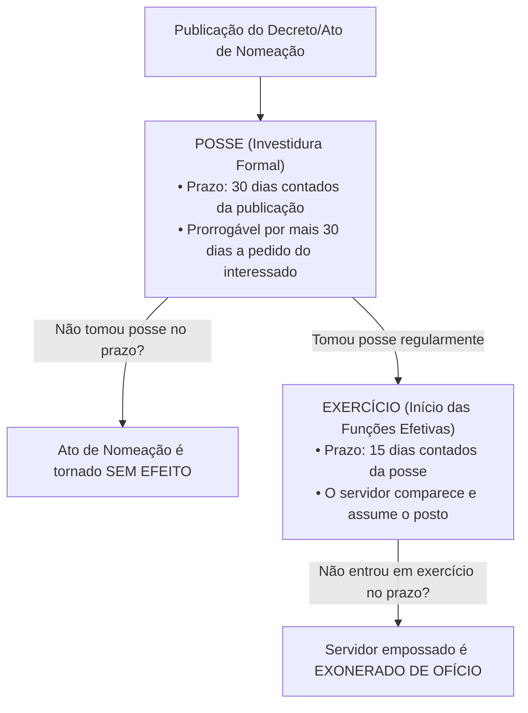
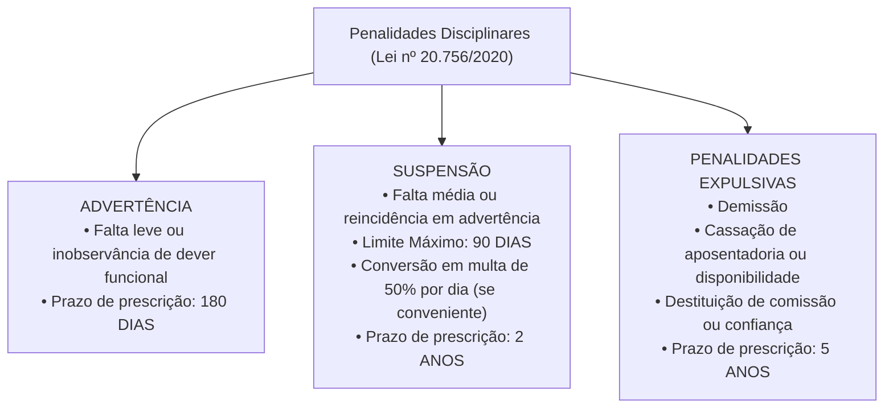

# 04 - Regime Jurídico dos Servidores e PCCR do TCE-GO

> **Matéria:** Legislação Institucional  
> **Cargos:** A01 – Técnico de Controle Externo (Adm) / B02 – Técnico de Controle Externo (TI)  
> **Arquivo:** `04_regime_juridico_servidores_e_pccr_leis_20756_e_15122.md`  
> **Atos Normativos:** Lei Estadual nº 20.756, de 28 de janeiro de 2020 (Estatuto Geral dos Servidores Públicos Civis do Estado de Goiás) e Lei Estadual nº 15.122, de 04 de fevereiro de 2005 (Plano de Cargos, Carreiras e Remuneração do TCE-GO)

---

## 📌 Ementa / Itens do Edital
- Regime Jurídico dos Servidores Públicos Civis do Estado de Goiás (Lei Estadual nº 20.756/2020):
  - Disposições preliminares: conceito de servidor público, cargo público de provimento efetivo e em comissão, classe, padrão e quadro de pessoal;
  - Provimento de cargos públicos: forma originária (nomeação) e formas derivadas (reintegração, recondução, reversão, aproveitamento e readaptação);
  - Concurso público: requisitos, validade, prorrogação e reserva legal de vagas para pessoas com deficiência;
  - Posse e Exercício: requisitos legais, prazos rigorosos (30 dias para posse e 15 dias para exercício) e consequências jurídicas do não comparecimento (ato sem efeito x exoneração de ofício);
  - Estágio Probatório: período de 3 (três) anos (36 meses) de efetivo exercício, comissão de avaliação, critérios taxativos avaliados e consequências da inaptidão (exoneração ou recondução);
  - Estabilidade constitucional e hipóteses de perda do cargo público;
  - Vacância do cargo público: exoneração, demissão, readaptação, aposentadoria, posse em outro cargo inacumulável e falecimento;
  - Direitos e vantagens pecuniárias: vencimento básico, remuneração, indenizações (diárias, ajuda de custo e transporte), gratificações e adicionais;
  - Regime de férias, licenças e afastamentos remunerados e não remunerados;
  - Regime Disciplinar: deveres funcionais, vedações e proibições;
  - Penalidades disciplinares: advertência, suspensão (limite máximo de 90 dias e conversão em multa), demissão, cassação de aposentadoria ou disponibilidade e destituição de cargo em comissão ou função de confiança;
  - Prescrição da pretensão punitiva disciplinar: prazos de 5 anos, 2 anos e 180 dias; termo inicial e causas de interrupção;
  - Processo Administrativo Disciplinar (PAD) e Sindicância: fases procedimentais (instauração, inquérito administrativo com instrução, defesa e relatório, e julgamento);
- Plano de Cargos, Carreiras e Remuneração dos Servidores do TCE-GO (Lei Estadual nº 15.122/2005 e alterações):
  - Estrutura da Carreira de Controle Externo: Analista de Controle Externo e Técnico de Controle Externo (Especialidades Administrativa e TI);
  - Atribuições típicas do cargo de Técnico de Controle Externo;
  - Desenvolvimento funcional: Progressão Funcional (horizontal, entre padrões da mesma classe) e Promoção Funcional (vertical, entre classes da carreira);
  - Requisitos de interstício temporal, avaliação periódica de desempenho e capacitação continuada na Escola Superior de Controle Externo do TCE-GO;
  - Estrutura remuneratória: vencimento base, Gratificação de Controle Externo (GCE) e adicional de qualificação.

---

## 🧭 Sumário
- [1. Estatuto dos Servidores Públicos Civis do Estado de Goiás (Lei nº 20.756/2020)](#1-estatuto-dos-servidores-públicos-civis-do-estado-de-goiás-lei-nº-207562020)
  - [1.1 Conceito de Servidor, Cargo Público e Formas de Provimento](#11-conceito-de-servidor-cargo-público-e-formas-de-provimento)
  - [1.2 Posse e Exercício: Prazos e Consequências do Descumprimento](#12-posse-e-exercício-prazos-e-consequências-do-descumprimento)
  - [1.3 Estágio Probatório, Fatores de Avaliação e Hipóteses de Inaptidão](#13-estágio-probatório-fatores-de-avaliação-e-hipóteses-de-inaptidão)
  - [1.4 Vacância do Cargo Público](#14-vacância-do-cargo-público)
  - [1.5 Direitos, Vantagens Pecuniárias, Férias e Licenças](#15-direitos-vantagens-pecuniárias-férias-e-licenças)
  - [1.6 Regime Disciplinar: Deveres, Proibições e Penalidades](#16-regime-disciplinar-deveres-proibições-e-penalidades)
  - [1.7 Prescrição da Pretensão Punitiva Disciplinar](#17-prescrição-da-pretensão-punitiva-disciplinar)
  - [1.8 Sindicância e Processo Administrativo Disciplinar (PAD)](#18-sindicância-e-processo-administrativo-disciplinar-pad)
- [2. Plano de Cargos, Carreiras e Remuneração do TCE-GO (Lei nº 15.122/2005)](#2-plano-de-cargos-carreiras-e-remuneração-do-tce-go-lei-nº-151222005)
  - [2.1 Estrutura do Quadro Efetivo do TCE-GO](#21-estrutura-do-quadro-efetivo-do-tce-go)
  - [2.2 Atribuições Legais do Técnico de Controle Externo](#22-atribuições-legais-do-técnico-de-controle-externo)
  - [2.3 Desenvolvimento Funcional: Progressão Horizontal vs. Promoção Vertical](#23-desenvolvimento-funcional-progressão-horizontal-vs-promoção-vertical)
  - [2.4 Estrutura Remuneratória e Vantagens Específicas do Tribunal](#24-estrutura-remuneratória-e-vantagens-específicas-do-tribunal)
- [3. Fontes Oficiais e Referências Bibliográficas](#3-fontes-oficiais-e-referências-bibliográficas)
- [4. Questões de Concurso FCC Comentadas](#4-questões-de-concurso-fcc-comentadas)

---

## 1. Estatuto dos Servidores Públicos Civis do Estado de Goiás (Lei nº 20.756/2020)

### 1.1 Conceito de Servidor, Cargo Público e Formas de Provimento
A **Lei Estadual nº 20.756, de 28 de janeiro de 2020**, estabelece o regime jurídico único dos servidores públicos civis da administração direta, autárquica e fundacional dos Poderes Executivo, Legislativo e Judiciário do Estado de Goiás, aplicando-se também aos servidores dos Tribunais de Contas (TCE-GO e TCM-GO) e do Ministério Público.
- **Servidor Público:** É a pessoa legalmente investida em cargo público estadual.
- **Cargo Público:** Conjunto de atribuições, deveres e responsabilidades cometidos a um servidor, criado por lei, em número certo, com denominação própria e subsídio ou vencimento pago pelos cofres públicos. Podem ser de **provimento efetivo** (exige concurso público) ou **em comissão** (de livre nomeação e livre exoneração).
- **Forma Originária de Provimento:** A **nomeação** é a única forma de provimento originário.
- **Formas Derivadas de Provimento:** Pressupõem vínculo funcional anterior do servidor com a Administração estadual:

| Forma de Provimento Derivado | Conceito e Hipótese Legal | Regra de Retorno e Direitos Pecuniários |
| :--- | :--- | :--- |
| **Reintegração** | Retorno do servidor público **estável** ao cargo anteriormente ocupado quando sua **demissão for invalidada** por decisão judicial transitada em julgado ou administrativa. | O servidor é reintegrado com **ressarcimento integral** de todos os vencimentos, remunerações e vantagens retroativas a que faria jus. |
| **Recondução** | Retorno do servidor público **estável** ao cargo de origem anteriormente ocupado, decorrente de: 1) **Inabilitação em estágio probatório** de outro cargo público; ou 2) Retorno do titular daquele cargo em virtude de reintegração. | Retorno formal **sem direito a qualquer indenização** financeira pelo período em que esteve fora. |
| **Reversão** | Retorno à atividade do servidor **aposentado**: a) *De ofício:* quando junta médica oficial declara insubsistentes os motivos da aposentadoria por incapacidade permanente; b) *A pedido:* voluntária, no interesse da administração, desde que haja cargo vago, o servidor seja estável e conte menos de 70 anos. | Volta à atividade na mesma classe e padrão em que se aposentou. |
| **Readaptação** | Investidura do servidor em cargo de atribuições e responsabilidades compatíveis com a **limitação física ou mental superveniente** sofrida, verificada em perícia médica oficial. | Caso o cargo de readaptação tenha remuneração inferior, o servidor mantém a remuneração do cargo de origem. |
| **Aproveitamento** | Retorno compulsório à atividade do servidor que se encontrava em **disponibilidade** (em razão de extinção do cargo ou de declaração de sua desnecessidade). | Aproveitado obrigatoriamente em cargo de atribuições e vencimentos compatíveis. |

---

### 1.2 Posse e Exercício: Prazos e Consequências do Descumprimento
A investidura no cargo público consuma-se com a **posse**, momento solene no qual o servidor presta compromisso de bem servir e assina o termo formal perante a autoridade competente:

- **Prazos Oficiais:**
  - **Posse:** Deve ocorrer no prazo de **trinta (30) dias** contados da data da publicação oficial do ato de provimento (nomeação), prorrogável por igual período a requerimento justificado do interessado.
  - **Exercício:** É o efetivo desempenho das atribuições do cargo público. O prazo para o servidor empossado entrar em exercício é de **quinze (15) dias**, contados da data da posse.
- **Distinção Crítica das Consequências:**
  - Se o nomeado **NÃO tomar posse** no prazo legal de 30 dias: o ato de nomeação será tornado **SEM EFEITO** (a pessoa ainda não é servidora, logo não se pode exonerar quem nunca tomou posse!).
  - Se o nomeado **tomar posse, mas NÃO entrar em exercício** no prazo legal de 15 dias: o servidor será **EXONERADO DE OFÍCIO**.

> 🚨 **ALERTA DE PROVA / PEGADINHA FCC:** A banca FCC rotineiramente inverte as consequências: afirma que quem não toma posse é exonerado, ou que quem não entra em exercício tem o ato tornado sem efeito. Grave esta correlação imediata: **Não tomou posse $\rightarrow$ ato SEM EFEITO**. **Tomou posse mas não entrou em exercício $\rightarrow$ EXONERAÇÃO DE OFÍCIO**.

---

### 1.3 Estágio Probatório, Fatores de Avaliação e Hipóteses de Inaptidão
Ao entrar em exercício, o servidor nomeado para cargo de provimento efetivo cumpre **estágio probatório por período de 3 (três) anos** (36 meses) de efetivo exercício, durante o qual sua aptidão e idoneidade serão avaliadas por comissão constituída para essa finalidade.

- **Critérios Legais Avaliados no Estágio (Art. 31 da Lei nº 20.756/2020):**
  1. **Assiduidade**;
  2. **Pontualidade**;
  3. **Disciplina**;
  4. **Iniciativa**;
  5. **Produtividade e qualidade** no trabalho;
  6. **Responsabilidade**.
- **Consequências da Inaptidão / Reprovação no Estágio Probatório:**
  - Se o servidor era **recém-ingressante** no serviço público (não possuía estabilidade anterior no Estado de Goiás): é **exonerado de ofício** daquele cargo;
  - Se o servidor **já era estável** em cargo público estadual anterior: é **reconduzido** ao cargo de origem anteriormente ocupado, sem direito a indenização.

---

### 1.4 Vacância do Cargo Público
A vacância de cargo público decorre de fatos funcionais taxativos previstos em lei:
1. **Exoneração:** Não tem caráter punitivo. Pode ocorrer a pedido do próprio servidor ou de ofício (quando não satisfeitas as condições do estágio probatório, quando o servidor empossado não entrar em exercício, ou para ajuste fiscal do art. 169 da CF);
2. **Demissão:** Penalidade disciplinar de caráter punitivo imposta pela prática de falta funcional de natureza grave;
3. **Readaptação:** Provimento no novo cargo compatível com a limitação e vacância simultânea do cargo originário;
4. **Aposentadoria:** Voluntária, por incapacidade permanente para o trabalho ou compulsória aos 75 anos de idade;
5. **Posse em outro cargo público inacumulável;**
6. **Falecimento.**

---

### 1.5 Direitos, Vantagens Pecuniárias, Férias e Licenças
- **Vencimento vs. Remuneração:**
  - *Vencimento:* É a retribuição pecuniária básica fixada em lei para o padrão ocupado pelo servidor no cargo público efetivo.
  - *Remuneração:* É o vencimento do cargo efetivo acrescido das vantagens pecuniárias de caráter permanente estabelecidas em lei.
- **Indenizações (Não incorporam aos proventos nem sofrem incidência de imposto de renda ou previdência):**
  - **Diárias:** Indenização por despesas extraordinárias de alimentação e pousada quando o servidor se desloca a serviço do seu município de lotação;
  - **Ajuda de Custo:** Indenização para cobrir despesas de mudança e instalação quando o servidor for transferido de ofício para ter exercício em nova localidade;
  - **Indenização de Transporte:** Paga ao servidor que realizar despesas com a utilização de meio próprio de locomoção para execução de serviços externos.
- **Férias:** O servidor faz jus a **30 (trinta) dias de férias anuais** remuneradas, pagas com acréscimo de **1/3 (um terço) constitucional**. É vedada a acumulação de mais de dois períodos de férias por absoluta necessidade do serviço.
- **Licenças Estatutárias:** Licença para tratamento da própria saúde; por motivo de doença em pessoa da família; maternidade (180 dias); paternidade (20 dias); capacitação profissional (até 3 meses a cada quinquênio trabalhado); e para desempenho de mandato classista.

---

### 1.6 Regime Disciplinar: Deveres, Proibições e Penalidades

- **Advertência:** Aplicada por escrito em caso de inobservância de dever funcional ou falta leve, para a qual a lei não comine expressamente sanção mais gravosa.
- **Suspensão:** Aplicada em caso de reincidência em falta punida com advertência ou prática de falta média.
  - **Limite Temporal Rigoroso:** A suspensão **não pode exceder a noventa (90) dias**.
  - **Conversão em Multa:** Quando houver conveniência para o serviço público, a penalidade de suspensão poderá ser convertida em multa na base de **50% (cinquenta por cento)** por dia de remuneração, ficando o servidor obrigado a permanecer em serviço.
- **Demissão:** Penalidade expulsiva aplicável nos casos de infrações disciplinares gravíssimas:
  - Crime contra a administração pública e improbidade administrativa;
  - **Abandono de Cargo:** Ausência intencional do servidor ao serviço por mais de **trinta (30) dias consecutivos**;
  - **Inassiduidade Habitual:** Falta injustificada ao serviço por **sessenta (60) dias interpolados** durante o período de doze meses;
  - Corrupção passiva, concussão, recebimento de propina, aceitação de vantagem indevida ou revelação de segredo funcional de que tenha conhecimento em razão do cargo.
- **Cassação de Aposentadoria ou Disponibilidade:** Aplicada ao inativo que tenha praticado, na atividade, falta grave para a qual seja cominada a pena de demissão.

> 🚨 **ALERTA DE PROVA / PEGADINHA FCC:** Grave a distinção entre abandono e inassiduidade:
> - **Abandono de Cargo:** mais de **30 dias consecutivos**.
> - **Inassiduidade Habitual:** **60 dias interpolados** em 12 meses.
> Ambas as condutas são faltas graves sancionadas compulsoriamente com **DEMISSÃO** após apuração formal em PAD.

---

### 1.7 Prescrição da Pretensão Punitiva Disciplinar
A ação disciplinar para imposição de penalidades aos servidores públicos prescreve nos seguintes prazos legais:
- **Cinco (5) anos:** Para infrações disciplinares puníveis com **demissão**, **cassação de aposentadoria ou disponibilidade** e **destituição de cargo em comissão ou função de confiança**;
- **Dois (2) anos:** Para infrações puníveis com **suspensão**;
- **Cento e oitenta (180) dias:** Para infrações puníveis com **advertência**.
- **Termo Inicial:** O prazo prescricional começa a correr na data em que a autoridade competente para instaurar o processo disciplinar **toma conhecimento formal do fato**.
- **Interrupção:** A publicação do ato de instauração de sindicância ou do Processo Administrativo Disciplinar (PAD) **interrompe** a contagem do prazo de prescrição da pretensão punitiva.

---

### 1.8 Sindicância e Processo Administrativo Disciplinar (PAD)
O PAD é o procedimento contraditório formal destinado a apurar a responsabilidade de servidor público por infração funcional praticada no exercício de suas atribuições:
- Desenvolve-se nas seguintes fases sequenciais:
  1. **Instauração:** Publicação da portaria designando comissão processante tripartite (composta por três servidores estáveis);
  2. **Inquérito Administrativo:** Subdivide-se em instrução probatória (oitiva de testemunhas, juntada de perícias e documentos), defesa (citação do acusado para apresentação de defesa escrita) e relatório conclusivo minucioso da comissão;
  3. **Julgamento:** Decisão fundamentada proferida pela autoridade competente para a aplicação da penalidade.

---

## 2. Plano de Cargos, Carreiras e Remuneração do TCE-GO (Lei nº 15.122/2005)

### 2.1 Estrutura do Quadro Efetivo do TCE-GO
A **Lei Estadual nº 15.122, de 04 de fevereiro de 2005**, organiza o Plano de Cargos, Carreiras e Remuneração (PCCR) dos servidores do Tribunal de Contas do Estado de Goiás. O quadro de provimento efetivo do TCE-GO é estruturado em duas carreiras técnicas:
1. **Analista de Controle Externo:** Nível de escolaridade superior. Atuação finalística em auditorias, inspeções, instrução técnica de processos complexos de contas e fiscalização orçamentária e operacional.
2. **Técnico de Controle Externo:** Nível técnico/intermediário superior. Compreende especialidades voltadas ao suporte operacional, instrução procedimental e gestão de sistemas:
   - **Especialidade Técnico Administrativo (Cargo A01):** Gestão administrativa, apoio ao processamento de autos, gestão de contratos internos, compras, almoxarifado, patrimônio e apoio aos gabinetes de Conselheiros e Secretarias de Câmaras;
   - **Especialidade Tecnologia da Informação (Cargo B02):** Suporte técnico operacional de infraestrutura de TI, atendimento aos usuários de sistemas internos, gerenciamento de redes, segurança da informação, suporte a bancos de dados e desenvolvimento/manutenção de softwares de auditoria eletrônica.

---

### 2.2 Atribuições Legais do Técnico de Controle Externo
Nos termos da Lei nº 15.122/2005 e regulamentos internos da Corte, incumbe ao Técnico de Controle Externo:
- Executar atividades e rotinas de nível técnico voltadas ao apoio do controle externo e da administração geral do Tribunal;
- Operacionalizar softwares de triagem, alimentação de bancos de dados processuais e gestão eletrônica de autos;
- Prestar suporte logístico e administrativo às equipes de fiscalização e inspeção externa;
- Elaborar expedientes, certidões, intimações, notificações e relatórios de suporte administrativo;
- Na especialidade de TI (B02): garantir a estabilidade operacional dos sistemas informatizados, segurança de dados corporativos e funcionamento dos recursos tecnológicos utilizados pelos auditores e membros da Corte.

---

### 2.3 Desenvolvimento Funcional: Progressão Horizontal vs. Promoção Vertical
A evolução dos servidores nas carreiras do TCE-GO dá-se sob duas modalidades distintas:

| Modalidade de Evolução | Conceito no PCCR | Requisitos Exigidos na Lei nº 15.122/2005 |
| :--- | :--- | :--- |
| **Progressão Funcional** | Movimentação horizontal do servidor de um **padrão de vencimento para o subsequente**, dentro dos limites da **mesma classe** da carreira. | 1. Cumprimento do **interstício mínimo de efetivo exercício** no padrão anterior; 2. Resultado satisfatório na **avaliação periódica de desempenho**. |
| **Promoção Funcional** | Movimentação vertical do servidor do **último padrão de uma classe para o padrão inicial da classe imediatamente superior**. | 1. Cumprimento do interstício mínimo de efetivo exercício no último padrão da classe; 2. Resultado satisfatório na avaliação periódica de desempenho; 3. Participação e aprovação em cursos de **capacitação continuada e aperfeiçoamento profissional** promovidos ou homologados pela **Escola Superior de Controle Externo (Escola de Contas)** do TCE-GO. |

> ⭐ **IMPORTANTE / VEDAÇÃO DE CONCURSO INTERNO:** A evolução funcional entre classes (promoção) ocorre estritamente dentro da mesma carreira para a qual o servidor prestou concurso público originário. É vedada a mudança de Técnico para Analista sem novo concurso público de provas e títulos (Súmula Vinculante nº 43 do STF).

---

### 2.4 Estrutura Remuneratória e Vantagens Específicas do Tribunal
A remuneração dos servidores efetivos do TCE-GO é composta por:
- **Vencimento Básico:** Fixado nas tabelas salariais da Lei nº 15.122/2005 de acordo com a classe e padrão de evolução;
- **Gratificação de Controle Externo (GCE):** Vantagem pecuniária vinculada ao exercício de atividades de fiscalização e suporte técnico no âmbito da Corte de Contas;
- **Adicional de Qualificação:** Concedido em percentuais legais com base na conclusão de cursos de pós-graduação (*lato sensu*, mestrado ou doutorado) em áreas de interesse do Tribunal de Contas, incentivando o contínuo aprimoramento técnico do corpo de servidores.

---

## 3. Fontes Oficiais e Referências Bibliográficas

* [Lei Estadual nº 20.756, de 28/01/2020 (Legisla Goiás)](https://legisla.casacivil.go.gov.br/pesquisa_legislacao/102987/lei-20756) - Estatuto dos Servidores Públicos Civis do Estado de Goiás com atualizações normativas consolidadas.
* [Lei Estadual nº 15.122, de 04/02/2005 (Legisla Goiás)](https://legisla.casacivil.go.gov.br/pesquisa_legislacao/80517/lei-15122) - Plano de Cargos, Carreiras e Remuneração dos Servidores do Tribunal de Contas de Goiás.
* [Portal da Transparência do TCE-GO](https://portal.tce.go.gov.br/transparencia/pessoal) - Quadro de pessoal, tabelas remuneratórias e planos de capacitação.
* [Supremo Tribunal Federal - Súmula Vinculante nº 43](https://portal.stf.jus.br) - Inconstitucionalidade de provimento que propicie ao servidor investir-se em cargo que não integra a carreira na qual anteriormente investido.

---

## 4. Questões de Concurso FCC Comentadas

### Questão 01
**(FCC – TCE-GO – Analista de Controle Externo)**  
Lucas, servidor público estável do Estado de Goiás, obteve aprovação em concurso público e foi nomeado para cargo de outra carreira estadual inacumulável. Durante a realização do estágio probatório do novo cargo, foi considerado inapto pela comissão de avaliação e formalmente inabilitado. Paralelamente, em outra repartição, Beatriz, servidora pública estável demitida por falta funcional, teve sua demissão invalidada por decisão judicial transitada em julgado. De acordo com a Lei Estadual nº 20.756/2020, o retorno de Lucas ao cargo primitivo e a reintegração de Beatriz ao cargo público ocupado anteriormente caracterizam, respectivamente:

* A) Reversão e Aproveitamento.
* B) Recondução e Reintegração.
* C) Readaptação e Reversão.
* D) Reintegração e Recondução.
* E) Aproveitamento e Readaptação.

> **Comentário Detalhado:**
> - **A) Incorreta.** Reversão é o retorno do aposentado e aproveitamento é a convocação de servidor colocado em disponibilidade.
> - **B) CORRETA.** Nos termos dos mandamentos expressos da Lei Estadual nº 20.756/2020:
>   - **Recondução:** É o retorno do servidor estável ao cargo anteriormente ocupado, decorrente de sua inabilitação em estágio probatório relativo a outro cargo público (situação de Lucas) ou de reintegração do anterior ocupante, sem direito a qualquer indenização financeira.
>   - **Reintegração:** É o retorno do servidor estável ao cargo anteriormente ocupado quando sua demissão for invalidada por decisão judicial ou administrativa, com ressarcimento integral de todas as vantagens pecuniárias e vencimentos pretéritos (situação de Beatriz).
> - **C) Incorreta.** Readaptação pressupõe limitação superveniente física ou mental atestada em perícia oficial; reversão cuida do retorno do inativo.
> - **D) Incorreta.** A ordem lógica e jurídica dos institutos está invertida.
> - **E) Incorreta.** Nenhum dos dois casos trata de disponibilidade nem readaptação funcional.
> 
> **Gabarito: B**

---

### Questão 02
**(FCC – DPE-RS – Analista de Gestão e Pessoal)**  
Mariana foi nomeada para cargo de provimento efetivo no serviço público de Goiás e compareceu tempestivamente à repartição, prestando compromisso e assinando o termo de posse. Entretanto, por motivos estritamente particulares, Mariana não compareceu para assumir as atribuições funcionais e não entrou em efetivo exercício no prazo legal fixado pelo estatuto funcional. De acordo com as normas da Lei Estadual nº 20.756/2020:

* A) O ato de nomeação de Mariana será sumariamente tornado sem efeito por decreto do Governador.
* B) Mariana será exonerada de ofício do cargo público no qual havia tomado posse.
* C) A posse será anulada retroativamente, aplicando-se suspensão de seus direitos políticos por improbidade administrativa.
* D) O prazo de exercício será prorrogado compulsoriamente por igual período mediante requerimento de ofício do chefe imediato.
* E) Será instaurado Processo Administrativo Disciplinar para aplicação da penalidade de demissão por abandono de cargo.

> **Comentário Detalhado:**
> - **A) Incorreta.** O ato de nomeação é tornado *sem efeito* apenas quando o nomeado deixa de tomar posse no prazo legal de 30 dias. A partir do momento em que Mariana assinou o termo de posse, ela tornou-se formalmente servidora pública.
> - **B) CORRETA.** Nos termos estritos da Lei Estadual nº 20.756/2020, o prazo para o servidor empossado entrar em exercício é de **15 (quinze) dias**. Se o servidor toma posse regularmente, mas **não entra em exercício** dentro do prazo legal fixado, a consequência expressa é a sua **exoneração de ofício**.
> - **C) Incorreta.** O não comparecimento para o exercício funcional não constitui causa de anulação da posse válida e nem atrai improbidade administrativa com suspensão de direitos políticos.
> - **D) Incorreta.** Não há previsão estatutária para dilação compulsória de prazo de exercício por iniciativa unilateral da chefia imediata sem expressa solicitação fundamentada da servidora.
> - **E) Incorreta.** O abandono de cargo pressupõe que o servidor esteja no exercício efetivo das atribuições e se ausente por mais de 30 dias consecutivos; para o empossado inerte que nunca entrou em exercício, o estatuto comina a **exoneração de ofício**.
> 
> **Gabarito: B**

---

### Questão 03
**(FCC – TCE-AP – Técnico de Controle Externo)**  
A respeito da estabilidade e do estágio probatório do servidor público civil, regulamentados pela Lei Estadual nº 20.756/2020, considere:

* A) O período de estágio probatório é de dois anos, sendo que o servidor aprovado adquire vitaliciedade automática na carreira.
* B) O estágio probatório tem a duração de três anos de efetivo exercício, período durante o qual a aptidão e a capacidade do servidor serão objeto de avaliação obrigatória segundo fatores previstos em lei.
* C) O servidor em estágio probatório adquire estabilidade tácita caso a comissão de avaliação de desempenho não homologue o resultado no prazo de trinta dias antes do término do triênio.
* D) O servidor reprovado na avaliação de estágio probatório que não seja estável no serviço público será posto em disponibilidade com remuneração proporcional ao tempo de serviço.
* E) É vedada a exoneração de servidor em estágio probatório, podendo a demissão ocorrer apenas após sentença judicial penal condenatória transitada em julgado.

> **Comentário Detalhado:**
> - **A) Incorreta.** O período de estágio probatório é de **três anos** (36 meses) e os servidores públicos civis adquirem **estabilidade**, e não vitaliciedade (garantia privativa de magistrados, procuradores de contas e membros do MP).
> - **B) CORRETA.** Conforme prescreve a Lei Estadual nº 20.756/2020, ao entrar em exercício, o servidor público nomeado para cargo de provimento efetivo sujeita-se a **estágio probatório com duração de 3 (três) anos** de efetivo exercício, período no qual sua capacidade e desempenho serão submetidos a avaliação especial obrigatória considerando fatores legais como assiduidade, pontualidade, disciplina, iniciativa, produtividade e responsabilidade.
> - **C) Incorreta.** A aquisição da estabilidade constitucional subordina-se compulsoriamente à prévia aprovação em avaliação de desempenho (Art. 41, § 4º da CF), sendo juridicamente impossível a estabilidade "tácita" por decurso de prazo.
> - **D) Incorreta.** O servidor não estável reprovado no estágio probatório é **exonerado de ofício**; a disponibilidade com remuneração proporcional é prerrogativa protetiva exclusiva do servidor já estável cujo cargo venha a ser extinto.
> - **E) Incorreta.** O servidor em estágio probatório pode ser perfeitamente exonerado se reputado inapto na avaliação de desempenho, assegurados o contraditório e a ampla defesa.
> 
> **Gabarito: B**

---

### Questão 04
**(FCC – ARTESP – Especialista em Regulação)**  
A respeito do regime disciplinar e da prescrição da pretensão punitiva administrativa regulados pela Lei Estadual nº 20.756/2020, assinale a opção correta:

* A) A penalidade de suspensão não poderá exceder a noventa dias, acarretando a perda da remuneração dos dias em que perdurar o afastamento.
* B) A ação disciplinar para apuração de infrações puníveis com suspensão prescreve no prazo improrrogável de cento e oitenta dias da ocorrência do fato.
* C) O cometimento de infração funcional de natureza leve acarreta diretamente a aplicação da penalidade de demissão a bem do serviço público.
* D) O prazo prescricional para punir infrações administrativas começa a fluir na data em que a conduta foi praticada, independentemente de quando a autoridade competente tomou conhecimento dela.
* E) A instauração de sindicância ou processo administrativo disciplinar não interfere no curso do prazo de prescrição, que flui ininterruptamente até a decisão final.

> **Comentário Detalhado:**
> - **A) CORRETA.** Nos termos da Lei Estadual nº 20.756/2020, a penalidade disciplinar de **suspensão** será imposta em caso de falta média ou reincidência em falta punida com advertência, **não podendo ultrapassar noventa (90) dias**, importando a perda da remuneração dos dias correspondentes ao afastamento do trabalho.
> - **B) Incorreta.** O prazo prescricional para infrações sancionadas com penalidade de suspensão é de **2 (dois) anos**. O prazo de 180 dias incide sobre as infrações sujeitas à pena de **advertência**.
> - **C) Incorreta.** Falta leve sujeita o servidor à penalidade de **advertência** por escrito; a demissão exige a ocorrência de infração gravíssima taxativamente tipificada em lei.
> - **D) Incorreta.** O prazo de prescrição disciplinar tem como termo inicial a data em que a autoridade competente para determinar a instauração do procedimento administrativo **toma conhecimento da irregularidade**, e não a data em que o fato foi praticado.
> - **E) Incorreta.** A instauração formal de sindicância investigativa ou do Processo Administrativo Disciplinar (PAD) **interrompe** a contagem do prazo prescricional.
> 
> **Gabarito: A**

---

### Questão 05
**(FCC – TCE-GO – Técnico de Controle Externo)**  
No âmbito do Tribunal de Contas do Estado de Goiás, a carreira de Técnico de Controle Externo é disciplinada pelo Plano de Cargos, Carreiras e Remuneração (Lei Estadual nº 15.122/2005). Sobre a evolução funcional dos servidores nesta carreira:

* A) A promoção funcional consiste na passagem do servidor de um padrão para outro dentro da mesma classe, baseando-se exclusivamente no decurso do tempo de serviço.
* B) A progressão funcional consiste na mudança do servidor de um padrão de vencimento para o subsequente dentro da mesma classe, exigindo cumprimento de interstício de efetivo exercício e resultado satisfatório na avaliação de desempenho.
* C) O servidor em estágio probatório pode obter sucessivas promoções verticais de classe a cada semestre trabalhado.
* D) A promoção funcional para a classe imediatamente superior prescinde da realização de cursos de capacitação técnica na Escola de Contas do Tribunal.
* E) O desenvolvimento funcional na carreira do TCE-GO opera-se mediante concurso público interno bienal exclusivo para servidores de nível médio.

> **Comentário Detalhado:**
> - **A) Incorreta.** A movimentação de padrão para padrão dentro da mesma classe é a **progressão funcional** (e não promoção), e subordina-se à avaliação periódica de desempenho, não decorrendo puramente do decurso temporal.
> - **B) CORRETA.** Nos termos da Lei Estadual nº 15.122/2005 (PCCR do TCE-GO): a **progressão funcional** é a movimentação horizontal do servidor de um padrão para o padrão imediatamente subsequente dentro da **mesma classe**, condicionada ao cumprimento do **interstício mínimo de efetivo exercício** e à obtenção de **resultado satisfatório na avaliação periódica de desempenho**.
> - **C) Incorreta.** Não há progressões ou promoções verticais aceleradas a cada semestre para servidores em estágio probatório; a estabilização e evolução seguem o ciclo anual com cumprimento do triênio.
> - **D) Incorreta.** A **promoção funcional** (movimentação vertical de classe) exige expressamente, além de interstício e desempenho, a aprovação em cursos de **capacitação continuada** promovidos ou credenciados pela Escola de Contas do TCE-GO.
> - **E) Incorreta.** O concurso interno de ascensão entre carreiras é vedado pela Constituição Federal e pela Súmula Vinculante nº 43 do STF. O desenvolvimento realiza-se na mesma carreira por meio de progressão e promoção.
> 
> **Gabarito: B**
