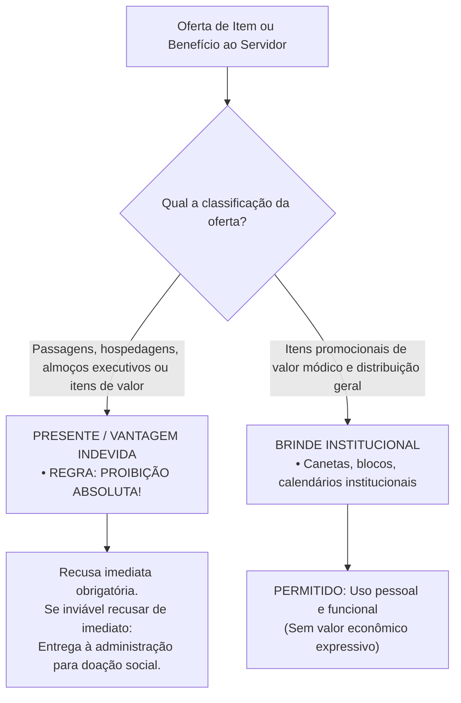
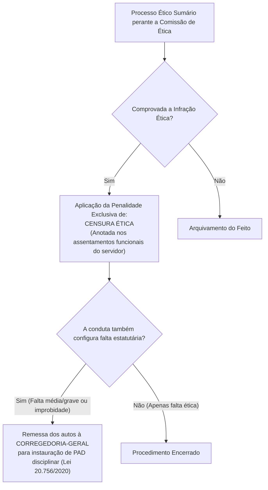

# 05 - Código de Ética dos Servidores do TCE-GO

> **Matéria:** Legislação Institucional  
> **Cargos:** A01 – Técnico de Controle Externo (Adm) / B02 – Técnico de Controle Externo (TI)  
> **Arquivo:** `05_codigo_de_etica_servidores_tce_go.md`  
> **Ato Normativo:** Código de Ética e de Conduta dos Servidores do Tribunal de Contas do Estado de Goiás (Resolução Administrativa nº 01/2014, Anexo II, e alterações normativas de integridade)

---

## 📌 Ementa / Itens do Edital
- Código de Ética dos Servidores do Tribunal de Contas do Estado de Goiás:
    - Princípios e valores deontológicos fundamentais do controle externo: dignidade, decoro, zelo, probidade, eficácia, independência, integridade, impessoalidade e imparcialidade;
    - Normas Internacionais das Entidades Fiscalizadoras Superiores (Código de Ética da INTOSAI - ISSAI 130);
    - Direitos funcionais e deveres éticos: zelo com o interesse público, urbanidade com partes e jurisdicionados, eficiência técnica e aperfeiçoamento profissional contínuo;
    - Dever indeclinável de sigilo funcional e confidencialidade: custódia de dados, processos sigilosos e vedação expressa ao uso de informações privilegiadas;
    - Conflito de interesses: conceito, prevenção, transparência e autodeclaração de impedimento e suspeição;
    - Vedações e proibições éticas expressas:
    - Vedação à antecipação de juízos de valor à imprensa ou em redes sociais sobre processos em curso;
    - Vedação ao exercício de advocacia, assessoria técnica ou consultoria a órgãos e entidades jurisdicionadas;
    - Política de aceitação de presentes x brindes: distinção legal, limites de valor econômico e destinação de itens recusáveis;
    - Comissão de Ética do TCE-GO:
    - Natureza institucional, composição e mandato de seus membros;
    - Competência consultiva e preventiva (orientação e resposta a dúvidas dos servidores);
    - Competência investigativa e processual (rito sumário, garantia do contraditório e ampla defesa);
    - Penalidade ética exclusiva: Censura Ética e anotação nos assentamentos funcionais;
    - Intersecção com o regime disciplinar: remessa de expedientes à Corregedoria-Geral para instauração de Processo Administrativo Disciplinar (PAD).

---

## 🧭 Sumário
- [1. Fundamentos Deontológicos e Normas Internacionais de Auditoria](#1-fundamentos-deontologicos-e-normas-internacionais-de-auditoria)
    - [1.1 Princípios e Valores Éticos do Controle Externo](#11-principios-e-valores-eticos-do-controle-externo)
    - [1.2 Alinhamento com a ISSAI 130 da INTOSAI e Primazia do Interesse Público](#12-alinhamento-com-a-issai-130-da-intosai-e-primazia-do-interesse-publico)
- [2. Deveres Éticos e Postura Funcional do Servidor do TCE-GO](#2-deveres-eticos-e-postura-funcional-do-servidor-do-tce-go)
    - [2.1 Urbanidade, Relações Profissionais e Presteza](#21-urbanidade-relacoes-profissionais-e-presteza)
    - [2.2 Zelo Técnico, Produtividade e Rigor Procedimental](#22-zelo-tecnico-produtividade-e-rigor-procedimental)
    - [2.3 Dever Incondicional de Sigilo, Custódia de Dados e Vedação a Informações Privilegiadas](#23-dever-incondicional-de-sigilo-custodia-de-dados-e-vedacao-a-informacoes-privilegiadas)
- [3. Proibições Éticas, Vedações e Conflito de Interesses](#3-proibicoes-eticas-vedacoes-e-conflito-de-interesses)
    - [3.1 Vedações Expressas: Advocacia, Consultoria e Redes Sociais](#31-vedacoes-expressas-advocacia-consultoria-e-redes-sociais)
    - [3.2 Política Institucional de Presentes vs. Brindes](#32-politica-institucional-de-presentes-vs-brindes)
    - [3.3 Prevenção de Conflito de Interesses e Autodeclaração de Impedimento](#33-prevencao-de-conflito-de-interesses-e-autodeclaracao-de-impedimento)
- [4. A Comissão de Ética do TCE-GO e o Processo Ético](#4-a-comissao-de-etica-do-tce-go-e-o-processo-etico)
    - [4.1 Composição e Tríplice Atuação da Comissão de Ética](#41-composicao-e-triplice-atuacao-da-comissao-de-etica)
    - [4.2 Rito Sumário Apuratório e Garantia da Ampla Defesa](#42-rito-sumario-apuratorio-e-garantia-da-ampla-defesa)
    - [4.3 A Penalidade Exclusiva de Censura Ética e Remessa Disciplinar à Corregedoria](#43-a-penalidade-exclusiva-de-censura-etica-e-remessa-disciplinar-a-corregedoria)
- [5. Fontes Oficiais e Referências Bibliográficas](#5-fontes-oficiais-e-referencias-bibliograficas)
- [6. Questões de Concurso FCC Comentadas](#6-questoes-de-concurso-fcc-comentadas)

---

## 1. Fundamentos Deontológicos e Normas Internacionais de Auditoria

### 1.1 Princípios e Valores Éticos do Controle Externo
O Código de Ética e de Conduta dos Servidores do Tribunal de Contas do Estado de Goiás, veiculado pela **Resolução Administrativa nº 01/2014 (Anexo II)** e complementado pelos atos de integridade institucional, estabelece as diretrizes axiológicas que regem a conduta de todos os servidores efetivos, comissionados, estagiários e colaboradores que prestam serviços ao Tribunal.

- **Dignidade, Decoro e Zelo:** O servidor público não pode dissociar sua vida funcional de sua conduta perante a sociedade; sua atuação deve refletir o prestígio e a respeitabilidade do Tribunal de Contas.
- **Probidade e Moralidade:** A atividade pública exige probidade estrita, lealdade à verdade real dos fatos apurados em fiscalizações e repúdio veemente a qualquer forma de vantagem indevida ou favorecimento escuso.
- **Independência Profissional e Imparcialidade:** Imunidade absoluta contra pressões de governantes, partidos políticos, grupos econômicos ou sindicatos; as conclusões de auditorias e instruções processuais devem apoiar-se estritamente na Constituição, nas leis e em matrizes probatórias consistentes.
- **Eficácia e Competência Técnica:** Busca contínua por aprimoramento profissional na Escola Superior de Controle Externo, aplicando os melhores padrões técnicos para elevar o rendimento do controle da despesa pública.

---

### 1.2 Alinhamento com a ISSAI 130 da INTOSAI e Primazia do Interesse Público
O Código de Ética do TCE-GO encontra-se em total sintonia com a **ISSAI 130 (Código de Ética da Organização Internacional das Entidades Fiscalizadoras Superiores - INTOSAI)** e com as diretrizes da Associação dos Membros dos Tribunais de Contas do Brasil (ATRICON) e do Instituto Rui Barbosa (IRB):

- **Primazia do Interesse Público:** O interesse público coletivo se sobrepõe incondicionalmente a quaisquer conveniências pessoais, partidárias, corporativas ou setoriais.
- **Cultura de Integridade e Prestação de Contas (*Accountability*):** O controle externo deve constituir modelo de integridade para toda a Administração Pública, não se tolerando complacência com desvios morais ou conflitos de interesses em suas próprias fileiras.

---

## 2. Deveres Éticos e Postura Funcional do Servidor do TCE-GO

### 2.1 Urbanidade, Relações Profissionais e Presteza
Constituem deveres inafastáveis dos servidores do TCE-GO:

- Tratar com urbanidade, respeito, civilidade e presteza todas as partes, procuradores, advogados, agentes públicos jurisdicionados e cidadãos;
- Facilitar o exercício dos direitos de fiscalização social assegurados ao cidadão;
- Atuar com neutralidade ideológica no trato das informações processuais e nas relações institucionais.

---

### 2.2 Zelo Técnico, Produtividade e Rigor Procedimental
O servidor do controle externo tem a obrigação de:

- Cumprir com presteza e pontualidade os prazos processuais e regimentais de instrução, elaboração de relatórios de auditoria e cumprimento de despachos;
- Fundamentar com rigor técnico todas as análises de contas, apontando com precisão os dispositivos legais transgredidos e a quantificação fidedigna do dano ao erário quando verificado;
- Zelar pela conservação dos bens públicos, equipamentos eletrônicos, bases de dados e materiais colocados à disposição para o desempenho do serviço.

---

### 2.3 Dever Incondicional de Sigilo, Custódia de Dados e Vedação a Informações Privilegiadas
No âmbito do TCE-GO, o manuseio de dados fiscais, bancários, orçamentários e relatórios de auditoria submete-se ao mais rígido **dever de sigilo e confidencialidade**:

- **Custódia Segura das Bases de Dados:** O servidor responde pela integridade e preservação dos arquivos eletrônicos, papéis de trabalho e informações confidenciais a que tiver acesso;
- **Proibição de Uso de Informação Privilegiada:** É expressamente vedado ao servidor utilizar informação confidencial ou ainda não divulgada formalmente pela Corte de Contas para auferir vantagem pessoal direta ou indireta, para beneficiar parentes, amigos ou terceiros;
- **Sigilo das Ações de Fiscalização:** As etapas preliminares de inspeções e auditorias mantêm caráter reservado até a notificação formal das partes e liberação pública do relatório pelos órgãos deliberativos, sob pena de responsabilidade ética, disciplinar e criminal por quebra de segredo funcional.

---

## 3. Proibições Éticas, Vedações e Conflito de Interesses

### 3.1 Vedações Expressas: Advocacia, Consultoria e Redes Sociais
É terminantemente proibido ao servidor do Tribunal de Contas do Estado de Goiás:

1. **Exercício da Advocacia ou Assessoria a Jurisdicionados:** Atuar, direta ou indiretamente, como procurador, consultor jurídico, assessor contábil ou preposto de quaisquer órgãos da administração pública direta ou indireta estadual, empresas públicas, consórcios, ou pessoas físicas e jurídicas sujeitas à jurisdição da Corte de Contas;
2. **Antecipação de Juízos de Valor em Redes Sociais e Imprensa:** Emitir declarações públicas ou publicações em redes sociais pessoais, blogs e meios de comunicação manifestando opinião antecipada, críticas pessoais ou juízos de valor sobre processos em tramitação, decisões pendentes ou sobre gestores investigados;
3. **Uso Privado da Estrutura do Tribunal:** Empregar servidores subordinados, bens patrimoniais, equipamentos eletrônicos ou sistemas corporativos do TCE-GO em atividades estranhas ao serviço público ou em campanhas político-partidárias;
4. **Prática de Assédio:** Qualquer atitude que configure assédio moral ou assédio sexual nas relações funcionais de trabalho.

> 🚨 **ALERTA DE PROVA / PEGADINHA FCC:** É frequente a FCC apresentar cenários de servidores do TCE que, indignados com desvios que apuram, publicam desabafos e documentos preliminares em suas redes sociais pessoais, alegando "direito de livre expressão" ou "dever de publicidade". A conduta configura **grave violação ética aos deveres de sigilo e reserva**. A publicidade dos achados de controle ocorre estritamente pelos canais institucionais oficiais e após o contraditório formal!

---

### 3.2 Política Institucional de Presentes vs. Brindes
A disciplina de integridade do TCE-GO estabelece fronteira nítida entre o que configura vantagem indevida (presente) e simples cortesia de divulgação institucional (brinde):

| Parâmetro Comparativo | Presente / Vantagem Financeira | Brinde Institucional |
| :--- | :--- | :--- |
| **Definição e Natureza** | Bens, serviços, transporte, passagens aéreas, estadias, jantares ou cortesias que possuam valor comercial individualizado apreciável. | Artigos promocionais de valor econômico módico e sem apelo de comercialização. |
| **Critério de Distribuição** | Destinado especificamente a um servidor público, equipe de auditoria ou gabinete determinado. | Distribuído em caráter genérico a todos os participantes de evento público, seminário ou feira institucional. |
| **Tratamento no Código de Ética** | **VEDAÇÃO ABSOLUTA**. A aceitação gera quebra de imparcialidade e enseja sanção ética, sem prejuízo de apuração por improbidade ou crime de corrupção. | **PERMITIDO**, desde que de valor módico estipulado nos normativos da Corte. |
| **Procedimento em Caso de Impossibilidade de Recusa Imediata** | O servidor tem o dever funcional de entregar o item à Diretoria de Administração para fins de incorporação ao patrimônio ou doação a entidades filantrópicas. | O servidor pode reter o item para utilização nas dependências da repartição. |

> ⭐ **IMPORTANTE / PEGADINHA DE CONCURSO:** Convite de fornecedor de TI para o servidor participar de congresso internacional com "tudo pago pela empresa" **NÃO É BRINDE**! Constitui vantagem indevida expressamente vedada pelo Código de Ética, gerando impedimento e responsabilização funcional imediata.

---

### 3.3 Prevenção de Conflito de Interesses e Autodeclaração de Impedimento
O conflito de interesses ocorre quando o interesse privado do servidor pode influenciar de maneira inadequada o desempenho de suas atribuições públicas no controle externo.

- **Dever de Autodeclaração:** O servidor designado para atuar em auditoria, instrução de processo de contas ou análise de licitação que possuir relação de parentesco (cônjuge, companheiro ou parentes consanguíneos ou afins até o terceiro grau) com dirigentes da entidade auditada, ou com quem mantenha litígio judicial ou interesse financeiro comum, tem a **obrigação ética de autodeclarar imediatamente o impedimento**, solicitando à chefia imediata sua substituição na equipe.

---

## 4. A Comissão de Ética do TCE-GO e o Processo Ético

### 4.1 Composição e Tríplice Atuação da Comissão de Ética
A Comissão de Ética do TCE-GO é órgão autônomo colegiado, instituído pela Presidência da Corte:

- **Composição:** Composta por **três (3) servidores públicos efetivos e estáveis**, designados para mandato com duração pré-fixada;
- **Tríplice Atuação Institucional:**
    1. **Função Consultiva e Preventiva:** Responde a consultas abstratas de servidores sobre conflitos de interesses e dilemas deontológicos, emitindo pareceres orientadores;
    2. **Função Educativa:** Promove campanhas institucionais de integridade, transparência e respeito à ética pública;
    3. **Função Investigativa e Judicante:** Processa e julga representações e denúncias sobre condutas antiéticas de servidores da Casa.

---

### 4.2 Rito Sumário Apuratório e Garantia da Ampla Defesa
O procedimento ético adota rito sumário simplificado, com garantia constitucional da ampla defesa:

1. Notificação do servidor investigado para, querendo, prestar esclarecimentos preliminares e apresentar defesa escrita no prazo regimental;
2. Produção de provas documentais e oitiva de eventuais testemunhas sob a condução da Comissão;
3. Elaboração de relatório conclusivo motivado reconhecendo a improcedência do fato ou a consumação de desvio ético.

---

### 4.3 A Penalidade Exclusiva de Censura Ética e Remessa Disciplinar à Corregedoria
A competência punitiva direta da Comissão de Ética restringe-se estritamente ao âmbito moral e ético:

- **A Penalidade de Censura Ética:** A única sanção que a Comissão de Ética pode aplicar diretamente ao servidor infrator é a pena de **Censura Ética**, a qual é consignada nos registros cadastrais e funcionais do servidor, gerando reflexos negativos na avaliação de desempenho para fins de promoção e na concessão de elogios.
- **Incompetência para Sanções Estatutárias:** A Comissão de Ética **NÃO pode aplicar** penas de demissão, suspensão funcional, advertência disciplinar, multa ou cassação de aposentadoria da Lei nº 20.756/2020.
- **Encaminhamento à Corregedoria-Geral:** Havendo indícios de que o ato praticado pelo servidor ultrapassa o desvio ético e enquadra-se como infração estatutária, ato de improbidade administrativa ou ilícito penal, a Comissão de Ética remeterá cópia integral do processo à **Corregedoria-Geral do TCE-GO** para deflagração de Processo Administrativo Disciplinar (PAD).

> 🚨 **ALERTA DE PROVA / PEGADINHA FCC:** Questões da FCC costumam afirmar que a Comissão de Ética "demitiu o servidor" ou "aplicou suspensão de 30 dias". Essa afirmação está **TOTALMENTE ERRADA**. A única sanção que a Comissão de Ética pode impor diretamente é a **CENSURA ÉTICA**. Suspensão e demissão são matérias privativas da esfera disciplinar processadas pela Corregedoria e julgadas pela autoridade administrativa.

---

## 5. Fontes Oficiais e Referências Bibliográficas

* [Código de Ética dos Servidores do TCE-GO (Documento Oficial TCE-GO)](https://portal.tce.go.gov.br/documents/20181/574123/C%C3%B3digo+de+%C3%89tica/056863be-6768-4c35-a6e8-ccdd40421211) - Texto oficial com deveres, vedações e funcionamento da Comissão de Ética.
* [Portal Institucional do TCE-GO - Corregedoria Geral e Ética](https://portal.tce.go.gov.br/corregedoria-geral2) - Atribuições da Corregedoria Geral e atuação da Comissão de Ética do TCE-GO.
* [Lei Estadual nº 20.756/2020 - Estatuto dos Servidores de Goiás (Casa Civil/GO)](https://legisla.casacivil.go.gov.br/pesquisa_legislacao/100979/lei-20756) - Deveres funcionais, proibições e regime disciplinar dos servidores públicos.
* [Lei Estadual nº 13.800/2001 - Processo Administrativo Estadual (Casa Civil/GO)](https://legisla.casacivil.go.gov.br/pesquisa_legislacao/81441/lei-13800) - Ritos e garantias da ampla defesa em processos de apuração ética.
* [Lei Federal nº 8.429/1992 - Lei de Improbidade Administrativa (Planalto)](https://www.planalto.gov.br/ccivil_03/leis/l8429compilada.htm) - Princípios da moralidade administrativa e sanções por enriquecimento ilícito.
* NOHARA, Irene Patrícia. **Direito Administrativo**. 11. ed. São Paulo: Atlas, 2022. (Cap. 11 - Moralidade Administrativa e Regime Disciplinar).
* CARVALHO FILHO, José dos Santos. **Manual de Direito Administrativo**. 38. ed. Barueri: Atlas, 2024. (Cap. 12 - Responsabilidade Funcional e Regime Ético).
* GARCIA, Emerson; ALVES, Rogério Pacheco. **Improbidade Administrativa**. 10. ed. São Paulo: Saraiva, 2021. (Cap. 3 - Violação aos Princípios da Administração Pública).

---

## 6. Questões de Concurso FCC Comentadas

### Questão 01
**(FCC – TCE-GO – Analista de Controle Externo)**  
Rodrigo, Técnico de Controle Externo do TCE-GO designado para compor comissão de fiscalização de contratos de serviços de informática, é abordado pelo diretor comercial de uma grande empresa de tecnologia que disputa novo certame estadual. O empresário oferece a Rodrigo o pagamento integral de passagens aéreas, estadia em hotel de luxo e inscrições para um congresso temático no exterior. Paralelamente, envia ao gabinete de Rodrigo uma cesta de vinhos importados de alto valor comercial. Diante das regras deontológicas constantes do Código de Ética dos Servidores do TCE-GO, Rodrigo deverá:

* **A)** Aceitar as passagens e a inscrição no congresso, pois revertem em benefício à qualificação técnica do Tribunal, mas doar os vinhos ao almoxarifado.
* **B)** Recusar peremptoriamente tanto o convite de viagem quanto os presentes, comunicando formalmente o fato à chefia e à Comissão de Ética, por configurar benefício de pessoa interessada em deliberações da Corte.
* **C)** Aceitar o convite de viagem desde que formalize compromisso escrito de manter neutralidade no relatório de auditoria.
* **D)** Aceitar os vinhos na qualidade de brinde institucional, vedada apenas a aceitação de valores em espécie.
* **E)** Aceitar os benefícios oferecidos, cabendo à Comissão de Ética homologar a doação após a conclusão do certame licitatório.

> **Comentário Detalhado:**
>
> - **A) Incorreta.** Custeio de passagens aéreas e hotelaria por empresa fornecedora ou interessada em deliberações da Corte consubstancia benefício indevido, comprometendo de forma irreversível a independência técnica da fiscalização.
> - **B) CORRETA.** Em observância estrita ao Código de Ética do TCE-GO, o servidor público do controle externo tem o dever de recusar peremptoriamente qualquer presente, viagem, transporte, hospedagem ou vantagem econômica oferecida por particulares ou entes que mantenham interesses em processos fiscalizados pela Corte, comunicando o ocorrido de imediato à sua chefia e à Comissão de Ética.
> - **C) Incorreta.** Termo de compromisso moral unilateral não elide a nulidade nem a quebra objetiva do dever de neutralidade gerada pelo recebimento de hospitalidades de fornecedores.
> - **D) Incorreta.** Bebidas finas e itens de elevado valor econômico classificam-se juridicamente como presentes (e não brindes promocionais de valor ínfimo).
> - **E) Incorreta.** A Comissão de Ética não tem competência para homologar recebimento de benesses financeiras ou vantagens indevidas.
> 
> **Gabarito: B**

---

### Questão 02
**(FCC – TCE-RO – Auditor de Controle Externo)**  
A respeito da Comissão de Ética e do rito de apuração de infrações comportamentais no âmbito dos Tribunais de Contas, assinale a opção correta:

* **A)** A Comissão de Ética tem competência para aplicar diretamente as penas de suspensão funcional e demissão do cargo público.
* **B)** A única sanção administrativa cabível diretamente no âmbito de deliberação da Comissão de Ética é a Censura Ética, a qual será registrada no assentamento funcional do servidor.
* **C)** O processo ético submete-se ao segredo de justiça absoluto em todas as suas fases, sendo dispensada a notificação do acusado para evitar constrangimentos.
* **D)** A Comissão de Ética atua exclusivamente no julgamento contencioso, sendo-lhe expressamente vedada a resposta a consultas preventivas dos servidores.
* **E)** A condenação em censura ética extingue automaticamente a possibilidade de apuração disciplinar pela Corregedoria do órgão.

> **Comentário Detalhado:**
>
> - **A) Incorreta.** A aplicação de penalidades estatutárias expulsivas ou gravosas (como suspensão e demissão) constitui matéria da esfera disciplinar apurada mediante PAD (Lei nº 20.756/2020), escapando à competência da Comissão de Ética.
> - **B) CORRETA.** A única sanção sancionatória que a Comissão de Ética pode aplicar diretamente em seu processo de conformidade moral é a **Censura Ética**, cuja decisão motivada é formalmente anotada na ficha cadastral e assentamento funcional do servidor público.
> - **C) Incorreta.** O procedimento ético respeita com rigor as garantias constitucionais do contraditório e da ampla defesa, sendo indispensável a notificação do interessado para apresentação de defesa formal escrita.
> - **D) Incorreta.** Uma das missões primordiais da Comissão de Ética é sua função consultiva e preventiva, orientando os servidores e dirimindo dúvidas a respeito de condutas em tese.
> - **E) Incorreta.** As instâncias ética e disciplinar são autônomas e comunicam-se; a imposição de censura ética não prejudica a remessa dos autos à Corregedoria-Geral para deflagração de PAD por falta funcional correlata.
> 
> **Gabarito: B**

---

### Questão 03
**(FCC – TCE-PI – Auditor de Controle Externo)**  
Flávio, Técnico de Controle Externo do TCE-GO, teve acesso a um relatório preliminar de auditoria ainda sigiloso que apura irregularidades na gestão de saúde pública estadual. Indignado com os achados, Flávio publica trechos dos documentos e fotografias em suas redes sociais pessoais, tecendo críticas severas aos gestores envolvidos antes do julgamento do processo pela Câmara. À luz das normas deontológicas do TCE-GO:

* **A)** A atitude de Flávio é protegida pelo direito constitucional à livre manifestação do pensamento, não configurando infração ética.
* **B)** Flávio cometeu infração ética grave contra os deveres de sigilo, reserva e confidencialidade, sendo-lhe expressamente vedado antecipar juízos de valor em mídias sociais sobre processos em tramitação.
* **C)** A divulgação em rede social só seria ilícita se Flávio tivesse recebido remuneração direta de partidos de oposição.
* **D)** O servidor agiu com estrito cumprimento do princípio da publicidade, sobrepondo-se este ao sigilo institucional dos autos.
* **E)** A comissão de auditoria deve endossar a postagem para garantir a transparência ativa dos dados da Corte de Contas.

> **Comentário Detalhado:**
>
> - **A) Incorreta.** A garantia constitucional da liberdade de expressão encontra limite no dever de fidelidade institucional e de sigilo funcional sobre documentos não homologados a que o agente teve acesso exclusivamente em virtude do cargo público.
> - **B) CORRETA.** Nos termos do Código de Ética do TCE-GO, incumbe ao servidor o **dever indeclinável de sigilo e discrição** quanto a relatórios e autos processuais em andamento. É vedada categoricamente a antecipação de juízos de valor, a manifestação pública de opiniões parciais ou o vazamento de peças técnicas à imprensa e redes sociais antes da formal deliberação do Tribunal.
> - **C) Incorreta.** O recebimento de remuneração agravaria o ilícito com contornos de corrupção passiva, mas a divulgação não autorizada por si só já perfaz falta ética autônoma.
> - **D) Incorreta.** A publicidade republicana é assegurada mediante atos e canais oficiais da Corte nos momentos processuais oportunos, não se confundindo com quebra arbitrária de sigilo por servidor individualmente.
> - **E) Incorreta.** As equipes de fiscalização submetem-se ao mesmo dever de reserva e neutralidade institucional.
> 
> **Gabarito: B**

---

### Questão 04
**(FCC – TCE-AM – Auditor de Controle Externo)**  
De acordo com os princípios da INTOSAI (ISSAI 130) e as diretrizes do Código de Ética do Tribunal de Contas do Estado de Goiás, na hipótese de um servidor ser designado para fiscalizar entidade cujo dirigente máximo seja seu cônjuge ou parente colateral até o terceiro grau:

* **A)** O servidor poderá realizar a auditoria normalmente, desde que se limite à análise de demonstrativos numéricos desprovidos de juízo discricionário.
* **B)** O servidor tem o dever ético de declarar imediatamente seu impedimento ou suspeição, abstendo-se de praticar qualquer ato de instrução ou fiscalização.
* **C)** Caberá à chefia imediata acompanhar presencialmente todas as entrevistas para garantir a neutralidade da inspeção.
* **D)** O servidor deverá solicitar autorização prévia por escrito ao Governador do Estado para atuar nos autos.
* **E)** Não há conflito de interesses quando o parentesco for decorrente de vínculo por afinidade legítima.

> **Comentário Detalhado:**
>
> - **A) Incorreta.** A existência de vínculo de parentesco macula objetivamente a presunção de imparcialidade e isenção técnica necessária à auditoria, mesmo em análises matemáticas.
> - **B) CORRETA.** Em respeito aos princípios da **imparcialidade, moralidade e prevenção de conflito de interesses**, o servidor que constatar situação de parentesco consanguíneo ou por afinidade até o terceiro grau com dirigente ou parte interessada na entidade auditada tem a **obrigação ética de declarar de ofício seu impedimento**, solicitando sua substituição imediata na respectiva comissão de auditoria.
> - **C) Incorreta.** O acompanhamento pela chefia não sana o impedimento legal do auditor com laços de consanguinidade com a autoridade auditada.
> - **D) Incorreta.** O Governador do Estado não interfere nas designações de membros de equipes de controle do TCE-GO, órgão titular de autonomia institucional.
> - **E) Incorreta.** O parentesco por afinidade (cunhados, sogros) submete-se às mesmíssimas restrições de suspeição e impedimento da legislação processual e ética.
> 
> **Gabarito: B**

---

### Questão 05
**(FCC – DPE-SP – Oficial de Defensoria)**  
Considere que um servidor recém-empossado no TCE-GO possua dúvidas legítimas sobre a possibilidade de exercer, cumulativamente com suas funções públicas, atividade de docência acadêmica em universidade privada e a publicação de artigos científicos na área orçamentária. Nesse cenário, à luz dos mecanismos de governança ética:

* **A)** O servidor deverá consultar previamente a Comissão de Ética do órgão, a qual possui atribuição consultiva para dirimir dúvidas éticas e orientar os servidores.
* **B)** É vedado à Comissão de Ética responder a qualquer questionamento de servidores que não seja originado de processo punitivo litigioso.
* **C)** A atividade de magistério é terminantemente proibida aos ocupantes de cargos no controle externo, ensejando demissão sumária.
* **D)** O servidor deve requerer autorização prévia ao Presidente da Assembleia Legislativa em audiência pública.
* **E)** O exercício da docência independe de compatibilidade de horários, bastando aviso informal ao colega de setor.

> **Comentário Detalhado:**
>
> - **A) CORRETA.** Uma das missões nucleares da **Comissão de Ética** é o exercício de sua **atribuição preventiva, educativa e consultiva**. Os servidores do Tribunal de Contas têm a faculdade e o dever de provocar a Comissão de Ética previamente para dirimir dúvidas a respeito de conflito de interesses, acumulação de docência e condutas funcionais antes da tomada de decisões concretas.
> - **B) Incorreta.** A atuação da comissão não é exclusivamente litigiosa; seu foco primordial é a orientação proativa da conduta dos servidores.
> - **C) Incorreta.** O magistério superior é constitucionalmente autorizado em regime de acumulação com cargos públicos (CF, Art. 37, XVI, "b"), desde que haja compatibilidade de horários e não envolva assessoria a entes fiscalizados.
> - **D) Incorreta.** A gestão da conduta ética interna dos servidores do TCE-GO é disciplinada pela própria Corte de Contas, e não pelo Poder Legislativo.
> - **E) Incorreta.** A compatibilidade de horários é mandamento constitucional inafastável para qualquer regime de acumulação remunerada lícita.
> 
> **Gabarito: A**
