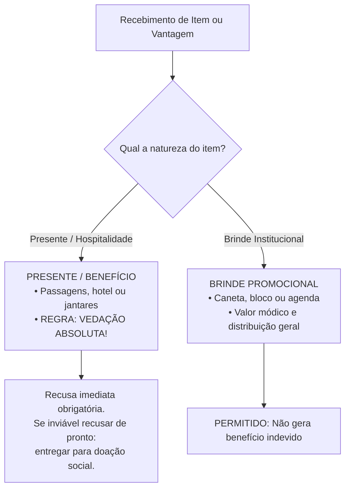
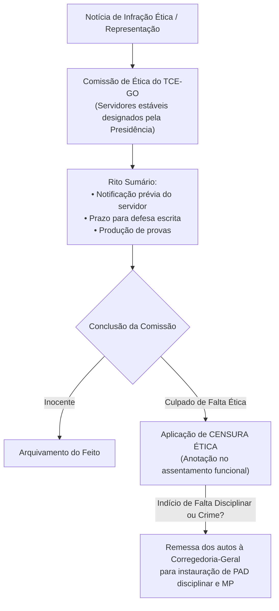

# 05 - Código de Ética dos Servidores do TCE-GO

> **Matéria:** Legislação Institucional  
> **Cargos:** A01 – Técnico de Controle Externo (Adm) / B02 – Técnico de Controle Externo (TI)  
> **Arquivo:** `05_codigo_de_etica_servidores_tce_go.md`  
> **Ato Normativo:** Código de Ética e de Conduta dos Servidores do Tribunal de Contas do Estado de Goiás (Resolução Administrativa nº 01/2014, Anexo II, e alterações normativas de integridade)

---

## 📌 Ementa / Itens do Edital
- Código de Ética dos Servidores do Tribunal de Contas do Estado de Goiás:
  - Princípios e valores deontológicos fundamentais do controle externo: dignidade, decoro, zelo, probidade, eficácia, independência, integridade, impessoalidade e imparcialidade;
  - Normas Internacionais das Entidades Fiscalizadoras Superiores (Código de Ética da INTOSAI - ISSAI 130);
  - Direitos funcionais e deveres éticos: zelo com o interesse público, urbanidade com partes e jurisdicionados, eficiência técnica e aperfeiçoamento profissional contínuo;
  - Dever indeclinável de sigilo funcional e confidencialidade: custódia de dados, processos sigilosos e vedação expressa ao uso de informações privilegiadas;
  - Conflito de interesses: conceito, prevenção, transparência e autodeclaração de impedimento e suspeição;
  - Vedações e proibições éticas expressas:
    - Vedação à antecipação de juízos de valor à imprensa ou em redes sociais sobre processos em curso;
    - Vedação ao exercício de advocacia, assessoria técnica ou consultoria a órgãos e entidades jurisdicionadas;
    - Política de aceitação de presentes x brindes: distinção legal, limites de valor econômico e destinação de itens recusáveis;
  - Comissão de Ética do TCE-GO:
    - Natureza institucional, composição e mandato de seus membros;
    - Competência consultiva e preventiva (orientação e resposta a dúvidas dos servidores);
    - Competência investigativa e processual (rito sumário, garantia do contraditório e ampla defesa);
    - Penalidade ética exclusiva: Censura Ética e anotação nos assentamentos funcionais;
    - Intersecção com o regime disciplinar: remessa de expedientes à Corregedoria-Geral para instauração de Processo Administrativo Disciplinar (PAD).

---

## 🌳 Classificação Hierárquica

```text
5. Ética Pública e Conduta Funcional no TCE-GO
├── 5.1 Fundamentos, Princípios e Diretrizes Deontológicas
│   ├── 5.1.1 Princípios Fundamentais: Dignidade, decoro, integridade, moralidade e lealdade às instituições
│   ├── 5.1.2 Padrões Internacionais: ISSAI 130 da INTOSAI e diretrizes do Instituto Rui Barbosa (IRB)
│   └── 5.1.3 Primazia Absoluta do Interesse Público sobre interesses particulares, de grupos ou corporativos
├── 5.2 Deveres Éticos e Postura Funcional do Servidor
│   ├── 5.2.1 Atendimento e Relações Profissionais: Urbanidade, cortesia, presteza e respeito à cidadania
│   ├── 5.2.2 Zelo Técnico e Produtividade: Cumprimento rigoroso de prazos, instrução qualificada e zelo pelo erário
│   ├── 5.2.3 Dever de Sigilo e Confidencialidade:
│   │   ├── Preservação de informações sigilosas obtidas em inspeções, auditorias e processos
│   │   └── Vedação categórica do uso de informações privilegiadas em benefício pessoal ou de terceiros
│   └── 5.2.4 Comunicação Obrigatória de Irregularidades: Dever de reportar ilegalidades às chefias e instâncias de controle
├── 5.3 Proibições Éticas, Vedações e Gestão de Conflitos de Interesses
│   ├── 5.3.1 Condutas Expressamente Proibidas:
│   │   ├── Atuação em advocacia, assessoria ou consultoria a órgãos ou partes jurisdicionadas ao TCE-GO
│   │   ├── Manifestação pública ou em mídias digitais sobre processos sob exame (vedada antecipação de juízo)
│   │   └── Utilização de bens, estrutura, sistemas de dados ou pessoal do Tribunal para finalidades particulares
│   ├── 5.3.2 Regime de Presentes, Favores e Brindes:
│   │   ├── Proibição estrita de receber presentes, doações, hospedagens, passagens ou vantagens econômicas
│   │   ├── Exceção: Brindes de valor módico distribuídos como cortesia ou divulgação institucional generalizada
│   │   └── Procedimento de recusa e encaminhamento à administração para doação social
│   └── 5.3.3 Impedimentos e Suspeições: Dever de autodeclaração quando houver laços de parentesco ou interesse financeiro
└── 5.4 Comissão de Ética do TCE-GO e Procedimento Apuratório
    ├── 5.4.1 Organização da Comissão de Ética: Composição por servidores estáveis e mandatos definidos
    ├── 5.4.2 Tríplice Atuação Institucional:
    │   ├── Atuação Consultiva/Educativa: Orientação prévia aos servidores e campanhas de integridade
    │   ├── Atuação Investigativa: Apuração de denúncias ou representações de ofício
    │   └── Atuação Deliberativa: Julgamento de conformidade ética
    ├── 5.4.3 Procedimento Ético Sumário: Notificação do investigado, prazo de defesa, instrução e relatório final
    └── 5.4.4 Sanção Ética Aplicável:
        ├── Aplicação exclusiva da pena de Censura Ética anotada na ficha funcional do servidor
        └── Comunicação à Corregedoria-Geral para abertura de PAD quando a conduta caracterizar infração disciplinar
```

---

## 📖 Resumo Teórico & Pontos-Chave

### 1. Princípios e Valores Éticos do Controle Externo

A atuação no Tribunal de Contas exige padrões de conduta que transcendem a mera legalidade estrita, alinhando-se aos compromissos da **ISSAI 130 (Código de Ética da INTOSAI)** e do Código de Ética do TCE-GO (Resolução Administrativa nº 01/2014):

* **Integridade:** Retidão moral inegociável, agindo com honestidade, retidão e boa-fé em todas as circunstâncias públicas ou privadas;
* **Independência e Imparcialidade:** Imunidade a pressões políticas, ideológicas, econômicas ou corporativas; atuação estritamente técnica baseada em evidências probatórias;
* **Competência Técnica:** Compromisso com o aprimoramento continuado de conhecimentos e uso meticuloso das melhores práticas de auditoria;
* **Confidencialidade e Sigilo:** Dever de preservar o segredo sobre documentos e informações acessados em auditorias até sua formal deliberação pública pelo Colegiado.

---

### 2. Regramento sobre Presentes x Brindes (Ponto Crucial em Provas)



#### Quadro de Distinção entre Presente e Brinde:

| Parâmetro | Presente / Vantagem Financeira | Brinde Institucional |
| :--- | :--- | :--- |
| **Definição** | Bem, serviço, transporte, almoço de negócios, hospedagem ou benefício com valor econômico individualizado. | Item sem valor comercial relevante distribuído a título de cortesia, propaganda ou evento público. |
| **Público-Alvo** | Direcionado especificamente ao servidor ou ao seu gabinete/equipe de auditoria. | Distribuído em caráter de generalidade a todos os participantes ou ao público amplo. |
| **Tratamento Legal** | **PROIBIDO**. Constitui falta ética grave e, a depender do contexto, ato de improbidade ou crime de corrupção passiva. | **PERMITIDO**, desde que respeitado o teto de valor módico fixado em normas de integridade. |
| **Destinação em Caso de Entrega Forçada** | O servidor deve formalizar a entrega à Diretoria de Administração do Tribunal para incorporação ao patrimônio ou doação social. | O servidor pode reter para uso pessoal em suas atividades funcionais. |

---

### 3. Vedações Expressas ao Servidor do TCE-GO

O Código de Ética proíbe taxativamente ao servidor do Tribunal:

1. **Advocacia e Assessoria a Jurisdicionados:** Atuar como procurador, consultor, assessor ou intermediário de órgãos, entidades públicas ou empresas privadas sujeitas à jurisdição do TCE-GO;
2. **Manifestação Precipitada em Redes Sociais / Imprensa:** Emitir opiniões públicas antecipando juízos de valor sobre relatórios de auditoria, processos em andamento ou mérito de deliberações pendentes no Tribunal;
3. **Uso de Informações Privilegiadas:** Utilizar dados sigilosos ou antecipações de fiscalizações em benefício próprio, de familiares ou de terceiros;
4. **Desvio de Finalidade Operacional:** Empregar servidores subordinados, computadores, redes corporativas, sistemas de inteligência ou infraestrutura física da Corte para interesses privados ou campanhas político-partidárias;
5. **Omissão em Declarar Impedimento:** Deixar de comunicar formalmente situação de parentesco, afinidade ou litígio financeiro com gestores ou entidades fiscalizadas.

---

### 4. A Comissão de Ética do TCE-GO e o Rito da Censura Ética



#### Atribuições e Limites da Comissão de Ética:
* **Composição:** Composta por servidores públicos estáveis, designados por ato do Presidente do TCE-GO, com mandato certo;
* **Atuação Pedagógica:** Responde a consultas abstratas dos servidores sobre dilemas éticos cotidianos e conflitos de interesses;
* **Poder Punitivo Próprio:** A comissão de ética **NÃO tem competência** para aplicar sanções disciplinares estatutárias (advertência, suspensão, demissão ou cassação de aposentadoria da Lei nº 20.756/2020);
* **Pena Exclusiva de Censura Ética:** A penalidade formal privativa da Comissão de Ética é a **Censura Ética**, consignada na ficha cadastral/funcional do servidor;
* **Encaminhamento Obrigatório:** Constatado que a infração ética transcende o plano moral e configura também falta funcional estatutária ou ato ilícito, a Comissão remete cópia autenticada dos autos à **Corregedoria-Geral** para abertura do respectivo Processo Administrativo Disciplinar (PAD).

---

## ⚠️ Alertas de Prova & Pegadinhas da FCC

> 🚨 **ALERTA DE PROVA / PEGADINHA FCC:** Em diversas questões de concurso, a FCC formula casos em que o servidor comete falta ética grave e indaga qual a penalidade que a *Comissão de Ética* aplicará diretamente, colocando opções como "demissão", "suspensão por 30 dias" ou "advertência funcional". **Cuidado:** A Comissão de Ética só pode aplicar **Censura Ética**! As sanções de demissão e suspensão são prerrogativas da autoridade administrativa julgadora competente no âmbito do PAD.

> ⭐ **IMPORTANTE / REDES SOCIAIS:** O servidor do Tribunal de Contas não pode publicar postagens em redes sociais criticando gestores fiscalizados ou divulgando dados de auditorias em andamento sob a alegação de "liberdade de expressão". O dever de reserva, sigilo profissional e neutralidade institucional impõe contenção expressa.

> 📌 **NOTA EXPLICATIVA / DISTINÇÃO PRÁTICA:** Convites para jantares caros, custeio de passagens aéreas e hospedagens pagas por fornecedores licitantes **NÃO são brindes**, mas sim vantagens indevidas vedadas pelo Código de Ética, gerando grave infração e suspeição imediata da equipe de auditoria.

---

## 🌐 Fontes Oficiais e Referências Bibliográficas

* [Código de Ética dos Servidores do TCE-GO (Resolução Administrativa nº 01/2014, Anexo II)](https://portal.tce.go.gov.br/legislacao) - Normas deontológicas, deveres, vedações e processo perante a Comissão de Ética.
* [Portal da Ética e Ouvidoria do TCE-GO](https://portal.tce.go.gov.br/etica) - Canal oficial de integridade institucional, orientações e cartilha de conduta.
* [ISSAI 130 - Código de Ética da INTOSAI (IRB / Atricon)](https://irbcontas.org.br/) - Princípios éticos fundamentais para auditores das Entidades Fiscalizadoras Superiores.
* [Lei Federal nº 12.813/2013 (Lei de Conflito de Interesses)](http://www.planalto.gov.br/ccivil_03/_ato2011-2014/2013/lei/l12813.htm) - Diretrizes sobre prevenção de conflito de interesses no serviço público aplicadas por simetria.

---

## 📝 Questões de Concurso FCC Comentadas

### Questão 01
**(FCC – TCE-GO – Analista de Controle Externo)**  
Rodrigo, Técnico de Controle Externo do TCE-GO designado para compor comissão de fiscalização de contratos de serviços de informática, é abordado pelo diretor comercial de uma grande empresa de tecnologia que disputa novo certame estadual. O empresário oferece a Rodrigo o pagamento integral de passagens aéreas, estadia em hotel de luxo e inscrições para um congresso temático no exterior. Paralelamente, envia ao gabinete de Rodrigo uma cesta de vinhos importados de alto valor comercial. Diante das regras deontológicas constantes do Código de Ética dos Servidores do TCE-GO, Rodrigo deverá:

* **A)** Aceitar as passagens e a inscrição no congresso, pois revertem em benefício à qualificação técnica do Tribunal, mas doar os vinhos ao almoxarifado.
* **B)** Recusar peremptoriamente tanto o convite de viagem quanto os presentes, comunicando formalmente o fato à chefia e à Comissão de Ética, por configurar benefício de pessoa interessada em deliberações da Corte.
* **C)** Aceitar o convite de viagem desde que formalize compromisso escrito de manter neutralidade no relatório de auditoria.
* **D)** Aceitar os vinhos na qualidade de brinde institucional, vedada apenas a aceitação de valores em espécie.
* **E)** Aceitar os benefícios oferecidos, cabendo à Comissão de Ética homologar a doação após a conclusão do certame licitatório.

> **Gabarito: B**  
> **Comentário Detalhado:**  
> - **A) Incorreta.** Viagens e hospedagens custeadas por empresas fiscalizadas configuram benefício indevido e quebra frontal da independência funcional, sendo expressamente vedadas pelo Código de Ética.  
> - **B) CORRETA.** Nos termos do Código de Ética do TCE-GO, é terminantemente **vedado** ao servidor aceitar ou receber qualquer presente, benefício, vantagem financeira, hospedagem, transporte ou favor de pessoa física ou jurídica que seja jurisdicionada ou mantenha contratos e interesses sujeitos à fiscalização do Tribunal. O servidor tem o dever de recusar o oferecimento e comunicar o fato aos seus superiores hierárquicos e à Comissão de Ética.  
> - **C) Incorreta.** O compromisso moral do servidor não afasta a infração ética formal, pois a aceitação de viagens cria inadmissível conflito de interesses aparente e real.  
> - **D) Incorreta.** Vinhos finos de alto valor individualizado qualificam-se como **presentes**, e não brindes de valor módico institucional.  
> - **E) Incorreta.** A Comissão de Ética não possui competência para convalidar o recebimento de vantagens indevidas ofertadas por fornecedores.

---

### Questão 02
**(FCC – TCE-RO – Auditor de Controle Externo)**  
A respeito da Comissão de Ética e do rito de apuração de infrações comportamentais no âmbito dos Tribunais de Contas, assinale a opção correta:

* **A)** A Comissão de Ética tem competência para aplicar diretamente as penas de suspensão funcional e demissão do cargo público.
* **B)** A única sanção administrativa cabível diretamente no âmbito de deliberação da Comissão de Ética é a Censura Ética, a qual será registrada no assentamento funcional do servidor.
* **C)** O processo ético submete-se ao segredo de justiça absoluto em todas as suas fases, sendo dispensada a notificação do acusado para evitar constrangimentos.
* **D)** A Comissão de Ética atua exclusivamente no julgamento contencioso, sendo-lhe expressamente vedada a resposta a consultas preventivas dos servidores.
* **E)** A condenação em censura ética extingue automaticamente a possibilidade de apuração disciplinar pela Corregedoria do órgão.

> **Gabarito: B**  
> **Comentário Detalhado:**  
> - **A) Incorreta.** A aplicação de sanções como suspensão e demissão é de alçada privativa da autoridade competente em sede de PAD disciplinar (previsto na Lei nº 20.756/2020), e não da Comissão de Ética.  
> - **B) CORRETA.** A competência sancionatória direta atribuída à Comissão de Ética restringe-se formalmente à penalidade de **Censura Ética**, consignada por escrito na ficha cadastral/assentamento funcional do agente público.  
> - **C) Incorreta.** O processo ético observa rigorosamente o devido processo legal, o contraditório e a ampla defesa, sendo indispensável a citação e concessão de prazo para apresentação de defesa.  
> - **D) Incorreta.** A Comissão de Ética desempenha papel primordial de cunho **pedagógico, preventivo e consultivo**, orientando os servidores sobre condutas éticas adequadas e prevenção de conflitos de interesse.  
> - **E) Incorreta.** A esfera ética é independente da esfera disciplinar. Se a falta ética também constituir infração disciplinar estatutária, a Comissão encaminhará os autos à Corregedoria para instauração de PAD, inexistindo *bis in idem*.

---

### Questão 03
**(FCC – TCE-PI – Auditor de Controle Externo)**  
Flávio, Técnico de Controle Externo do TCE-GO, teve acesso a um relatório preliminar de auditoria ainda sigiloso que apura irregularidades na gestão de saúde pública estadual. Indignado com os achados, Flávio publica trechos dos documentos e fotografias em suas redes sociais pessoais, tecendo críticas severas aos gestores envolvidos antes do julgamento do processo pela Câmara. À luz das normas deontológicas do TCE-GO:

* **A)** A atitude de Flávio é protegida pelo direito constitucional à livre manifestação do pensamento, não configurando infração ética.
* **B)** Flávio cometeu infração ética grave contra os deveres de sigilo, reserva e confidencialidade, sendo-lhe expressamente vedado antecipar juízos de valor em mídias sociais sobre processos em tramitação.
* **C)** A divulgação em rede social só seria ilícita se Flávio tivesse recebido remuneração direta de partidos de oposição.
* **D)** O servidor agiu com estrito cumprimento do princípio da publicidade, sobrepondo-se este ao sigilo institucional dos autos.
* **E)** A comissão de auditoria deve endossar a postagem para garantir a transparência ativa dos dados da Corte de Contas.

> **Gabarito: B**  
> **Comentário Detalhado:**  
> - **A) Incorreta.** A liberdade de expressão do agente público não autoriza a quebra de sigilo funcional nem a divulgação de documentos pendentes de julgamento a que teve acesso exclusivo em razão do cargo.  
> - **B) CORRETA.** O Código de Ética do TCE-GO prescreve o **dever indeclinável de sigilo e discrição** quanto a relatórios e processos em andamento. É vedado expressamente aos servidores manifestar juízos antecipados ou vazar dados à imprensa e às redes sociais, preservando a imparcialidade do Tribunal e a ampla defesa dos jurisdicionados.  
> - **C) Incorreta.** A obtenção de vantagem pecuniária agravaria a falta (podendo caracterizar corrupção), mas a simples divulgação não autorizada já consubstancia infração ética autônoma grave.  
> - **D) Incorreta.** O princípio da publicidade opera-se por canais institucionais oficiais após as etapas processuais cabíveis, não autorizando vazamento unilateral por servidores.  
> - **E) Incorreta.** A comissão de fiscalização é obrigada a manter reserva e submeter seus achados ao crivo do Relator e do Ministério Público de Contas.

---

### Questão 04
**(FCC – TCE-AM – Auditor de Controle Externo)**  
De acordo com os princípios da INTOSAI (ISSAI 130) e as diretrizes do Código de Ética do Tribunal de Contas do Estado de Goiás, na hipótese de um servidor ser designado para fiscalizar entidade cujo dirigente máximo seja seu cônjuge ou parente colateral até o terceiro grau:

* **A)** O servidor poderá realizar a auditoria normalmente, desde que se limite à análise de demonstrativos numéricos desprovidos de juízo discricionário.
* **B)** O servidor tem o dever ético de declarar imediatamente seu impedimento ou suspeição, abstendo-se de praticar qualquer ato de instrução ou fiscalização.
* **C)** Caberá à chefia imediata acompanhar presencialmente todas as entrevistas para garantir a neutralidade da inspeção.
* **D)** O servidor deverá solicitar autorização prévia por escrito ao Governador do Estado para atuar nos autos.
* **E)** Não há conflito de interesses quando o parentesco for decorrente de vínculo por afinidade legítima.

> **Gabarito: B**  
> **Comentário Detalhado:**  
> - **A) Incorreta.** A existência de laço de parentesco contamina a presunção de imparcialidade de qualquer ato de auditoria, mesmo contábil.  
> - **B) CORRETA.** Em observância aos princípios da **imparcialidade e moralidade**, o servidor que constatar impedimento legal ou suspeição ética (como relação de parentesco até terceiro grau com a autoridade auditada) tem a **obrigação ética de autodeclará-la de imediato**, solicitando seu afastamento da respectiva equipe fiscalizatória.  
> - **C) Incorreta.** O acompanhamento pela chefia não elide a nulidade decorrente da atuação de servidor formalmente impedido.  
> - **D) Incorreta.** O Governador não interfere na distribuição e impedimentos de servidores do Tribunal de Contas (órgão autônomo).  
> - **E) Incorreta.** O parentesco por afinidade (sogro, cunhado) também gera impedimento expresso na legislação processual e ética.

---

### Questão 05
**(FCC – DPE-SP – Oficial de Defensoria)**  
Considere que um servidor recém-empossado no TCE-GO possua dúvidas legítimas sobre a possibilidade de exercer, cumulativamente com suas funções públicas, atividade de docência acadêmica em universidade privada e a publicação de artigos científicos na área orçamentária. Nesse cenário, à luz dos mecanismos de governança ética:

* **A)** O servidor deverá consultar previamente a Comissão de Ética do órgão, a qual possui atribuição consultiva para dirimir dúvidas éticas e orientar os servidores.
* **B)** É vedado à Comissão de Ética responder a qualquer questionamento de servidores que não seja originado de processo punitivo litigioso.
* **C)** A atividade de magistério é terminantemente proibida aos ocupantes de cargos no controle externo, ensejando demissão sumária.
* **D)** O servidor deve requerer autorização prévia ao Presidente da Assembleia Legislativa em audiência pública.
* **E)** O exercício da docência independe de compatibilidade de horários, bastando aviso informal ao colega de setor.

> **Gabarito: A**  
> **Comentário Detalhado:**  
> - **A) CORRETA.** Uma das missões primordiais da **Comissão de Ética** é a sua função **educativa e consultiva**. Os servidores podem e devem provocar a comissão em tese para sanar dúvidas a respeito de potenciais conflitos de interesses, compatibilidade de docência e condutas funcionais antes de adotá-las.  
> - **B) Incorreta.** A comissão possui papel preventivo e orientador expresso, não se limitando à função contenciosa.  
> - **C) Incorreta.** A docência é expressamente permitida pela Constituição Federal (Art. 37, XVI) e pelos estatutos funcionais, desde que haja compatibilidade de horários e não envolva assessoria a jurisdicionados.  
> - **D) Incorreta.** A Assembleia Legislativa não delibera sobre a gestão funcional individual dos servidores do Tribunal de Contas.  
> - **E) Incorreta.** A compatibilidade de horários é requisito indeclinável imposto pelo art. 37, XVI da CF/88.
