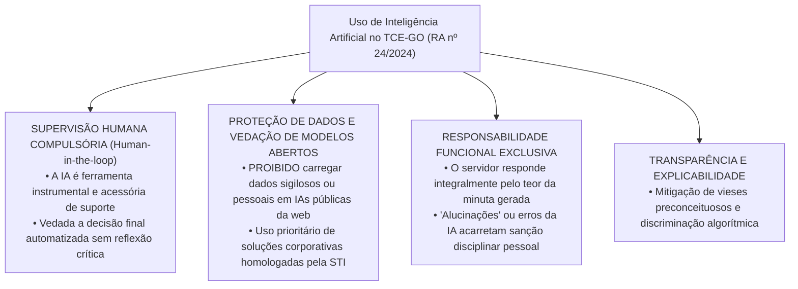
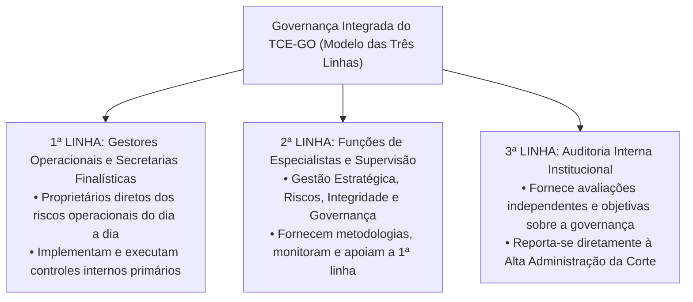

# 06 - Estrutura Organizacional e Políticas Institucionais do TCE-GO

> **Matéria:** Legislação Institucional  
> **Cargos:** A01 – Técnico de Controle Externo (Adm) / B02 – Técnico de Controle Externo (TI)  
> **Arquivo:** `06_politicas_institucionais_e_resolucoes_normativas.md`  
> **Atos Normativos:** Resoluções Administrativas (RA) e Resoluções Normativas (RN) do TCE-GO de 2024 e 2025

---

## 📌 Ementa / Itens do Edital
- Políticas institucionais do Tribunal de Contas do Estado de Goiás e resoluções normativas relacionadas à organização, funcionamento e gestão institucional:
    - **Resolução Administrativa nº 14/2025:** Define a estrutura organizacional do TCE-GO com as respectivas competências das secretarias, diretorias técnicas e unidades auxiliares;
    - **Resolução Administrativa nº 17/2024:** Dispõe sobre a Política de Segurança da Informação (PSI) do TCE-GO, pilares de confidencialidade, integridade, disponibilidade, autenticidade e legalidade (CIDA+L), classificação de ativos e deveres dos usuários;
    - **Resolução Normativa nº 5/2024:** Regulamenta o tratamento e a proteção de dados pessoais no âmbito do TCE-GO à luz da Lei Geral de Proteção de Dados (Lei nº 13.709/2018 - LGPD), bases legais do controle externo, atribuições do Encarregado (DPO), Comitê de Privacidade e Relatório de Impacto à Proteção de Dados Pessoais (RIPD);
    - **Resolução Administrativa nº 24/2024:** Dispõe sobre as diretrizes, princípios éticos e governança para o uso de ferramentas de Inteligência Artificial (IA) no TCE-GO (supervisão humana indelegável *Human-in-the-loop*, vedação de dados sigilosos em IAs públicas e responsabilidade pessoal do operador);
    - **Resolução Administrativa nº 5/2024:** Dispõe sobre a Política de Gestão de Pessoas do TCE-GO (gestão por competências, capacitação continuada na ESCOEX, avaliação de desempenho, saúde ocupacional e regras de teletrabalho);
    - **Resolução Administrativa nº 19/2024:** Dispõe sobre a Política de Comunicação Institucional (transparência pública, linguagem simples/cidadã, centralização na Assessoria de Comunicação e relacionamento com a mídia);
    - **Resolução Administrativa nº 15/2024:** Dispõe sobre o Sistema de Planejamento e Gestão Institucional do TCE-GO (planejamento estratégico plurianual, governança pública, gestão de riscos no Modelo das Três Linhas e monitoramento de indicadores de desempenho).

---

## 🧭 Sumário

1. [Estrutura Organizacional e Competências Técnicas (RA nº 14/2025)](#1-estrutura-organizacional-e-competencias-tecnicas-ra-no-142025)
    1. [Macroestrutura Superior e Órgãos Deliberativos](#11-macroestrutura-superior-e-orgaos-deliberativos)
    2. [Secretarias de Controle Externo e Unidades de Apoio Estratégico](#12-secretarias-de-controle-externo-e-unidades-de-apoio-estrategico)
    3. [Teste 172](#Teste-172)
2. [Política de Segurança da Informação - PSI (RA nº 17/2024)](#2-politica-de-seguranca-da-informacao-psi-ra-no-172024)
    1. [Pilares Basilares: CIDA+L e Destinatários da Norma](#21-pilares-basilares-cidal-e-destinatarios-da-norma)
    2. [Teste 173](#Teste-173)
    3. [Classificação da Informação e Controles Operacionais de TI](#22-classificacao-da-informacao-e-controles-operacionais-de-ti)
    4. [Tratamento de Incidentes Cibernéticos e Rastreabilidade](#23-tratamento-de-incidentes-ciberneticos-e-rastreabilidade)
    5. [Teste 174](#Teste-174)
3. [Tratamento e Proteção de Dados Pessoais - LGPD (RN nº 5/2024)](#3-tratamento-e-protecao-de-dados-pessoais-lgpd-rn-no-52024)
    1. [Aplicação da LGPD ao Controle Externo: Dispensabilidade do Consentimento](#31-aplicacao-da-lgpd-ao-controle-externo-dispensabilidade-do-consentimento)
    2. [Teste 175](#Teste-175)
    3. [Governança de Privacidade: Controlador, Operador, DPO e Comitê](#32-governanca-de-privacidade-controlador-operador-dpo-e-comite)
    4. [Minimização, Anonimização e Relatório de Impacto (RIPD)](#33-minimizacao-anonimizacao-e-relatorio-de-impacto-ripd)
    5. [Teste 176](#Teste-176)
4. [Governança e Uso de Inteligência Artificial no TCE-GO (RA nº 24/2024)](#4-governanca-e-uso-de-inteligencia-artificial-no-tce-go-ra-no-242024)
    1. [Princípio da Supervisão Humana Compulsória (*Human-in-the-loop*)](#41-principio-da-supervisao-humana-compulsoria-human-in-the-loop)
    2. [Teste 177](#Teste-177)
    3. [Proibição Estrita de Dados Sigilosos em Modelos Abertos](#42-proibicao-estrita-de-dados-sigilosos-em-modelos-abertos)
    4. [Responsabilidade Funcional Exclusiva do Servidor Operador](#43-responsabilidade-funcional-exclusiva-do-servidor-operador)
    5. [Teste 178](#Teste-178)
5. [Gestão de Pessoas, Comunicação e Planejamento Integrado](#5-gestao-de-pessoas-comunicacao-e-planejamento-integrado)
    1. [Política de Gestão de Pessoas e Teletrabalho (RA nº 5/2024)](#51-politica-de-gestao-de-pessoas-e-teletrabalho-ra-no-52024)
    2. [Política de Comunicação Institucional e Linguagem Simples (RA nº 19/2024)](#52-politica-de-comunicacao-institucional-e-linguagem-simples-ra-no-192024)
    3. [Teste 179](#Teste-179)
    4. [Planejamento Institucional e o Modelo das Três Linhas do IIA (RA nº 15/2024)](#53-planejamento-institucional-e-o-modelo-das-tres-linhas-do-iia-ra-no-152024)
    5. [Teste 180](#Teste-180)
    6. [Teste 181](#Teste-181)
6. [Fontes Oficiais e Referências Bibliográficas](#6-fontes-oficiais-e-referencias-bibliograficas)

---

## 1. Estrutura Organizacional e Competências Técnicas (RA nº 14/2025)

### 1.1 Macroestrutura Superior e Órgãos Deliberativos
A **Resolução Administrativa nº 14/2025** atualizou e consolidou a estrutura organizacional do Tribunal de Contas do Estado de Goiás, organizando a Corte em níveis funcionais e hierárquicos bem delineados:

- **Órgãos Deliberativos Colegiados Superiores:**
    - **Tribunal Pleno:** Composto pelos 7 Conselheiros e presença obrigatória do Procurador-Geral de Contas. Competência constitucional privativa para emissão de parecer prévio sobre as contas do Governador, apreciação de consultas em tese, deliberação recursal e eleição de dirigentes;
    - **Primeira e Segunda Câmaras Deliberativas:** Compostas por 3 Conselheiros cada, com competência para julgamento ordinário de contas de ordenadores, registro de atos de pessoal/aposentadorias e auditorias temáticas.
- **Órgãos de Direção Superior:**
    - **Presidência:** Direção executiva, administração geral, ordenação de despesas e representação institucional;
    - **Vice-Presidência:** Substituição regimental e supervisão de projetos institucionais;
    - **Corregedoria-Geral:** Órgão correicional permanente, responsável pela fiscalização de prazos processuais e disciplina funcional.
- **Órgãos Especiais e Vinculados:**
    - **Ministério Público de Contas (MPC-GO):** Atuação ministerial autônoma com intervenção obrigatória em todos os processos;
    - **Ouvidoria:** Canal de transparência ativa, acesso à informação (LAI) e acolhimento de denúncias de controle social;
    - **Escola Superior de Controle Externo (ESCOEX / Escola de Contas):** Centro de excelência responsável pela capacitação, pós-graduação e formação continuada de servidores da Corte e de gestores municipais e estaduais de Goiás.

---

### 1.2 Secretarias de Controle Externo e Unidades de Apoio Estratégico
As atividades finalísticas e corporativas do Tribunal são executadas por secretarias especializadas:

- **Secretarias Técnicas de Controle Externo:**
    - *Secretaria de Fiscalização de Contas e Orçamento:* Instrução das contas anuais do Governador e acompanhamento da Lei de Responsabilidade Fiscal (LRF);
    - *Secretaria de Fiscalização de Obras Públicas e Meio Ambiente:* Auditorias de engenharia, medições físicas, editais de infraestrutura e sustentabilidade;
    - *Secretaria de Fiscalização de Pessoal e Previdência:* Exame de admissões em concurso público e registro de aposentadorias, pensões e reformas;
    - *Secretaria de Fiscalização de Licitações, Contratos e Parcerias:* Controle de editais, contratos administrativos, consórcios e termos celebrados com Organizações Sociais (OSs);
    - *Secretaria de Avaliação de Políticas Públicas e Desempenho:* Auditorias operacionais para mensurar eficácia, eficiência e efetividade de programas sociais e de saúde/educação.
- **Secretarias de Apoio Corporativo:**
    - *Secretaria de Tecnologia da Informação (STI):* Gestão de infraestrutura de TI, governança de dados, inteligência artificial, segurança cibernética e sustentação de sistemas processuais;
    - *Secretaria-Geral:* Suporte direto ao Pleno e às Câmaras no processamento de pautas, atas e acórdãos;
    - *Secretaria de Gestão Estratégica:* Planejamento institucional, mapa de riscos e acompanhamento de metas globais;
    - *Diretoria de Gestão de Pessoas (DGP):* Gestão funcional, folha de pagamento, saúde ocupacional e desenvolvimento por competências.

### Teste 172
**(FCC – Inédita – Padrão TCE-GO)**  
De acordo com a Estrutura Organizacional e Competências Técnicas do TCE-GO aprovada pela Resolução Administrativa nº 14/2025:

* **A)** A Secretaria-Geral de Controle Externo subordina-se hierarquicamente à Procuradoria-Geral do Estado para fins de definição das diretrizes de auditoria.
* **B)** A macroestrutura executiva do Tribunal de Contas do Estado de Goiás compreende unidades de assessoramento superior, a Secretaria de Controle Externo (responsável pela coordenação executiva e técnica das ações fiscalizatórias especializadas) e a Secretaria de Gestão Integrada, estruturadas para conferir celeridade, inovação e rigor metodológico ao controle governamental.
* **C)** A criação ou extinção de diretorias e secretarias operacionais dispensa qualquer aprovação do Tribunal Pleno.
* **D)** As equipes de auditoria técnica das gerências especializadas possuem competência para aplicar multas e emitir acórdãos terminativos de forma monocrática e independente do Tribunal Pleno.
* **E)** As decisões administrativas sobre recursos humanos da Secretaria de Controle Externo são julgadas exclusivamente pelo Ministério Público de Contas.

---

> **Comentário Detalhado:**
>
> - **A)** Incorreta. O Tribunal de Contas goza de autonomia administrativa, financeira e institucional garantida pela Constituição (art. 73 c/c art. 96 da CF/88), inexistindo qualquer subordinação à PGE.
> - **B)** Correta. A Resolução Administrativa nº 14/2025 estabeleceu o organograma moderno do TCE-GO, delineando a divisão das atribuições finalísticas de fiscalização contábil, financeira e operacional sob a coordenação técnica da Secretaria de Controle Externo, atuando em harmonia com as secretarias de governança e apoio corporativo.
> - **C)** Incorreta. A organização interna e a fixação de competências das unidades decorrem de deliberação normativa colegiada do Pleno.
> - **D)** Incorreta. As unidades técnicas de fiscalização emitem relatórios de auditoria, notas técnicas e pareceres instrutórios; a competência para julgar e aplicar penalidades é privativa dos colegiados (Pleno e Câmaras) e dos relatores, nos limites regimentais.
> - **E)** Incorreta. A gestão administrativa de pessoal compete à Presidência do Tribunal.
>
> **Gabarito: B**

---

## 2. Política de Segurança da Informação - PSI (RA nº 17/2024)

### 2.1 Pilares Basilares: CIDA+L e Destinatários da Norma
A **Resolução Administrativa nº 17/2024** estabelece a Política de Segurança da Informação (PSI) do TCE-GO, estruturada sobre cinco pilares fundamentais (**CIDA+L**):

$$\text{CIDA+L} = \text{Confidencialidade} + \text{Integridade} + \text{Disponibilidade} + \text{Autenticidade} + \text{Legalidade}$$

1. **Confidencialidade:** Garantia de que a informação corporativa e processual não estará disponível nem será revelada a indivíduos, entidades ou processos não autorizados;
2. **Integridade:** Salvaguarda da precisão, completude e integridade lógica dos ativos de informação e de seus métodos de processamento, impedindo alterações não autorizadas;
3. **Disponibilidade:** Propriedade de a informação e os sistemas corporativos estarem perfeitamente acessíveis e utilizáveis sob demanda por pessoas autorizadas;
4. **Autenticidade:** Garantia incontestável da identidade de quem produziu, assinou eletronicamente, transmitiu ou modificou determinado dado público ou administrativo;
5. **Legalidade:** Asseguramento de que o manuseio de dados obedece integralmente ao ordenamento constitucional e às normas legais vigentes.

- **Destinatários da PSI:** A PSI vincula expressamente **todos os usuários** de ativos de tecnologia do Tribunal. Isso engloba Conselheiros, Conselheiros Substitutos, Procuradores de Contas, servidores ocupantes de cargos efetivos e em comissão, servidores cedidos de outros órgãos, estagiários, residentes jurídicos e técnicos, bem como **empregados de empresas contratadas e terceirizadas**.

> 📌 **NOTA EXPLICATIVA / ABRANGÊNCIA DA PSI:** A Política de Segurança da Informação do TCE-GO não é um regulamento restrito aos servidores do setor de TI. Ela vincula universalmente qualquer pessoa que utilize computadores, contas de e-mail institucional, rede sem fio ou bases de dados da Corte de Contas goiana.

---

### Teste 173
**(FCC – DPE-RS – Analista de Tecnologia da Informação)**  
A respeito da Política de Segurança da Informação (PSI) do Tribunal de Contas do Estado de Goiás, veiculada pela Resolução Administrativa nº 17/2024, assinale a afirmativa correta:

* **A)** Os princípios fundamentais da PSI restringem-se à disponibilidade e agilidade computacional, reputando-se secundária a confidencialidade no setor público.
* **B)** As normas e diretrizes da PSI vinculam todos os usuários de recursos de tecnologia do TCE-GO, incluindo membros, servidores efetivos e comissionados, residentes, estagiários e colaboradores terceirizados.
* **C)** É lícito aos servidores de um mesmo setor compartilhar entre si senhas corporativas de acesso para agilizar o atendimento de demandas urgentes na ausência do titular.
* **D)** A Política de Segurança da Informação aplica-se estritamente aos servidores lotados na Secretaria de Tecnologia da Informação.
* **E)** A classificação de informações em níveis de confidencialidade é vedada no âmbito do Tribunal em virtude do princípio constitucional da publicidade ampla.

---

> **Comentário Detalhado:**
>
> - **A) Incorreta.** A PSI fundamenta-se nos princípios consolidados da Confidencialidade, Integridade, Disponibilidade, Autenticidade e Legalidade (CIDA+L), não sendo a confidencialidade secundária.
> - **B) CORRETA.** Conforme preceitua a Resolução Administrativa nº 17/2024, a Política de Segurança da Informação é de **observância compulsória por todos os usuários**, abrangendo os Conselheiros titulares e substitutos, Procuradores de Contas, servidores efetivos e comissionados, servidores cedidos, estagiários, residentes e empregados de empresas terceirizadas que utilizem a rede ou ativos da Casa.
> - **C) Incorreta.** O compartilhamento de senhas individuais é terminantemente vedado, constituindo falta funcional grave por violar os princípios da rastreabilidade e autenticidade de acessos.
> - **D) Incorreta.** A PSI tem alcance institucional pleno sobre todos os órgãos, gabinetes e usuários do Tribunal.
> - **E) Incorreta.** A classificação das informações (Pública, Interna, Confidencial e Secreta/Ultrassecreta) é mandamento legal de conformidade com a Lei de Acesso à Informação.
> 
> **Gabarito: B**

---

### 2.2 Classificação da Informação e Controles Operacionais de TI
A informação produzida ou sob guarda do TCE-GO é categorizada em quatro níveis de confidencialidade:

- **Pública:** Disponível para livre acesso da sociedade e dos jurisdicionados (acórdãos públicos, pautas, relatórios finais e portarias normativas);
- **Interna:** Informações de uso corporativo ordinário interno, que não devem ser divulgadas publicamente sem justificativa;
- **Confidencial:** Informações protegidas por sigilo bancário, fiscal, comercial ou referente a processos disciplinares e denúncias com apuração preliminar pendente;
- **Secreta ou Ultrassecreta:** Informações sensíveis de segurança de Estado e investigações especiais sob regime restritivo formal da Lei de Acesso à Informação.

**Controles Obrigatórios impostos aos Usuários:**

- Utilização obrigatória de autenticação multifator (**MFA**) em todos os acessos remotos e contas corporativas;
- Proibição absoluta de compartilhamento de credenciais de acesso, logins ou senhas entre colegas de trabalho (as credenciais são estritamente pessoais e intransferíveis);
- Bloqueio imediato da tela da estação de trabalho sempre que o usuário se afastar de sua mesa (*mesa e tela limpas*);
- Conexão obrigatória via Rede Virtual Privada (**VPN**) institucional criptografada para execução de atividades em regime de teletrabalho.

---

### 2.3 Tratamento de Incidentes Cibernéticos e Rastreabilidade
A infraestrutura do TCE-GO conta com a **Equipe de Tratamento de Incidentes de Redes (ETIR)**.

- Qualquer usuário que identificar comportamento anômalo em sistemas, tentativas de invasão, *phishing* ou perda de dados tem o dever imediato de notificar a equipe de segurança da STI;
- O Tribunal mantém trilhas de auditoria eletrônica e logs de acesso detalhados para garantir a rastreabilidade absoluta de qualquer modificação ou consulta indevida em processos de controle externo.

### Teste 174
**(FCC – Inédita – Padrão TCE-GO)**  
A Política de Segurança da Informação (PSI) do TCE-GO, instituída pela Resolução Administrativa nº 17/2024, baseia-se nos pilares essenciais da segurança cibernética (CIDA+L). No tocante à classificação e ao tratamento da informação institucional:

* **A)** Toda informação produzida ou custodiada pelo Tribunal é classificada automaticamente como ultrassecreta por tempo indeterminado, sendo vedado o acesso aos cidadãos.
* **B)** As informações no âmbito do TCE-GO são classificadas quanto ao grau de confidencialidade (pública, interna, restrita e sigilosa), cabendo aos servidores e colaboradores zelar pela salvaguarda das credenciais de acesso, sendo proibido o compartilhamento de senhas individuais e a utilização de dispositivos particulares não autorizados para armazenamento de dados corporativos.
* **C)** O compartilhamento de senhas funcionais de acesso à rede interna entre colegas de uma mesma equipe de auditoria é estimulado pela PSI para garantir a continuidade dos serviços.
* **D)** O pilar da autenticidade assegura que a informação permaneça acessível aos usuários mesmo em situações de ataque de negação de serviço.
* **E)** Incidentes de quebra de sigilo ou vazamento cibernético de dados dispensam notificação à área de segurança da informação se resolvidos internamente no setor em 24 horas.

---

> **Comentário Detalhado:**
>
> - **A)** Incorreta. Pelo princípio constitucional da publicidade (art. 37 da CF/88 e Lei de Acesso à Informação), a publicidade é a regra geral e o sigilo é a exceção devidamente fundamentada.
> - **B)** Correta. A RA nº 17/2024 (PSI) estrutura a proteção de dados e ativos corporativos do TCE-GO em conformidade com as normas ABNT NBR ISO/IEC 27001 e 27002, estabelecendo a taxonomia formal de classificação da informação e impondo a responsabilidade individual e intransferível pelo uso de credenciais e senhas funcionais de acesso.
> - **C)** Incorreta. As credenciais de acesso são estritamente pessoais e intransferíveis; compartilhar senhas constitui grave infração de segurança da informação.
> - **D)** Incorreta. A garantia de disponibilidade contínua refere-se ao pilar da **Disponibilidade**; o pilar da **Autenticidade** assegura a identidade inequívoca do autor ou emissor da informação.
> - **E)** Incorreta. Qualquer incidente de segurança da informação deve ser imediatamente comunicado à equipe de resposta a incidentes (CSIRT/TI) da Corte.
>
> **Gabarito: B**

---

## 3. Tratamento e Proteção de Dados Pessoais - LGPD (RN nº 5/2024)

### 3.1 Aplicação da LGPD ao Controle Externo: Dispensabilidade do Consentimento
A **Resolução Normativa nº 5/2024** disciplina o tratamento de dados pessoais no âmbito do TCE-GO em harmonia com a Lei Geral de Proteção de Dados Pessoais (Lei Federal nº 13.709/2018 - LGPD):

- **Bases Legais Autônomas no Controle Externo:** O Tribunal de Contas trata dados pessoais (incluindo dados de ordenadores de despesas, servidores, licitantes e terceiros envolvidos em auditorias) com amparo nas seguintes hipóteses legais expressas:
    - **Artigo 7º, II da LGPD:** Cumprimento de obrigação legal ou regulatória pelo controlador;
    - **Artigo 7º, III da LGPD:** Execução de políticas públicas e exercício de competências institucionais de fiscalização e controle externo atribuídas pela Constituição Federal e Estadual.
- **Inexigibilidade de Consentimento:** O TCE-GO **NÃO depende de consentimento** do titular de dados para requisitar, tratar, cruzar e analisar folhas de pagamento, extratos bancários de contas públicas ou contratos administrativos em processos de fiscalização. O dever republicano de prestar contas e a missão constitucional de controle prevalecem sobre o interesse individual de ocultar registros financeiros públicos.

> 🚨 **ALERTA DE PROVA / PEGADINHA FCC:** É frequente a banca FCC tentar confundir o candidato afirmando que um gestor público auditado tem o direito de exigir que o Tribunal de Contas apague seus dados com base na LGPD. Essa assertiva está **INCORRETA**. O direito de eliminação de dados não se aplica quando o tratamento for amparado no cumprimento de obrigação legal de fiscalização e guarda de documentos públicos (Art. 16 da LGPD).

---

### Teste 175
**(FCC – TCE-PI – Auditor de Controle Externo)**  
Determinado jurisdicionado ingressou com requerimento administrativo perante o TCE-GO exigindo a imediata exclusão e o expurgo de seus dados cadastrais e financeiros constantes de procedimento de fiscalização de obras, invocando o direito de eliminação assegurado pela Lei Geral de Proteção de Dados (LGPD). De acordo com a Resolução Normativa nº 5/2024 do TCE-GO e com a Lei nº 13.709/2018:

* **A)** O Tribunal deve atender prontamente ao pedido, sob pena de incorrer em infração civil gravíssima sujeita a multa cominada pela ANPD.
* **B)** O tratamento de dados pessoais no âmbito do controle externo independe do consentimento do titular, estando respaldado nas hipóteses legais de cumprimento de obrigação legal e exercício de competências constitucionais fiscalizatórias.
* **C)** O controle externo estadual não se submete aos princípios da LGPD, sendo vedado ao Tribunal instituir Comitê de Privacidade ou nomear Encarregado de Dados.
* **D)** A eliminação dos dados cadastrais é obrigatória, devendo os relatórios de auditoria ser cancelados e arquivados sem decisão de mérito.
* **E)** O titular de dados possui direito potestativo absoluto de impedir o acesso de auditores aos seus dados bancários, mesmo diante de comprovado desvio de recursos públicos.

---

> **Comentário Detalhado:**
>
> - **A) Incorreta.** O direito de eliminação de dados não ostenta caráter absoluto e cede diante das finalidades públicas imperativas de controle financeiro do Estado.
> - **B) CORRETA.** Nos termos da Resolução Normativa nº 5/2024 e do artigo 7º, II e III da Lei Federal nº 13.709/2018, as atividades finalísticas do TCE-GO fundam-se no **cumprimento de dever legal e regulatório** e no **exercício regular de competências constitucionais fiscalizatórias**, dispensando-se o consentimento do titular e obstando a exclusão de dados indispensáveis à instrução de processos de controle da despesa pública.
> - **C) Incorreta.** O Tribunal adota integralmente as normas da LGPD, possuindo Comitê de Privacidade, Encarregado (DPO) e diretrizes rígidas de segurança da informação.
> - **D) Incorreta.** O interesse público no julgamento e controle das contas coletivas prevalece sobre pretensões de ocultação cadastral do auditado.
> - **E) Incorreta.** O dever universal de prestar contas e submeter-se à auditoria decorre diretamente do texto constitucional (Art. 70, parágrafo único da CF), sendo vedada a oposição arbitrária de sigilo em desfavor da Corte de Contas.
> 
> **Gabarito: B**

---

### 3.2 Governança de Privacidade: Controlador, Operador, DPO e Comitê
A governança de dados pessoais no TCE-GO é estruturada com clareza funcional:

- **Controlador:** O próprio **Tribunal de Contas do Estado de Goiás**, pessoa jurídica de direito público a quem competem as decisões sobre o tratamento de dados;
- **Operador:** As pessoas físicas ou jurídicas terceirizadas que realizam o tratamento de dados em nome e sob as ordens do TCE-GO (ex.: provedores de computação em nuvem, empresas de desenvolvimento de software);
- **Encarregado pelo Tratamento de Dados Pessoais (DPO):** Servidor formalmente designado pelo Presidente do Tribunal, responsável por atuar como canal oficial de comunicação entre o TCE-GO, os titulares dos dados e a Autoridade Nacional de Proteção de Dados (ANPD);
- **Comitê de Privacidade e Proteção de Dados:** Órgão multidisciplinar permanente encarregado de propor normas, aprovar o inventário de dados e auditar a conformidade da instituição com a LGPD.

---

### 3.3 Minimização, Anonimização e Relatório de Impacto (RIPD)
- **Princípio da Minimização da Coleta:** As auditorias e sistemas do Tribunal devem coletar apenas os dados pessoais estritamente necessários e pertinentes à finalidade da fiscalização;
- **Anonimização e Pseudonimização:** Nas decisões, relatórios e acórdãos disponibilizados em portais de transparência pública, os dados pessoais sensíveis ou desnecessários ao controle social (como CPF completo, endereço residencial privado e dados médicos) devem ser tarjados ou pseudonimizados;
- **Relatório de Impacto à Proteção de Dados Pessoais (RIPD):** Documento elaborado pelo setor de governança antes da implantação de novos sistemas ou processos que envolvam tratamento massivo de dados sensíveis, mapeando riscos de vazamento e indicando medidas mitigadoras.

### Teste 176
**(FCC – Inédita – Padrão TCE-GO)**  
Em relação à governança de privacidade e à proteção de dados pessoais no âmbito do TCE-GO (Resolução Normativa nº 5/2024, em sintonia com a Lei Geral de Proteção de Dados Pessoais - LGPD, Lei nº 13.709/2018):

* **A)** O tratamento de dados pessoais realizado pelo TCE-GO para o cumprimento de suas competências constitucionais de fiscalização e controle externo depende do prévio e expresso consentimento de cada gestor auditado.
* **B)** O Tribunal de Contas pode tratar dados pessoais de jurisdicionados, licitantes e servidores sem necessidade de consentimento do titular, com fundamento na base legal do cumprimento de obrigação legal e execução de políticas públicas previstas em lei (arts. 7º, II e III, e 23 da LGPD), devendo observar o princípio da minimização e adotar salvaguardas técnicas adequadas.
* **C)** O Encarregado pelo Tratamento de Dados Pessoais (DPO) do TCE-GO responde solidariamente com seu patrimônio pessoal por qualquer vazamento externo provocado por criminosos virtuais.
* **D)** O Relatório de Impacto à Proteção de Dados Pessoais (RIPD) é documento dispensável mesmo quando houver tratamento de dados sensíveis em larga escala.
* **E)** Os titulares de dados perdem qualquer direito de informação ou retificação de seus dados cadastrais perante o Tribunal de Contas.

---

> **Comentário Detalhado:**
>
> - **A)** Incorreta. Exigir consentimento prévio inviabilizaria a própria atividade de auditoria e repressão à corrupção. A LGPD expressamente afasta a exigência de consentimento para a atuação de órgãos estatais no cumprimento de deveres legais (art. 7º, II) e exercício regular de direitos em processos administrativos (art. 7º, VI).
> - **B)** Correta. A RN nº 5/2024 disciplina com precisão a incidência da LGPD no controle externo goiano: a atuação fiscalizatória apoia-se em hipóteses legais vinculadas (art. 23 da LGPD), dispensando consentimento, mas submetendo o TCE-GO aos princípios reitores da lei, em especial a **finalidade legítima**, a **adequação**, a **segurança da informação** e a **minimização** (coletar apenas os dados estritamente necessários ao objetivo da auditoria).
> - **C)** Incorreta. O Encarregado (DPO) atua como canal de comunicação entre o órgão, os titulares e a ANPD, não assumindo responsabilidade patrimonial automática por ações criminosas de terceiros.
> - **D)** Incorreta. O RIPD é obrigatório e fundamental quando o tratamento de dados envolver riscos relevantes aos direitos dos titulares ou dados sensíveis.
> - **E)** Incorreta. Os direitos básicos dos titulares assegurados pelo art. 18 da LGPD (confirmação de tratamento, acesso e correção) são garantidos no que for compatível com a tutela do sigilo legal das investigações.
>
> **Gabarito: B**

---

## 4. Governança e Uso de Inteligência Artificial no TCE-GO (RA nº 24/2024)

### 4.1 Princípio da Supervisão Humana Compulsória (*Human-in-the-loop*)
A **Resolução Administrativa nº 24/2024** estabelece as diretrizes éticas e de governança para o uso de ferramentas de Inteligência Artificial (IA) no âmbito do TCE-GO:

- **Ferramenta de Suporte Cognitivo:** Os sistemas de IA (generativa, preditiva ou de processamento de linguagem natural) atuam exclusivamente como instrumentos complementares para potencializar a produtividade e a análise de dados pelo corpo técnico;
- **Vedação de Decisão Automatizada:** É expressamente proibida a prolação de pareceres técnicos, relatórios de auditoria ou votos decisórios gerados de forma puramente automatizada sem a supervisão e validação crítica de um servidor público (*Human-in-the-loop*). O juízo técnico de mérito e discricionariedade é monopólio da inteligência e discernimento humanos.

---

### Teste 177
**(FCC – TCE-GO – Analista de Controle Externo)**  
Em conformidade com a Resolução Administrativa nº 24/2024 do Tribunal de Contas do Estado de Goiás, que disciplina o uso de ferramentas de Inteligência Artificial (IA) no âmbito da Corte, o auditor que utiliza assistente generativo para subsidiar a elaboração de matriz de auditoria governamental:

* **A)** Fica isento de responsabilidade funcional caso a ferramenta produza precedentes jurisprudenciais fictícios ou cite dispositivos revogados.
* **B)** Deve observar a supervisão humana compulsória (*Human-in-the-loop*), permanecendo como o único e integral responsável pela exatidão, consistência e adequação jurídica de todo o teor elaborado.
* **C)** Tem autorização para inserir dados fiscais e bancários protegidos por sigilo constitucional em qualquer ferramenta pública de IA disponível na web para agilizar o processamento.
* **D)** Está dispensado de checar as fontes citadas pelo modelo, haja vista a presunção legal de veracidade das plataformas de inteligência computacional.
* **E)** Só poderá utilizar modelos de linguagem mediante autorização prévia individual e por escrito expedida pelo Plenário do Tribunal.

---

> **Comentário Detalhado:**
>
> - **A) Incorreta.** O servidor público não goza de isenção funcional; o eventual fenômeno de "alucinação" algorítmica não escusa o profissional por erro técnico em peça oficial.
> - **B) CORRETA.** A Resolução Administrativa nº 24/2024 do TCE-GO positiva categoricamente a diretriz da **supervisão humana indelegável (*Human-in-the-loop*)**. As ferramentas de inteligência artificial desempenham papel puramente auxiliar e de suporte de produtividade, permanecendo a autoria jurídica, a análise crítica e a **responsabilidade pessoal e disciplinar** pela fidedignidade e precisão do trabalho sob encargo exclusivo e intransferível do servidor que o subscrever.
> - **C) Incorreta.** É expressamente vedado carregar dados protegidos por sigilo constitucional (fiscal, bancário, judicial) ou dados sensíveis em plataformas abertas de inteligência artificial desprovidas de salvaguardas contratuais corporativas de segurança.
> - **D) Incorreta.** Inexiste presunção de veracidade em sistemas computacionais; o dever de checagem documental e validação probatória é mandatório.
> - **E) Incorreta.** As ferramentas de IA autorizadas e homologadas pela STI integram os fluxos ordinários de trabalho, dispensando autorização pontual do Pleno para cada expediente.
> 
> **Gabarito: B**

---

### 4.2 Proibição Estrita de Dados Sigilosos em Modelos Abertos
A norma impõe restrições operacionais categóricas à segurança da informação:

- **Proibição de Upload de Dados em IAs Públicas:** É terminantemente **vedado carregar ou inserir documentos sigilosos, segredos de justiça, dados bancários, fiscais ou dados pessoais protegidos pela LGPD em ferramentas públicas gratuitas de IA generativa** disponíveis na internet (como chatbots abertos sem salvaguardas contratuais corporativas de privacidade);
- **Uso de Soluções Corporativas Homologadas:** O desenvolvimento e uso de inteligência artificial no Tribunal deve ocorrer prioritariamente dentro do ecossistema tecnológico corporativo mantido e monitorado pela Secretaria de Tecnologia da Informação (STI), sob acordos estritos de confidencialidade e segurança de dados.

---

### 4.3 Responsabilidade Funcional Exclusiva do Servidor Operador
O servidor que utilizar ferramentas de IA para redigir peças processuais, despachos, resumos de auditoria ou minutas de instrução assume **responsabilidade pessoal e funcional integral pelo conteúdo**:

- O servidor tem a obrigação inescusável de conferir a veracidade dos fatos narrados, a exatidão das referências normativas e a autenticidade dos precedentes jurisprudenciais citados;
- A alegação de "alucinação algorítmica" ou falha da inteligência artificial **NÃO isenta o servidor de culpa funcional**, respondendo ele administrativamente perante a Corregedoria-Geral por negligência ou erro grosseiro.

> 🚨 **ALERTA DE PROVA / PEGADINHA FCC:** Questões de concurso podem tentar enganar o candidato sugerindo que "o servidor que utilizar inteligência artificial homologada pelo Tribunal fica isento de responsabilidade disciplinar caso a minuta traga jurisprudência forjada pelo modelo". A assertiva está **TOTALMENTE ERRADA**. A responsabilidade pelo texto assinado é sempre **pessoal e indelegável do servidor**, que deve checar minuciosamente cada citação!

### Teste 178
**(FCC – Inédita – Padrão TCE-GO)**  
A Resolução Administrativa nº 24/2024 estabelece a Política de Governança e Uso de Inteligência Artificial no TCE-GO. Sobre as diretrizes éticas e operacionais de ferramentas de IA na Corte de Contas goiana, é correto afirmar:

* **A)** É permitida a delegação integral da tomada de decisão de mérito em processos de contas aos algoritmos de inteligência artificial generativa, dispensando a intervenção humana.
* **B)** É expressamente vedada a inserção de documentos sigilosos, dados pessoais não públicos ou peças de auditoria sob segredo de justiça em modelos públicos ou abertos de inteligência artificial generativa baseados em nuvem externa, subsistindo a supervisão humana obrigatória (*human-in-the-loop*) e a responsabilidade funcional indelegável do servidor que utilizar a ferramenta.
* **C)** A inteligência artificial pode ser utilizada para gerar automaticamente acórdãos condenatórios sem conferência técnica do relator.
* **D)** As ferramentas de IA utilizadas no Tribunal são dispensadas de observar princípios de explicabilidade e auditabilidade algorítmica.
* **E)** O servidor que assina relatório gerado com auxílio de IA fica isento de responsabilidade por erros materiais ou alucinações de conteúdo produzidas pela máquina.

---

> **Comentário Detalhado:**
>
> - **A)** Incorreta. A tomada de decisão jurisdicional e sancionatória é ato privativo e indelegável de agentes públicos humanos investidos de autoridade constitucional.
> - **B)** Correta. A RA nº 24/2024 do TCE-GO consagra balizas de vanguarda na governança de IA pública: 1) Vedação peremptória ao upload de dados sigilosos e informações sob segredo em plataformas públicas abertas (para evitar vazamentos e quebra da LGPD); 2) O princípio da supervisão humana compulsória (*human-in-the-loop*); 3) A responsabilidade pessoal e intransferível do servidor operador por todo e qualquer texto ou cálculo incorporado às minutas oficiais.
> - **C)** Incorreta. A decisão colegiada exige juízo crítico motivado do julgador humano.
> - **D)** Incorreta. A transparência, explicabilidade e auditabilidade dos sistemas inteligentes são exigências éticas fundamentais da norma.
> - **E)** Incorreta. O servidor responde plenamente por qualquer "alucinação", dado incorreto ou citação inexistente formulada pela IA que for submetida sem a devida validação humana.
>
> **Gabarito: B**

---

## 5. Gestão de Pessoas, Comunicação e Planejamento Integrado

### 5.1 Política de Gestão de Pessoas e Teletrabalho (RA nº 5/2024)
A **Resolução Administrativa nº 5/2024** estrutura a moderna gestão de pessoas do Tribunal:

- **Gestão Estratégica por Competências:** Mapeamento continuado de Conhecimentos, Habilidades e Atitudes (CHA) para adequar o perfil técnico dos servidores às atribuições das secretarias;
- **Regime de Teletrabalho e Trabalho Híbrido:**
    - Caráter facultativo e condicionado à conveniência da administração pública;
    - Exige prévia pactuação de **Plano de Trabalho Individualizado com estipulação de metas superiores** às exigidas no regime exclusivamente presencial;
    - Não é admitido aos servidores que apresentem desempenho insatisfatório ou estejam cumprindo sanção disciplinar;
- **Papel da ESCOEX:** Planejamento e execução de programas de capacitação continuada e pós-graduações, com foco no controle externo e governança pública.

---

### 5.2 Política de Comunicação Institucional e Linguagem Simples (RA nº 19/2024)
A **Resolução Administrativa nº 19/2024** orienta a comunicação pública do TCE-GO:

- **Movimento da Linguagem Simples e Cidadã:** Determinação cogente de redigir atos, resumos de acórdãos, notícias e painéis de dados em linguagem direta, clara e acessível ao cidadão comum, extirpando expressões rebuscadas em latim ou formalismos jurídicos estéreis;
- **Centralização da Relação com a Imprensa:** O atendimento a jornalistas, comunicados oficiais e concessão de entrevistas em nome institucional do TCE-GO competem privativamente à **Assessoria de Comunicação (ASCOM)**, preservando a neutralidade e integridade da imagem da Corte.

---

### Teste 179
**(FCC – TCE-GO – Técnico de Controle Externo)**  
A respeito da Política de Comunicação Institucional (Resolução Administrativa nº 19/2024) e da Política de Gestão de Pessoas (Resolução Administrativa nº 5/2024) do TCE-GO:

* **A)** A Política de Comunicação incentiva o uso de linguagem rebuscada e jargões processuais latinos em todos os atos públicos para demonstrar erudição jurídica.
* **B)** A Política de Comunicação adota as diretrizes da Linguagem Simples e Cidadã, buscando transmitir as decisões e informações de controle externo de forma acessível e compreensível a qualquer cidadão.
* **C)** O regime de teletrabalho previsto na Política de Gestão de Pessoas é obrigatório para todos os servidores sem necessidade de avaliação ou metas de produtividade.
* **D)** A capacitação dos servidores é facultativa ao Tribunal, sendo vedada a oferta de pós-graduações pela Escola Superior de Controle Externo.
* **E)** Os servidores do Tribunal têm liberdade para conceder entrevistas individuais em nome da Corte de Contas a emissoras de televisão sem alinhamento com a Assessoria de Comunicação.

---

> **Comentário Detalhado:**
>
> - **A) Incorreta.** A política veda expressamente o rebuscamento inútil e o jargão excessivo, orientando a clareza e concisão.
> - **B) CORRETA.** A Resolução Administrativa nº 19/2024 estabelece como pilar central o uso da **Linguagem Simples e Cidadã**, visando assegurar que acórdãos, resumos de julgamentos e informativos sejam compreendidos pela sociedade em geral, fortalecendo o controle social e a transparência pública.
> - **C) Incorreta.** O teletrabalho é facultativo, submete-se ao interesse da administração e exige pactuação formal de metas de produtividade (em regra, superiores às presenciais).
> - **D) Incorreta.** A formação continuada é prioridade institucional, ofertando a ESCOEX programas regulares de pós-graduação e aperfeiçoamento.
> - **E) Incorreta.** O contato com veículos de comunicação social é institucionalmente centralizado na Assessoria de Comunicação (ASCOM).
> 
> **Gabarito: B**

---

### 5.3 Planejamento Institucional e o Modelo das Três Linhas do IIA (RA nº 15/2024)
A **Resolução Administrativa nº 15/2024** organiza o Sistema de Planejamento e Gestão de Riscos do TCE-GO, adotando o internacionalmente consagrado **Modelo das Três Linhas** do *Institute of Internal Auditors* (IIA):

- **1ª Linha:** Composta pelos secretários, diretores e chefes de divisões operacionais, que são os verdadeiros proprietários dos riscos em suas rotinas diárias;
- **2ª Linha:** Composta por órgãos de supervisão, riscos, integridade e governança corporativa, que dão suporte metodológico e monitoram os controles da 1ª linha;
- **3ª Linha:** Desempenhada pela **Auditoria Interna Institucional**, que possui independência funcional para auditar a eficácia da governança, dos controles internos e do gerenciamento de riscos de todo o Tribunal.

---

### Teste 180
**(FCC – TCE-SE – Analista de Controle Externo)**  
No âmbito do Sistema de Planejamento e Gestão Institucional do TCE-GO, normatizado pela Resolução Administrativa nº 15/2024, a gestão de riscos e os controles internos da gestão estruturam-se consoante o internacionalmente reconhecido Modelo das Três Linhas (*Three Lines Model* do IIA). Nesse modelo, as atribuições da 1ª Linha, da 2ª Linha e da 3ª Linha correspondem, respectivamente, a:

* **A)** Auditoria interna independente; Ministério Público de Contas; Tribunal Pleno.
* **B)** Gestores operacionais diretos que gerenciam os riscos nos processos diários; Unidades de supervisão, conformidade e governança de riscos; Auditoria interna independente.
* **C)** Ouvidoria e cidadãos; Assessoria de Comunicação; Diretoria de Recursos Humanos.
* **D)** Assembleia Legislativa do Estado; Governador do Estado; Tribunal de Justiça.
* **E)** Empresas terceirizadas; Conselheiros relatores; Servidores em estágio probatório.

---

> **Comentário Detalhado:**
>
> - **A) Incorreta.** A Auditoria Interna Independente atua na 3ª Linha do modelo, e não na 1ª Linha operacional.
> - **B) CORRETA.** Conforme a Resolução Administrativa nº 15/2024 do TCE-GO e o padrão IIA: a 1ª Linha compreende os gestores operacionais diretos; a 2ª Linha congrega as unidades de conformidade, riscos e governança; e a 3ª Linha cabe à Auditoria Interna Independente.
> - **C) Incorreta.** Ouvidoria e assessoria não definem as linhas estruturais do modelo metodológico do IIA.
> - **D) Incorreta.** Cita instâncias políticas e órgãos externos que transcendem a governança interna do Tribunal.
> - **E) Incorreta.** Aponta papéis avulsos e sem correspondência conceitual com a taxonomia das Três Linhas.
> 
> **Gabarito: B**

### Teste 181
**(FCC – Inédita – Padrão TCE-GO)**  
Quanto ao regime de teletrabalho disciplinado na Política de Gestão de Pessoas do TCE-GO (Resolução Administrativa nº 5/2024):

* **A)** O teletrabalho é direito subjetivo incondicionado de todo servidor recém-empossado, independentemente de avaliação do estágio probatório ou interesse da administração.
* **B)** A adesão ao teletrabalho vincula-se ao cumprimento de plano de trabalho com metas de desempenho superiores às da atividade presencial, sendo vedada a concessão do regime a servidores que estejam respondendo a processo administrativo disciplinar ou que tenham sofrido penalidade funcional recente.
* **C)** No regime de teletrabalho, o servidor fica desobrigado de manter canais de comunicação ativos durante o horário regular de funcionamento do Tribunal.
* **D)** O não atingimento imotivado das metas de desempenho fixadas no plano de trabalho acarreta a promoção automática do servidor por merecimento presumido.
* **E)** O teletrabalho impede a realização de auditorias presenciais mesmo quando expressamente requisitadas pelo relator dos autos.

---

> **Comentário Detalhado:**
>
> - **A)** Incorreta. O teletrabalho não constitui direito adquirido nem subjetivo incondicional; é ato discricionário deferido no estrito interesse e conveniência do serviço público.
> - **B)** Correta. De acordo com a RA nº 5/2024, a inclusão no regime de teletrabalho no TCE-GO exige pactuação formal de metas de produtividade e qualidade (geralmente fixadas em patamar superior ao presencial), observando-se vedações expressas, tais como a existência de penalidade disciplinar nos últimos anos ou tramitação de PAD por falta funcional grave.
> - **C)** Incorreta. O servidor em teletrabalho deve manter plena disponibilidade de comunicação (telefone, e-mail institucional, aplicativo corporativo) durante a jornada regular.
> - **D)** Incorreta. O descumprimento injustificado das metas resulta no imediato desligamento do regime de teletrabalho e na apuração de eventuais faltas funcionais.
> - **E)** Incorreta. O servidor em teletrabalho permanece obrigado a comparecer ao Tribunal ou a diligências externas sempre que convocado pela chefia ou pelo Relator.
>
> **Gabarito: B**

---

## 6. Fontes Oficiais e Referências Bibliográficas

* [Portal Institucional do TCE-GO - Tecnologia da Informação e Políticas Digitais](https://portal.tce.go.gov.br/tecnologia-da-informacao2) - Governança de TI, segurança da informação e diretrizes digitais do Tribunal.
* [Portal Institucional do TCE-GO - Plano de Fiscalização e Governança](https://portal.tce.go.gov.br/governanca-planejamento-e-gestao/planos-institucionais/plano-de-fiscalizacao) - Planejamento institucional e diretrizes de governança pública.
* [Portal Institucional do TCE-GO - TCE-Juris: Atos Normativos e Resoluções](https://portal.tce.go.gov.br/tce-juris/atos-normativos-do-tce-go) - Resoluções normativas sobre inteligência artificial, segurança e processo eletrônico.
* [Lei Complementar Estadual de Goiás nº 205/2025 - Política de IA (Casa Civil/GO)](https://legisla.casacivil.go.gov.br/pesquisa_legislacao/110694/lei-complementar-205) - Política Estadual de Fomento à Inovação em Inteligência Artificial no Estado de Goiás.
* [Lei Federal nº 13.709/2018 - LGPD (Planalto)](https://www.planalto.gov.br/ccivil_03/_ato2015-2018/2018/lei/l13709.htm) - Tratamento de dados pessoais pelo Poder Público e princípios de privacidade.
* MOTTA, Fabrício. **Governança Pública e Tribunais de Contas**. Belo Horizonte: Fórum, 2022. (Cap. 5 - Inovação Tecnológica e Governança de TI no Controle Externo).
* MARRARA, Thiago. **Processo Administrativo e Inovação Tecnológica**. São Paulo: Almedina, 2021. (Cap. 4 - Inteligência Artificial e Processo Eletrônico no Setor Público).
* BIONI, Bruno Ricardo. **Proteção de Dados Pessoais: A Função e os Limites do Consentimento**. 2. ed. Rio de Janeiro: Forense, 2021. (Cap. 3 - Dados Pessoais e Administração Pública).
