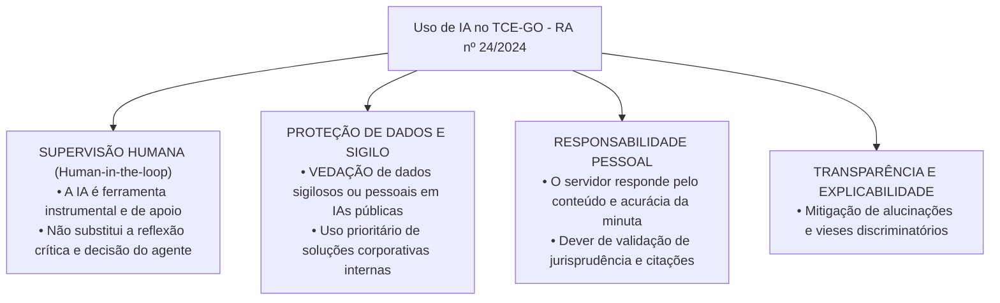
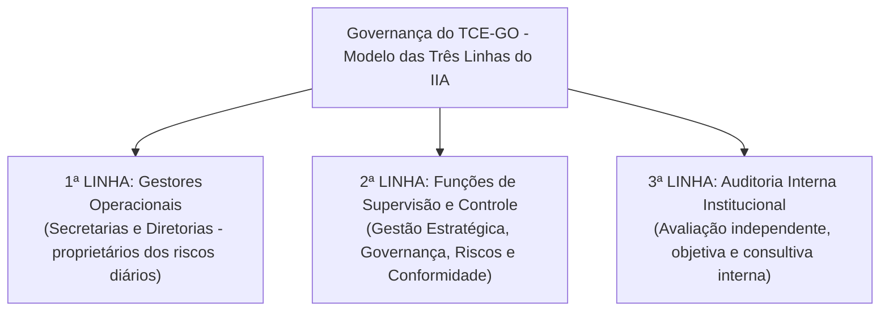

# 06 - Estrutura Organizacional e Políticas Institucionais do TCE-GO

> **Matéria:** Legislação Institucional  
> **Cargos:** A01 – Técnico de Controle Externo (Adm) / B02 – Técnico de Controle Externo (TI)  
> **Arquivo:** `06_politicas_institucionais_e_resolucoes_normativas.md`  
> **Atos Normativos:** Resoluções Administrativas (RA) e Resoluções Normativas (RN) do TCE-GO de 2024 e 2025

---

## 📌 Ementa / Itens do Edital
- Políticas institucionais do Tribunal de Contas do Estado de Goiás e resoluções normativas relacionadas à organização, funcionamento e gestão institucional:
  - **Resolução Administrativa nº 14/2025:** Define a estrutura organizacional do TCE-GO com as respectivas competências das secretarias, diretorias técnicas e unidades auxiliares;
  - **Resolução Administrativa nº 17/2024:** Dispõe sobre a Política de Segurança da Informação (PSI) do TCE-GO, pilares de confidencialidade, integridade, disponibilidade, autenticidade e legalidade (CIDA+L), classificação de ativos e deveres dos usuários;
  - **Resolução Normativa nº 5/2024:** Regulamenta o tratamento e a proteção de dados pessoais no âmbito do TCE-GO à luz da Lei Geral de Proteção de Dados (Lei nº 13.709/2018 - LGPD), bases legais do controle externo, atribuições do Encarregado (DPO), Comitê de Privacidade e Relatório de Impacto à Proteção de Dados Pessoais (RIPD);
  - **Resolução Administrativa nº 24/2024:** Dispõe sobre as diretrizes, princípios éticos e governança para o uso de ferramentas de Inteligência Artificial (IA) no TCE-GO (supervisão humana indelegável *Human-in-the-loop*, vedação de dados sigilosos em IAs públicas e responsabilidade pessoal do operador);
  - **Resolução Administrativa nº 5/2024:** Dispõe sobre a Política de Gestão de Pessoas do TCE-GO (gestão por competências, capacitação continuada na ESCOEX, avaliação de desempenho, saúde ocupacional e regras de teletrabalho);
  - **Resolução Administrativa nº 19/2024:** Dispõe sobre a Política de Comunicação Institucional (transparência pública, linguagem simples/cidadã, centralização na Assessoria de Comunicação e relacionamento com a mídia);
  - **Resolução Administrativa nº 15/2024:** Dispõe sobre o Sistema de Planejamento e Gestão Institucional do TCE-GO (planejamento estratégico plurianual, governança pública, gestão de riscos no Modelo das Três Linhas e monitoramento de indicadores de desempenho).

---

## 🌳 Classificação Hierárquica

```text
6. Estrutura Organizacional, Tecnologia e Governança no TCE-GO
├── 6.1 Estrutura Organizacional e Competências (RA nº 14/2025)
│   ├── 6.1.1 Organograma Superior: Tribunal Pleno, 1ª e 2ª Câmaras, Presidência, Vice e Corregedoria
│   ├── 6.1.2 Órgãos Auxiliares e Vinculados: MPC-GO, Ouvidoria, Escola de Contas (ESCOEX)
│   ├── 6.1.3 Secretarias Técnicas de Fiscalização e Controle Externo:
│   │   ├── Fiscalização de Contas e Orçamento do Estado
│   │   ├── Fiscalização de Obras Públicas, Engenharia e Meio Ambiente
│   │   ├── Fiscalização de Atos de Admissão de Pessoal e Benefícios Previdenciários
│   │   └── Fiscalização de Licitações, Contratos e Parcerias do Terceiro Setor
│   └── 6.1.4 Secretarias de Gestão e Suporte: Secretaria-Geral, Gestão Estratégica, Administração e STI
├── 6.2 Política de Segurança da Informação - PSI (RA nº 17/2024)
│   ├── 6.2.1 Pilares Fundamentais: Confidencialidade, Integridade, Disponibilidade, Autenticidade e Legalidade
│   ├── 6.2.2 Âmbito de Aplicação: Todos os membros, servidores efetivos/comissionados, residentes, estagiários e terceirizados
│   ├── 6.2.3 Classificação da Informação: Pública, Interna, Confidencial e Secreta/Ultrassecreta
│   ├── 6.2.4 Controles e Regras de Segurança: Senhas complexas, MFA, bloqueio de tela e vedação de credenciais compartilhadas
│   └── 6.2.5 Resposta a Incidentes Cibernéticos: Equipe de Tratamento de Incidentes (ETIR) e continuidade do negócio
├── 6.3 Tratamento e Proteção de Dados Pessoais - LGPD (RN nº 5/2024)
│   ├── 6.3.1 Aplicação da LGPD (Lei 13.709/2018) ao Controle Externo:
│   │   ├── Base Legal Específica: Cumprimento de obrigação legal e execução de competências constitucionais
│   │   └── Princípios: Finalidade, adequação, necessidade (minimização) e transparência
│   ├── 6.3.2 Governança e Papéis: TCE-GO como Controlador, Operadores terceirizados, Comitê de Privacidade
│   ├── 6.3.3 O Encarregado de Dados (DPO): Atribuições, canal de atendimento aos titulares e interlocução com a ANPD
│   └── 6.3.4 Instrumentos de Mitigação: Relatório de Impacto (RIPD), anonimização e pseudonimização em relatórios públicos
├── 6.4 Governança de Inteligência Artificial no TCE-GO (RA nº 24/2024)
│   ├── 6.4.1 Princípios Norteadores: Ética, explicabilidade, transparência, mitigação de vieses e não discriminação
│   ├── 6.4.2 Primazia do Fator Humano: Supervisão humana indelegável (*Human-in-the-loop*) em todas as etapas
│   ├── 6.4.3 Regras de Segurança e Privacidade:
│   │   ├── Vedação terminante ao upload de dados sigilosos ou pessoais em modelos de IA públicos na internet
│   │   └── Utilização prioritária de soluções corporativas homologadas pela STI (ecossistema interno)
│   └── 6.4.4 Responsabilidade Funcional: Responsabilidade pessoal do servidor pelo teor do trabalho gerado ou auxiliado por IA
├── 6.5 Política de Gestão de Pessoas (RA nº 5/2024)
│   ├── 6.5.1 Gestão por Competências: Mapeamento de conhecimentos, habilidades e atitudes (CHA)
│   ├── 6.5.2 Capacitação Continuada: Papel da Escola Superior de Controle Externo (ESCOEX)
│   ├── 6.5.3 Avaliação de Desempenho Funcional e Clima Organizacional
│   └── 6.5.4 Trabalho Híbrido e Teletrabalho: Metas quantitativas/qualitativas superiores e pactuação formal
├── 6.6 Política de Comunicação Institucional (RA nº 19/2024)
│   ├── 6.6.1 Princípios: Transparência ativa, acessibilidade, tempestividade e combate à desinformação
│   ├── 6.6.2 Linguagem Simples (Cidadã): Eliminação do juridiquês excessivo para facilitar a compreensão pública
│   └── 6.6.3 Relacionamento com a Mídia: Centralização nas instâncias oficiais de comunicação (ASCOM)
└── 6.7 Sistema de Planejamento e Gestão Institucional (RA nº 15/2024)
    ├── 6.7.1 Instrumentos do Planejamento Estratégico: Missão, Visão de Futuro, Valores e Mapa Estratégico
    ├── 6.7.2 Gestão de Riscos no Modelo das Três Linhas (IIA):
    │   ├── 1ª Linha: Gestores operacionais e proprietários dos riscos
    │   ├── 2ª Linha: Conformidade, controle interno da gestão e integridade
    │   └── 3ª Linha: Auditoria interna independente
    └── 6.7.3 Monitoramento Estratégico: Indicadores de desempenho (KPIs) e Reuniões de Avaliação da Estratégia (RAE)
```

---

## 📖 Resumo Teórico & Pontos-Chave

### 1. Estrutura Organizacional e Competências (Resolução Administrativa nº 14/2025)

A Resolução Administrativa nº 14/2025 modernizou o organograma do TCE-GO, dividindo-o em macroestruturas funcionais:

1. **Órgãos Colegiados Superiores:** Tribunal Pleno, Primeira Câmara e Segunda Câmara.
2. **Órgãos de Direção Superior:** Presidência, Vice-Presidência e Corregedoria-Geral.
3. **Órgãos Autônomos e Auxiliares:**
   - **Ministério Público de Contas (MPC-GO):** Fiscal da ordem jurídica;
   - **Ouvidoria:** Canal de diálogo com a sociedade e acolhimento de manifestações e denúncias sociais;
   - **Escola Superior de Controle Externo (ESCOEX / Escola de Contas):** Responsável pelo planejamento e execução dos programas de formação, capacitação e pós-graduação dos servidores e jurisdicionados.
4. **Secretarias Técnicas de Controle Externo:** Unidades responsáveis pela instrução processual, planejamento e execução das auditorias e inspeções temáticas (Contas, Obras/Engenharia, Pessoal/Previdência, Licitações/Contratos e Avaliação de Políticas Públicas).
5. **Secretarias de Apoio Corporativo:** Secretaria-Geral (suporte às sessões), Secretaria de Tecnologia da Informação - STI (sistemas corporativos, segurança cibernética e IA), Secretaria de Gestão Estratégica (planejamento e riscos) e Diretoria de Gestão de Pessoas (DGP).

---

### 2. Política de Segurança da Informação - PSI (Resolução Administrativa nº 17/2024)

* **Pilares Basilares da PSI:**
  * **Confidencialidade:** Garantia de que a informação é acessível somente a pessoas formalmente autorizadas;
  * **Integridade:** Salvaguarda da exatidão, inteireza e completude da informação e de seus métodos de processamento;
  * **Disponibilidade:** Acesso garantido aos dados e sistemas aos usuários autorizados sempre que necessário;
  * **Autenticidade:** Certeza e comprovação inequívoca da identidade de quem produziu ou enviou a informação;
  * **Legalidade:** Conformidade estrita com as leis, normas e regulamentos vigentes.
* **Destinatários da Norma:** A PSI vincula expressamente **todos os usuários** de ativos de TI do TCE-GO, abrangendo membros, servidores efetivos, ocupantes de cargos em comissão, conselheiros substitutos, procuradores, servidores cedidos, estagiários, residentes e prestadores de serviços terceirizados.
* **Classificação da Informação:** Dividida em quatro níveis: **Pública**, **Interna**, **Confidencial** e **Secreta/Ultrassecreta**.
* **Deveres dos Usuários:** Utilização exclusiva de credenciais individuais (proibido o compartilhamento de senhas); uso de autenticação de dois fatores (MFA); bloqueio compulsório de tela ao se ausentar da estação de trabalho; uso de rede virtual privada (VPN) institucional para teletrabalho; proibição de instalação de softwares não homologados pela STI.

---

### 3. Tratamento e Proteção de Dados Pessoais - LGPD (Resolução Normativa nº 5/2024)

* **Adequação da LGPD ao Controle Externo:**
  * O TCE-GO trata dados pessoais no exercício de suas atribuições constitucionais amparado nas bases legais do **Art. 7º, II (cumprimento de obrigação legal ou regulatória)** e **Art. 7º, III (execução de políticas públicas e competências institucionais)** da Lei nº 13.709/2018;
  * Não se exige o consentimento do titular de dados nos procedimentos de auditoria e julgamento de contas públicas decorrentes do dever fiscalizatório legal.
* **Papéis Estratégicos:**
  * **Controlador:** O próprio Tribunal de Contas do Estado de Goiás;
  * **Encarregado pelo Tratamento de Dados Pessoais (DPO):** Agente público designado pela Presidência para atuar como ponte oficial entre o TCE-GO, os titulares dos dados e a Autoridade Nacional de Proteção de Dados (ANPD);
  * **Comitê de Privacidade:** Órgão colegiado que supervisiona a conformidade dos fluxos de dados do Tribunal.
* **Diretrizes Operacionais:**
  * **Princípio da Minimização:** Coletar e tratar apenas os dados estritamente indispensáveis à instrução fiscalizatória;
  * **Anonimização / Pseudonimização:** Supressão de dados sensíveis ou pessoais desnecessários em acórdãos, relatórios e demonstrativos abertos ao público externo;
  * **Relatório de Impacto à Proteção de Dados Pessoais (RIPD):** Documento elaborado para mapear e mitigar riscos nas operações que envolvam grandes volumes ou dados pessoais sensíveis.

---

### 4. Governança e Uso de Ferramentas de Inteligência Artificial (Resolução Administrativa nº 24/2024)



#### Regras de Ouro da RA nº 24/2024 (Altíssima Incidência em Concurso):
1. **Supervisão Humana Indelegável (*Human-in-the-loop*):** O uso de IA é sempre de assistência à atividade intelectual humana. É expressamente proibida a automação decisória final em julgamentos de mérito sem revisão prévia humana;
2. **Proibição de Dados Sigilosos em Modelos Abertos:** É terminantemente **proibido inserir documentos protegidos por sigilo fiscal, bancário, comercial, judicial ou de investigações em andamento**, bem como dados pessoais, em modelos de IA generativa públicos gratuitos disponíveis na web (como interfaces abertas sem acordo institucional de confidencialidade);
3. **Responsabilidade Pessoal do Servidor:** O servidor público é o **único e exclusivo responsável** pela integridade, exatidão lógica, fidelidade das citações legais e conformidade de todo texto ou relatório elaborado com o auxílio de IA. Se a ferramenta cometer "alucinações" (inventar julgados ou leis inexistentes), o servidor responderá funcionalmente pelo erro.

---

### 5. Gestão de Pessoas, Comunicação e Planejamento (RAs nº 5/2024, 19/2024 e 15/2024)

#### 5.1 Política de Gestão de Pessoas (RA nº 5/2024):
* **Gestão por Competências:** Alinhamento estratégico do perfil profissional às necessidades das secretarias;
* **Teletrabalho / Trabalho Híbrido:** Regime condicionado à prévia pactuação de plano de trabalho com metas de desempenho (em regra, metas superiores às do regime presencial); vedado aos servidores em estágio probatório no seu período inicial ou com desempenho insuficiente;
* **ESCOEX:** Centro de aperfeiçoamento contínuo de competências técnicas.

#### 5.2 Política de Comunicação Institucional (RA nº 19/2024):
* **Linguagem Simples e Cidadã:** Determinação institucional de produzir textos, súmulas e comunicados em linguagem clara e acessível à população, eliminando jargões técnicos desnecessários;
* **Centralização da Comunicação:** O contato com a imprensa e veículos externos é conduzido exclusivamente pela Assessoria de Comunicação (ASCOM).

#### 5.3 Sistema de Planejamento e Gestão Institucional - Modelo das Três Linhas (RA nº 15/2024):



---

## ⚠️ Alertas de Prova & Pegadinhas da FCC

> 🚨 **ALERTA DE PROVA / PEGADINHA FCC:** A FCC pode sugerir que "a responsabilidade por eventual informação incorreta gerada por Inteligência Artificial é atribuída à empresa desenvolvedora do algoritmo". **ERRADO!** Pela RA nº 24/2024, a responsabilidade técnica e disciplinar pelo teor do documento é **integral e pessoal do servidor público** que o subscreveu, em razão do princípio da supervisão humana compulsória (*Human-in-the-loop*).

> ⭐ **IMPORTANTE / BASES LEGAIS DA LGPD:** O TCE-GO **NÃO precisa do consentimento do titular** para tratar dados pessoais obtidos em auditorias e processos de prestação de contas. O fundamento reside no cumprimento de **obrigação legal e constitucional fiscalizatória** (Art. 7º, II e III da Lei nº 13.709/2018).

> 📌 **NOTA EXPLICATIVA / ABRANGÊNCIA DA PSI:** A Política de Segurança da Informação **não é restrita à Diretoria de TI**. Ela abrange Conselheiros, Auditores, servidores efetivos e comissionados, servidores cedidos, estagiários e até empregados de empresas terceirizadas que utilizem a rede ou computadores do TCE-GO.

> 🛑 **ATENÇÃO / GESTÃO DE RISCOS (TRÊS LINHAS):** Não confunda a 1ª Linha (quem executa as rotinas e responde pelos riscos do dia a dia) com a 2ª Linha (quem monitora e apoia com metodologias de riscos e governança) e a 3ª Linha (Auditoria Interna independente que avalia a eficácia de todo o sistema).

---

## 🌐 Fontes Oficiais e Referências Bibliográficas

* [Portal de Legislação do TCE-GO - Resoluções Normativas e Administrativas](https://portal.tce.go.gov.br/legislacao) - Compilação integral das Resoluções Administrativas nº 14/2025, 17/2024, 24/2024, 5/2024, 19/2024, 15/2024 e Resolução Normativa nº 5/2024.
* [Portal da Governança e Planejamento Estratégico do TCE-GO](https://portal.tce.go.gov.br/planejamento-estrategico) - Mapa estratégico, objetivos de longo prazo e painel de indicadores.
* [Portal da Privacidade e Proteção de Dados Pessoais do TCE-GO](https://portal.tce.go.gov.br/lgpd) - Diretrizes da RN nº 5/2024, canal do DPO e inventário de dados.
* [Instituto dos Auditores Internos (IIA Brasil) - Modelo das Três Linhas](https://iiabrasil.org.br) - Estrutura de governança e gerenciamento integrado de riscos corporativos.
* [Lei Federal nº 13.709/2018 (Lei Geral de Proteção de Dados Pessoais - LGPD)](http://www.planalto.gov.br/ccivil_03/_ato2015-2018/2018/lei/l13709.htm) - Bases legais de tratamento no setor público.

---

## 📝 Questões de Concurso FCC Comentadas

### Questão 01
**(FCC – TCE-GO – Analista de Controle Externo)**  
Em conformidade com a Resolução Administrativa nº 24/2024 do Tribunal de Contas do Estado de Goiás, que disciplina o uso de ferramentas de Inteligência Artificial (IA) no âmbito da Corte, o auditor que utiliza assistente generativo para subsidiar a elaboração de matriz de auditoria governamental:

* **A)** Fica isento de responsabilidade funcional caso a ferramenta produza precedentes jurisprudenciais fictícios ou cite dispositivos revogados.
* **B)** Deve observar a supervisão humana compulsória (*Human-in-the-loop*), permanecendo como o único e integral responsável pela exatidão, consistência e adequação jurídica de todo o teor elaborado.
* **C)** Tem autorização para inserir dados fiscais e bancários protegidos por sigilo constitucional em qualquer ferramenta pública de IA disponível na web para agilizar o processamento.
* **D)** Está dispensado de checar as fontes citadas pelo modelo, haja vista a presunção legal de veracidade das plataformas de inteligência computacional.
* **E)** Só poderá utilizar modelos de linguagem mediante autorização prévia individual e por escrito expedida pelo Plenário do Tribunal.

> **Gabarito: B**  
> **Comentário Detalhado:**  
> - **A) Incorreta.** O servidor não é isento de responsabilidade; "alucinações" da IA não justificam erro técnico em documentos oficiais.  
> - **B) CORRETA.** A Resolução Administrativa nº 24/2024 consagra o princípio da **supervisão humana indelegável (*Human-in-the-loop*)**. O sistema de IA opera como ferramenta auxiliar de produtividade e apoio à reflexão, mas a autoria formal, a verificação fática e a **responsabilidade pessoal e funcional** pela fidelidade e acurácia do conteúdo produzido são indelegáveis do servidor que subscreve o trabalho.  
> - **C) Incorreta.** É expressamente proibido carregar informações sigilosas ou dados protegidos pela LGPD em ferramentas abertas de IA externas desprovidas de conformidade corporativa.  
> - **D) Incorreta.** Não há presunção de veracidade em modelos de inteligência artificial; o dever de checagem documental e jurisprudencial é mandatório.  
> - **E) Incorreta.** O uso de ferramentas corporativas homologadas é institucionalmente permitido no fluxo de trabalho, prescindindo de autorização monocrática do Plenário a cada uso.

---

### Questão 02
**(FCC – TCE-PI – Auditor de Controle Externo)**  
Determinado jurisdicionado ingressou com requerimento administrativo perante o TCE-GO exigindo a imediata exclusão e o expurgo de seus dados cadastrais e financeiros constantes de procedimento de fiscalização de obras, invocando o direito de eliminação assegurado pela Lei Geral de Proteção de Dados (LGPD). De acordo com a Resolução Normativa nº 5/2024 do TCE-GO e com a Lei nº 13.709/2018:

* **A)** O Tribunal deve atender prontamente ao pedido, sob pena de incorrer em infração civil gravíssima sujeita a multa cominada pela ANPD.
* **B)** O tratamento de dados pessoais no âmbito do controle externo independe do consentimento do titular, estando respaldado nas hipóteses legais de cumprimento de obrigação legal e exercício de competências constitucionais fiscalizatórias.
* **C)** O controle externo estadual não se submete aos princípios da LGPD, sendo vedado ao Tribunal instituir Comitê de Privacidade ou nomear Encarregado de Dados.
* **D)** A eliminação dos dados cadastrais é obrigatória, devendo os relatórios de auditoria ser cancelados e arquivados sem decisão de mérito.
* **E)** O titular de dados possui direito potestativo absoluto de impedir o acesso de auditores aos seus dados bancários, mesmo diante de comprovado desvio de recursos públicos.

> **Gabarito: B**  
> **Comentário Detalhado:**  
> - **A) Incorreta.** O direito de eliminação não é irrestrito e não se sobrepõe ao cumprimento de deveres legais e constitucionais de fiscalização financeira.  
> - **B) CORRETA.** Conforme a Resolução Normativa nº 5/2024 e os arts. 7º, II e III da Lei nº 13.709/2018, as atividades finalísticas do TCE-GO fundamentam-se no **cumprimento de obrigação legal e regulatória** e no **exercício de competências constitucionais fiscalizatórias**, dispensando o consentimento do titular de dados e impedindo a exclusão unilateral que inviabilizaria a tutela do patrimônio público.  
> - **C) Incorreta.** O Tribunal submete-se à governança da LGPD, contando com Comitê de Privacidade, Encarregado (DPO) e políticas de minimização e segurança.  
> - **D) Incorreta.** A instrução de auditoria prevalece sobre o interesse individual do auditado em ocultar informações financeiras públicas.  
> - **E) Incorreta.** O dever de prestar contas e a submissão à fiscalização decorrem da Constituição Federal (Art. 70, parágrafo único), não podendo o jurisdicionado obstar o controle externo.

---

### Questão 03
**(FCC – DPE-RS – Analista de Tecnologia da Informação)**  
A respeito da Política de Segurança da Informação (PSI) do Tribunal de Contas do Estado de Goiás, veiculada pela Resolução Administrativa nº 17/2024, assinale a afirmativa correta:

* **A)** Os princípios fundamentais da PSI restringem-se à disponibilidade e agilidade computacional, reputando-se secundária a confidencialidade no setor público.
* **B)** As normas e diretrizes da PSI vinculam todos os usuários de recursos de tecnologia do TCE-GO, incluindo membros, servidores efetivos e comissionados, residentes, estagiários e colaboradores terceirizados.
* **C)** É lícito aos servidores de um mesmo setor compartilhar entre si senhas corporativas de acesso para agilizar o atendimento de demandas urgentes na ausência do titular.
* **D)** A Política de Segurança da Informação aplica-se estritamente aos servidores lotados na Secretaria de Tecnologia da Informação.
* **E)** A classificação de informações em níveis de confidencialidade é vedada no âmbito do Tribunal em virtude do princípio constitucional da publicidade ampla.

> **Gabarito: B**  
> **Comentário Detalhado:**  
> - **A) Incorreta.** A PSI é alicerçada nos pilares clássicos da Confidencialidade, Integridade, Disponibilidade, Autenticidade e Legalidade (CIDA+L).  
> - **B) CORRETA.** Nos termos expressos da Resolução Administrativa nº 17/2024, a Política de Segurança da Informação é de **observância obrigatória por todos os usuários**, abrangendo Conselheiros, Conselheiros Substitutos, Procuradores de Contas, servidores do quadro efetivo e comissionados, servidores cedidos, estagiários, residentes e empregados de empresas contratadas e terceirizadas que acessem a infraestrutura da Corte.  
> - **C) Incorreta.** O compartilhamento de senhas e credenciais individuais é terminantemente vedado, constituindo falta funcional grave por comprometer o princípio da rastreabilidade e autenticidade.  
> - **D) Incorreta.** A PSI vincula a instituição em sua totalidade, e não apenas o corpo técnico de TI.  
> - **E) Incorreta.** A classificação da informação (Pública, Interna, Confidencial e Secreta/Ultrassecreta) é obrigatória e alinhada à Lei de Acesso à Informação (Lei nº 12.527/2011).

---

### Questão 04
**(FCC – TCE-SE – Analista de Controle Externo)**  
No âmbito do Sistema de Planejamento e Gestão Institucional do TCE-GO, normatizado pela Resolução Administrativa nº 15/2024, a gestão de riscos e os controles internos da gestão estruturam-se consoante o internacionalmente reconhecido Modelo das Três Linhas (*Three Lines Model* do IIA). Nesse modelo, as atribuições da 1ª Linha, da 2ª Linha e da 3ª Linha correspondem, respectivamente, a:

* **A)** Auditoria interna independente; Ministério Público de Contas; Tribunal Pleno.
* **B)** Gestores operacionais diretos que gerenciam os riscos nos processos diários; Unidades de supervisão, conformidade e governança de riscos; Auditoria interna independente.
* **C)** Ouvidoria e cidadãos; Assessoria de Comunicação; Diretoria de Recursos Humanos.
* **D)** Assembleia Legislativa do Estado; Governador do Estado; Tribunal de Justiça.
* **E)** Empresas terceirizadas; Conselheiros relatores; Servidores em estágio probatório.

> **Gabarito: B**  
> **Comentário Detalhado:**  
> - **A) Incorreta.** A auditoria interna é a 3ª linha e não a 1ª.  
> - **B) CORRETA.** Segundo o Modelo das Três Linhas adotado pelo TCE-GO na RA nº 15/2024:  
>   - **1ª Linha:** É exercida pelas áreas operacionais e finalísticas que entregam os serviços e diretamente gerenciam os riscos em suas atividades cotidianas;  
>   - **2ª Linha:** É exercida pelas áreas de supervisão, governança, conformidade (*compliance*), riscos e controles internos da gestão, que estabelecem metodologias e prestam suporte;  
>   - **3ª Linha:** É exercida pela **Auditoria Interna Institucional**, que presta avaliações e consultorias independentes e objetivas sobre a governança e o gerenciamento de riscos para a alta administração.  
> - **C), D) e E) Incorretas.** Confundem órgãos externos, instâncias políticas ou unidades operacionais desconexas da estrutura formal do modelo de linhas de defesa do IIA.

---

### Questão 05
**(FCC – TCE-GO – Técnico de Controle Externo)**  
A respeito da Política de Comunicação Institucional (Resolução Administrativa nº 19/2024) e da Política de Gestão de Pessoas (Resolução Administrativa nº 5/2024) do TCE-GO:

* **A)** A Política de Comunicação incentiva o uso de linguagem rebuscada e jargões processuais latinos em todos os atos públicos para demonstrar erudição jurídica.
* **B)** A Política de Comunicação adota as diretrizes da Linguagem Simples e Cidadã, buscando transmitir as decisões e informações de controle externo de forma acessível e compreensível a qualquer cidadão.
* **C)** O regime de teletrabalho previsto na Política de Gestão de Pessoas é obrigatório para todos os servidores sem necessidade de avaliação ou metas de produtividade.
* **D)** A capacitação dos servidores é facultativa ao Tribunal, sendo vedada a oferta de pós-graduações pela Escola Superior de Controle Externo.
* **E)** Os servidores do Tribunal têm liberdade para conceder entrevistas individuais em nome da Corte de Contas a emissoras de televisão sem alinhamento com a Assessoria de Comunicação.

> **Gabarito: B**  
> **Comentário Detalhado:**  
> - **A) Incorreta.** O combate ao rebuscamento desnecessário ("juridiquês") é uma das principais diretrizes da nova política de comunicação institucional.  
> - **B) CORRETA.** A Resolução Administrativa nº 19/2024 preconiza expressamente o compromisso com a **Linguagem Simples e Cidadã**, orientando a produção de textos e informativos claros, diretos e objetivos para que a sociedade civil possa compreender as decisões e exercer o controle social efetivo sobre a aplicação dos recursos públicos.  
> - **C) Incorreta.** O teletrabalho é voluntário/convenido, exige plano de trabalho individualizado e estipulação de metas de produtividade (geralmente superiores às do presencial).  
> - **D) Incorreta.** A ESCOEX tem como objetivo central fomentar a formação continuada, inclusive por meio de cursos de pós-graduação e aperfeiçoamento.  
> - **E) Incorreta.** O relacionamento com veículos de imprensa é centralizado e institucionalmente coordenado pela Assessoria de Comunicação (ASCOM).
