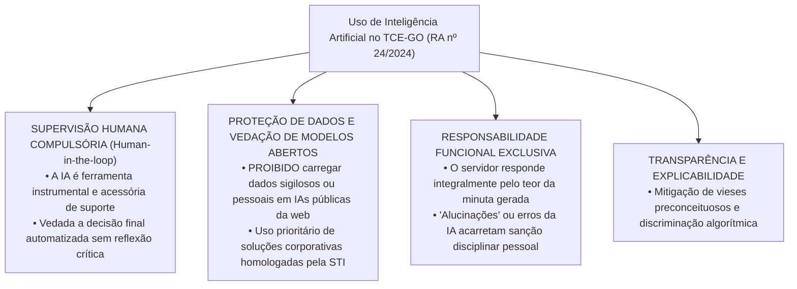
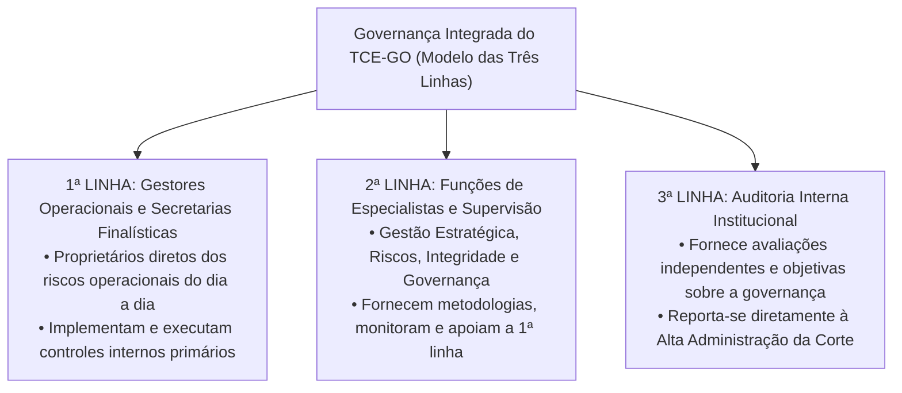

# 06 - Estrutura Organizacional e Políticas Institucionais do TCE-GO

> **Matéria:** Legislação Institucional  
> **Cargos:** A01 – Técnico de Controle Externo (Adm) / B02 – Técnico de Controle Externo (TI)  
> **Arquivo:** `06_politicas_institucionais_e_resolucoes_normativas.md`  
> **Atos Normativos:** Resoluções Administrativas (RA) e Resoluções Normativas (RN) do TCE-GO de 2024 e 2025

---

## 📌 Ementa / Itens do Edital
- Políticas institucionais do Tribunal de Contas do Estado de Goiás e resoluções normativas relacionadas à organização, funcionamento e gestão institucional:
    - **Resolução Administrativa nº 14/2025:** Define a estrutura organizacional do TCE-GO com as respectivas competências das secretarias, diretorias técnicas e unidades auxiliares;
    - **Resolução Administrativa nº 17/2024:** Dispõe sobre a Política de Segurança da Informação (PSI) do TCE-GO, pilares de confidencialidade, integridade, disponibilidade, autenticidade e legalidade (CIDA+L), classificação de ativos e deveres dos usuários;
    - **Resolução Normativa nº 5/2024:** Regulamenta o tratamento e a proteção de dados pessoais no âmbito do TCE-GO à luz da Lei Geral de Proteção de Dados (Lei nº 13.709/2018 - LGPD), bases legais do controle externo, atribuições do Encarregado (DPO), Comitê de Privacidade e Relatório de Impacto à Proteção de Dados Pessoais (RIPD);
    - **Resolução Administrativa nº 24/2024:** Dispõe sobre as diretrizes, princípios éticos e governança para o uso de ferramentas de Inteligência Artificial (IA) no TCE-GO (supervisão humana indelegável *Human-in-the-loop*, vedação de dados sigilosos em IAs públicas e responsabilidade pessoal do operador);
    - **Resolução Administrativa nº 5/2024:** Dispõe sobre a Política de Gestão de Pessoas do TCE-GO (gestão por competências, capacitação continuada na ESCOEX, avaliação de desempenho, saúde ocupacional e regras de teletrabalho);
    - **Resolução Administrativa nº 19/2024:** Dispõe sobre a Política de Comunicação Institucional (transparência pública, linguagem simples/cidadã, centralização na Assessoria de Comunicação e relacionamento com a mídia);
    - **Resolução Administrativa nº 15/2024:** Dispõe sobre o Sistema de Planejamento e Gestão Institucional do TCE-GO (planejamento estratégico plurianual, governança pública, gestão de riscos no Modelo das Três Linhas e monitoramento de indicadores de desempenho).

---

## 🧭 Sumário

1. [Estrutura Organizacional e Competências Técnicas (RA nº 14/2025)](#1-estrutura-organizacional-e-competencias-tecnicas-ra-no-142025)
    1. [Macroestrutura Superior e Órgãos Deliberativos](#11-macroestrutura-superior-e-orgaos-deliberativos)
    2. [Secretarias de Controle Externo e Unidades de Apoio Estratégico](#12-secretarias-de-controle-externo-e-unidades-de-apoio-estrategico)
    3. [Teste 172](#Teste-172)
2. [Política de Segurança da Informação - PSI (RA nº 17/2024)](#2-politica-de-seguranca-da-informacao-psi-ra-no-172024)
    1. [Pilares Basilares: CIDA+L e Destinatários da Norma](#21-pilares-basilares-cidal-e-destinatarios-da-norma)
    2. [Classificação da Informação e Controles Operacionais de TI](#22-classificacao-da-informacao-e-controles-operacionais-de-ti)
    3. [Tratamento de Incidentes Cibernéticos e Rastreabilidade](#23-tratamento-de-incidentes-ciberneticos-e-rastreabilidade)
    4. [Teste 173](#Teste-173)
    5. [Teste 174](#Teste-174)
3. [Tratamento e Proteção de Dados Pessoais - LGPD (RN nº 5/2024)](#3-tratamento-e-protecao-de-dados-pessoais-lgpd-rn-no-52024)
    1. [Aplicação da LGPD ao Controle Externo: Dispensabilidade do Consentimento](#31-aplicacao-da-lgpd-ao-controle-externo-dispensabilidade-do-consentimento)
    2. [Governança de Privacidade: Controlador, Operador, DPO e Comitê](#32-governanca-de-privacidade-controlador-operador-dpo-e-comite)
    3. [Minimização, Anonimização e Relatório de Impacto (RIPD)](#33-minimizacao-anonimizacao-e-relatorio-de-impacto-ripd)
    4. [Teste 175](#Teste-175)
    5. [Teste 176](#Teste-176)
4. [Governança e Uso de Inteligência Artificial no TCE-GO (RA nº 24/2024)](#4-governanca-e-uso-de-inteligencia-artificial-no-tce-go-ra-no-242024)
    1. [Princípio da Supervisão Humana Compulsória (*Human-in-the-loop*)](#41-principio-da-supervisao-humana-compulsoria-human-in-the-loop)
    2. [Proibição Estrita de Dados Sigilosos em Modelos Abertos](#42-proibicao-estrita-de-dados-sigilosos-em-modelos-abertos)
    3. [Responsabilidade Funcional Exclusiva do Servidor Operador](#43-responsabilidade-funcional-exclusiva-do-servidor-operador)
    4. [Teste 177](#Teste-177)
    5. [Teste 178](#Teste-178)
5. [Gestão de Pessoas, Comunicação e Planejamento Integrado](#5-gestao-de-pessoas-comunicacao-e-planejamento-integrado)
    1. [Política de Gestão de Pessoas e Teletrabalho (RA nº 5/2024)](#51-politica-de-gestao-de-pessoas-e-teletrabalho-ra-no-52024)
    2. [Política de Comunicação Institucional e Linguagem Simples (RA nº 19/2024)](#52-politica-de-comunicacao-institucional-e-linguagem-simples-ra-no-192024)
    3. [Planejamento Institucional e o Modelo das Três Linhas do IIA (RA nº 15/2024)](#53-planejamento-institucional-e-o-modelo-das-tres-linhas-do-iia-ra-no-152024)
    4. [Teste 179](#Teste-179)
    5. [Teste 180](#Teste-180)
    6. [Teste 181](#Teste-181)
6. [Fontes Oficiais e Referências Bibliográficas](#6-fontes-oficiais-e-referencias-bibliograficas)

---

## 1. Estrutura Organizacional e Competências Técnicas (RA nº 14/2025)

### 1.1 Macroestrutura Superior e Órgãos Deliberativos
A **Resolução Administrativa nº 14/2025** atualizou e consolidou a estrutura organizacional do Tribunal de Contas do Estado de Goiás, organizando a Corte em níveis funcionais e hierárquicos bem delineados:

- **Órgãos Deliberativos Colegiados Superiores:**
    - **Tribunal Pleno:** Composto pelos 7 Conselheiros e presença obrigatória do Procurador-Geral de Contas. Competência constitucional privativa para emissão de parecer prévio sobre as contas do Governador, apreciação de consultas em tese, deliberação recursal e eleição de dirigentes;
    - **Primeira e Segunda Câmaras Deliberativas:** Compostas por 3 Conselheiros cada, com competência para julgamento ordinário de contas de ordenadores, registro de atos de pessoal/aposentadorias e auditorias temáticas.
- **Órgãos de Direção Superior:**
    - **Presidência:** Direção executiva, administração geral, ordenação de despesas e representação institucional;
    - **Vice-Presidência:** Substituição regimental e supervisão de projetos institucionais;
    - **Corregedoria-Geral:** Órgão correicional permanente, responsável pela fiscalização de prazos processuais e disciplina funcional.
- **Órgãos Especiais e Vinculados:**
    - **Ministério Público de Contas (MPC-GO):** Atuação ministerial autônoma com intervenção obrigatória em todos os processos;
    - **Ouvidoria:** Canal de transparência ativa, acesso à informação (LAI) e acolhimento de denúncias de controle social;
    - **Escola Superior de Controle Externo (ESCOEX / Escola de Contas):** Centro de excelência responsável pela capacitação, pós-graduação e formação continuada de servidores da Corte e de gestores municipais e estaduais de Goiás.

### 1.2 Secretarias de Controle Externo e Unidades de Apoio Estratégico
As atividades finalísticas e corporativas do Tribunal são executadas por secretarias especializadas:

- **Secretarias Técnicas de Controle Externo:**
    - *Secretaria de Fiscalização de Contas e Orçamento:* Instrução das contas anuais do Governador e acompanhamento da Lei de Responsabilidade Fiscal (LRF);
    - *Secretaria de Fiscalização de Obras Públicas e Meio Ambiente:* Auditorias de engenharia, medições físicas, editais de infraestrutura e sustentabilidade;
    - *Secretaria de Fiscalização de Pessoal e Previdência:* Exame de admissões em concurso público e registro de aposentadorias, pensões e reformas;
    - *Secretaria de Fiscalização de Licitações, Contratos e Parcerias:* Controle de editais, contratos administrativos, consórcios e termos celebrados com Organizações Sociais (OSs);
    - *Secretaria de Avaliação de Políticas Públicas e Desempenho:* Auditorias operacionais para mensurar eficácia, eficiência e efetividade de programas sociais e de saúde/educação.
- **Secretarias de Apoio Corporativo:**
    - *Secretaria de Tecnologia da Informação (STI):* Gestão de infraestrutura de TI, governança de dados, inteligência artificial, segurança cibernética e sustentação de sistemas processuais;
    - *Secretaria-Geral:* Suporte direto ao Pleno e às Câmaras no processamento de pautas, atas e acórdãos;
    - *Secretaria de Gestão Estratégica:* Planejamento institucional, mapa de riscos e acompanhamento de metas globais;
    - *Diretoria de Gestão de Pessoas (DGP):* Gestão funcional, folha de pagamento, saúde ocupacional e desenvolvimento por competências.

---

### Teste 172
**(FGV – TCE-PA – Auditor de Controle Externo – 2024)**
Ao analisar o disposto na Lei nº 12.527/2011, Mei re verificou a 
delimitação de alguns conceitos, notadamente em relação à 
qualidade da informação, que são relevantes na aplicação da 
matéria, entre os quais os seguintes: 
I. qualidade da informação não modificada, inclusive quanto à 
origem, trânsito e destino; 
II. qualidade da informação que pode ser conhecida e utilizada 
por indivíduos, equipamentos ou sistemas autorizados; 
III. qualidade da informação que tenha sido produzida, expedida, 
recebida ou modificada por determinado indivíduo, 
equipamento ou sistema.  
Assinale a opção que indica a pertinente correlação.

* **A)** I. integridade; II. disponibilidade; III. autenticidade;
* **B)** I. primariedade; II. autenticidade; III. integridade;
* **C)** I. autenticidade; II. primariedade; III. integridade;
* **D)** I. disponibilidade; II. autenticidade; III. integridade;
* **E)** I. primariedade; II. integridade; III. disponibilidade. 

AUDITOR DE CONTROLE EXTERNO – ÁREA ADMINISTRATIVA - ADMINISTRAÇÃO – MANHÃ  TIPO  BRANCA – PÁGINA 12 

Administração Pública, gestão e 
fiscalização de contratos

---

> **Comentário Detalhado:**
>
> - **A)** Incorreta. Discrepa das diretrizes normativas e jurisprudenciais aplicáveis ao tema objeto do item.
> - **B)** Incorreta. Discrepa das diretrizes normativas e jurisprudenciais aplicáveis ao tema objeto do item.
> - **C)** Incorreta. Discrepa das diretrizes normativas e jurisprudenciais aplicáveis ao tema objeto do item.
> - **D)** Correta. Representa com precisão a disciplina do tema e o entendimento pacificado adotado pela banca (FGV).
> - **E)** Incorreta. Discrepa das diretrizes normativas e jurisprudenciais aplicáveis ao tema objeto do item.
>
> **Gabarito: D**

---
## 2. Política de Segurança da Informação - PSI (RA nº 17/2024)

### 2.1 Pilares Basilares: CIDA+L e Destinatários da Norma
A **Resolução Administrativa nº 17/2024** estabelece a Política de Segurança da Informação (PSI) do TCE-GO, estruturada sobre cinco pilares fundamentais (**CIDA+L**):

$$\text{CIDA+L} = \text{Confidencialidade} + \text{Integridade} + \text{Disponibilidade} + \text{Autenticidade} + \text{Legalidade}$$

1. **Confidencialidade:** Garantia de que a informação corporativa e processual não estará disponível nem será revelada a indivíduos, entidades ou processos não autorizados;
2. **Integridade:** Salvaguarda da precisão, completude e integridade lógica dos ativos de informação e de seus métodos de processamento, impedindo alterações não autorizadas;
3. **Disponibilidade:** Propriedade de a informação e os sistemas corporativos estarem perfeitamente acessíveis e utilizáveis sob demanda por pessoas autorizadas;
4. **Autenticidade:** Garantia incontestável da identidade de quem produziu, assinou eletronicamente, transmitiu ou modificou determinado dado público ou administrativo;
5. **Legalidade:** Asseguramento de que o manuseio de dados obedece integralmente ao ordenamento constitucional e às normas legais vigentes.

- **Destinatários da PSI:** A PSI vincula expressamente **todos os usuários** de ativos de tecnologia do Tribunal. Isso engloba Conselheiros, Conselheiros Substitutos, Procuradores de Contas, servidores ocupantes de cargos efetivos e em comissão, servidores cedidos de outros órgãos, estagiários, residentes jurídicos e técnicos, bem como **empregados de empresas contratadas e terceirizadas**.

> 📌 **NOTA EXPLICATIVA / ABRANGÊNCIA DA PSI:** A Política de Segurança da Informação do TCE-GO não é um regulamento restrito aos servidores do setor de TI. Ela vincula universalmente qualquer pessoa que utilize computadores, contas de e-mail institucional, rede sem fio ou bases de dados da Corte de Contas goiana.

### 2.2 Classificação da Informação e Controles Operacionais de TI
A informação produzida ou sob guarda do TCE-GO é categorizada em quatro níveis de confidencialidade:

- **Pública:** Disponível para livre acesso da sociedade e dos jurisdicionados (acórdãos públicos, pautas, relatórios finais e portarias normativas);
- **Interna:** Informações de uso corporativo ordinário interno, que não devem ser divulgadas publicamente sem justificativa;
- **Confidencial:** Informações protegidas por sigilo bancário, fiscal, comercial ou referente a processos disciplinares e denúncias com apuração preliminar pendente;
- **Secreta ou Ultrassecreta:** Informações sensíveis de segurança de Estado e investigações especiais sob regime restritivo formal da Lei de Acesso à Informação.

**Controles Obrigatórios impostos aos Usuários:**

- Utilização obrigatória de autenticação multifator (**MFA**) em todos os acessos remotos e contas corporativas;
- Proibição absoluta de compartilhamento de credenciais de acesso, logins ou senhas entre colegas de trabalho (as credenciais são estritamente pessoais e intransferíveis);
- Bloqueio imediato da tela da estação de trabalho sempre que o usuário se afastar de sua mesa (*mesa e tela limpas*);
- Conexão obrigatória via Rede Virtual Privada (**VPN**) institucional criptografada para execução de atividades em regime de teletrabalho.

### 2.3 Tratamento de Incidentes Cibernéticos e Rastreabilidade
A infraestrutura do TCE-GO conta com a **Equipe de Tratamento de Incidentes de Redes (ETIR)**.

- Qualquer usuário que identificar comportamento anômalo em sistemas, tentativas de invasão, *phishing* ou perda de dados tem o dever imediato de notificar a equipe de segurança da STI;
- O Tribunal mantém trilhas de auditoria eletrônica e logs de acesso detalhados para garantir a rastreabilidade absoluta de qualquer modificação ou consulta indevida em processos de controle externo.

---

### Teste 173
**(FGV – TJ-MT – Analista Judiciário - Tecnologia da Informação – 2024)**
A Lei Geral de Proteção de Dados Pessoais (LGPD) estabelece uma 
série de regras para o tratamento de dados pessoais no Brasil.  
Assinale a afirmativa correta acerca das bases legais para o 
tratamento de dados pessoais previstas pela LGPD.

* **A)** A empresa pode tratar os dados pessoais de um cliente sem a 
necessidade de qualquer justificativa legal, desde que o cliente 
tenha fornecido o consentimento.
* **B)** O tratamento de dados pessoais pode ser realizado 
exclusivamente quando houver um contrato de trabalho 
formal entre o controlador e o titular dos dados.
* **C)** O tratamento de dados pessoais pode ser realizado com base 
em legítimo interesse do controlador, desde que não 
sobreponha os direitos e liberdades fundamentais do titular.
* **D)** O tratamento de dados pessoais é proibido, exceto quando a 
autoridade nacional autorizar explicitamente sua coleta e uso.
* **E)** Dados sensíveis podem ser coletados e utilizados sem a 
necessidade de qualquer base legal, desde que o titular 
forneça o consentimento explícito.

---

> **Comentário Detalhado:**
>
> - **A)** Incorreta. Discrepa das diretrizes normativas e jurisprudenciais aplicáveis ao tema objeto do item.
> - **B)** Correta. Representa com precisão a disciplina do tema e o entendimento pacificado adotado pela banca (FGV).
> - **C)** Incorreta. Discrepa das diretrizes normativas e jurisprudenciais aplicáveis ao tema objeto do item.
> - **D)** Incorreta. Discrepa das diretrizes normativas e jurisprudenciais aplicáveis ao tema objeto do item.
> - **E)** Incorreta. Discrepa das diretrizes normativas e jurisprudenciais aplicáveis ao tema objeto do item.
>
> **Gabarito: B**

---
### Teste 174
**(FGV – TJ-MT – Analista Judiciário - Tecnologia da Informação – 2024)**
A governança de dados é um conjunto de práticas, processos e 
políticas que garantem a disponibilidade, integridade, segurança e 
usabilidade dos dados dentro de uma organização. Ela envolve a 
criação de regras e a definição de responsabilidades para a gestão 
dos dados ao longo de seu ciclo de vida. Diferentes tipos de 
governança de dados podem ser implementados, dependendo dos 
objetivos da organização e dos requisitos regulatórios.  
No contexto de Governança de Dados, no modelo de governança 
de dados colegiado

* **A)** a governança de dados é centralizada em uma única equipe 
responsável por todas as decisões, garantindo padronização e 
controle rígido.
* **B)** múltiplas áreas da organização compartilham a 
responsabilidade pelas decisões de dados, com a liderança de 
um comitê ou grupo interdepartamental.
* **C)** todas as decisões são tomadas de forma independente por 
cada equipe de dados, sem coordenação centralizada.
* **D)** a governança de dados é mantida por um único setor que 
gerencia a coleta, o armazenamento e a análise dos dados de 
toda a organização.
* **E)** a responsabilidade de governança é atribuída exclusivamente 
aos usuários finais dos dados, garantindo maior autonomia 
para o uso.

---

> **Comentário Detalhado:**
>
> - **A)** Incorreta. Discrepa das diretrizes normativas e jurisprudenciais aplicáveis ao tema objeto do item.
> - **B)** Correta. Representa com precisão a disciplina do tema e o entendimento pacificado adotado pela banca (FGV).
> - **C)** Incorreta. Discrepa das diretrizes normativas e jurisprudenciais aplicáveis ao tema objeto do item.
> - **D)** Incorreta. Discrepa das diretrizes normativas e jurisprudenciais aplicáveis ao tema objeto do item.
> - **E)** Incorreta. Discrepa das diretrizes normativas e jurisprudenciais aplicáveis ao tema objeto do item.
>
> **Gabarito: B**

---
## 3. Tratamento e Proteção de Dados Pessoais - LGPD (RN nº 5/2024)

### 3.1 Aplicação da LGPD ao Controle Externo: Dispensabilidade do Consentimento
A **Resolução Normativa nº 5/2024** disciplina o tratamento de dados pessoais no âmbito do TCE-GO em harmonia com a Lei Geral de Proteção de Dados Pessoais (Lei Federal nº 13.709/2018 - LGPD):

- **Bases Legais Autônomas no Controle Externo:** O Tribunal de Contas trata dados pessoais (incluindo dados de ordenadores de despesas, servidores, licitantes e terceiros envolvidos em auditorias) com amparo nas seguintes hipóteses legais expressas:
    - **Artigo 7º, II da LGPD:** Cumprimento de obrigação legal ou regulatória pelo controlador;
    - **Artigo 7º, III da LGPD:** Execução de políticas públicas e exercício de competências institucionais de fiscalização e controle externo atribuídas pela Constituição Federal e Estadual.
- **Inexigibilidade de Consentimento:** O TCE-GO **NÃO depende de consentimento** do titular de dados para requisitar, tratar, cruzar e analisar folhas de pagamento, extratos bancários de contas públicas ou contratos administrativos em processos de fiscalização. O dever republicano de prestar contas e a missão constitucional de controle prevalecem sobre o interesse individual de ocultar registros financeiros públicos.

> 🚨 **ALERTA DE PROVA / PEGADINHA FCC:** É frequente a banca FCC tentar confundir o candidato afirmando que um gestor público auditado tem o direito de exigir que o Tribunal de Contas apague seus dados com base na LGPD. Essa assertiva está **INCORRETA**. O direito de eliminação de dados não se aplica quando o tratamento for amparado no cumprimento de obrigação legal de fiscalização e guarda de documentos públicos (Art. 16 da LGPD).

### 3.2 Governança de Privacidade: Controlador, Operador, DPO e Comitê
A governança de dados pessoais no TCE-GO é estruturada com clareza funcional:

- **Controlador:** O próprio **Tribunal de Contas do Estado de Goiás**, pessoa jurídica de direito público a quem competem as decisões sobre o tratamento de dados;
- **Operador:** As pessoas físicas ou jurídicas terceirizadas que realizam o tratamento de dados em nome e sob as ordens do TCE-GO (ex.: provedores de computação em nuvem, empresas de desenvolvimento de software);
- **Encarregado pelo Tratamento de Dados Pessoais (DPO):** Servidor formalmente designado pelo Presidente do Tribunal, responsável por atuar como canal oficial de comunicação entre o TCE-GO, os titulares dos dados e a Autoridade Nacional de Proteção de Dados (ANPD);
- **Comitê de Privacidade e Proteção de Dados:** Órgão multidisciplinar permanente encarregado de propor normas, aprovar o inventário de dados e auditar a conformidade da instituição com a LGPD.

### 3.3 Minimização, Anonimização e Relatório de Impacto (RIPD)
- **Princípio da Minimização da Coleta:** As auditorias e sistemas do Tribunal devem coletar apenas os dados pessoais estritamente necessários e pertinentes à finalidade da fiscalização;
- **Anonimização e Pseudonimização:** Nas decisões, relatórios e acórdãos disponibilizados em portais de transparência pública, os dados pessoais sensíveis ou desnecessários ao controle social (como CPF completo, endereço residencial privado e dados médicos) devem ser tarjados ou pseudonimizados;
- **Relatório de Impacto à Proteção de Dados Pessoais (RIPD):** Documento elaborado pelo setor de governança antes da implantação de novos sistemas ou processos que envolvam tratamento massivo de dados sensíveis, mapeando riscos de vazamento e indicando medidas mitigadoras.

---

### Teste 175
**(FGV – TRT-DA 24-REGIÃO – Analista Judiciário - Tecnologia da Informação – 2025)**
A Portaria 252/2020 do Conselho Nacional de Justiça dispõe sobre 
o Modelo de Governança e Gestão da Plataforma Digital do Poder 
Judiciário (PDPJ-Br). 
A respeito das atribuições que competem ao Comitê Gestor 
Nacional do PDPJ-Br, que exerce a supervisão geral da Plataforma, 
avalie as afirmativas a seguir. 
I. Homologar e propor ajustes aos projetos de desenvolvimento 
de microsserviços sugeridos pela Gerência Executiva e pelos 
Comitês Gestores dos tribunais. 
II. Propor à Presidência, mediante sugestão do Comitê Gestor 
Nacional da PDPJ, a política de tecnologia da informação a ser 
seguida pela PDPJ-Br. 
III. Propor normas regulamentadoras à Comissão Permanente de 
Tecnologia da Informação e Infraestrutura do Conselho 
Nacional de Justiça. 
Está correto o que se afirma em

* **A)** I, apenas.
* **B)** II, apenas.
* **C)** III, apenas.
* **D)** I e III, apenas.
* **E)** II e III, apenas.

---

> **Comentário Detalhado:**
>
> - **A)** Correta. Representa com precisão a disciplina do tema e o entendimento pacificado adotado pela banca (FGV).
> - **B)** Incorreta. Discrepa das diretrizes normativas e jurisprudenciais aplicáveis ao tema objeto do item.
> - **C)** Incorreta. Discrepa das diretrizes normativas e jurisprudenciais aplicáveis ao tema objeto do item.
> - **D)** Incorreta. Discrepa das diretrizes normativas e jurisprudenciais aplicáveis ao tema objeto do item.
> - **E)** Incorreta. Discrepa das diretrizes normativas e jurisprudenciais aplicáveis ao tema objeto do item.
>
> **Gabarito: A**

---
### Teste 176
**(FGV – TRT-DA 24-REGIÃO – Analista Judiciário - Tecnologia da Informação – 2025)**
De acordo com a Lei Geral de Proteção de Dados Pessoais  
(Lei nº 13.709/2018), o titular tem direito ao acesso facilitado às 
informações sobre o tratamento de seus dados, que deverão ser 
disponibilizadas de forma clara, adequada e ostensiva acerca de 
determinadas características. 
Quando o consentimento é requerido, se houver mudanças da 
finalidade para o tratamento de dados pessoais não compatíveis 
com o consentimento original, o controlador deverá informar o 
titular sobre as mudanças de finalidade

* **A)** previamente, sendo que o titular não poderá revogar o 
consentimento.
* **B)** previamente, podendo o titular revogar o consentimento, caso 
discorde das alterações.
* **C)** posteriormente, sendo que o titular não poderá revogar o 
consentimento.
* **D)** posteriormente, podendo o titular revogar o consentimento, 
caso discorde das alterações.
* **E)** anualmente, sendo que o titular deverá renovar o seu 
consentimento.

---

> **Comentário Detalhado:**
>
> - **A)** Incorreta. Discrepa das diretrizes normativas e jurisprudenciais aplicáveis ao tema objeto do item.
> - **B)** Incorreta. Discrepa das diretrizes normativas e jurisprudenciais aplicáveis ao tema objeto do item.
> - **C)** Correta. Representa com precisão a disciplina do tema e o entendimento pacificado adotado pela banca (FGV).
> - **D)** Incorreta. Discrepa das diretrizes normativas e jurisprudenciais aplicáveis ao tema objeto do item.
> - **E)** Incorreta. Discrepa das diretrizes normativas e jurisprudenciais aplicáveis ao tema objeto do item.
>
> **Gabarito: C**

---
## 4. Governança e Uso de Inteligência Artificial no TCE-GO (RA nº 24/2024)

### 4.1 Princípio da Supervisão Humana Compulsória (*Human-in-the-loop*)
A **Resolução Administrativa nº 24/2024** estabelece as diretrizes éticas e de governança para o uso de ferramentas de Inteligência Artificial (IA) no âmbito do TCE-GO:

- **Ferramenta de Suporte Cognitivo:** Os sistemas de IA (generativa, preditiva ou de processamento de linguagem natural) atuam exclusivamente como instrumentos complementares para potencializar a produtividade e a análise de dados pelo corpo técnico;
- **Vedação de Decisão Automatizada:** É expressamente proibida a prolação de pareceres técnicos, relatórios de auditoria ou votos decisórios gerados de forma puramente automatizada sem a supervisão e validação crítica de um servidor público (*Human-in-the-loop*). O juízo técnico de mérito e discricionariedade é monopólio da inteligência e discernimento humanos.

### 4.2 Proibição Estrita de Dados Sigilosos em Modelos Abertos
A norma impõe restrições operacionais categóricas à segurança da informação:

- **Proibição de Upload de Dados em IAs Públicas:** É terminantemente **vedado carregar ou inserir documentos sigilosos, segredos de justiça, dados bancários, fiscais ou dados pessoais protegidos pela LGPD em ferramentas públicas gratuitas de IA generativa** disponíveis na internet (como chatbots abertos sem salvaguardas contratuais corporativas de privacidade);
- **Uso de Soluções Corporativas Homologadas:** O desenvolvimento e uso de inteligência artificial no Tribunal deve ocorrer prioritariamente dentro do ecossistema tecnológico corporativo mantido e monitorado pela Secretaria de Tecnologia da Informação (STI), sob acordos estritos de confidencialidade e segurança de dados.

### 4.3 Responsabilidade Funcional Exclusiva do Servidor Operador
O servidor que utilizar ferramentas de IA para redigir peças processuais, despachos, resumos de auditoria ou minutas de instrução assume **responsabilidade pessoal e funcional integral pelo conteúdo**:

- O servidor tem a obrigação inescusável de conferir a veracidade dos fatos narrados, a exatidão das referências normativas e a autenticidade dos precedentes jurisprudenciais citados;
- A alegação de "alucinação algorítmica" ou falha da inteligência artificial **NÃO isenta o servidor de culpa funcional**, respondendo ele administrativamente perante a Corregedoria-Geral por negligência ou erro grosseiro.

> 🚨 **ALERTA DE PROVA / PEGADINHA FCC:** Questões de concurso podem tentar enganar o candidato sugerindo que "o servidor que utilizar inteligência artificial homologada pelo Tribunal fica isento de responsabilidade disciplinar caso a minuta traga jurisprudência forjada pelo modelo". A assertiva está **TOTALMENTE ERRADA**. A responsabilidade pelo texto assinado é sempre **pessoal e indelegável do servidor**, que deve checar minuciosamente cada citação!

---

### Teste 177
**(FCC – TRT-14 – Analista Judiciário - Tecnologia da Informação – 2016)**
Dentre as categorias de controles gerais que devem ser consideradas em um processo de auditoria de sistemas estão os 
controles de

* **A)** gestão, que são políticas e procedimentos estabelecidos para organizar as responsabilidades de todos os envolvidos nas 
atividades relacionadas à alta gerência.
* **B)** entidade, que oferecem a estrutura para gerência do risco, desenvolvimento de políticas de segurança e supervisão da 
adequação dos controles gerais da entidade.
* **C)** riscos, que garantem, na ocorrência de eventos inesperados, que as operações críticas não sejam interrompidas, ou sejam 
imediatamente retomadas, e os dados críticos sejam protegidos.
* **D)** acesso, que limitam ou detectam o acesso a recursos computacionais, protegendo-os contra modificação não autorizada, 
perda e divulgação de informações confidenciais.
* **E)** riscos, que limitam e supervisionam o acesso aos programas  e arquivos críticos para o sistema, prevenindo a imple-
mentação ou modificação não autorizada de programas. 
Caderno de Prova ’C03’, Tipo 001

8 TRT14R-An.Jud.-Tec.Informação-C03

---

> **Comentário Detalhado:**
>
> - **A)** Incorreta. Discrepa das diretrizes normativas e jurisprudenciais aplicáveis ao tema objeto do item.
> - **B)** Incorreta. Discrepa das diretrizes normativas e jurisprudenciais aplicáveis ao tema objeto do item.
> - **C)** Incorreta. Discrepa das diretrizes normativas e jurisprudenciais aplicáveis ao tema objeto do item.
> - **D)** Incorreta. Discrepa das diretrizes normativas e jurisprudenciais aplicáveis ao tema objeto do item.
> - **E)** Correta. Representa com precisão a disciplina do tema e o entendimento pacificado adotado pela banca (FCC).
>
> **Gabarito: E**

---
### Teste 178
**(FGV – TJ-AP – Analista Judiciário - Segurança da Informação – 2023)**
De acordo com a Resolução CNJ nº 396/2021, que institui a 
Estratégia Nacional de Segurança Cibernética do Poder Judiciário 
(ENSEC-PJ), no seu Art. 18, estabelece que a Rede de Cooperação 
do Judiciário na área de segurança cibernética tem o seguinte 
objetivo:

* **A)** evitar ambiente colaborativo com outros órgãos do Poder 
Judiciário, de forma a manter em segredo quaisquer ameaças 
e eventuais ataques ou incidentes cibernéticos;
* **B)** estimular o compartilhamento de informações sobre 
incidentes e vulnerabilidades ciber néticas, exceto as do 
âmbito do Poder Judiciário;
* **C)** realizar exercícios cibernéticos com a participação de entes 
restritos ao Poder Judiciário, no intuito de evitar vazamento 
de dados sensíveis;
* **D)** fortalecer o Centro de Prevenção, Tratamento e Respost a a 
Incidentes Cibernéticos (CPTRIC-PJ) do CNJ;
* **E)** desestimular a estrutura judiciária quanto ao aprimoramento 
de investigações de crimes cibernéticos.

---

> **Comentário Detalhado:**
>
> - **A)** Correta. Representa com precisão a disciplina do tema e o entendimento pacificado adotado pela banca (FGV).
> - **B)** Incorreta. Discrepa das diretrizes normativas e jurisprudenciais aplicáveis ao tema objeto do item.
> - **C)** Incorreta. Discrepa das diretrizes normativas e jurisprudenciais aplicáveis ao tema objeto do item.
> - **D)** Incorreta. Discrepa das diretrizes normativas e jurisprudenciais aplicáveis ao tema objeto do item.
> - **E)** Incorreta. Discrepa das diretrizes normativas e jurisprudenciais aplicáveis ao tema objeto do item.
>
> **Gabarito: A**

---
## 5. Gestão de Pessoas, Comunicação e Planejamento Integrado

### 5.1 Política de Gestão de Pessoas e Teletrabalho (RA nº 5/2024)
A **Resolução Administrativa nº 5/2024** estrutura a moderna gestão de pessoas do Tribunal:

- **Gestão Estratégica por Competências:** Mapeamento continuado de Conhecimentos, Habilidades e Atitudes (CHA) para adequar o perfil técnico dos servidores às atribuições das secretarias;
- **Regime de Teletrabalho e Trabalho Híbrido:**
    - Caráter facultativo e condicionado à conveniência da administração pública;
    - Exige prévia pactuação de **Plano de Trabalho Individualizado com estipulação de metas superiores** às exigidas no regime exclusivamente presencial;
    - Não é admitido aos servidores que apresentem desempenho insatisfatório ou estejam cumprindo sanção disciplinar;
- **Papel da ESCOEX:** Planejamento e execução de programas de capacitação continuada e pós-graduações, com foco no controle externo e governança pública.

### 5.2 Política de Comunicação Institucional e Linguagem Simples (RA nº 19/2024)
A **Resolução Administrativa nº 19/2024** orienta a comunicação pública do TCE-GO:

- **Movimento da Linguagem Simples e Cidadã:** Determinação cogente de redigir atos, resumos de acórdãos, notícias e painéis de dados em linguagem direta, clara e acessível ao cidadão comum, extirpando expressões rebuscadas em latim ou formalismos jurídicos estéreis;
- **Centralização da Relação com a Imprensa:** O atendimento a jornalistas, comunicados oficiais e concessão de entrevistas em nome institucional do TCE-GO competem privativamente à **Assessoria de Comunicação (ASCOM)**, preservando a neutralidade e integridade da imagem da Corte.

### 5.3 Planejamento Institucional e o Modelo das Três Linhas do IIA (RA nº 15/2024)
A **Resolução Administrativa nº 15/2024** organiza o Sistema de Planejamento e Gestão de Riscos do TCE-GO, adotando o internacionalmente consagrado **Modelo das Três Linhas** do *Institute of Internal Auditors* (IIA):

- **1ª Linha:** Composta pelos secretários, diretores e chefes de divisões operacionais, que são os verdadeiros proprietários dos riscos em suas rotinas diárias;
- **2ª Linha:** Composta por órgãos de supervisão, riscos, integridade e governança corporativa, que dão suporte metodológico e monitoram os controles da 1ª linha;
- **3ª Linha:** Desempenhada pela **Auditoria Interna Institucional**, que possui independência funcional para auditar a eficácia da governança, dos controles internos e do gerenciamento de riscos de todo o Tribunal.

---

### Teste 179
**(FGV – TJ-AP – Analista Judiciário - Banco de Dados – 2023)**
De acordo com a Resolução CNJ nº 396/2021, que institui a 
Estratégia Nacional de Segurança Cibernética d o Poder Judiciário 
(ENSEC-PJ), no seu Art. 18, estabelece que a Rede de Cooperação 
do Judiciário na área de segurança cibernética tem o seguinte 
objetivo:

* **A)** evitar ambiente colaborativo com outros órgãos do Poder 
Judiciário, de forma a manter em segredo quaisquer ameaças 
e eventuais ataques ou incidentes cibernéticos;
* **B)** estimular o compartilhamento de informações sobre 
incidentes e vulnerabilidades cibernéticas, exceto as do 
âmbito do Poder Judiciário;
* **C)** realizar exercícios cibernéticos com a particip ação de entes 
restritos ao Poder Judiciário, no intuito de evitar vazamento 
de dados sensíveis;
* **D)** fortalecer o Centro de Prevenção, Tratamento e Resposta a 
Incidentes Cibernéticos (CPTRIC-PJ) do CNJ;
* **E)** desestimular a estrutura judiciária quanto ao aprimoramento 
de investigações de crimes cibernéticos.

---

> **Comentário Detalhado:**
>
> - **A)** Correta. Representa com precisão a disciplina do tema e o entendimento pacificado adotado pela banca (FGV).
> - **B)** Incorreta. Discrepa das diretrizes normativas e jurisprudenciais aplicáveis ao tema objeto do item.
> - **C)** Incorreta. Discrepa das diretrizes normativas e jurisprudenciais aplicáveis ao tema objeto do item.
> - **D)** Incorreta. Discrepa das diretrizes normativas e jurisprudenciais aplicáveis ao tema objeto do item.
> - **E)** Incorreta. Discrepa das diretrizes normativas e jurisprudenciais aplicáveis ao tema objeto do item.
>
> **Gabarito: A**

---
### Teste 180
**(FCC – TRT – Analista Judiciário - Tecnologia da Informação – 2009)**
Ao planejar o desenvolvimento de serviços e produtos de 
informação no âmbito da biblioteca digital, o bibliotecário 
deve repensar a questão do uso da informação de 
maneira que a biblioteca

* **A)** promova a utilização simultânea dos recursos por 
duas ou mais pessoas.
* **B)** venha a prover a totalidade da informação deman-
dada em formato eletrônico.
* **C)** amplie o número de computadores e o acesso à 
internet oferecidos aos usuários.
* **D)** não necessite ser proprietária do documento solicita-
do pelo usuário.
* **E)** transforme o seu acervo físico em documentos 
virtuais de acesso remoto. 
_________________________________________________________

---

> **Comentário Detalhado:**
>
> - **A)** Incorreta. Discrepa das diretrizes normativas e jurisprudenciais aplicáveis ao tema objeto do item.
> - **B)** Incorreta. Discrepa das diretrizes normativas e jurisprudenciais aplicáveis ao tema objeto do item.
> - **C)** Correta. Representa com precisão a disciplina do tema e o entendimento pacificado adotado pela banca (FCC).
> - **D)** Incorreta. Discrepa das diretrizes normativas e jurisprudenciais aplicáveis ao tema objeto do item.
> - **E)** Incorreta. Discrepa das diretrizes normativas e jurisprudenciais aplicáveis ao tema objeto do item.
>
> **Gabarito: C**

---
### Teste 181
**(FGV – TCE-GO – Analista de Controle Externo - Controle Externo – 2024)**
According to the text, the word that “this extraordinary gift” (5 th 
paragraph) refers to is our

* **A)** world.
* **B)** universe.
* **C)** humanity.
* **D)** monopoly.
* **E)** intelligence.

---

> **Comentário Detalhado:**
>
> - **A)** Incorreta. Discrepa das diretrizes normativas e jurisprudenciais aplicáveis ao tema objeto do item.
> - **B)** Incorreta. Discrepa das diretrizes normativas e jurisprudenciais aplicáveis ao tema objeto do item.
> - **C)** Incorreta. Discrepa das diretrizes normativas e jurisprudenciais aplicáveis ao tema objeto do item.
> - **D)** Incorreta. Discrepa das diretrizes normativas e jurisprudenciais aplicáveis ao tema objeto do item.
> - **E)** Correta. Representa com precisão a disciplina do tema e o entendimento pacificado adotado pela banca (FGV).
>
> **Gabarito: E**

---
## 6. Fontes Oficiais e Referências Bibliográficas

* [Portal Institucional do TCE-GO - Tecnologia da Informação e Políticas Digitais](https://portal.tce.go.gov.br/tecnologia-da-informacao2) - Governança de TI, segurança da informação e diretrizes digitais do Tribunal.
* [Portal Institucional do TCE-GO - Plano de Fiscalização e Governança](https://portal.tce.go.gov.br/governanca-planejamento-e-gestao/planos-institucionais/plano-de-fiscalizacao) - Planejamento institucional e diretrizes de governança pública.
* [Portal Institucional do TCE-GO - TCE-Juris: Atos Normativos e Resoluções](https://portal.tce.go.gov.br/tce-juris/atos-normativos-do-tce-go) - Resoluções normativas sobre inteligência artificial, segurança e processo eletrônico.
* [Lei Complementar Estadual de Goiás nº 205/2025 - Política de IA (Casa Civil/GO)](https://legisla.casacivil.go.gov.br/pesquisa_legislacao/110694/lei-complementar-205) - Política Estadual de Fomento à Inovação em Inteligência Artificial no Estado de Goiás.
* [Lei Federal nº 13.709/2018 - LGPD (Planalto)](https://www.planalto.gov.br/ccivil_03/_ato2015-2018/2018/lei/l13709.htm) - Tratamento de dados pessoais pelo Poder Público e princípios de privacidade.
* MOTTA, Fabrício. **Governança Pública e Tribunais de Contas**. Belo Horizonte: Fórum, 2022. (Cap. 5 - Inovação Tecnológica e Governança de TI no Controle Externo).
* MARRARA, Thiago. **Processo Administrativo e Inovação Tecnológica**. São Paulo: Almedina, 2021. (Cap. 4 - Inteligência Artificial e Processo Eletrônico no Setor Público).
* BIONI, Bruno Ricardo. **Proteção de Dados Pessoais: A Função e os Limites do Consentimento**. 2. ed. Rio de Janeiro: Forense, 2021. (Cap. 3 - Dados Pessoais e Administração Pública).
